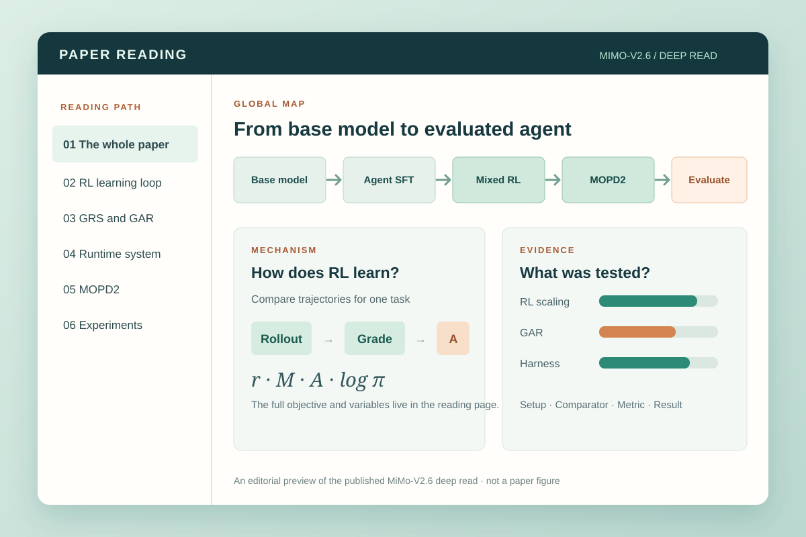

<p align="center"></p>
<h1 align="center">Paper Reading Skill</h1>
<p align="center"><strong>读过，还能讲清楚。</strong> 用 Brief Reading 把握论文主线，用 Deep Reading 完整重建技术细节。两种模式都交付离线 HTML，串起问题、机制、公式、原图与实验证据，并保留可核查的来源。</p>
<p align="center"><a href="https://xiaofengshi.github.io/paper-reading-skill/zh.html">项目主页 ↗</a> · <a href="https://xiaofengshi.github.io/paper-reading-skill/lora-deep-read.html">Brief 导读样例 ↗</a> · <a href="https://xiaofengshi.github.io/paper-reading-skill/rollback-deep-read.html">Deep 深读样例 ↗</a> · <a href="#开始使用">开始使用</a> · <a href="README.md">English</a></p>



## 从一篇论文开始

**已经使用 Codex？** 在你的项目目录运行（需要 Node.js 20+）：

```bash
npx --yes skills add xiaofengShi/paper-reading-skill --skill paper-reading --agent codex --copy --yes
(cd .agents/skills/paper-reading && npm ci && npm run doctor)
```

打开新的 Agent 会话，复制这段话：

```text
用 $paper-reading 的 Brief Reading 模式帮我读懂 https://arxiv.org/abs/2106.09685v2，用中文。
我了解基础神经网络，但没用过 LoRA。解释它为什么省可训练参数，
做一个小算例，并分清论文实测结果与解读。先获取完整论文并核对版本，
把离线 HTML 和 Markdown 保存到 paper-readings/lora/。
```

Agent 完成阅读后，预期得到 `paper-readings/lora/reading.html` 及 Markdown 审计源。Agent 负责阅读和撰写解释，渲染器把 Markdown 生成 HTML。Skill 本身免费，不需要额外 API Key，使用你原有 Agent 的模型权限与计费。[其他 Agent、安装方式与故障排查](#开始使用)。

### 选择 Brief 或 Deep Reading

| 模式 | 交付内容 | 怎么提出请求 | 样例 |
|---|---|---|---|
| **Brief Reading 导读**（默认） | 聚焦问题、主路径、关键机制与公式、决定性证据及限制 | “读这篇论文”或“用 Brief Reading” | [LoRA · 中文](https://xiaofengshi.github.io/paper-reading-skill/lora-deep-read.html) |
| **Deep Reading 深读** | 逐步重建正文与重要附录的技术内容，展开关键推导与算例，逐组解读主实验和消融 | “用 Deep Reading”或“深入阅读这篇论文” | [Rollback · 中文](https://xiaofengshi.github.io/paper-reading-skill/rollback-deep-read.html) |

两种模式都交付离线 HTML 和 Markdown 审计源，并在页面显示模式。Deep 的篇幅随论文复杂度增长，必须满足核心内容覆盖与可重建的解释要求；字数本身不能证明深度。详见[模式对照](references/reading-modes.md)与[Deep Reading 协议](references/deep-reading.md)。

要生成 Rollback 样例所展示的深度，可复制：

```text
用 $paper-reading 的 Deep Reading 模式阅读 https://arxiv.org/abs/2610.36068v1，用中文。
重建搜索、相对价值标签、策略损失和世界模型更新，展开公式与具体算例，
逐组解读主实验、消融与重要附录。
把离线 HTML 和 Markdown 保存到 paper-readings/rollback/。
```

## 阅读完整样例

画廊同时提供 **Brief Reading 导读**与 **Deep Reading 深读**，每篇标明模式和语言。Brief 可从 LoRA 或 ResNet 开始；Deep 可读 Rollback：16 个连贯章节展开搜索、公式、训练系统、实验及附录 A–G。每篇将原图和证据放在解释旁，并提供论文特定的理解题。原有 `-deep-read` 链接保持不变，深度以页面显示的模式为准。

<!-- readings-index:start -->
- **Attention Is All You Need** · English · Brief Reading — 沿编码器与解码器追踪 token，算清注意力公式，再读翻译实验、消融和句法分析。 依据 [arXiv:1706.03762](https://arxiv.org/abs/1706.03762)。[打开阅读文档 →](https://xiaofengshi.github.io/paper-reading-skill/attention-is-all-you-need-deep-read.html)
- **MiMo-V2.6** · 中文 · Brief Reading — 从训练主线读到 RL 目标、GRS/GAR、运行系统、MOPD2 与实验。[打开阅读文档 →](https://xiaofengshi.github.io/paper-reading-skill/mimo-v2.6-deep-read.html)
- **LoRA** · 中文 · Brief Reading — 改变输入，跟算低秩修正，再核对合并权重的输出。从初始化梯度读到二维子空间例子，完整实验与协议按需展开。附四道自测，包含换预算的迁移题。 依据 [arXiv:2106.09685v2](https://arxiv.org/abs/2106.09685v2)。[打开阅读文档 →](https://xiaofengshi.github.io/paper-reading-skill/lora-deep-read.html)
- **HarnessPro** · 中文 · Deep Reading · ZCode — 帕累托感知的 Harness 递归自我改进深读：固定 LLM 生成测试替代判官偏好（失败检出 41.7%→83.3%）、三优先级并行规划、加权距离选出 lite/medium/heavy 三档，全面超 RHO 且成本降 26.1%。 依据 [arXiv:2610.26770v2](https://arxiv.org/abs/2610.26770v2)。[打开阅读文档 →](https://xiaofengshi.github.io/paper-reading-skill/harnesspro-deep-read.html)
- **LongZero** · 中文 · Deep Reading · ZCode — 零数据长上下文 RL 深读：策略先写紧凑的问题-证据-答案规格再展开成长文档，不稳定带过滤后 GRPO 训练，五基准胜过外部语料与 397B 教师合成数据。 依据 [arXiv:2610.30132v1](https://arxiv.org/abs/2610.30132v1)。[打开阅读文档 →](https://xiaofengshi.github.io/paper-reading-skill/longzero-deep-read.html)
- **Rollback** · 中文 · Deep Reading · Codex — 16 章 Deep Reading：逐步重建回退搜索、PUCT、相对价值分档、flow matching、模型适配与异步训练，再逐组核对真机实验、消融及附录 A–G。 依据 [arXiv:2610.36068v1](https://arxiv.org/abs/2610.36068v1)。[打开阅读文档 →](https://xiaofengshi.github.io/paper-reading-skill/rollback-deep-read.html)

目前已发布 **18** 篇阅读文档——[浏览完整画廊 →](https://xiaofengshi.github.io/paper-reading-skill/zh.html#readings)
<!-- readings-index:end -->

重构记录涵盖的 LoRA、ResNet 等本轮 11 篇样例已于 2026-10-27 按更新后的 Skill 重构。[重构与验证记录](docs/examples-rebuild-20261027.html)列出来源版本、教学算例、修正的主张和验证边界。

## 你会得到什么

1. **全局认知图** 研究问题、场景、主要想法、贡献及证据进入的位置。
2. **方法或论证路径** 输入、阶段、分支、反馈和输出，并解释重要箭头的含义。
3. **机制放大** 必要的定义、公式、假设，以及有帮助时的具体算例。
4. **实验图谱** 每个问题对应的设置、对照、指标、观察结果与可支持的解读。
5. **综合理解** 把方法与证据重新连起来，并把限制放在相应结论旁边。
6. **理解自测** 针对这篇论文的机制、小算例或证据边界提出问题，想核对时再展开答案。它们是学习辅助，不代表测得的理解分数。

图负责引导阅读；正文、公式、表格和原论文图承载细节。原文位置默认不显示，但需要核对时可以展开。最终交付是一份离线可读的 HTML，另附作为审计源的 Markdown。

## 论文阅读方法

这套流程把已有的论文阅读和知识组织方法，与针对单篇论文的编辑设计结合起来。三个检查分别回答不同问题：

1. **能否先重建论文，再向读者解释** [Keshav 的三遍阅读法](https://systems.cs.columbia.edu/ds2-class/papers/keshav-paper.pdf)从全局认识，逐步走到内容理解和细节重建。本 skill 先画暂定全局图，再追踪方法与结果，最后推演决定性的公式、假设、证明或实验。Brief 在核对原文后选择关键内容展开；Deep 对所有实质性部分及相关附录完成技术重建。
2. **图里的关系是否有明确含义** [Novak 与 Cañas 的概念图方法](https://cmap.ihmc.us/docs/theory-of-concept-maps)从焦点问题出发，用带说明的连线和跨区关联组织概念。本项目的每张图都回答一个与论文有关的问题，例如“机制如何影响结果”；箭头须说明是数据流、过程顺序还是证据关系，正文解释这些连接。
3. **解读能否回到论文核查** [SciDoc2Diagrammer-MAF](https://aclanthology.org/2024.findings-emnlp.780/)指出生成的科学图示可能遗漏信息或偏离原文。本项目据此要求核对关键图、公式、数字和箭头，并把每项实验的设置、对照、指标与结果放在一起。本项目并未实现该论文的图示生成算法。

这三项原则形成五层解释顺序：全局图、主路径、机制、实验图谱和综合理解，并在有帮助时补充[理解自测](references/learning-checks.md)。衡量深读是否有用，要看读者能否说清核心机制、指出重要结论由哪些证据支撑，而不必为补全关键解释反复查 PDF。这是本项目的方法设计；现有样例尚未经独立读者研究验证。

[公开的阅读质量检查](evals/reading-quality.md)为两种模式提供共同的来源、科学事实、证据与交付门槛。Brief 的各适用深度维度至少达到 2（解释清楚）；Deep 必须全部达到 3（能够重建和应用），并保留来源到解释的覆盖记录。[各样例的读者题目与答案](evals/reader-tasks.md)可供未参与编写的人测试理解效果。渲染器测试通过或作者自查，都不等于完成了独立读者研究。

## 开始使用

上方的[首次使用步骤](#从一篇论文开始)通过 [skills CLI](https://github.com/vercel-labs/skills) 安装项目内的 Codex 副本。内置渲染器需要 Node.js 20 或更新版本；Agent 还需要能获取并阅读完整论文的工具。

### 个人安装与其他 Agent

选择一个尚未占用的个人 skill 目录：

| Agent | 个人目录 | 显式调用 |
|---|---|---|
| Codex | `~/.agents/skills/paper-reading` | `$paper-reading` |
| Kimi Code | `~/.agents/skills/paper-reading` | `/skill:paper-reading` |
| Claude Code | `~/.claude/skills/paper-reading` | `/paper-reading` |

Codex 或 Kimi Code 使用以下命令；Claude Code 将第一行改为 `paper_reading_dir="$HOME/.claude/skills/paper-reading"`。

```bash
paper_reading_dir="$HOME/.agents/skills/paper-reading"
mkdir -p "$(dirname "$paper_reading_dir")"
git clone https://github.com/xiaofengShi/paper-reading-skill.git "$paper_reading_dir"
(cd "$paper_reading_dir" && npm ci && npm run doctor)
```

`doctor` 在临时目录渲染一份明确标为合成材料的小样例，检查语种、导航、内嵌数学字体、SVG 和图表。它不下载或阅读论文，通过检查也不代表科学内容已经核实。

打开新的 Agent 会话，附上 PDF 或可访问的论文链接，然后说：**“用中文 Brief Reading 模式读这篇论文。”** 需要完整技术重建时说：**“用中文 Deep Reading 模式深入阅读这篇论文，逐步讲解机制、关键推导、主要实验与消融，并覆盖重要附录。”** 也可以指定其他语种。没有任何语种线索时使用英文；中文请求会生成中文输出。内置渲染器提供中英文导航。

如果安装目录是 Git clone，先检查本地修改，再运行 `git -C "$paper_reading_dir" pull --ff-only`，随后在该目录重新运行 `npm ci` 和 `npm run doctor`。CLI 安装的副本和轻量包可能没有 Git 历史，替换前先保留本地修改。

### 创建阅读目录

可选的初始化命令只负责准备工作目录。按首屏步骤安装后，在项目目录运行：

```bash
node .agents/skills/paper-reading/scripts/init-reading.cjs \
  --out paper-readings/my-paper --title "我的论文" \
  --paper "https://arxiv.org/abs/2106.09685v2" --lang zh-CN --mode brief
```

它创建 `reading.md`、`brief.md` 和 `assets/` 目录。使用 `--mode deep` 准备深读任务；两种模式中的 `brief.md` 都是给 Agent 的任务说明。Markdown 会明确标为**未完成草稿**；命令不获取论文、不撰写解读，也不生成 HTML。Agent 需要完成草稿并核对来源后再渲染。已有目标目录会被拒绝，避免覆盖文件。英文草稿使用 `--lang en`；在安装目录运行 `npm run init:reading -- --help` 查看全部参数。

### 本地构建轻量包

需要当前两种模式的轻量包时，从仓库最新 checkout 构建。[v0.2.0 release 归档](https://github.com/xiaofengShi/paper-reading-skill/releases/tag/v0.2.0)采用区分 Brief/Deep 之前的阅读规则。当前运行包的构建命令：

```bash
npm ci
npm run pack:skill
```

输出为 `dist/paper-reading/`，内含 SHA-256 `manifest.json`；系统有 `tar` 命令时，还会生成 `dist/paper-reading.tar.gz`。将整个运行目录复制到上表中尚未占用的 skill 位置，再进入该副本运行 `npm ci` 和 `npm run doctor`。包中保留渲染器、辅助模块、参考文件与合成检查样例，不含 `docs/`、`examples/`、依赖和测试。已有打包输出会被拒绝；再次构建可用 `npm run pack:skill -- --out <新的输出父目录>`。

### 故障排查

| 现象 | 检查方法 |
|---|---|
| 缺少 `marked` 或 `katex` | 在安装后的 skill 目录运行 `npm ci`，确认 `package-lock.json` 存在。 |
| 缺少 helper 或 fixture 文件 | 安装完整 checkout 或生成的运行目录，仅复制 `SKILL.md` 不够。 |
| 旧安装报 `ERR_REQUIRE_ESM` | 更新 skill 并重新安装依赖；当前渲染器支持 Node.js 20.18 及更新版本。 |
| Agent 找不到 skill | 核对安装目录，打开新会话，并尝试上表的显式调用。 |
| 初始化提示目标目录已存在 | 选择新目录；初始化命令会保留已有文件。 |
| 只有摘要或无法读取 PDF | 补充全文，或将结果明确保留为未完成；摘要不能代替完整深读。 |

Agent 完成科学阅读与 Markdown 撰写，渲染器再把 Markdown 生成 HTML。普通读论文默认 Brief，明确要求深读时使用 Deep。快筛对应按请求缩短范围的 Brief；审稿和研究比较作为所选模式上的额外视角。

## 工作方式

[Skill 指令](SKILL.md)引导 agent 依次建立全局认知、重建全文、编写解释并核对来源。[论文类型协议](references/paper-types.md)为实证、系统、基准、数据集、理论和综述论文选择合适图形；[可视化阅读规则](references/visual-reading.md)要求图示与解释、证据对应。[阅读模式](references/reading-modes.md)定义 Brief 与 Deep；[Deep Reading 协议](references/deep-reading.md)进一步规定覆盖、技术重建、推导和逐组实验解读要求。审稿与研究比较是可选视角。

仓库附带的[渲染器](scripts/render-reading.cjs)把 Markdown 审计源与本地图形生成单文件 HTML，内嵌图片、图示、KaTeX 数学排版和字体。每份源文档都必须在首行写明 `<!-- paper-reading-lang: en -->` 或 `<!-- paper-reading-lang: zh-CN -->`，导航和图表标签也据此选择语种。可在第二行选择四种内置视觉主题之一：`<!-- paper-reading-theme: forest -->`、`cobalt`、`plum`、`saffron`；省略时使用 `forest`。在同一文件头声明 `<!-- paper-reading-mode: brief -->` 或 `<!-- paper-reading-mode: deep -->`，HTML 标题和首屏会显示对应模式；旧源文档省略模式时按 Brief 渲染。作者按论文内容选择主题，渲染器不猜测主题。

Skill 会逐篇判断探索分支、状态变化或反馈环是否能增加理解；若不能，使用静态图。交互图可用 Archify 或自包含的 HTML/SVG 制作，关键解释仍须在无脚本时可读。构建不依赖 Archify 或其他本地 skill。[渲染器输入格式](references/renderer-format.md)给出 Markdown 契约，[从 PDF 抽取插图](references/figure-extraction.md)说明原图处理方法，[理解自测](references/learning-checks.md)说明如何用原生答案展开区辅助理解。

每篇已发布阅读文档的 Markdown 审计源与图形输入都在 `examples/` 下，索引见 [readings.json](readings.json)；它们是构建材料，不要求读者分别打开。

本地重建所有已发布样例：

```bash
npm ci
npm run doctor
npm run build:examples
npm run check:examples
npm test
```

## 验证与适用范围

不同检查支持的结论不同：

| 检查 | 能说明什么 | 边界 |
|---|---|---|
| 自动化结构与渲染检查 | 输入契约、语言和主题声明、公式、所声明资源的内嵌、图表行为，以及生成文件是否同步。 | 渲染通过不能证明科学内容正确或读者已经理解；doctor 使用合成材料。 |
| AI 辅助来源核查 | 将公式、原图、数字与主张追溯到明确的论文版本，并记录冲突和覆盖缺口。 | 必须交代实际检查范围和不确定处；它不等于实验复现或独立真人评审。 |
| 独立读者评估 | [读者题目](evals/reader-tasks.md)为后续评估提供问题和答案依据。 | 当前尚未报告独立读者研究；展开答案或 AI 作答不能证明真人学习效果。 |

样例覆盖经典架构、参数高效适配、技术报告、领域微调、工程基准、文档知识内化和智能体外骨架。理论与综述仍不在当前样例范围内。LoRA 的小矩阵和参数预算部分标为教学算例，与论文实测分开。项目尚未证明这一呈现方式比其他阅读方法更能提高理解。

[Archify](https://github.com/tt-a1i/archify)是可选的交互结构图呈现工具。科学内容仍须对照论文核查。

欢迎在 [GitHub Issues](https://github.com/xiaofengShi/paper-reading-skill/issues)提交问题、缺陷或其他论文类型的样例。项目使用 [MIT 许可证](LICENSE)。

## 维护说明

本文是[中文主页](https://xiaofengshi.github.io/paper-reading-skill/zh.html)的内容源；[README.md](README.md)是默认[英文主页](https://xiaofengshi.github.io/paper-reading-skill/)的内容源。修改任一语言后运行 `npm run build:docs`，将生成的 HTML 与 Markdown 一同提交。主页生成器见 [scripts/build-docs.cjs](scripts/build-docs.cjs)。
