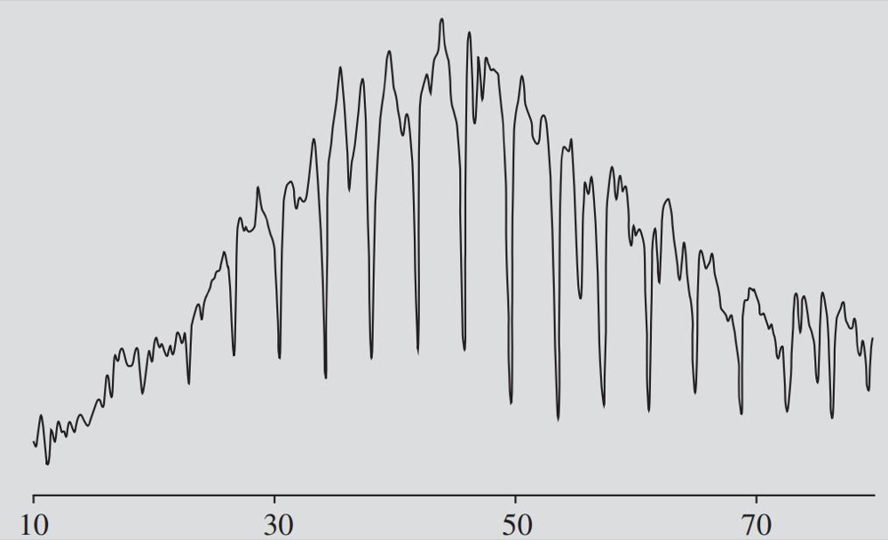
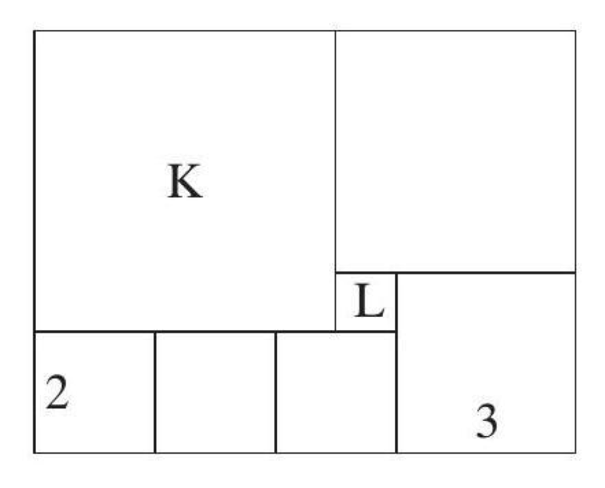
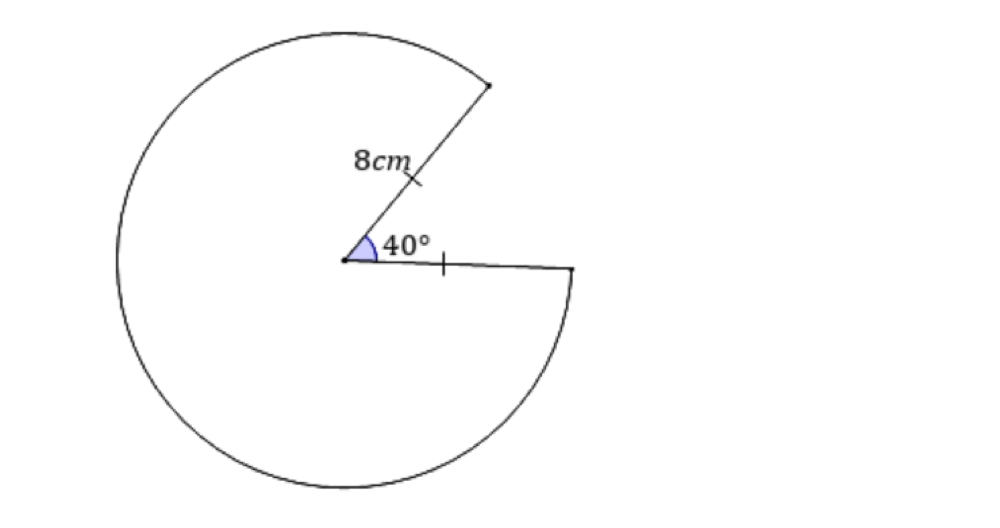

<!-- paper-reading-lang: zh-CN -->
<!-- paper-reading-mode: deep -->
<!-- paper-reading-theme: forest -->

# A-RSI 深读：递归自我改进里被忽略的那一半问题——何时换题

深读对象：A-RSI: Adaptive Task Refresh for Zero-Data Multimodal Self-Improvement（arXiv 2610.38568v1，PDF 50 页，IIE/CUHK/Würzburg/CMU/MPI/Trento/XJTU 等机构合作）。本周读过的零数据自改进系（Absolute Zero、R-Zero、MM-Zero、LongZero）回答的都是"**下一步生成什么经验**"——更难的题、贴近能力的题、可验证的题。这篇论文把镜头转向另一半问题："**现在这套经验什么时候失效、该整批换掉**"。它的两个核心分离设计直接针对现有方法的两个痛点：其一，刷新时机来自**训练日志**（组内优势信号计数与训练侧准确率），全程不看验证/测试分数；其二，新任务的答案由**程序计算**（题目程序从同一底层配置渲染图像并计算参考答案），不依赖模型多数投票或自一致性——模型自己的不确定预测不会变成自己的训练标签。结果层：Qwen3-VL-8B 在 11 个基准上从 57.77 涨到 61.05（800 个新任务）；对照"每窗口必刷新"要用 4 倍数据（3,200）还低 0.40 分。本文按细章深读规范重构：公式逐步推导、决策规则逐步验算、五臂对照逐格解读、附录审计（奖励压力测试、对抗检查器、输出分解）全量整合。

<!-- Deep Reading coverage
| Source section / object | Role | Explanation location / status |
| --- | --- | --- |
| §1 何时刷新与答案可靠性两个分离 | 立论 | §01–02 |
| Table 1 方法定位（任务源/监督/更新时机/选择规则） | 谱系 | §02 |
| §3.1 Eq.(1)(7) 程序化任务构造与共享配置契约 | 核心机制一 | §03（含图表示例手算） |
| §3.2 Eq.(2) 三项奖励与 GRPO | 核心机制二 | §04（含排序不等式 Eq.6） |
| §3.3 Eq.(3)(4) 饱和检测 | 核心机制三 | §05（含三次决策验算） |
| §3.4 Eq.(5) 整池替换+Algorithm 1 | 核心机制四 | §06（含配额手算） |
| §4 五臂/记号/评测协议 | 实验前提 | §07 |
| §5.1-5.3 Table 2-4 + Fig.4 | 主结果 | §08（逐格重算） |
| §6.1-6.3 刷新与选择消融 | 归因 | §09（含"随机为何赢"） |
| §7.1 奖励压力测试 Eq.(6)+对抗检查器 | 审计 | §10 |
| §7.2 长预算保留+答案独立校验 Fig.5 | 审计 | §10 |
| §8 案例 A1/A2/B1 | 质性证据 | §11（三图） |
| §9-10 讨论结论 | 边界 | §12 |
| 附录 27.3/27.4 全参数/难度梯 | 复现条件 | §04-05 全文整合（λ、ρ、η、配额、梯次通过率） |
| 附录 11-26（补充对比/审计） | 支撑 | §10 概览（secondary：逐表不展开，关键数字已引） |
| Fig.1-5 原图 | 示意 | HTML 版为矢量图无位图；案例三图可用，status partial |
-->

## 01 / 两个被混在一起的问题

递归自我改进（RSI）系统持续从自己构造的经验里学习。现有工作把注意力放在"生成什么"上：Absolute Zero 用代码执行器出题验题、R-Zero 让 Challenger 与 Solver 围绕当前能力共同进化、MM-Zero 用多角色投票构造多模态训练数据、LongZero 先写紧凑规格再展开长文档。但一个系统可以**在学不动了的题池上继续烧更新步**——LongZero 的"不稳定带"过滤在出题时剔除全对/全错题，正是对这个问题的静态处理；而 A-RSI 问的是动态版本：训练进行中，**何时判定当前池子已经供不出学习信号、该整批换新**。反过来，刷新太频也有代价：新任务消耗生成与验证预算，而且（本文实测）盲目每窗刷新反而不如省着用。

换个说法：前者是"数据供给的调度问题"（scheduling），后者是"现有工作的数据更新都在固定时刻（每步/每批/每窗）或由生成器自身状态驱动，没有人让**学习信号的实测存量**来当闹钟。A-RSI 的贡献就是把这个闹钟做出来并检验它值多少钱。

第二个问题更隐蔽：**自生成任务的答案从哪来**。多数投票、自一致性、模型判分——这些做法让"模型自己的不确定预测"变成"自己下一步更新的标签"，错误会自我强化。A-RSI 的解法是把答案交还给程序：出题程序从一份采样的底层配置**同时**渲染图像、生成问题、计算参考答案，三者共享同一份真值，答案正确性只取决于模板实现是否正确——这是一个可独立审计的对象，而不是模型的意见。两个分离的对应产出也干净利落：时机分离给了 Eq. 4 那条只读训练日志的判决规则（§05）；答案分离给了 Eq. 7 的共享配置契约与 1,000 题独立校验（§03/§10）。整篇论文的结构就是沿着这两条分离各走一程，再在五臂对照里让它们各自的价格显现。

## 02 / 谱系定位：它填的是哪个空格

Table 1 用四个维度摆清了位置——任务源、监督来源、数据何时更新、选择规则。Absolute Zero/R-Zero/MM-Zero 在训练中**持续**更新数据，用可学习性/难度奖励挑题；ThinkLite-VL、在线难度过滤、SEC/DUMP 从既有任务或分布中**每批次/每步**挑。A-RSI 独特在第三列：**日志触发**（log-triggered）——整个池子只在训练日志显示饱和时才换，其余时间动都不动；选择规则是最朴素的**固定家族配额随机抽取**。这个"最朴素"是有意的：论文用实验证明（§09），在自己测试过的难度感知、能力感知选择规则下，随机替换并不落下风——先把"何时换"做对，比"换什么"的花样更值钱。与 DAPO 的动态采样也有一层概念对位：DAPO 在**批次内**丢弃全同奖励的提示（它们无梯度），A-RSI 把同款信号**跨窗口聚合**成 $U_w$，回答的是池级问题——这两层互补而非替代（§2 原文明确这个区分）。与 LongZero 的"不稳定带"也有概念接力：LongZero 在**出题时**静态过滤全对/全错题（保持入池信号密度），A-RSI 在**训练中**动态检测池内信号枯竭（维护存量）——一个管入口水质、一个管池子何时该换水，恰好覆盖同一问题的两个时间尺度。

## 03 / 机制一：程序化任务与共享配置契约

### 从种子到模板到任务

训练开始前（一次性），基座模型从几何、图表、表格、计数四类种子任务出发，生成可复用的题库模板库 𝒯：每个模板 τ 声明可采参数及其取值域、问题目标、采样/绘图/组题/算答案四段程序。训练中模板**冻结**，任务实例化只是执行：

$$z\sim p_{\tau},\qquad (I,\,q,\,a)=G_{\tau}(z)$$

论文的图表例子：某模板采到类别值 $v_A=18$、$v_B=11$，画出柱状图，问"A 比 B 大多少"，程序从**存储的值**计算 $a=v_A-v_B=7$。学习者只看到 $(I,q)$，看不到潜在值与答案。附录 27.1 拆出七个生成器（Table 30）：几何参数决定点、关系与给定量；图表/表格参数决定类别、标签、序列与数值；计数参数决定物体与被询属性。多选题还有个易被忽略的细节——**程序同时构造干扰项并给正确选项分配答案标签**，连选项排列都是配置的一部分。替换任务零模型成本：问题与参考答案在模板执行时已算好。模板的多样性由三层保证：种子覆盖四家族（几何/图表/表格/计数）、每家族多种结构（几何有多跳与平面梯、图表单/多系列）、参数空间连续（类别值、尺寸、比例均采样）——同一模板不同参数即不同任务，400 个替换任务是"结构 × 参数"组合空间的抽样而非 400 道手工题。

准入三层过滤（§7.2 条件规范）：生成器专属构造检查 $V_\tau(I,q,a,z)$ 验采样配置、答案计算与渲染/歧义约束；新鲜度检查 $F(x)$ 与污染筛 $C(x)$ 拒掉被标记者；诊断保留集 $H$ 从训练排除。形式化地：

$$x\ \text{入库}\ \Longleftrightarrow\ V_\tau(I,q,a,z)\wedge F(x)\wedge C(x)\wedge x\notin H$$

保留记录把图像、问题、答案与生成器身份、种子绑定——任何训练数据可复现回配置，这是 §10 独立审计能"重算答案再比对"的前提。

### 共享配置契约（Eq. 7）

论文在 §7.2 把这个设计形式化为生成契约：设 $s_\tau(z)$ 为底层配置、$E_\tau$ 答案执行器、$R_\tau$ 渲染器、$Q_\tau$ 问题构造器，则

$$I=R_\tau\big(s_\tau(z)\big),\quad q=Q_\tau\big(s_\tau(z)\big),\quad a=E_\tau\big(s_\tau(z)\big)$$

图像、问题、答案**出自同一份配置**——不是"先生成图文再让模型配答案"，而是三视图共源。这使答案正确性成为模板实现的属性，可以用独立求解器审计：论文对实际消耗的替换池按五个生成器组各随机抽 200 题（共 1,000 题），独立求解器与参考答案**全部一致**，训练 gold 与源记录一致、图像哈希与记录一致（§7.2）。抽样协议的细节值得记录：按五个生成器组**分层**各抽 200（不整池随机，防家族失衡掩盖个别生成器的系统性错误）；成员资格在重算前锁定（防挑选）；除答案外还核对训练 gold/solution 与源记录、图像哈希与记录——"答案对、标注对、图没换"三重验证。契约是条件式的：它支持"程序计算的监督"，但不声称每个渲染题目都已被形式化证明正确。

### 手算：一张图的完整生成链（教学算例）

设几何模板采样配置 $s=(\text{三角形},\,\text{底}=8\,\text{cm},\,\text{高}=5\,\text{cm})$。渲染器 $R$ 画出带标注的三角形图 $I$；问题构造器 $Q$ 生成"求图中三角形面积"；答案执行器 $E$ 计算 $a=\tfrac12\times8\times5=20\ \text{cm}^2$。若模型答"20"，$r_{\text{ans}}=1$；若答"40 cm²"（把高当底），提取后与 $a$ 不匹配，$r_{\text{ans}}=0$。关键在**反事实**：同一份 $s$ 若被问"周长"，程序没有足够信息（缺两边长）——准入检查会拒绝这类配置（模板必须声明参数与问题目标的匹配条件），而不是渲染出一张不可解的图。再走一遍多选题的完整链（教学构造）：配置 $s$=（四个城市人口：1200/850/630/410 万），渲染器画横向条形图并标注数值；问题构造器生成"人口第二多的城市是？"并**由程序构造三个干扰项**（第一/三/四名城市）分配到 A/B/C/D——正确答案标签由程序从配置直接确定（如 B）；答案执行器返回 "B"。学习者看到图与四选一问题；模型若答 "B" 得 $r_{\text{ans}}=1$，答 "A"（把第一名当第二名）得 0。注意：**干扰项也是配置的函数**——它错得"有理由"（对应真实的混淆方向），而不是随机凑数；这是模板设计质量的一部分，也是 §10 答案审计能 1000/1000 通过的结构性原因之一。

## 04 / 机制二：三项奖励与"辅助项不翻案"

每题采样 $m=8$ 个回复，每个回复 $y$ 的奖励（Eq. 2）：

$$r(y,a)=r_{\text{ans}}(y,a)+\lambda_{\text{fmt}}\,r_{\text{fmt}}(y)+\lambda_{\text{stop}}\,r_{\text{stop}}(y)$$

$r_{\text{ans}}$：提取答案与 $a$ 匹配为 1 否则 0；$r_{\text{fmt}}$：符合 boxed 答案格式为 1 否则 0；$r_{\text{stop}}$：正常收尾且带最终 boxed 答案为 0，否则 **−1——即使文本前面已经出现过 boxed 表达式，撞到 token 上限照样罚**（附录 27.3 明确）。系数 $\lambda_{\text{fmt}}=0.1$、$\lambda_{\text{stop}}=0.3$，全程固定；无逐 token 长度惩罚、无跳数奖励。训练用 GRPO：$m=8$ 个回复组内归一化优势（裁剪 0.2、**无 KL 惩罚**），恒定学习率 $10^{-6}$，响应上限 4,096 token，温度 1.0/top-p 1.0。组归一优势：

$$\hat{A}_{g,j}=\frac{r_{g,j}-\operatorname{mean}(\mathbf{r}_g)}{\operatorname{std}(\mathbf{r}_g)}$$

组内奖励全同则 $\operatorname{std}=0$、全组优势为零——$U_w$ 度量的物理意义即在此。工程衔接细节：**动态重采样**的方差检查只用正确性+截断两项、排除格式项，最多重采 6 轮；最终优化奖励与记录优势含全部三项（附录 27.3）——"找有信号的提示"用粗筛、"学习与检测"用全项，两个口径刻意分开。每窗 50 批次 ×8 提示组 ×8 响应 = 3,200 条响应，检测器逐批计数。

### 排序不等式（Eq. 6）与一次验算

辅助项会不会让"格式漂亮但答错"压过"格式糟糕但答对"？论文给出闭式保证：设 $r_c$ 答案正确、$r_w$ 答案错误，辅助奖励落在 $[-\lambda_{\text{stop}},\lambda_{\text{fmt}}]$，则

$$R(r_c)-R(r_w)\ \geq\ 1-\lambda_{\text{fmt}}-\lambda_{\text{stop}}\ >\ 0$$

代入数值验算：$1-0.1-0.3=0.6>0$——**答对者比答错者至少高 0.6 分**，最坏情形（对者无格式且被截断、错者有格式且正常收尾）差值仍为 $1-0.1-0.3=0.6$（**教学重算**：$R_c^{\min}=1+0-0.3=0.7$，$R_w^{\max}=0+0.1+0=0.1$，差 $0.6$）。但注意不等式的单向性：它保证正确性排序不被翻案，**不阻止全错组内部的奖励爬升**——把错误答案写得更规范、更早收尾也能涨奖励，这正是 §10 输出分解要区分"完成"与"改正"的原因。

### 为什么 r_stop 连"有 boxed 的截断"也罚

训练时的截断响应常常已经写了答案但刹不住车继续绕圈——奖励它等于奖励"写到一半就停"。−1 的截断罚把"收尾纪律"变成显式学习目标，而附录 §20 显示这套奖励让截断率显著下降。代价是它可能与基准评测的截断计分交互（§10 的长预算审计专门检验这一点）。再算一笔结构性账（教学重算）：正常完成且带格式的正确回答总分 $1+0.1+0=1.1$；截断的错答总分 $0+0-0.3=-0.3$——两项相差 1.4 分；而"格式完美的错答"（$0+0.1+0=0.1$）与"无格式但正确的截断"（$1+0-0.3=0.7$）仍差 0.6，这就是 Eq. 6 的下界实体。组内归一化后，这些差值变成相对优势的排序——GRPO 在组内学的是"哪个回复更好"，Eq. 6 保证"更好"至少在答案维度上不撒谎。

## 05 / 机制三：饱和检测——两个信号与一条规则

### 信号定义（Eq. 3）

组内奖励全同 ⇒ GRPO 优势全零 ⇒ 无梯度。所以"还有多少提示保有组内差异"就是学习信号存量的直接度量。设 $\mathcal{G}_w$ 为窗口 $w$ 动态重采样后记录的响应组（每批次计一次，50 批次/窗、3,200 响应/窗）：

$$U_w=\Big|\big\{x_g:\ g\in\mathcal{G}_w,\ \max_{1\le j\le m}|A_{g,j}|>\varepsilon\big\}\Big|,\qquad a_w=\frac{1}{m|\mathcal{G}_w|}\sum_{g}\sum_{j}c_{g,j}$$

$U_w$ 数的是**保有非零优势的去重提示数**（$\varepsilon=10^{-9}$ 是数值容差），$a_w$ 是训练侧答案准确率（全部记录响应的平均 $r_{\text{ans}}$，非去重提示通过率——分子分母都是响应级）。两个信号一个看**差异存量**（$U_w$，还有多少可学）、一个看**掌握进度**（$a_w$，已学多少），互补覆盖"学不动"与"学太熟"两种换池理由。要特别留意 $U_w$ 的口径细节：它统计的是**动态重采样之后**实际记录的组（每批次计一次）——重采样把奖励全同的组换掉再采，所以 $U_w$ 反映的是"重采后仍无信号的提示存量"；若模型在池上全面饱和，重采 6 轮也变不出差异，$U_w$ 才会持续走低。这个设计让检测器对"表面饱和"有一定免疫力：偶发的全同组会被重采修复，只有系统性枯竭才触发 $U_w$ 下降。注意优势用 Eq. 2 的完整奖励计算——格式或截断差异也能贡献 $U_w$。

### 判决规则（Eq. 4）与三次验算

$$\delta_w=\begin{cases}1,& n_w\geq n_{\min}\ \text{且}\ \big(U_w\leq\rho\,U_{w-\ell}\ \text{或}\ a_w-a_{w-\ell}\geq\eta\big)\\ 0,&\text{否则}\end{cases}$$

参数（附录 27.3，训练前固定）：滞后 $\ell=2$、最小观察期 $n_{\min}=3$、信号保留阈值 $\rho=0.85$、准确率增幅阈值 $\eta=0.10$。两个信号各自的失效模式是理解这条规则的关键：**只看 $U_w$** 会把"全错型枯竭"（模型彻底不会、组内无差异）误判为"学完了"——这正是第二条件 $a_w$ 的用途：准确率涨过 10 点说明池子对模型而言**变容易了**（熟悉的信号），而 $U_w$ 下降配低准确率才是真正的"学不动"与"学不会"的分界。反过来 $n_{\min}>\ell$（3>2）保证比较双方来自同一个池——池中途换掉再比就是拿苹果比橘子。语义：在同一池上至少训 3 窗后，**信号量比 2 窗前掉 15% 以上**（学不动了）**或准确率涨 10 个点以上**（学得太熟了）就换池。三次实际执行的验算（**算术重构**）：

| 场景 | 计数变化 | 比值 | 判定 |
| --- | --- | --- | --- |
| Qwen 旧池 | 239 → 195 | $195/239=\mathbf{0.816}\leq0.85$ | 触发刷新 |
| Qwen 新池 1（A-RSI/Frontier） | — | $0.832\,/\,0.826$ | 触发刷新 |
| MiMo 第 3 池（末轮重放） | 152 → 150 | $150/152=\mathbf{0.9868}>0.85$ | **保留** |

此前 MiMo 前两池：初始池 245→153（保留 $153/245=62.45\%$，远低于 0.85，准确率涨幅同时超 10 点、两条件同时命中）、第一替换池 199→143（$71.86\%$）。第三行最有信息量：同一规则在 MiMo 的第三池上**选择继续用**——饱和不是时间表，是状态。对照同阶段 Qwen 第二替换池的保留率

$$\frac{152}{181}=0.8398\ \leq\ 0.85\ \Rightarrow\ \text{触发刷新}$$

：**同一条规则在同一阶段对两个模型给出相反决策**，这是"观察期让决策合格、训练状态决定动作"的直接证据（§6.3）。

### 窗口机制：什么在换、什么不换

Eq. 5 的替换语义要逐项列清，因为它常被误读成"重置"：**换的**只有活动池 $\mathcal{P}_w$——400 个未用任务按家族配额以预排好的伪随机序整批上；**不换的**有五样——模型权重 $\theta_w$（携全部经验）、模板库 $\mathcal{T}$（训练前冻结）、采样分布与配额 $\mathbf{k}$、检测器参数（$\ell,\rho,\eta,n_{\min}$ 训练前固定）、优化器（每窗本来就重置）。替换池在训练前就预排成不相交序列（Draw 提前执行），检测器只是决定**何时激活下一个**——这把"换池"从训练时决策降为训练前准备+训练时触发，实现干净且可复现。窗内计数 $n_w$ 换池后归零，最小观察期重新起算——新池至少要训 3 窗才可能再触发，防止抖动。

### 规则的边界

论文自己讲清楚了这个启发式的边界：全错响应与集中分布同样会消灭组内差异（信号低≠掌握）；动态重采样影响哪些提示被观察到（$U_w$ 是**记录到的**训练信号，不是池剩余可学习性的穷尽估计）；准确率条件从未单独触发过（实测中都是信号条件先到）。

## 06 / 机制四：整池替换与训练循环

$\delta_w=1$ 时整池换成 $B=400$ 个未用任务（Eq. 5），按家族配额 $\mathbf{k}=(194,131,54,21)$（几何/图表/表格/计数，**教学验算**：$194+131+54+21=400$ ✓）以固定伪随机序抽取；**模型权重不重置**，$\theta_w$ 携带全部先前经验。Algorithm 1 的工程细节有三处值得点出：**健康门**——附录 28 的门检查训练侧异常（如梯度步数不足、零信号比例越限），窗口失败从上一接受检查点重试一次（同池同种子、新优化器状态），再败则停。重试的语义是"怀疑这次是坏运气"而不是"怀疑池坏了"——同种子重放能区分偶发崩溃与系统性枯竭；**拒绝静默重用**则把"数据纪律"写进控制流——池耗尽时停止训练并返回最后接受的检查点，而不是悄悄把旧池再喂一遍让日志看起来连续。这两个工程决定共同定义了系统在资源边界上的行为：诚实停机优于虚假延续。**拒绝静默重用**——替换池耗尽时控制器宁可停也不悄悄复用旧池或改采样规则；**优化器每窗重置**——无论换不换池，每窗新开优化器与调度器，只继承权重。前置检查也做了：$S_t$ 之前的平台检验（同池再加 300 步，四个种子 $+0.45/-0.27/-0.38/-0.63$——涨跌互现，确认旧池确实榨不出稳定收益）。走一遍完整循环把角色对齐：模板库与替换池**训练前**备好（图 2a）；每窗内 GRPO 在活动池上做 100 步更新（图 2b）；窗末控制器读日志算 $U_w,a_w$、比 2 窗前、判 $\delta_w$（图 2c）；换池只换数据不动权重——"训练经验改变的是**数据替换的时机**，不改生成器与采样分布"，这句自我描述精确圈定了自适应性所在的层。健康门（附录 28）检查的是训练侧异常（梯度步数、零信号比例），与基准分数无关——检测器与门都活在训练日志的世界里，评测世界对它们封闭。

## 07 / 五臂对照与记号

主实验 Qwen3-VL-8B-Instruct：$S_0$ 公开模型 → 旧池 500 题训 100 步得 $S_t$（57.77）→ 最多 8 个延续窗（每窗 100 步）。11 个基准覆盖多模态数学与科学理解谱系（Table 2 给出规模）：MMSI（1,000 题）、MathVerse（3,940）、MathVision（3,040）、MMMU-Pro 4/10 选项（各 1,592）、VisNumBench（1,913）等。Macro11 等权平均——小基准与大基准同权，读均值时要知道这个口径。LLM 判分（LJ）用 Qwen2.5-14B-Instruct 比对提取答案与参考答案，作为准确率之外的稳健性读数（附录 26 判分协议与噪声分析）。记号 $S_{ij}$：第 $i$ 池第 $j$ 窗。五臂（对齐更新数比较）：**A-RSI**（检测触发+随机）、**Frontier**（检测触发+边界选难）、**Periodic**（每 2 窗+边界选难）、**Continuous**（每窗+自适应难度）、**No-Refresh**（永不换）。设计者的对照思路值得点破：A-RSI vs Frontier 隔离**选择规则**（同触发）；A-RSI vs Periodic/Continuous 隔离**触发时机**（随机选择下换不同节奏）；A-RSI vs No-Refresh 隔离**换不换**本身；五臂共用前 2-3 窗（A-RSI 与 Frontier 共到第 3 窗）压低运行成本也引入了非独立性（§12 边界会回到这点）。边界选难的"边界"定义在附录 27.4：每梯取留出集通过率 ≤70% 的最容易梯次为选中梯，配额 50%、相邻梯各 25%；Continuous 每窗重测，通过率 ≥80% 升一梯、≤20% 降一梯。11 个基准全测试集（MMSI/MathVerse/MathVision/MMMU-Pro 等），Macro11 等权平均，8,192 token 评测上限；另报 LLM 判分（LJ，Qwen2.5-14B-Instruct 判定）。MiMo-VL-7B-SFT 做第二基座。附录 27.4 的难度梯很有信息量：模型**自我预测**哪题会错的 AUC≈0.50（等于抛硬币！），程序特征预测 0.58–0.61，其他模型的实测准确率预测 0.72–0.82——难度感知选择器能拿到的信号其实很弱，这为 §09 的"随机不输"埋了伏笔。把三个 AUC 翻译成白话：模型说自己哪题会错——跟抛硬币一样；程序算出来的特征（题面复杂度、参数个数等）——比随机好一点但不多；拿**别的模型**在同一题上的实测对错当预测器——显著有效（0.72-0.82）。第三条最讽刺：难度信号存在于模型间差异里，但单个模型自己看不到它；而 A-RSI 的选择器恰恰只能用前两种（自评或程序特征）——等于让色盲挑颜色。$S_t$ 处一条多跳梯的逐档通过率（.94/.57/.32/.14/.07）显示梯次区分度本身是好的——梯造对了，但"该站哪一档"的判断信号太弱。

## 08 / 主结果：逐格重算

### 端点与数据效率

Qwen 主轨迹逐步展开（Table 2 的 Pool 列）：Pool 1（$S_{11},S_{12},S_{13}$）均值约 60.0 区间、Pool 2（$S_{21},S_{22},S_{23}$）59.84→60.40、Pool 3（$S_{31},S_{32},S_{33}$）到 61.05——**每换一次池，均值都抬一个台阶**（Pool 1→2→3 的池均值单调上升），且池内窗口间也有增益。值得注意的细节：A-RSI 的两次实际刷新都发生在第 3 窗末（与 $n_{\min}=3$ 的最小观察期重合），即"最早允许的时刻就触发了"——既说明 $\rho=0.85$ 在此设定下不苛刻，也埋下 §09 的批评口实（前两次刷新实质是"每 3 窗"的固定表）。真正展示检测器自主性的是 MiMo 第三池的重放保留决策与 Qwen/MiMo 同阶段反向决策——但那是**末轮离线重放**而非训练中执行，证据等级要区分。到 $S_{32}$ 累计 8 个延续窗 + 800 新任务（两次完整替换 2×400，第三池部分使用，见图 3 池条带）。MiMo：$S_0$ 59.08 → $S_{32}$ 60.71。逐基准看 Qwen 轨迹（Table 2，$S_0$→$S_{32}$，**算术摘录**）：MMSI 27.10→31.00（+3.90）、MathVerse 62.03→63.81（+1.78）、MathVision 45.92→52.53（+6.61）、MMMU-Pro(4) 58.42→63.00、VisNumBench 49.03→56.19（+7.16）、MMMU-Pro(10) 50.75→54.52——**视觉密集型基准（MathVision、VisNumBench）涨幅显著大于文本推理型（MathVerse）**，与任务家族（图表/几何/计数全走视觉通道）的邻近性一致；但也提示增益与训练家族的分布重合度不可忽略（§12 边界）。逐臂对账（Table 4，$S_{32}$ 列）：

| 臂 | 规则 | 新任务数 | $S_{21}$ | $S_{23}$ | $S_{32}$ |
| --- | --- | --- | --- | --- | --- |
| **A-RSI** | 日志触发+随机 | **800** | 59.84 | **60.40** | **61.05** |
| No-Refresh | 从不 | 0 | 58.48 | 58.35 | —（停机） |
| Continuous | 每窗+自适应难度 | 3,200 | 59.47 | 59.74 | 60.64 |
| Periodic | 每 2 窗+边界 | 1,200 | 59.22 | 59.91 | 59.89 |
| Frontier | 日志触发+边界 | 800 | 59.76 | 59.83 | 59.59 |

三笔账（$S_{32}$ 端点、分母对齐）：**同预算赢不换**——$S_{23}$ 处 60.40 vs 58.35，+2.05 分。**省着换赢频繁换**——61.05 vs 60.64，数据量差 4 倍；把"分数增益 ÷ 新任务数"定义为**每千任务效率**（教学归一口径）：

$$\text{效率}=\frac{\text{Macro11}(S_{32})-\text{Macro11}(S_t)}{\text{新任务数}/1000}$$

A-RSI $3.28/0.8=4.10$ 分/千任务；Continuous $2.87/3.2=0.90$；Periodic $2.12/1.2=1.77$；Frontier $1.82/0.8=2.28$——A-RSI 对 Continuous **4.6 倍效率**。第三笔：**同数据量比选择**——A-RSI vs Frontier 同 800 任务 61.05 vs 59.59，+1.46 分全部来自**随机替换优于边界选难**。选择消融（Table 5）在四窗每窗刷新的共享对照（60.29）下复现：失败优先、可学习带、永远选错与梯次控制器等全部更低。

### No-Refresh 的死法

不换池不是"分数停在 58.35"，而是**训练本身停摆**：$S_{31}$ 时记录 35 次零信号警告、100 步里只剩 94 步正常梯度，健康门两次失败后训练终止——没有 $S_{32}$ 可评。旧池信号枯竭不只是浪费，它会实质性破坏训练进程。把死因再拆细：零优势组比例升高后，GRPO 的有效梯度步数下降（100 步里 94 步正常、6 步因组内无方差而退化），35 次零信号警告说明检测器早已"看见"问题在恶化；健康门两次失败说明训练侧指标越过阈值——整个链条是"信号枯竭 → 有效更新减少 → 训练不健康 → 停机"，而非分数意义上的"学完了"。

### 分数涨在哪（输出分解的预告）

57.77→61.05 的 3.28 分里有多少是"真会了"vs"能收尾了"？§10 的长预算审计给了一个可验算的答案。

```paper-chart
{
  "type": "bars",
  "title": "五臂对照：S32 端点与新鲜任务消耗",
  "subtitle": "Qwen3-VL-8B，11 基准 Macro11，8192 token；No-Refresh 停机无 S32",
  "origin": "本文重绘 · 原论文 Table 4",
  "source": "PDF Table 4、Fig.4",
  "unit": "分",
  "domainMax": 63,
  "note": "括号内为到 S32 消耗的新任务数。A-RSI 用 800 任务拿到 61.05；每窗必刷的 Continuous 用 4 倍数据（3200）反而低 0.41 分。No-Refresh 在 S31 后因健康门失败停机。",
  "rows": [
    { "label": "No-Refresh（S23 后停机）", "value": 58.35 },
    { "label": "Frontier·日志触发+边界（800）", "value": 59.59 },
    { "label": "Periodic·每2窗+边界（1200）", "value": 59.89 },
    { "label": "Continuous·每窗+自适应（3200）", "value": 60.64 },
    { "label": "A-RSI·日志触发+随机（800）", "value": 61.05 }
  ]
}
```

## 09 / 消融：随机为何赢，时机证据的诚实边界

### 选择消融

Table 5 的替换选择族：失败优先采样、可学习带、永远选错、梯次控制器、永远递增、截断感知、全梯——**全部低于同块的每窗随机对照**。结合 §07 的 AUC 数据，解释链是：难度感知选择依赖"知道哪些题难/有价值"，而模型自评是随机的（AUC 0.50）、程序特征很弱（0.58-0.61），在这个信号质量下，选择器的"聪明"不如随机的**多样性**——固定家族配额保证了四类任务的覆盖不塌缩，而任何单向偏好都会挤掉这个覆盖。附录 20 专门拆"Why Random Wins"的机制：边界选难把配额集中在通过率 ≤70% 的梯次及其邻域，一旦模型在该梯次快速过拟合（训练准确率飙升），后续窗口都在低信号区打转；随机抽取在每个家族内部维持全梯覆盖，任何子集饱和都不会拖垮全局信号。

### 时机消融的诚实结论

这是全文最值得赞赏的一段自我限定。固定选择（Frontier）下，日志触发 59.59 vs 每 2 窗定期 59.89——**检测器比固定时间表低 0.30 分**；且 A-RSI 前两次实际刷新恰好都发生在第 3 窗，与"每 3 窗"的固定表重合。论文原文："这些结果支持本实现的新鲜池策略，**但不能确立检测器选的时机优于固定时间表**"。能够确立的是：同样的检测器+权重延续框架下，随机替换成立；检测器的**跨模型分化能力**（§05 的 MiMo/Qwen 反向决策）证明它读到了真实的训练状态——只是"读到状态"与"选对时机"之间的因果桥，本实验设计没有搭完。补一句实验设计的限制：五臂共用前段意味着比较不是独立复现；单次运行意味着 0.30 分的劣势可能在运行间噪声内（附录 26 的噪声分析给出基准级波动幅度）。要真正确立时机主张，需要同臂多种子重复 + 固定表与检测器在同一种子序列上对打——这恰是论文留给后续的明确题目。把全景数据再读一遍可以看清主张的精确形状：确立的命题是「日志触发框架下的随机换池 > 所有已测替代方案」（61.05 对 59.59-60.64）；未确立的是「日志触发 > 每三窗固定表」（观测上前两次重合、固定选择下检测器反而低 0.30）；已确立的反命题是「检测器读到了真实训练状态」（跨模型反向决策 + 末轮保留决策）。三条合起来：**框架赢了，时机的功劳待定**——这是一个可以拆开来引用的结论结构。

## 10 / 审计层：一个把"自家增益"当审计对象的框架

### 奖励压力测试（Table 6）

对 1,000 个实际消耗的任务各构造 7 个反事实变体（正确/错误 boxed、同答案不同收尾原因、无 boxed 等，共 7,000 个），用训练真实奖励函数打分：正确承诺排在错误承诺之上 **1,000/1,000**；固定正确性与收尾、规范化格式提升奖励 **1,000/1,000**；固定正确性与格式、正常提交提升奖励 **1,000/1,000**。三项全满——奖励函数在受控变体上无翻案。

### 对抗检查器

18 变体 ×1,000 题（16,000 个规定检查）：生产检查器败 220 个——集中在 110 道选择题上接受"金标前缀+无关尾随"与"金标选项+垃圾文本"。隔离修正版检查器通过全部 16,000 项；回放到 5 个训练窗的 16,000 条真实日志响应，3,760 条选择题响应里**只改变 1 条**的得分。结论的措辞极谨慎：暴露解析器漏洞，"**不确立**被训练模型广泛利用"——且修正版尚未替换进报告的训练运行（诚实的"未修"声明）。这个漏洞值得细看：110 道选择题上，生产检查器接受"金标前缀+无关尾随"（如 "B. Paris is the capital" 后面跟着别的论述）与"金标选项+垃圾文本"——本质是**前缀匹配**而非**完整匹配**。为什么实际影响只有 1/3,760？因为训练响应极少在选项字母后接长尾文本——模型的输出分布天然避开了这个解析器死角。教训是双面的：解析器要修（隔离版全过），但"漏洞存在"≠"漏洞被利用"，两个命题都要单独证据。

### 长预算审计（Fig. 5）

分数涨了，是会做了还是只是能在预算内收尾了？把评测上限从 4,096 翻倍到 8,192，对比各检查点与基线在**同预算**下的增益：A-RSI 保留 **80%** 增益（4.08 → 3.25，**验算** $3.25/4.08=79.7\%$），MM-Zero v5 保留 59%（4.18 → 2.45，$2.45/4.18=58.6\%$）。A-RSI 的训练增益对输出预算的敏感性显著更低——更大的预算下它仍比基线高 3.25 分。做一个反事实解读（教学推理）：若 A-RSI 的增益全是收尾能力，则 8,192 限下基线也能收尾、增益应趋零；保留 80% 说明至少约八成增益与预算无关（答案改正），至多两成是收尾贡献——这与案例分解（A 组收尾例与 B 组改正例并存）的定性图景自洽。MM-Zero v5 的 59% 保留率则提示其增益有四成依赖预算内完成——两种训练配方在"学收尾"与"学改正"上的配比差异被这个单一对照曝光。输出分解（附录 15/18）把全量响应沿"截断→完成"与"完成内错→对"两条轴分解，另有一个**与结果无关的 1,000 题输出审计**（附录 18）：随机抽样不看病程结果、只审输出质量，避免选择偏差。加上 1,000 题独立答案校验全对（§03）与 §11 案例分解，这层审计回答了"增益是真的吗、有多少是收尾假象"的相当大部分——并诚实保留 20% 的预算敏感流失未归因。

## 11 / 案例：完成与改正是两件事

论文用四组对照把 3.28 分拆成两种可观察的变化（§8，附录 32 还有 10 例）。分组的判据是"前后响应的收尾状态×答案对错"的 2×2：截断→完成（A 组）、完成内错→对（B 组）、完成内对→对（未变，不展示）、截断→截断（失败，不展示）——展示的只是前两类，且每组配 token 数与解码种子复现声明。这种呈现方式把"分数涨了"这个总量分解成可肉眼检查的机制证据，比只报均值诚实得多。

### A1：答了但收不了尾 → 收尾（PhyX #1314）



*原论文 Fig.6 案例 A1，附录 8。基线反复绕圈撞 8,192 上限；训练后用 1,759 token 给出 boxed C 并正常结束。注意论文自己的注解：光谱仍被误读——这是完成而非经验证的推理改进。*

### A2：换布局换到撞墙 → 接受一个答案（MATH-Vision #703）



*原论文 Fig.6 案例 A2。基线反复重建不兼容布局撞上限；训练后仍在挣扎但最终提交 25（正确）。论文注解："推导仍不一致；这是完成的例子，不是经验证的推理改进。"*

A1 与 A2 的共同点值得提炼：两者都是"完成"而非"会了"——A1 光谱仍被误读、A2 推导仍不一致，但都从撞墙变成了在预算内提交答案。从奖励设计的视角这不是缺陷而是 $r_{\text{stop}}$ 的直接效应：截断罚教会模型"知道什么时候该止损提交"。真正的方法改正要看 B 组。

### B1：真正的方法改正（MathVerse #2042）



*原论文 Fig.7 案例 B1。基线把 40° 标注当成所求扇形角，答 21.59；训练后识别出"挖去 40° 扇形的圆"，改用 320° 弧计算得 60.68。两个响应都正常收尾——分数变化不能用避免截断解释，这是完成答案内的改正。*

$$P=2(8)+\frac{320}{360}\cdot 2\pi(8)\approx 60.68$$

（**教学验算**：$16+0.889\times50.27=16+44.68=60.68$ ✓。）

四例都在第二个解码种子上复现（附录 32 另给 10 例跨 8 基准的完成内改正）。这层分解的方法论价值值得单独指出：多数训练论文只报端点分数，把"收尾能力提升"与"答案改正"打包成一个数字——当截断罚在奖励里时（本文 $\lambda_{\text{stop}}=0.3$），这种打包尤其危险：奖励函数自己就在推模型学会收尾，若不分解，训练收益与奖励设计的副产品无法区分。A-RSI 的做法是让两者各自可见（Fig.5 的预算敏感度 + 案例分组），再把"哪部分是推理改进"的最终判断交给读者——附录 23 的标题就是这个态度："证据支持什么、不支持什么"。这层分解的价值：它把"分数涨了"翻译成"多少是收尾能力、多少是答案改正"，并且拒绝把前者冒充后者。

## 12 / 边界与接回论证

**与 RSI 可信框架的三点对位**：其一，固定测试对应"接受有效性"——本文的尺子是程序计算的答案而非模型判断，且 1,000 题独立校验全对；其二，健康门与拒绝静默重用对应"约束保持"——训练侧异常有硬闸，替换池耗尽宁可停机不造假；其三，输出分解对应"证据覆盖"——增益被拆成收尾与改正两条轴并做预算敏感性。唯一缺席的是后继级证据：论文没有展示连续多轮刷新后模型是否持续受益或出现累积偏差——8 个延续窗的轨迹里池均值单调上升，但更长的弧线（20 窗、50 窗）未测，"刷新可以无限继续"是外推而非实测。

**设计演化**（附录 21，Table 20）：当前冻结设计是第三版——v1 冻结模型快照出题+程序算答案+视觉-语言模型操作难度工具；v2 只留程序化任务但每窗刷新+梯次控制器；v3 梯次只用于诊断、日志检测器决定刷新。三版演化本身是"选择花样递减、时机决策浮现"的过程——与 §09 消融同构。**边界**：单一基座对单基座（Qwen 主证、MiMo 复现到 60.71，附录 22 给出 MiMo 的补充结果与质性修正例）；四类任务家族（几何/图表/表格/计数）撑起的任务分布较窄，11 基准上的收益（+3.28）在"数学-图表密集"区，与任务家族的邻近性有天然关联；时机主张未确立（§09 的诚实结论）；每臂单次运行、共享前段（五臂共用前 2-3 窗），非独立复现；对抗检查器的修正版未回到训练。

**接回论证**：本周的零数据系列里，LongZero 解决"题从哪来、答案怎么保证对"（规格先行、忠实门、不稳定带静态过滤），A-RSI 解决"**题什么时候作废**"（日志触发的整池替换）——两者在"不稳定带"概念上正好接力：LongZero 把它用在**出题时**（过滤全对全错），A-RSI 把它用在**训练中**（$U_w$ 计数跌破阈值即换池）。更广地看，RSI 可信框架要求"改进机制自身的修改"有独立证据——A-RSI 的控制器不改生成器、不改采样分布、参数训练前冻结，恰恰把自适应严格限制在"**用哪批现成数据**"这一层——用综述的语言说，它不碰 B（归纳偏置）也不碰 U（偏置更新函数），只在"经验调度"层做决策，天然回避了最深的递归风险；这既是最诚实的安全声明，也是能力上限：当任务分布本身需要演化（比如从几何扩展到推理证明）时，冻结的模板库无能为力；代价是它对"任务分布本身需要演化"的场景无能为力。一句话收束：它没有让自我改进更聪明，它让自我改进**知道什么时候该换口味**——并且用 4 倍数据效率的对照证明，这个知道很值钱。留给读者的两个动手点：一是把 $U_w$ 检测器接到自己的训练管线上（它是纯日志侧的，不动训练循环，改造成本极低）；二是把"模型自评 AUC≈0.50"这个发现当作一面镜子——任何依赖模型自评难度的数据选择管线，都值得先测一下自己的 AUC 再谈效果。

```paper-check
{"title":"六个能检验技术理解的问题","items":[{"question":"U_w 下降到 0.85 倍以下有哪几种非掌握性原因？各举一例。","hint":"§3.3 末段列了三种。","answer":"三法：全错响应消灭组内差异（模型彻底不会也产生全零优势）；响应分布集中（多样化崩溃但非掌握）；动态重采样改变可见提示集合（计数偏差而非真实枯竭）。所以 U_w 是记录到的训练信号度量，不是池剩余可学习性的穷尽估计。","source":"PDF §3.3"},{"question":"Eq.6 手算：若 λ_stop 从 0.3 改为 0.9（λ_fmt=0.1 不变），排序保证还成立吗？最坏差值是多少？","hint":"R_c 最小=1+0−λ_stop；R_w 最大=0+λ_fmt+0。","answer":"R_c^min=1−0.9=0.1，R_w^max=0.1，差为 0——保证失效（临界）。只要 λ_fmt+λ_stop<1 严格成立，差=1−λ_fmt−λ_stop>0。取 0.9+0.1=1 恰好踩线，全错组内格式奖励可以追平正确惩罚，最坏差 0。","source":"PDF Eq.6、附录 27.3；教学重算"},{"question":"A-RSI 与 Continuous 同为随机/自适应抽取，为什么 A-RSI 用 800 任务能赢 Continuous 的 3200？给出至少两条机制。","hint":"§9 与 §5.3 的训练准确率数据。","answer":"其一：A-RSI 每池用满 3 窗才换（信号确认枯竭），单位任务的学习信号被榨干；每窗必刷则每批任务只训一窗即弃。其二：新池训练准确率 0.35 vs 旧池末 0.57——确认换池时机保证了新池确实新鲜（高不确定、高信号）；盲目高频换入的任务未必比当前池更有信号。其三：连续小批换入打断学习动态（每窗重置优化器），整池替换保持窗口内稳定。","source":"PDF §5.3、§9、Table 4"},{"question":" Frontier 与 A-RSI 用同一检测器、同为 800 任务，为何差 1.46 分？这连同「模型自评 AUC=0.50」说明什么？","answer":"差异全在选择规则：随机固定配额 vs 边界选难。结合难度梯诊断（模型自评 AUC≈0.50=随机、程序特征 0.58-0.61 很弱），说明可用难度信号太弱，选择器的偏好（集中在中低通过率梯次）损失了覆盖多样性而不换来有效难度。固定家族配额的随机抽取是信号弱环境下的稳健策略。","source":"PDF Table 4、§6.2、附录 27.4"},{"question":" No-Refresh 为什么没有 S32 结果？这比「分数停在 58.35」多说明了什么？","answer":"健康门两次失败后训练终止（S31 时 35 次零信号警告、94/100 正常梯度步）。多说明的是：信号枯竭不只是浪费算力，它实质破坏训练进程——零优势组比例过高后优化器步数失真、健康检查失败，训练本身不可继续。换池不只是提效，还是训练可持续的必要条件。","source":"PDF §5.3、Algorithm 1"},{"question":"长预算审计里 A-RSI 保留 80% 增益、MM-Zero 保留 59%——为什么这个对比说明 A-RSI 的增益更「真」？反过来它不能证明什么？","answer":"若增益主要来自「更快在预算内收尾」，则放宽预算后基线也能收尾，增益应大幅缩水。A-RSI 在两倍预算下仍保留 80%（3.25/4.08），说明大部分增益在答案改正而非收尾。不能证明的：剩余 20% 流失仍是收尾成分；且它不证明推理过程正确（案例 B1 的改正也未逐步验证推导），只证明答案层改进对预算稳健。","source":"PDF §7.1、Fig.5；教学验算"}]}
```

<details class="reading-detail">
<summary>来源与离线交付记录</summary>

本阅读使用 arXiv:2610.38568v1 的 HTML 版为阅读源，对应 PDF 3.92 MB、50 页，SHA-256：`aa23428266c4e01718ad474c59b8a404c80c4741dc04f9ad43b8773f21029130`。附录 27.3（奖励系数与控制器全参数）、27.4（难度梯与预测 AUC）、28（健康门）、7.1/7.2（压力测试与独立校验）及 §8 案例均已通读并整合；附录 11-26 的补充对比与审计以关键数字引入正文（逐表未展开）。原文 Fig.1-5 为矢量图无位图，三张案例图（A1/A2/B1）裁自 HTML 资源 assets/cases/。标注"教学算例/教学重算/算术重构"的数字为本页计算。本页为 A-RSI 首版深读（按量化深度门槛执行）。
</details>
