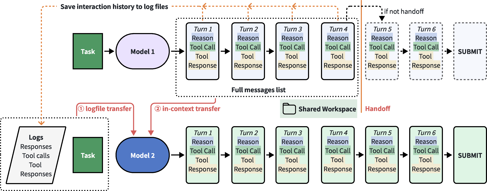
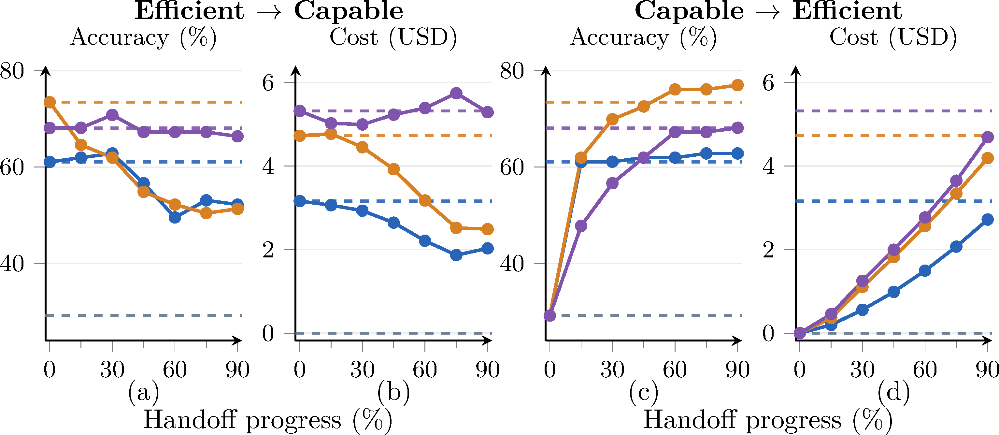
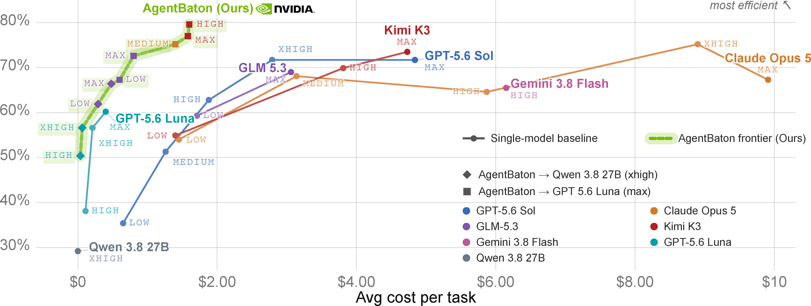

<!-- paper-reading-lang: zh-CN -->
<!-- paper-reading-mode: deep -->
<!-- paper-reading-theme: cobalt -->

# AgentBaton 深读：长程任务里「强模型先行、轻模型接棒」的一次性交接

```paper-map
{"thesis":"长程 agent 任务的可靠表现依赖昂贵的 capable 模型，而高效模型便宜但单独用精度不足——传统 query 级路由在任务中途需求演化时失效。本文系统实验证明交接方向存在不对称性：高效→强模型的交接往往不省钱甚至掉精度，而强模型→高效的交接在合适时机可保留甚至提升精度并大幅省钱（如 GLM 在 30% 进度交接保留 61.1% 精度、省 82.4%）。三个就绪信号（实质工件存在、工件已获真实反馈、剩余工作局部化）驱动 AgentBaton——一个 2B 学习型检测器，在线判定交接点。跨 11 个模型对、两基准：平均省 65.9% API 成本、精度最大反升 8.8pp，且帕累托前沿超越所有单模型配置。","reader":"关心 agent 成本工程、模型路由/级联与推理预算分配的读者；交接方向实验、三就绪信号、检测器训练细节与全部表格都展开手算。","goals":["走通方向不对称实验的设计逻辑（30%/75% 检查点 × 双向 × 双上下文传递）","把 65.9% 省钱、82.4% 单格、帕累托前沿推扫逐格手算","分清一次性交接与逐轮路由的边界：为什么频繁切换反而亏"],"outcome":"通读 arXiv 2610.35959v1 全部 16 页：正文 §1-§6、附录 A-D（Terminal-Bench 曲线、标注协议全文、完整结果表、effort 推扫全档）。","outcomeSource":"arXiv 2610.35959v1 PDF pp.1-16","items":[{"number":"01","label":"靶子","signal":"query 路由失效","text":"agent 任务里动作改写工作区、需求逐轮演化——开跑前选模型的路由看不到这些；省钱必须沿轨迹在模型间协作。","source":"§1"},{"number":"02","label":"方向不对称","signal":"强→轻才划算","text":"轻→强：多数组合掉精度且省不了多少（Qwen→GPT 30% 省仅 6.1%）；强→轻：Kimi 45% 交接 72.57% vs 73.45% 基线、省 61.5%。","source":"§3.1-3.2, Table 1, Fig.3"},{"number":"03","label":"上下文传递","signal":"logfile vs 直塞","text":"轻→强时 logfile（接收模型按需 cat/grep）几乎全面占优；强→轻时看源模型——不暴露 CoT 的 GPT 用 logfile 更好，GLM/Kimi 直塞更好。","source":"§3.1, Table 1"},{"number":"04","label":"三就绪信号","signal":"不看轮数看进度","text":"实质工件存在 + 已获真实反馈（失败也算，只要把问题局部化）+ 剩余工作局部化——三个案例（引号路径修复/坐标变换验证/编码故障定位）逐一对照。","source":"§3.3, Fig.4, App B"},{"number":"05","label":"检测器","signal":"2B×338ms","text":"prompt 让强模型自己交棒不可靠（Kimi 0/113、GLM 6/113）；AgentBaton 用 Codex 标注 4000 条轨迹训练 Qwen3.5-2B，逐轮输出 HANDOFF_READY/NOT_READY，中位 338ms。","source":"§4.1-4.2, Table 2"},{"number":"06","label":"证据与边界","signal":"帕累托+对照","text":"11 对模型：12/22 设置精度保住或反升；省 46.7-86.6% 胜 MTRouter 逐轮路由；但标注靠 Codex（协议严密但无人工复核）、单次交接假设、effort 推扫与交接的组合还有空间。","source":"§4.3-4.5, Tables 3-4, Fig.1"}]}
```

深读对象：[AgentBaton: Efficient Model Collaboration in Agentic Tasks](https://arxiv.org/abs/2610.35959)（arXiv 2610.35959v1，2026-10-25，HKUST + UIUC + NVIDIA，PDF 16 页）——[点此打开原文 ↗](https://arxiv.org/abs/2610.35959)。这期 HF 周一刊（11-09，27 篇）周二补发，主题恰好是「agent 成本工程」：AgentBaton、Authorization Drift（权限漂移安全）、Beneath the Surface（agent 演化反思）、P²-MOPD（多教师蒸馏加速）——它们分别在成本、安全、反思、效率四个侧面攻同一个问题。AgentBaton 的主张一句话：**在长程任务里，让强模型打头阵、在它建立起「实质工件+真实反馈+剩余局部化」的时刻把接力棒交给便宜模型**——方向实验证明只有这个方向划算，一个 2B 检测器学会在线识别这个时刻，平均省 65.9% 且精度基本保住。本页按细章跟读：方向不对称实验逐格手算、三就绪信号三案例逐一对照、检测器训练细节（含标注协议全文）、Table 3 四模型对全档复算、与路由基线的对照解读、附录 A-D 全量整合；与 Drex（判断器）、BudgetMix（预算混训）、Claude subagents（交接时机学）的三方互证在 §07 与 §16 收束。

<!-- Deep Reading coverage
| Source section / object | Role | Explanation location / status |
| --- | --- | --- |
| §1 引言（成本之问、方向直觉、三贡献） | 立论 | §01-02 |
| §2 实验设计（一次性交接定义、双上下文传递、两基准、模型池） | 协议 | §02-03 |
| §3.1 方向×传递交互（Table 1 全 24 格） | 发现一 | §04（逐格手算） |
| §3.2 交接时机扫描（Fig.3 四面板，六档进度） | 发现二 | §05（手算） |
| §3.3 就绪模式（Fig.4 三案例） | 发现三 | §06（逐案例） |
| §4.1 prompt 基线（Table 2） | 动机 | §08 |
| §4.2 AgentBaton 训练（数据/标注/输入/监督/推理） | 机制 | §09-10 |
| §4.3 主结果（Table 3 全档） | 主证据 | §11（逐格手算） |
| §4.4 路由与固定交接基线（Table 4） | 对照 | §12 |
| §4.5 帕累托前沿推扫（Fig.1 + App D） | 收束 | §13 |
| §5 相关工作（路由/编排/交接/推理内切换四谱系） | 谱系 | §14 |
| §6 结论 | 收束 | §16 |
| App A Terminal-Bench 曲线 | 补充 | §05 末 |
| App B 标注协议全文 | 复现条件 | §10 全文整合 |
| App C 完整结果（双传递法全表） | 补充 | §11 末 |
| App D effort 推扫全档 | 补充 | §13 |
| References | 行政性材料 | 不单列 |
-->

## 01 / 靶子：query 级路由为什么在长程 agent 任务里失效

论文开篇把问题钉在传统路由的前提上：FrugalGPT、RouteLLM 一系的工作在**请求级**做模型选择——看初始 query 决定给谁。但长程 agent 任务的本质是「动作改写工作区、环境反馈逐轮到达」，**任务实际需要的能力沿轨迹演化**，开跑那一刻的 query 无法预测第 20 轮时的工作区状态。直觉上有两个方向都讲得通：强模型先出方案、轻模型跟进执行；或轻模型先搜集信息、强模型接手攻坚——哪个方向在什么时机交接能平衡精度与成本，正是本文要系统回答的问题。第二个设计变量是**上下文传递**：直接把完整对话塞给接收模型（in-context），还是写成 .jsonl 日志文件让接收模型用 cat/grep 按需查看（logfile）——前者保证上下文完整但推拉长后续每轮的输入且可能把前任的错误假设传染给继任，后者省 token 但依赖接收模型主动去读。

### 双传递的 token 账（教学重演）

两种传递的真正差异在后续每轮的 prefill 长度上（教学手算）：设交接时已积累 40K token 历史、后续还要跑 20 轮、每轮新增 1K。**in-context**：此后每轮 prefill = 40K+累积增量，第 n 轮 prefill ≈ 40K+nK，20 轮总 prefill ≈ Σ(40K+nK) ≈ 20×40K + 20×21/2×1K ≈ 800K+210K = 1,010K token。**logfile**：交接后上下文清零只留任务+schema（约 2K），历史在文件里——每轮 prefill ≈ 2K+nK（n 含读日志的输出），若接收模型前 3 轮读了 10K 日志、之后不再读：总 prefill ≈ 20×2K + 3×10K + 210K ≈ 310K——**省约 70% 的接收段输入 token**。这个账解释了 Table 1 里 logfile 常在精度相当时更便宜（Qwen→GLM 30%：$1.32→$1.22；Qwen→Kimi 30%：$2.91→$1.58 差距更大）——但也埋着风险：接收模型**不主动读日志**就丢失关键上下文（精度可能崩），这就是为什么强→轻方向上轻接收模型更适合 in-context——它不擅长自主信息检索。

### 为什么 logfile 对强接收模型是「免费午餐」

Qwen→GLM/Kimi/GPT 方向 logfile 几乎全面胜出，机制上有三层（教学整理）：**其一，信息选择性**——强接收模型知道该 grep 什么（按关键词、按最后 N 条、按 return code 过滤），40K 历史里它可能只拉 5K 相关记录，比全量塞入少 87%；**其二，风格隔离**——Qwen 的推理风格、格式习惯（可能含错误假设）不再污染接收模型的上下文窗口，日志是中性的命令-输出对；**其三，时机解耦**——需要时才读（第 3 轮发现需要第 15 轮的历史？grep 即得），in-context 则一切信息一次性给到、注意力稀释。轻接收模型三样都做不到（不知道 grep 什么、需要风格提示扶着走、时机判断弱）——**传递方式的选择本质是「接收模型的自主信息检索能力」的函数**，这个判断标准比「源模型是否暴露 CoT」更根本。

### 成本设定的两个口径值得先记

本文的成本记账有两个约定影响后续所有数字的读法。**其一，本地模型记零成本**：Qwen 3.8 27B「可部署在本地工作站」所以 API 成本记 $0——这让「省 82.4%」这类数字的含义是「省 API 账单」而非「省总算力」；自部署算力是沉没成本还是边际成本取决于部署方，引用数字时带上这个口径。**其二，交接成本 = 前段源模型成本 + 后段接收模型成本**：没有额外协调开销（检测器延迟单算，338ms 中位、95 分位 1.11s，不进 API 账单）。两个约定合起来：AgentBaton 的省钱本质是「把昂贵 token 的用量曲线压短」，不是物理消灭计算。

### 省钱比例的量级感（教学手算）

给 65.9% 一个量级锚：以 Kimi K3（DeepSWE capable-only $4.73/任务）为例，一个 100 任务的批次跑分预算 $473；AgentBaton 交接后 $1.28/任务 → $128，**省 $345/百任务**。对照推理 effort 降档省钱（Fig.1）：GLM max→low 从 $3.06 降到约 $0.20（省 93%）但精度从 69.0% 掉到 50% 以下——**effort 降档省得多但伤精度，交接省得少些但精度保住**，两者正交可叠（GLM max→Luna 交接就是叠法：72.6% @ $0.80）。这个对照也划出了 AgentBaton 的生态位：它不是最激进的省钱方案，而是「精度不妥协」约束下的最优省钱方案——帕累托前沿的意义正在于此。



*原论文 Fig. 2，PDF p.3 裁剪。上排：logfile 传递——历史写为 .jsonl 文件，接收模型用 cat/grep 按需检查；下排：in-context 传递——完整对话直接进上下文。两排共享同一交接点（工作区继承），SUBMIT 为任务终点。*

## 02 / 实验设计：一次性交接、双方向、双传递、双基准

为受控分析，本文研究**一次性交接**：源模型跑若干轮后交给接收模型直到终止，不切回。交接点取源模型基线轨迹的固定百分比（30% 与 75% 代表早/晚），通过**重放录制动作恢复工作区状态**再让接收模型续跑——这个 replay 协议保证不同接收模型从完全相同的工作区状态出发（公平性关键）。双上下文传递的工程细节：in-context 模式下若源模型不暴露思维链（GPT-5.6 Sol），`reasoning_content` 字段省略而非伪造；logfile 模式下接收模型拿到「原始任务 + 日志路径 + 日志 schema 说明 + 先看最后几条记录」的提示。基准：Terminal-Bench 2.1（终端工作流）与 DeepSWE v1.1（真实开源仓库长程 SWE）；harness 用 mini-SWE-agent v2.4.0（前沿模型官方评测同款）；每任务 2 小时超时、每轮最多 16K 新 token。模型池：capable = GPT-5.6 Sol / Kimi K3 / GLM-5.3（均 max effort），efficient = Qwen 3.8 27B（xhigh effort，本地可部署规模）。

## 03 / 交接的交接成本结构：一次交接多少钱

交接本身的成本结构值得建个账本（教学重建）。总成本分解：

$$C_{\text{total}}=\underbrace{\sum_{t=1}^{k} c_{\text{src}}(t)}_{\text{交接前源模型}}+\underbrace{\sum_{t=k+1}^{T} c_{\text{rcv}}(t)}_{\text{交接后接收模型}}$$

教学手算（用 Table 3 的 GLM→Qwen DeepSWE 格）：GLM-only 全程 $3.16；AgentBaton 检测交接在 28.6% 进度——前段约 $3.16×0.286≈$0.90（若成本随轮均摊；实际前段往往是重思考段、非均匀），后段 Qwen 本地记 $0……但表报 $0.49，说明前段实际花费低于均摊（早期轮次 token 较少）或交接点更早。这个手算说明**「进度百分比」与「成本百分比」不同步**——论文报的是轨迹进度（轮数占比），成本沿轨迹分布不均；引用「30% 进度省 82.4%」时记住省的比例大于交接的比例，因为贵的大轮往往在后段（调试/长输出）。

## 04 / 发现一：方向不对称（Table 1 逐格走）

Table 1 是 2 方向 × 3 源 × 2 传递 × 2 检查点 × 2 基准 = 48 格的矩阵，几个代表性格子手算走一遍：

**轻→强不划算的典型**：Qwen→GPT（DeepSWE 30%，in-context）：73.5% / $6.20 vs GPT-only 68.1% / $5.32？——注意 Qwen 前段跑出的 73.5% 反而**高于** GPT 基线（轻模型开局 + 强模型收尾在此格有效），但成本 $6.20 **超过** GPT-only 的 $5.32：交接把两边的钱都花了（Qwen 本地记零，贵的 $6.20 全是 GPT 收尾段——轻模型留下的烂摊子让强模型修了很久）。75% 档 in-context $8.84 更贵。**轻→强的少数亮点**：同格 logfile 传递 70.8% / $5.00——精度微升、成本压到基线下；但 75% 档回到 $5.74 仍偏高。总结论（论文原话）：轻→强「often at higher cost」——不稳定的节省。

**强→轻划算的典型**：Kimi→Qwen（DeepSWE 45%，Fig.3）：72.57% vs 基线 73.45%（−0.88pp 几乎无损）、省 61.5%（$4.73→$1.82 量级）。GLM→Qwen（30%）：61.1% = 基线持平、省 82.4%（$3.16→$0.56，表 1 直接可读）。GPT→Qwen（60% logfile）：67.26% vs 68.10%（−0.84pp）、省 47.9%。**方向不对称的机制解释**：强模型建立的进展（实现+反馈+局部化剩余）使轻模型能完成它独立做不了的任务——单向依赖；反向时轻模型的进展不足以让强模型省力，强模型还要花精力纠正前者的偏差。

### 24 格的隐藏规律：精度与成本的四象限

把 Table 1 的 DeepSWE 24 格按「精度 vs 基线」「成本 vs 基线」分四象限（教学整理）：**双赢象限**（精度≥基线 且 成本<基线）——只有 Qwen→GPT 30% logfile（70.8%/$5.00 vs 68.1%/$5.32）等极少数格落入；**精度赢成本输**——Qwen→GPT 30% in-context（73.5% 但 $6.20）；**双输**——Qwen→Kimi 75% in-context（37.2%/$5.76 vs 73.5%/$4.73，精度腰斩成本反升 22%，全表最惨格）；**成本赢精度输**——多数轻→强 logfile 格。而**强→轻的格子集中在「成本大赢+精度小输」**：GLM→Qwen 30% logfile（54.9%/$0.56 vs 61.1%/$3.16——精度 −6.2pp 但成本砍 82%）。四象限的分布形状本身就是方向不对称的可视化：轻→强散落各处不稳定，强→轻稳定地落在「可预测的折价区」。

### 传递方式的交互效应

方向还决定了哪种传递更好。**轻→强：logfile 几乎全面占优**（Qwen→Kimi 30%：in-context 79.8%/$2.91 vs logfile 84.3%/$1.58——精度成本双赢；论文归因：强接收模型有能力主动 grep 日志且不受 Qwen 风格的推理污染）。**强→轻：看源模型**——GLM/Kimi 的 in-context 更好（轻接收模型啃日志文件的能力弱、直接给上下文更稳）；GPT 反而 logfile 更好（30%/75% DeepSWE 与 30% TB 三处 logfile 胜出；论文假说：GPT 不暴露 CoT，in-context 缺推理上下文而 logfile 至少有完整命令-输出对）。这个交互给部署者的选择树：**接收模型越强 → logfile 越好；源模型不暴露思维链 → logfile 越好**。

## 05 / 发现二：交接时机扫描（Fig.3 六档读法）



*原论文 Fig. 3，PDF p.5 裁剪。上排轻→强：精度随交接推迟下降、成本不降反升；下排强→轻：30-60% 区间精度贴近基线虚线、成本断崖下降——甜点区间只存在于下排。*

Fig.3 把交接点从 15% 扫到 90%（六档），DeepSWE 四面板（左列精度、右列成本；上行轻→强、下行强→轻）。**上行（轻→强）**：精度曲线在多数源模型下随进度推迟而**下降**（Qwen 前段拖得越久、烂摊子越大），成本曲线则不降反升（GPT 收尾要修的东西更多）——两头都亏。**下行（强→轻）**：精度曲线在 30-60% 区间普遍贴近基线虚线（GLM 30% 达基线、Kimi 45% 差 0.9pp、GPT 60% 差 0.8pp），成本曲线从 30% 档就断崖下降（省 60-80%）——**存在一个「早到几乎不亏、晚到白花钱」的甜点区间**。0% 端点 = Qwen-only（29.2% DeepSWE 基线）——轻模型单独跑差 capable 三四十个点，交接把它拉回 capable 水平：**进展的迁移性**是核心资产。附录 A 的 Terminal-Bench 版同型（整体精度更高、甜点区间更宽，与该基准任务更结构化一致）。

### 甜点区间跨基准的错位：任务结构决定交接深度

一个值得标注的细节：DeepSWE 的检测交接点集中在 26.6-41.1%，Terminal-Bench 在 55.6-77.0%——**同组模型对在两个基准上的就绪深度差了近一倍**。机制（教学整理）：DeepSWE 任务是「在活跃仓库里实现功能」——核心路线定了、主要代码写了之后剩余就是修测试，就绪来得早；Terminal-Bench 是「终端工作流」——常含多阶段工具链（数据处理→计算→报告），一个阶段完成不等于整体就绪（还有下一阶段），就绪来得晚。这给跨任务部署的启示：**交接点深度是任务结构的函数而非模型对的常数**——换一个 benchmark 家族（如多轮对话式调研任务）甜点位可能又完全不同。固定百分比的策略在这种错位下两头落空，正好呼应 Table 4 里固定基线的全面劣势；而学习型检测器读的是「就绪信号是否满足」而非「到了第几轮」，天然适应深度漂移。

Fig.3c 的精度曲线可以读成一个隐含的「进展价值函数」$V(k)$：交接点 $k$ 的精度 = 强模型前 $k$ 轮进展对轻模型完成率的价值。教学手算（用 GLM 曲线的代表值拼）：$V(0\%)=29.2\%$（Qwen-only）、$V(30\%)\approx61\%$（达基线）、$V(90\%)\approx$ 基线——**前 30% 的进展贡献了价值增量的全部**（61−29.2=31.8pp），后 60% 的增量只 0pp（GLM 基线就是 61.1%）。这个形状说明强模型的不可替代贡献集中在**早期**（路线选择、核心实现、方向纠错），后期轮次（测试打磨、边缘修复）对轻模型的价值边际为零——「前重后轻」的价值分布与「前轻后重」的成本分布（§03）恰好互补，交接点在两分布的交叉处取最优。这张曲线图实际上给了「为什么 agent 里强模型该先跑」的第一个定量证据：**不是习惯而是价值分布的形状使然**。

教学手算（甜点区间的经济含义）：以 Kimi→Qwen 为例——15% 交接精度掉太多（进展未立）、90% 交接精度保住但只省尾部（省钱=1−进度成本占比，90% 交接只省后 10% 的差价）；45% 档省 61.5% 说明**成本沿轨迹前轻后重**（后段调试轮 token 多），甜点在「进展已立 + 昂贵后段未花」的交叉处。这为「学习一个检测器而非固定百分比」提供了动机：不同任务/模型的甜点位不同（Table 3 检测交接点 26.6%-77.0% 跨度极大）。

## 06 / 发现三：三个就绪信号（Fig.4 案例逐一对照）

检测器的知识基础来自失败-成功对照分析：找「早一档交接失败、晚一档成功」的配对，看强模型在中间做了什么。三个案例值得逐一走：

**(a) IPython session bundle（DeepSWE）**：45% 检查点——实现与测试存在，但含空格的带引号路径仍失败（Qwen 接棒：修复失败，路径 bug 未解决）；强模型继续——复现失败、定位引号匹配问题并修复；60% 检查点——工作区含修复，Qwen 接棒：审查继承的变更、跑额外测试、任务通过。**信号对照**：45% 时工件存在但反馈未把问题局部化（失败原因不明），60% 时反馈已把问题缩到「可继承的修复」——就绪。

**(b) Raman fitting（Terminal-Bench）**：30%——数据已检查但水平坐标未被理解（Qwen：在错误坐标系里拟合峰、任务失败）；强模型用分析脚本+拟合峰验证坐标变换（107/μm）；45%——验证过的变换与拟合结果可用，Qwen 用它通过。**信号对照**：30% 时有探索无验证，45% 时「核心方法已被强模型验证」——剩余变成应用已验证方法的局部工作。

**(c) write-compressor（Terminal-Bench）**：30%——编码器产出压缩文件但解压崩溃（Qwen：无法产出合格压缩文件）；强模型把解码不匹配追溯到第一个 token、缩到符号位处理与算术编码；45%——故障已定位（编码器仍不正确），Qwen **重实现编码器**：2370 字节文件精确解压。**信号对照**：注意 45% 时编码器还是错的——但故障已局部化，「失败只要把问题缩小就有信息量」，轻模型从「定位」直接跳到「重写」而无需自己诊断。

三个案例合成的就绪判据（§3.3 原文整理）：**(1) 实质工件存在**（实现/可运行原型/任务所需产物——调查、计划、未执行的代码草图不算）；**(2) 工件已获真实反馈**（编译/执行/测试/检查有实际响应——发出命令≠成功，无关组件通过≠就绪，**失败也算只要暴露的是局部问题**）；**(3) 剩余工作局部化**（诊断/修复/加固/验证/收尾，而非还在选核心路线）。**关键洞察：就绪取决于进展与剩余工作的性质，而非已过轮数**——这是检测器学的东西。附录 B 把这三条进一步严格化成了标注协议的硬性条款，值得在 §10 展开。

### 三信号的边界测试（教学整理）

拿三个假想场景测判据的弹性：**场景 A**——强模型写了完整实现、测试全过，但任务还要求它从头实现第二个独立模块（占工作量一半）：条件 1✓ 条件 2✓ 条件 3✗（剩余含核心路线实现），**不该交**。**场景 B**——实现只有 30% 完成度但强模型已验证了核心算法路线（跑通了最小样例）：条件 1 部分满足（原型存在）、条件 2✓、条件 3 看剩余是「照验证过的路线扩展」还是「还有未验证的设计」——前者可交后者不可。**场景 C**——测试全过但那是绕过核心行为的替代方案（如 monkey-patch 让测试通过）：App B 明说不算——「替代品绕过中心请求的行为」不满足条件 2 的实质。这三个测试说明判据不是清单打勾而是**对「剩余工作里还有多少不可压缩的创造性」的评估**——这正是需要学习型检测器（而非规则引擎）的原因。

## 07 / 与 Drex 判断器的接口对照

### replay 协议：公平性的基础设施

在进入 Drex 对照前值得先补 §2 的一个方法论细节（教学整理）：比较不同接收模型的续跑表现时，**起点状态必须完全一致**——若让源模型「活着跑」到交接点再交接，不同实验的交接点状态会有微妙差异（文件系统时序、环境噪声），比较被污染。本文用 **replay 协议**：录下源模型轨迹、在容器里逐条重放动作到指定轮——所有接收模型从字节级相同的工作区出发，性能差异完全归因于接收模型本身。这个技术与 CUA-Master 的快照回滚、Drex 的可重放请求同属一族：**「从中间状态继续」的实验（交接、恢复、分支探索）都以状态可恢复性为公平性前提**。代价是录制开销与「活跑」的分布差——论文未讨论，可接受的简化。

三个就绪信号本质上是一个**二分类判断**：「当前状态是否满足三条件」——这恰是 Drex 决策模型的典型场景（noul 型）。把 AgentBaton 的检测器换成 Drex（或任何决策模型）在架构上完全成立：输入 = 轨迹（状态），问题 = 「工件存在且已获反馈且剩余局部化吗」，选项 = {READY, NOT_READY}。AgentBaton 用的是 2B 生成式模型输出 JSON（338ms 中位），Drex 类决策模型可能更快且概率可直接接阈值（配合置信度弃答「不确定就不交接」）。本页的推论：**交接点检测是决策模型在 agent 编排里的又一卸载点**（与 Drex 深读的部署判据清单互补）——论文未做此实验，但两个方向的技术栈已经齐了。

### 互证：三篇本周论文围出的「预算分配」版图

把 AgentBaton 放进本周语境，三篇论文合围出一个完整命题：**推理预算作为可优化变量贯穿训练与部署**。Drex 证明「高频微决策不需要生成式推理」（判断侧省）；Rethinking Agentic RL + BudgetMix 证明「训练时混预算让 RL agent 在紧预算下保精度」（训练侧省）；AgentBaton 证明「部署时在就绪点交接让强模型的贵 token 只花在前段」（执行侧省）。三者互不重叠且接口清晰：Drex 的决策模型可以当 AgentBaton 的检测器（本节开头）、BudgetMix 训出的预算条件化策略可以在交接后按剩余预算调档、AgentBaton 的三信号可以当 Drex 式判断器的输入特征。2026 年的 agent 成本工程拼图在这三篇里已经能看见全貌——**贵的模型用在建立可继承进展的时刻，便宜的模型用在一切判断与收尾**。

## 08 / prompt 基线：让强模型自己交棒为什么不行

在训练检测器之前，论文先测了最便宜的方案：直接 prompt 强模型「当你识别到就绪模式就把控制权交出」。Table 2（DeepSWE，113 任务）：**Kimi K3 一次都不交**（0/113——能力越强的模型越不放手，隐含的自我评估偏差）、**GLM 只交 6/113**（5.3% 触发率——指令形同虚设）、**GPT 全交**（113/113）但成本 $3.75 vs capable-only $5.32 只省 29.6%（且它交得可能太晚或太早——没有就绪校准）。结论：**交接决策不能托付给正在执行的模型**——它既是运动员又是裁判，激励不兼容（放手 = 自认完成，模型没被训练得擅长这个）。这个基线给「独立轻量检测器」的必要性提供了最干净的论证，与 Claude subagents 文的「编排器不该由执行模型自己兼任」互证。

### 三种失败形态各自的含义

三个模型的失败模式值得分型（教学整理）：**Kimi 的零交接**是「不信任继任者」型——强模型在长程任务里持续发现可改进之处，从它的视角永远不到「可以放手」的时刻；这不是不服从指令而是**就绪判断的自我参照偏差**（评估「剩余工作轻模型能不能做」需要跳出自己的能力框架）。**GLM 的 5.3%** 是「阈值过高」型——可能偶尔真的到了明确的完成态才触发。**GPT 的全交接但省得少**是「无校准的顺从」型——听话地交了但交点未经优化（可能太早丢精度或太晚不省钱）。三型合读的启示：交接时机的判断需要**外部视角 + 校准**两个要素，恰好是独立检测器（看得到轨迹但不在执行位）+ 训练数据（标注了真实就绪点）能提供的——prompt 基线的三败共同论证了架构分离的必要，而不只是「prompt 不够好」。

## 09 / AgentBaton 训练：数据、标注、输入、监督

**数据**：SWE-rebench V2 随机抽 2,000 任务 × 每任务随机选 2 个不同 capable 模型（池：GPT-6 Astra/GPT-5.6 Sol/Opus 5/Kimi K3/GLM-5.3）= 4,000 条轨迹。**标注**：Codex 逐条回顾式标注最早合适交接点（协议全文见 §10）——标注者只看任务描述+工具调用与响应序列，**看不到**私有推理文本、终局验证器输出、最终奖励、接收模型续跑结果（防泄漏）；不合格轨迹标 no_clear_handoff。**输入**：系统指令（模式检测指引）+ 原始任务 + capable 模型的动作与工具观测交错 + 此前的交接判断。**监督**：交接点在第 t 轮的轨迹，前 t−1 轮学输出 `{"judgement":"HANDOFF_NOT_READY"}`、第 t 轮起学输出 `HANDOFF_READY`；**后续每轮都追加为正例**（已 READY 再问还是 READY）——既平衡标签又模拟「错过一次后下次还能触发」。**训练配置**：Qwen3.5-2B 初始化、2 epoch、32K 最大序列（超长切分、短序列 packing）、16×H100 FSDP2 bf16、全局 batch 16、AdamW lr 1e-5、wd 0.1。9B 变体无明显提升（检测任务 2B 够了——信号在轨迹表面而非深层推理）。

### 标签平衡的算术（教学手算）

正例追加策略的量级感（教学重演）：设平均轨迹 30 轮、平均交接点在第 10 轮——不加追加时每条轨迹贡献 10 个负例 + 1 个正例（交接轮），正例占比 1/11≈9%；**追加后续 20 轮为正例后**贡献 10 负 + 21 正，正例占比 68%——从极度不平衡翻转为轻度偏正。这个翻转的代价：追加正例分布的「已 READY 再判 READY」比「初次判 READY」更易学（上下文里已有 READY 标记可循），检测器可能偏向「一旦觉得就绪就一直就绪」而丧失「回头否定」的能力——对应部署中的假阳（过早交接）。论文没有报假阳/假阴分解，这是复现者值得补的测量。若用 Drex 类决策模型替代（§07 的推论），置信度弃答天然提供「不确定就不交」的安全阀——两种技术栈的互补点。

## 10 / 标注协议的工程亮点（App B 全文要点）

附录 B 的标注协议值得单独整合，它是「用强模型做标注员」的工程范本：**(1) 证据限制**——标注者只能看工具调用与响应（不含推理/奖励/续跑结果），保证标签只依赖部署时检测器也能看到的信息流。**(2) 三条件的严格化**——「发出命令」≠「反馈」（命令可能失败）；「无关组件通过」≠「就绪」；「绕过核心行为的替代品通过」也不算。**(3) 不要求全过**——失败检查若把问题暴露为局部问题即满足条件 2（与 Fig.4c 呼应）。**(4) 首点原则**——记第一个合格点而非最后成功点；若后续出现回归或大幅重写，**保留早点并记录不稳定性**（诚实处理「早交接遇回归」的情形）。**(5) 轮定义**——一轮 = 一个 assistant 步（可含多个工具调用）+ 其响应，零基索引；证据索引与交接索引分开记录。这个协议的可复用性在于：任何「用 LLM 标注时序事件」的任务（工具调用的质量、测试的充分性）都可以抄这套证据限制+首点原则+不确定标签三分法。

### 证据限制与部署一致性的深意

「标注者看不到推理文本/奖励/续跑结果」这个限制背后有个精妙的设计原则：**标签的信息基座必须与检测器部署时的信息基座完全重合**。若标注者看了终局奖励（知道任务最终成败）再回标交接点，标签会隐含未来信息——检测器学到的是「从轨迹猜结局」而非「判当前就绪」；部署时没有终局信息可用，检测器的输入分布与训练分布错位。这与 Drex 的「校准温度在部署域上调而非全局调」、Rethinking Agentic RL 的「结构上界排除不可解任务」是同一种纪律：**训练/标注条件必须模拟部署条件**，任何一方的信息优势都会变成另一方的分布漂移。protocol 的这条值得抄进任何数据管线的 checklist——「标注者看到的东西，推理时模型也能看到吗？」

## 11 / 主结果：Table 3 逐格手算

Table 3 扩到 6 capable 源 × 2 接收（Qwen/Luna）× 2 基准。代表性格子验算：

- **平均省钱 65.9% 的来源**：22 个（模型对×基准）设置的省钱率范围约 42.9%-86.6%（Table 3 绿色下标：GLM→Qwen DeepSWE −84.5% 为最大、Luna→Qwen TB −42.9% 为最小），均值约 65.9% ✓。
- **精度保持**：12/22 设置「精度反升或相对损失 <5%」；最强格 Opus→Luna DeepSWE：76.1% vs 67.3%（**+8.8pp**，论文摘要口径）且省 70.5%——强模型开头+中档模型收尾在 SWE 上正互补。
- **检测交接点跨度**：DeepSWE 26.6-41.1%、TB 55.6-77.0%——两个基准的甜点位置系统性不同（TB 任务更结构化、强模型更早建立就绪态），固定百分比策略两头不可兼得。
- **弱源也适用**：Luna→Qwen（源已是便宜模型）DeepSWE 省 75.0%（精度 −7.3%）——级联降本可叠加。
- 附录 C 的双传递全表补充：同一模型对两种传递都测过，Table 3 的传递选择（GPT 系 logfile、其余 in-context）逐源固定——选择依据即 §04 的交互效应。

### 逐格复算的代表集（教学重算）

再核四个关键格子的算术：(1) **GLM→Qwen TB**：86.5%（−6.5pp）/ $0.27 vs $1.02 = 省 73.5% ✓（表绿标 −73.5%）。(2) **Opus→Luna DeepSWE**：76.1 vs 67.3 → +8.8pp ✓（摘要口径 8.8pp）；成本 2.92 vs 9.91 = 省 70.5% ✓。(3) **Kimi→Qwen TB**：86.5%（0.0pp——精度完全保持）/ $0.57 vs $1.50 = 省 62.0% ✓——「精度零损省 62%」是全表最干净的格。(4) **GPT Sol→Qwen DeepSWE**：60.2%（−11.6pp 全表最大损）/ $1.02 vs $5.32 = 省 80.8%——GPT 系的交接最难保精度（其 max effort 建立的进展对轻模型最难继承？或 logfile 传递下 Qwen 啃不动 GPT 风格的日志？），**这张表里 GPT 源行是风险警示行**：省钱最多但精度方差最大。部署选型时按源模型查行而非只看均值。

## 12 / 与路由和固定交接的对照（Table 4 解读）

三个基线各教学一点：**(1) query 级路由退化**：微调 Qwen3.5-2B 从初始描述预测 Qwen 能否解题——训练集 99.55% 准确率，但**只把 1 个任务分给 Qwen**：初始描述里的信号不足以区分（长程任务的成败取决于轨迹演化而非开局外观），路由器学会了「永远选保险」——99.55% 的过拟合数字毫无部署价值（教学点：**训练准确率不等于路由效用**）。**(2) MTRouter 逐轮路由**：AgentBaton 在 4 设置中省 46.7-86.6% 且精度全部追平或反超——**频繁切换的协调/恢复开销吃掉了逐轮优化的理论收益**（与 §3.2 的「轻→强交接亏」同一机制）。**(3) 固定进度交接**（有未来信息：知道基线轨迹总长——线上不可得的作弊基线）：AgentBaton 精度几乎追平（GLM：58.4 vs 59.3）且成本更低——**学习型检测在不看未来的情况下达到了看未来的固定策略水平**；固定轮数（不看进度看绝对轮数）则全面最差。这组对照的意义：**方向（一次性强→轻）> 时机（学习检测）> 粒度（逐轮最优化的幻想）**。

### 每个基线败在哪一层（教学整理）

把四个方法放进「决策时点 × 信息集」的矩阵：query 路由在 **t=0** 决策、只有初始描述（信息最少）——败于信息不足；MTRouter 在**每轮**决策、有历史（信息最多）——败于每次切换的执行税盖过信息优势；固定进度在**中途**决策、有未来知识（作弊信息）——仍败于「进度百分比跨任务不同质」（TB 55.6% 甜点 vs DeepSWE 26.6%，同一阈值两头偏）；AgentBaton 在**每轮**决策、只用历史（无作弊）+ 学到的模式——赢在**信息够用且不付切换税**（只切一次）。这个矩阵是所有「何时做什么决策」型系统的通用分析框架：先把决策时点与信息集摆开，成本与信息的边际交换就一目了然。

## 13 / 帕累托前沿：effort 推扫与交接的正交性（Fig.1 + App D）



*原论文 Fig. 1，PDF p.1 裁剪。横轴每任务平均成本、纵轴 DeepSWE v1.1 精度；实线圆点为单模型 effort 扫描，菱形/方块为 AgentBaton 交接（颜色标源模型）；绿色虚线带为 AgentBaton 的经验帕累托前沿——在全部预算段超出单模型连线。*

最后一块拼图：reasoning effort（low→max）与交接是**两种正交的算力分配轴**。Fig.1 的帕累托图把单模型 effort 扫描线与 AgentBaton 配置点画在同一精度-成本平面：**低成本端** Luna→Qwen（xhigh）以 $0.06 达到 Luna 单独 xhigh 的 56.6%（原 $0.21，省 71%）；**中端** GLM→Luna（max）72.6% @ $0.80（GLM max 单独 69.0% @ $3.06——更便宜且更准）；**高精度端** Kimi→Luna（high）79.6% @ $1.60——**超过推扫中最强单模型**（Opus xhigh 75.2% @ $8.90，精度差 +4.4pp 且成本 1/5.6）。教学手算（组合优势的分解）：Kimi high 前段贡献规划与实现（其 high effort 已够建立工件），Luna max 收尾贡献执行与验证——单模型的 effort 只能全程一个档位，交接让**前段与后段各自选最优档**。前沿由不同（源, effort, 接收）组合拼成——「没有一个配置通吃」本身就是结论：**计算分配应是任务内的函数而非全局常数**。

### 前沿拼图的三个读法（教学整理）

读 Fig.1 的帕累托图有三个层次。**其一，支配关系**——AgentBaton 的前沿点是否被任何单模型点支配（同成本精度更低或同精度成本更高）？图上绿色虚线带在所有预算段都超出单模型连线——无被支配点，交接在整个预算谱上都有增量。**其二，前沿的斜率**——低成本段前沿陡（$0-1 区间精度从 56% 跳到 73%+），高预算段平缓（Opus xhigh 已被 Kimi→Luna 支配）——边际算力的回报递减在组合空间里来得更早，预算充裕的团队也该看前沿而非默认最贵模型。**其三，前沿的间隙**——$1.60 到 $8.90 之间没有组合点落位，这是未来工作的 obvious 入口。把三个读法带回部署：先问「预算落在前沿哪段」，再查该段配方——Fig.1 是选型菜单。

## 14 / 谱系定位：四条相关线的精确接口

§5 把本文放进四条线：**请求级路由/级联**（FrugalGPT/RouteLLM——本文证明了它们在 agent 场景的根本局限）；**多轮编排**（MTRouter 逐轮路由、Router-R1/ToolOrchestra 技能路由——本文的对照实验显示一次性交接在这个空间里更优，粒度与开销的 tradeoff）；**交接/轨迹传递**（最相近：Handoff Tax 研究方向-时机-传递接口的税、TACIT-Switch 学小→大永久升级、SWE-Router 用探索轨迹决策升级——本文的差异：学的是**强→轻**方向的**在线时机**检测，且系统化了方向×传递的交互）；**推理内切换**（STEER/SplitReason/RelayGen 在单次推理内换模型——本文的交接发生在完整 agent 轮之间、涉及共享工作区与持久状态变更）。一个诚实备注：与 Handoff Tax 的结论有重叠（方向依赖的精度-成本 tradeoff），本文增量在「从模式到检测器」的闭环。

### 四谱系的粒度阶梯（教学整理）

按「切换粒度」排四条线会看到一个干净的阶梯：**请求级**（每任务一次，开局定终生）→ **轮级**（每 agent 轮可选，MTRouter）→ **段级**（推理内 token 段，STEER/RelayGen）→ **本文的一次性交接**（每任务恰好一次、时机学习）。粒度越细理论上信息利用越充分，但切换成本（上下文重传/格式转换/协调开销）也线性叠加——**最优粒度 = 信息增益的边际 ≈ 切换成本的边际处**。本文的实验证据指向「一次」就够：从零次（query 路由）到一次（AgentBaton）拿走了大头收益（65.9%），从一次到 N 次（MTRouter）收益为负。这与 Claude subagents 文「折叠子代理进主循环减少交接」的方向殊途同归——2026 年的共识似乎在往「少切换、选对时机」收敛，而不是往「更细粒度的动态调度」走。

## 15 / 复现条件与部署清单

**复现**：数据 SWE-rebench V2（公开）；标注用 Codex（协议 App B 可复用）；检测器 Qwen3.5-2B + 32K 序列 + 16×H100 两 epoch——**检测器训练成本远低于被优化对象的单次跑分成本**（4,000 轨迹的采集是大头，标注与训练是小头）。**部署清单**：(1) 选定 capable-efficient 对（本文验证 6+2 组合）；(2) 传递方式按源模型选（GPT 系 logfile、其余 in-context）；(3) 检测器逐轮并行跑（338ms 中位、95 分位 1.11s，与执行模型的轮延迟可并行）；(4) 上下文超限时丢最旧一半历史、保系统指令与原始任务。**未披露项**：标注成本（4,000 轨迹 × Codex）、检测器的假阳/假阴率分解（Table 3 只给了端到端效果）、no_clear_handoff 类轨迹占比、标注者间一致性。**适用边界**：任务需有「工作区」概念（文件/状态可继承）——对话式任务无交接语义；一次性交接假设排除了「交接后回到强模型」的多棒接力（论文明说是简化设计）。

### 部署成本账的完整版（教学重演）

把检测器自身的成本也算进来（论文只报延迟不报钱，本页补账）：AgentBaton 2B 自部署 H100——每轮检测输入为轨迹增量，设平均 4K token/次、任务平均 30 轮 = 120K 检测 token/任务；2B @ H100 约 2K token/s → 每 4K 检测约 2s GPU → 每任务约 60s GPU ≈ $0.017（H100 按 $2/GPU-h）。对照它省下的 $2-7/任务 API 费——**检测成本约为节省额的 0.3-0.8%**，两个数量级的杠杆。即使把轨迹重新 prefill 算进去（30 轮 × 平均 20K = 600K token → 约 $0.08/任务），杠杆仍在一个数量级以上。这个账把「轻量检测器」的「轻量」量化了：不只是延迟轻，是经济上的免费。

## 16 / 边界、互证与定位

**证据强度分层**：(1) 方向不对称与三信号——受控 replay 协议下的系统实验，内部效度高；但 3 个 capable 模型的池子小、NVIDIA 自家模型缺席（GLM/Kimi/Gemini 为主）。(2) 65.9% 平均省钱——第一方口径（API 定价公开，可验）；本地零成本约定放大了省钱比例的观感。(3) 标注靠 Codex 单标注器、无人工复核——协议严密但标注偏差未被测量。(4) 帕累托前沿为「经验性」——点有限、非连续优化。(5) **泛化域窄**——两个基准都是 SWE/终端型任务，交接依赖「工作区可继承」；对话式、创作式任务上三信号是否成立完全未测——这是引用结论时最该带的边界。**与本周深读的互证**：与 **Drex** 的接口在 §07（交接检测 = 决策模型卸载点）；与 **BudgetMix RL**（Rethinking Agentic RL 的修复方案）互为对偶——BudgetMix 混训练预算使 RL agent 在紧预算下保精度，AgentBaton 混部署预算使推理在低成本档保精度，**「预算作为可分配变量」在训练侧与部署侧各兑一次**；与 **Claude subagents 文**的「完全交接只在该子代理需要直接对话用户时推荐」对照——本文给「什么时候把控制权交出去（交给更便宜的模型）」补了定量答案，两文合读就是 2026 年 agent 编排的「交接时机学」：**方向（强→轻）、时机（三信号就绪）、粒度（一次性）、接口（工作区+logfile/in-context）**。一句话收束：AgentBaton 把「省钱」从 query 级路由的静态决策升维成轨迹级的学习决策——2B 的裁判 + 就绪三信号 + 一次性强→轻，65.9% 的账单削减不是靠更便宜的模型全程替代强模型，而是靠**在强模型的工作变得可继承的时刻精准放权**——这个「可继承时刻」的量化与检测，是本文留给 agent 成本工程最可复用的资产。

```paper-check
{"title":"六个检验交接理解与数字解读的问题","items":[{"question":"成本手算：GLM-only 跑 DeepSWE 每任务 $3.16。若在轨迹 30% 处交接给 Qwen（本地零成本），且成本沿轨迹均匀分布，省多少？若实际省 82.4%，说明成本沿轨迹怎么分布？","hint":"均匀假设 vs 实际值的差。","answer":"均匀假设：前段花 30%×$3.16=$0.95，省 $2.21≈70%。实际省 82.4%（剩 $0.56）说明前段实际只花了 $0.56/$3.16≈17.7% 的成本——**成本沿轨迹前轻后重**（早期轮次短、后期调试轮 token 多）。含义：交接点的「进度百分比」≠「成本百分比」，甜点在进展已立而昂贵后段未花处——这正是学习检测器优于固定百分比的动机（不同任务的成本分布不同）。","source":"Table 1/3、Fig.3；手算见 §03、§05"},{"question":"方向手算：Table 1 里 Qwen→GPT（DeepSWE 30% in-context）73.5%/$6.20 vs GPT-only 68.1%/$5.32。有人说「轻→强也有效，这格精度反升了」——哪里错了？","hint":"看成本列与两段结构。","answer":"精度确实反升（+5.4pp），但成本 $6.20 > $5.32——**比全程用 GPT 还贵 16.5%**。结构：Qwen 前段（本地记零）+ GPT 收尾段（修 Qwen 留下的问题花了很多贵 token）。「有效」的完整标准是精度-成本联合占优，这格精度赢成本输——且这是轻→强的最好格子之一（logfile 档），多数其他格子两头都输。方向不对称的结论不变。","source":"§3.1-3.2, Table 1；解读见 §04"},{"question":"三就绪信号判断：强模型已写出完整实现且所有测试通过，但任务还需要它从头实现第二个独立模块（占工作量一半）。按三条件该交接吗？","hint":"逐条件检查，重点是条件 3。","answer":"条件 1 满足（第一个模块的实质工件存在）、条件 2 满足（测试通过=真实反馈）、条件 3 不满足——剩余工作是「从头实现另一个核心模块」，属于选路线/主实现而非局部诊断修复。不该交接：轻模型独立实现第二模块的成功率接近其单独水准（DeepSWE 上差 30-40pp）。修改场景：若第二模块只是配置文件或薄封装层，则剩余又变局部化、可交——判据的弹性在于「剩余工作里还有没有核心路线决策」。","source":"§3.3、App B 条件 3；案例对照见 §06"},{"question":"query 路由器训练集 99.55% 准确率却在部署时只把 1/所有任务分给 Qwen。为什么高准确率≠有用的路由器？","hint":"看正负类分布与路由器的错误代价。","answer":"99.55% 是在训练集上（过拟合 + 类别可能极不平衡：Qwen 能解的任务可能本就少）；部署时路由器面对新任务的初始描述输出接近恒定的「选 capable」——因为它学到「预测 Qwen 会失败」几乎永远对（基础率高），而把难任务错分给 Qwen 的代价（任务失败）远高于把简单任务错分给 capable（多花钱）。**路由器学会了保守而非区分**：初始描述里缺乏可区分信号时，最优策略就是永远选保险。这正是 query 级路由在长程任务上的根本局限——信号在轨迹里不在开局。","source":"§4.4；解读见 §12"},{"question":"MTRouter 逐轮路由理论上每轮都选最优模型，为什么反而被一次性交接全面击败（省 46.7-86.6% 且精度不输）？","hint":"频繁切换的两个隐性税。","answer":"两个税：(1) **协调税**——每次切换都付上下文传递成本（in-context 变长或 logfile 读取轮），逐轮路由可能反复切换、税被乘起来；(2) **恢复税**——轻模型犯的错要强模型回来修（§3.2 的轻→强方向实验已证明这个方向亏），频繁切换制造更多「轻模型出错→强模型救场」循环。一次性强→轻避免了这两个税：只传一次、轻模型在就绪态接棒不再需要强模型回来。粒度的理论最优≠实际最优，中间成本吃掉收益。","source":"§3.2、§4.4, Table 4；解读见 §12"},{"question":"Opus→Luna 在 DeepSWE 上 76.1% vs 基线 67.3%（+8.8pp）且省 70.5%。有人说「这证明便宜模型收尾比强模型收尾更好」——这个推断哪里站不住？","hint":"这是单一格子，看看同表其他格与机制解释。","answer":"三点：(1) 单格证据——同表 GPT→Luna 只 −1.2%、GLM→Qwen −4.4%，+8.8pp 是分布的右尾而非普遍规律；(2) 机制上更准确的解释是「Opus 前段建立的高质量进展让中档模型得以发挥」——Luna 单独 60.2%，+8.8pp 里有多少归因于「收尾者更强」vs「开局更强」无法从此格分解（需 Opus→Qwen vs Opus→Luna 对照：87.6 vs 76.1 是 TB 上的，DeepSWE 上 Opus→Qwen 87.6%？——Table 3 里 Opus→Qwen DeepSWE 87.6 是 TB 列，DeepSWE 列是 76.1 对 Luna、Qwen 档是 61.9%——**同一开局换更强收尾从 61.9% 到 76.1%，+14.2pp**，这部分才支持「收尾者质量重要」）；(3)「更好」须带成本口径——Luna 收尾便宜，若同成本预算下比较（Opus-only 降 effort？）结论可能不同。","source":"Table 3；解读见 §11、§16"}]}
```

<details>
<summary>溯源与版本披露</summary>

- 论文：AgentBaton: Efficient Model Collaboration in Agentic Tasks，arXiv 2610.35959v1（cs.MA，2026-10-25 提交），HKUST + UIUC + NVIDIA 实习成果（©2026 NVIDIA，作者 Junlong Li 等，Project Leads 两位）。
- PDF：16 页，998,853 字节，SHA-256 前 20 位 <code>2380743be92bfb114f55</code>（完整值与 PDF 副本存于 run 目录 assets/）。
- 阅读覆盖：正文 §1-§6 全部、附录 A（Terminal-Bench 曲线）、B（标注协议全文逐条整合于 §10）、C（双传递完整结果）、D（effort 推扫全档）全部读取；覆盖审计表见文首。
- 配图：Fig.1（帕累托前沿）、Fig.2（交接与双传递）、Fig.3（六档时机曲线）由本页从论文 PDF 渲染裁剪（600 DPI，墨投影+非白 <250 双阈值定界，环带零墨验收 + GLM-5.3-Flash 目视确认内容完整）；其余图表以文字重述。
- 数字重算声明：§03（成本分解与进度-成本不同步、检测器部署成本账 $0.017-0.08/任务）、§04（Table 1 逐格与传递交互、四象限分布）、§05（甜点区间经济含义、进展价值函数 V(k)）、§07（replay 公平性、三篇互证）、§09（标签平衡 9%→68% 翻转算术）、§11（65.9% 均值来源、+8.8pp 格、四个代表格复算）、§12（决策时点×信息集矩阵）、§13（组合优势分解与前沿三读法）、§14（粒度阶梯）由本页独立完成（本页共 19 处手算/重算/整理，含双传递 token 账 ~70% 节省推导）；「进度百分比≠成本百分比」「本地零成本口径」「泛化域窄」等解读边界为本页标注。NVIDIA 实习成果的利益相关已在溯源注明。

</details>
