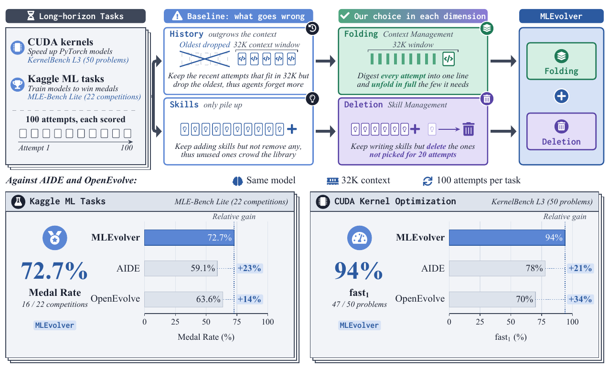
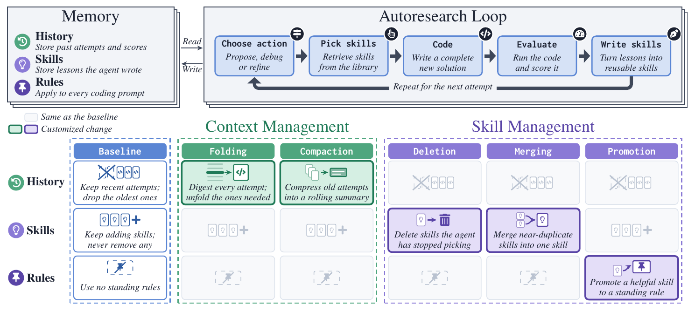
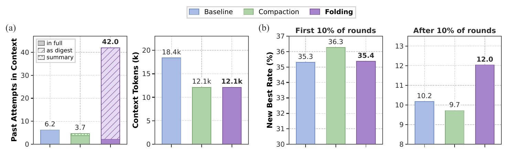
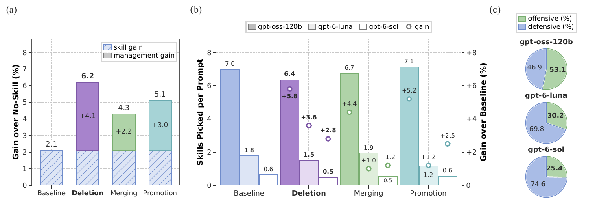
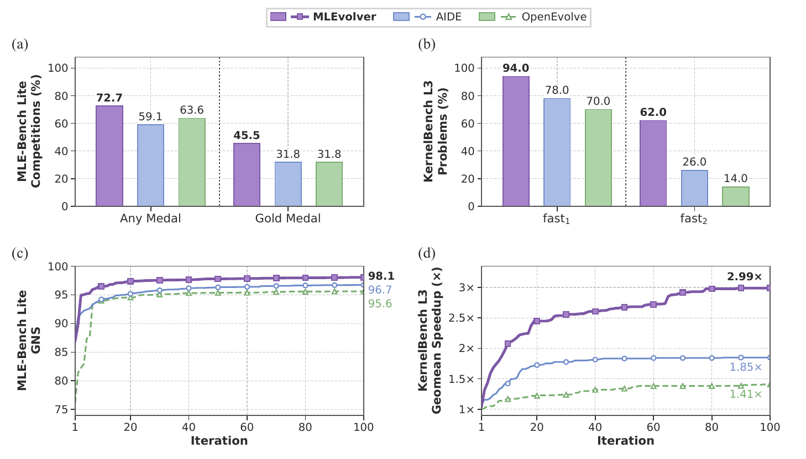

<!-- paper-reading-lang: zh-CN -->
<!-- paper-reading-mode: deep -->
<!-- paper-reading-theme: cobalt -->

<!-- Deep Reading coverage
| 原文范围 | 论证职责 | 本文位置与状态 |
| --- | --- | --- |
| §§1–3.1、Figs.1–2、Eq.1 | 两层记忆与统一实验循环 | 01–03，已讲解 |
| §§3.2–3.3、Eqs.2–4、Appendix F.5–F.7 | 截断、折叠、压缩 | 03–05，已讲解 |
| §3.4、Eqs.5–6、Appendices E、F.2、F.4、F.8–F.9 | 技能写入、检索、删除、合并、提升 | 06–08、12，已讲解 |
| §4、Table 1、Appendices A–B、Eqs.7–11 | 基准、计分、采样、单变量消融 | 09–10，已讲解 |
| §5、Figs.3–4、Appendices C、E | 复盘行为、后期新高、模型差异 | 11–12，已讲解 |
| §§6–7、Fig.5、Appendices C–D | 系统级比较、窗口扩大与边界 | 13–15，已讲解 |
| References、Appendix F.1–F.9 | 来源关系、各角色输入输出 | 15–16，已讲解 |
32 页 v1，附录 A–F 全部走查。文中仅转载部分图，逐任务完整表、补充曲线和提示模板见原文。原文 Fig.1 的 20 轮与方法 §3.4 的 5 轮存在冲突。
-->

# 自动科研如何找回失败的那一轮

这篇论文把固定权重的智能体放进重复实验：写机器学习方案或 CUDA 内核，运行，拿到反馈，再决定下一轮。六个模型与基准组合里，逐条折叠旧实验在两类上下文策略中全部拿到最高终值。后 90% 迭代刷新本次运行历史最优的比例从仅保留近期实验的 10.2% 升至 12.0%，而代码模型平均输入从约 18.4K 降到 12.1K token。技能库方面，按近期使用删除条目的平均收益为 4.1%，高于语义合并和常驻提升。

两条证据分别回答不同问题。第一条关系到还能否找到某次过去实验，第二条关系到每次需要从多少条规则里挑。原文图 1 写连续 20 轮未选则删除，方法 §3.4 和公式（5）写 5 轮，本文算法推导采用正文 5 轮，实际实验参数仍需实现或作者说明确认。

**深读对象**为 Kelvin Kiu-Wai Tam 等的 [Demystifying the Autoresearch Harness: How Context and Skills Shape Self-Evolving Agents](https://arxiv.org/abs/2611.28244v1)。[点此打开原文 ↗](https://arxiv.org/pdf/2611.28244v1)

```paper-map
{"thesis":"把实验历史建成可检索的逐轮档案，并控制每轮候选技能的规模。","reader":"适合搭建实验智能体、模型评测或代码优化循环的研究和工程读者。","goals":["复算上下文容量、淘汰时钟和基准指标","分辨单变量消融、行为解释与跨系统比较","读懂阈值、算力、时间及窗口长度的证据边界"],"outcome":"能够从实验记录和技能检索两条链路诊断长程自动科研。","outcomeSource":"原文 §§3–6、Appendices A–F","items":[{"number":"01","label":"看清每轮在操作什么","signal":"单任务迭代","text":"同一个初始解，选择动作、挑技能、写代码、评测、写经验。","source":"§3、Fig.2"},{"number":"02","label":"把完整历史放在窗口之外","signal":"上下文预算","text":"任务说明、常驻规则和技能占一部分，历史按策略期望提供余量内证据。","source":"Eqs.1–2"},{"number":"03","label":"每轮都有独立索引","signal":"折叠与压缩","text":"比较可展开的短摘要、滚动总结和仅保留近期尝试。","source":"Eqs.3–4、Fig.3"},{"number":"04","label":"管理会增长的技能库","signal":"三种维护策略","text":"看停用、相似性、提分信号各自能做什么。","source":"Eqs.5–7、Fig.4"},{"number":"05","label":"复算两个评测尺度","signal":"指标与规范","text":"用基准阈值和样本分母读归一分、几何平均加速、正确加速覆盖。","source":"§4、Appendices A–B"},{"number":"06","label":"识别后期改进证据","signal":"历史新高率","text":"分别观察首个十分位与后续九成，核对相同 token 下的历史形态。","source":"Fig.3、Appendix C"},{"number":"07","label":"区分单开关和系统对照","signal":"MLEvolver","text":"固定模型、迭代上限与窗口后，读两项系统基准的分母与曲线。","source":"§6、Fig.5"},{"number":"08","label":"审查可复现条件","signal":"附录与边界","text":"窗口放大、分类规则、轨迹反例、角色提示和图文阈值差异。","source":"Appendices A–F"}]}
```

## 01 / 同一个实验为什么会被做两遍

### 把问题缩小到一次运行

假设一位科研助手第一轮训练了简单基线，第二十轮发现一个候选方向在特定数据划分下表现差，第七十轮有了更好的模型和一条来自同类任务的建议。此时，第二十轮的结果仍有价值。它能帮助助手判断这条建议是否值得重新测试，以及怎样设计一个能解释差异的对照。如果工作提示里只剩最近几轮，模型可能重走那条路。如果长历史被总结为「过去试过特征工程」，模型又难以找到当时的划分、改变的变量以及失败发生在哪个阶段。输出一份漂亮的摘要和复查某个实验需要不同的记录粒度。

文章把场景控制在**每次运行解决同一道题**。Kaggle 任务要求交付一份满足评测协议的机器学习方案。CUDA 任务要求交付数值正确且执行更快的实现。两类反馈都会随候选消耗预算，前者给模型分数和运行错误，后者还暴露编译、精度以及计时结果。模型在几十轮机器产生的反馈上调整下一步，模型权重保持固定。这里的自演化指候选程序、实验轨迹和推断时的文档变化。这个限定关系到结果能否外推到跨任务常识积累，后者没有在主协议中发生。

### 共同起点使可归因性更强

每道题中各配置从同一个故意较弱的初始解开始。若配置 A 从更强的初始化出发，增加十轮后仍领先可以全由起点造成。固定 $a_0$ 后，至少这一解释受控。论文随后使用两种证据：同框架内只切换一种策略，以及组合后的完整系统与其他框架比较。前者适合判断哪一种机制在给定基线周围有收益。后者回答一个实际框架能否在相同迭代上限下做出更好的解，两者互相支持但职责不同。



*Tam 等，原文 Fig.1，CC BY 4.0，由 PDF 裁切。图示删除阈值写 20 轮，正文 §3.4、公式（5）写 5 轮。右下 94% 的分母为 50 道 Level 3 问题。*

## 02 / 一次迭代的五个角色

### 候选程序怎样进入历史

先由动作选择器决定探索新思路、优化当前解或排查失败。动作输出是对下一轮方向的选择，完整候选代码在后面由代码角色生成。选择器能查看任务与近期尝试，技能选择器随后按当前症状、动作和适用条件挑出可用经验。候选必须提交完整解，评估器单独运行并把反馈放入历史。技能写手读取这一轮发生了什么，决定是否抽出一条或多条可复用经验。空输出本身也是合理结果，比如运行超时但原因未知，仓促把臆测当规则会给后续轮次带来噪声。

可以把记录看成一次尝试的三个可回看的字段。以下是对原文表示的教学化拆解，方向、程序和实测反馈应保留各自的时间顺序。

$$
\begin{aligned}
a_i&=(p_i,c_i,f_i)\\
H_t&=(a_0,\ldots,a_{t-1})
\end{aligned}
$$

已失败的候选非常有用。假定候选在训练正常、导出异常时得分为空。它对最终榜单没有贡献，却告诉下一轮需要单独验证导出；只记录最高分模型会把这个故障一起藏掉。反过来，结果较低的完整候选不需要每一轮都重新塞给代码模型。若记录带唯一编号，搜索时 2–4 句通常已经够判断是否值得展开。



*Tam 等，原文 Fig.2，CC BY 4.0。绿色改实验历史，紫色改候选技能或常驻规则。褪色单元格沿用基线。*

### 反馈归属不能写反

评估器接收的是本轮产物。写手的工作则是在执行反馈出来后写帮助未来的规则。先有观察，再有提炼。这条因果时序使人能区分「模型当时看见了什么」和「事后解释能挖出什么」。如果把事后发现的隐藏测试答案写进历史，然后回放同一轮的决策，就让离线复盘拥有在线系统没有的信息。论文保留历史和任务评估的职责差异，复现者需要进一步保留时间戳与评估权限，才可在审计时重建每次输入。

## 03 / 同一个上下文有四笔支出

### 四个组成部分和固定窗口

令 $T$ 表示任务说明，$R_t$ 是当前常驻规则，$K_t$ 是本轮挑选的技能。写成方括号表示依约拼接，而非集合并集。历史映射 $\Phi$ 决定代码模型在当前迭代读到哪一部分。

$$
C_t=[T,R_t,K_t,\Phi(H_t)]
$$

$$
\operatorname{tok}(C_t)\le B
$$

对于任务、常驻规则、技能都已确定的单轮，可以把历史可用名额近似记作下面的剩余量。真实实现还需要给拼接标记、角色和边界留出余量，下面用于直观算预算。

$$
\begin{aligned}
B_H&=B-\operatorname{tok}(T,R_t,K_t)
\end{aligned}
$$

**手算一。** 假设窗口上限 32,000 token，任务说明和格式共 3,800，规则 1,200，已选技能 2,000。扣去这三笔，历史余 25,000 token。最近六轮每轮 4,000，合计 24,000，基线可容纳它们。再往前一轮即使很重要，也容不下完整记录。如果每轮摘要平均 120 token，六十轮摘要用 7,200，仍余 17,800。先放摘要之后，可按相关性放四个 4,000 token 的完整实验，外加 1,800 给拼接或其他记录。这里的六十、四个和 120 都是演算设定。图 3 的 42 条和 12.1K 是论文实测平均，也包含不同长度的快照。

### 仅保留近期到底丢了什么

基线在可用历史余量内保留最长近期后缀。这很适合紧追当前错误，最近一轮的程序和日志可直接定位，也几乎不需要额外的总结调用。代价出现在任务方向反复切换时。比如先从方案 A 转到 B，迭代十几次后判断 B 回报变小。回到 A 时，过去 A 的验证故障可能刚好落在后缀之外。论文基线没有为那些旧尝试提供逐条找回路径。技能仍会累积，所以基线也可能凭某条被抽象过的规则避开错误，但规则通常不能恢复完整程序。把基线理解成「完全没有记忆」会低估它，也会把不同层级的能力混为一个开关。

## 04 / 折叠保留每轮的索引

### 从摘要找回原始证据

折叠先为每个完成的尝试建立短摘要。常见元素包括试了什么、得分和关系到下一轮的失败线索。短摘要按记录依次保留，并让检索器选择若干条目展开成完整历史。展开后可看到候选代码、当时的推理和评估输出。论文 F.5 与 F.6 的提示表明，这需要模型在摘要中的序号与评估材料之间建立稳定对应，选择之后由系统恢复对应记录。

$$
d_i=\sigma(a_i),\qquad i<t
$$

$$
\begin{aligned}
D_t&=(d_0,\ldots,d_{t-1})\\
\Phi_{\mathrm{fold}}(H_t)&=[D_t,\operatorname{full}(U_t)]
\end{aligned}
$$

其中 $U_t$ 是筛选后且放得进预算的实验索引；写成子集可以看清展开完整文本的代价是稀缺的。原文和附录把摘要压到 2–4 句。几百个字留下一个明确失败指纹往往比记录「调参」更有检索辨识度。举例说，「在候选验证循环里变更批归一化顺序，只有小批量分组误差异常」比「归一化问题」更能帮模型拒绝误诊。这个例子说明记录设计，未出现在原文实验中。

### 摘要之外仍保存原始记录

实现上，折叠的承诺依赖窗口外保存的完整档案。若使索引永久指向一个会被同名覆盖的临时文件，到了六十轮，模型打开摘要看见的可能已是另外一个版本。原文确保任务历史被写入记忆，工程复现应该将代码、环境标识和评测结果绑定到尝试编号。还可以分别记录候选不可用与测评系统失败。后者没有给方法本身提供负证据，用户也应能在课后的轨迹里辨认。随着轮数增长，摘要目录本身也会长到放不下，论文的 50 或 100 轮没有证明原策略可以无限外推。把索引改为分段或分层是需要新对照实验的设计。

## 05 / 滚动总结也省 token，但找回的粒度不同

### 比较一份动态摘要和一列实验卡

压缩方案先围住最近几条完整记录，再把更早记录和上一版摘要一起交给总结者。历史从大量独立尝试变成一个持续重写的文档加近期后缀。原文 F.7 让摘要保留主方向、最高分、路径、失败点、后续线索等可操作信息。它比任其随意写小作文更强。连续代入仍有损失的机会：第一次总结漏掉的数据划分名，第二次总结找不到它，第三次也无法从当前摘要自动找回它。折叠把压缩单位限定在单条记录，保留索引级的回查。

$$
\begin{aligned}
m_t&=S(m_{t-1},h_t)\\
\Phi_{\mathrm{comp}}(H_t)&=[m_t,\tau_t]
\end{aligned}
$$

这里 $h_t$ 是这次进入旧历史的完整片段，(	au_t) 是尚留在工作上下文的近期后缀。压缩有一种合适的场景：后续工作只需要读长期稳定的结论。例如任务约束是恒定的，交易规则、接口要求和已排除类目高度可概括，一小份文档比长目录更好浏览。本论文测试的是要反复切换实现、甚至要直接恢复某个候选代码的任务。因此用实验索引保留选择权，比只看压缩程度更贴近工作目标。

### 同样平均长度提供一个线索

图 3 左半比出两种方案都在代码角色的提示中用了约 12.1K token，数值呈现到小数一位，不能视为逐轮完全相同。折叠平均可见 42.0 条过往尝试，其中大部分是摘要。压缩是 3.7 条完整近期记录，另外携带一份总结。基线平均保留 6.2 条完整尝试，用 18.4K token。读这张图的关键关系是历史入口数与单条证据长度的取舍。42 个可回查入口既不等于 42 份完整上下文，也不意味着它们都影响了决策。理解这一点之后，才能解释为什么右半图的后期新高率和总输入量可能分离。

## 06 / 技能从一次经验变成可以重新应用的规则

### 适用条件放在建议前面

作者把技能单独存成自然语言单元，包含标题、描述以及适用触发条件。写手还要说明失败的根因、后来验证过的转向，以及能够跨相似尝试复用的结论和应避免的模式。实测日志里可核对的事实往往只对当前候选成立。把事实转成技能需要一个带条件的推断。比如「当前输入数据高度稀疏且验证分层没出现泄漏迹象时，先保留稀疏表示」比「总用稀疏表示」更便于下一轮决定。验证条件在实验任务改变以后可能失效，因此代码角色只有在被选择时接收这条技能，除非它被提升为常驻规则。

可把写入和选用理解为两个函数，论文在 F.2 与 F.4 提供对应提示。写手可以返回零条，选择器也不需要占满固定数量。把空选视为失败会扭曲本来的测量。

$$
\begin{aligned}
L_{t+1}&=L_t\cup W(a_t,H_t)\\
K_t&=P(T,\operatorname{action}_t,L_t)
\end{aligned}
$$

在未实施维护的控制条件中，集合只增长。这一写法省略了物理格式与 ID，便于理解为什么清理单条技能与删实验档案是两类动作。相同程序即使再执行一次，事实仍可回查，技能选择器却无需一直看见由它提炼出来的每个同义条目。

### 模型和候选库互相作用

模型每轮看得到的标题和触发条件由库的历史决定，库的淘汰又反过来由模型是否选择决定。若模型倾向只选前几条，低选择率可能反映展示顺序，而非知识本身无用。技能的活跃程度也可能只是当前优化阶段的代理量。论文测量了各模型的平均技能选取数量，能证明同一机制下观察到的使用策略不同，但不能还原偏好、顺序、上下文长短和技能内容之间的独立因果贡献。一个可复现的日志至少应记下候选全集大小、检索输入、被选编号与本轮得分。

## 07 / 三种维护开关做出三种取舍

### 删除的量是连续未选轮数

按 §3.4 正文，技能一旦被选中，未选计数清零；当连续未选达五轮则从候选库删除。这个规则只在删除变体打开，且删除的是本任务中的候选经验单元。原文图 1 的 20 轮与正文不符，图示不能单独用来配置实验。下式按方法正文重写保留条件。

$$
\begin{aligned}
u_k(t+1)&=
\begin{cases}
0,& k\in K_t\\
v_k,& k\notin K_t
\end{cases}\\
v_k&=1+u_k(t)
\end{aligned}
$$

$$
L_{t+1}^{\mathrm{keep}}=\{k:u_k(t+1)<5\}
$$

**手算二。** A 连续四轮没被选，第五轮被选，计数序列是 1、2、3、4、0。接下来再连续五轮都没被选，第十轮结束后达到 5 并清除。B 一开始便连续五轮没被选，第五轮结束被清除。A 累计九轮未选，B 只有五轮，B 更早离开，因为规则观察连续性。若某个技能只在每十轮进行诊断时有价值，采用 5 的窗口会让它在下一次诊断前消失。论文的平均收益不能消除这个周期性反例。

### 合并看语义邻近，再让模型改写

利用 Qwen3-Embedding-0.6B 的向量，在已有库中为新技能找最近邻。论文阈值为余弦相似度至少 0.8。语义相近的条目由合并角色生成一条带条件的规则。标题接近只是候选入口，仍需要保留原规则依赖的精度、形状或验证条件。合并不是简单复制两段进同一栏，它会实质改变读到的建议。

$$
\cos(x,y)=
\frac{x\cdot y}{\lVert x\rVert\,\lVert y\rVert}
$$

**手算三。** $x=(1,0)$，$y=(4,3)$。点积 4，模长分别 1 与 5，所以相似度为 0.8，恰好满足论文的门槛。现在让两个技能都写「提高吞吐」，一个仅在误差上界满足时生效，另一个专用于不同数据类型。相似度的算式仍可能给高分，但对实验真正重要的是规则中的条件。原文 E.3 展示了近似语义在重写时丢精度细节的案例；看到一个高阈值不等于已经保全事实。

## 08 / 常驻规则会搭下一轮的脚手架

### 晋升需要提名和观测收益

提升把技能从按需检索层挪进规则层。候选先由模型提名，再要求这个技能在至少一个取得改进的迭代里被选过。代码角色从此每一轮都受到这条规则的约束，不再由当轮挑选决定。以下指示器只刻画门槛，忽略提示对选拔理由、重复条目的清理等要求。

$$
\begin{aligned}
E(k)&=\sum_{i<t}\mathbf 1[k\in K_i]\,b_i\\
\mathrm{eligible}(k)&=\mathbf 1[E(k)\ge1]
\end{aligned}
$$

这里 $b_i=1$ 表示第 (i) 轮观察到了改进。若某轮同时改变模型、数据和停止条件，又注入两个技能，最终分数提高只能说明它们共同出现。晋升信号便宜，并不足以判断单一规则的增量贡献。需要强证据时，可以在同一版本、同一随机条件下复跑只移除该规则的对照。论文没有给每次晋升做这样的反事实实验。

### 淘汰、合并和常驻看见的信号不同

用具体场景读三者。某个规则既是早期胜利的搭档，也在后续十几轮很少有关，它容易被晋升机制留下，被删除机制淘汰。某条罕见的正确性提醒可能语义近似常用优化技能，进入合并后文字变少，使用限制也可能变淡。同一条规则命运不同，原因是三个选项使用的证据信号不同。原文没有宣称删除在每个条件都最好，Sol 在 MLE 这一列的晋升得分略高。实务中若规则关系到不可违反的正确性边界，应由任务规范或评估器约束，而非等近期检索频率决定。

## 09 / Kaggle：金牌线是坐标，不是概率

### 先恢复每项原始评分方向

MLE-Bench 的十项消融任务来自六项低复杂度和四项中复杂度竞赛。训练、预测、导出文件，最后由相应竞赛的 grader 评估。附录 B 把比赛、权重、原始指标、金牌阈值和历史名次列成表，并说明有的比赛最大化 AUC 一类的指标，有的最小化损失或误差。每个配置同题跑 100 轮，零号尝试单独评估。超时或者提交的列和行数不符合样例，候选没有分数，迭代仍被消耗。最终拿来排名的是各运行的最佳有效提交。附录中的表和竞赛快照很重要：不同稿件若对同一名称使用不同版本的私榜，归一化后也可能失去可比性。

$$
\mathrm{GNS}_i
=100\frac{s_i-s_i^0}{s_i^{\rm gold}-s_i^0}
$$

$s_i$ 是该任务最佳有效分，$s_i^0$ 是无操作基线的参考分数，$s_i^{\rm gold}$ 来自 MLE-Bench 保存的竞赛私榜金牌线。达到金牌线给 100，越过金牌线可大于 100。低为佳的指标两个差同时转为负，故比值仍沿进步方向增加。

**手算四。** 一个 AUC 例子从 0.50 到 0.80，金牌线 0.90，分数为 $100(0.80-0.50)/(0.90-0.50)=75$。另一个损失从 0.69 降至 0.45，金牌线 0.39，算得 $100(-0.24)/(-0.30)=80$。两道题的 75 与 80 在各自参考尺度上归一。可以一起做加权平均，不能解读成百分之 75 或百分之 80 的概率。

$$
\mathrm{GNS}
=\frac{\sum_i w_i\mathrm{GNS}_i}{\sum_i w_i}
$$

**手算五。** 六个低复杂度任务的 GNS 都是 80，四个中复杂度任务都是 90。取权重 1 和 2 后，分母为 14，分子为 480 加 720，等于 1200，平均 85.71。若直接按十项等权，得到 84。把总表 86.1 理解成“平均做对 86.1% 的题”会完全换掉题意。

### 指标有效性由外部裁判建立

在 Kaggle 格式下，程序写出文件只是进入评分的前提。作者逐赛描述训练、测试和评价的对接，同一项目的赛题在数据、反馈和提交接口上存在明显差别。刻意挑容易提供增量反馈的子集有利于成本估计，但不能据此宣称复杂流水线都有相同表现。判别一条可迁移的经验，至少要核对它针对哪项基准、来自本地验证还是隐藏评测，才知道是否应写成常驻规则。

## 10 / CUDA：先保证同题、正确，再看快不快

### 计时协议也属于方法

KernelBench 消融每个配置运行 50 轮。50 道题包含 20 个单算子、20 条算子链和 10 个模型架构。候选在相同随机生成输入上与 PyTorch Eager 参考核对数值结果。原文硬件是 GH200 144G HBM3e，软件为 Python 3.10.20、PyTorch 2.11.0+cu128、CUDA 12.8。作者报告跨不同候选反复编译和执行时，暂态波动高于原始基准希望维持的水平。因此用重复延时中位数替代原协议的算术平均。中位数抵抗少量尖峰，在硬件不同、计时边界变化或服务并行调度时依然可能变动。交付一个加速结论，数值检查、计时与参考环境都需要一起留痕。

$$
\begin{aligned}
r_i&=\frac{t_i^{\rm Eager}}{t_i^{\rm agent}}\\
G&=\exp\left(\frac{\sum_i\ln r_i}{N}\right)
\end{aligned}
$$

**手算六。** 三个问题的速度倍率分别为 1、2、4，乘积 8，三次方根是 2，算术平均则约 2.33。几何平均保留对乘法变化的对称性。若一题从 1 倍变成 2，另一题从 1 倍跌到一半，整体乘积不变。它仍可能遮住个别明显退化，所以系统对照另看达到某个门槛的题数。比如同样的 2 倍几何平均可以来自每题都很稳定，也可以集中在少数几题。

### 抽样尽量保留计算结构差异

附录 A 从 250 项中得到 238 项有效抽样框。排除项包含 3 个退化近零输出任务、8 个可以通过显著代数化简改变所测题意的任务、1 个无可靠计时项。作者基于计算结构建立 28 个层，每层至少选一项，再匹配 20:20:10 的难度配额。先用试测加速的对数方差及层大小作近似 Neyman 分配，同时用头部空间估计稳定较小层的方差。

$$
n_h\ \propto\ N_h\sigma_h
$$

随后从约三千个候选子集里比较其基线运行时间分布，使用全体时长的 KS 距离及分级对数时间的差异约束，使子集在速度分布上尽可能贴近抽样框。这个流程减少同种算子变体扎堆的风险。其适用对象依然是作者定义的有效框内子集，不能直接把表 1 的倍率外推为所有 250 题或不同 GPU 的平均倍率。另一处边界在于 A.3 的防投机验证。正确性、计时、精度与参考过程分离，加上静态和运行检查，才能尽量让分数来自目标计算。对优化候选，先看输出独立生产且满足精度协议，再讨论加速数字。

## 11 / 消融表与后期新高各自看清一件事

### 六列的两类单位要分别解释

整理 Table 1。左侧每列是该模型的 GNS，右侧是 50 道 CUDA 题的几何平均倍率。最右是逐列先对各自基线算相对变化，再把六列等权平均。

| 只改一个机制 | MLE OSS | MLE Luna | MLE Sol | Kernel OSS | Kernel Luna | Kernel Sol | 六列平均相对变化 |
| --- | ---: | ---: | ---: | ---: | ---: | ---: | ---: |
| 仅近期历史 | 70.5 | 86.1 | 93.2 | 1.17× | 1.46× | 2.16× | — |
| 折叠 | 76.1 | 89.7 | 94.7 | 1.29× | 1.74× | 2.34× | +8.6% |
| 压缩 | 71.6 | 86.4 | 91.6 | 1.16× | 1.47× | 2.20× | +0.3% |
| 删除 | 73.8 | 87.6 | 94.1 | 1.25× | 1.54× | 2.26× | +4.1% |
| 合并 | 73.7 | 87.1 | 94.0 | 1.22× | 1.47× | 2.19× | +2.2% |
| 提升 | 73.6 | 87.0 | 94.3 | 1.24× | 1.48× | 2.24× | +3.0% |

$$
\begin{aligned}
\Delta_j&=100\left(\frac{x_j}{b_j}-1\right)\\
\overline{\Delta}&=\frac16\sum_j\Delta_j
\end{aligned}
$$

**手算七。** Luna 的 KernelBench 倍率从 1.46 升到 1.74，其相对改进等于 $100(1.74/1.46-1)\simeq19.2$%。以同一个固定参考耗时举例，两个候选的相对耗时为 $1.46/1.74\simeq0.839$，也就是新候选快到旧耗时的约 83.9%，用时下降约 16.1%。由相对倍率变动不能直接换算整套服务器节省的 GPU 小时。折叠在全部六列的终值最高。压缩在两个组合低于基线，接近零的六列平均掩盖了正负两面。

原文报告 每个基准六配置与三个骨干平均后的分段统计。前半程 KernelBench 倍率平均相对提高 65.2%，后半程在其基础上再提高 7.4%。MLE 则分别增加 41.6 和 2.9 个 GNS 点。量纲不同，所以不应把 65.2 与 41.6 算成共同均值。附录 C 图 6 还展示各组合改进曲线。折叠在中期五列领先、终点六列领先，说明终值和过半时表现整体同向，却也说明中期分数不能完全预测最终排序。

### 后期新高分母是尝试次数

$$
R_I=\frac{\sum_{t\in I}\mathbf 1[f_t>M_{t-1}]}{|I|}
$$

这里 $M_{t-1}$ 是运行内此前最优，$f_t$ 概念上按基准转换成高为好的有效结果。取 $I$ 为首 10% 时，基线、压缩、折叠依次是 35.3%、36.3%、35.4%。剩余 90% 里则为 10.2%、9.7%、12.0%。相对基线增幅约 $(12.0-10.2)/10.2=17.65$%，绝对增加 1.8 个百分点。假如两种配置在各自 100 个后期尝试里大致找到 12 次、10 次新高，新高次数本身仍未计每次进步有多大。原文统计把行为和终值放在一起观察，提供相互印证。它没有给读者相同 API 总 token 或同一 GPU 总预算的系统对照。折叠多了生成摘要和检索等角色，代码角色上下文较短不足以直接推断全流程费用变低。



*Tam 等，原文 Fig.3，CC BY 4.0。左图的完整、摘要和滚动总结代表三种不同的信息量，横向比较时要保留图例。*

## 12 / 技能库的增益和模型选择偏好

### No-Skill 基线隔离有无技能

作者另关掉技能写手和选择器作为 No-Skill 对照。没有维护的技能库比 No-Skill 平均高 2.1%。删除、合并、提升比不维护的技能库分别再增加 4.1%、2.2%、3.0%。Fig.4a 用堆叠画出各自的贡献，段值延续各自对照。相对变化应按每列基线理解。如果一列先比无技能强 2.1%、又比这一步强 4.1%，数学上合成是 $1.021\times1.041-1\approx6.29$%。论文图把六列相对贡献平均后画成 6.2%，两种算法的舍入和平均顺序不同，不能凭图复原每列分数。

Skill 数量提供了机制侧证。gpt-oss-120b 每轮约选 6.4–7.1 条，Luna 约 1.2–1.9 条，Sol 约 0.5–0.6 条。Appendix E 的库存时间曲线显示，在 gpt-oss-120b 的 MLE 情形下，删除后最后剩 31 条，基线 312 条，提升变体是 330 条并计入常驻规则。删除约九成库存与分数变好发生在同一对照里。这一差距具体属于原文的这一模型、这一基准和运行末段。工作区内的各题任务没有跨题技能继承。



*Tam 等，原文 Fig.4，CC BY 4.0。第二小图柱子看左轴的技能数量，圆点看右轴的相对涨幅。第三小图是被选中的技能构成。*

### 分类规则和轨迹反例共同限制解释

提分型经验提示新的实现、融合或候选方向，保护型经验用来防失败、退化和测量误差。E.1 先看标题的保护动词、谨慎词、停滞提示、提分动词等有序规则，再回到内容表述。图上提分型份额为 OSS 53.1%、Luna 30.2%、Sol 25.4%。表 5 再按任务分开，给 OSS 在两个基准 34.8% 和 71.6%，说明任务形式改变也会大幅改变技能构成。分类来自固定启发式，不能假设概念边界客观，尤其是同时包含纠错和提速的规则。

E.3 给了三类细节。其一，合并一个 CUDA 问题的规则时，原有的明确 FP32 条件被缩成一个不够具体的占位表述，未验证状态也淡出。相关清理在第 79、80 轮附近重新出现，说明“代码替换成功”与“知识表达完整”要分开验收。其二，某个 Level 2 问题原本的融合路径由一条常驻规则表达，后来候选重构后仍能看到相关惯性。其三，Kaggle 轨迹中 LightGBM 规则从第 15 轮附近进入常驻，在第 30 轮切换到 PyTorch 后仍出现。轨迹整体继续找到新高，说明残留本身不能被直接量化为性能损失。要判断应该撤回哪条规则，需要查看具体的有效实现范围和局部反事实。

## 13 / MLEvolver：将两个开关放进完整系统

### 对照对象的搜索组织各有不同

作者把折叠历史和技能删除组合进 MLEvolver。三个系统对照统一 gpt-6-sol、32K 窗口、最多 100 轮，任务换成 22 项 MLE-Bench Lite 与 50 项 KernelBench Level 3。Lite 全是低复杂度比赛。Level 3 集合都是模型架构，和消融中三个等级混合的 50 项不是同一个范围。AIDE 维护候选树并在起草、改进与调试分支间调度。OpenEvolve 用岛群组织候选程序，可选择父代和参考候选，并生成差分修改。MLEvolver 使用实验摘要目录选择探索或改进，然后可展开与选中方向相关的旧实验。比较回答这个系统组合在本设置的效果，作用量里同时含搜索调度、代码组织与技能记忆。

### 同时报告阈值覆盖与全程曲线

用 $b_i$ 表示候选数值正确，再对有效问题的加速检查严格大于阈值。分母是整个题组，不是已经加速的题数。这个定义把正确但更慢、尚无有效候选以及达到加速的题分开理解。

$$
\mathrm{fast}_q=\frac{1}{N}
\sum_i\mathbf 1[b_i=1,\ r_i>q]
$$

| 设定 | MLEvolver | AIDE | OpenEvolve |
| --- | ---: | ---: | ---: |
| Lite 任意奖牌，22 题 | 16/22 | 13/22 | 14/22 |
| Lite 金牌，22 题 | 10/22 | 7/22 | 7/22 |
| Level 3 正确且超过 1 倍，50 题 | 47/50 | 39/50 | 35/50 |
| Level 3 正确且超过 2 倍，50 题 | 31/50 | 13/50 | 7/50 |
| Lite 终点 GNS | 98.1 | 96.7 | 95.6 |
| Level 3 终点几何平均倍率 | 2.99× | 1.85× | 1.41× |

**手算八。** MLEvolver 与 AIDE 的任意奖牌分别是 72.7% 与 59.1%，比值 $16/13-1=23.08$%，增加 13.64 个百分点。超过 1 倍的正确方案是 94% 与 78%，相对 $47/39-1=20.51$%，增加 16 个百分点。把两项相对提升等权平均约 21.8%，对应论文描述的约 22%。换 OpenEvolve 得约 24.3%。这些数字不能和金牌或超过 2 倍那一栏的变化率交叉使用。比如 31 比 13 超过两倍，读者容易把“覆盖了两倍数量的题”和“所有内核快两倍”说成同一条结论，正是分母检查要避免的混淆。



*Tam 等，原文 Fig.5，CC BY 4.0。上方比较达到门槛的题数比例，下方比较连续评分。粗紫线表示 MLEvolver。*

## 14 / 谁从长程迭代里继续受益

### 前段到达的水平和后段斜率

MLEvolver 在 Lite 第 20 轮达到 97.4 GNS，已高于两个对照的完成值。在 Level 3 第 10 轮达到约 2.08 倍，也超过两个对照第 100 轮的几何平均。末半程前者从 2.67× 到 2.99×，按四舍五入数字复算约 12.0%，精确口径原文为 11.9%；同期 AIDE、OpenEvolve 报告 0.8% 和 5.2%。原文解释是显式历史使得重新进入过去路径和延续改进更容易。要检验解释本身，还可记录每一次回查是否指向一个此前落在近期窗口之外的证据，并比较相同候选方向有无回查时的结果。当前论文没有做完整中介分析。

可以从问题结构理解两条曲线为什么不同。竞赛任务早期测试几套建模框架后，后期微小变动可能碰到验证噪声。内核任务往往有更局部的可重复计时反馈，候选的结构和参数可逐步调整，并用功能验证保护正确性。作者把这作为过程讨论。数据没有表明任意机器学习任务都更适合先粗搜，也没有给出断言某一搜索树组织在 CUDA 优化上普遍不利的证据。判断尾部还能学多少，必须看单次尝试的有效反馈强度、成本和稳定性。

### 128K 提升说明容量仍有作用

附录 D 固定 MLEvolver、gpt-6-luna、百轮，将 32K 上限调成 128K。Lite 任意奖牌 59.1% 到 63.6%，金牌 27.3% 到 31.8%。Level 3 超过 1 倍的正确题由 72% 到 78%，超过 2 倍由 10% 到 20%。在 50 道题的分母下，这对应从 5 道增加至 10 道超过 2 倍，额外 5 道。窗口扩大与逐条档案可以同时有用，但这不是同一模型、同一批次同时跑近期截断与折叠的窗口×策略完整交叉实验。无法从这张补充图推断 128K 下折叠相对所有其他策略仍扩大多少优势。原文同样没有把填满 128K 当作必要目标，不宜把窗长直接乘四作为 API 支出估计。

## 15 / 判断哪些结论能带回自己的实验系统

### 先登记输入，再比较输出

如果要用文章思路评估自己的实验助手，一个基本实验可以从固定三件事开始：指定同一套初始候选，对每轮统一给反馈，由同一评估器判对错并计时。接着按图 2 那样只切一个开关，分开记录是否展开旧档案、检索了哪条、有没有真正引用它做下一步。还可以记录重复尝试是否复用了相同基准和配置。重复在某些情况下是验证随机性的合理选择，所以指标应区别预先计划的复验和不知道过去做过而重复进行的候选。强制保留完整运行账会增加记录成本，有了独立的行为结果才能知道收益来自减少重复、提高选择质量还是多跑出有效解。

扩到生产额外需要对齐几本账。轮数预算对允许使用的评估器调用有好处。上下文长度对个别写代码的提示有好处。若角色调用数、输出 token、失败运行和训练资源不同，实际价格与延时仍可能反转。可用同一批样本记录输入输出 token、生成角色次数、求解挂钟、CPU 和 GPU 用时、中断及冷启动，再划定等成本下的结论。论文给出的优势在同模型、同轮次限制以及各自协议下成立。统计量里还未有逐任务多种子置信区间来精确表述跨设置的波动，对近邻排序应保留余地。图 1 的阈值矛盾尤其适合复现前核查，不宜暗中取一种设定并声称是完全复刻。

### 两个系统层级可以搭配独立验收

任务内实验档案负责提供事实，技能层负责提醒要做的事。若两层独立设计，可以长期保留原始分数、候选和条件，同时从当轮选择界面移除不再用的技能。清理经验不需要丢弃失败证据。若要避免重要技能因低频被淘汰，可以先以任务规范保留强制规则，给技能附适用范围与复盘时间，并单独检验这些决定的效果。论文中的折叠、删除属于可比较实验方案。把这套思想带到不同 GPU、数据来源或者跨任务经验时，边界也要随任务重设。

## 16 / 从提示词落到可审计的轨迹

### 附录 F 给出九个角色入口

动作角色看任务与近期尝试的状态，挑一个下一步动作并解释原因。技能选择器对照当前症状和触发条件，决定载入哪些条目。代码角色返回一份完整 Python 方案，附录展示约定的代码块格式，评估器负责运行和反馈。写手根据真实观测填触发、转向和适用边界，可选择不加知识。折叠的选择器点出应展开的精确摘要 ID，摘要器把每轮压为 2–4 句。滚动压缩则要保留最近的最好路径、失败领域以及精确分数等锚点。合并提示要求在相似时仍维护条件差异，提升提示选长期适用且已有收益点的非重复条目。打印成一章长提示时，这些职责边界很容易被错放。用逐角色的原始输入与输出审查，最容易发现由何处引入错误。

三个附录线索可以互查。用 A、B 核对样本范围与实测评分协议。用 C、D 分辨平均曲线和单个窗口设置。用 E 与 F 检查对技能的分类、库存变化、定性例子和原始角色操作。参考文献把 MLE-Bench、KernelBench 及 AIDE 分别作为基准与系统对照，也把已有的反思、检索和技能维护工作放进背景。本篇提出的价值偏向共享循环的归因研究。读者若将结果引用为通用检索模型的优劣、以分数证明方法具有显著因果优势或当成某家模型的官方评测，引用范围会超出原文。

### 给读者一组够用的复核入口

先问自己近几十次长程试验中，有多少次在做第二遍，因为之前的失败没有留下可检索记录。再问常驻规则是否在环境变化后仍然能检查到它们的触发条件。最后将实验工单的成功率、几何性能和耗时分别保存。一个过程可以同时出现更频繁的新高、更长的挂钟以及更少的有效错误，只有指标分别有分母时才知道怎么取舍。论文最值得保留的实践是让每次实验都有可重新打开的证据，以后发生问题时既能复算，也能解释为什么做了当时那个选择。

```paper-check
{"title":"复算工作记忆与自动科研评测","items":[{"question":"折叠记录约 42 条，是否意味着 42 份代码都在提示中？","answer":"否。Fig.3 的 42.0 是摘要为主、可按需展开的记录条目数。完整历史仍存在窗外。","source":"§3.3、Fig.3"},{"question":"GNS 示例中 log loss 从 0.69 到 0.45，金牌线 0.39，得多少分？","answer":"80。分子 −0.24、分母 −0.30，两个负号相消后乘 100。","source":"§4.1、Appendix B.3"},{"question":"连续四轮没选，第五轮选中，何时按正文规则删除？","answer":"第五轮末归零，再连续五轮没有选才删除。§3.4 用 5，Fig.1 写 20。","source":"§3.4、Eq.5、Fig.1"},{"question":"Luna 的 CUDA 倍率 1.46× 到 1.74× 是多少相对变化？","answer":"约 +19.2%；候选相对耗时约 −16.1%，分母是旧候选而非原始 Eager 时间。","source":"Table 1"},{"question":"为什么 94% 不能说成平均速度提升 94%？","answer":"47/50 道题有数值正确且速度超 1 倍的候选，94% 是题数覆盖；速度倍率用 2.99× 几何平均单独描述。","source":"§6.2、Fig.5"},{"question":"压缩和折叠的代码提示平均都约 12.1K，能否据此判断总费用相同？","answer":"不能。需另计写手、检索、摘要、输出 token 与实际评测执行；Fig.3 只报告代码角色的输入。","source":"§5.1、Appendix F"}]}
```

<details>
<summary>原文版本、图像及计算溯源</summary>

- 依据 arXiv:2611.28244v1 的 32 页 PDF，摘要页标示首投 2026-11-20，PDF 封面日期 2026-11-24。PDF SHA-256 为 a30bfb27e07fc42051ed7bdd816fd7ad3e8a8dea42619965fb9544b0e195b6b0。来源为 [arXiv 记录](https://arxiv.org/abs/2611.28244v1) 和 [PDF](https://arxiv.org/pdf/2611.28244v1)。
- 图 1–5 是同一 PDF 中的原图裁切，作者 Kelvin Kiu-Wai Tam 等。按 [CC BY 4.0](https://creativecommons.org/licenses/by/4.0/) 转载，图中文字及数据维持原貌。
- Table 1、Figs.3–5 及 7 的读数来自报告。本篇手算、预算示例、归因分析与复现建议属于解读。未执行论文的训练、GPU 计时或复现实验。正文中 5 轮与 Fig.1 中 20 轮的差异来自同一版本，实际消融配置等待实现确认。

</details>
