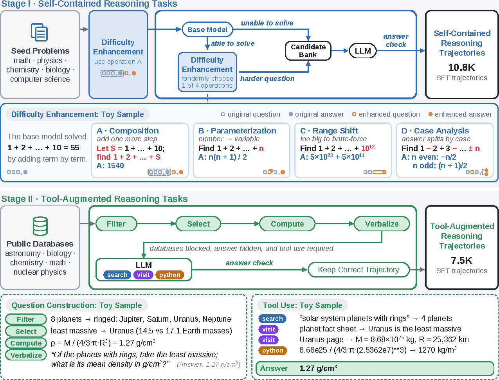
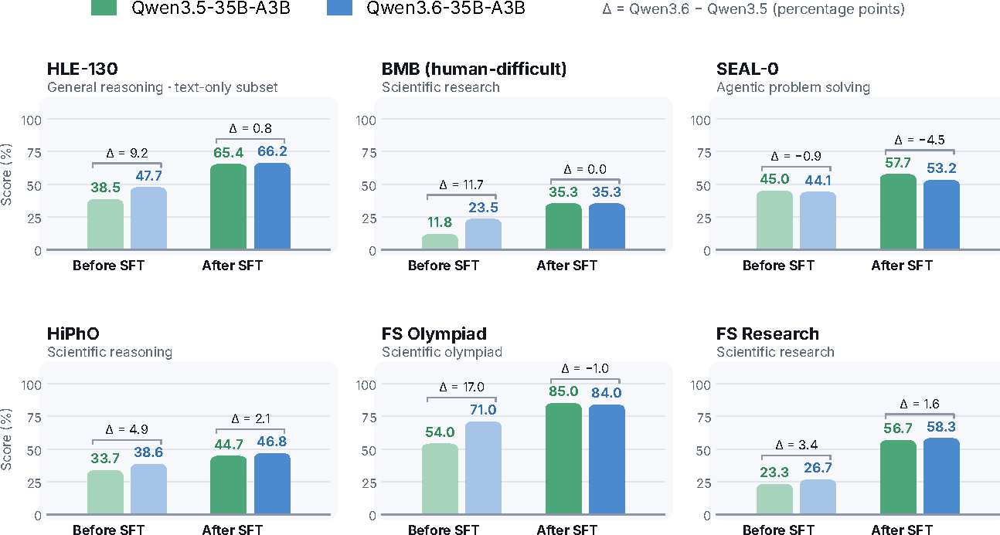

<!-- paper-reading-lang: zh-CN -->
<!-- paper-reading-mode: deep -->
<!-- paper-reading-theme: saffron -->

# Axion 1.0 深读：把 Agent 基座训练做减法，把数据构造做加法

```paper-map
{"thesis":"现代 agent 模型的训练管线越堆越厚（中途训练/DPO/OPD/多阶段专料），Axion 1.0 反问「哪些成分真的必要」：只用两段轻量 SFT + 一段 RL，把复杂度全部转移到数据构造上——第一段用模型感知的四难化算子造自包含推理题，第二段用确定性程序从真实数据库造工具依赖题，RL 用前缀链分层奖励——35B/122B 双尺寸在六个基准上追平或超过前沿闭源模型，且数据构造、过滤、验证、prompt、训练代码全开源。","reader":"了解 LLM 后训练基本流程、想看一份可复现的 agent 基座训练配方及其证据边界的读者。","goals":["走通两段数据构造的每个机制：难化算子、三解一致验证、确定性 filter-select-compute","把奖励函数、进度度量、GPU 账本、阶段增益逐格手算","分清「配方简单」与「生态简单」：哪里仍然依赖外部强模型","识别评测协议（best-of-3、跨源基线）对结论强度的影响"],"outcome":"通读 arXiv 2611.03233v2 全部 22 页：正文 §1-§7、附录 A 超参表全档、附录 B 三个案例研究。","outcomeSource":"arXiv 2611.03233v2 PDF pp.1-22","items":[{"number":"01","label":"靶子","signal":"复杂度惯性","text":"训练管线成分越加越多，复现成本高、增益来源模糊、配方难迁移；很多「开源」只放权重不放过程。","source":"§1"},{"number":"02","label":"配方","signal":"三段式","text":"SFT-I 自包含推理（10.8K 题）→ SFT-II 工具依赖推理（7.5K 题）→ GRPO RL；无中途训练、无 DPO、无 OPD。","source":"§3.1, Fig.2"},{"number":"03","label":"数据一","signal":"模型感知难化","text":"基座做对的题按其成功策略施加 A 组合/B 参数化/C 范围平移/D 分情况四算子之一；GPT-5.5 三解一致才定参考答案。","source":"§2.1"},{"number":"04","label":"数据二","signal":"确定性构造","text":"filter-select-compute-verbalize 从结构化数据库程序化出题：构造期算出答案、解题期封锁构造库、闭书可解题剔除——强制工具依赖。","source":"§2.2"},{"number":"05","label":"奖励","signal":"前缀链","text":"RL 奖励 1 / max(0, 0.3P−0.1(1−A))：P 按依赖序累乘，后面的步骤只有前置全过才计分；不提交答案扣 0.1。","source":"§3.3, Eq.4-5"},{"number":"06","label":"证据与边界","signal":"逐格重算","text":"六基准 52.2/59.0（受限口径）追平 GPT-5.6 Sol；Stage I 在 BMB 上倒退 5.9、RL 有负增益格、SEAL-0 大模型反不如小模型——协议 best-of-3 需带折扣读。","source":"§4, Tables 1-3"}]}
```



*原论文 Fig. 2，PDF p.4 裁剪。上：Stage I 自包含推理——种子经组合增强与基座实测，做对的题按四算子（A 组合/B 参数化/C 范围平移/D 分情况）定向难化，三解一致定参考答案，只保留正确轨迹（10.8K）；下：Stage II 工具增强推理——公开数据库经 filter/select/compute 确定性出题，构造库封锁+闭书剔除强制工具依赖（7.5K）。两侧 toy sample 分别演示 1+…+10 的四种难化与天王星密度题。*

深读对象：Axion 1.0: Open Agent Foundation Models, Simplified（arXiv 2611.03233v2，2026-11-03，Duke/字节跳动/马里兰大学/布法罗大学合作，PDF 22 页）。这期 HF 周三刊（11-04，42 篇）的 agent 含量依旧很高：Recursa 做递归自改进系统、ToolSpace 合成工具环境、WebHarbor 给 GUI agent 造真实网站环境、Mage-VL-Cowork 训 4B 混合 CUA——它们都在往上加东西，而 Axion 1.0 反着来：**agent 基座模型的训练管线能不能做减法**。答案是一个三段式配方（两段 SFT + 一段 RL，明确不用中途训练/DPO/OPD），把省下来的复杂度全部押在数据构造上——10.8K 道自包含推理题 + 7.5K 道工具依赖题，规模小得反直觉（对比 CUA-Master 的 115K 任务），却在 Humanity's Last Exam、FrontierScience 等六个基准上把 35B/122B 两个尺寸推到与 GPT-5.6 Sol、Gemini 3.1 Pro 同档。本页按细章跟读：两个数据管线的每个机制配手算教学例（组合增强的 1540、Uranus 密度 1.27、立方体测地线 73%），奖励函数与进度度量逐边界取值，Table 1-3 与 R3 诊断数字逐格复算，附录 A 超参全档与 B 三个案例全量整合。边界也先立住：这是一份来自工业界的配方论文，评测协议（每基准 3 次取最好、跨源基线）与「配方简单≠生态简单」（数据验证用 GPT-5.5、RL 裁判用 Qwen3.8-27B）都会在 §16 单独对账。

<!-- Deep Reading coverage
| Source section / object | Role | Explanation location / status |
| --- | --- | --- |
| §1 引言（复杂度惯性之问、贡献列表） | 立论 | §01-02 |
| §2.1 自包含推理数据（种子/操作 A/四难化算子/三解一致/轨迹过滤，Eq.1） | 机制一 | §03-05（含 Fig.2 上半） |
| §2.2 工具依赖数据（filter-select-compute-verbalize/防泄漏三闸/中间验证目标，Eq.2） | 机制二 | §06-07（含 Uranus 手算） |
| §3.1-3.2 训练总览与两段 SFT（Eq.3 assistant-only 损失） | 配方 | §08-09 |
| §3.3 RL（GRPO、Eq.4 奖励、Eq.5 前缀链、任务筛选） | 机制三 | §10-11（多处手算） |
| §4.1 评测设置（best-of-3 协议、HLE 双口径） | 协议 | §13、§16 |
| §4.2 Table 1 六基准总表 | 主证据 | §13（差值逐格） |
| §4.3 Table 2 阶段贡献 | 消融 | §14（含回归格） |
| §4.4 Fig.3 基座对比 / Table 3 规模 / R3 分析 | 附加分析 | §15 |
| §5.1 SFT 基础设施（FSDP/EP/CP、GPU 账本） | 复现条件 | §12 |
| §5.2 RL 基础设施（异步/TITO/R3） | 机制四 | §12 末-15 |
| §6 相关工作（四条线定位） | 谱系 | §02、§16 摘要 |
| §7 结论 | 收束 | §16 |
| App A Tables 4/5 超参全档 | 复现条件 | §12（全表搬入） |
| App B Table 6 + B.1-B.3 案例 | 定性证据 | §14 末（逐案例） |
| References | 行政性材料 | 不单列 |
-->

## 01 / 靶子：训练管线的复杂度惯性

论文开篇的诊断不是「现有模型不够强」而是「现有配方不够懂」：现代 agent 模型的训练栈普遍是中途训练 + 多个监督阶段 + 能力专属数据配比 + 偏好优化 + RL + 各种附加后训练的叠加。每个成分单独看都有动机，但**叠起来之后就没人说得清哪些是必要的**——复现成本抬高、能力增益的来源被淹没、配方换一个基座就失灵。第二个靶子是「假开源」：很多模型放权重，但数据构造、过滤、验证、prompt、训练过程全部缺席——而 agent 基座的能力恰恰取决于数据和交互设计，不只是一个权重文件。Axion 的回应是一句问话式的宣言：*训练管线可以简化到什么程度，还能造出强而广的 agent 基座？* 边界句要立刻钉住：「简化」指**训练阶段结构**（不做中途训练/DPO/OPD），不指数据构造工作量——恰恰相反，论文的原则是「简化训练管线不需要简化学习问题」，把力气全花在题目质量上。这个立场后面每个数字都要靠它解释：18.3K 道题训出 HLE 59.0（受限口径），靠的不是量大是题难且可验证。

### 为什么「过程件开源」比权重开源难得多

权重是一个静态制品，放出即完事；过程件是一个决策链——种子从哪来、难化算子怎么选、验证失败率多少、哪些题被闭书探测剔除、RL 任务池过滤后剩多少，每一环都有参数与判断。放过程件等于把这套判断链摊开接受检验：别人可以逐环复算、逐环挑错，也可以换掉任何一环看后果。论文相关工作里点名了这条路的上游：OpenThoughts 开推理数据配方、OpenThoughts-Agent 开 agentic 数据管理、DR Tulu 开 RL 框架、QUEST 开模型+数据+脚本——Axion 把它们拼成一条**从种子到 RL 的单一连续管线**并保证每一环的开源粒度对齐（能跑、能改、能对账）。这个背景下再读「简单配方」的动机会更准：管线越短，过程件越可检查——三段式不只是省算力，也是**让开源承诺可兑现**的结构性条件；一个十段管线的「全开源」论文，读者实际上没能力逐环审计。

## 02 / 开放度与配方总览

Axion 1.0 释放两个尺寸：35B-A3B 与 122B-A10B，分别从 Qwen3.6-35B-A3B 与 Qwen3.5-122B-A10B 初始化（还有仅做两段 SFT 的 4B/9B 变体做规模分析）。注意一个容易漏看的细节：**两个尺寸用的基座代次不同**（122B 用 Qwen3.5、35B 用更新的 Qwen3.6），论文没有解释这个选择——它让跨尺寸对比多了一个混淆变量（§15 的基座对比只在 35B 档内做了控制）。「全开源」的具体清单值得照抄：数据构造、生成、过滤、验证的完整管线 + prompt + 训练代码 + 权重（github.com/bytedance/axion1_0）。配方三段：**SFT-I** 在自包含推理数据上教模型解难题（可用 Python、禁检索）；**SFT-II** 从 Stage I 检查点继续，在工具依赖数据上教模型搜资料、读网页、把外部证据与推理计算结合；**RL** 用 GRPO 在模型自己的工具交互轨迹上继续优化。相关工作里作者把自己放进四条谱系的交点：比 MiroThinker-1.7（中途训练+偏好优化+RL）少两段、比 Agents-A1（域路由 OPD）换掉蒸馏、比 Apodex 1.1 收窄到单 agent；数据侧与 Evol-Instruct/Absolute Zero/Agent0 一脉（任务难度适配学习者）但明确差异——**对基座已能解对的题，按它自己的成功策略定向加难**；工具任务侧与 TaskCraft/WebShaper/QUEST 互补——先由确定性程序算出答案、再让 LLM 把题面写出来。这个「答案先行、题面后置」的倒置是全文最值得偷的设计之一，§06 展开。

## 03 / 数据管线 I：种子与组合增强

Stage I 的原料是公开课程、竞赛与推理数据集的问答对（数学/物理/化学/生物/计算机），但**不直接训练**这些可能已被基座见过的题，而是当种子。第一步「组合（操作 A）」：生成器 LLM 找出种子解法所确立的某个量，构造一道**以该量为必要中间结果**的新题，要求新题自包含、答案无歧义可检查、且不泄露原种子。论文的 toy 例子值得手算一遍（教学重算）：种子 $1+2+\dots+10=55$；操作 A 令 $S=55$，新题「求 $1+2+\dots+S$」；答案 $S(S+1)/2 = 55\times56/2 = 1540$——原题的答案变成新题的输入，新题的答案要靠通项公式而不是再数一遍。这步产出的只是「初始增强池」，难化还在后面。

### 为什么不直接用种子题训练

三个理由都值得展开。**污染风险**：公开数据集的题大概率在基座预训练语料里，直接训等于复习已会的内容，SFT 增益虚高。**难度天花板**：课程与竞赛题的难度分布是给人定的，对 2026 年的百 MoE 基座来说，大量种子已无训练价值——论文用基座实测来筛（§04），而不是用人设难度标签。**验证独立**：新题的参考答案由 GPT-5.5 三解一致独立建立（§05），不继承种子的答案——每道题的「可验证性」是构造时重建的，不是从种子搬运的。

## 04 / 数据管线 II：模型感知的四难化算子

初始池的每道题都让基座实测一次（允许 Python、禁搜索与网页）。**做错的题直接进候选题库**；**做对的题才触发难化**——生成器拿到基座的成功解法，随机施加四个算子之一（这是「模型感知」的含义：难化的方向对着基座的解法策略打）：

- **A 组合**：在当前题上再挂一个依赖步，原答案变成新题的中间结果（与 §03 的初始组合同型，可叠加两次）；
- **B 参数化**：把固定值换成符号参数，要求给通式而非数值——toy 例：$1+\dots+n$ 的答案是 $n(n+1)/2$；
- **C 范围平移**：把参数范围放大到枚举或捷径失效——toy 例：$1+\dots+10^{12}$，逐项求和不可行，答案是 $\tfrac{10^{12}(10^{12}+1)}{2} = 5\times10^{23}+5\times10^{11}$（手算：$10^{12}\times(10^{12}+1)/2 = (10^{24}+10^{12})/2$ ✓）；
- **D 分情况**：加入答案随条件分支的结构——toy 例：$1-2+3-\dots\pm n$，$n$ 偶数时 $-n/2$、奇数时 $(n+1)/2$（验证：$n=4\to 1-2+3-4=-2=-4/2$ ✓；$n=5\to -2+5=3=6/2$ ✓）。

教学要点：四个算子攻击的是**解题策略**而不是题面长度——组合封「一步出答案」、参数化封「背具体值」、范围平移封「暴力枚举」、分情况封「单一公式套到底」。转化后的题经答案验证即入库，**不再要求基座第二次做错**（边界句：这是有意的宽松——目标是增加所需推理量，不是保证每题都难倒基座）。这个设计与 Evol-Instruct 的差别论文自己点明：Evol 是「迭代变换加复杂度」，Axion 是「对着你的成功解法定向加难」——前者盲改，后者瞄准。

### 一道题走完整条难化链（教学重演）

把整条 Stage I 管线在一道题上走一遍（本页构造的教学重演，各步规则均取自论文）：种子「求 $1+2+\dots+10$」，答案 55。操作 A 初始增强 → 「令 $S=55$，求 $1+\dots+S$」，GPT-5.5 三解一致给出参考答案 1540。基座实测：做对了（这题对百 MoE 太容易），其成功策略是「直接套 $n(n+1)/2$」。随机抽中算子 C（范围平移）→ 「求 $1+2+\dots+10^{12}$」——原策略的公式仍适用但枚举失效，参考答案重建为 $5\times10^{23}+5\times10^{11}$（三解一致 ✓）。轨迹采集：解题 LLM 带 Python 生成轨迹，最终答案与参考比对一致、格式完整 → 入库。这条链的关键节点在「基座做对 → 拿到它的解法 → 定向选算子」：如果基座用枚举法做对了（10 项逐加），C 算子就直接废掉它的策略；如果它用公式，C 算子其实没伤到策略本身、只放大了执行精度要求——这也解释了为什么论文强调「目标是增加推理量而非数值精度」，四个算子里 C 是最接近「精度加难」的一个，其配比权重论文未披露。

## 05 / 数据管线 III：三解一致与轨迹过滤

参考答案的建立独立于基座预测：GPT-5.5 独立解三遍，**三次答案一致且推导过正确性检查**才采纳为参考答案；病态题、欠规格题直接丢弃。每次改写后答案都要重建（组合增强后原答案作废）。这个「三解一致」门槛的取舍值得记：它筛掉的是 GPT-5.5 自己也拿不准的题——代价是**系统性偏向 GPT-5.5 能稳定解出的题**，难度上限被验证器的能力封顶（一道连 GPT-5.5 三次都解不一致的超难题，即使构造得再好也进不了库）；论文用「验证器弱于受训模型怎么办」的代价换了「参考答案绝对可靠」的收益，这是数据工程里典型的可靠性-难度交换。然后由另一个 LLM 在「Python 可用、检索禁用」条件下解候选题，轨迹包含推理、Python 调用与输出、最终答案；与参考答案比对，**只保留答案正确、工具调用合法、格式完整、无重复的轨迹**。最终数据集形式化：

$$\mathcal{D}_{sc}=\{(x_i,\tau_i,\varnothing,y_i)\}_{i=1}^{M_{sc}}$$

$x$ 是题目、$y$ 参考答案、$\tau$ 保留的解轨迹、$\varnothing$ 表示无程序化中间验证目标——10.8K 条（$M_{sc}=10.8\mathrm{K}$）。这里有个规模直觉值得算（教学重算）：122B 基座 Stage I 处理 841M token、每题 3 个 epoch，每题平均 token 预算为

$$\bar\ell_{sc}=\frac{841\mathrm{M}}{10.8\mathrm{K}\times3\ \text{epoch}}\approx 25.9\mathrm{K}\ \text{token/题}$$

**每条自包含推理轨迹平均约 2.6 万 token**，是货真价实的长思维链数据；这也解释了为什么 18.3K 道题能撑起一个训练段：量少但每条都厚。同口径对照两个参照系：CUA-Master 的 115K 任务按其 247K token/任务的**评测**开销不可比（那是含环境交互的 rollout），但方向一致——2026 年的共识已是「任务级难度与轨迹级厚度比任务数量更重要」；而 Axion 的激进之处是把这条推到极限：**18.3K 题训一个 122B agent 基座**，每题背后是「种子→定向难化→三解一致→基座试解→轨迹过滤」五道闸，一条轨迹的制造成本远高于一条普通合成指令。边界句：Stage II 的 token 量论文未单独披露，7.5K 工具题的轨迹厚度无法用同法估算。

## 06 / 数据管线 IV：filter-select-compute-verbalize

Stage II 面向答案依赖外部事实的题。原料是结构化公开数据库（天文/生物/化学/数学/地理/航空等），每条记录有实体、属性、值。出题是四步确定性程序：

1. **Filter**：按显式条件筛出候选实体集（例：八大行星中有环的 → 木/土/天/海四颗）；
2. **Select**：按极值准则唯一确定一个实体（例：其中质量最小的 → 天王星，14.5 vs 17.1 地球质量，与海王星拉开足够差距）;
3. **Compute**：取该实体的属性按确定公式算派生量（含单位换算）；
4. **Verbalize**：LLM 把筛选条件与计算要求写成自然语言题面，程序答案为准。

Uranus 手算（教学重算，论文原例）：$M=8.68\times10^{25}$ kg、$R=25{,}362$ km，$\rho = M/(4\pi R^3/3)$：$R^3 = (2.5362\times10^7)^3 \approx 1.6317\times10^{22}$ m³，$4\pi/3\times1.6317\times10^{22} \approx 6.840\times10^{22}$，$\rho = 8.68\times10^{25}/6.840\times10^{22} \approx 1269$ kg/m³ $= 1.27$ g/cm³ ✓ 与论文一致。一道题串起实体识别、事实检索、单位换算、公式计算四层能力——考的不是记忆而是组合。

### Select 的唯一性与裕量条件

Filter 与 Select 之间藏着一个容易被略过的数值条件：极值选择要求**与次名拉开足够裕量（margin）**，论文的表述是「避免歧义或不稳定的答案」。把它写成检查式（本页形式化，教学重建）：

$$v_{(1)} \le (1-\delta)\, v_{(2)}\quad\text{（以「最小」准则为例）}$$

即候选集中最小值 $v_{(1)}$ 必须比次小值 $v_{(2)}$ 足够小（相对差 $\delta$ 以上），题目才被放行。原因很实际：如果两颗行星质量只差 2%，不同数据源的舍入误差或版本差异就可能翻转 Select 的结果——参考答案在构造期就「不稳」，解题期无论检索到哪个源都对不上。Uranus 例里 14.5 对 17.1 地球质量（相对差约 15%）轻松过闸。这个条件与确定性验证三件套（filter 产出非空、select 唯一、所需属性可用）一起，把「答案在题面生成之前就已验证稳定」落到了程序级——对比让 LLM 先出题再想办法验证的管线，这里**验证成本在构造期一次性付清**，训练期每条轨迹的检查都是廉价的精确比对。

### 跨库链：上一步的输出决定下一步的检索

跨多个数据库的任务靠实体标识符与交叉引用串联：Filter 在库 A 选出的实体，其标识符成为库 B 里 Filter 的输入——题目因此天然形成依赖链。这个设计与后面 RL 的前缀链奖励（§10）严丝合缝：构造期的依赖序就是 $z_i=\{v_{i,1},\dots,v_{i,m}\}$ 的顺序，就是 $P(\tau;z)$ 里累乘的顺序——**数据的结构直接成了奖励的结构**，不需要任何额外的任务分析。

### 防泄漏三闸

这个管线最容易被忽视的是三道防泄漏设计。**闸一（构造库封锁）**：构造期的数据库表在解题期对模型不可访问——可以搜网、看网页、跑 Python，但不能直接查构造库，答案必须从公开信息里重新拼出来。**闸二（闭书剔除）**：出好的题先做一次无工具闭书探测，**能被闭书答对的题直接剔除**——保证监督信号集中在信息获取而不是背诵。**闸三（题面消毒）**：verbalize 后检查有没有丢约束、有没有把选中实体或答案说漏嘴，并尽量避免点名源数据库（不给「直接查表」的路径提示）。极值选择还要求与次名拉开足够裕量（margin），防止答案不稳定。跨库任务用实体标识符串联：上一步的输出决定下一步的检索。中间实体与值保留为**中间验证目标** $z_i=\{v_{i,1},\dots,v_{i,m}\}$——解题时不给，RL 时当过程奖励用（§10）。数据集：

$$\mathcal{D}_{ta}=\{(x_i,\tau_i,z_i,y_i)\}_{i=1}^{M_{ta}}$$

$M_{ta}=7.5\mathrm{K}$。两段数据合成一条能力递进：先独立推理、再在检索证据上推理。

## 07 / 训练总览：简化训练不等于简化学习问题

三段结构：SFT-I 用 $\mathcal{D}_{sc}$、SFT-II 从 Stage I 检查点继续用 $\mathcal{D}_{ta}$、RL 从 Stage II 检查点开始。没有中途训练、没有 DPO、没有 OPD——每一条都是对当前主流配方的显式减法。但「轻量」二字要正确理解（边界句）：训练段轻，是因为**难题已经把学习问题做重了**；同时生态并不轻——数据验证用 GPT-5.5、RL 开放式奖励用 Qwen3.8-27B 裁判、上下文压缩用 6 个 Qwen3.5-9B（§12）。配方简单性的正确读法是「阶段结构可复现、可归因」，不是「一个人一把卡就能复现」。

### 「不做清单」逐条对账

三条减法各自对着一个行业默认，值得逐条对账。**不做中途训练（mid-training）**：近年 agent 模型常在预训练与后训练之间插一段大规模继续预训练（代码/工具语料/轨迹语料），Axion 认为两段 SFT 的高质量轨迹已覆盖该功能——但注意对照限制：它没有做「加了中途训练会不会更好」的实验，这是减法声明不是等价性证明。**不做 DPO**：偏好优化通常排在 SFT 后修格式与风格，Axion 的替代是 Eq.4 奖励里那个显式的格式项 $A$（不提交合法终答直接扣）+ RL 的组内竞争——把「偏好」下沉到可验证的奖励结构里。**不做 OPD**：近期工作（如 Agents-A1 的域路由蒸馏）用强教师在线蒸馏，Axion 的替代是**数据侧外部性**——生成与验证借用 GPT-5.5，但训练信号全部来自自己的轨迹。三条减法共享同一个逻辑：**凡是能用「更难的题 + 更严格的验证」替代的阶段，一律砍掉**；替代不了的部分（裁判、验证器）老实留在生态里并写清楚。

## 08 / SFT 目标：assistant-only 监督

两段 SFT 共用目标：

$$\mathcal{L}_{\mathrm{SFT}}(\theta;\mathcal{D}_k)=-\sum_{(x,\tau,z,y)\in\mathcal{D}_k}\ \sum_{j\in I_{asst}(\tau)}\log\pi_\theta(\tau_j\mid x,\tau_{<j})$$

$k\in\{sc,ta\}$，$I_{asst}(\tau)$ 索引轨迹里**assistant 生成的 token 位置**。序列化完整交互（含工具观测），但系统消息、用户消息、工具观测只提供上下文不计损失；参考答案与验证目标只用于检查轨迹、不进模型输入。这与 CUA-Master 等工作的做法一致，但论文把它写进公式层面（$I_{asst}$ 显式出现在损失里），复现时不会含糊。为什么观测不进损失值得多说一句（教学重建）：工具观测是**环境返回的文本**，其分布由工具与网页决定而非模型策略——若计入损失，模型在学习「模仿搜索引擎的输出风格」，这既不是目标能力、又会把梯度预算浪费在不受策略控制的 token 上；长轨迹里观测常占大半（搜索结果页动辄数千 token），不掩蔽的话有效信号被稀释。代价面同样真实：掩蔽观测意味着模型在训练中从不「学习预测环境」，对环境行为的全部理解都来自条件上下文——这与世界模型路线（把环境预测纳入目标）的分野在此。全参数、sample packing、两段超参一致（附录 A：lr $3\times10^{-6}$ 恒定、warmup 0、Adam $(0.9,0.95)$、wd 0.1、clip 1.0、BF16、每段 3 epoch、128K 序列、全局 batch 8——batch 计序列数）。

### 为什么两段顺序不能换

SFT-I 在禁检索条件下教推理，SFT-II 在开检索条件下教取证。如果反过来（先工具后纯推理），模型在学推理时会习惯性「先搜一下」，而封闭题恰恰要求它靠已有知识硬想——论文的表述是「先教模型推理，再要求它检索并整合外部信息」。附录 B 的案例对照给了定性侧写：Stage I 学到的自检行为（B.1 立方体题：先网格 Dijkstra 逼近、发现与已知构型的解析值不符、诊断出网格限制在边上走折线、换面展开解析法），在 Stage II 转化为证据核查（B.2 哲学归属题：从「主题相关」升级到「找到直接支持该归属的段落」）。

## 09 / RL：GRPO 与异步训练

从 Stage II 检查点起，用 verl 的全异步 GRPO：模型在搜索、网页访问、学术检索、Python 工具上生成轨迹，上下文管理支持长程 rollout。RL 任务直接复用 §2.2 的程序化构造池——**可验证答案与中间目标天然自带**，不需要人工奖励标注。每题 8 条 rollout，组内相对优势照 GRPO 惯例：

$$\hat A_i=\frac{r_i-\mathrm{mean}\left(\{r_j\}_{j=1}^{8}\right)}{\mathrm{std}\left(\{r_j\}_{j=1}^{8}\right)}$$

组基线消掉绝对奖励尺度（Eq.4 的 0.3/0.1 系数不进优势的量纲），只留组内相对好坏。session 级训练（QUEST 式上下文压缩把 rollout 切成 session，同 rollout 的 session 共享奖励与组归一优势，损失按 session 归一）。策略更新用非对称裁剪的 PPO 式目标（附录 A 的 clip 范围 0.2/0.28）：

$$\mathcal{L}=\mathbb{E}\left[\min\left(r_t\hat A_t,\ \mathrm{clip}\left(r_t,\ 1-0.2,\ 1+0.28\right)\hat A_t\right)\right]$$

上界放宽到 1.28 意味着**允许概率比往上多走一步**——正优势方向更新更激进、负方向更保守；这是工程侧对「RL 增益不稳」（§14 的负增益格）的一个对冲设计（本页推断，论文未解释为何非对称）。异步侧的工程参数：trainer 每凑满 24 个非退化奖励的 prompt 更新一次；每 2 个优化器步把新权重 NCCL 推给 rollout 引擎（122B 要 45-60 秒）；超过 11 个参数版本旧的在途轨迹直接丢弃（staleness 阈值）。

## 10 / 奖励设计：结果 + 前缀链进度 + 不提交罚

奖励函数是 RL 段的核心机制，分段定义：

$$R(\tau;y,z)=\begin{cases}1, & F=1\\ \max\left(0,\ 0.3P-0.1(1-A)\right), & F=0\end{cases}$$

$F\in\{0,1\}$ 终答是否正确、$A\in\{0,1\}$ 是否提交了合法终答、$P\in[0,1]$ 是中间进度。进度度量按依赖序累乘：

$$P(\tau;z)=\frac{1}{m}\sum_{j=1}^{m}\prod_{\ell=1}^{j}b_\ell(\tau;z)$$

$b_j$ 表示第 $j$ 个目标是否被正确确立——**后面的步骤只有前置全部通过才计分**。论文原例：3 步链、第 1/3 步过、第 2 步不过，则 $j=1$ 计 $b_1=1$，$j=2$ 计 $b_1b_2=0$，$j=3$ 计 $b_1b_2b_3=0$，$P=1/3$。

教学算例（改输入取值，逐格走边界）：5 步链 $b=[1,1,0,1,1]$——$j=1{:}1$、$j=2{:}1$、$j=3{:}0$、$j=4{:}0$、$j=5{:}0$，$P=2/5$；若 $A=1$ 则 $R=\max(0,0.3\times0.4)=0.12$。三个边界值得记：(1) $P=1/3,A=1\to R=0.1$，与 $P=2/3,A=0\to\max(0,0.2-0.1)=0.1$ 同分——**做了三分之二进度但不交答案 = 只做三分之一进度且交了答案**，这个等价是有意的：鼓励「有进展就收尾」；(2) 不提交罚最多吃掉 0.1，$P<1/3$ 且 $A=0$ 时奖励归零（max 的下界）；(3) $F=1$ 时奖励无折扣——终答正确给满 1，不与 $P$ 叠加。中间结果的验证要求「在推理中被识别或使用」而非只在检索候选里出现过；需要外部接地的目标（实体标识符）必须有工具观测支撑；验证是确定性检查 + LLM 语义等价判断的组合，数值容差程序化计算后显式传给裁判。

### 系数设计的三处取舍

三个系数（0.3 的进度上限、0.1 的不提交罚、前缀链的累乘结构）各埋一处取舍。**0.3 上限**：部分进度的最大价值被钉在终答的三成——防止模型学会「刷中间步骤骗分」的捷径（若上限给到 0.8，一条只做对前半的轨迹与做对大半的轨迹难分）。**0.1 罚与 0.3 上限的 1:3 比**：进度分满打满算也不够罚两次不提交——收尾压力大于进度展示压力；但没有罚到负（max 下界 0），避免对探索性轨迹过度惩罚。**累乘而非求和的 P**：求和版 $P=(1/m)\sum b_j$ 会给「跳步硬做对最后一步」的轨迹满分机会；累乘版要求**严格按依赖序通过**，第 $j$ 步得分当且仅当前 $j$ 步全对——这正是构造期跨库链（§06）的执行序。设计整体可以概括为「奖励跟随依赖结构走」：数据怎么造，奖励就怎么给，没有引入数据之外的自由度——这也是「配方可归因」哲学在奖励设计上的延续。

## 11 / RL 任务筛选：四采样方差门

不是构造池里所有题都进 RL。每题先离线采 4 条轨迹按 Eq.4 打分，**保留条件：至少一条终答正确 且 四条奖励非零方差**。两个条件各有含义：前者保证题目有已被证实的解路径（不至于全军覆没没有学习信号）；后者保证组相对优势（GRPO 的 $\hat A=(r-\bar r)/\mathrm{std}$）有区分度——四条全对（方差 0）或全错（全零）的题都没有梯度贡献。这条门实际做的是**课程自动分级**：筛剩下的题恰好落在「当前模型有时能做对」的难度带——太容易与太难的对两侧都被滤掉，剩下的正是学习信号最浓的区域；而且这个难度带是**随训练移动的**（模型变强后，之前被滤掉的难题会重新出现方差），无需手工调课程。教学重算（方差门的边界）：四条奖励 $[1,1,1,0]$——方差非零且至少一对 → 保留，组内优势把第四条拉开；$[1,1,1,1]$——全对方差 0 → 剔除（已掌握）；$[0.1,0,0,0]$——无一条终答正确 → 剔除（暂不可解，等模型更强）。这与 CUA-Master 按难度分级+rollout 成功率筛 RL 任务的思路同族，但门槛写得更具体。边界句：筛选用的 4 次离线采样与训练期每题 8 rollout 是分开的两套（附录 A 明确注明），复现时别混。

## 12 / 基础设施：SFT 的账本与 RL 的一致性

### SFT 框架与 GPU 账本

SFT 把 NVIDIA Megatron-FSDP 接进 ms-swift 的 Megatron 后端：ZeRO-3 式参数/梯度/优化器分片 + Megatron 内核。两个有主见的并行选择：**不用流水线并行**（避免 bubble 与调度的阶段间通信）；MoE 层**用专家并行（EP=8）而非张量并行**（TP=1）——专家矩阵乘不被切开、不引入额外 all-reduce，expert dispatch/compute 保持在单个 NVLink 域内。上下文并行：FSDP 不分片全部激活，122B 每 token 剩余激活 1.4 MiB+（MoE dispatch 缓冲、GDN 状态、词表 logits），故把序列再切到多卡——全注意力层用 Ring Attention、GDN 层用 Ulysses 式 all-to-all；128K 序列上 CP=4 + micro-batch 2 吞吐最高。账本手算（教学重算）：122B 两段共 841M（I，3h32m）+（II，3h58m）= 7h30m 墙钟 × 32 卡 = 240 GPU 小时 ✓（$7.5\times32=240$）；35B 两段 2h48m ≈ 90 GPU 小时（$2.8\times32=89.6$ ✓）；峰值显存 113/101 GiB 每卡。**一个 122B MoE 基座的两段 SFT 只花 240 卡时**——配方轻量的最硬证据。

### 异步 RL 与两份一致性

RL 基础设施：rollout（vLLM，10 个 TP4 引擎 40 卡）与 trainer（16 卡，TP2/EP8，优化器态卸载 CPU）分池并跑；服务节点挂 2 个 Qwen3.8-27B 裁判（开放式/引用奖励）与 6 个 Qwen3.5-9B（网页摘要与上下文压缩）。两份训练-推理一致性工程：**TITO**（token-in-token-out）——消息重渲染再重分词会因 BPE 边界改变 token ID， rollout 与训练用的序列就对不上；TITO 让 agent 循环直接交换 token ID、追加到共享 buffer，训练器拿 buffer 加 policy 位置掩码，压缩后新前缀只在 session 开始分词一次。**R3**（rollout routing replay）——MoE 下 vLLM 与 Megatron 对同一 token 可能选不同专家；R3 把 rollout 期每 token 每层的专家选择录下来（uint8，约 20MB/样本）在 trainer 前向里回放。诊断数字见 §15。

### 为什么 BPE 重分词是个真问题（TITO 的具体故障模式）

「重分词改变 token ID」听起来无害，故障模式值得展开（教学重建）：agent 轨迹里工具观测以字符串注入上下文，若训练侧把整段历史重新渲染成文本再分词，观测结尾与 assistant 回复开头的拼接点可能落在不同字节上——例如观测以 "3.14" 结尾、回复以 "5" 开头，rollout 引擎可能持有 token ["3", ".", "14", "5"]（"5" 独立成 token），而重分词后得到 ["3", ".", "145"]（"145" 是词表里的另一个 token）——**同一个语义序列在两侧变成不同的 token 串**，训练时算的 log-prob 对应的不是 rollout 实际采样的序列，策略梯度就带上了系统性偏差。轨迹越长、观测越多，拼接点越多，偏差累积越大——对平均 2.6 万 token 的长轨迹这不是边界情况而是常态。TITO 的解法是让 token ID 全程不经过字符串态：rollout 产出什么 ID，训练就喂什么 ID，拼接点从根上消失。这与 R3 的 expert 选择回放是同一哲学的两个实例：**凡是「两个引擎对同一段内容可能产生不同表示」的地方，就把一侧的决定录下来给另一侧回放**。

## 13 / 主结果重算：六个基准逐格对账

### 口径先行：两条会改变读数的协议细节

读 Table 1 前必须记住两件事。**best-of-3**：自家评测的基准（含 GPT-5.6 Sol、Gemini 3.1 Pro）每基准跑 3 次（BMB 5 次）**取单次最好**而非聚合——对高方差任务这天然抬高分数，论文明说跨源比较「indicative rather than strictly controlled」。**HLE 双口径**：主表 HLE 是「限制访问」口径（封了 Hugging Face 等网站），35B/122B 为 52.2/59.0；不限制则 59.1/64.8——**访问限制分别值 6.9/5.8 分**。引用 Axion 的 HLE 数字时必须带口径，否则跨表比较会错 6 分。

### Table 1 逐格（差值全部复算）

对同量级开源对手 Agents-A1：35B 在 HLE +4.6（52.2 vs 47.6 ✓）、SEAL-0 +5.8（62.2 vs 56.4 ✓）、FS-Olympiad +7.0（86.0 vs 79.0 ✓）；对 Agents-A1 的 FS-Research 40.0，35B/122B 为 56.7/66.7（+16.7/+26.7）。**122B 在 FS-Research 66.7 超 GPT-5.6 Sol 的 63.3 达 3.4 分** ✓（论文原话），也超 Gemini 3.1 Pro 的 26.7、GPT-5.5 的 26.7、Muse-Spark 的 38.0；rubric 分 6.67/7.09（FS-Research 是开放式的 rubric 评分制，百分比与 rubric 分两套口径并存，引用时别混）。FS-Olympiad 86.0/87.0 均超 Gemini 3.1 Pro 的 85.0（35B +1.0、122B +2.0）。SEAL-0 62.2（35B）是**全表最高**——超过 GPT-5.6 Sol 与 Gemini 的 53.2、Agents-A1 的 56.4。BMB 是短板：122B 41.7 仍落后 GPT-5.6 Sol 47.1（−5.4）与 Claude Fable 5 的 46.1（−4.4）；HLE 全量 59.0 落后 Claude Opus/Fable 5 的 63.6/63.8 与 GPT-6 Astra 57.2……不：59.0 > 57.2（+1.8），落后的是 Claude 两款（−4.6/−4.8）。规模效应：35B→122B 六基准五升，最大 FS-R +10.0、HLE +6.8、BMB +6.4、HiPhO 仅 +0.5，**SEAL-0 反降 −3.6**（62.2→58.6）——§15 展开。

### 短板的结构性解释

两个落后点都有结构性解释而不是偶然失误。**BMB（生物数据分析）落后 4-5 分**：这个基准要求对真实生物数据（序列/结构/表达谱）做分析流水线，属于「领域数据动手」而非「检索+计算」——Axion 的工具任务构造覆盖天文/化学/地理等结构化库，唯独没有生物序列分析这类需要领域库与专门工具链的形态，训练分布没覆盖到的能力自然落后；对照 Claude 系（生物医学见长）差距集中在此并不意外。**HLE 落后 Claude 两款 4-5 分**：HLE 是专家级百科难题，天花板靠的是基座知识广度与极长推理——这两样分别是 122B-A10B（激活 10B）对 Claude 旗舰的硬件劣势与「无中途训练」减法的知识面代价。可检验的推论（本页推断）：若 Axion 补一段领域数据中途训练，BMB 差距应比 HLE 差距先收窄——因为 BMB 的缺口在「见过领域数据」而 HLE 的缺口在「参数量与知识密度」。

## 14 / 阶段贡献：增益从哪一段来

Table 2 沿检查点链拆贡献（论文自己强调：这是**顺序检查点对比，不是成分消融**——去掉某段会怎样没有对照实验）。逐格差分按

$$\Delta_k=s_k-s_{k-1}$$

读：35B 链：HLE-130 47.7→59.2（Stage I +11.5）→66.2（II +7.0）→70.0（RL +3.8）；122B 链：HLE-130 40.8→68.5（I **+27.7**）→68.5（II 0）→74.6（RL +6.1）。值得展开的三个结构：**35B 与 122B 的 Stage I 增益形状完全不同**——122B 基座的 HLE-130 起点反而更低（40.8 vs 47.7）但 Stage I 一步 +27.7 直接反超到 68.5，35B 是三段均匀爬升（+11.5/+7.0/+3.8）——同一份数据在两个基座上的「可激活知识」分布不同，配方不改变这个事实；**FS-Olympiad 两尺寸都是 Stage I 大头**（35B +12.0、122B +20.0）——竞赛型封闭推理确实是纯推理数据的射程中心；**SEAL-0 两尺寸都靠 RL 收官**（35B +9.0、122B +5.4）——信息检索恰恰是「自己试错才知道怎么搜」的能力，监督示范给不全。

几个值得单独拎出来的格子：**Stage I 的 BMB 回退**——35B 从 23.5 掉到 17.6（−5.9），纯推理训练伤了生物数据分析，Stage II 才拉回 35.3（+17.7）：能力干扰是真实的，两段式恰好是解药。**Stage II 的 122B HLE-130 零增益**（68.5→68.5）：工具段对封闭题不增益也不伤害，这是「先推理后工具」顺序的成本面。**RL 的负增益格**：35B 的 FS-R 58.3→56.7（−1.6）、HiPhO 46.8→45.7（−1.1）——RL 不是全面正向，论文如实报出；122B 上 RL 全面为正（BMB +6.4、HLE-130 +6.1、SEAL-0 +5.4）。总结论（论文原话）：**大部分增益来自两段 SFT，RL 在选定的 agentic 基准上继续加成**。

### 附录 B：三个案例对照（定性侧写）

三个案例是「selected trajectories」，论文明确声明它们不构成因果证据（「不确立某行为在所有早期 rollout 中缺席」）。B.1 立方体测地线（手算：$|C|/(2\pi r) = 1-\arcsin(3/4)/\pi$，$\arcsin(0.75)=0.84806$ rad，$1-0.84806/3.14159=0.73005\to 73\%$ ✓）：Stage I 学到的不是几何而是**用已知构型挑战计算结果**——网格 Dijkstra 在同一面的两点上返回 0.604 而解析直线只有 0.559，网格细化不收敛暴露「沿网格边走折线」的表示误差，轨迹据此换方法。B.2 哲学归属（Dąmbska 的症状/信号之分）：从 Stage I 的「主题相关就归给创始人 Twardowski」到 Stage II 的「找到直接支持该归属的段落」。B.3 网约车（印度最常用+车型价档广）：从 Stage II 的「Ola 与 Uber 并列、含糊偏 Ola」到 RL 的**区分累计下载/活跃用户/单量三种口径、按题目双条件裁决出 Uber 并保留口径敏感性说明**——检索信息的综合能力是 RL 段的增益面。

## 15 / 三个附加分析：基座、规模、R3

### 基座对比（Fig. 3）：SFT 配方对弱基座的拉平效应



*原论文 Fig. 3，PDF p.11 裁剪。六个基准上 Qwen3.5-35B-A3B 与 Qwen3.6-35B-A3B 在同一两段 SFT 前后的得分与差值 Δ：HLE-130 差距 9.2 → 0.8，BMB 训后同为 35.3，SEAL-0 出现反转（Qwen3.5 反超 4.5）。*

同一两段 SFT 施加在 Qwen3.5-35B 与 Qwen3.6-35B 上：HLE-130 差距从 9.2（38.5 vs 47.7）缩到 0.8（65.4 vs 66.2）；BMB 训后同为 35.3；SEAL-0 出现反转（Qwen3.5 57.7 > Qwen3.6 53.2，Δ=−4.5）；HiPhO 训后差 3.4、FS-Olympiad 差 1.6。读法：**基座选择在 SFT 前重要、SFT 后被大幅拉平**——配方不挑食，这对「想用旧基座复现」的实践者是好消息；但拉平不是全维（SEAL-0 反转说明信息检索能力的基座差异在 SFT 后仍以不同符号存在）。边界句：只有 35B 一档做了这个对照，122B 档没有。

### 规模（Table 3）：单调性与 SEAL-0 反常

4B→9B（均仅两段 SFT）：六基准全升（HLE-130 53.1→63.1、BMB 11.8→23.5、SEAL-0 56.8→61.3、FS-R 45.0→55.0）——构造数据在小尺寸同样有效。35B/122B 与小尺寸不构成受控规模实验（多了 RL、基座架构不同，论文自己声明）。**SEAL-0 的 35B>122B（62.2 vs 58.6）是全表最显眼的反常**：更大的模型在信息检索基准上反而更低。论文没有给出解释（没有按任务类型或检索深度的分解分析）。能排除的是「数据不够」（两尺寸同数据）；不能排除的包括 MoE 路由差异、长上下文使用习惯、或 best-of-3 的方差。把它当「大模型全面占优」的反例引用时，应带上这个不确定性。

### R3：平均一致性 vs 尾部不稳定

rollout routing replay 在 122B 上的对照（§4.4 末）：平均诊断全部改善——序列平均 log-prob 差 0.044→0.042、最大平均差 1.799→1.282、梯度范数 1.998→1.922、PPO KL 0.0413→0.0396、裁剪率 3.86%→3.68%；下游 HLE-130 74.6 vs 72.3（+2.3）、FS-Olympiad 87.0 vs 85.0、FS-R 66.7 vs 61.7（+5.0），SEAL-0 **63.1→58.6（−4.5）**，HiPhO 持平。诚实的部分在尾部：**最大梯度尖峰反而升高**（21.1→26.8）、奖励标准差升 15%——R3 改善的是平均一致性而非消除偶发不稳定。且作者自己标注：log-prob 诊断还混着异步策略陈旧与上下文压缩的 off-policy 效应，「benchmark 差异到 R3 的因果归因受限」。这组数字是全文方法论最自觉的一段：改善声明 + 尾部恶化披露 + 归因限制，三样都齐。

## 16 / 边界、复现与定位

**复现清单（附录 A 全档 + §5）**：SFT——lr 3e-6 恒定、warmup 0、Adam(0.9, 0.95)、wd 0.1、clip 1.0、BF16、每段 3 epoch、128K 序列、全局 batch 8（序列数）；RL——lr 2e-6 恒定、warmup 5、Adam(0.9, 0.999)、8 rollout/题、温度 1.0、session prompt 上限 12K、session 响应上限 49,152、**clip 范围 0.2/0.28（非对称）**、KL 系数 0.001、熵系数 0、参数同步间隔 2 步、陈旧阈值 11。硬件账：122B SFT 240 GPU-hrs / RL 用 40 rollout 卡 + 16 trainer 卡 + 服务节点（2×Qwen3.8-27B 裁判 + 6×Qwen3.5-9B）。**未披露项**：SFT-II 的 token 量单独值、数据配比细节、GPT-5.5 验证的成本、10.8K/7.5K 里学科分布。**结论强度边界**：(1) best-of-3 评测协议抬分，跨源对比只是指示性；(2) 阶段贡献是检查点链不是消融，缺「只做 RL 不做 SFT-II」等对照；(3) HLE 双口径差 6-7 分，引用必须带口径；(4) SEAL-0 规模反常与 Stage-I BMB 回退都如实报出但未深究机制。**定位**：这篇论文的价值不在 59.0 或 66.7 哪个数字，而在它把「agent 基座=复杂数管线」的行业默认做了受控减法，并交出了从数据构造到训练代码的完整过程件——对比同期把管线越叠越厚的工作，它给出的是一条可归因、可复现的底线配方：**题目难化对着基座打、答案在题面前先算好、奖励沿依赖链给部分分**。它的三个短板（BMB 落后前沿、RL 对科学推理的收益不稳、生态仍依赖外部强模型）就是下一代配方论文的靶子。

### 可复用资产与最小可行移植

对不打算复现整个模型的读者，这篇论文的零件价值按「离原始上下文多远还能用」排序：**最可移植的是 Stage II 的出题范式**——任何有结构化数据的领域（公司财报、文献元数据、代码库 API、内部知识库）都能套 filter-select-compute-verbalize 造出可验证的工具依赖题，「答案先行 + 构造库封锁 + 闭书剔除」三闸不需要任何模型训练就能落地为评测集或 SFT 数据。**次可移植的是四难化算子**——对着基座成功策略定向加难的思路适用于任何「已有题库想增值」的场景，实现成本就是一个基座评测循环加四个改写 prompt。**需要算力才可用的是**：前缀链奖励（需要 RL 训练循环，但奖励函数本身二十行代码）、TITO/R3（需要自建 rollout-training 管线）。**过程件里被低估的一份**是论文自带的评测诚实度模板——best-of-3 声明、跨源基线指示性声明、检查点链非消融声明、R3 尾部恶化披露，四条自我限定放在结论前，这个写法本身值得每一个发模型的工作抄走。

```paper-check
{"title":"六个检验配方理解与数字解读的问题","items":[{"question":"RL 奖励取值手算：一条 4 步链的轨迹，b=[1,0,1,1]，模型未提交终答（A=0）。P 和 R 各是多少？另一条轨迹 b=[1,1,1,1] 但终答错误（F=0, A=1）呢？","hint":"先按前缀累乘逐项算 P，再代 max(0, 0.3P−0.1(1−A))。","answer":"轨迹一：j=1 计 1，j=2/3/4 因 b2=0 全为 0，P=1/4；A=0 → R=max(0, 0.075−0.1)=0。轨迹二：P=4/4=1；F=0, A=1 → R=max(0, 0.3×1−0)=0.3。设计含义：全进度但终答错（0.3）> 低进度且不收尾（0）——奖励结构强烈鼓励「把能做的做完并提交」，哪怕答案可能错。","source":"§3.3 Eq.4-5；手算见 §10"},{"question":"组合增强手算：种子题「求 1+2+…+20 的值」，答案 210。按操作 A 增强后的新题是什么、参考答案是多少？若再施加一次操作 B（参数化）呢？","hint":"操作 A 挂依赖步，操作 B 把定值换成符号。","answer":"操作 A：令 S=210，新题「求 1+2+…+S」，参考答案 S(S+1)/2 = 210×211/2 = 22155。操作 B：把上题的 S 换成参数 n，新题「求 1+2+…+n 的通项公式」，参考答案 n(n+1)/2——从数值答案变成表达式答案，考察点从计算变成推导。","source":"§2.1；教学重算见 §03-04"},{"question":"HLE 上 Axion-35B 报了 52.2 和 59.1 两个数。有人说「模型从 52.2 提升到 59.1，进步 6.9 分」，这个解读错在哪？","hint":"两个数字的口径差异是什么。","answer":"错在把同一模型在不同评测条件下的分数当成训练前后的增益。52.2 是限制访问口径（封 Hugging Face 等站），59.1 是无限制口径——6.9 分衡量的是「外部信息访问的价值」而不是训练带来的能力变化。同理引用 122B 的 59.0/64.8 时也必须带口径，否则与 Claude Opus 5 的 63.6 比较会得出相反结论（受限口径落后 4.6、无限制口径领先 1.2）。","source":"§4.2；口径分析见 §13"},{"question":"Table 2 里 35B 的 BMB 分数走了一条 V 形线（23.5→17.6→35.3→35.3）。这条曲线能证明「Stage I 伤工具能力、Stage II 修复」吗？能证明「两段式是必要的」吗？","hint":"区分「顺序检查点上观察到」与「因果归因」，想想缺什么对照。","answer":"能证明的：在这条检查点链上，纯推理 SFT 后 BMB 确实下降 5.9、加工具 SFT 后确实回升 17.7——干扰与修复在顺序上成立。不能证明的：「必要」需要反事实对照（比如把两段数据混在一起一段训、或先工具后推理），论文没有这些对照，Table 2 自注「not component-removal ablations」。谨慎表述：两段式在这条链上避免了混合训练可能的干扰，但最优课程结构未被搜索过。","source":"§4.3 Table 2；解读见 §14"},{"question":"SEAL-0 上 35B 得 62.2、122B 只有 58.6，且 62.2 是全表最高。能否据此说「信息检索任务上小模型更优」？","hint":"一个数据点、best-of-3 协议、无分解分析。","answer":"不能。三个削弱因素：(1) 单基准单尺寸对的孤立反常，没有按检索深度/任务类型分解的机制分析；(2) best-of-3 取最好的协议下 3-4 分差距可能在run 间方差范围内；(3) 两尺寸基座架构不同（Qwen3.6-35B vs Qwen3.5-122B），不是受控规模实验。可说的只是：在这套评测里，更大模型没有在信息检索上兑现规模优势——这本身值得后续工作解释，但不是「小模型更优」的证据。","source":"§4.2/4.4 Tables 1,3；反常分析见 §15"},{"question":"如果只有 8 张 H200 想复现这套配方的「最小内核」，哪些部分可行、哪些必然不可行？","hint":"按数据构造/SFT/RL 三块分别估。","answer":"可行：数据构造（生成器+GPT-5.5 验证是 API 级；filter-select-compute 是纯程序）；小尺寸 SFT——论文 4B/9B 只做两段 SFT，128K 序列的 9B 全参 SFT 在 8 卡上勉强可行（batch 会很小）。不可行：122B 的复现本体（SFT 要 32 卡起步，账本 240 GPU-hrs 是 32 卡口径）；RL 段（40 rollout + 16 trainer + 服务节点的资源结构，8 卡连一个 TP4 rollout 引擎都紧张）。结论：这套论文的可复现性是「配方级」而非「硬件级」——8 卡用户能复现数据管线与小尺寸 SFT，RL 与大尺寸依赖论文提供的 checkpoint。","source":"§5 Tables 4-5；账本见 §12、§16"}]}
```

<details>
<summary>溯源与版本披露</summary>

- 论文：Axion 1.0: Open Agent Foundation Models, Simplified，arXiv 2611.03233**v2**（cs.AI，2026-11-03 提交）。
- PDF：22 页，722,671 字节，SHA-256 <code>6704b2420537cb11740c748ef7f4cd1f89b789c38eb5c614d8e7f8605587f98c</code>。
- 阅读覆盖：正文 §1-§7 全部、附录 A（Tables 4-5 超参全档）、附录 B（Table 6 + B.1-B.3 案例全文）全部读取；覆盖审计表见文首。
- 配图：Fig.2（数据构造管线）、Fig.3（基座对比）由本页从论文 PDF 第 3/10 页渲染裁剪（墨水投影定界）；其余图表以文字重述。
- 数字重算声明：§03-06、§10、§12-15 的验算由本页独立完成（1540、$5\times10^{23}+5\times10^{11}$、Uranus 1.27、立方体 73%、奖励边界取值、GPU 账本 240/90、Table 1-3 差值、R3 诊断），与论文一致处标 ✓；SEAL-0 规模反常与 best-of-3 协议的解读边界为本页标注。

</details>
