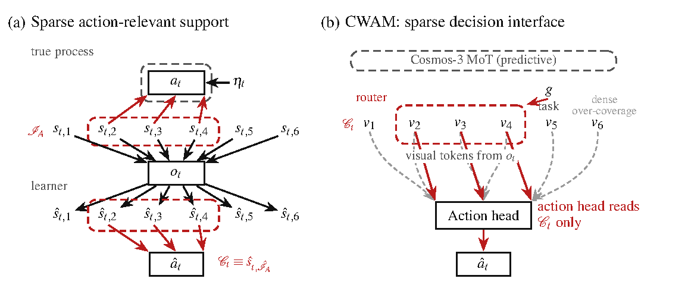
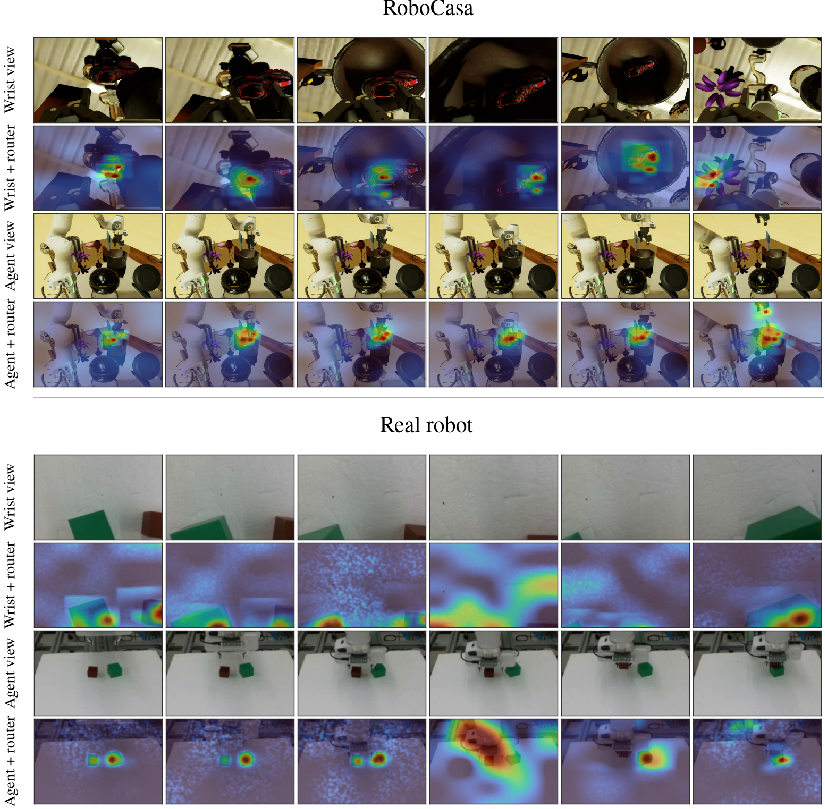

<!-- paper-reading-lang: zh-CN -->
<!-- paper-reading-mode: deep -->
<!-- paper-reading-theme: forest -->

# CausalWAM 深读：世界动作模型里，动作到底该看潜变量的哪一块

```paper-map
{"thesis":"WAM 的潜变量既要预测整个场景又要生成动作，但动作只由其中一小块导致；纯观测拟合只会让动作头的依赖不少于真支撑（过覆盖），加一条支撑稀疏约束后依赖结构在置换意义下被精确辨识，紧致态成为真动作块的可逆重编码——全程不需要干预、时序依赖或动力学假设。","reader":"面向了解表征学习与机器人学习、想逐条走通一套可识别性论证的读者；文中展开雅可比支撑集、五步证明链、块三角结构与全部实验重算。","goals":["从观测等价走到三个定理的完整证明链","用 4×4 块矩阵、softmax top-k、M_c 缩放等教学算例把手算走通","分清块恢复证据（合成）与闭环提升证据（机器人）各自能证明什么"],"outcome":"完整阅读 arXiv v1 正文与附录 A-H（PDF 20 页），含三定理证明全文、合成协议全档、17 任务逐表与训练配方。","outcomeSource":"PDF pp.1-20","items":[{"number":"01","label":"问题是什么","signal":"预测全景 vs 动作局部","text":"o=f(s) 必须编码整个场景，a=π(s,η) 只依赖 I_A 子块——拟合演示不保证学到的动作头只看这块。","source":"PDF §1-2, Eq.1"},{"number":"02","label":"负结果","signal":"只有下界","text":"Prop 1：观测等价加非退化条件只保证每个动作维的估计支撑 ≥ 真支撑——过覆盖是常态不是偶然。","source":"PDF §3.1, Prop.1, App.A.1"},{"number":"03","label":"两个正结果","signal":"稀疏逼等","text":"支撑稀疏约束（式3）把下界逼成等式：Thm 1 依赖结构置换等价；Thm 2 紧致态 C 是真块的可逆函数。","source":"PDF §3.2, Thm.1-2, App.A.2-A.3"},{"number":"04","label":"怎么装进系统","signal":"token 级代理","text":"CWAM 在 Cosmos 3 Nano 上加 relation-aware 稀疏路由（top-k=32）+ L_sparse，世界建模目标一行不改。","source":"PDF §4, Eq.4-9, App.H"},{"number":"05","label":"证据几何","signal":"三层","text":"合成：块恢复 R²=0.9957、Δ_nuis≈0；RoboCasa365 宏平均 0.24→0.43；C-only 保 84.6% 成功率。","source":"PDF §5, Tables 1-2, 4-5"},{"number":"05b","label":"什么没确立","signal":"块级≠分量级","text":"无分量级可识别性（作者自认）；LIBERO/Franka 只有图无数值表；合成里±稀疏差距小于与 VAE/dense 的差距。","source":"PDF §6, Fig.2, App.C"}]}
```

深读对象：CausalWAM: Learning the Causes of Actions in World Action Models（arXiv 2610.42096v1，2026-10-30，UIUC/UCSD 合作，PDF 20 页）。这期 HF 周一刊恰好是「世界动作模型（WAM）」家族专场：WorldBridge 讲视频泛化与动作泛化怎么分工、OSWAM 把多步去噪压成一步、HiFOR 给 VLA 加分层前瞻——它们都在改 WAM 的**能力**，而 CausalWAM 改的是 WAM 的**自我认知**：一个 WAM 从演示里学出来的潜变量，凭什么说自己生成动作时用的是「真正导致动作的那部分」，而不是一块混进了桌布、杂物等无关因素的鸡尾酒向量？论文的回答分三层：一条负结果（不加约束只有下界）、两条正结果（稀疏约束下支撑集与紧致态都可识别）、一套把理论装进 Cosmos 3 Nano 的工程接口，外加合成与真实机器人的双层验证。本页按细章跟读：三个定理的证明链逐步展开（含链式法则、Leibniz 行列式、块三角拆解），关键表格逐格重算（宏平均、保持率都从原数据重新加出来），附录 A-H 全量整合。先从那个直观例子说起。

<!-- Deep Reading coverage
| Source section / object | Role | Explanation location / status |
| --- | --- | --- |
| §1 引言（叠木块/桌布例子、ICA 相关工作定位） | 立论 | §01（相关工作仅作路标，逐条不展开） |
| §2 问题设定（式1、支撑集定义、紧致态、式2 观测等价、正则与耦合） | 形式化基础 | §02 |
| §3.1 Prop 1 + App A.1 证明全文（式11-25） | 负结果 | §03（五步逐步重构+教学算例） |
| App B.1 假设讨论（span 条件、s1+s2 反例） | 假设边界 | §04（反例手算） |
| §3.2 Thm 1 + App A.2（式26-35） | 正结果一 | §05 |
| Thm 2 + App A.3（式36-44） | 正结果二 | §06（4×4 块三角手算） |
| §4 估计原理（式4-5）、Figure 1 | 系统接口 | §07（含架构图） |
| §4 路由器（式6）+ App H 模块参数 | 机制一 | §08 |
| §4 L_sparse（式7-9）+ App H 调度 | 机制二 | §09（top-k 手算） |
| App C 合成协议全档（生成器/估计器/指标/划分） | 实验前提 | §10（生成器逐式走查+缩放手算） |
| §5.1 Table 1（五行逐列）+ Table 4（App D） | 块恢复证据 | §11-12（逐格重读重算） |
| §5.2 + App E Table 5（17 任务逐表）+ Fig.2 | 闭环证据 | §13（宏平均重算；Fig.2 数值未列表已披露） |
| §5.3 Table 2 + Fig.3 路由可视化 | 充分性证据 | §14（保持率重算+图） |
| App F/G 训练配方（Table 6 全档、两阶段、数据、主干） | 复现条件 | §15 全文整合 |
| §6 结论与局限 + AI Statement | 边界 | §16 |
| References | 行政性材料 | 不单列（正文路标已引） |
-->

## 01 / 预测要全景，动作只要一块

开篇场景值得慢读：机器人把一块积木叠到另一块上，这个动作取决于两块积木的位置和夹爪正抓着上面那块；如果有人抽走桌布、清走背景杂物，像素会剧烈变化，动作本身却不用变一个字节。WAM（Fast-WAM、NVIDIA Cosmos 3 这一类）从图像提潜变量，既要靠它生成后续帧（预测），又要靠它出动作（控制）。**预测必须解释整个画面**，所以潜变量天然要编码桌布和杂物；**动作只由一小块潜变量导致**。论文把前者叫 nuisance 变量、后者叫动作相关（action-relevant）变量，把核心风险一句话说破：把演示拟合好，**并不保证**动作头只从动作相关变量出动作——一个足够灵活的动作头完全可以从「积木位置 ⊕ 桌布纹理」的混合体里读出动作，照样拟合无误，因为混合体与纯块在信息上等价。

这不是稻草人。非线性 ICA 的经典不可识别结论（Hyvärinen-Pajunen 1999；Locatello et al. 2019）说：不加假设，潜变量只能识别到任意可逆变换 $\phi$ 那一层；加上动作观测也不解决，两个模型可以给出**完全相同的 $(o_t,a_t)$ 分布**而潜变量差一个任意可逆混合。纠缠的代价在开环拟合里看不见、到闭环里才兑现（本页推断，依据 §5.2 的族级增益分布）：演示数据里桌布与积木的共变模式是训练分布特有的，部署时背景一换、纹理一乱，从混合体里读动作的策略就吃到分布外输入；而只从动作相关块读动作的策略对背景变化天然不动心——Table 5 里取放/抽屉类任务的大增益与按钮类的零增益，恰好是这个推断在数据上的影子（§13 展开）。已有解法各有代价：辅助变量/时序依赖（TDRL、TCL 一系）要求足够的时间依赖；已知目标的干预（CITRIS）在机器人上昂贵甚至不可行；机制稀疏一系（Lachapelle et al. 2022 等）多数要恢复**全部**潜变量，条件连 nuisance 也得满足。本文的切口是**部分可识别性**：不求全 recovering，只求把「导致动作的那块」从剩下的里剥出来——而指示这块的侧信息，就是动作本身。这条路线有明确谱系：von Kügelgen et al. 2021 用数据增强的共享视图钉住 content（增广不变的那部分）、Kong et al. 2022 取跨域不变分量、Yao et al. 2024 用多视角的可观测性、Zheng et al. 2026 按「任务相关」取子集——它们都要数据自带侧信息（视图标签、域标签、任务标签），而机器人演示里**唯一免费**的侧信息就是动作本身：哪个潜变量导致动作，动作机制自己知道。把「动作相关」当成分界线，是这篇论文在整个因果表征学习版图上落的子。于是问题收紧成一句话：仅从演示，能否把「导致动作的」与「预测需要的」分开？答案的形状先剧透：不加约束时只有下界（§03），加一条支撑稀疏（式 3）后变成精确等价（§05-06）。要读懂这两步，先把形式化摆正——这也是全文最像数学课的一节，但每个符号后面都站着那个叠积木的机器人。

## 02 / 形式化：观测等价之下能问什么

### 世界动作过程与「相关」的定义

数据是演示序列 $\{o_t,a_t\}_{t=1}^T$，$o_t\in\mathbb{R}^{d_o}$、$a_t\in\mathbb{R}^{d_a}$，没有任何任务/技能/分段标签。真实过程假设为隐变量过程：

$$o_t=f(s_t),\qquad a_t=\pi(s_t,\eta_t)$$

其中 $s_t\in\mathbb{R}^n$ 是隐状态，$f:\mathbb{R}^n\to\mathbb{R}^{d_o}$ 是映到像上的微分同胚（允许 $d_o\gg n$），$\pi$ 是未知动作机制，$\eta_t$ 是外生噪声。注意论文**不要求时间依赖**：相邻步可以完全不相关，每对 $(o_t,a_t)$ 可以 i.i.d.——这比多数非线性 ICA 设定弱得多，是有意为之（机器人演示常常恰好没有干净的时间结构）。「相关」用**函数依赖**定义而非相关系数：对可微映射 $m$，记 $J_m(s)=\partial m/\partial s$，支撑集

$$\mathcal{I}(J_m)=\{(i,j):\Pr[J_m(s)_{ij}\neq 0]>0\}$$

即雅可比中「以正概率非零」的坐标对集合。第 $i$ 个动作维的父母集 $I_i:=\{j:(i,j)\in\mathcal{I}(J_\pi)\}$，全体动作相关坐标 $I_{\mathrm{A}}=\bigcup_i I_i$，对应子向量 $s_{t,I_{\mathrm{A}}}$。学习器返回编码器 $\hat f^{-1}$（$\hat s_t=\hat f^{-1}(o_t)$，**动作不是编码器的输入**）、动作机制 $\hat\pi$、估计支撑 $\hat I_i$，以及交付时真正部署的**紧致态** $C_t:=\hat s_{t,\hat I_{\mathrm{A}}}$——它只从观测算出。

### 观测等价：能问的只剩动作侧

两个过程 $(f,\pi)$ 与 $(\hat f,\hat\pi)$ 观测等价即 $(o,a)$ 的分布相同：

$$\mathcal{L}_{f,\pi}=\mathcal{L}_{\hat f,\hat\pi}$$

在观测等价下，估计态 $\hat s_t$ 必须决定每个潜变量（预测的代价），$\hat s=\phi(s)$、$\phi:=\hat f^{-1}\circ f$ 可以是任意微分同胚——**全态辨识无望，问题只剩动作侧**。为什么说无望：给定任何一个合格的 $(f,\pi)$，任取可逆 $\psi$，令 $\hat f=f\circ\psi^{-1}$、$\hat\pi(\hat s,\eta)=\pi(\psi^{-1}(\hat s),\eta)$，则 $(\hat f,\hat\pi)$ 与 $(f,\pi)$ 诱导**完全相同**的 $(o,a)$ 分布——而 $\hat s=\psi(s)$ 可以把桌布坐标与积木坐标任意搅在一起。这个「先共轭再喂」的构造对所有观测数据不可区分，指望数据本身把 $\psi$ 钉死是徒劳的，必须从**结构侧**（对 $\hat\pi$ 的依赖模式加约束）下手。于是能问的问题收窄成两个：一是 $\hat\pi$ 的依赖模式是否匹配 $\pi$，二是 $C_t$ 是否与 nuisance 分离（是否只携带 $s_{t,I_{\mathrm{A}}}$ 的信息）。证明用的是路径耦合版本：两过程共享噪声、共享隐状态至 $\phi$，即 $a_t=\pi(s_t,\eta_t)=\hat\pi(\hat s_t,\eta_t)$ 处处成立——这比分布等价强，是全文技术骨架。边界句（论文自己划的）：正则条件要求各映射连续可微、$f,\hat f$ 同像、$s_t$ 密度在 $\mathbb{R}^n$ 上恒正；结论都是**单步内**的（附录 A 固定一步丢掉下标 $t$），跨时间结构一个字都没用——这正是卖点，但 也意味着下面所有定理对「$s_{t,I_{\mathrm{A}}}$ 与 nuisance 统计相关」毫无意见：相关性是允许的，函数依赖才是判据。那么不加额外约束，观测等价到底给了什么保证？下一节给出一个有点扫兴的精确答案。

## 03 / 负结果：拟合只保证「不少于」

### Prop 1 的两个前提条件

命题（Prop 1）：两个观测等价过程满足正则条件，且对每个动作维 $i$：(a) 存在 $|I_i|$ 个状态 $s^{(1)},\dots,s^{(|I_i|)}$ 使雅可比行 $(J_\pi(s^{(l)}))_{i,\cdot}$ 线性无关（span 条件）；(b) 对 $\phi=\hat f^{-1}\circ f$、$P=J_{\phi^{-1}}$ 与任何 $\mathcal{I}(M)=\mathcal{I}(P)$ 的 $M$，有支撑包含 $\mathcal{I}((J_\pi(s^{(l)})M)_{i,\cdot})\subseteq\mathcal{I}((J_{\hat\pi}(\hat s^{(l)}))_{i,\cdot})$。则对每个 $i$：

$$\|\mathcal{I}((J_{\hat\pi})_{i,\cdot})\|_0\;\geq\;\|\mathcal{I}((J_{\pi})_{i,\cdot})\|_0$$

直译：拟合演示最多保证估计机制的每个动作维**至少**依赖真父母那么多坐标——下界，不是等式。过覆盖（over-coverage）从此有了正式名字。

### 证明链五步走（App A.1）

**第一步（重参数化）**：耦合给出恒等式 $\pi(s,\eta)=\hat\pi(\phi(s),\eta)$，两边对 $s$ 求导、链式法则：

$$J_\pi(s)=J_{\hat\pi}(\phi(s))\,J_\phi(s)$$

由 $J_\phi(s)=(J_{\phi^{-1}}(\phi(s)))^{-1}$，记 $P(\hat s):=J_{\phi^{-1}}(\hat s)$，得**全文枢纽恒等式**：

$$J_{\hat\pi}(\phi(s))=J_\pi(s)\,P(\phi(s))$$

**第二步（非退化行）**：由包含条件，$(J_\pi(s^{(l)})M)_{i,\cdot}$ 落在估计支撑 $S_i:=\mathcal{I}((J_{\hat\pi})_{i,\cdot})$ 张成的坐标子空间里。这里有个全文反复使用的证明装置值得单独拆开：$S^{(l)}:=\mathcal{I}((J_{\hat\pi}(\hat s^{(l)}))_{i,\cdot})$ 是**某一点处**的行支撑，$S_i$ 是**功能性**行支撑（正概率非零）；要证 $S^{(l)}\subseteq S_i$，用连续性 + 密度恒正两步走——$\hat\pi$ 连续可微，某项在 $\hat s^{(l)}$ 处非零则在其邻域非零，而 $\hat s=\phi(s)$ 继承了 $s$ 在 $\mathbb R^n$ 上恒正的密度，任何邻域都有正概率，于是「点态非零」自动升级为「功能性非零」。反向也用同一装置（§06）：若某项**以正概率**为零但某点非零，连续性给出正概率邻域非零——矛盾，故「几乎处处为零」与「处处为零」在正密度下等价。这个「邻域有正概率」的小引理是把集合论断变成函数论断的桥，三个定理都靠它过河。**第三步（张成论证）**：真行 $v^{(l)}:=(J_\pi(s^{(l)}))_{i,\cdot}$ 只在 $I_i$ 上非零，$|I_i|$ 条线性无关行恰构成 $V=\mathrm{span}\{e_k:k\in I_i\}$ 的一组基，于是任何 $e_j^\top$（$j\in I_i$）都是它们的线性组合；右乘 $M$ 后每个组合项都落在 $\mathrm{span}\{e_r:r\in S_i\}$ 里，故

$$M_{j,\cdot}\in\mathrm{span}\{e_r:r\in S_i\},\qquad j\in I_i$$

**第四步（公共置换）**：在任意固定点 $\hat s^*$，$P$ 可逆，由 Leibniz 公式

$$\det P=\sum_{\sigma\in\mathfrak S_n}\mathrm{sgn}(\sigma)\prod_k P_{k,\sigma(k)}\neq 0$$

必存在某个置换 $\rho$ 使 $P_{j,\rho(j)}(\hat s^*)\neq 0$ 对所有 $j$ 同时成立；连续性+正密度把它升级为 $(j,\rho(j))\in\mathcal{I}(P)=\mathcal{I}(M)$，即 $M_{j,\rho(j)}\neq 0$。**第五步（收口）**：第三步说 $M_{j,\cdot}$ 在 $S_i$ 之外为零，第四步说 $M_{j,\rho(j)}$ 非零，两只手一握就是 $\rho(j)\in S_i$：$\rho(I_i)\subseteq S_i$，数一数就是下界。妙处在第四步**不依赖 $i$**——同一个 $\rho$ 服务所有动作维，这为 Thm 1 的「求和论证」埋好了桩。

### 教学算例：过覆盖长什么样

设 $n=3$、$d_a=1$、真机制 $a=\pi(s)=s_1s_2$（$I_1=\{1,2\}$），观测 $o=f(s)$ 满秩。取 $\hat f=f\circ\phi^{-1}$、$\hat\pi(\hat s)=\hat s_1\hat s_2+\hat s_3\cdot 0$？不行——要让 $\hat\pi$ 真的多依赖一格且仍观测等价，可取 $\phi$ 为恒等、$\hat\pi(\hat s)=\hat s_1\hat s_2+\hat s_3^2-\hat s_3^2$ 这种「形式依赖、实质抵消」没有意义；正确的构造是让 $\phi$ 把 nuisance 混进来：$\hat s_1=s_1,\hat s_2=s_2,\hat s_3=s_3$ 时退化为真机制，改 $\hat s_2=s_2+s_3,\hat s_3=s_3$（可逆），则 $\hat\pi(\hat s)=\hat s_1(\hat s_2-\hat s_3)$ 在 $\hat s$ 坐标下雅可比行 $=(\hat s_2-\hat s_3,\ \hat s_1,\ -\hat s_1)$，三个坐标都以正概率非零：$|S_1|=3\geq|I_1|=2$，观测分布完全一致——过覆盖活生生站在那里（教学重建，非论文原例）。这个例子里「多出来的格」来自重参数化本身：不是 $\hat\pi$ 学坏了，而是**任何**与真过程观测等价的估计都可能在某些参数化下显得多依赖。下界挡不住它，那需要一条会「从上往下压」的约束——但在加约束之前，得先弄清 Prop 1 的两个前提到底假设了什么，它们并不是免费的。

## 04 / 假设的分量：span 条件会怎么失效

### span 条件的反例（App B.1）

Prop 1 的 (a) 要求每个动作维有 $|I_i|$ 个状态、真雅可比行线性无关。B.1 给出精确反例：若 $\pi_i(s)=s_1+s_2$，则每个状态处行向量恒为 $(1,1,0,\dots,0)$——**不管状态分布多好**，一组相同的向量永远线性无关不起来；更一般地 $\pi_i(s)=g(s_1+s_2)$ 的行都形如 $g'(s_1+s_2)(1,1,0,\dots)$，全部共线。教学重算：$J_{\pi_i}=(\partial\pi_i/\partial s_1,\partial\pi_i/\partial s_2)=(g'(\cdot),\,g'(\cdot))$，两列之比恒为 1，秩恒为 1，而 $|I_i|=2$ 需要秩 2。这个反例的直觉是：**真机制把两个潜变量只用「和」这一个组合喂进动作**时，动作侧根本无法区分「依赖 $s_1,s_2$ 各自」与「依赖某个混合」——可识别性的敌人不只是估计器的柔性，还有真机制自身的退化。条件 (b)（包含条件）则是排除测度零的巧合：重参数化后的行支撑恰好「到处抵消」的情形；论文承认它是对估计机制的技术性假设，不是能从数据验证的性质。边界句：这两个条件是**充分条件**，失效时下界结论未必假，只是此证法失效；论文没有给出可检验版本——这是理论到实践的一处裸露接口。

### 为什么相关变量不碍事

还有一处容易误读的正则细节值得单列：耦合允许 $s_{t,I_{\mathrm{A}}}$ 与 nuisance **统计相关**（桌布位置可以与积木位置相关）。判据是函数性的——$C_t$ 是否只依赖 $s_{t,I_{\mathrm{A}}}$、且能反过来决定它——与「$C_t$ 能否线性预测 nuisance」是两回事（合成实验里真块本身对 nuisance 的线性探测 $R^2$ 就大于 0，§11 的 $\Delta_{\mathrm{nuis}}$ 指标正是为此设计的）。理论部分到此齐装满员：下界已立，假设已称重。下一步就是把「不多于」这条反向不等式接上去，看两头一夹能逼出什么——这是全文最短也最漂亮的一步推理。

## 05 / 正结果一：稀疏把下界逼成等式（Thm 1）

### 约束与定理

支撑稀疏约束要求估计机制**激活的坐标对总数不超过真的**：

$$\|\mathcal{I}(J_{\hat\pi})\|_0\;\leq\;\|\mathcal{I}(J_{\pi})\|_0$$

Thm 1：在 Prop 1 条件 + 上式之下，存在置换 $\rho$ 使

$$\mathcal{I}(J_{\hat\pi})=\mathcal{I}(J_\pi)P_\rho,\qquad \mathcal{I}((J_{\hat\pi})_{i,\cdot})=\rho(I_i)\ \ \forall i$$

即从潜坐标到动作的**二部图依赖模式在置换意义下精确匹配**。

### 求和论证（App A.2）

证明短得可以整个搬进来，但每一步都有编号可查。**第一步**（式 26-27）：对每个 $i$ 重放 Prop 1 的五步，得 $\rho(I_i)\subseteq\mathcal{I}((J_{\hat\pi})_{i,\cdot})$（Step 4 的 $\hat s^*$ 与 $\rho$ 对所有动作维统一，这是共享的关键）；**第二步**（式 28-30）：支撑总数按行拆开——每个 $(i,j)\in\mathcal{I}(J_\pi)$ 恰对应 $j\in I_i$，故 $\|\mathcal{I}(J_\pi)\|_0=\sum_{i=1}^{d_a}\|\mathcal{I}((J_{\pi})_{i,\cdot})\|_0$，对 $\hat\pi$ 同理；逐行下界 $\|\mathcal{I}((J_{\hat\pi})_{i,\cdot})\|_0\geq|I_i|$ 求和得总数下界 $\|\mathcal{I}(J_{\hat\pi})\|_0\geq\|\mathcal{I}(J_\pi)\|_0$；**第三步**（式 31-33）：与式 3 的「不超过」一夹，总数相等——若任何一行严格大于，求和必然严格大于、与相等矛盾，于是**每一行都取等**，$\rho(I_i)$ 的包含升级为相等；**第四步**（式 34-35）：行级相等逐坐标等价于 $(i,j)\in\mathcal{I}(J_\pi)\iff(i,\rho(j))\in\mathcal{I}(J_{\hat\pi})$，按 $P_\rho$ 的定义（$(P_\rho)_{j,k}=\mathbf 1\{\rho(j)=k\}$，支撑乘上它就是把列指标 $j$ 改名成 $\rho(j)$）组装成矩阵级 $\mathcal{I}(J_{\hat\pi})=\mathcal{I}(J_\pi)P_\rho$。这个「两侧夹逼 → 逐行取等 → 改名组装」的骨架与稀疏可识别性文献（Zheng et al. 2022 等）同宗，但这里只需**部分**潜变量满足条件、且不需要时间结构——差异全在「动作侧指示了相关子集」这一个切口上。Thm 1 管的是 $\hat\pi$ 的雅可比模式，但机器人部署的可是紧致态 $C_t$ 这个**变量**——模式对齐了，会不会变量本身漏信息或渗杂质？这就是 Thm 2 要堵的最后一针。

## 06 / 正结果二：紧致态块可逆（Thm 2）

### 从模式到变量：块三角拆解（App A.3）

Thm 2：在 Thm 1 假设下（同一 $\rho$），存在可逆映射 $h$ 使

$$C_t=\hat s_{t,\rho(I_{\mathrm{A}})}=h\big(s_{t,I_{\mathrm{A}}}\big)$$

证明三步：**（i）零块**。任取 $j\in I_{\mathrm{A}}$、$r\notin I_{\mathrm{A}}$，由 §03 第三步的 $M_{j,\cdot}\in\mathrm{span}\{e_k:k\in\rho(I_i)\}$ 与 $r\notin I_i$，得 $M_{j,\rho(r)}=0$；这里要动用一次 $j\in I_{\mathrm{A}}$ 的来历——$I_{\mathrm{A}}=\bigcup_i I_i$ 保证任取的相关坐标 $j$ 必属于**某个**动作维的父母集 $I_i$，而 $\rho(r)\notin\rho(I_i)$（置换保不属），张成空间里的向量在该坐标上必为零；再由 $\mathcal I(M)=\mathcal I(P)$ 把零从 $M$ 搬给 $P$，用「邻域有正概率」装置把几乎处处为零升为处处为零。**（ii）块三角**。把 $P$ 的行按 $(I_{\mathrm{A}},\ \text{其余})$、列按 $(\rho(I_{\mathrm{A}}),\ \text{其余})$ 重排，零块恰在右上：

$$P=\begin{pmatrix}P_{11}&0\\ P_{21}&P_{22}\end{pmatrix},\qquad \det P=\det P_{11}\,\det P_{22}\neq 0$$

**（iii）功能依赖**。分块求逆右上角仍为零（$P^{-1}$ 右上块 $=P_{11}^{-1}\cdot 0=0$ 的对应块），即 $\partial\hat s_{\rho(j)}/\partial s_r\equiv 0$ 与 $\partial s_j/\partial\hat s_{\rho(r)}\equiv 0$ 同时成立——$\hat s_{\rho(I_{\mathrm{A}})}$ 既不依赖 nuisance、又反向被 $s_{I_{\mathrm{A}}}$ 决定，微分同胚性把「零偏导」升级为「功能无关」，得 $\hat s_{\rho(I_{\mathrm{A}})}=h(s_{I_{\mathrm{A}}})$ 且 $h$ 可逆，其雅可比就是 $J_h=P_{11}^{-1}$。最后 $\hat I_i=\rho(I_i)$ 逐维相并得 $\hat I_{\mathrm{A}}=\rho(I_{\mathrm{A}})$，于是部署的 $C$ 恰是那个可逆重编码。

### 教学算例：4×4 块三角走一遍

设 $n=4$、$I_{\mathrm{A}}=\{1,2\}$（前两行是相关块），取

$$P=\begin{pmatrix}1&0.5&0&0\\ 0.2&1&0&0\\ 0.3&0.1&1&0.4\\ 0.1&0.2&0.5&1\end{pmatrix}$$

右上 $2\times 2$ 为零（零块），$\det P=\det P_{11}\det P_{22}=(1-0.1)(1-0.2)=0.9\times0.8=0.72\neq0$，故 $P_{11}=\begin{pmatrix}1&0.5\\0.2&1\end{pmatrix}$ 可逆，$J_h=P_{11}^{-1}=\frac{1}{0.9}\begin{pmatrix}1&-0.5\\-0.2&1\end{pmatrix}$——$h$ 局部是线性重编码，且**逆也存在**（$\det\neq0$ 全局成立时全局可逆）。这个 0.72 没有任何论文出处，是本页算给你核对块三角逻辑用的；注意若 $P_{11}$ 奇异而 $P$ 整体可逆，右上零块结构会被迫让 $P_{22}$ 也奇异、与 $\det P\neq0$ 矛盾——「零块 + 可逆」联合起来才保证 $h$ 可逆，缺一不可。理论闭环了：**支撑对齐 → P 零块 → 块可逆**。但定理说的是「存在这样的估计器」，怎么把 $\|\mathcal{I}\|_0$ 这种数格子的约束装进一个带 Wan 2.2 VAE 和 8B 推理器的现代 WAM？接下来是论文的工程翻译。

## 07 / 从定理到系统：CWAM 的接口

### 估计原理与部署接口

论文把「带支撑稀疏惩罚拟合演示」的模型统称 CWAM。原理式把式 5 写成「分布匹配 + 结构偏置」：

$$\min_{\hat f,\hat\pi}\ \mathcal D\big(\mathcal L_{f,\pi},\ \mathcal L_{\hat f,\hat\pi}\big)+\mathcal R_{\mathrm{sparse}}(\hat\pi)$$

部署接口把式 1b 扩成 $H$ 步动作块（chunk）：

$$\hat a_{t:t+H-1}=\hat\pi(o_t,\epsilon_t;C_t),\qquad C_t=\mathcal S(\hat f^{-1}(o_t))$$

$\epsilon_t$ 是生成用外生噪声（整流流的初始抽样）、$\mathcal S$ 选支撑稀疏子集。**可识别性按动作坐标逐维陈述**，与 chunk 化兼容。

### 落点：Cosmos 3 Nano 加一条旁路



*原论文 Fig. 1，PDF p.6 裁剪。左：(a) 真实过程的稀疏动作支撑；右：(b) CWAM 的稀疏决策接口——看路由器如何把「估计的动作相关块」从干净 token 里挑出来。*

上图是全文唯一的机制图：真实过程里 $s_{t,I_{\mathrm{A}}}$ 是块（左），CWAM 估计它并在生成塔后挂一个**稀疏路由器**（右），把 top-$k$ 干净上下文 token 作为 $C_t$ 喂给动作头；灰色虚线是默认保留的稠密 MoT 视觉→动作路径——**路由是加法不是替换**，这个设计决定后面解释一半实验现象。理论里的 $\mathcal D$ 落地为 Cosmos 3 的联合整流流目标 $\mathcal L_{\mathrm{WAM}}$（未来视频 token 与动作块联合去噪，条件是干净历史与语言），$\mathcal R_{\mathrm{sparse}}$ 只加在路由读出上、$\mathcal L_{\mathrm{WAM}}$ 一行不改——基线与 CWAM 共享除路由器外的全部训练配方（§15 全档）。要把「数格子」的 $\ell_0$ 约束翻译成可微的东西，得进路由器内部。

## 08 / 路由器：relation-aware 的 top-k 读出

生成塔之后，每个动作隐状态 $h_i$ 对**干净上下文索引** $j\in\mathcal J_t$（任务 token + 干净视觉；**加噪的未来视觉 token 被排除在外**——这一点是「预测要全景、动作只要一块」在 token 层的直接对应）做注意力路由：

$$w_{ij}=\mathrm{softmax}_{j\in\mathcal J_t}\Big(\frac{q_i^\top k_j}{\sqrt{d_r}}+b_{ij}(\text{relations})\Big),\qquad \tilde h_i=\sum_{j\in\mathcal J_t}w_{ij}\,v_j$$

关系偏置 $b_{ij}$ 挂在位置、模态、块进度三类关系上；规模是 $d_r=512$、8 头、top-$k$ 支撑 $k=32$（App H 全档）。路由信号经**门控** $g\in(0,1)$（初始化 0.01）残差进入：$h_i\leftarrow h_i+g\,\tilde h_i$——初始近零，训练自己决定开多大。三个工程决定值得点破：其一，路由只在**干净 token**上做，天然回避了「用未来帧给当下动作递纸条」的作弊通道；其二，门控小初值让稀疏路径从近乎旁路开始生长，避免早期噪声路由干扰已收敛的 $\mathcal L_{\mathrm{WAM}}$；其三，路由器权重在加载公开 Nano 检查点时**跳过**（freshly initialized），LR 乘子 5.0 单独喂它——新模块新学率，旧主干不被拖着走。边界句：论文没有消融 $k=32$ 这个值，也没有给「为什么是 token 级而不是坐标级」的对照实验——坐标级的 $\mathcal S$（合成实验里那种）在 Cosmos 里没有直接对应物，这是理论到系统的近似跳变，下下节会用合成实验单独验证坐标级版本。门控开了、权重算出来了，稀疏约束本身怎么变成损失？下一节把这个唯一的正则项拆开。

## 09 / 稀疏损失的 token 级替代

式 3 数的是雅可比格子（$\ell_0$），不可微也不可观测；CWAM 用「top-$k$ 注意力质量占比」做替代：

$$\mathcal{L}_{\mathrm{sparse}}=\lambda\,\mathbb E_i\Big[1-\sum_{j\in T_k(i)}w_{ij}\Big]$$

$T_k(i)$ 是第 $i$ 个动作查询的 $k$ 个最大权重下标集。总损失：

$$\mathcal L_{\mathrm{total}}=\mathcal L_{\mathrm{WAM}}+\mathcal L_{\mathrm{sparse}}$$

调度（App H）：$\lambda=0.01$，第 1000 步激活、此后 4000 步线性退火到位；$\mathcal L_{\mathrm{sparse}}$ 的梯度同时更新共享塔与路由器；稠密 MoT 视觉→动作路径**训练与默认评估时都保持激活**。调度意图（本页推断）：前 1000 步完全不加惩罚，让路由器先在 $\mathcal L_{\mathrm{WAM}}$ 的信号里长出有意义的注意力分布——对一个全新初始化的模块立刻上稀疏惩罚，最容易学到的「解」是全部权重塌到一个 token 的平凡尖峰，那既不对应动作支撑也无信息量；等分布成形后再退火收紧，top-$k$ 的「选择」才是从一群有意义的候选里挑。梯度流向共享塔则说明稀疏不是路由器一家的事：它反过来重塑主干对干净上下文的表征，让「值得路由」的特征在塔内就分化出来。**教学算例（top-k 质量）**：设 6 个干净 token 的某动作查询 logits 为 $(4.2,\ 3.9,\ 3.1,\ 2.8,\ 2.7,\ 0.1)-3$（已减均值），softmax 后约 $(0.31,\ 0.23,\ 0.10,\ 0.077,\ 0.070,\ 0.009)$（数取整便于核对，分子 $\exp(\cdot)$ 相对最大项为 $1,\ 0.74,\ 0.33,\ 0.25,\ 0.24,\ 0.024$，除以总和 $\approx3.57$）。$k=2$ 的 top-$k$ 质量 $=0.31+0.23=0.54$，损失贡献 $1-0.54=0.46$；若训练把分布推尖到 $(0.71,0.2,0.04,\dots)$，质量升至 0.91、损失降到 0.09——**损失只在「质量逃离 top-k」时才惩罚**，尾部形状不管，这正是「支撑不多于」的软化版：数格子 → 数前 $k$ 名之外的残余质量。紧致态的 token 级定义随之落地：

$$C_t=\big\{j\in\mathcal J_t\ \big|\ \exists i:\ j\in T_k(i)\big\}$$

即被**任一**动作查询的 top-$k$ 覆盖的干净 token 全集。边界句：$\lambda$、$k$、退火长度均无消融表（App H 只登记值）；且式 7 优化的是**代理**，与式 3 的关系是「直觉对应」而非定理保证——理论保证在坐标级头（合成）上验证，token 级只在闭环指标上验证，两层证据在 §11-14 分别审视。系统侧到此完整：主干不动、旁路稀疏、损失一行。接下来看两层证据的第一层——合成环境里块恢复到底测出了什么。

## 10 / 合成协议全档：可识别性的直接体检

### 生成器逐式走查（App C）

合成环境把式 1 的每个分量都造成已知：$n=20$ 个潜变量、$I_{\mathrm{A}}=\{1,\dots,4\}$、动作 8 维。动作机制带隐藏 regime：

$$a_t=M_{c_t}\,s_{t,I_{\mathrm{A}}}+0.05\,\eta_t,\qquad M_c=(1+0.15(c-1))M$$

$M\in\mathbb{R}^{8\times4}$ 高斯、$c_t\in\{0,1,2\}$ 走 Dirichlet 随机转移的马尔可夫链、**从不给估计器**。转移与观测：

$$s_{t+1}=\tanh\big((1+0.15\,c_t)(W_s s_t+W_a a_t)\big)+0.05\,\epsilon_{t+1}$$

$$o_t=\tanh(W_{\mathrm{mix}}\,s_t)+0.05\,\xi_t$$

$W_s$ 稠密高斯（对角 0.85）把 nuisance 与相关块耦合起来，$W_a$ 只把动作反馈进 $I_{\mathrm{A}}$，$W_{\mathrm{mix}}\in\mathbb{R}^{100\times20}$ **块对角**（每潜变量 5 个观测坐标、无跨块项）。**教学算例（regime 缩放）**：$c=0,1,2$ 对应 $M_c=0.85M,\ 1.00M,\ 1.15M$；取 $M$ 首行 $(1,\,0.5,\,-1,\,2)$、$s_{I_{\mathrm{A}}}=(1,\,-2,\,0.5,\,2)^{\top}$，则 $c=0$ 时该维动作 $=0.85\times(1\times1+0.5\times(-2)+(-1)\times0.5+2\times2)=0.85\times3.5=2.975$；$c=2$ 时 $=1.15\times3.5=4.025$；噪声项 $\pm0.05\eta$。regime 让估计器见到的是「机制被三种尺度搅动的边缘分布」，却**不改 4 因子的动作支撑**——这是对「定理不假设 regime 演化」的直接压力测试。第二套环境因子 $e_t\in[E]$ 每步 i.i.d. 重抽、只给 nuisance 坐标乘 $[0.5,1.5]$ 的逐环境因子（App D 用 $E\in\{1,2,3,5\}$ 扫）。

### 估计器与指标（App C 续）

编码器 MLP $100\to256\to20$（tanh + 非 affine LayerNorm）、**线性动作头** $20\to8$——头权重即雅可比，式 3 的列级替代是「头列 $\ell_2$ 范数均值的权重 0.01」惩罚；Adam、batch 512；学习率与轮数从 $\{3\mathrm{e}{-4},1\mathrm{e}{-3},3\mathrm{e}{-3}\}\times\{80,160\}$ 用开发种子 900/901 选出 $1\mathrm{e}{-3}$/160 轮，评估种子 200-204（与开发隔离）；每 fit 用 2000 训练/500 held-out 回合、每回合长 128；当前动作**只做目标不做输入**。开发协议还有一个容易被略过的诚实细节：320 轮档**只在没有任何候选达到预注册开发目标时**才启用——实际六个候选全部达标，说明 $1\mathrm{e}{-3}$/160 不是搜索到极限的产物；「最小选定态动作 MSE」当选择标准，避免用测试指标选超参。指标：held-out 线性岭探测（$\alpha=1$，250 校准/250 报告回合）给出「相关 $R^2$」（$C_t\to s_{I_{\mathrm{A}}}$ 各维平均）与** nuisance 超额**：

$$\Delta_{\mathrm{nuis}}=R^2(C_t\to\text{nuis})-R^2(s_{t,I_{\mathrm{A}}}\to\text{nuis})$$

减号右边是 oracle 参照——真块透过 $W_s$ 耦合本来就能预测一部分 nuisance（$R^2>0$ 是设计出来的，不是缺陷），$\Delta$ 衡量 $C_t$ **超出本底**的泄漏。两个度量层面的自觉值得记下：其一，论文明确不报 MCC——Thm 2 只保证块级（可逆混合）而非分量级对齐，MCC 会错罚合法的块内旋转（App C 末段）；其二，线性探测对 $C_t=h(s_{I_{\mathrm{A}}})$ 的**可逆但非线性**的 $h$ 并非完备——$h$ 足够弯时线性 $R^2$ 可以低而信息仍在（探测是必要性的下界证据而非充分性证明）；论文用「相关 $R^2$ 高 + $\Delta$ 贴零 + 头消融方向性」三件套互相补台，而不是单押一个数。头消融把 $\hat s_t$ 在 $C_t$ 之外（Selected/full）或之内（Complement/full）置零后**不重训**直接测动作 MSE，相对完整 $\hat s_t$ 的 MSE 报比值。五个对手：dense（20 维全读出）、random matched（4 个随机坐标）、CWAM 去稀疏（同一 fit、按头权选 4 坐标）、标准 MLP VAE（高斯后验、KL 权 $10^{-3}$、头无稀疏）、CWAM 带稀疏。协议里的小账也透明：70 个表格条目出自 50 个保存的估计器复用、$E=1$ 行跨表共享、同 fit 出 dense/random/$\lambda{=}0$ 三读出。装置齐了，结果表怎么看？

## 11 / 块恢复主表逐格重读（Table 1）

### 相关 R²：四种读出挤在 0.99 附近，含义不同

Table 1 核心五行的「相关 $R^2$」：dense $0.9961\pm0.0015$；random matched $0.5493\pm0.2964$（均值被个别种子拖垮、方差巨大）；CWAM 去稀疏 $0.9876\pm0.0164$；VAE $0.9440\pm0.0448$；CWAM 带稀疏 $0.9957\pm0.0014$。第一眼结论：**在「选对 4 个坐标」的前提下，带不带稀疏的相关 $R^2$ 几乎无差**（0.9957 vs 0.9876，差距 0.008、在一个 $\sigma$ 内）；与 dense 的差距更小（0.0004）。真正的分水岭在 nuisance 侧。

### Δ_nuis 与头消融：泄漏看 Δ、依赖看置零

$\Delta_{\mathrm{nuis}}$（越接近 0 越好）：dense $+0.646\pm0.115$（20 维读出把 nuisance 一起编了，泄漏 0.65 量级）；VAE $+0.316\pm0.186$（明显漏）；random $+0.392$；**CWAM 去稀疏 $-0.008\pm0.006$、带稀疏 $+0.039\pm0.093$**。重算与解读（教学重算）：带稀疏的均值 0.039 小于其总体标准差 0.093——符号跨种子不稳，正确读法是「与 0 不可区分」，而不是「平均泄漏 0.04」；去稀疏版本甚至微负（$-0.008$），App C 解释过线性探测可略低于参照的机制（$C_t$ 过非线性编码器、逐坐标不必对齐，探测落点可上可下）。头消融的方向性是全表最干净的一格：凡「选了块」的头（含 VAE），置零块外代价小（Selected/full 1.7-3.5 倍）、置零块内代价大（Complement/full 50-55 倍）——**头确实主要从选出的块出动作**；random matched 反向（48.1 vs 6.36）：随机 4 坐标既测不出相关块、头也不依赖它们。表格记账也值得一句：dense 行的两个比值是 n/a——20 维全读出没有「块外」可言；「Mean ± population std over five seeds, 比值逐种子算再平均」的注释说明表里的比值**不是**均值之比，避免了小分母种子把比值拉爆的统计病；70 个表项出自 50 个保存估计器的复用（dense/random/$\lambda{=}0$ 共享同一 fit）让对照在同参数化内进行。诚实边界：带稀疏相对去稀疏的**实测**优势只有 Selected/full 从 3.456 收到 1.704 与 $R^2$ 微升——理论说稀疏才是保证，实验里「按头权选块 + 无稀疏」已拿到大部分收益；论文没有回避这一点，但也没有单列「稀疏惩罚关掉后支撑会不会漂移」的种子级分析。表层读完，更深一层的压力在隐藏环境上。

## 12 / 隐藏环境扫描与头依赖的例外（Table 4 + 消融细节）

### E 扫描：结论对 nuisance 动荡稳健

Table 4（App D）把 $E$ 从 1 加到 5：dense 的相关 $R^2$ 恒 $0.9961\pm0.0017$、$\Delta_{\mathrm{nuis}}$ 恒 $0.64$-$0.68$；CWAM 带稀疏 $R^2$ 恒 $\geq0.9957$、$\Delta_{\mathrm{nuis}}$ 在 $E\geq2$ 后钉在 $-0.004$-$0.003$。逐行读：**相关块恢复对 nuisance 侧的环境数量完全不敏感**——这正是「定理不假设 regime/环境演化」预言的形状；dense 的泄漏也纹丝不动，说明它编码 nuisance 是结构性的、不是环境噪声带来的扰动。有一个跨表的细节值得挑明：$E=1$ 行直接复用 Table 1 的 fit（$\Delta=+0.039\pm0.093$），$E\geq2$ 反而收紧到 $-0.004\pm0.003$——直觉上「环境更多」该更难，实测却更稳。机制（本页推断）：$e_t$ 每步 i.i.d. 重抽、对 nuisance 坐标乘 $[0.5,1.5]$ 因子，$E$ 越大 nuisance 侧被乘得越花，经 $W_s$ 耦合回相关块的「可预测 nuisance 痕迹」被平均得越干净，线性探测的本底参照越准；而动作机制 $M_{c_t}$ 与 $I_{\mathrm{A}}$ 支撑在整个环境族上不变——定理关心的对象根本没动，$R^2$ 当然不动。教学重算：$E=5$ 时 CWAM 的 $\Delta=-0.003\pm0.002$，三倍 $\sigma$ 仍贴着 0。

### 头消融的反例格与 VAE 的位置

Table 1 有个容易被标题盖住的细节：VAE 的 Selected/full（3.259）与 CWAM 带稀疏（1.704）同量级、Complement/full（51.13 vs 54.65）也同量级——**就头依赖模式而言 VAE 与 CWAM 相似**，差距全在 $\Delta_{\mathrm{nuis}}$（0.316 vs 0.039）与 $R^2$（0.944 vs 0.996）。也就是说 VAE 选的块「头也依赖、也大致对」，但块里**混着 nuisance 信息**——Thm 2 关心的恰恰是这一层（函数性分离），而不是头怎么用块。App C 还提到训练过一个 VAE+$\ell_1$ 版（0.05×平均绝对头权）却**从表中略去**——表内没有它的数字，这属于附录披露了存在性但未给结果的半开放格，复现时值得自己补。合成层的结论：块恢复成立、对隐藏环境稳健、稀疏的实测增益小于理论地位。第二层证据换到真机器人：闭环成功率。

## 13 / 闭环主结果：17 个任务逐个数（Table 5）

### 宏平均 0.24→0.43 的重算

RoboCasa365 评测协议（App E/F）：17 任务 × 每任务 100 回合、基种子 42、每回合上限 400 步、12 步开环动作块后重规划。Table 5 逐任务（基线→CWAM）：PickPlaceCtrToCab .31→.43、CtrToStove .22→.45、DrawerToCtr .15→.07（**降**）、SinkToCtr .24→.74、ToasterToCtr .28→.72、CloseFridge .14→.61、CloseToasterOvenDoor .51→.37（**降**）、OpenCabinet .31→.24（**降**）、CloseBlenderLid .02→.03、OpenStandMixerHead .30→.69、TurnOnMicrowave .27→.26（**微降**）、TurnOnElectricKettle .35→.45、OpenDrawer .25→.70、SlideDishwasherRack .32→.61、TurnOffStove .05→.18、TurnOnSinkFaucet .25→.37、CoffeeSetupMug .10→.37。**算术重构**：基线总和 $=0.31+0.22+0.15+0.24+0.28+0.14+0.51+0.31+0.02+0.30+0.27+0.35+0.25+0.32+0.05+0.25+0.10=4.07$，$4.07/17=0.2394\to$ 表报 $0.24$ ✓；CWAM 总和 $=7.29$，$7.29/17=0.4288\to 0.43$ ✓；下降任务恰 4 个（DrawerToCtr、ToasterOvenDoor、OpenCabinet、TurnOnMicrowave），提升 $13/17$ ✓ 与表题一致。增益结构也值得读。按技能族拆（Table 5 的分组）：Pick and place 五任务全在 +0.12 以上、其中三个超 +0.44；开合抽屉/推拉架/拧旋钮/插接（OpenDrawer +0.45、SlideDishwasherRack +0.29、TurnOffStove +0.13、CoffeeSetupMug +0.27）全为正；按钮类几乎不动（Microwave −0.01、Kettle +0.10）——与 Figure 2(a) 表述「按钮按压增益最小、抽屉/推架/插接/取放最大」逐族对上。方向解读（本页推断，非论文原话）：取放与抽屉类任务的成功判据是「物体到达精确目标」，动作相关块（物体+目标位姿）从背景里的剥出直接决定成败；而按钮开火的判据位置在机身面板上、相机视角里近于常量，可剥余量本来就小。最大的几项（+0.50 SinkToCtr、+0.44 Toaster、+0.47 CloseFridge、+0.45 OpenDrawer、+0.39 MixerHead）全是**需要把物体移到精确目标**的长程操作——恰是「动作相关块从 nuisance 里剥出」最该帮上的任务。四个下降任务（DrawerToCtr −0.08、ToasterOvenDoor −0.14、OpenCabinet −0.07、Microwave −0.01）论文未逐一归因，这是表格留给读者的裸露面；其中 ToasterOvenDoor 基线 0.51 本就是 17 任务里最高的，天花板效应可能是原因之一，但这是本页猜测。

### LIBERO 与真机：方向一致、数字在图里

LIBERO（40 任务、四套件、每任务 100 回合，F.3：沿用 Cosmos 3 的 LIBERO 闭环栈——20 Hz、quantile 旋转动作、双摄拼接，LIBERO 后训练的基线与 CWAM 检查点同配方）：正文只给「四套件全胜、最大增益在 LIBERO-Goal」，数值在 Figure 2(b) 雷达图里**没有列表**——想引用具体数字得自己从图上读，这是主文证据链里最薄的一环（边界披露）；且 LIBERO 双方都已高分，增益空间的绝对值本身有限，「全胜」的统计强度未给区间。Franka R3 真机叠方块 50 试/策略：CWAM「多数成功」、基线「不到一半」，同样只有柱状图无数值表——50 试下「多数 vs 不到一半」的差约在 25+/50 与 24−/50 之间，拿来做方向性证据够、做精确比较不够。闭环增益已立，最后一个问题：增益是不是真的**走那条稀疏路**带来的？还是稠密路径自己变好了？

## 14 / 路由的充分性：C-only 与热力图（Table 2 + Fig.3）

### 保持率重算

固定 50k 步检查点、不重训，只改动作查询可见的视觉 token：C-only 只留式 9 的路由 token；random matched 留等量随机 token。四任务（CWAM / C-only / random）：SinkToCtr 74/63/28、ToasterToCtr 72/61/21、OpenDrawer 70/59/33、MixerHead 69/58/16。**算术重构**：列平均 $71.25\to$ 表报 $71.3$、$60.25\to60.3$、$24.5$ ✓；C-only 保持率 $60.3/71.3=84.6\%$，random 只有 $24.5/71.3=34.4\%$——**同数量、不同选法，差 50 个百分点**，四任务次序全部一致。这一格直接回应「路由可视化不等于充分性」的自我质疑（§5.3 开头自己提出来的）：留 routed token 够跑八成半，留随机 token 崩到三分之一，token 的**选择**而非**数量**在起作用——与合成头消融（选块 vs 随机块）形成跨层同构。

### 路由质量落在哪



*原论文 Fig. 3，PDF p.9 裁剪。上下两块各四行：腕摄/腕摄+路由/第三人称/第三人称+路由；暖色越深代表该处干净视觉 token 承载越多动作查询的 top-k 质量。*

看图要点：大多数帧里暖色斑落**在被移动的物体与目标上**（下排红块→绿块）；但第四帧（真机序列）质量明显散到机械臂与墙面——论文自己标注了这个例外，没有把可视化挑成全员命中。看图前还要立两条读法纪律：其一，「采样帧」意味着这些是**挑出来展示的**帧，没有全rollout 的命中率统计，帧间行为差异（第三帧集中、第四帧分散）无法换算成比例；其二，热力叠的是**干净视觉 token** 上的 top-$k$ 质量——加噪的未来帧根本不在路由候选里（§08），所以「路由没看的地方」包含两类：被看了但权重低的干净 token、以及压根不在候选集的未来帧，图上区分不出这两类。诚实边界有三：其一，可视化是**采样帧**不是统计；其二，默认策略仍保留稠密路径，图上质量高 ≠ 系统只看那里（C-only 才是干预证据）；其三，routing mass 落点与「真 $I_{\mathrm{A}}$」之间没有合成环境那种对账可能——真机上没有 ground truth 支撑可查，只能靠成功率侧面印证。两层证据看完，复现这套东西需要什么？附录的配方表全档如下。

## 15 / 复现条件全档（App F/G/H + Table 6）

### 训练两阶段与数据配方

主干 Cosmos 3 Nano：Qwen3-VL-8B-Instruct 推理器 + MoT 生成器（two_way 注意力、video_gen 与 action_gen 同开）；视频 Wan 2.2 VAE（48 通道），训练时长精确编码时长取 $\{17,61,73\}$ 帧三档、生产 run 用预计算 latents 只做元数据校验；打包后最大 token 74,000（Nano 默认 45,056 的覆盖）。后训练**两阶段**：Stage 1 从公开 nvidia/Cosmos3-Nano 检查点热启（转 DCP 格式），路由器**全新初始化**、后训 10,000 步（线性 warmup 500 步、cycle 16,000）；Stage 2 续到 50,000 步，LR 乘子**平推 0.3871**——恰是 Stage 1 结束时的学习率（调度器状态不恢复，这个 0.3871 是把断点学习率手工钉住）。数据：RoboCasa365 LeRobot 风格演示、20 Hz 策略模式、chunk_length=16（首帧观测、后帧加噪）、concat_view 双摄 256×256 拼成 256×512、caption_mode=policy 的 JSON 提示、动作为 frame_wise_relative rot6d 10 维（位置+旋转+夹爪）配 quantile_rot 归一化与 embodiment 标签。硬件：单节点 8×H200、FSDP shard 8、bf16、FMHA 选择性激活检查点。共享超参（Table 6 全档）：FusedAdamW（$\beta_1=0.9,\beta_2=0.99,\epsilon=10^{-8}$）、基础 LR $5\times10^{-5}$（action2llm/llm2action/action_modality_embed 乘 5.0）、权重衰减 0.05、裁剪 1.0（force finite）、梯度累积 2、存档 500/10,000 步 + EMA 0.1、整流流损失 scale 10.0、动作损失权重 10.0、CFG dropout 训练 0.1/验证 0。推理默认 UniPC、1000 训练时间步、shift 1。动作适配器（action2llm、llm2action、action_modality_embed、action_pos_embed）**从零重初始化**，视频/推理器栈保留公开权重。

### 路由器专档（App H）

$d_r=512$、8 头、$k=32$、门控初值 0.01、$\lambda=0.01$（1000 步激活、4000 步线性退火）、action_relevance 组 LR 乘子 5.0、加载公开检查点时跳过路由器权重；$\mathcal L_{\mathrm{sparse}}$ 梯度同时更新共享塔与路由器；C-only/random matched 是**评估期干预**（固定 50k 检查点、不重训、沿用主评测回合键——配对可比）。边界句：基线「同样两阶段、同样数据、同样优化，只是没有路由器与 $\mathcal L_{\mathrm{sparse}}$」——对照设计是干净的单一差异；但论文未提供随机种子数与方差（17 任务×100 回合的宏平均没有置信区间），也未复用合成侧的种子协议，真机 50 试同样无区间。复现门槛主要在 8×H200 与 Cosmos 3 Nano 权重可得性；代码未随 v1 发布（v1 无 artifact 链接披露）。

## 16 / 结论、局限与接回 WAM 家族

### 作者自认的边界

结论复述三层贡献：过覆盖的精确化（Prop 1）、稀疏下的结构与块可识别（Thm 1/2）、CWAM 的合成+真机验证。**局限是作者自己写的**：只有**块级**可识别性——块内各分量仍可任意混合，精确干预（动某一个因素）做不了；要分量级需要更强假设（稀疏 ICA 一系的全量条件）。本页补三条读出来的边界：LIBERO/Franka 数值只在图中（§13）；token 级替代与坐标级理论之间的跳变无桥接实验（§09）；真机无 ground-truth 支撑、路由落点只能侧面印证（§14）。AI Statement 披露生成式 AI 辅助了代码、润色与绘图（当代论文的规范动作，如实记录）。

### 接回今天这期 WAM 专场

同一刊期的 WorldBridge 用「视频专家+动作专家+桥」把**预测泛化**与**动作泛化**分工（25.07%→55.90%→70.70% 的视频/动作监督阶梯），OSWAM 把动作生成的多步去噪压成一步（imagination tokens 初始化替代随机噪声），HiFOR 给 VLA 加分层前瞻——它们都在优化「WAM 怎么把动作出得更好」；CausalWAM 站在上游问「WAM 出动作时**该看什么**」，并给出观测侧就能兑现的答案：让动作头只从一条稀疏路径看世界，世界建模照旧全景。三者与本文的接口也现成：WorldBridge 的视频专家/动作专家分工是**架构级**的预测-动作分离，CausalWAM 是**信息级**的分离——动作专家该接哪路视觉特征，稀疏路由是一个可直接叠加的答案；OSWAM 压缩的是动作生成的去噪步数，与路由正交。与 causal representation learning 谱系的对接点在「部分可识别 + 机制稀疏」：它不要求恢复全部潜变量，只要求动作侧那条边稀疏——这是把 Lachapelle et al. 式机制稀疏从「全量辨识」剪裁到「动作相关子集」的一次干净移植。留给动手者的三个接口：合成协议（App C 全档）是任何「部分可识别」新理论的免费试炼场；top-$k$ 质量损失（式 7）可以挂到任何带注意力头的策略上单测；C-only/random matched 的评估期干预（不重训）是检验任何「注意力选择器」声称的廉价审计。一句话收束：这篇论文没让 WAM 更会预测，也没让动作更准到哪儿去（宏平均翻倍主要来自长程操作任务的修正）——它让 WAM **第一次能说明白，动作从潜变量的哪一块来**，并且证明这个「说明白」只需要一条旁路加一行正则。

```paper-check
{"title":"六个能检验技术理解的问题","items":[{"question":"Prop 1 说的是「估计支撑 ≥ 真支撑」。举一个不依赖任何估计器、由真机制自身导致该下界永远取不到等号的情形。","hint":"§04 的 span 反例家族。","answer":"π_i(s)=g(s_1+s_2) 类机制：雅可比行恒为 g'(s1+s2)(1,1,0,…)，任何状态下都共线，span 条件要求 |I_i| 条线性无关行——真机制自己给不出来。此时 Prop 1 前提失效，不是结论为假，而是这套论证用不了；这类「和形式」真机制是可识别性的盲区，论文未讨论其占比。","source":"PDF §3.1、App B.1；教学重构"},{"question":"手算：把合成环境的 regime 改成 c∈{0,1,2,3} 且 M_c=(1+0.2(c-1))M。取 M 首行 (1,0.5,-1,2)、s_A=(1,-2,0.5,2)，c=3 时该维动作均值是多少？噪声界呢？","hint":"先算内积 3.5，再乘缩放因子。","answer":"内积 = 1×1+0.5×(−2)+(−1)×0.5+2×2 = 3.5。c=3 → 1+0.2×2=1.4，动作 = 1.4×3.5 = 4.9；噪声 ±0.05η 不随 regime 变（η 为外生）。对照 c=0 → 0.8×3.5=2.8。注意原设定是 (1+0.15(c−1))，c=2 时 1.15×3.5=4.025。","source":"PDF App C；教学重算"},{"question":"Table 1 里 CWAM 带稀疏的 Δ_nuis=+0.039±0.093，去稀疏是 −0.008±0.006。能不能据此说「稀疏版平均泄漏 0.04、去稀疏更干净」？","hint":"均值与总体标准差的相对大小，跨种子符号。","answer":"不能。0.039 小于其总体标准差 0.093——跨种子符号不稳定，正确读法是「与 0 不可区分」；去稀疏的微负值也不是「负泄漏」，App C 明说线性探测可略低于参照（C_t 过非线性编码器、探测落点可上可下）。两行都应读作 Δ≈0。可以说的只是：两种选块方式都把泄漏压到本底附近，而 dense(+0.65)/VAE(+0.32) 是真泄漏。","source":"PDF Table 1、App C；解读题"},{"question":"Thm 2 的证明里，右上零块与 P 可逆两个条件分别在哪个环节用掉？若 P11 奇异会发生什么？","hint":"§06 的 (ii)(iii) 两步。","answer":"零块（由式 20+支撑对齐推出）用来把 P 排成块下三角并保证 P^{-1} 右上也为零，得到 ∂ŝ_{ρ(j)}/∂s_r≡0 的双向零偏导，再由微分同胚升为功能无关与相互决定。可逆性（det P≠0）用来推 det P11·det P22≠0 → P11 可逆 → h 的雅可比 P11^{-1} 存在 → h 可逆。若 P11 奇异：块三角下 det P=det P11·det P22，P 整体可逆强制 P22 也奇异导致矛盾——所以「零块+整体可逆」联合排除 P11 奇异，h 可逆不是额外假设。","source":"PDF App A.3、式 37-43；教学重算"},{"question":"宏平均重算：Table 5 的 17 任务基线总和是多少？如果去掉下降最多的 CloseToasterOvenDoor（.51→.37），基线与 CWAM 宏平均各变多少？","hint":"总和 4.07 与 7.29，去掉后除以 16。","answer":"基线总和 4.07、CWAM 7.29（4.07/17=0.2394→.24；7.29/17=0.4288→.43）。去掉该任务：基线 (4.07−0.51)/16=0.2225，CWAM (7.29−0.37)/16=0.4325——基线降到 0.22、CWAM 升到 0.43，差距从 0.19 扩到 0.21。说明该任务是基线唯一强项（.51 是基线最高），它的存在略微掩盖了整体差距。","source":"PDF Table 5；算术重构"},{"question":"C-only 保持 84.6% 成功率（60.3/71.3）能否证明「动作只依赖路由 token」？随机组 34.4% 又排除了什么？","hint":"§14 两个边界 + 合成头消融的同构。","answer":"不能。C-only 只证明路由 token 携带了大部分动作所需视觉信息（充分性层面），不证明系统平时只用它们（默认策略仍保留稠密路径，且是 token 级证据、非坐标级 I_A）；另外不重训直接置零是评估期干预，模型未见过该分布。随机组排除了「任何等量 token 都行」的 解释——24.5% 对 60.3% 说明选择本身承载信息，与合成里选块 vs 随机块的头消融同构。两层合起来是「路由选出信息充分的子集」的证据，仍不是 Thm 2 在真机上的验证。","source":"PDF §5.3、Table 2；解读题"}]}
```

<details class="reading-detail">
<summary>来源与离线交付记录</summary>

本阅读使用 arXiv:2610.42096v1（2026-10-30 提交）的 HTML 版为阅读源，对应 PDF 2.62 MB、20 页，SHA-256：`779ae9e74958abed959c57e7f9dd828a36dc08e0d7e2fc39e597825238b39314`。正文 §1-§6、附录 A（三定理证明全文）、B.1（假设讨论）、C（合成协议全档）、D（Table 4）、E（Table 5 逐任务）、F/G/H（训练配方与路由器专档）均已通读并整合；References 仅作正文路标未逐条展开。Fig.1（架构图，PDF p.6）与 Fig.3（路由热力，PDF p.9）为 Ghostscript 200/150 dpi 渲染后按视觉定位裁剪；Fig.2（雷达图）数值未在正文列表，已作为证据链薄点披露。标注「教学算例/教学重算/算术重构」的数字为本页计算（4×4 块矩阵、softmax top-k、regime 缩放、宏平均加和、保持率等）。本页为 CausalWAM 首版深读（按量化深度门槛执行）。
</details>
