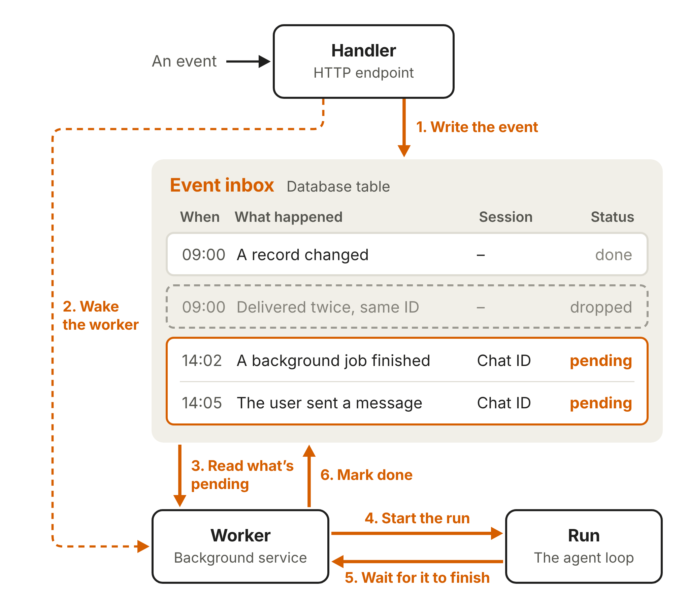

<!-- paper-reading-lang: zh-CN -->
<!-- paper-reading-mode: deep -->
<!-- paper-reading-theme: cobalt -->

# Claude｜Building always-on agents：把「永远在线」拆成五个可运行的原语

```paper-map
{"thesis":"Anthropic 官方工程博客提出：常驻智能体（always-on agents）的「永远在线」只是用户体验，底层是一个睡-醒循环——agent 绝大多数时间在睡觉，被事件唤醒后跑一段 run（在 session 里接收事件、完成任务、保存信息），跑完继续睡，无限循环。让这个循环成立的不是模型本身而是围绕模型的五个架构原语：事件收件箱（一切触发的唯一入口，持久化+去重+单 worker+批处理）、定时器（follow-up 与 schedule 两类，经调度器转成收件箱事件）、记忆（只存查不回来的东西，四类文件分层加载）、权限（凭证代理注入+auto mode 分类器+deferred tool calls 的中断-恢复协议）、发件箱（说与送解耦，dispatcher 控节奏）。复兴的根因是模型侧两个变化：判断力提升（知道何时不打扰用户）与智能变便宜（Opus 5.5 在长程编码任务上每解决一个任务的成本比 Opus 5 低 78%，典型负载只低 40%——长程任务受益最大）。","reader":"正在把 agent 从「用户发一条跑一次」改造成「有状态、可主动行动」的产品与平台工程师；本页把文章的每条工程建议形式化为可手算的运行模型（占空比、事件积压、批处理合并、缓存折扣、期望风险、延迟账本、噪声预算）。","goals":["走通「两个前提→睡醒循环→五原语→总装回路」的完整论证链","把 78%/40% 成本差、单 worker、批处理、start quiet 等关键主张放进可复算的模型","分清官方工程博客的第一方经验与可迁移的一般原理的边界"],"outcome":"全文精读 Claude 官方文章（2026-11-13，William Hu，致谢 Rodrigo Olivares 与 Michael Segner），含正文全部小节、四张架构图的忠实转录（事件收件箱图以原图嵌入，定时器/记忆/发件箱三图转写为文字与表格），文章自带的成本数字逐个复算。","outcomeSource":"https://claude.com/resources/articles/building-always-on-agents","items":[{"number":"01","label":"复兴前提","signal":"判断力+成本","text":"常驻智能体回潮的两个模型侧原因：最新模型判断力更好（理解意图、知道何时该请示），且智能在变便宜——长程任务受益最大，某长程编码基准上 Opus 5.5 每解决一个任务的成本比 Opus 5 低 78%，而典型负载只低 40%。","source":"正文引言"},{"number":"02","label":"睡醒循环","signal":"run 与 session","text":"常驻不是常开：agent 大部分时间在睡，被事件唤醒后跑一个 run（收事件→完成任务→保存信息），run 在 session（消息与工具调用的完整记录）内工作，跑完回睡，循环无限。","source":"正文「The cycle」"},{"number":"03","label":"事件收件箱","signal":"唯一触发入口","text":"所有事件源（webhook、定时任务、后台作业、用户消息）一律写入持久收件箱（数据库表+HTTP handler+后台 worker），不直连 agent；按源唯一 ID 去重，单用户一个收件箱起步，同时只允许一个活跃 worker，pending 事件可合并成一个 run。","source":"正文「Event inbox」"},{"number":"04","label":"定时器","signal":"两类两类","text":"follow-up 是 agent 给自己设的截止（如查回复），schedule 是固定节奏的循环任务（如日报）；定时器存独立的持久表，调度器轮询把到期的定时器转成收件箱事件——定时器从不直接发起 run。","source":"正文「Timers」"},{"number":"05","label":"记忆","signal":"只存查不回的","text":"记忆自成一库（产品里实现为文件目录，映射到数据库或对象存储）；只存 agent 无法再查到的信息，能查的存指针；四类：用户指令（每 run 必读）、用户笔记、已发消息、任务进度（后两类按需经索引取回）；可加 dreaming 跨 run 策展记忆。","source":"正文「Memory」"},{"number":"06","label":"上下文经济学","signal":"overhead 与缓存","text":"每个 run 都要背系统提示词+工具定义+记忆文件的初始开销，建议保持精简并用 prompt caching 降成本；session 过长则压缩旧消息或新开 session，两者都丢细节——需要留存的必须沿途写进记忆。","source":"正文「Inside the context window」"},{"number":"07","label":"权限","signal":"无人值守","text":"权限是常驻智能体风险最大的地方：run 持有用户访问权且无人值守。三件套：凭证经 agent 环境外的代理注入（agent 永不接触密钥）、auto mode 用分类器拦高危动作、deferred tool calls 把 run 中断在工具调用中间、等用户答复作为新事件回来续跑。","source":"正文「Permissions」"},{"number":"08","label":"发件箱","signal":"说送解耦","text":"run 三种结局：发消息到 outbox、什么都不发、deferred 请求；多数场景一个 send 工具就够，需要控节奏或错误恢复才上正式 outbox（独立表+dispatcher）；消息过多是噪音过少是漏报，用 evals 找平衡，宁可 start quiet 逐步赢得注意力。","source":"正文「Outbox」"},{"number":"09","label":"总装","signal":"因果闭环","text":"五原语拼成一个因果环：事件唤醒 worker→启动 run→agent 读记忆打底→在权限内行动→更新记忆→写 outbox→dispatcher 投递；run 可设定时器再唤醒自己，用户回复又变回收件箱事件——每个 run 都短暂，但环永远转。","source":"正文「How everything fits together」"},{"number":"10","label":"证据边界","signal":"第一方工程经验","text":"这是 Anthropic 产品团队的架构提炼（作者 William Hu），数字只有 78%/40% 一组且未给基准细节；五原语是自家产品（Claude Code auto mode、Messages API memory tool、MCP Apps）的通用化，方向价值高、数字须自测。","source":"全文口径；§16 展开"}]}
```

深读对象：Claude 官方工程博客[《Building always-on agents》](https://claude.com/resources/articles/building-always-on-agents)（Anthropic，2026-11-13 发布，作者 William Hu，特别致谢 Rodrigo Olivares 与 Michael Segner）——[点此打开原文 ↗](https://claude.com/resources/articles/building-always-on-agents)。这是「Claude 文章深读」系列的第三篇（前两篇：fold-subagents 与 agent memory 相关篇目），主题是把过去几个月客户反复问的一个问题——「怎么把常驻体验集成进自己的产品」——拆成五个可以直接开工的架构原语。文章立场一句话：**「常驻」是一种用户体验，不是一种运行状态**；把「永远在线」实现好的路径不是让模型一直转，而是在模型周围搭好五个持久化组件，让每一次短暂的 run 都能接得上上一次。本页按细章跟读：两个复兴前提配成本差复算、睡-醒循环形式化成占空比模型、五原语逐个重构（收件箱的竞态与批处理、定时器的双类递归、记忆的指针规则与分层加载、权限的中断-恢复协议、发件箱的噪声预算）、总装环做一次完整生命周期追踪；全文四张架构图里唯一达到本站分辨率标准的事件收件箱图以原图嵌入，其余三张转录为文字与表格；文末对第一方工程经验的证据边界做诚实对账。

<!-- Deep Reading coverage
| Source section / object | Role | Explanation location / status |
| --- | --- | --- |
| 引言（复兴、两个模型侧原因、78%/40% 成本数据） | 立论前提 | §01 |
| 「The cycle behind the always-on agent」（run/session 定义、睡醒循环） | 核心抽象 | §02 |
| 「Event inbox」（直连失败模式、三组件、去重、会话延续、四条 best practices） | 原语一 | §03-05（图 1 原图嵌入） |
| 「Timers」（follow-up/schedule、独立存储、调度器四步、durable execution engine） | 原语二 | §06 |
| 「Memory」（指针规则、四类记忆、目录实现、dreaming） | 原语三 | §07 |
| 「Inside the context window」（overhead、prompt caching、压缩或新开） | 原语三续 | §08 |
| 「Permissions」（风险定位、credential store+代理注入、auto mode、deferred tool calls） | 原语四 | §09-11 |
| 「Outbox」（三种 run 结局、send 工具 vs 正式 outbox、dispatcher、evals 调节奏） | 原语五 | §12 |
| 「How everything fits together」（总装循环、自指反馈） | 收束 | §13-14 |
| Acknowledgements（作者与致谢、发布日期） | 溯源 | 文末披露 |
| 相关文章链接（memory post、auto mode、MCP Apps、prompt caching 等） | 语境 | §15 逐个定位 |
-->

## 01 / 复兴的前提：判断力与成本的双降

文章开头把时间轴摆出来：「过去几个月我们看到了常驻智能体的回潮」（a resurgence）。这个词选得讲究——常驻智能体不是新发明，定时任务+聊天机器人十几年前就有；「回潮」说的是**现在值得认真做了**。作者给出两个模型侧的原因，都指向同一个约束的松动：

第一，**判断力**（judgment）。最新模型「更可靠地理解用户意图、知道什么时候该请示」（more reliable at understanding user intent and knowing when to check in）。这句听起来软，其实是常驻体验的生死线：一个无人值守的 agent 如果不知道什么时候该问、什么时候自己扛，用户第一天就会把它关掉。判断力是常驻智能体的准入门槛——它决定了「无人值守」是解放还是事故。

第二，**智能在变便宜**（intelligence is becoming cheaper），而且**长程任务受益最大**。文章给了全文唯一的一组硬数字：在「一个长程编码基准」（one long-horizon coding benchmark）上，**Opus 5.5 每解决一个任务的成本比 Opus 5 低 78%；对比之下，典型工作负载只低 40%**。这两个数字的差值是整篇文章的经济学地基——常驻智能体恰好是长程、多 run、高事件量的形态，成本下降在它身上被放大。

### 手算复算：78% 与 40% 的差值意味着什么

把两个百分比放进同一个模型（教学重建，原文只给数字不展开）。设每解决一个任务的成本比为 $r = C_{new}/C_{old}$：

$$r_{long} = 1 - 0.78 = 0.22, \qquad r_{typical} = 1 - 0.40 = 0.60$$

长程任务的相对成本是典型任务的三分之一多一点：$0.22/0.60 \approx 0.367$。换一个更直观的算法：同样跑 100 个任务的预算，Opus 5 能解 100 个的话，Opus 5.5 在长程基准上能解约 $100 \times (1/0.22) \approx 455$ 个，在典型负载上只能解约 $100 \times (1/0.60) \approx 167$ 个——**同一次模型换代，长程场景的「预算购买力」涨幅是典型场景的 2.7 倍**。这解释了为什么常驻形态（本质上是把很多零散工作串成长程流）恰好站在降成本的最甜位置。要诚实标注：原文没有给出基准名称、任务口径或采样区间，「一个长程编码基准」是全部信息量——这组数字应该当作方向性证据而非可引用的实验结论（§16 展开）。

第三段交代写作动机：客户开始问「怎么把这种体验集成进自己的产品」——有的想把现有 agent 变得更主动，有的想从零造一个。这句话也悄悄限定了读者：**这篇文章写给要动手建的人**，不是给评估行业趋势的人。

## 02 / 「常驻」是体验不是状态：睡-醒循环的形式化

全文第一句架构判断值得逐字读：「**常驻智能体其实并不『常开』，这只是对用户体验的描述**」（An always-on agent is not actually "always on." This is just a description of the user experience.）。这是整篇文章的题眼——它把一个模糊的产品词翻译成了一个可实现的运行模型：

> 实际上，agent 大部分时间在睡觉，周期性醒来干活。每一段工作叫一个 **run**：agent 收到一个事件、完成它的任务、然后保存发生了什么的信息。run 在一个 **session** 里工作——session 是消息与工具调用的完整记录（transcript）。run 结束后 agent 回去睡觉，循环无限重复。

三个术语一次定义清楚，且相互关系精确：**run 是工作单位（一段），session 是历史单位（一卷）**；一个 session 里可以有多个 run（文章后面说：延续先前工作的事件——比如用户的回复——恢复既有 session，其余事件开新 session）。这个区分是后面一切机制的地基：记忆为了跨 run（§07）、权限可以中断在 run 中间（§11）、发件箱是 run 的出口（§12）。

### 占空比：常驻的机器成本其实很低

把睡-醒循环形式化（教学重建）。定义占空比（duty cycle）——agent 处于运行态的时间比例：

$$\delta = \frac{T_{run}}{T_{run} + T_{idle}}$$

教学手算：一个每天被唤醒 24 次（约每小时一次）、每次 run 平均 90 秒的常驻智能体，$\delta = \frac{24 \times 90}{86400} = \frac{2160}{86400} = 2.5\%$——**它在 97.5% 的时间里没有任何计算在跑**。「常驻」的边际机器成本几乎全部落在持久化存储（收件箱、定时器、记忆）而非算力上。这个 2.5% 也解释了为什么文章敢说这套架构「实际可跑」（practical to run）：用户体验是 24 小时在场，计费是零星短跑。反过来它也标出了这套设计的责任边界：既然 agent 醒着的时间这么少，**每次醒来的质量就必须高**——错过一个事件或带着错误记忆跑完一个 run，用户要等下一个周期才能纠正。持久化组件（收件箱、记忆）的可靠性因此不是工程细节，是产品本体。

与 fold-subagents 篇的视角对照：那篇讲「一个 run 内部怎么组织」（单循环 vs 子代理），这篇讲「run 与 run 之间怎么组织」（五个持久化组件）——两篇合起来恰好是 agent 架构的完整纵横轴。

## 03 / 原语一：事件收件箱——为什么事件源不能直连

常规 agent 只在用户发消息时运行。常驻智能体的触发面宽得多：**webhook、定时任务、后台作业**，当然还有用户消息。文章先排除一个诱人的捷径——「让每个事件源直接调用 agent」（each event source call the agent directly），并点名两个失败模式：

- **并发竞争**：两个事件同时到达，启动两个互相竞争的 run；
- **事件丢失**：一次崩溃就把事件整个丢掉。

这两个失败模式值得各建一个模型（教学重建）。并发竞争的概率随事件源数量组合增长：$n$ 个源在任意时刻活跃概率为 $p$，同时活跃的概率是 $1-(1-p)^n$——五个源、瞬时活跃概率 5% 时已有 $1-0.95^5 \approx 22.6\%$ 的窗口存在竞争风险，而且这个数字对「源越多」是超线性恶化的。事件丢失则是乘法链：直连路径上任何一跳（网络、进程重启、队列满）以概率 $q_i$ 丢事件，整条路径的留存率是 $\prod(1-q_i)$——三跳各 99% 的路径也只有 97% 的留存，对一个「替用户盯着世界」的 agent，3% 的漏听率直接摧毁信任。

解法是**事件收件箱**（event inbox）：所有源不调用 agent，而是把事件写进一个收件箱，由一个 worker 从里面取。

## 04 / 收件箱的最小实现：三组件与状态机

文章给出最简版本的三组件，每一件都指定了默认实现：

1. **事件的持久列表**——通常是一张数据库表；
2. **handler**——通常是一个 HTTP 端点，把事件写进列表；
3. **worker**——通常是一个后台服务，从列表读事件。

三条设计规则跟着给出：收件箱应**追踪每个事件的状态**；事件可**按源侧的唯一标识符去重**；**从每用户一个收件箱起步**，需要更高并行度再拆分。工作流程是：handler 收到新事件 → 写入收件箱并唤醒 worker → worker 读出全部 pending → 启动一个 run → 延续先前工作的事件（如用户回复）恢复既有 session，其余开新 session → worker 把事件交给 agent 循环、等 run 跑完、把对应事件标记为 done。



*图 1：事件收件箱原语（原文配图）。左侧任一事件到达 Handler（HTTP 端点），第 1 步写入 Event inbox 数据库表——表里每行记「何时/发生了什么/属于哪个会话/状态」，可见三行示例：一条已完成（done）、一条因同 ID 重复投递被丢弃（dropped）、两条 pending 分属两个会话；第 2 步唤醒 Worker，第 3 步读出 pending，第 4 步启动 Run（agent 循环），第 5 步等它跑完，第 6 步把事件标记为 done。六步构成一个可重放的闭环。*

图 1 是四张原语图里信息最密的一张，值得对着看两个细节。其一，表中的「Delivered twice, same ID — dropped」行演示了去重规则的实际形态：webhook 供应商普遍至少重投一次，没有幂等去重的收件箱会把同一封邮件「读到」两遍、把同一条提醒发两遍——去重不是优化，是正确性前提。形式化：事件带源侧唯一标识 $id$，收件箱维护已见集合 $S$，写入判定为

$$\text{drop} \iff id \in S, \qquad \text{insert} \iff id \notin S$$

其二，「Session」列把 §02 的 run/session 之分落到了表结构上：事件在入队那一刻就被归入会话（新或旧），worker 据此决定恢复哪卷历史。会话归属是入队时定、不是运行时猜——这让「用户回复接上先前对话」变成表里的一个外键，而不是模型每次现场判断的记忆题。

### 状态机：一个事件的一生

综合正文与图 1，一个事件的完整状态机是：**到达（handler）→ 已入队（pending）→ 已被某 run 消费（running，正文未命名此态、由「等 run 跑完」隐含）→ done**，另有两条旁路：**dropped**（重复投递）与（worker 中途死亡后的）**重新领取**——正文说「如果 worker 在 run 中途死掉，新的 worker 能捡起同一个事件重试」，这意味着 done 的提交必须发生在 run 完成之后，且事件在被领取期间不删除、只锁定。这是经典的 at-least-once 投递 + 幂等消费模式；agent 侧的幂等性（同一个事件跑两遍不出双份副作用）由去重与单 worker 兜底，正文没有展开 run 自身的幂等设计——这是文章留下的实现空白之一（§16）。

## 05 / 收件箱的四条军规：从「能跑」到「跑得对」

正文用「实现细节可能变得棘手」（implementation details can get tricky）引出四条 best practices，每条都对应一个真实的失败模式，值得逐条形式化。

### 军规一：handler 必须快确认

「一些源（如 webhook 供应商）把慢响应当作失败」。handler 可以做轻量检查，但更深的验证——比如**提示词注入检查**——应该挪到 run 里做。这条规则的经济学：handler 的响应时间决定上游会不会重投。重投本身被去重挡住（§04），但重投会白白消耗 handler 容量；更深的问题是「把安全检查放在 handler」会让确认变慢、把「写下来」和「检查完」耦合成一个慢事务。正确切分是：**handler 只做「记录」，run 才做「理解」**——顺带把提示词注入防线放在了有完整上下文（记忆、会话）的 run 里，而不是孤立看一条消息的 handler 里。注入检查在 run 内做还有个证据学好处：被拦下的事件在表里留了痕，可以事后审计。

### 军规二：收件箱是唯一真相源

「worker 被唤醒时，应该先从收件箱拉最新事件。这样，如果 worker 在 run 中途死掉，新的 worker 能捡起同一个事件重试。」这条规则决定了整个系统的恢复语义：**worker 内存里的一切都是缓存，表里的才是事实**。崩溃恢复模型：worker 死亡丢失的只是「正在跑的 run」，事件因未标 done 而仍在表里，新 worker 重放即可——系统里不存在「只存在于进程内存里的事件」。代价是 run 可能被执行两遍（旧 worker 死前可能已发出副作用），这就是上一节说的 run 幂等空白。

### 军规三：同时只有一个活跃 worker

「这防止两个 run 重复劳动或互相覆盖。当新事件在 run 中途出现，可以把它推给下一个 run、并入当前 run、或者中断重启。」单 worker 是用吞吐换正确性的保守选择——对每用户一个收件箱的起步形态，事件量撑不起竞争的收益。三种处置新事件的策略值得记成决策表：**推给下个 run**（当前工作重要、新事件不急——如正在写长报告时来了条点赞通知）、**并入当前**（新事件与当前工作同题——用户连发两条补充说明）、**中断重启**（新事件改变任务前提——用户说「等等，别发给老板」）。正文没有给三选一的判据，只说可以三选；判据留给实现者（这是文章的又一处留白，但它至少把选项收敛到了三个）。

### 军规四：批处理 pending 事件

「如果用户连发几条消息，worker 可以把它们合并成一个 run，agent 只需要回复一次。」这是唯一一条降成本军规，值得手算（教学重建）。设一次 run 的固定上下文开销为 $M_0$（系统提示词+工具定义+必读记忆文件，§08 会算它有多大）、每事件的可变开销为 $m$。$N$ 条消息分开跑与合并跑的上下文成本比：

$$\frac{C_{sep}}{C_{batch}} = \frac{N(M_0 + m)}{M_0 + Nm}$$

代入教学数字：$M_0 = 8000$ tokens、$m = 200$ tokens、$N = 5$——分开跑 $5 \times 8200 = 41000$，合并跑 $8000 + 1000 = 9000$，**省 78%**（巧的是这个数与 §01 的成本降幅同量级，纯巧合）。合并还有一个用户侧红利：五条消息一个回复，不会出现「先回了一条、又回了一条」的碎片感。批处理与军规三的「并入当前」是同一个思想在两个时间尺度的应用：run 间合并（批处理）与 run 内合并（并入）。

### 事件的排队论下限：积压动力学

四条军规之外，收件箱的容量规划可以用最简单的积压模型校核（教学重建）。设事件到达率 $\lambda$、worker 完成 run 的速率 $\mu$（每 run 处理一批），积压的演化是：

$$B_{t+\Delta} = \max(0,\; B_t + \lambda\Delta - \mu\Delta)$$

稳定要求 $\mu > \lambda$。教学手算：一个收件箱 $\lambda = 12$ 事件/小时、单 worker 每 run 4 分钟（$\mu = 15$ run/小时、批处理下每 run 吸收≥1 事件），利用率 $\rho = \lambda/\mu = 0.8$——队列稳定，但按排队论常识，利用率 0.8 附近的等待时间对突发很敏感（到达突增 50% 就越界）；这说明「单 worker」军规的适用域是中低事件量，高事件量要么拆收件箱（正文允许），要么接受更高延迟。正文没做任何排队分析，这组数字标出的是军规三的适用边界，不是文章的主张。

## 06 / 原语二：定时器——主动性来自两类自己设的钟

如果说收件箱让 agent「被动可唤醒」，定时器让它**主动**：「与事件收件箱一起，定时器让常驻智能体能够主动」（Timers, together with the event inbox, let always-on agents be proactive）。正文把定时器干净地分成两类：

- **follow-up**：agent 给自己设的截止时间——「比如查一条回复回了没有」；
- **schedule**：已知节奏的循环任务——「比如一份每日通讯」。

两类的本质差异在状态转移：follow-up 是**一次性**的（到期即完成），schedule 是**递归**的（到期后要算下一次）：

$$t_{next} = \begin{cases} \text{无（完成）} & \text{follow-up} \\ t_{due} + P & \text{schedule（周期 } P\text{）} \end{cases}$$

工程落位也讲得很死：定时器住在**自己的持久存储**（另一张表），与收件箱分开——「收件箱只该装已经可以动手的事件」；follow-up 与 schedule 可以共享相近的 schema，但 schedule 要**额外记录它的周期**。

### 调度器：定时器从不直接发起 run

这是本原语最关键的一句话：「**定时器不会自己发起 run**。相反，一个调度器（通常是后台服务）以固定间隔轮询存储，把到期的都触发。」每趟扫描做三件事：扫描存储找出到期的定时器；按类别更新（follow-up 标记完成，schedule 把到期时间更新到下一次）；**往收件箱加一个事件并唤醒 worker**。

把「定时器到期」降格为「一个普通事件」是深刻的架构收敛：至此，**系统里只剩一个入口能启动 run——收件箱**（§13 总装图里会看到这个收敛的回报：一切唤醒路径汇于一点，可观测、可限流、可重放）。调度器每趟的成本是 $C_{poll} = f_{poll} \cdot c_{scan}(n_t)$，$n_t$ 是定时器总数、$f_{poll}$ 是轮询频率——定时器表按到期时间建索引后 $c_{scan}$ 退化为常数级，所以这个设计的扩展瓶颈不在扫描而在事件量。正文最后给了一个自建 vs 买的选择：要么自己写调度服务，要么用**持久化执行引擎**（durable execution engine）——这是全文唯一一次点名一类外部基础设施。

教学手算（定时器双类的具体运转，数字取自原文配图的示例行）：agent 周三给一条外发消息设了 follow-up「Thu 18:00 查回复是否到了」，用户设了 schedule「Fri 09:00 每日通讯」。周四 18:00 调度器扫描：follow-up 到期 → 标记完成 → 写事件「查回复」入收件箱 → worker 启动 run → agent 发现没回复，按记忆里的策略再设一个新 follow-up（比如 Fri 12:00）——follow-up 链可以自我延续，每环一跳。周五 09:00 schedule 到期 → 到期时间更新为 Sat 09:00 → 写事件「发今日通讯」→ 又一个 run。两个钟走的是同一条「到期→事件→run」流水线，差别只在状态转移那一行。

## 07 / 原语三：记忆——只存查不回来的东西

常驻智能体跨许多互不相干的 run 工作，「依靠记忆维持连续性」（rely on memory to maintain continuity）。实现上，记忆**自成一库**：在 Anthropic 自己的产品里（Claude Code 的 auto memory、Messages API 的 memory tool），它实现为**一个文件目录**；常驻形态下目录应映射到持久存储（数据库或对象存储）——「这样记忆比 worker 活得长」。

然后是全文最好的一句工程格言，值得背下来：

> **经验法则：记忆只该存 agent 没法再查一遍的东西。** 如果某个东西已经活在别的系统里——比如 issue 跟踪器——你应该存一个指针。

形式化（教学重建）：设 $I$ 为 agent 运行中接触的信息全集，$L \subseteq I$ 为「可通过工具再查询」的子集，则本地记忆的最小充分集是 $M_{min} = I \setminus L$——**只存查不回来的**。这条规则的对抗面是两种病：什么都存（记忆膨胀成第二个数据库，且与源系统不一致——issue 改了状态、记忆里还是旧的）；什么都不存（跨 run 失忆，§02 说过每次 run 都短，失忆的 run 等于白跑）。指针规则是中间态：**存地址，不存值**。一致性责任留在源系统，记忆只负责「知道去哪查」。

### 四类记忆文件：一张分层加载表

正文把该存的记忆拆成四类。原文配图把它画成一个目录树（本站分辨率标准下转录为表，内容忠实于原图标签）：

| 文件 | 装什么 | 何时读 |
| --- | --- | --- |
| `instructions.md` | 用户对 agent 行为的指令 | **每个 run 开始** |
| `index.md` | 笔记目录与任务进度目录的索引 | **每个 run 开始** |
| `reported.md` | agent 已经告诉过用户什么（防重复） | **每个 run 开始** |
| `notes/` | 学到的关于用户的事（角色、偏好、纠正） | 按需（经索引取回） |
| `progress/` | 每个进行中任务的进度（已完成/待办） | 按需（经索引取回） |

四类背后是三条不同的失效模式：**指令**不随 run 带走，agent 就会每轮重新猜用户口味（「用户不会总在场来纠正它，所以指令必须跨 run 存续」——这句把「为什么必读」说透了）；**已发消息**不记，agent 会把同一件事汇报三遍；**进度**不记，每个 run 都从零开始。注意表格右列的分层：前三样每 run 必读，后两样只读索引、用到才取——这是把 §08 的上下文经济学直接做进了文件系统布局。

笔记类的演化路径也给了：「可以从一个文件起步，随着笔记增长拆成多个小文件；后一种情况下，每个 run 开始只加载索引，agent 需要细节时再把单个文件拉进上下文。」已发消息有两种等价实现：单独文件每 run 读，或由 worker 直接加载 agent 与用户最近几条消息。

### dreaming：跨 run 的记忆策展

「以上说的都是 run 期间保存的记忆。你还可以加 dreaming——回顾过去的 session 来策展记忆。Dreaming 可以替换过时的条目、发现只在许多 run 之间才显形的模式。」这是四类文件之外的第五种记忆操作，时间维度与前四类不同：前四类是**run 内写入**，dreaming 是**离线重读**。它解决的是记忆的垃圾回收与模式发现：单 run 视角看不出「用户连续三周忽略我的晨报建议」（该降频了），跨 session 回顾才能。正文克制地只给一段并指向专门的文章（agent memory post），没有给 dreaming 的调度时机——按本文架构自然的位置是**它自己就是一个 schedule 定时器**触发的 run（§06 的流水线正好装得下它），这个推论是本页的，不是原文的。

## 08 / 上下文窗口经济学：每个 run 背的行李

记忆解决「存什么」，这一节解决「每次 run 带多少」。正文：「做任何工作之前，agent 加载系统提示词、工具定义和记忆文件。这份初始上下文『开销』（overhead）包含在**每一个** run 里，所以我们建议保持精简，并用 **prompt caching** 降低成本。」

（教学重建）把一个 run 的上下文拆成固定开销与可变负载：

$$M_{run} = \underbrace{M_{sys} + M_{tools} + M_{mem}}_{\text{固定开销 } M_0} + \underbrace{M_{events} + M_{session}}_{\text{可变}}$$

缓存的经济学：命中缓存的读取价格通常是全价的 $k \in [0.05, 0.15]$ 倍（行业通行定价区间，非本文数字）。设 $M_0 = 8000$ tokens 的固定开销在 run 间不变、缓存命中率 $h$，则固定开销的有效单价是 $k \cdot h + 1 \cdot (1-h)$ 倍：

$$\text{成本倍率} = 1 - h(1-k)$$

教学手算：$h = 90\%$、$k = 0.1$ 时，倍率 $= 1 - 0.9 \times 0.9 = 0.19$——**九成缓存命中把每 run 的固定开销压到约五分之一**。这解释了为什么「保持精简」与「用缓存」并列：前者压 $M_0$ 的绝对值（对缓存未命中的冷 run 与会话内增量都有效），后者压 $M_0$ 的有效单价（对高频短 run 收益最大——常驻智能体恰好是高频短 run 形态）。两个旋钮转的是不同的轴。

### 新旧 session 与压缩：两种都要付 detail 税

「新 session 只带着这份上下文开销和触发本次 run 的事件开始；既有 session 则把先前 run 的消息与工具调用都带回来。」如果 session 太长，「可以压缩较早的消息，或者开新 session——**两种方式都会丢失细节**，所以任何需要留存的都应该沿途存进记忆」。

（教学重建）把压缩建模为保留率 $r$：$M_{eff} = r \cdot M_{old} + M_{new}$，$r < 1$ 是压缩税；新开 session 是 $r = 0$ 的特例（只留 $M_{new}$ 加记忆里的沉淀）。关键句是后半句——它把记忆（§07）从「锦上添花」升格为「session 管理的必要配套」：**session 是易失的（会被压缩、会被截断），记忆才是唯一的跨 run 持久层**。一个 run 里学到的用户偏好，如果不写进 `notes/`，就会在下一次压缩时消失。压缩时机正文未给判据（多长算「太长」？），实现者只能在 token 预算与 $r$ 之间自己找平衡——又一处留白（§16）。

## 09 / 原语四：权限——风险最高的一环

正文定位毫不客气：「**权限是常驻智能体风险最高的地方**。一个 run 持有用户的访问权，而且**设计上就是无人值守地运行**。对每一次工具调用，agent 都要决定：自己继续、拦截、还是等待批准。」三个选项构成每次工具调用的三分决策：

$$a \in \{\text{proceed},\; \text{block},\; \text{defer（等批准）}\}$$

这句话里最重的词是「设计上」（by design）——常规 agent 的风险有人盯着的冗余兜底，常驻智能体把这道冗余拆了，权限组件就是补回来的那道闸。正文列出与其他 agent 相同的三件组件：凭证存储（credential store）、auto mode、deferred tool calls，但每一件在常驻语境下都有了新读法。

## 10 / 凭证代理注入与 auto mode：两道自动防线

**凭证存储**：常驻智能体要有用，往往得拿到用户的敏感凭证（密码、访问令牌）。推荐模式是「**agent 环境之外的一个代理**（proxy），在出站请求上补凭证——agent 发出的请求不带凭证，代理在转发前注入真实凭证」。这个模式的漂亮之处在于**用位置换知识**：模型（及其提示词注入攻击面）从头到尾**没见过**密钥，注入攻击偷到的最大权限是「发一个不带凭证的请求」。凭证的机密性与「决定是否使用凭证」的授权判断解耦了：机密性归代理（agent 碰不到），授权判断归 run（每次调用过三分决策）。

**auto mode**：常驻智能体应该能不靠用户持续输入地工作——Claude Code 的 auto mode 已经解决过这个问题：**用分类器审查较高风险的动作、拦下它们识别为危险的那些，让 Claude 换一条更安全的路**。「但用户审查对最重要的决策仍然必要。」

（教学重建）给 auto mode 一个期望风险模型：设危险动作发生率为 $p_h$、单次损失 $D$、分类器召回率 $\rho$（拦住的比例），未拦部分的期望损失：

$$R = p_h \cdot D \cdot (1 - \rho)$$

教学手算：一天 40 次工具调用、其中 2% 属高危（$p_h \cdot n = 0.8$ 次/天）、单次损失 500 元等价、分类器召回 95%——期望损失 $0.8 \times 500 \times 0.05 = 20$ 元/天。把召回提到 99% 降到 4 元/天，但召回与误拦率是一对矛盾旋钮：误拦（拦了安全动作）的代价是 agent 绕路、体验变慢。「block 之后让模型找更安全的路」这句原文恰恰是在管理误拦成本——不是失败即停，而是失败换路。最后半句（最重要决策仍需用户）是把 $\rho \to 1$ 的不可能性兜在产品层：分类器不是替代批准，是给批准分级。

## 11 / deferred tool calls：中断在工具调用中间的恢复协议

第三件组件是全文最精巧的机制：**延迟工具调用**。在 Claude Code 里「一个 hook 可以延迟一次工具调用、等待用户的额外输入」；同样的模式适用于常驻智能体——有些动作开始前就需要澄清或批准。精巧之处在于它如何嵌入睡-醒循环（原文一整段，值得拆成五步）：

1. 调用被延迟时，**run 结束、session 保存在调用中间**（mid-call）；
2. 请求展示给用户（比如用 MCP Apps 建的交互卡片）；
3. 用户的答复**作为收件箱里的一个事件**回来；
4. 那个事件启动新 run，**恢复保存的 session**、带上用户输入继续；
5. 等待期间 worker 可以处理其他事件——**agent 不被阻塞**。

（教学重建）延迟的延迟账本：一次「问-答-续」的端到端等待是 $T_{defer} = T_{run1} + T_{user} + T_{run2}$，其中 agent 侧只占 $T_{run1} + T_{run2}$；对比「阻塞等待」方案（run 挂起等用户），worker 的容量被 $T_{user}$ 整段占用。教学数字：$T_{run1} = T_{run2} = 90$ 秒、$T_{user} = 2$ 小时——阻塞方案 worker 被占 7290 秒，deferred 方案只占 180 秒，**worker 利用率差 40 倍**。更妙的是协议对 §02 的忠实：「session 保存在调用中间」意味着恢复时模型看到的世界与中断时分毫不差——**人机交接的保真度是 100%**（对比 fold-subagents 篇里子代理交接的「电话游戏」损耗——把交接对象从另一个模型换成人类+持久化 session，损耗就归零了）。用户答复「作为收件箱事件回来」还完成了权限与收件箱的合流：批准也是事件、也排队、也进同一个循环——**系统里依然只有一个 run 入口**（§06 的收敛再次兑现）。

## 12 / 原语五：发件箱——说与送的解耦

常规 agent 把回答边生成边流式给用户；常驻智能体大部分工作在后台，「用户拿到的是结果和少量细节，而不是完整的逐步拆解」。一个 run 有且只有三种结局：**发一条消息到 outbox**、**判定无事可发**、**用 deferred tool call 请求权限或补充输入**。注意第二种结局是一等公民——「什么都不发」是合法且常见的 run 出口，不是失败。

分寸感在这一节最好：「**多数常驻智能体用一个直接把消息发给用户的 send 工具就能过活**。只有当你想给 agent 的消息**控节奏**或让它**从错误中恢复**时，才需要一个正式的 outbox。」正式形态与收件箱镜像对称：一张外发消息表 + 一个 dispatcher（后台服务，对应 worker 的角色），「dispatcher 读出 pending 消息、决定投递哪些、发给用户」。deferred 请求既可以走 outbox 也可以直接在界面上展示——「两条路都行，看你」。

原文的发件箱配图（转录）给了一行行示例消息，恰好演示了 dispatcher 的「决定投递哪些」：09:00「导出失败」（已发送）、14:10「还没有回复」（pending）、14:25「发票逾期了」（pending）、15:05「报告就绪」（pending）、15:20「批准退款吗？」（pending，作为消息）。五条 pending 摆在同一张表里，控节奏的必要性不言自明。

### 噪声预算：start quiet 策略

「调好 agent 发多少消息很重要：发太多变噪音，发太少错过用户需要知道的事。**我们建议建 evals 来找平衡。**实践中，让 agent 从安静起步、随着时间逐步赢得用户更多的注意力，更好。」（教学重建）把它形式化成噪声预算：设每条消息的注意力成本 $c$、信息价值 $v_i$（因条而异），最优发送策略只发 $v_i > c$ 的消息；难点在 $v_i$ 不可观测，evals 的角色就是给 $v_i$ 造代理指标（用户阅读率/回复率/关闭通知率）。「从安静起步」（start quiet）是一个有不对称损失的先验：漏发一条重要消息的代价，通常小于用十条噪音把用户的通知权限作废——而**通知权限一旦被用户关掉，这个 agent 的 outbox 通道就永久贬值**。通道本身就是稀缺资产，start quiet 是在保护通道的存续。

## 13 / 总装：一次完整生命周期的追踪

「五原语怎么拼起来」一节是全文的收束，正文一段话把环走了一遍：**每个 run 都从收件箱的一个事件开始**（用户消息、webhook 或定时器）→ worker 取到事件、启动 run、在**新的或既有的 session** 里唤醒 agent → agent **读记忆**打底 → **在权限内**行动 → **用学到的东西更新记忆** → run 结束后**往 outbox 推一行**、dispatcher 把消息投递给用户。

（教学重建）用一个贯穿的教学例把环走活——「逾期发票提醒」，数字沿用原文发件箱图里的行：

- **周三 10:00**，一条 webhook（ERP 系统的「发票 X 逾期」）到达 handler，写入收件箱（Session: S-42, pending）；handler 顺带唤醒 worker；
- **worker** 发现 S-42 已有既有 session（上周处理过同一家供应商），恢复它；run 启动：agent 加载 `instructions.md`（「财务异常要先汇总再报告」）、`index.md`、`reported.md`（发现上周已报过一次发票 W 的逾期——**不重复**）、按需读 `progress/`；
- agent 的工具调用「给供应商发催款邮件」过三分决策：**defer**（指令说外发财务通信要批准）——run 结束、session 存在调用中间、一张 MCP Apps 交互卡出现在用户界面（「批准向 Acme 发催款邮件？」）；
- 同时 agent 给自己设了一个 follow-up：「周五 15:00 查这封邮件回没回」，写进定时器表；
- **周三 10:02** 用户点了「批准」——批准作为事件进收件箱、归入 S-42；新 run 恢复 session、续上被延迟的调用、邮件发出；agent 往 outbox 推「已向 Acme 发送催款邮件（发票 X）」、更新 `progress/`、更新 `reported.md`；dispatcher 投递；
- **周五 15:00** 调度器扫描：follow-up 到期 → 标记完成 → 事件「查回复」入收件箱 → run 发现没回复 → 再设新 follow-up「周一 09:00 再查」+（按记忆里用户的偏好）这条「还没回复」**不发消息**（run 的第二种结局：无事可发）；
- **下周一 09:00** 环继续。

一次业务只碰了五个原语各一次，但注意系统里**始终只有一个组件能启动 run**（收件箱）、只有一层持久历史（session+记忆）、只有一个出口（outbox/deferred）——架构上的单入口单出口让每一步都可重放。

## 14 / 三个反馈回路：这个架构是自指的

总装段最后两句常被略读，其实是架构的灵魂：「合起来它们形成一个**环**。一个 run 可以设一个定时器、稍后再把自己叫醒；用户回复消息时，答复又作为事件回到收件箱。**每个 run 都很短，但环无限地转下去——这就是让 agent 显得『常开』的原因。**」

环其实有三个嵌套的反馈回路（教学重建）：

1. **定时器环**（agent→环境→agent）：run 设 follow-up → 到期转事件 → 新 run——**agent 对自己的唤醒计划有写权限**，主动性（proactive）的技术实现全在这条环上；
2. **对话环**（agent→用户→agent）：outbox 投递 → 用户回复 → 回复入收件箱 → 新 run——注意这条环把「用户」也编进了事件流水线：**人不在线则环慢转，人在线则环快转**，同一套架构无差别容纳两种节奏；
3. **记忆环**（run→记忆→run）：每个 run 写记忆、每个 run 读记忆——**agent 的行为分布随经历漂移**，dreaming（§07）是这条环的低通滤波器。

三条环共用同一个发动机（收件箱→run），这是五原语设计里最经济的部分：**主动性、对话性、学习性，三种能力没有三种机制，只有一种**。「常驻感」= 环的周转时间低于用户的注意周期——用户随时说话都有人接（对话环）、该提醒时有人提醒（定时器环）、越用越懂你（记忆环）。用户体验的「常开」，工程上是三个环都在转。

## 15 / 与相关文章和产品的互证

文内链接串起 Anthropic 自家的一组资产，值得逐个定位（它们也是本文各原语的「官方参考实现」）：**agent memory post**（记忆与 dreaming 的专文——本站深读过的「笔记、dreaming 与知识 wiki」篇，对应原语三）；**Messages API memory tool** 与 **Claude Code auto memory**（记忆的产品化，目录实现的具体形态）；**auto mode**（原语四的分级拦截产品）；**deferred tool calls 的 hook**（原语四中断-恢复协议的 Claude Code 实现）；**MCP Apps**（deferred 请求的交互卡片载体）；**prompt caching**（§08 成本模型的官方依据）；「**one long-horizon coding benchmark**」（§01 的 78% 数字，原文未署名基准——诚实说，这个链接在抓取版里指向不明，数字只能按方向性证据处理）。另外「run/session」词汇与 Messages API 的 sessions 概念同源、收件箱模式与 Claude Code 后台任务的产品形态同构——这篇博客实际上是把 Anthropic 已部署的产品经验反向提炼成中性架构词汇，这也是它「拿来就能开工」的原因：每个原语都有产品背书。

## 16 / 边界：第一方工程经验的证据等级

对账收尾。这篇文章的体裁是**第一方工程经验**（作者 William Hu，Anthropic 产品团队；致谢两人；无实验、无引文），证据等级与 fold-subagents 篇同级：**方向价值高、数字精度低**。具体清单：

- **唯一硬数字是 78%/40%**（§01 已复算），且基准未署名、口径未给——当作「成本在长程任务上降得更猛」的方向性证据；
- **五原语是自家的通用化提炼**：收件箱/定时器/outbox 是标准的分布式系统模式（持久队列、调度器、发件箱模式在工程界都有成熟对应物——文章的价值在于**指出这五个恰好够用**，并给出常驻语境下的具体取舍），记忆与 deferred 是 Anthropic 产品的独有经验；
- **明确的留白**：run 自身的幂等设计（§04）、新事件三处置的判据（§05 军规三）、压缩时机（§08）、dreaming 的调度（§07，本页补了推论）、evals 怎么建（§12）——全是「指了方向没给图纸」的地方，动手者要自己填；
- **没有覆盖的**：多用户租户与隔离（只说「每用户一个收件箱起步」）、成本监控、可观测性、记忆的权限边界（记忆里的敏感信息谁能读）——常驻产品的运维面基本未谈；
- **利益相关**：出自 Anthropic 官方博客，文中建议与其产品（auto mode、MCP Apps、memory tool、prompt caching）有直接利益关联——原语的选型天然偏向自家已验证的路径。

一句话收束：**「永远在线」是一句话，「每个 run 都接得上上一个 run」是一套系统**——五个持久化组件（收件箱、定时器、记忆、权限、发件箱）把一句产品口号翻译成了可开工的架构清单，而这五个的公共名字叫「状态」：常驻智能体与常规 agent 的全部差别，就是把状态从「一个上下文窗口」搬进了「几个数据库表」。

```paper-check
{
  "title": "六个检验架构理解与数字解读的问题",
  "items": [
    {
      "question": "改输入重算：Opus 5.6 在同一长程编码基准上每任务成本比 Opus 5.5 再降 50%。相对 Opus 5（以本文 78% 为基线），每任务成本比是多少？典型负载若只再降 20%（相对 Opus 5 的 40% 基线），两代累计的「长程/典型」成本优势比是多少？",
      "hint": "成本比相乘，优势比相除。",
      "answer": "长程：Opus 5.5 相对 Opus 5 是 0.22，Opus 5.6 再降 50% 即 0.22 × 0.5 = 0.11（相对 Opus 5 省 89%）。典型：0.60 × 0.8 = 0.48（相对 Opus 5 省 52%）。优势比 = 0.11 / 0.48 ≈ 0.229——长程任务的成本约为典型任务的四分之一强，代际更替后「长程受益最大」的结论进一步放大。",
      "source": "§01 手算复算"
    },
    {
      "question": "改输入重算：§05 批处理手算中，若固定开销 M₀ = 3000 tokens（做了精简）、每事件 m = 200、用户连发 8 条消息，分开跑 vs 合并跑的上下文成本各多少？省多少？由此说明「精简 M₀」与「批处理」的关系。",
      "hint": "分开 N(M₀+m)，合并 M₀+Nm。",
      "answer": "分开：8 × (3000+200) = 25,600；合并：3000 + 8×200 = 4,600；省 82%。M₀ 越小，合并的绝对节省越小（M₀=8000 时省 32,000、M₀=3000 时省 21,000），但比例节省仍随 N 增长；反过来 M₀ 越大、批处理越关键。两个旋钮独立：精简压每个 run 的底价（对冷 run 与未合并事件也有效），批处理摊薄底价（只对同窗到达的批量有效）。",
      "source": "§05 军规四"
    },
    {
      "question": "改输入重算：§08 缓存模型中，缓存命中率从 90% 掉到 50%（缓存频繁失效，比如记忆文件每 run 都被改写），k = 0.1 时固定开销的有效成本倍率各是多少？这对「记忆每 run 必读文件」的设计有什么提示？",
      "hint": "倍率 = 1 − h(1−k)。",
      "answer": "h=0.9：1 − 0.9×0.9 = 0.19；h=0.5：1 − 0.5×0.9 = 0.55——有效成本接近涨三倍。提示：每 run 必读的三个文件（instructions/index/reported）如果每 run 都被改写，缓存前缀就会持续失效；设计上应让「必读集」尽量稳定（改写频率低），把高频变动的记忆放进按需读取层——文件分层同时是缓存分层。",
      "source": "§07 表格与 §08"
    },
    {
      "question": "机制重构：定时器为什么「从不直接发起 run」而必须绕道收件箱？给出至少两条架构理由，并指出这个收敛在 deferred tool calls 上如何再次兑现。",
      "hint": "想想「系统里有几个组件能启动 run」。",
      "answer": "理由一：单入口——系统里只有一个组件能启动 run，一切唤醒路径（用户消息、webhook、定时器、用户批准）汇于一点，天然获得统一的可观测、限流、重放与单 worker 串行化（军规三）。理由二：恢复语义——定时器触发的 run 与其他 run 一样要排队、可被批处理合并（比如「查回复」到期时恰有新用户消息 pending，可并入同一 run），崩溃恢复也复用同一套「事件未 done 即重放」。deferred 的兑现：用户的批准也作为收件箱事件回流、启动恢复 session 的新 run——权限审批没有另造一条启动通道，同样走唯一入口。",
      "source": "§06 调度器与 §11"
    },
    {
      "question": "机制重构：凭证代理注入为什么能同时缩小注入攻击面与保持授权判断？用「谁见过密钥/谁决定用密钥」两个维度说明，并与「把令牌放进 agent 环境变量」对比。",
      "hint": "机密性与授权是两个维度。",
      "answer": "代理注入下，密钥只在代理里存在：agent（及其提示词注入攻击面）从未见过密钥——注入攻击能偷到的最多是「发一个不带凭证的请求」。授权判断（该不该打这个 API）留在 run 内的三分决策里。对比环境变量方案：密钥进入 agent 运行环境，注入攻击若能诱导工具调用即等于拿到密钥本体，且「谁能读密钥」与「谁决定用密钥」耦合在同一进程——一次 prompt injection 同时攻破两维。代理模式把机密性（代理管）与授权（run 管）拆到两个信任边界。",
      "source": "§10"
    },
    {
      "question": "数字解读题：某团队读罢本文，把「常驻智能体大部分时间在睡觉」理解成「机器成本可以忽略」，因此计划给 10 万用户每人配 20 个定时器（schedule 每小时一查）。这个解读哪里出了问题？",
      "hint": "睡省的是什么、不省的是什么？「显得常开」的条件是什么？",
      "answer": "两处。其一，「睡」省的是算力，不省持久化与调度：10 万用户 × 20 定时器 = 200 万行定时器表，调度器持续轮询（轮询频率 × 索引查询 × 唤醒开销），每小时一查意味着大量事件入收件箱、每次都是 run 前缀加载（§08 的 M₀ 乘上去）——run 再短，乘十万户也是真金白银；§05 的积压动力学还要求每用户收件箱的 μ>λ。其二，「显得常开」需要的是环的周转低于注意周期（§14），不是查得越频越好——每小时一查的 schedule 若多数 run 结论是「无事可发」，就是在用 M₀ 买沉默。正确做法是先估 λ 与 run 均价，再定 schedule 密度。",
      "source": "§02、§05、§06、§08、§14 综合"
    }
  ]
}
```

## 溯源披露

<details>
<summary>来源、抓取与覆盖声明</summary>

- **来源**：Claude 官方博客文章《Building always-on agents》，URL：https://claude.com/resources/articles/building-always-on-agents ，Anthropic，发布于 2026-11-13（文章页标注），作者 William Hu，特别致谢 Rodrigo Olivares、Michael Segner。
- **抓取**：2026-11-16 07:0x（北京时间）curl 直抓静态 HTML（--noproxy 直连），剥离导航/页眉/页脚后正文约 14,000 字符；文章结构完整（引言→循环→五原语各节→总装→致谢），无分页、无付费墙。
- **无 PDF 版本**：本文为网页文章，无 PDF、无 arXiv ID、无 SHA-256；溯源以 URL+抓取时间+作者为准。
- **配图**：原文四张架构示意图（事件收件箱、定时器、记忆目录、发件箱）均托管于 assets.claude.com。仅事件收件箱图原始分辨率达本站 ≥1800px 嵌入标准（2040×1821，原图直链下载嵌入，图 1）；其余三张为 1400px（未达标准，**不嵌入**），其内容以文字忠实转录：记忆目录图转录为 §07 表格，定时器与发件箱图的关键标签转录进 §06 与 §12 的正文与示例行。转录依据：对四张原图的视觉识读（标签逐个核对）。
- **覆盖声明**：正文全部小节（引言、The cycle、Event inbox、Timers、Memory、Inside the context window、Permissions、Outbox、How everything fits together、Acknowledgements）逐节覆盖，见文首 coverage 表；文内指向的外链（auto mode、MCP Apps、prompt caching、agent memory post、memory tool 等）只定位不展开——它们是独立文章，不属本篇深读范围。
- **利益相关**：来源为 Anthropic 官方博客，其建议与自家产品存在直接利益关联（§16 已逐条对账）。
- **本页自建内容标注**：全部公式、手算算例与「教学重建」标记的模型（占空比、竞争概率、积压动力学、批处理成本比、缓存倍率、期望风险、延迟账本、噪声预算、三反馈回路、发票生命周期）为本页构建的教学模型，用于把原文的定性建议形式化，**不属于原文内容**；原文数字仅 78%/40% 一组与四张图的示例标签。

</details>
