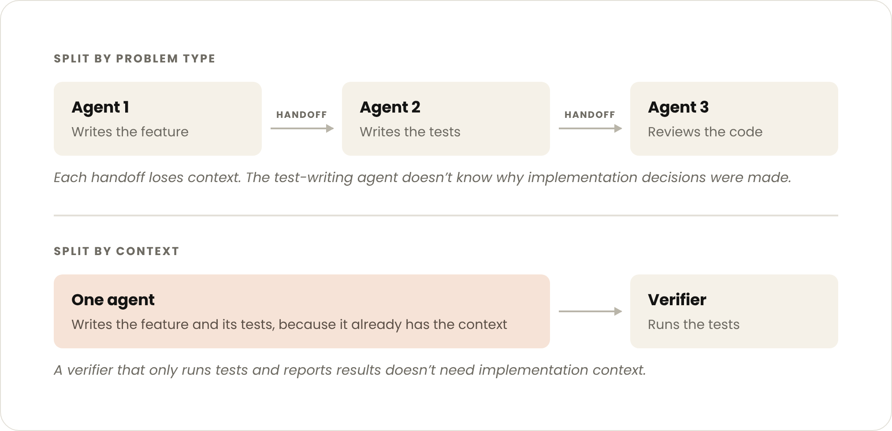

<!-- paper-reading-lang: zh-CN -->
<!-- paper-reading-mode: deep -->
<!-- paper-reading-theme: cobalt -->

# Claude｜Building agents：何时把子代理折进主循环

```paper-map
{"thesis":"Anthropic Applied AI 团队根据多个企业部署的对照经验提出：企业 agent 普遍过度使用子代理——「每个团队/问题类型一个子代理」的默认架构带来交接损耗、子代理蔓延、Frankenprompt、分裂评测与延迟堆叠；而自 Opus 4.5 起模型已能在单循环里管理远超团队预期的复杂度，用 skills（渐进披露上下文）+ tool search（渐进披露工具）武装的单 agent 循环在质量上经常同时优于「一提示词包打天下」与「编排器-子代理」两种设计，且成本与延迟更低（有客户实测单循环快约 2 倍）。子代理仍该保留的三种情况有明确判据；迁移路径是「先建任务完成度评测、按共享上下文渐进折叠、一比一转成 skills 与 MCP 工具、逐任务对照翻转」。","reader":"正在设计或维护多 agent 系统工程架构的读者；文中把每个工程建议形式化为可手算的决策模型（交接保真度、延迟堆叠、上下文预算、评测翻转）。","goals":["走通「五失败模式→三保留条件→单循环规格→迁移六步」的完整论证","把 2 倍延迟、80% 提示词缩减、12 子代理等关键数字放进可复算的模型","分清本文的第一方经验证据与普适结论的边界"],"outcome":"全文精读 Claude 官方文章（2026-10-22，Diane Sarkis，18 分钟阅读量）中英对照抓取，含正文全部小节与四件迁移工具说明。","outcomeSource":"https://claude.com/resources/articles/building-agents-when-to-fold-subagents-into-your-main-agent-loop","items":[{"number":"01","label":"病根","signal":"按团队切分","text":"企业默认把 agent 按团队/问题类型切成子代理联邦，五种失败模式随之而来：上下文交换损耗、子代理蔓延、Frankenprompt、无人负责的分裂评测、嵌套循环延迟。","source":"正文「failure modes」节"},{"number":"02","label":"反转主张","signal":"单循环更优","text":"单 agent + skills 渐进披露在对照中经常质量更高且成本延迟更低；一家公司的 12 个专家子代理拖垮品牌一致性与延迟，另一客户实测单循环快约 2 倍。","source":"正文引言与对照段"},{"number":"03","label":"三保留条件","signal":"何时仍用子代理","text":"上下文膨胀导致可测性能退化、需要并行且可丢弃的新鲜上下文、单代理选不好工具或指令冲突——三条判据之外的建议都是折叠。","source":"正文「Use them when」"},{"number":"04","label":"单循环规格","signal":"计划内写","text":"一个模型一个上下文窗口跑开放工具循环：首轮在上下文里写计划并随结果修订，批量工具调用并行执行，回合/成本预算与写门做硬限，流程知识进 skills、硬约束进 tools。","source":"正文「single loop design」"},{"number":"05","label":"迁移路径","signal":"评测先行","text":"先建端到端任务完成度评测（rubric 评分），按共享上下文从最常用子代理开始合并，子代理先降级为工具调用，再一比一转成 skills/MCP 工具，逐任务看翻转不只看总分。","source":"正文「folding」四节"},{"number":"06","label":"证据边界","signal":"第一方经验","text":"这是 Anthropic Applied AI 的部署观察与自家工具推介，数字多为方向性（约 2 倍、>80%、「一批企业部署」）而非受控实验；判据与路径可迁移，具体数字须自测。","source":"全文口径；§16 展开"}]}
```

深读对象：Claude 官方工程博客[《Building agents: When to fold subagents into your main agent loop》](https://claude.com/resources/articles/building-agents-when-to-fold-subagents-into-your-main-agent-loop)（Anthropic，2026-10-22，作者 Diane Sarkis，Applied AI 团队，标注阅读时长 18 分钟）——[点此打开原文 ↗](https://claude.com/resources/articles/building-agents-when-to-fold-subagents-into-your-main-agent-loop)。这是「Claude 文章深读」系列的第一篇：来源不是 arXiv 而是 Anthropic 的第一方部署经验，证据形态是「多个企业部署的对照观察 + 官方迁移工具」，结论的方向价值高、数字精度低（本页会逐个标注）。文章立场一句话：**子代理被过度使用了**——把编排器-专家联邦折叠成一个用渐进披露（skills + 工具搜索）武装的单 agent 循环，经常同时赢质量、成本、延迟三样。本页按细章跟读：五种失败模式配蔓延度手算、三保留条件形式化成决策规则、电话游戏与嵌套延迟建可复算模型、2 倍/80% 两个关键数字放进模型核对、迁移六步与四件官方工具逐一拆解；文末对第一方经验的证据边界做诚实对账。

<!-- Deep Reading coverage
| Source section / object | Role | Explanation location / status |
| --- | --- | --- |
| 引言（对照结论、12 子代理案例、2× 延迟） | 立论 | §01-02 |
| 「failure modes」五节（上下文/蔓延/Frankenprompt/评测/延迟） | 病理 | §02 |
| 「three reasons」（共享上下文/渐进披露/模型更强，80% 数字） | 机理 | §03 |
| 「Use them when」三保留条件 | 判据 | §05 |
| 「single loop design」规格与计划内写 | 目标架构 | §04 |
| 「task-completion evals」 | 迁移前置 | §08 |
| 「reducing subagents over time」（合并领域代理/降级为工具） | 迁移路径 | §09-10 |
| 「folding into skills and tools」（一比一改造、task flip 案例） | 迁移路径 | §11 |
| 「how several teams contribute」（tools/skills/KB 三分法、DRI、skill-creator/doctor） | 组织模型 | §12-13 |
| 「tools to accelerate」（migration kit 四件套） | 工具箱 | §14 |
| 结尾（模型演化→更多子代理可折叠） | 收束 | §16 |
| 相关文章列表（每日检查的信号源） | 任务背景 | §16 末 |
-->

## 01 / 靶子：企业 agent 的「每个团队一个子代理」

文章开篇点名一个企业默认架构：公司想把多个产品能力合成一个客户界面，每个能力归一个团队所有，于是**每个团队造自己的子代理**——客服团队一个、订单团队一个、物流团队一个……由一个编排器协调。这个组织上最自然的切法（团队边界=架构边界）在技术上恰恰是最贵的切法。引言给了两个对照锚点：其一，Applied AI 团队「跨多个企业部署的对比」里，**带 skills 的单 agent 在质量上经常同时打赢『一提示词包打天下』和『编排器-子代理』两种设计，且每任务成本与延迟往往更低**；其二，一家公司客户侧 agent 里的**十几个专家子代理**让一致的品牌体验难以维持、延迟伤到用户体验。还有一个被点名的「熟悉的进步假象」：intent classifier + 固定多步 recipe + 每步一个子代理的流水线设计——反馈往往是这些结构在替模型做模型自己已经会做的事。

### 另一个极端也不行：为什么「一提示词包打天下」输了

注意对照里的第二个输家不是子代理联邦，而是**一提示词包打天下**（one-prompt-for-everything）——把所有团队的所有规则、所有工具全部塞进一个静态提示词、不做任何披露管理。它输的原因与子代理联邦对称：子代理联邦死于**交接损耗**（切太碎），一提示词死于**上下文膨胀**（堆太满）——所有能力全量常驻，每个任务都要背着全部无关规则跑，模型在长提示词里选工具、守规矩的准确率随膨胀下降。单循环 + 渐进披露恰好站在两者中间的甜点位：**架构上是单的（零交接），上下文是按需的（不膨胀）**。这个三角关系是理解全文的坐标：三种设计不是「复杂度递减」的排序，而是沿「上下文常驻量 × 交接次数」两个正交轴的不同落点——单循环把两个轴同时压低，靠的就是渐进披露这个使能技术。

### 为什么按团队切分是陷阱

按团队切分的深层问题不是技术而是**接口经济学**（本页形式化，教学重建）：$n$ 个子代理两两之间存在潜在交接路径，其数量按组合数增长：

$$P(n)=\binom{n}{2}=\frac{n(n-1)}{2}$$

教学手算：12 个子代理（引言案例的量级）有 $\binom{12}{2}=66$ 条潜在交接路径——每条路径都需要定义「传什么上下文、什么格式、失败怎么办」。而单循环架构的交接路径数是 $P(1)=0$：全部协作发生在同一个上下文窗口里，由模型自己协调。这个 66 对 0 的对比是全文「共享上下文产生更好答案」的组织学注脚：**架构复杂度不是随团队数线性涨，是按平方涨**；这就是「subagent sprawl」为什么在十几个子代理规模上开始失控的数学原因。

## 02 / 五种失败模式：病理清单

正文列出按团队切分的五种病，每一种都值得单独命名：

- **上下文管理**：要决定子代理之间交换什么上下文，来回传递中丢失细节——后文「电话游戏」模型（§06）量化这个损耗；
- **子代理蔓延（subagent sprawl）**：每个团队发自己的子代理，最终得到**数百个互相重叠、无强制标准**的子代理（§01 的 66 条接口路径是单个数字的微观版）；
- **Frankenprompt**：每个团队往系统提示词里塞一句自己的规则，结果是**互相冲突的规则 + 没有一致的声音**——提示词的「公有地悲剧」；
- **无人负责的分裂评测**：每个团队加自己「过度优化自家子任务」的评测，**没有人拥有和维护整套**——局部最优叠加不等于全局最优，甚至互相打架；
- **延迟**：多 agent 架构复杂度直接加延迟——一位客户把多 agent harness 与单 agent 循环对照，**后者 runtime 快约 2 倍**（§07 建模型核对这 2 倍从哪来）。

### 五种病的传导链：不是并列而是叠加

把五种病读成并列清单会低估它们的杀伤力——它们是一条传导链。**蔓延是源头**：每个团队发自己的子代理，接口数按 §01 的平方律涨。**Frankenprompt 是蔓延在提示词层的投影**：子代理各自为政的同时，主提示词还在被各团队塞规则，两处同时失控。**分裂评测是蔓延在质量层的投影**：每个子代理自带一套「过拟合自家子任务」的评测，而端到端链路上没有任何一套评测能对最终的客户体验负责——客服子代理的评测分再高，订单→发货链断了它也不知道。**上下文管理与延迟是链路的直接税**：每次跨子代理协作都要付交接税（§06 的保真度损耗）与嵌套循环税（§07 的延迟）。传导链的含义对治疗顺序有直接指导：**从源头治（收敛子代理数量、中央接管提示词与评测）比在末端止痛（优化交接协议、加缓存）有效**——这也是文章把「合并子代理」放在迁移路径第一步的原因。

五种病的共同结构：**没有中央团队端到端拥有质量**。文章给的组织处方在后面（§13）：一个中央团队拥有系统提示词与端到端评测，逐个审核新工具与评测再上线；领域团队的所有权转移到 skills 与工具层。

## 03 / 三个理由：为什么单循环现在能赢

「把子代理折回主循环」在旧模型上不成立、在 2026 年的模型上成立——文章给了三个理由。

**理由一：共享上下文产生更好的答案。** 对长时运行的 agent，多个任务的上下文应该待在**同一个**主上下文窗口里：更少的上下文窗口、更少的**有损交接**。电话游戏（§06）给损耗定量。

**理由二：渐进披露防止上下文膨胀。** 这是单循环可行性的技术支柱：agent 只看到 skills 与工具的**短描述**，用到时才全量加载。文章给了本文最硬的数字：渐进披露（含 skills 与工具披露）相关的削减让 **Claude Code 面对更强模型的系统提示词缩减超过 80%**。本页配一个可复算的教学模型（§04）：40 个 skill 全量常驻是 80K token，渐进披露下常驻只要描述层 3.2K + 实际用到的 3 个全量 6K ≈ 9.2K——**降 88%**，与 80%+ 的官方数字同量级。

**理由三：模型更强了。** 「从 Opus 4.5 起，模型在单循环里能管理的东西远超多数团队的预期。」这句话是全文的时间戳：**这是一条会过期的建议**——模型每强一代，「需要子代理」的边界就往外退一步（结尾明说：模型越强、agent 跑得越长，更多子代理可以变成 skills 与工具）。边界句：文章也说单循环「需要纪律」——精心管理的系统提示词、真实短小的 skill/工具描述、中央团队端到端拥有质量；没有这些纪律，单循环会退化成新的一提示词包打天下。

### 「替模型做模型会做的事」：一条历史规律

引言里那句「这些结构在替模型做模型自己已经会做的事」值得展开成一条规律。多 agent 史上每次「结构前置」都在被模型进步回收：早期模型不会规划，于是有 intent classifier 与固定 recipe；不会长程跟踪，于是有外部计划管理器；工具一多选不过来，于是有路由子代理。每一代结构都是为了**绕过当期模型的短板**，而每一代更强的模型都会把对应短板补掉——结构就从「必需品」变成「遗产」。prompt-audit 工具（§14）干的正是这个还债动作：标出「为旧模型写的指令」并提修复。判断一个结构是否已过期的方法论与三保留条件同构：**给「拿掉这个结构」做一次评测对照**——分数不掉（或涨），结构就该退役；分数掉，才说明它还在补真短板。把这条规律用在本文自己身上：单循环 + 渐进披露也是「为当代模型设计的结构」，它同样会被未来的模型进步部分回收（比如上下文窗口大到不再需要披露）——区别只在时间。

## 04 / 单循环设计规格：计划写在上下文里

正文给出的目标架构（原文加粗的逐条转述，架构插图见下图）：



*原文章插图（assets.claude.com 原样下载，2024×980）。单循环四要素：一个模型与上下文窗口、首轮写计划并随结果修订、批量工具调用并行执行、harness 层的回合/成本预算与写门硬限。*

1. **一个模型、一个上下文窗口**跑开放式工具循环，硬限制（回合预算、成本预算、写门）设在 harness 层；
2. 每回合模型发出**一批工具调用**，harness 并行执行、把原始结果返回同一窗口；
3. 循环在模型给出答案或**撞预算**时停止；答案后可选跑一个目标/验证器检查；
4. **模型首轮在上下文里写计划，随结果到达持续修订**——这是与编排器设计最大的差别：计划从「harness 里的代码步骤」变成「上下文里的文本」，从「按目录规则重写」变成「模型自己决定下一步」；
5. 剩余的代码只做两类事：加载**便宜且几乎总要**的东西（如实体消歧步骤）、处理 harness 级机制；**流程与领域规程进 skills**，**硬限制（校验、审批门）与会话中途出现的需求（如记忆查找）进 tools**。

渐进披露的上下文预算可以写成（教学形式化）：

$$C_{\text{load}}=\underbrace{\sum_{i=1}^{N} c^{\text{desc}}_i}_{\text{常驻描述层}}+\underbrace{\sum_{j\in U} c^{\text{full}}_j}_{\text{实际用到的全量}}\qquad\text{vs}\qquad C_{\text{static}}=\sum_{i=1}^{N} c^{\text{full}}_i$$

教学手算：$N=40$ 个 skill、$c^{\text{full}}=2\mathrm{K}$、$c^{\text{desc}}=80$ token、单次任务实际用 $|U|=3$ 个——常驻披露 $40\times80=3.2\mathrm{K}$，加全量 $3\times2\mathrm{K}=6\mathrm{K}$，合计 $9.2\mathrm{K}$；静态全载 $40\times2\mathrm{K}=80\mathrm{K}$。缩减率 $1-9.2/80=88.5\%$——与官方「>80%」同量级不是巧合：披露比（描述/全量 = 80/2000 = 4%）越悬殊、单任务实际用到的 skill 越少，缩减越狠。

### 计划内写 vs 代码计划：一个范式差

第 4 条规格值得单独展开，因为它是整套设计的哲学枢纽。传统编排器里「计划」是代码里的数据结构：harness 按固定流程推进，每步调用一个子代理，计划的重写由代码按目录规则执行。单循环里计划是**上下文里的文本**：模型第一轮把它写出来，之后每批工具结果回来自己修订。三个后果：**适应性**——计划可以因意外结果（工具报错、数据出乎意料）即时改道，不需要改代码；**可审计性**——计划就在对话里，用户与开发者直接看到模型「在想什么」，排错从读代码变成读轨迹；**下限保护**——计划是文本就会有漂移，所以硬约束（回合/成本预算、写门）必须留在 harness 层兜底。停机条件形式化（教学重建）：

$$\mathrm{stop}=\mathrm{answered}\ \lor\ \left(t>B_{\text{turn}}\right)\ \lor\ \left(c>B_{\text{cost}}\right)\ \lor\ \left(\mathrm{write}\notin G\right)$$

前两项是预算熔断，最后一项是写门：需要审批的写操作不在门内就拒——**开放性（模型自由决定步骤）与确定性（硬限永远生效）的分界线就画在这里**。

## 05 / 三保留条件：什么时候仍然用子代理

文章对「子代理已死」的误读做了明确防御——**三种情况该用**（原文列表直译）：

1. 单 agent 循环因**上下文膨胀出现可测的性能退化**；
2. 多个任务需要**并行**、且用完即可丢弃的新鲜上下文窗口；
3. 单 agent **选不好工具**，或系统提示词里存在**互相冲突的指令**。

把三条形式化成决策规则（教学重建）：

$$\mathrm{KeepSubagent}=\mathrm{Bloat}(\Delta_{\text{perf}})\ \lor\ \mathrm{Parallel}_{\text{disposable}}\ \lor\ \mathrm{Conflict}$$

其中 $\mathrm{Bloat}$ 要求「**可测**的性能退化」——不是上下文长就拆，是长到分数掉才拆；这条判据的隐含推论：拆不拆子代理是**评测决定**的事，不是架构审美决定的事（§08 的评测先行由此而来）。三条之外的常见理由（「不同团队维护」「提示词太长放不下」「历史上就是这么分的」）都不在保留清单里——它们是待折叠的症状而非理由。

### 冲突条件的双向用法：折叠本身就是解药

第三条保留条件（提示词指令冲突 → 用子代理隔离）有个容易漏看的双向性：**冲突既可以靠隔离解决，也可以靠合并解决**。把两个指令打架的子代理折进同一个循环，合并动作本身就强迫中央团队把冲突规则去重、排序、写成一致口径——隔离只是把冲突冻结在架构里，合并才是把冲突消灭在提示词里。文章倾向后者的原因有二：隔离的代价是永久交接税（这两个领域从此隔着一条电话线），而合并的去重成本是一次性的；且隔离后的两个子代理若常被一起调用（§09 的合并判据），冲突还会在编排层以「路由摇摆」的形式复发。实践判据（本页整理）：**冲突若源于「同一件事两套说法」，合并解决；若源于「真需要不同系统提示词人格」（如一个面向客户的客服口径 vs 一个内部风控口径），隔离合理**——前者是技术债，后者是业务边界。

## 06 / 电话游戏：交接保真度模型

「按问题类型切分 agent 时，它们在玩电话游戏——信息来回传递，每次交接都在降低保真度。」给个可复算的模型（教学重建）：设每次交接保留比例 $f$ 的信息量，经过 $n$ 次交接后端到端保真度：

$$F(n)=f^{\,n}$$

教学手算：$f=0.9$（每次交接只丢一成——已经是乐观假设）、$n=5$ 次交接：$F=0.9^5\approx0.59$——**近四成信息在到达终点前蒸发**。要保住九成信息，交接次数上限是 $n\le\ln 0.9/\ln 0.9=1$（一次）；$f=0.95$ 时也只允许 $n\le2$。反过来算「能容忍多少次交接」：给定目标保真度 $F^\ast$，$n^\ast=\lfloor\ln F^\ast/\ln f\rfloor$。模型说的是同一件事：交接不是免费的，**链长是被保真度预算硬约束的**；单循环把 $n$ 压到 0，这就是「共享上下文产生更好答案」的定量版本。边界句：$f$ 是教学参数（文章没给实测交接保真度），但方向性结论对任意 $f<1$ 都成立——只要交接有损，链越长越糟。

## 07 / 嵌套循环延迟账本：2 倍从哪来

「每个（子代理）调用都是嵌套的模型循环，增加延迟。」给延迟建个账本（教学重建）。单循环：

$$L_{\text{single}}=T_{\text{turn}}\cdot E[n_{\text{turns}}]$$

编排器-子代理链（串行经过 $k$ 个子代理、每个子代理自跑 $m_i$ 回合、交接开销 $h$）：

$$L_{\text{multi}}=\sum_{i=1}^{k}\left(T_{\text{turn}}\cdot m_i+h\right)$$

教学手算：$T_{\text{turn}}=2$ 秒、单循环 $10$ 回合 → $L_{\text{single}}=20$ 秒。多 agent 版：编排器 2 回合 + 3 个子代理各 4 回合 + 4 次交接各 1.5 秒 → $L_{\text{multi}}=2\times(2\times4+1.5)+2\times2=22$？按公式直算：编排器与子代理回合合计 $(2+3\times4)\times2=28$ 秒，交接 $4\times1.5=6$ 秒，共 $34$ 秒——**1.7 倍**于单循环；子代理回合更碎或交接更贵时逼近客户实测的**约 2 倍**。2 倍的构成：多出来的不只是交接开销（6 秒），大头是**编排器自己的回合 + 每个子代理冷启动上下文的重复思考**（8 个额外回合 = 16 秒）。这也解释了为什么「子代理降级为工具调用」只能省一部分（§10）：工具调用没有嵌套循环，但是如果保留子代理形态，嵌套还在。

### 真并行：三条件里最硬的一条

延迟模型里唯一对多 agent 有利的项是**并行**：$k$ 个子代理同时跑独立任务时，墙钟时间取 max 而非 sum：

$$L_{\parallel}=\max_{i\in[1,k]}\left(T_{\text{turn}}\cdot m_i\right)+h_{\text{fan}},\qquad S\le\min\left(k,\ \frac{\sum_i T_{\text{turn}}m_i}{\max_i T_{\text{turn}}m_i}\right)$$

教学手算：3 个子代理各 4 回合并行、$T_{\text{turn}}=2$ 秒、分发汇总开销 $h_{\text{fan}}=2$ 秒——$L_\parallel=8+2=10$ 秒；串行版要 $24+6=30$ 秒，加速 3 倍。单循环里模型每回合发出的**批量工具调用**也是并行的（规格第 2 条），所以「工具级并行」单循环已经免费拿到；子代理独有的是**上下文级并行**——每条并行线有自己的窗口、互不挤占，做完即丢（三保留条件之二的原话：「用完即可丢弃的新鲜上下文窗口」）。典型场景是研究式任务的分头检索（Anthropic 自己的多 agent 研究系统就是明证）：八条检索线各带各的窗口同时跑，主窗口只收回摘要。判别口径：**并行单位是「工具调用」还是「带独立上下文的整段工作」**——前者留在主循环（批量工具调用已免费并行），后者才值得子代理（新鲜上下文、用完即弃、按 max 计时）。

## 08 / 迁移第一步：任务完成度评测

「折叠前先建能判断该不该折的评测集。」要点直译：给 agent 的**最终消息按 rubric 评分**是跟踪答案质量的起点；难的场景（内部系统难以重放、用户参与难模拟）也要先建**某种**端到端任务完成度度量——哪怕是代理指标。为什么必须先行：三保留条件里的 Bloat 判据要「可测退化」，折叠决策的「folded vs kept」对照要分数，全都要这套评测。官方工具 `/claude-api build-eval` 就是干这个的（§14）。评测粒度文章给了明确要求（§11 的 task flip）：**每一次改动前，确保评测覆盖生产里实际会连在一起跑的每条 agent 链、以及每个要折叠的子代理**——链级覆盖是防「折了这个、断了那条」的最低保险。

### 为什么是「最终消息的 rubric」而不是中间过程

评分对象选「最终消息」有讲究：折叠迁移关心中位数体验而非单步细节，rubric（正确性、完整性、口径一致、是否引用真实数据等维度各设档）恰好度量这些；而过程级度量（每步工具选对没有）在折叠前后天然不同——单循环的过程与编排器的过程根本不可比，拿过程指标做对照会把架构差异误读成质量差异。这也是「代理指标也行」的深层含义：企业内部系统难重放时，与其等一个理想的可重放环境，不如先用「最终答案对不对/全不全」这类粗但同构的指标把对照跑起来——**对照的可比性比指标的精度重要**，粗指标下观察到的翻转方向通常足够支撑折叠决策。边界句：rubric 终点是「起点」——迁移完成后，过程级可观测（哪个 skill 被加载、哪个工具被调、各花多少 token）仍然要建，但那是运维资产，不是迁移的决策依据。

## 09 / 渐进折叠：合并领域代理的顺序策略

「向单循环演化 = 把子代理折进工具与 skills。」合并策略（原文直译+整理）：

- **先小规模端到端评测，再动第一次合并**；
- **按共享上下文折叠，从使用最多的子代理开始**；
- **合并那些链式接力、摸同一批数据、常被一起调用的专家**——例：若相当比例的调用是「订单专家 → 发货专家」链，把两者合并成一个「履约」域代理；
- 合并的中间形态可以仍是子代理（**域代理**），逐步收敛。

顺序策略的经济学：使用最多的子代理折叠后，**评测覆盖最厚、收益兑现最快**；「常一起调用」的配对合并直接消灭一条高频电话链（§06）——每次合并消灭的交接次数 = 该链的使用频率 × 链上交接数。边界句：合并顺序「最常用优先」与重构直觉（最简单先动）相反——这里的选择是收益驱动而非风险驱动，因为评测先行已经兜住了风险。

### 域代理中间态：收敛的路标而非归宿

「先合并成域代理、再逐步向单循环收敛」的中间态设计有实用价值：域代理把 12 个专家收敛成 3-4 个领域（客服域、履约域、账务域），接口路径从 66 条骤降到 3-6 条，Frankenprompt 与评测分裂立即缓解——**收益的大头在第一步合并就兑现**；而后续「域代理 → skill 化」的步子可以在评测保护下从容走。要警惕的是中间态的引力：域代理跑稳后团队容易停在这里（「已经好了八成，何必再动」），但 §10 列的三个残留失败模式（独立提示词/有损摘要/嵌套延迟）在域代理形态下一个不少。路标原则：**中间态的每次合并都要顺手把被合并者的提示词去重、评测并轨**——为下一跳减负；把域代理当终点的信号是「不再有合并动作却有持续的小修小补」，那说明引力已经赢了。

## 10 / 子代理降级：作为工具调用 vs 完全交接

保留的子agent怎么被主 agent 调？文章明确降级序列：**推荐「作为工具调用」**——主 agent 调它、拿回结构化结果、继续主循环；**只有当子代理需要直接和用户对话时才推荐完全交接**（full handoff，子代理接管会话）。工具化调用的两个工程要求（原文直译）：定义**共享的响应 schema**；让主 agent 能**拿真实数据验证子代理的结论**（而不是照单全收摘要）。即便降级为工具调用，三个失败模式仍在（文章如实列出）：每个专家仍有自己的提示词/上下文/负责团队/评测；每次调用仍交回**有损摘要**；每次调用仍是**嵌套模型循环**加延迟。所以降级是中间站，不是终点——终点是 §11 的一比一折叠。

### 响应 schema 与真数据验证：降级形态的两个安全带

降级形态的两个工程要求各自防一种事故。**共享响应 schema** 防格式事故：主 agent 消费子代理输出前先过结构校验（字段齐全、类型对、枚举合法），坏输出在接口处被拦而不是污染主上下文——这与 §12 「Y 需要 X 的输出就让 Y 工具内部先做 X」是同一个思想：**把协议约束下沉到接口层，不依赖模型自觉**。**真数据验证**防幻觉事故：主 agent 拿子代理结论后，用可用的工具再核一层（子代理说「订单已发货」→ 主 agent 查一次物流接口确认）。这条实践暗合一个通用模式：**生成-验证分离**——子代理是生成器，主循环兼任验证器；验证不必周全，但关键断言（会影响用户可见动作的）必须可复核。教学手算（验证的期望收益）：子代理关键断言准确率 95%、验证器对错误断言的检出率 60%——无验证时错误断言直通率 5%；加验证后 $5\%\times(1-60\%)=2\%$，砍掉六成——验证器不必完美，**有**就显著。

## 11 / 折叠为 skills 与 MCP 工具：一比一改造与翻转分析

**一次折一个**：把子代理的提示词转成 skill，把它的 API 调用转成 MCP 工具。对照方法论是全文最实操的一段（原文案例直译）：在样本**客服 agent**上测试时，把一个子代理折进另一个**降低了延迟，但弄坏了一个原本通过的流程**——主 agent 自己拿着订单查询工具就答了，不再向发货专家要送达日期。教训两条：**别只看总分，要看哪些任务翻转了**；总分 +2 可以掩盖一条关键链路断裂。形式化（教学重建）：设任务集 $S$、折叠前后通过集 $S_{\text{before}},S_{\text{after}}$，评测分数 $|S|^{-1}|S_{\text{pass}}|$ 只看大小，翻转集

$$\mathrm{Flip}=S_{\text{before}}\setminus S_{\text{after}}\ \cup\ S_{\text{after}}\setminus S_{\text{before}}$$

才暴露回归。教学手算：100 题评测 82→84 分（净 +2），但翻转分析发现 3 题由败转胜、**5 题由胜转败**——净 +2 掩盖了 5 条回归；若那 5 题里有「查送达日期」这类业务关键任务，这个「改进」实际是事故。 hillclimb 工具（§14）就是为这种 folded-vs-kept 对照设计的。

### 链覆盖要求：改动前的评测充分性条件

「每次改动前，确保评测对生产里连在一起跑的**每条 agent 链**、以及每个要折叠的子代理都有任务覆盖」——这条可以写成覆盖条件（教学形式化）：

$$\forall\,\mathrm{chain}\in\mathrm{Prod},\quad \exists\,\mathrm{task}\in E:\ \mathrm{task\ exercises\ chain}$$

它防的正是客服案例那种事故：「订单 → 发货」是一条生产链，但评测集里若没有**同时要这两个环节**的任务，折叠断链就测不出来——订单任务与发货任务各自通过，链断了总分毫无波动。工程含义：评测集的构造单位不是「能力」而是「生产链」；每次新增或折叠子代理，先问「哪些链穿过它」，没有对应评测任务就先补任务再动手。这与软件重构里的集成测试同构：单元测试（单能力任务）再绿，也替代不了端到端路径测试（链任务）。

## 12 / 三分法：tools / skills / knowledge bases

多团队向单 agent 贡献能力的三个归口，文章给了干净的决策函数（直译+整理）：

- **MCP 工具**：要**执行动作**、读**实时数据**、返回**固定格式结果**时——配 tool search 延迟加载；**硬前置尽量少**，必要的前置放进工具内部（例：若 Y 需要 X 的输出，别要求模型先调 X 再调 Y，让 Y 的工具内部先做 X）；
- **Skills**：agent 需要知道**一个团队怎么干活**——步骤、规则、判断分寸——时；skill 的维护交还给写 skill 的人；每团队 DRI 拥有自家 skills，保证精 craft、彼此区分、无死重；
- **Knowledge bases**：agent **只是偶尔需要**的参考材料——事实与参考资料放 KB 按需检索，别硬塞提示词。

### Skill 治理与子代理治理同构：换了资产，没换问题

注意文章对 skill 图书馆开的药方——每团队 DRI 拥有、保证精 craft 与彼此区分、用 skill-doctor 按成本与使用频率清理死重——**与子代理联邦的病对照着读会心一笑**：skill 蔓延就是子代理蔓延的转世。上一代架构把复杂度堆在子代理上（数百个重叠子代理），这一代若不治理会堆在 skills 上（数百个重叠 skill）；区别在于治理工具变了：skill 的创建有 skill-creator 保良构起点、有 skill-doctor 给出成本×使用的客观数据——比子代理时代的「感觉有用就留着」多了测量手段。这个同构给迁移团队一条心理准备：**折叠子代理不会一劳永逸，它把蔓延问题从架构层搬到了资产层**，资产层的蔓延更便宜（不占交接路径、按需加载），但仍是蔓延——DRI 制度与定期审计（prompt-audit/skill-doctor）要作为常设机制，而不是一次性迁移动作。

三者的判据轴可以画成（教学整理）：**「做事还是知道？」**——做事（有副作用/要实时/有 schema）→ 工具；**「知道怎么做还是知道是什么？」**——怎么做（流程/判断）→ skill；是什么（参考事实）→ KB。skill 图书馆的两个治理工具是第一方给的：`/skill-creator` 起手即良构、还能审计现有的做裁剪去重重构；`/skill-doctor` 显示**每个 skill 的成本与实际使用频率**、删掉死重——skill 也有自己的 sprawl 问题，治理逻辑与子代理同构。

## 13 / 组织模型：中央团队 + 领域所有权转移

单循环不等于单团队。文章的组织设计：**中央团队端到端拥有质量与系统提示词**，逐个审核新工具与评测再上线；领域团队的所有权**上移到贡献层**——知识库、skills、MCP 工具。这是「Frankenprompt 公有地」的解药：提示词不再是公有地（谁都能塞一句），而是有 owner 的受审资产；领域团队从「拥有子代理」变成「拥有 skill 与工具」——影响力没变小，变更面从「改子代理提示词就上线」变成「过中央审核再上线」。教学手算（治理收益）：假设每团队每月 2 次提示词/工具变更、$n=12$ 个团队、每次变更 5% 概率引入冲突规则——无审核时期望冲突 $12\times2\times0.05=1.2$ 次/月；中央审核拦下其中七成后降至 0.36 次/月。数字是教学虚构，但结构是真实的：**审核成本线性、冲突代价随规模超线性**（冲突规则之间还会互相作用）。

### 所有权的心理账：领域团队为什么愿意交出子代理

迁移的隐藏阻力是组织性的：领域团队把「自己的子代理」视为地盘，折叠听上去像裁军。文章的所有权设计恰好回答了这个问题——团队交出的只是**架构层的位置**（子代理这个壳），保住的是**知识层的主权**：怎么做本域的事（steps/rules/judgment）写在自家 skill 里、由自家 DRI 拥有与维护；自家数据与操作封装成自家 MCP 工具；自家参考资料放自家 KB。对照旧模式里「提示词改一句要找平台团队排期」，新模式的变更面反而更自主（skill 是自己团队的可维护资产，过审即可）。理解这一层后，「如何让多个团队共建单 agent」的答案就完整了：**中央管底盘（提示词、评测、审核），领域管弹药（skill/工具/KB），DRI 做两层的接口人**。迁移叙事也因此应该从「拆掉你的子代理」换成「把你的子代理升级为全公司都能用的 skill」——同一件事，后者的组织阻力小一个量级。

## 14 / 工具箱：migration kit 四件套

官方把本文的方法论做成了可执行的 Claude API skills，一个 **migration kit** 串起引导式工作流（识别模式→评估替代→验证最优）。四件（原文直译）：

- `/claude-api build-eval`：建中央团队拥有的第一批端到端评测，或各团队随 skill 发布的小评测；
- `/claude-api prompt-audit`：标出**为旧模型写的指令**（提示词、skill、工具描述里都有），以 diff 形式提修复——「模型变强了，旧指令在拖后腿」的可操作化；
- `/claude-api hillclimb`：对着既有评测迭代改进应用——**folded vs kept 对照**就用它跑；
- `/claude-api cost-optimize`：画像调用去向，逐项提议省法（提示词缓存、裁剪多余输入输出 token、effort 档、模型选择——一次改一样）。

四件工具与迁移步骤的对应关系：build-eval ↔ §08 评测先行；prompt-audit ↔ §03 理由三（模型变强后的提示词还债）；hillclimb ↔ §11 折叠对照；cost-optimize ↔ 成本侧的持续优化。注意这是 Anthropic 第一方工具推介——方法论本身工具无关，任何评测/重构管线都能执行同样的步骤（边界句，§16 一并讨论）。

### cost-optimize 的四个旋钮与「一次改一样」

cost-optimize 列出的省法值得展开：**提示词缓存**（稳定前缀复用缓存价，典型定价下缓存命中比全价省一个量级）、**裁剪多余输入输出 token**（长工具返回截断、历史压缩）、**effort 档位**（同一模型不同推理深度）、**模型选择**（任务分层用小模型）。关键的工程纪律是「一次改一样」（one change at a time）——成本旋钮之间有交互（缓存依赖稳定前缀，裁剪历史会破坏前缀稳定），同时拧两个就无法归因。这与 §11 的「一次折一个子代理」是同一条方法论在两个战场的应用：**单变量改动 + 评测对照 = 可归因的改进**；多变量同时改，赢了不知道为什么赢，输了不知道哪里输。给单 agent 循环的启发：成本优化不是迁移完成后的附加题，折叠本身就是最大的成本优化（消掉嵌套循环与重复上下文），cost-optimize 管剩下的长尾。

## 15 / 与本周论文证据的互证

把这篇文章放进本周深读的三篇论文旁边，四个交叉点值得标注（本页整理）：**(1) 与 Rethinking Agentic RL 的对照**——论文证明多轮 RL 的增益集中在错误恢复与长程韧性、且依赖预算；本文的单循环设计（计划内写 + 随结果修订）恰好是「长程韧性的 harness 侧实现」：计划常驻上下文 = 给模型的恢复能力一个锚点；回合/成本预算 = 论文里 Pass@T 预算的生产版。**(2) 与 CUA-Master 的环境哲学对照**——CUA-Master 用 2000 台 VM 把环境变成可回滚的一等资产；本文把「流程知识」变成 skills 一等资产——同一种思想在不同层的应用：**把隐式依赖显式化为可治理的资产**。**(3) 与 Axion 1.0 的数据哲学对照**——Axion 把难度对准基座的成功策略；本文的 prompt-audit 把指令清理对准「为旧模型写的」部分——都是「先测量再动手」的减法。**(4) 评测粒度的一致性**——论文的 Pass@(K,T) 双轴与本文的 task-flip 分析都在说同一件事：**聚合分数会撒谎，条件级与任务级数据才可信**。

## 16 / 边界：第一方经验的证据等级

诚实对账这张文章的证据形态。**是什么**：Anthropic Applied AI 团队对「多个企业部署」的对照观察 + 自家产品经验（Claude Code 的 80% 缩减）+ 配套工具推介。**不是什么**：不是受控实验——「frequently outperformed」「often at a lower cost」没有置信区间；「约 2 倍」「>80%」「一批企业部署」都是方向性数字；12 子代理案例匿名。**适用条件**：Claude 平台 + Opus 4.5 级模型 + 有中央工程团队的企业场景；模型弱一代、或没有中央团队纪律，三条保留条件之外的折叠都可能翻车。**会过期的部分**：文章自己说「模型越强、agent 越长跑，更多子代理可以变成 skills 与工具」——这是一条随模型进步单调右移的边界，今天的「必须保留」（比如真并行）明天可能也进折叠区。**不受影响的部分**：电话游戏的交接损耗、接口数的平方增长、评测先行的迁移纪律、task-flip 分析——这些对任意 $f<1$ 的系统都成立。**给每日任务的信号**：文末的相关文章列表（本期含 10-27 Google Cloud 成本、10-19 源码控制重构、10-16 两篇等）就是本系列的监控面——新文章出现即按本页同样的深度流程处理。

### 一句话收束

把全文压缩成一条可携带的判断：**子代理解决的是模型的三个真短板（上下文容量、并行上下文、指令路由），而 2026 年的模型只剩一个半还成立**——容量被渐进披露与更强模型合围，路由被 skills 与工具搜索接管，剩半个真并行还站着。所以架构审查的正确问法不是「我的系统需要几个子代理」，而是「我的系统里哪条子代理在补**今天仍存在**的短板」——按条过审、评测对照、能折尽折；折叠的尽头不是一个没有子代理的教条，而是一套随模型进步持续重审资产配置的纪律。

```paper-check
{"title":"六个检验架构理解与数字解读的问题","items":[{"question":"交接保真度手算：每次交接保留 f=0.85，经过 6 次交接的端到端保真度是多少？若业务要求端到端保真度不低于 70%，最多容忍几次交接？","hint":"F(n)=f^n；n*=⌊ln F*/ln f⌋。","answer":"F(6)=0.85^6≈0.377——六成交接后只剩不到四成信息。70% 上限：n*=⌊ln0.7/ln0.85⌋=⌊0.3567/0.1625⌋=⌊2.19⌋=2 次。含义：任何超过 2 次交接的电话链都在业务保真度之外——这是「合并常一起调用的专家」的量化动机：合并掉一条 k 次交接的链，等于把链上任务的保真度从 f^k 拉回 f^0=1。","source":"§06 模型；手算见同节"},{"question":"延迟账本手算：T_turn=3 秒、单循环 12 回合；多 agent 版编排器 3 回合 + 4 个子代理各 5 回合、6 次交接各 2 秒。多 agent 是单循环的几倍？把子代理降级为工具调用（无嵌套回合、保留交接 1 秒/次 ×4）后是几倍？","hint":"先算两个 L，再算降级版。","answer":"L_single=3×12=36 秒。L_multi=(3+4×5)×3+6×2=69+12=81 秒 ≈ 2.25 倍——客户实测「约 2 倍」的量级与此模型吻合。降级版：嵌套回合消失，剩编排器 3×3=9 秒 + 4 次工具交接 4×1=4 秒…但工具结果回主循环常引发后续回合，保守按总回合 16 算：16×3+4=52 秒 ≈ 1.44 倍。结论：降级砍掉嵌套回合（81→52）但砍不掉主循环自身的回合膨胀——这就是文章说降级「只是中间站」的定量原因。","source":"§07 模型；手算见同节"},{"question":"渐进披露手算：N=60 个 skill、全量 3K、描述 90 token、单任务用 4 个。披露制比全量制省多少？skill 数涨到 200 个（描述不变）时披露制的常驻开销是多少、为什么这正是「skill sprawl」的治理动机？","hint":"C_load=Σdesc+Σused full。","answer":"C_load=60×90+4×3000=5.4K+12K=17.4K vs C_static=180K——省 90.3%。N=200 时常驻描述层=200×90=18K——已经超过 N=60 时的全部加载量。含义：渐进披露把成本从 O(N×full) 降到 O(N×desc+used×full)，但 O(N) 项仍在涨；skill-doctor 按「成本×实际使用」清理死重，就是在压这个 O(N) 项。","source":"§04 预算式；§12 skill-doctor"},{"question":"task-flip 手算：100 题评测折叠前 76 分、折叠后 79 分。翻转分析发现 6 题败→胜、9 题胜→败。净分对得上吗？这个「改进」该怎么处置？","hint":"净分 = (6−9)/100。","answer":"对不上：(6−9)/100=−3，而总分 79−76=+3——说明还有未计入的既有失败改善或评分口径变化，两处数字必有一处需要核查（这正是 flip 分析的价值之一：连算术自洽性都顺便审了）。若按翻转口径，9 条回归 > 6 条改善，这是净回归，应回滚或修复发货日期类关键链路后再上——总分 +3 不足以放行。","source":"§11 翻转集定义与案例；手算见同节"},{"question":"三保留条件的 Bloat 判据说「可测的性能退化」。有人主张「上下文已经 150K token 了，太大了，必须拆子代理」。这个论证哪里不成立？","hint":"判据绑定的是什么变量？","answer":"Bloat 判据绑定的是性能度量（Δ_perf），不是上下文长度本身——150K 若评测分数不掉，恰是「模型在单循环里管理得比团队预期更多」的证据（理由三），拆了反而引入电话游戏损耗。只有「上下文增长 → 可测分数下降」的因果成立时才触发保留条件。工程含义：上下文长度是个监控指标，评测分数才是决策变量。","source":"§05 决策规则；解读见同节"},{"question":"这篇文章的哪些结论会随模型进步过期、哪些不会？给每日跟进 Claude 文章的读者一条筛选原则。","hint":"分「依赖模型能力边界」与「依赖信息论/组织学」两类。","answer":"会过期：三条保留条件的具体边界（模型越强边界越右移，真并行可能是最后倒下的）、80% 这类与当前提示词存量绑定的数字、单循环「需要纪律」的成本估计。不会过期：交接有损（任意 f<1 成立）、接口数平方增长、评测先行与 task-flip 方法论、中央审核 vs 公有地悲剧的组织学。筛选原则：新文章里绑定「当前模型能力」的数字要带着时间戳读，绑定「结构性质」的结论可以当长期资产积累——后者正是这个深读系列值得逐篇做的原因。","source":"§03 理由三、§16 边界；整理见同节"}]}
```

<details>
<summary>溯源与版本披露</summary>

- 来源：Claude 官方文章《Building agents: When to fold subagents into your main agent loop》，作者 Diane Sarkis（Anthropic Applied AI），发布于 2026-10-22，标注阅读时长 18 分钟。
- URL：https://claude.com/resources/articles/building-agents-when-to-fold-subagents-into-your-main-agent-loop（2026-11-06 全文抓取，HTTP 200，正文 495 行文本完整提取；网页来源无 PDF/SHA-256，引文均出自抓取原文）。
- 标签：Claude（本篇为 Claude 官方文章深读系列首篇；readings.json 以 tags 字段登记）。
- 配图：正文架构插图一张，自文章页 assets.claude.com 原样下载（2024×980 PNG，≥1800px 达标，未重采样）。
- 数字重算声明：§01（接口数 66）、§04（披露预算 88.5%）、§06（保真度 0.9^5 与 n*）、§07（延迟 1.7-2.25 倍）、§11（翻转算术）、§13（治理教学算例）为本页独立构建的教学模型；官方数字（约 2 倍、>80%、12 子代理）均为方向性口径，已逐处标注证据等级。
- 模型无关性：本文方法论（评测先行、渐进折叠、翻转分析）不依赖 Anthropic 工具链；migration kit 四件套为第一方推介，引用时注意利益相关。

</details>
