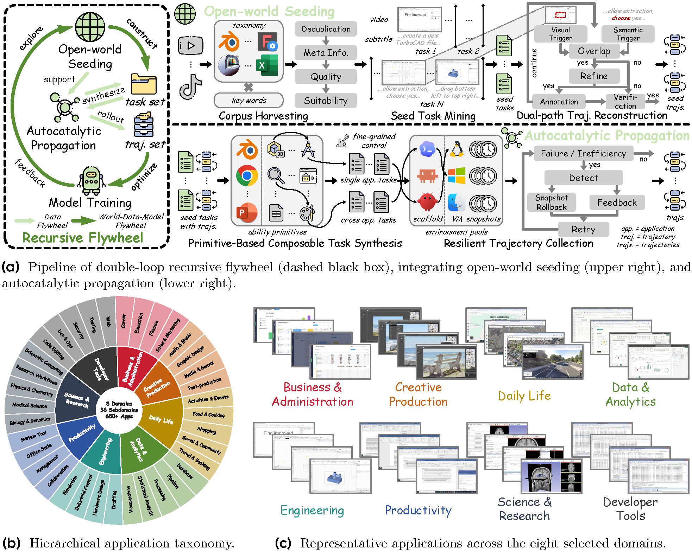
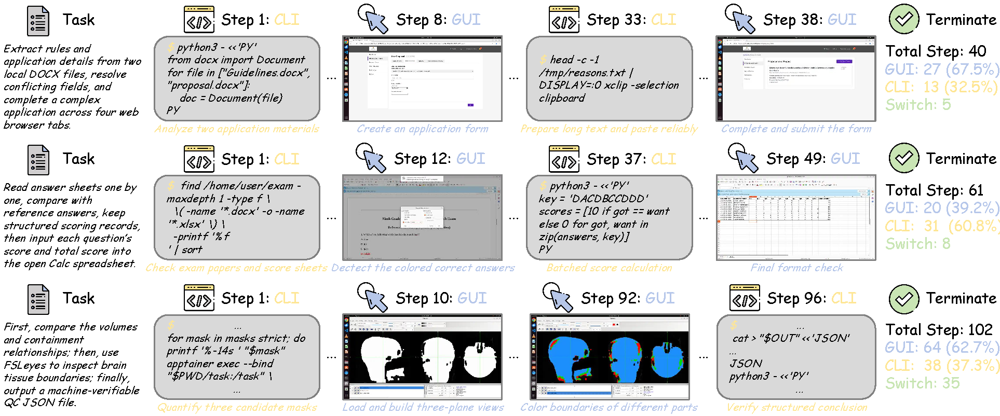
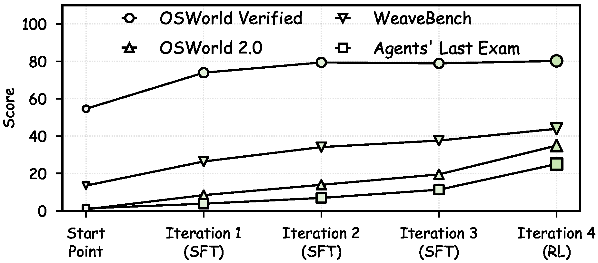

<!-- paper-reading-lang: zh-CN -->
<!-- paper-reading-mode: deep -->
<!-- paper-reading-theme: cobalt -->

# CUA-Master 深读：把「自我改进」从闭世界解放出来的双环飞轮

```paper-map
{"thesis":"CUA 的瓶颈不在单条数据怎么造，而在数据构造与模型优化怎么耦合：单向流水线的数据不知道模型缺什么，闭世界自我改进又受限于模型自己的知识。CUA-Master 用嵌套双环回答——外环让开放世界探索顺着模型弱点走，内环用「视频播种 + 原语自催化」把真实工作流变成可组合、可验证、可回滚重试的任务工厂，27B 模型在四个基准上逼近闭源巨头。","reader":"了解 LLM 后训练与 Agent 基础、想看一套完整 CUA 数据-训练系统怎么设计及其证据结构的读者。","goals":["走通外环与内环各自的机制：视频→种子→原语→合成→回滚","把 Table 1、Table 3、Fig.6 的关键数字逐格重算","分清四个基准各自测什么、哪些结论能从数字里站住、哪些分母对不上"],"outcome":"通读 arXiv v1 全部 24 页：正文 §1-§4、附录 A-E、Table 7/8/9 与 Fig.11-18 全部 prompt 原文。","outcomeSource":"arXiv 2611.03126v1 PDF pp.1-24","items":[{"number":"01","label":"病根在哪","signal":"两种旧范式","text":"单向流水线（数据→训练）不知道模型缺什么；自我生成式递归改进困在模型已有知识里，边际收益递减。","source":"§1, §2.2"},{"number":"02","label":"外环怎么转","signal":"弱点驱动","text":"世界→数据→模型→反馈：每轮训练后按域级失败分析指导下一轮开放世界探索的方向，SFT 三轮后转 RL 冲高。","source":"§2.2.2, §2.5, Fig.8-10"},{"number":"03","label":"内环怎么供料","signal":"播种+自催化","text":"开放世界播种从教学视频挖种子任务（视觉-语义双路触发）；自催化传播把种子拆成五元组原语，按 K/N 预算组合成可控复杂度的可验证任务。","source":"§2.3-2.4, Eq.4-7"},{"number":"04","label":"可靠性机制","signal":"快照回滚","text":"失败不整条重跑：诊断最早偏离步，回滚到它之前最近的稳定边界快照，保留有效前缀带反馈续跑——长任务成功率 14.6%→49.8%。","source":"§2.4.2, Eq.8, Table 3"},{"number":"05","label":"证据与疑点","signal":"四基准+分母","text":"80.2/36.9/43.9/25.0 且更快；OSW-V 总分可由域表精确重构，WeaveBench 域计数 139≠Overall 108、Fig.5 一条轨迹 51≠61——重算见 §14。","source":"Table 1-6, Fig.1-9"}]}
```

深读对象：CUA-Master: Scaling Computer-use Agents through Open-World Recursive Improvements（arXiv 2611.03126v1，2026-11-02，MMLab@CUHK / THU / HKUST(GZ) / 京东探索学院合作，PDF 24 页）。这期 HF 周二刊是 CUA 专场：NorthCUA 用经验飞轮喂计算机使用、Lost in Recovery 分析恢复行为、SWE-Trail 讲轨迹采集——它们各自攻「数据从哪来」的一个切面，而 CUA-Master 给出的是一整套**耦合系统**的答案：数据构造不再是一次性的前置步骤，而是跟着模型弱点走的持续过程。四个数字先立在这：OSWorld Verified 80.2（361 任务）、OSWorld 2.0 36.9、WeaveBench 43.9、Agents' Last Exam 全通过率 25.0——都由一个 27B 开源模型拿下，且每任务平均只走 19.0 步、8 分钟、247K token。本页按细章跟读：双环每个机制配手算教学例（触发交集、原语组合、回滚成本），Table 1 的效率百分比逐一复算，域级表的分母逐一对账（有两处对不上，如实展开），附录 A-E 与八份标注 prompt 全量整合。先从它给自己立的靶子说起。

<!-- Deep Reading coverage
| Source section / object | Role | Explanation location / status |
| --- | --- | --- |
| §1 引言（两种旧范式的病、三挑战） | 立论 | §01 |
| §2.1.1 任务定义 Eq.1-3 | 形式化 | §02 |
| §2.1.2 混合动作空间 + Table 7（App C） | 接口 | §02（全表搬入） |
| §2.1.3 环境基础设施（VM 池/覆盖层/调度） | 底座 | §03 |
| §2.2 数据飞轮 + 世界-数据-模型飞轮 | 总架构 | §04 |
| §2.3.1 语料收割（taxonomy/Whisper/σ 评分） | 机制一 | §05（含 Fig.11 prompt） |
| §2.3.2 种子任务挖掘 Eq.4 | 机制二 | §06（含 Fig.12） |
| §2.3.3 双路轨迹重建 Eq.5 | 机制三 | §07（手算+Fig.13-15） |
| §2.4.1 原语化与组合合成 Eq.6-7 | 机制四 | §08-09（手算+Fig.16-17） |
| §2.4.2 快照回滚重试 Eq.8 | 机制五 | §10（成本手算+Fig.18） |
| §2.5 训练配方（SFT/RL/超参） | 复现条件 | §11 |
| §3.1 基线与基准 + Table 1 | 主证据 | §12（逐列重算） |
| §3.2.2 性能-效率 Fig.3 | 效率证据 | §13（百分比复算） |
| §3.2.3 + Table 2 跨平台 | 泛化 | §12 末 |
| App D Table 4/5/6 域级表现 | 细粒度证据 | §14（分母对账） |
| §3.3.1 混合动作空间消融 Fig.5-6 | 消融一 | §15 |
| §3.3.2 数据飞轮分析 Fig.7 + Table 3 | 消融二 | §15（成功率阶梯重算） |
| §3.3.3 外环分析 Fig.8-9 | 消融三 | §15 |
| App A 相关工作 / App B 数据分布 Fig.10 / Table 9 taxonomy | 谱系与配置 | §04、§11、§16 摘要整合 |
| App E 局限 | 边界 | §16 |
| Fig.11-18 八份 prompt 原文 | 工程细节 | §05-10 各机制处引用要点 |
-->

## 01 / 靶子：单向流水线与闭世界自改各自病在哪

论文开篇把现有 CUA 训练范式分成两代，并给每代安了一个精确的病名。**第一代：单向流水线**——先造数据、再训模型，一次成型。病在数据构造与模型优化之间没有反馈回路：第一轮训完发现模型在跨应用工作流上不行，第二轮的数据却还是按老配方造的，「额外数据可能带来偏斜的收益，而没碰到持续的能力缺口」（§1 原话意译）。**第二代：递归自我改进**——WebRL、Self-Challenging Agents 这一支让模型自己生成任务自己练，反馈回路有了，但探索是闭世界的：任务来自模型自己的知识与能力，天花板就是起点，还可能强化分布偏差——引用的 Shumailov et al. 2024「模型在递归生成数据上会坍缩」与「LLM agents are not always faithful self-evolvers」就是这条路线的理论风险单。CUA-Master 的主张一句话：**递归系统必须持续获得新的开放世界知识**，否则飞轮转得越快越原地打转。

落到数据侧还有三个具体挑战（这段是全文的痛点清单，后面每个机制一一对应）：**多样性**——来源单一的任务同质化，数据量加码后能力覆盖没跟上，饱和得快；**可控性**——指令改写和模板生成的任务，复杂度、应用跨度、依赖关系都控制不了，长程跨应用任务尤其造不出；**可靠性**——任务越复杂，真实环境里 rollout 成功率越低，失败重跑的成本越高，验证也越难。读者可以先记住这三个词的落点：多样性靠视频播种 + t-SNE 上的覆盖扩张（§05、§15）、可控性靠原语的 K/N 组合预算（§09）、可靠性靠快照回滚（§10）——论文的方法节几乎是照着这份清单逐项发力的。

边界句也要先立住：这篇论文的「递归」指数据-训练循环的迭代（四轮：三轮 SFT + 一轮 RL），不是模型在线自我进化；每轮之间的「模型反馈」是域级失败分析（in-house assessment），一个由更强标注模型驱动的离线分析过程。把它读成「模型自己给自己出题」会高估它的自主性。

### 三挑战与三机制的对应表

引言列出的三个数据挑战，与方法节逐一对应，读方法前先带着这张映射：**多样性**挑战（同质化、快饱和）由两处机制接——开放世界播种从 650+ 应用的教学视频里挖人没造过的任务（§05-06），自催化传播在原语库里做组合爆炸把覆盖撑开（§09），证据在 Fig.7 的 t-SNE：飞轮任务既覆盖六个现有数据集的分布带又外溢到稀疏区。**可控性**挑战（复杂度、应用跨度、依赖控制不住）由 K/N 预算接——任务复杂度从语言改写的副产品变成两个显式旋钮，单应用/跨应用由 $N$ 直接指定，依赖合法性由前置条件合取检查保证（§09）。**可靠性**挑战（rollout 成功率低、重跑贵、验证难）由三处机制接——验证器在合成时焊进任务（$V^{syn}$）、环境目录保证任务有处可跑（§03）、快照回滚把失败重试从整条重跑变成保前缀续跑（§10），证据在 Table 3 的九档成功率阶梯：难度越高机制增益越大，$40/3$ 档 3.4 倍、$20/5$ 档 17 倍。这张映射也是检验论文诚实度的尺子：三个挑战都有着落，没有一个是靠口号回应的。

## 02 / 形式化与动作空间：任务三元组和 14 个原子动作

### 任务、策略、轨迹

任务定义为三元组：

$$T=(I,E,V)$$

$I$ 是自然语言指令，$E$ 是交互环境（一台装好应用的计算机），$V$ 是任务专属验证器，判定目标是否达成。第 $s$ 步策略出动作（可以是批量的）：

$$a_s\sim\Pi(\cdot\mid I,o_s,h_s),\qquad a_s=(a_s^{(1)},\dots,a_s^{(L_s)})$$

$L_s=1$ 是单步动作，$L_s>1$ 是一次输出一串原子动作批量执行——这个设计直接压平均步数（Table 1 里 CUA-Master 每任务 19.0 步、低于几乎所有同分模型，批量动作是原因之一）。完整轨迹：

$$\mathcal{X}=\{o_1,a_1,\dots,o_S,a_S,o_{S+1}\}$$

最后由 $V$ 判定成败。这个形式化的要点在于 $V$ 是**任务级**的一等公民：后面原语合成时每个原语自带验证规格，任务级验证器由原语级验证合并而来（§09），RL 的奖励也直接从执行结果导出（§11）——验证器不是评测时才请来的裁判，而是从造数据那一刻就焊在任务里的构件。

### 混合动作空间：GUI 与 CLI 同场

动作空间（附录 Table 7 全表）分三族：GUI 动作 11 个——`computer.click/double_click/triple_click/move/drag/scroll/type/press/key_down/key_up(以及 mouse_down/up)/wait`；CLI 动作 1 个——`shell.exec` 执行结构化命令；扩展工具 1 个——`tool.call` 调注册工具；外加 `finish` 终止。GUI 交互以截图为观测接地，CLI 交互以标准化的 shell 输出（stdout+stderr+状态码）为观测接地；**指针坐标统一用分辨率无关的归一化系 $x,y\in[0,1000]$**——这个细节消掉了不同分辨率环境之间的坐标迁移问题，也是从视频重建轨迹时能把教学视频里的点击直接映射成动作的前提（§07）。论文没有把「混合」停留在接口层：消融（§15）会显示 GUI-only 在 WeaveBench 上只有 6.6 分，混合是数量级差距而不是锦上添花。

## 03 / 环境底座：650 个应用、2000 台并发 VM

基础设施这段（§2.1.3）容易被当工程细节跳过，但它其实是后面所有成功率数字的地基。VM 池的构造是**半自动装配**：人工制备覆盖 Table 9 应用组合的基础镜像，再程序化派生变体——随机删应用、重排桌面布局——以低边际成本扩大环境覆盖；每个镜像登记进目录并带描述符（OS 类型版本、应用清单含版本与包元数据）。Rollout 时每个 episode 从版本化镜像目录实例化：**不可变基础镜像 + 一次性可写覆盖层**，覆盖层容纳 harness 引导（Codex、Claude Code、Open-Claw 等）、任务初始化和瞬态应用状态。全局资源感知调度器按 VM 槽位限并发，标准化生命周期钩子管资源获取、控制器就绪、网络隧道、环境重置与清理。两个硬指标：**100+ 种 CUA 环境、2000+ 并发 VM**。

为什么要记住这两个数：§15 里 Table 3 的成功率阶梯是在这套设施上量出来的，基线「naive 环境同预算从头重跑」与本文方法的差距（如 40/3 档 14.6% vs 49.8%）有一半功劳属于快照回滚机制、另一半就属于这套能大规模并行的环境供给——没有 2000 台并发，50 原语 8 应用档的任务连「造出来」都做不到。附录 E 把这条成本也如实记在局限里：快照回滚需要大规模额外 VM 支持，基础设施挑战不小。

### 可写覆盖层：为什么每次 rollout 都要「新机器」

不可变基础镜像 + 一次性可写覆盖层的组合值得单独看一眼，它是三条需求的交集解。**可复现**：任务每次都从同一版本镜像起跑，初始状态不因上次 rollout 残留（覆盖层用完即弃），Table 3 的成功率对比才可比。**可注入**：harness 引导（给不同被测模型装各自的执行框架）、任务初始化（放好任务要求的文件与应用状态）、瞬态应用状态全部写进覆盖层，基础镜像保持干净——同一个 Ubuntu+LibreOffice 镜像可以支撑「导出 PDF」「转换格式」「统计字数」无数种任务的初始化。**可回滚**：§10 的快照回滚要求能把 VM 状态存档再恢复，覆盖层分离让快照只记增量状态（活跃应用、窗口布局、相关文件、控制器元数据组成的轻量签名）而非整盘克隆，快照的管理成本才能压到可承受。换一个说法：这套基础设施把「环境」从一个静态容器变成了和数据一样可版本、可派生、可回收的一等资产——与 §05 的应用分类法互为表里，分类法定义环境空间，镜像目录实现它。

## 04 / 双环飞轮：外环管方向，内环管原料

### 内环：数据飞轮



*原论文 Fig. 2，PDF p.4 裁剪。(a) 双环递归飞轮主流程：左为外环世界-数据-模型飞轮（含失败/低效检测触发的快照回滚支路），右上为开放世界播种管线（视频语料到种子任务集），右下为自催化传播（原语库到单应用/跨应用合成任务）；(b) 8 域 36 子域层级应用分类法；(c) 代表性应用。*

数据飞轮由两个互补力驱动（§2.2.1）。**开放世界播种**（§2.3）持续注入真实世界的多样性与操作知识——发现欠覆盖的应用、操作、工作流，对冲纯自生成数据的闭环退化风险；**自催化传播**（§2.4）把种子变成可复用原语，支撑可组合的任务合成与可靠轨迹采集。两力的分工论文用了一个准确的比喻结构：播种提供外部知识和多样性、是必要基础；自催化系统性地放大它的覆盖、复杂度与规模。没有播种，自催化在原库内组合很快就把组合空间吃干；没有自催化，一个种子任务就是一个任务，长不出 K=40 的复合任务。上图（论文 Fig.2a）是整个系统的地图：左侧闭环是世界-数据-模型飞轮（含失败/低效检测触发的快照回滚支路），右侧上方播种管线从视频语料到种子任务集，右侧下方自催化从原语库到单应用/跨应用合成任务，两股在「轨迹集」汇合喂给训练。

### 外环：世界-数据-模型飞轮

外环（§2.2.2）把模型训练包进来：开放世界蒸馏出的任务与轨迹给模型提供接地监督；**模型演化后暴露的能力与短板反过来指导下一轮开放世界探索**——数据获取与扩容被导向欠覆盖工作流和更难任务。附录 B 的 Fig.10b 给了这个循环的数据侧证据：训练分布逐轮演化而非固定配比，后几轮提高软件开发、科研、生产力的占比、压低初轮过重的商务行政，最后一轮 RL 趋向均衡——「自适应再分配与演化的能力缺口对齐」。注意这里的因果链是设计出来的而非证明出来的：域配比变化是**依据**失败分析做的决策，论文没有给出「如果不做这个再分配会怎样」的对照消融，外环本身的增益只能从 Fig.8 的逐轮上升间接读出（§15 展开）。

## 05 / 播种 I：语料收割——从 650 个应用的教学视频开始

开放世界的入口是一个**层级应用分类法**：8 大域、36 子域、650+ 应用（附录 Table 9 全表——从 LibreOffice、GIMP、Blender 到 KiCad、COMSOL、FSLeyes，专业软件浓度远超一般 CUA 数据集）。对每个应用实例化组合查询（应用名 × 操作关键词如 tutorial/how to/guide）从 YouTube、TikTok、Bilibili 检索视频。过滤三道闸：**去重**（来源身份+归一化标题）；**元数据闸**（时长、上传新近度、来源可用性、分类法一致的应用归属）；**轻量噪声过滤**（压制推广、娱乐、语言教学类只顺带提到软件的视频）。

过闸视频用 Faster-Whisper（Whisper-Large-v3）打时间戳转写，然后请标注器 $\mathcal{A}$（更强的模型）做**适用性评分** $\sigma\in\{0,\dots,5\}$（Fig.11 prompt 原文在附录）：5 = 清晰高分屏软件演示+明确分步轨迹，3-4 = 主体是 CUA 但混有头像片段/幻灯片/不完整轨迹，0 = 游戏录像/真人视频/纯头像。附加判断 `is_cua/has_trajectory/clarity` 三个结构化信号。教学算例（重建评分语义）：一个 Photoshop 教程前 20 秒是主播开场、中间 8 分钟纯屏幕操作、结尾 30 秒求订阅——按 Fig.11 的标准应得 $\sigma=4$（mostly CUA、minor issues：头像段落），而非 5；`has_trajectory=true` 但 `clarity` 视分辨率定。这个 0-5 分后面会被用来做语料质量闸，论文没给 $\sigma$ 的通过阈值（边界句：阈值未披露，只说"low-quality and unpromising candidates"被去除）。

### 为什么用分类法驱动检索，而不是开放搜索

检索入口的选择有两个对立方案：拿「软件教程」这类开放关键词直接搜全网，或按 650+ 应用的分类法逐应用实例化查询。论文选了后者，理由写在结果里而不是动机里——开放搜索的召回会被流量主导：头部应用（Office、Chrome、Photoshop）的教程淹没一切，KiCad、COMSOL、FSLeyes 这类专业软件在开放检索里几乎不可见，而 CUA 的能力缺口恰恰长在这些低频应用上。分类法驱动把检索预算按应用分配：每个应用都有自己的查询组（应用名 × 操作关键词），长尾应用与头部应用拿到同等的初始召回机会，再由元数据闸与适用性评分做质量竞争。这与 §04 外环的「按模型弱点指导探索」构成两级定向：分类法保证**静态**覆盖广度（任何应用都有入场券），外环反馈决定**动态**配额倾斜（哪类应用多挖、哪类少挖）——附录 B 的域配比逐轮变化（商务行政降、软件开发/科研升）就是动态那一级在工作。另一个次要收益是噪声控制：查询里带应用名天然压住了「同名不同物」的检索漂移。

## 06 / 播种 II：种子任务挖掘——把一个视频切成 M 个任务

一个教程视频常含多个工作流、还夹着非操作片段，所以种子挖掘被形式化为**多模态时序片段发现**（§2.3.2）：

$$\mathcal{A}:\ \{\hat f_1,\dots,\hat f_n\}\ \mapsto\ \{(t_i^{s},t_i^{e},T_i)\}_{i=1}^{M}$$

输入元数据+时间戳转写+均匀采样总览帧，输出 $M$ 个（起点、终点、任务）三元组——只保留可观察的、计算机操作状态连续的区间，剔除片头、广告、头像评论、纯幻灯片讲解。**一个视频产出多个独立可执行的种子任务**，每段从视觉上下文、旁白、应用身份、演示的状态转移联合推断出一个简洁目标。这个设计与 Fig.12 的 prompt 一致：先选一个最长的主片段（primary_episode，要求单一连续工作流+明确目标+可见起止状态），再列出全部其余可导出片段（episode_segments），显式忽略区间（ignore_ranges）与高价值区间也一并输出。与 VideoAgentTrek/Video2GUI 那一支「视频直接生成轨迹」的区别论文自己点了：这里把过程当成**种子任务收集 + 后续传播的基础**，轨迹重建是下一步的事——种子是资产，轨迹只是种子的第一次实例化。

## 07 / 播种 III：视觉-语义双路重建——两条触发线投票

轨迹重建（§2.3.3）要回答：视频里的每一步操作对应什么原子动作、发生在哪个时刻。**语义路**先把时间戳转写按话语连接词与时间标记（"then"、"next"、"after that"）切成原子子句，再从中识别带操作表达的子句（click/press/scroll/drag 等动词）作为语义触发 $C^{sem}=\{t^{sem}_1,\dots,t^{sem}_{m_1}\}$；**视觉路**用 FFmpeg 算帧级外观变化分，超过阈值的时刻作为视觉触发 $C^{vis}=\{t^{vis}_1,\dots,t^{vis}_{m_2}\}$——指示菜单打开、对话框出现、页面跳转、内容更新这类界面转移。两路取**时间交集**得候选：

$$\mathcal{C}=\{(t_i^{sem},t_j^{vis})\mid |t_i^{sem}-t_j^{vis}|\le T\ \wedge\ t_i^{sem}\in C^{sem}\ \wedge\ t_j^{vis}\in C^{vis}\}$$

教学算例（触发交集怎么判）：旁白说 "then click the Export button"，语义触发落在 $t^{sem}=32.5$ 秒；FFmpeg 检测到界面在 $t^{vis}=33.1$ 秒发生一次外观跳变（导出对话框弹出）。若窗口 $T=2$ 秒，$|33.1-32.5|=0.6\le 2$，成对——这是一个高置信操作候选。反例：旁白在 10.0 秒说了 "click"，但 10 秒前后画面毫无变化（$\ge T$ 内无视觉触发）——大概率是口头预告或指代屏幕外操作，丢弃。之后 $\mathcal{A}$ 作为 **action rechecker**（Fig.13）联合检查局部转写上下文与动作前后帧对，删非操作变化、增补必要动作（菜单开、提交点击、等待导航）、分裂或合并候选；再作为 **action annotator**（Fig.14）批量转成 CUA 动作（坐标归一到 0-1000、键入内容、必要参数——注意 Fig.14 明确要求已提交的终端命令记作 `shell.exec` 而不是底层打字+回车，未提交的终端文字才记 `computer.type`，这是动作语义清洁的关键规则）；最后作为 **trajectory verifier**（Fig.15）去重、在大段时序/语义不连续处切分、保留合格轨迹。四道标注角色串成一条流水线，每道都有独立 prompt（附录 Fig.13-15 原文），这就是 Table 8 里「一个标注器、八种角色」的前五个。

边界句：双路触发的窗口 $T$ 与视觉路的外观变化阈值论文均未给数值（只说 predefined），复现时这两个超参需要自定；重建轨迹虽经验证器把关，论文也承认「可能含标注噪声、且未必对应目标环境里的真实执行」——所以种子轨迹进训练集前，还要过自催化传播那边的真实环境验证（§10）。

## 08 / 自催化 I：原语化——把工作流拆成五元组

自催化传播（§2.4）的第一步是把每个种子任务及其轨迹**原语化**（§2.4.1）：

$$\mathcal{A}:\ (T^{seed},\mathcal{X}^{seed})\ \mapsto\ \{p_1,\dots,p_n\},\qquad p_i=(u_i,a_i,P_i,E_i,V_i)$$

每个原语 $p_i$ 是五元组：所属应用 $u_i$、可复用能力 $a_i$、执行前置条件 $P_i$、环境要求 $E_i$、验证规格 $V_i$。Fig.16 的 prompt 把「原语」定义得很严格：**最小独立有意义的用户可见状态转移**——可以含多次点击、键入、对话框操作，但不能是孤立的机械动作，也不能是整个多目标工作流；前置条件只记必要的、且允许用 `requires:<effect>` 引用前序原语的产出（依赖显式化）；验证条件只能从提供的验证器推导、不得发明，不可独立验证的原语标 `coverage="none"`；每个原语必须引用轨迹里确切的支持步区间（step_start/step_end）。原语聚进**应用索引的原语库 $\mathcal{B}$**：语义等价的原语规范化去重，但前置条件、环境要求或验证逻辑不同的变体保留——同一名下的「导出 PDF」在不同应用里是不同原语。

教学算例（五元组怎么填）：种子任务「把报告.docx 转成 PDF 并用邮件发给老板」，轨迹含 LibreOffice 里打开-导出、Thunderbird 里写信-加附件-发送。原语化产出两条。$p_1$：应用 $u=$ LibreOffice，能力 $a=$ 导出当前文档为 PDF，前置 $P=\{$文档已打开$\}$，环境 $E=\{$LibreOffice 安装$\}$，验证 $V=\{$输出路径存在 .pdf$\}$。$p_2$：应用 $u=$ Thunderbird，能力 $a=$ 撰写邮件并添加附件发送，前置 $P=\{$PDF 路径已知$\}$，环境 $E=\{$Thunderbird 已配置账户$\}$，验证 $V=\{$已发送文件夹含带该附件的邮件$\}$。注意 $p_2$ 的前置条件「PDF 路径已知」恰好是 $p_1$ 的效果——这条 `requires` 边就是后面组合时的依赖边。

## 09 / 自催化 II：约束式任务合成——复杂度是预算出来的

任务合成不再是语言层面的改写，而是**带约束的原语组合**（§2.4.1 后半）：

$$\mathcal{A}:\ (\mathcal{B}(\{u_1,\dots,u_N\}),\ K)\ \mapsto\ T^{syn}=(I^{syn},\ E^{syn},\ V^{syn})$$

给定复杂度预算 $K$（组合的原语数）与应用集 $\{u_1,\dots,u_N\}$（跨度），$\mathcal{B}(\cdot)$ 提供所选应用的原语，$\mathcal{A}$（Fig.17 prompt）负责：选恰好 $K$ 个**兼容**原语、排成可执行依赖序（前置条件须被初始环境或前序原语满足）；拼成一个连贯工作流而非无关操作堆（跨应用任务必须有显式的交接工件或共享状态）；实例化具体文件、取值、应用状态；写出一条不暴露原语标识与低层步骤的简洁指令；合并原语级环境要求为 $E^{syn}$、合并验证规格为 $V^{syn}$；**每项被验证的产出都必须可观察、每个验证检查都必须对应指令**；凑不出合法组合时返回 `valid=false`。前置条件冲突或环境状态不兼容的原语不能组合；合成前置是兼容原语前置的合取。$N=1$ 单应用任务、$N>1$ 跨应用任务。

教学算例（组合空间与复杂度控制）：设原语库有 LibreOffice 3 条原语（导出 PDF、插入页眉、统计字数）、Thunderbird 2 条（写带附件邮件、建过滤规则）、Files 2 条（重命名、压缩）。$K=2,N=2$ 的合法组合理论上有跨应用对 $(3\times2)+(3\times2)+(2\times2)=16$ 种有序对，但「统计字数 → 写带附件邮件」被依赖检查拒掉（后者 `requires: 文件路径` 但前者无产出交接）——真正可执行的组合显著少于笛卡尔积，这正是「可控」的含义：复杂度不再是改写指令时长出来的，而是 $K/N$ 两个旋钮拧出来的。Table 3 的难度阶梯从 $K/N=5/1$ 一路到 $50/8$，横轴就是这两个旋钮。

## 10 / 自催化 III：快照回滚——失败只重做该重做的

最后一块可靠性机制（§2.4.2）。朴素做法是失败整条重跑，但「失败常由局部误操作引起，前缀大部分仍有效」；即使成功的轨迹也可能带冗余动作、重复观测、冗长推理。方案是**反馈引导的快照回滚重试**：验证失败或检测到低效时，$\mathcal{A}$ 作为 detector（Fig.18）联合检查验证器残差 $V$、轨迹 $\mathcal{X}$、环境 $E$：

$$\mathcal{A}:\ (T,\mathcal{X},E)\ \mapsto\ (\hat s,\ F)$$

$\hat s$ 估计**最早状态偏离步**，$F$ 生成执行接地的反馈——只描述观察到的失败与未满足的验证条件，**不给特权解**（不提供未来动作、点击坐标、shell 命令、参考轨迹），以避免分布错配。Fig.18 的 prompt 还要求 detector 输出失败源四分类：`agent / environment / verifier / inconclusive`——环境坏了（应用崩溃、依赖缺失）或验证器本身有错时，重试没有意义，直接返回 null 跳过；只有 agent 侧的失败才值得回滚重试。这个分类防止了「环境故障被算成模型失败」的数据污染：环境源的失败轨迹不会被拿去当负样本信号。环境回滚到 $\hat s$ 之前最近的稳定边界快照：快照在稳定边界处增量创建，存 VM 状态 + 轻量状态签名（活跃应用、窗口布局、相关文件、控制器元数据）。策略保留稳定交互前缀、丢弃坏后缀、带着诊断反馈续跑，直到 $V$ 通过或重试预算耗尽；只保留成功且最高效的分支，失败/低效后缀剔除以免引入状态不一致的监督。论文的自我定位：「重试构成一个轻量分支搜索」。

教学算例（回滚省多少）：100 步任务在第 80 步失败，稳定边界快照在第 70 步。从头重跑成本 $\approx 100$ 步；回滚重跑 $\approx 70$ 步已保前缀（VM 状态恢复，无需重执行）+ 从 71 步带反馈重试 $\approx 30$ 步 ≈ 30 步执行成本——该次重试节省约 70% 执行量。若快照粒度更细（每 10 步一存，70 步处恰有），最坏偏离点离快照不超过粒度 $g$，期望重做长度 $\approx g + (S-\hat s)$ 量级；粒度越细省得越多，但快照存储与管理的开销越大——论文未给 $g$ 的取值（边界句：快照间隔未披露）。Detector 的「不选最后失败步、选最早偏离步」是 Fig.18 prompt 里的明确指令（"Do not simply select the final failed step"），它决定保得住多长的前缀。

## 11 / 训练配方：三轮 SFT 攒知识，末段 RL 冲上限

训练（§2.5）嵌在外环里，每轮迭代是一次完整优化。**SFT 阶段**（三轮）：第 $i$ 轮在 $\bigcup_{t=1}^{i}(X_t^{seed}\cup X_t^{syn})$ 上微调——种子轨迹与合成轨迹混合，目标是对可执行动作序列的自回归似然：

$$\mathcal{L}_{\mathrm{SFT}}=-\sum_{t}\log\ \Pi_\theta\!\left(a_t\ \middle|\ I,\ o_{\le t},\ h_t\right)$$

关键规则是**每轮都从同一基础检查点起训**、把各轮新增数据并入原训练集，以避免优化漂移。三轮任务量 63K、38K、14K——算术对账：$63+38+14=115$K，与「最后一轮 SFT 的总训练数据约 115K」严格一致；即第二轮训的是 101K、第三轮训的是 115K，增量递减而总量累积。**RL 阶段**（最后一轮）：SFT 收益饱和后转 RL 冲任务级上限；用 ScaleCUA 的高效在线 RL 框架（GRPO 改型，带前沿采样与视觉上下文分段），在真实 VM 里每任务采 8 条轨迹估组内相对优势：

$$\hat A_i=\frac{r_i-\mathrm{mean}\left(\{r_j\}_{j=1}^{8}\right)}{\mathrm{std}\left(\{r_j\}_{j=1}^{8}\right)}$$

奖励 $r_i$ 直接来自合成时焊好的任务级验证器（无人工奖励标注），组内基线消掉了绝对奖励尺度的影响、只留相对好坏。高质量任务集约 12K，按难度分级（原语天然支持）+ 生成质量 + rollout 成功率筛选。超参全档：16 节点 × 8 × H200-141GB；SFT 用 AdamW、峰值学习率 $5\times10^{-6}$、余弦调度、warmup 比例 0.03、batch 128；RL 用 AdamW、学习率 $1\times10^{-6}$、batch 64（每批至多 $64\times8=512$ 条采样轨迹）；基座 Qwen-3.5-27B；推理温度多数模型取 1 以留探索空间。

### 「每轮同基点起训」的反直觉规则

迭代训练的直觉做法是接着上一轮的权重继续训（warm-start），这篇论文偏偏规定每轮 SFT 都回到同一个基础检查点重新训。理由是**优化漂移**：连续微调会把上一轮数据分布的偏差继承并放大——上一轮若在某类任务上过拟合，warm-start 的起点就带着这个伤痕进入下一轮，错误以训练动态的方式累积（论文引 UI-TARS-2、SEAgent 等 CUA 工作的同一实践）。代价是算力：每轮都要在越来越大的累积数据集上从头走一遍 SFT（63K→101K→115K），第三轮的训练量接近第一轮的两倍。收益是**每轮产物都是干净数据的函数**：第三轮模型 = 基座 + 全部三轮数据一次成型，轮与轮之间的性能差（Fig.8 的上升折线）才能干净地归因于「加了哪些数据」而不是「加了哪些数据 × 上一轮残留下来的优化状态」。这与 §15 Fig.9 的标注器消融互为印证——正因为每轮起训点干净，换标注器带来的数据质量差异才能在性能曲线上被单调读出。读者复现时注意这条规则和数据累积规则是一对：只抄「累积数据」不抄「同基点」，漂移问题就会回来。

数据分布（附录 B）：127K 总量 = 115K SFT + 12K RL；八域占比商务行政 18.4%、创意生产 16.5%、日常生活 13.4%、开发工具 11.4%、工程 10.6%、数据分析 10.3%、生产力 10.1%、科研 9.4%——和恰为 100.1%（舍入），分布刻意远离「办公套件一家独大」的常见 CUA 数据形态。

## 12 / 主结果重算：Table 1 四列逐步走

### 先分清四个基准在测什么

四个基准是两对：OSWorld Verified 与 OSWorld 2.0 是 **GUI-only**（纯图形界面操作），WeaveBench 与 Agents' Last Exam 是 **GUI+CLI 混合**（允许终端与结构化工具）。难度梯度也清楚：OSW-V 361 个中短程真实任务、OSW 2.0 长程化（平均 86.9 步 vs OSW-V 的 19.0 步，4.6 倍长度）、WeaveBench 长程混合、ALE 最难（混合 + 极长程，103.2 步）。计分口径有一个关键分叉：三个基准报**平均分**（部分得分制的任务均分），ALE 报**全通过率**（任务要么全过要么零分）——这解释了为什么 ALE 的数字看着小（25.0 是 25% 任务全过，不是平均完成 25%），也解释了 Fig.1 注里「全通过率同分时按平均分比较」的规则：全通过率对「差一点完成」和「完全没做」一视同仁，平均分才区分完成度。读 Table 1 时把 OSW-V 的 80.2 与 ALE 的 25.0 直接比大小是口径错误——前者平均完成 80%，后者全过 25%（ALE 平均分 103.2 意味着平均完成度其实高于 OSW 2.0 的 36.9 所示，两个基准的分数分布完全不同量级）。基线也值得看一眼再往下：通用模型（Qwen 系、Kimi 系、GPT-5.6、Claude）与专家模型（OpenCUA、GUI-Owl、EvoCUA、ScaleCUA、Qwen-CUA、UI-Mate）同台，且论文对全部基线用统一协议重评（同环境配置、同动作接口、同评测标准）——这消掉了各模型自报分数的口径漂移，是 Table 1 可比性的前提。

### 四个基准各自的分数与位置

OSWorld Verified（GUI-only，361 任务）：CUA-Master 80.2，每任务 19.0 步 / 247K token / 8 分钟。对照：Claude-Opus-5 86.3、Kimi-K3 84.2、Qwen-CUA-397B 84.0、GPT-5.6-Sol 83.6、Qwen-3.8-Max 82.8、Qwen-3.8-27B 81.2、GPT-5.6-Luna 77.3——**80.2 排在全部参赛者的第八位左右，但把步数压到了全场第三低（19.0，仅次于 Kimi 两代的 19.0/19.5）**。OSWorld 2.0（GUI-only 长程）：36.9，落后 Claude-Opus-5 64.2、Kimi-K3 55.9、GPT-5.6-Sol 59.0、Qwen-3.8-Max 44.7，**但以 36.9 微超同门基座系的 Qwen-3.8-27B（36.5）**且更快。WeaveBench（GUI+CLI 混合）：43.9，仅落后 Claude-Opus-5 55.7、GPT-5.6-Sol 50.6、Kimi-K3 43.2 之外的第四——注意它**超过**了 GPT-5.6-Luna 44.0？不：44.0 > 43.9，微差 0.1，论文的说法是 "matching GPT-5.6-Luna"（配对语境是效率，§13）。Agents' Last Exam（混合、最难）：全通过率 25.0，与 Kimi-K3、Qwen-3.8-Max 并列，**只落后 GPT-5.6-Sol 26.3 与 Claude-Opus-5 28.3**；同分时按平均分排序（Fig.1 注），CUA-Master 平均分 103.2 低于 K3 的 127.4 与 Max 的 114.9——并列里有细节。

### 对 UI-Mate-27B 的增量逐格验算

论文声称对同规模专家模型 UI-Mate-27B 四基准提升 2.6/12.9/25.6/11.8。验算：$80.2-77.6=2.6$ ✓；$36.9-24.0=12.9$ ✓；$43.9-18.3=25.6$ ✓；$25.0-13.2=11.8$ ✓。四格全部对上。跨平台泛化（Table 2）：WindowsAgentArena 56.2 / MacOSWorld 43.0 / MacAgentBench 59.9——训练以 Linux 为主而 Windows/macOS 仍居前列，但 MacOSWorld 43.0 低于 UI-Mate 37.1？不——高于 UI-Mate 的 37.1，低于 Qwen-CUA 的 42.0 与 Qwen-3.8-27B 的 39.2 中的前者、高于后者，且低于 EvoCUA 的 37.8？重排：MacOSWorld 列 Qwen-3.5-27B 30.4 / Qwen-3.6-27B 40.7 / Qwen-3.8-27B 39.2 / EvoCUA 37.8 / Qwen-CUA 42.0 / UI-Mate 37.1 / **CUA-Master 43.0**——该列第一。MacAgentBench 列 Qwen-CUA 65.3 最高、CUA-Master 59.9 第二。跨平台没有崩、有两列（MacOSWorld）还拿了头名。

## 13 / 效率账本：四个百分比逐一复算

论文声称四条效率增益，逐一用 Table 1 原始数复算：(1) OSWorld 2.0 上对 Qwen-3.8-27B **减少 24% 运行时间**：1h7m vs 1h28m，$(88-67)/88=23.9\%$ ✓（论文 24% 为舍入）。(2) WeaveBench 上 "matching GPT-5.6-Luna with 28% less runtime"：34m vs 47m，$(47-34)/47=27.7\%$ ✓；分数侧 43.9 vs 44.0 差 0.1 分，"matching" 站得住。(3) ALE 上与 Kimi-K3、Qwen-3.8-Max 同分 25.0：对 K3 $(79-52)/79=34.2\%$、对 Max $(81-52)/81=35.8\%$——论文写 "34-36% less time" ✓。(4) 每任务 token：OSW-V 247K 全场第三低（K2.6 188K、Opus-5 277K 中仅 K2.6 更低且它 72.7 分）——**低 27B 基座 + 批量动作 + 混合动作空间（CLI 一行顶 GUI 十步）三因素叠加**是效率的机制解释；§15 的模式消融给出直接证据：WeaveBench 上 GUI-only 要 49.9 步而混合只要 38.0 步。效率不是白捡的：混合模式在 OSW-V 上比 CLI-only 多花步数（19.0 vs 16.9）换 2.0 分（80.2 vs 78.2），在纯 GUI 基准上 CLI 的边际价值天然小。这组对账说明 Table 1 的效率叙述全部可由原始数复算，没有口径跳跃。

## 14 / 域级表与分母疑点：三张表只有一张能精确重构

附录 D 的三张域级表现表是检验「总分怎么来」的最好材料。检验工具是加权总分公式：

$$\bar s=\frac{\sum_d n_d\, s_d}{\sum_d n_d}$$

其中 $n_d$ 是域 $d$ 的任务数、$s_d$ 是域得分。域表可信的充要条件是：计数和等于 Overall 的任务数，且加权和恰好落在 Overall 分数上。三张表逐一过检。

### OSWorld Verified：精确重构，代价是 Healthcare 缺席

**Table 6**：Office 117@83.1、Professional 49@88.0、Workflow 93@70.7、Daily 78@78.8、OS 24@91.6、Healthcare 4@30.4，Overall 361@80.2。验算一：域计数和 $117+49+93+78+24+4=365\ne 361$——差 4，恰好是 Healthcare 的任务数。验算二：不含 Healthcare 的加权平均 $(117\times83.1+49\times88.0+93\times70.7+78\times78.8+24\times91.6)/361=(9722.7+4312.0+6575.1+6146.4+2198.4)/361=28954.6/361=80.2$ ✓ **精确命中**。两个对照强化结论：含 Healthcare 按 365 除是 79.7、按 361 除是 80.5，都不等于 80.2。结论：Overall 80.2 是五域加权重构，Healthcare 的 4 个任务在总分里缺席（或域表含评测外任务）——论文未注明，这是一个应披露而未披露的分母细节；顺带地，「医疗是短板（30.4）」这句话的统计基础只有 4 个任务，读域表下这类结论要掂量样本量。

### WeaveBench 与 OSWorld 2.0：域计数对不上总分

**WeaveBench（Table 4）**：八域计数 $22+22+19+14+14+13+17+18=139\ne 108$（Overall），加权和 $5567.9$ 按 139 除是 40.1、按 108 除是 51.6，都不等于 36.9——域表与总分**无法**用单一口径重构；合理解释是部分任务按多域计（域标签非互斥）或域表基于不同子集，但论文没说。**OSWorld 2.0（Table 5）**：六域计数 $15+12+10+12+13+17=79\ne 114$，同样对不上，加权均值 41.8 也与 43.9 有距离。三张表一张能精确重构（且重构本身暴露了 Healthcare 缺席）、两张不能——这不是否定结论（总分另有评测协议，OSWorld 系的分数本来就是部分得分制的平均），但它划了一条使用边界：**域表可以读相对强弱（如 Creative Production 29.4 是 WeaveBench 上最弱的域），不能拿域表反推总分，也不能把域计数当成任务数清单**。

### Fig.5 的第二条轨迹：51 ≠ 61

同类分母疑点还出现在正文图里。Fig.5 三条混合轨迹演示中，第二条（批改试卷）标注 "Total Step: 61"，但 GUI 20 步 + CLI 31 步 = 51；图内百分比 $20/51=39.2\%$、$31/51=60.8\%$ 与标注一致——**百分比按 51 分母算，总数却写 61**。多的 10 步最可能是 `computer.wait`/`finish` 等非 GUI/CLI 二分类的动作步（动作空间 Table 7 里确实有这类），也可能是标注口径不一致；另两条轨迹（27+13=40 ✓、64+38=102 ✓）都能对上，所以更像第二种或该轨迹特有的操作。图内自洽、总数不自洽——与域表疑点同属一类：论文的图表数字大多能互相印证（§12-§13 的效率百分比全部复算通过），但分母口径的披露习惯不严，引用任何聚合数之前值得自己按本节的方法过一遍。

## 15 / 三组消融：动作空间、数据飞轮、外环

### 混合动作空间：不是接口是数量级

Fig.6 三模式对照：WeaveBench 上 Hybrid 43.9 vs GUI-only 6.6 vs CLI-only 11.5——混合比最好的单模式高 **32.4 分**，步数从 GUI 的 49.9 降到 38.0（$-23.8\%$）；ALE 上 Hybrid 25.0 vs GUI 5.9（$+19.1$ 分）、步数 140.8→103.2（$-26.7\%$，复算 $(140.8-103.2)/140.8=26.7\%$ ✓）；OSWorld 2.0 步数降 43.8%（文本口径）。Fig.5 的三条真实轨迹（下图）给了机制画面：批改试卷任务 61 步里 CLI 占 60.8%（find 列文件 + python 批量算分 + GUI 只做逐题核对与表格填写）、脑影像 QC 任务 102 步切换 35 次——CLI 扛批量计算与文件处理、GUI 扛视觉检查与交互操作，切换次数随任务结构走。**单一模式的天花板不是模型能力而是模态错配**：纯 GUI 逐题点选做不了批量算分，纯 CLI 打不开 FSLeyes 看组织边界。



*原论文 Fig. 5，PDF p.11 裁剪。三条任务各给出终端命令片段、阶段流程条与 GUI/CLI 步数占比：填表任务 40 步 GUI 67.5%、批改试卷 61 步 CLI 60.8%（含 8 次模态切换）、脑影像质控 102 步切换 35 次。*

### 数据飞轮：t-SNE 覆盖 + 成功率阶梯

Fig.7 的 t-SNE：飞轮生成的任务嵌入既铺开在 AgentNet/VideoCUA/ScaleCUA/WildGUI/CUA-Gym/ProCUA-SFT 六个现有数据集的分布带上、又延伸进稀疏覆盖区——多样性主张的定性证据。Table 3 是定量重头：同预算下「naive 环境、从头重跑」基线 vs 本文方法（环境设施 + 快照回滚），九档难度逐档验算比值：$5/1$ 档 $95.4/74.0=1.29\times$；$10/1$ 档 $89.1/53.0=1.68\times$；$20/1$ 档 $83.7/31.5=2.66\times$；$40/3$ 档 $49.8/14.6=3.42\times$；$20/5$ 档 $32.8/1.9=17.3\times$；$40/5$ 档 $24.4/0.4=61\times$；$50/8$ 档 $18.7/0.0$（基线全灭）。**难度越高、机制增益越大**——长任务里「保前缀重试」的价值天然放大（失败越晚、整条重跑的浪费越大）。锚点：$K=40,N=3$ 与 ALE 平均难度相当，此时本文方法仍近 50% 成功率——这就是能批量生产 ALE 级训练数据的原因。

### 外环：迭代上升与标注者依赖



*原论文 Fig. 8，PDF p.12 裁剪（左半幅）。四个基准从起点（基座）经三轮 SFT 到末段 RL 的得分走势：OSW-V 与 WeaveBench 累计升幅超 25 分，末段 RL 在 OSW 2.0 与 ALE 上再各提约 15 分。*

Fig.8（上图）四基准跨 Start→SFT1→SFT2→SFT3→RL 逐轮上升，OSW-V 与 WeaveBench 累计 +25 分量级；SFT 在相对简单任务上饱和后，末段 RL 在更难的 OSW 2.0 与 ALE 上再各提约 15 分——「SFT 攒广度、RL 冲上限」的配方证据。Fig.9 是一篇小警示录：同一框架下换标注器（自策略 vs Qwen-3.8-27B vs Kimi-K3），增益单调随标注器强度上升；**自策略**（每轮模型自己当下一轮的标注器）有改善但增益有限——开放世界播种降低了（但没有消除）对强标注器的依赖，附录 E 直言：合成数据质量上限受制于标注器能力，强标注器带来推理成本与可得性约束。这条消融把「递归改进到底还需不需要外部强模型」的答案摆得很清楚：需要，只是从「出题者」退到了「助教」。

## 16 / 边界、成本与复现条件

**局限（附录 E 原文两条）**：(1) 递归改进管线的算力与基础设施成本高——大规模环境交互、轨迹采集、迭代优化，快照回滚虽提效但需要大规模额外 VM 支持；(2) 合成数据质量上限依赖强标注器，更强标注器增益更大，带来推理成本并可能在强标注器不可得时约束框架可得性。**复现清单**：基座 Qwen-3.5-27B；16×8 H200；SFT 三轮各 63K/38K/14K 任务（累积 115K）、lr 5e-6 峰值余弦 warmup 0.03 batch 128、每轮同基点起训；RL 12K 任务、ScaleCUA 框架 GRPO 改型、每任务 8 rollout、lr 1e-6 batch 64；环境需 100+ CUA 环境、2000 并发 VM、650+ 应用镜像目录。**未披露项**（复现时要自己定）：触发窗口 $T$ 与视觉阈值、视频适用性评分的通过线、快照间隔、标注器具体身份（Fig.9 只给了三档）、seed/synthetic 轨迹在 115K 里的配比。**能复用的资产**：Project/Code/Model 三链在标题页（模型开源）；Table 9 的 650+ 应用分类法与 Fig.11-18 八份 prompt 原文是整套数据管线的完整说明书——即使不训模型，把 prompt 族拿来改造自己的数据管线也是即插即用的。一句话收束：这篇论文最大的贡献不是 80.2 这个分数，而是把「数据构造跟着模型弱点走」从口号落成了可操作的闭环——外环定方向、内环供原料、验证器当货币、快照回滚保良率；它的两个诚实短板（基础设施门槛、标注器依赖）同时也是下一轮工作可以进攻的位置。

```paper-check
{"title":"六个检验技术与数字解读的问题","items":[{"question":"任务合成时给了 K=3、N=2，原语库中应用 A 有 4 条原语、应用 B 有 3 条，其中 A 的 1 条与 B 的所有原语前置条件都冲突。理论上最多有多少个合法的 K=3、N=2 组合（不排依赖序，只选集合）？","hint":"先算笛卡尔积再剪枝。","answer":"从 A 的 4 条中挑 2 条 × 从 B 的 3 条中挑 1 条：C(4,2)×C(3,1)=6×3=18；含冲突原语的组合非法：含它的 A 侧二元组有 C(3,1)=3 种，每种与 B 任一条组合都冲突，非法 3×3=9；合法最多 18−9=9 个。教学要点：组合数受前置条件约束大幅缩水，Fig.17 的 valid=false 就是这类剪枝的产出。","source":"§2.4.1 Eq.7；手算见 §09"},{"question":"快照回滚场景：120 步任务第 95 步失败，稳定边界快照在第 90 步；重试预算还剩 2 次。相对从头重跑，单次重试最多节省多少执行步数？若第二次重试在第 98 步再败且该段无新快照，两次重试的总执行成本是多少？","hint":"前缀由快照恢复不重执行。","answer":"单次节省 ≈ 90 步（前缀由快照恢复，只重做 91-120 约 30 步）：120−30=90。第二次重试仍从 90 步快照起（无更近快照），重做 91 起的后续：两次总执行 ≈ 120（首跑）+30（重试一）+30（重试二上限）=180 步；若从头重跑同预算要 120×3=360 步，省一半。体现粒度 g 的代价：偏离点离快照 5 步却要重做 30 步，因为快照只在稳定边界存。","source":"§2.4.2 Eq.8；手算见 §10"},{"question":"Table 1 里 CUA-Master 在 ALE 与 Kimi-K3、Qwen-3.8-Max 并列 25.0。能否据此说「CUA-Master 与 K3 综合实力相当」？","hint":"并列的是哪个口径，同分时按什么排序。","answer":"不能直接说。并列的是全通过率单一指标；同分时按平均分排序，K3 平均分 127.4、Max 114.9、CUA-Master 103.2——K3 平均高 24 分。且 K3 是 2.8T-A104B、CUA-Master 27B，效率维度反过来领先（52m vs 79/81m）。正确表述：全通过率持平、平均完成度落后、同分下效率显著更优。","source":"§3.2.1；重算见 §12、Fig.1 注"},{"question":"WeaveBench 模式消融里 GUI-only 6.6 分、CLI-only 11.5 分、Hybrid 43.9 分。有人说「这说明 GUI 和 CLI 各自都不重要，合起来才重要」，这个解读对吗？","hint":"注意两个单模式是否为零、混合分与两单模之和的关系。","answer":"不对。两个单模式都显著非零（6.6/11.5），说明两种模态单独都能完成一部分任务；43.9 远超两者之和（18.1），说明混合的增益来自任务内按需切换（CLI 批量算分+GUI 视觉检查），不是模态并列而是互补编排。Fig.5 三条轨迹的 Switch 次数（5/8/35）是切换行为的直接证据。","source":"§3.3.1 Fig.5-6；重算见 §15"},{"question":"用 Table 6 域级数据重构 OSWorld Verified 总分时，为什么必须剔除 Healthcare 的 4 个任务才能得到 80.2？这个「剔除」意味着什么？","hint":"分别按 365 和 361 作分母试一遍。","answer":"五域加权和 28954.6/361=80.2 精确命中，含 Healthcare 则 29076.2/365=79.7（或 /361=80.5）都不等于 80.2。最可能的解释：Healthcare 4 任务不在正式计分集内（域表多列了），或其得分另有口径。意味着：域表与 Overall 的分母关系论文未披露，读域表下结论（如「医疗场景是短板」）时要意识到这 4 个任务可能本就不计入总分——样本只有 4 个，30.4 分的统计意义也弱。","source":"App D Table 6；对账见 §14"},{"question":"如果只有 1/16 的算力（1 节点 8 卡 H200）且没有 2000 台 VM 池，这套方法里哪些部件还能用、哪些必然失效？","hint":"按「吃标注器」「吃训练算力」「吃环境设施」三类拆。","answer":"还能用：视频播种全管线（Whisper+标注器+双路触发是 API/单机级）；原语化与 K/N 合成（标注器调用）；小规模 SFT（63K 轨迹的 27B 微调在 8 卡上可行，只是慢）。必然失效或大幅缩水：末段 RL（每任务 8 条真实 VM rollout × 12K 任务，没有大规模并发环境根本采不完）；Table 3 高难档的合成任务验证（50/8 档基线本来就是 0%，没有快照回滚+VM 池连本文方法的 18.7% 也到不了）；跨 650+ 应用的环境覆盖。结论：播种+合成是可裁剪的、RL 与回滚是吃基础设施的——附录 E 第一条局限的定量注脚。","source":"§2.1.3、§2.5.3、App E；分析见 §03、§16"}]}
```

<details>
<summary>溯源与版本披露</summary>

- 论文：CUA-Master: Scaling Computer-use Agents through Open-World Recursive Improvements，arXiv 2611.03126v1（cs.AI，2026-11-02 提交）。
- PDF：24 页，5,777,696 字节，SHA-256 <code>06d33cdf171cea84d12cb48387888a3a8fa4e08bb63614502e9a73f160cdf790</code>。
- 阅读覆盖：正文 §1-§4 全部、附录 A（相关工作）-E（局限）全部、Table 7/8/9 与 Fig.11-18 八份 prompt 原文全部读取；覆盖审计表见文首。
- 配图：Fig.2（总览）、Fig.5（混合轨迹）、Fig.8（迭代趋势）由本页从论文 PDF 第 4/11/12 页渲染裁剪（150 dpi，按墨水投影定界）；其余图表以文字重述。
- 数字重算声明：§12-§15 所有验算由本页独立完成，与论文一致处标 ✓，不一致处（WeaveBench/OSW 2.0 域表分母、Fig.5 总步数）如实标注为论文未解释的疑点。

</details>
