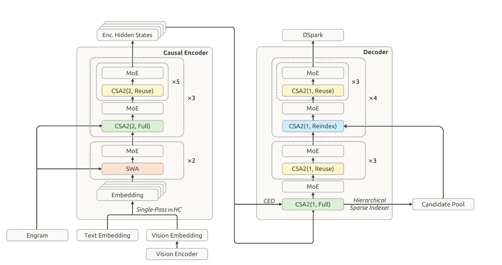
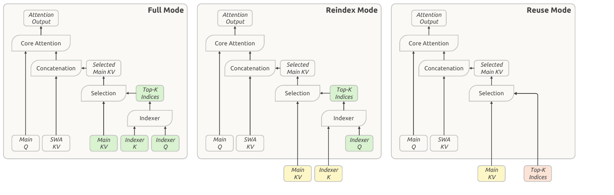
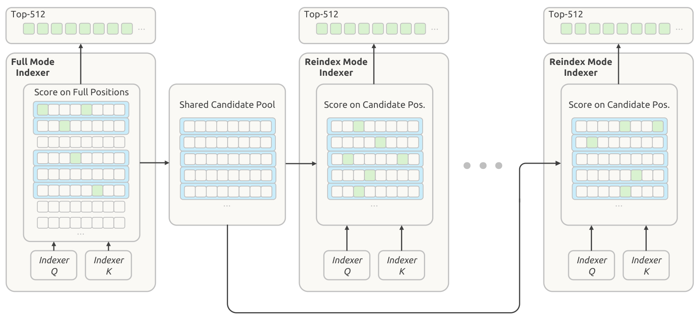

<!-- paper-reading-lang: en -->
<!-- paper-reading-theme: plum -->
<!-- paper-reading-mode: brief -->
# DeepSeek-V4.1-Flash: follow a prompt through three memory costs

> **Reading contract.** This is an understanding-first reading of DeepSeek-AI's *DeepSeek-V4.1-Flash: Pushing the Limits of KV Cache Compression*. It follows one agent turn from a long prefix to a short continuation, then asks which measurements support the design. The report's benchmark results are author-reported, without an experimental rerun here. <span class="source-ref">Primary source: [official 51-page PDF, pinned upload 53e70b17d9acb8e0c423f0e4fe5702f25562b63d](https://huggingface.co/deepseek-ai/DeepSeek-V4.1-Flash/resolve/53e70b17d9acb8e0c423f0e4fe5702f25562b63d/DeepSeek_V41_Tech_Report.pdf), accessed 2026-10-27; PDF creation 2026-09-10; SHA-256 ba68e2e40408125ae6d2f63a9a241b61c73910691c74ec1a2a7023c851eac08d. This English reading and its Chinese counterpart use this same file. Coverage: §§1–6, figure/table captions, evaluation Appendix B and mathematical Appendix C; Appendix A is the author list. The [arXiv record](https://arxiv.org/abs/2609.19969) identifies the report, but its PDF is not substituted for this pinned source.</span>

```paper-map
{
  "thesis":"A long-context agent needs a cheaper way to compute its prefix, keep active global KV, and recover old sessions; these are three different costs.",
  "reader":"For a reader who knows tokens and Transformer attention but has not implemented sparse attention or a KV server. The cache vocabulary and the effort-control calculus are explained below.",
  "goals":["Trace what is computed, shared, or reconstructed during one agent turn.","Hand-calculate a small CED projection, sparse candidate selection, and bounded-replay window.","Attach a benchmark result to its harness and distinguish a local effort model from measured accuracy."],
  "outcome":"CED, CSA2, FP4 main KV, and bounded replay form an integrated model-and-serving design; the complete trained checkpoint is evaluated separately.",
  "outcomeSource":"PDF abstract, §§1–3, 5–6",
  "items":[
    {"number":"01","label":"Repeated long prefix","signal":"compute","text":"Tool calls bring back a large context. CED reduces how much of the model must process that whole prefix.","source":"PDF §§1, 2.2"},
    {"number":"02","label":"Active context","signal":"HBM","text":"CSA2 shares global KV across layers; FP4 reduces main-KV entry storage. Reported global KV is 890 B/token.","source":"PDF §§2.3–2.4.4, 6"},
    {"number":"03","label":"Return to a session","signal":"persistent cache","text":"Short-lived SWA state can be reconstructed approximately, allowing persistent storage to retain global KV without SWA KV.","source":"PDF §§3.2.1–3.2.2"},
    {"number":"04","label":"Useful continuation","signal":"quality and budget","text":"Training produces the checkpoint; harness, effort, and task protocol determine how its quality is measured.","source":"PDF §§4–5, Appendices B–C"}
  ]
}
```

**First pass:** follow §§01–04 to explain the serving path, then §§05–06 to separate training and evaluation. Section 07 reconstructs the important appendix argument and its counterexample; §08 checks whether you can use the explanation. Extended comparison tables are optional disclosures. The main claim and its limits stay visible.

## 01 / Put each byte in the right place

An attention **query** asks what a token should read; **keys** help select earlier positions and **values** supply their content. A **KV cache** saves earlier keys and values so generation need not reconstruct all previous tokens every time. **Prefill** processes the supplied prefix; **decode** generates new tokens one at a time. An agent **harness** supplies the prompts, tools, context management, and turn-taking around the model. These distinctions matter because a tool call can leave a long saved prefix but only a short new suffix. (PDF §§1–2, 5.3.4)

The report combines global sparse attention with **SWA**, sliding-window attention over recent tokens. Global KV grows with sequence length; local SWA state is bounded for a fixed window, but still occupies storage across layers and sessions. **HBM** is accelerator memory used by active sequences; a **persistent prefix cache**, on SSD or host memory, lets a later request reuse a prior session. A smaller active cache and a smaller persistent cache are related design outcomes, not the same denominator. (PDF §§1, 3.2.1)

| Cost | Intervention | Reported quantity and boundary |
|---|---|---|
| Compute a long prefix | Causal Encoder-Decoder, or CED, plus decoder SWA replay | Approximately half the full-stack prefill work when prefix length greatly exceeds the SWA window; not a universal latency measurement |
| Keep active global context | CSA2 cross-layer reuse plus FP4 main-KV storage | **890 bytes per token**, about **1/4 of V4-Flash global KV**, at equal sequence length; local SWA and model weights are separate |
| Retain prefixes between requests | Remove SWA KV from persistent storage and reconstruct on a miss | About **1/8 of V4-Flash persistent KV**, under the report's workload/accounting; combines removal of SWA with global-KV compression |

The model has 552B backbone parameters plus 196B Engram parameters; CED activates 8B backbone parameters per token in prefill and 16B in decode. Parameter counts describe capacity or computation, while bytes/token describe serving state. They cannot be divided or multiplied into a single compression score. At one million tokens, 890 B/token corresponds to **890 MB of global KV in decimal units**, before local state and other memory; this multiplication is a teaching calculation, not measured total device use. (PDF §§2.1, 2.4.2, 4.2.1, 6)

**Read Fig. 1(b) as the storage side of this argument:** its logarithmic vertical axis measures global-KV bytes/token across model generations. Fig. 1(a) instead shows task performance. Their juxtaposition motivates the design; it does not isolate a cache component's effect on accuracy. (PDF Fig. 1)


*Original report Fig. 1, PDF p. 1. The 890 B/token figure refers to global KV; task comparisons require the separate protocols in §06.*

## 02 / Follow a prefix through CED

The language backbone has **40 layers: 20 causal encoder layers followed by 20 decoder layers**. The encoder is causal: its state at a position depends on the available past, not the future. CED changes where decoder **global** KV comes from. Instead of running every prompt token through the full decoder to obtain those caches, it projects them from the final encoder state. Each decoder layer still computes its own query and local SWA state where needed. (PDF §§2.1–2.2, 4.2.1)

**In Fig. 3, first follow text or image embeddings up the encoder, then the projection into decoder global KV.** The decoder's Full/Reindex/Reuse labels concern its global branch; the local SWA path is why a short decoder replay still remains. This is the answer to “what work survives the prefill shortcut?” (PDF Fig. 3)



*Original report Fig. 3, PDF p. 7. The first two encoder layers are pure SWA; the other encoder layers and the decoder use the CSA2 group assignments described below.*

```paper-path
{
  "title":"One agent turn: prefix to continuation",
  "stages":[
    {"title":"Encode the supplied context","role":"long-prefix prefill","action":"Embed text and visual input, then run the prefix through the causal encoder.","why":"The long prefix needs deep representations, but repeating full-stack work after tool calls is costly.","output":"Final encoder hidden states and encoder global KV.","source":"PDF §§2.1–2.2, Fig. 3"},
    {"title":"Prepare decoder global KV","role":"CED projection","action":"The decoder Full layer projects global KV from final encoder states; later decoder layers share according to their static CSA2 modes.","why":"Decoder access to prompt information no longer requires a full upper-stack pass over every prompt token.","cost":"Local SWA still requires its own layer-wise states.","output":"Global context available to decoder attention.","source":"PDF §§2.2–2.3.1, 4.2.1"},
    {"title":"Reconstruct recent local state","role":"bounded replay","action":"Run only the recent window through the decoder; on an encoder SWA cache miss, also rebuild recent encoder local state using cached global KV.","why":"The first decode steps need local state, while retaining all such state persistently is expensive.","cost":"Reconstructed state is approximate and depends on the replay boundary.","output":"Local SWA KV ready for continuation.","source":"PDF §3.2.2"},
    {"title":"Generate the next turn","role":"autoregressive decode","action":"Each new token reads local SWA and selected global entries; all 40 layers participate in decode.","why":"The serving shortcut concerns the old prefix, while new tokens still need the full computation path.","output":"An agent response or tool call, with its global prefix state reusable later.","source":"PDF §§2.2–2.3, 3.2"}
  ]
}
```

For decoder layer $l>L/2$, the report's Eq. 1 is:

$$
C_l=H_{L/2}W_l^{KV},\qquad Z_l=H_{L/2}W_l^Z.
$$

$L$ is the layer count, $H_{L/2}$ the final encoder hidden states, $C_l$ the global-KV entries, and $Z_l$ their compression weights. The projection matrices are layer-dependent. Under the actual CSA2 sharing schedule, only Full layers generate new main KV; the formula does not mean every Reuse layer stores an independent copy. SWA keys and values still come from the current layer's own hidden states. (PDF §§2.2–2.3.1, Eq. 1)

**Teaching trace:** replace one encoder state by $h=(1,2)$ and use $W^{KV}=(3,4)^T$, $W^Z=(1,-1)^T$. The projected values are $C=11$ and $Z=-1$. Changing the decoder projection changes its global entry without needing a new decoder hidden state for that old token. This toy shows the projection dependency only; it omits the report's real dimensions and compressor.

For prefix length $N$ and SWA window $n_{\mathrm{win}}$, the report's work estimate is:

$$
O(NL)\quad\longrightarrow\quad O(NL/2+n_{\mathrm{win}}L/2).
$$

With the model's $L=40$ and $n_{\mathrm{win}}=128$, a teaching proxy at $N=4096$ gives $163840$ versus $84480$ token-layer units, or 51.6% of the original. At $N=128$, both proxies are 5120: the near-halving needs **$N\gg n_{\mathrm{win}}$**. This operation count omits projection, kernel, and transfer costs and is not a latency benchmark. (PDF §§2.2, 4.2.1)

## 03 / Decide what CSA2 shares

A global attention layer needs both stored **main KV** and a choice of entries to read. The **indexer** is a lightweight scoring path that makes that choice; its own query/key are distinct from main attention's query/KV. **Top-K** means the K highest-scoring entries for this query. CSA2 decouples saving another copy of KV from recomputing which entries to read. Modes are assigned statically to layers, not selected dynamically by the input. (PDF §2.3)

| Mode | Main KV and indexer K | Top-K entries | Work that remains in this layer |
|---|---|---|---|
| Full | Generate new main KV and project indexer K | Select anew | Main Q, indexer Q and scoring, local SWA KV, attention |
| Reindex | Share the available main KV and indexer K | Select anew using its own indexer Q | Main Q, rescoring, local SWA KV, attention |
| Reuse | Share | Reuse the latest selection for that main KV | Main Q, local SWA KV, attention; no new indexer Q or scoring |

**Read Fig. 4 across the three columns:** green blocks are computed here, yellow blocks share global KV from the latest Full layer, and red blocks share Top-K indices. Find main Q and SWA KV in all three columns. This shows why sharing selections saves indexer work while sharing KV saves cache storage. (PDF Fig. 4)



*Original report Fig. 4, PDF p. 10. Reindex can change its selected entries without storing another main-KV cache.*

The decoder also uses a **hierarchical sparse indexer**. Its first Full layer scores the entire causally visible range, selects its own Top-512, then forms a larger pool using blocks' maximum scores. Later Reindex layers search only that pool; Reuse layers keep the latest Top-512. The actual pool is at most $2048\times8=16384$ positions. A fixed pool bounds later indexing work, while the first full-history scan remains. The restriction is introduced in post-training and applied in both training and inference. (PDF §2.3.2, Fig. 5)

**Teaching selection:** suppose four two-position blocks have scores $(1,9),(8,7),(6,5),(4,3)$. Their maxima are $9,8,6,4$. Keeping two blocks yields four candidate positions from the first two blocks. A later Reindex query rescores only those four and may choose a different Top-2 than the Full layer. It cannot recover a relevant position in the excluded third block: this illustrates the selection-error boundary, not a reported failure rate.

**In Fig. 5, distinguish the blue candidate blocks from green final selections.** The blue pool can remain shared while different Reindex layers produce different green Top-512 sets; the pool is not the final attention set. (PDF Fig. 5)



*Original report Fig. 5, PDF p. 11. The first Full layer still searches all causally visible positions.*

<details class="reading-detail">
<summary>Actual layer groups, compressor, and FP4 storage</summary>

The first two encoder layers use pure SWA. Its remaining 18 layers use compression ratio $m=2$ in three six-layer groups, each Full followed by five Reuse layers. The 20 decoder layers use $m=1$ in five four-layer groups: the first starts Full, the other four start Reindex, and the remaining three layers of each group are Reuse. Attention selects 512 global entries; SWA window size is 128. (PDF §4.2.1)

CSA2 removes the predecessor compressor's overlapping source entries and absolute position embeddings and derives indexer K from main KV rather than a separate hidden-state compression path. Main KV uses FP4 E2M1 with one E4M3 scale per 16 channels, quantized after RoPE, with post-training QAT; SWA KV remains FP8. The main-KV format targets storage and is dequantized for attention, so it is not a claim that all weights or all computations use FP4. (PDF §§2.3, 2.4.4)

</details>

## 04 / Recover local state without persisting it all

The previous system stored SWA KV at selected prompt/output boundaries; it consumed nearly half the persistent cache under that workload. V4.1 instead keeps encoder SWA KV in a short-lived distributed pool using 10% of host DRAM, with minute-scale TTL; global KV stays persistent for at least 72 hours. A global-cache hit with missing encoder SWA triggers replay. Decoder SWA is never prefix-cached and is rebuilt at each prefill. These are two related replay paths with different triggers. (PDF §§3.2.1–3.2.2)

Exact local reconstruction across $L$ layers has a theoretical $L n_{\mathrm{win}}$-token dependency. **Bounded replay** uses only the latest $n_{\mathrm{win}}$ tokens. For replay start $s$, query position $i$, and window width $W$, its local keys are:

$$
[\max(s,i-W+1),\ i].
$$

**Teaching trace:** set $W=4$, replay positions 7–10, hence $s=7$. At $i=7$, ordinary SWA could read 4–7 but replay reads only 7; at $i=9$, it reads 7–9 rather than 6–9; at $i=10$, the nominal window is 7–10. Even at the last position, higher-layer states can still differ because their earlier inputs were truncated. Seeing a full final window does not prove exact reconstruction. (PDF §3.2.2)

For encoder replay, cached-prefix tokens regenerate SWA only and reuse global KV without overwriting it; the new suffix generates both kinds of state. Decoder replay passes recent encoder outputs through decoder layers to prepare local KV for decode. The authors report negligible observed quality effects and simulate replay during post-training, but the state is **not mathematically identical** to a full forward pass. Sparse retrieval and cache-resumption extremes remain explicit uncharacterized robustness boundaries. (PDF §§3.2.2, 6)

The persistent ratio has its own accounting: removing SWA almost halves that cache, then retained global KV is about one quarter of its predecessor footprint, yielding about one eighth overall. Do not multiply the **runtime 1/4** and **persistent 1/8** ratios into “32× model compression”: they measure different stores. (PDF §§3.2.1, 6)

## 05 / Keep training separate from serving

The report trains on 45T multimodal tokens, starts sparse attention from scratch at 64K sequence length, and extends context to 1M at 34T tokens. Its training pipeline is **pretraining → SFT → RL → on-policy distillation**. An agent training task couples a problem, an executable environment, and a verifier; asynchronous rollouts and more than 40 domain teachers support post-training. The authors describe the post-training recipe as standard and emphasize data/environment construction. That is their account of development, not a controlled estimate of each data factor's contribution. (PDF §§4.2.2, 5.1–5.2)

Single-Pass mHC reduces residual-path memory traffic, Engram provides conditional memory, and DSpark accelerates speculative decoding; vision and serving infrastructure are also changed. These extensions help explain what was trained and deployed. Since architecture, capacity, data, and post-training change together, final-model accuracy is not an isolated CED, CSA2, FP4, or replay ablation. (PDF §§2.4, 3–5)

Table 1's Base comparison uses the authors' internal framework with matched stated settings, but compares different complete models. For example V4.1-Flash-Base versus V4-Pro-Base is 79.4 versus 76.8 on HumanEval Pass@1, while SimpleQA-verified EM is **42.3 versus 55.2** and LongBench-V2 EM **45.2 versus 51.5**. These counterexamples prevent “similar on several dimensions” becoming “equal on every task,” and they do not isolate compression's effect. (PDF §4.3, Table 1)

## 06 / Attach every score to its experiment

Three comparisons answer different questions. **Table 3** compares complete post-trained systems. **Table 4** fixes the V4.1 checkpoint and task set while changing the harness. **Fig. 9** varies effort in selected harnesses. Keep the changed variable attached to the conclusion. (PDF §5.3)

```paper-experiments
{
  "title": "Four comparisons and the claims they support",
  "rows": [
    {
      "question": "How does the complete system compare with its predecessor?",
      "setup": "Table 3, V4-Flash → V4.1-Flash, named code-agent tasks",
      "observation": "TB 2.1 Pass@1 82.7→90.6% (+7.9 points); DeepSWE v1.1 resolved 54.4→74.2% (+19.8); NL2Repo score 54.2→65.4 (+11.2 score units)",
      "conclusion": "The complete system improves on these rows; model/data/harness changes prevent single-component attribution",
      "source": "PDF Table 3"
    },
    {
      "question": "Does it match frontier systems on the hardest tasks?",
      "setup": "Table 3, challenging alternatives",
      "observation": "V4.1 HLE 36.8% full / 39.1% text-only versus Opus-5 56.3% full; TB 4.0 31.2% versus 51.8%",
      "conclusion": "Coding gains do not establish frontier parity across hard reasoning or expert tasks; full HLE and text-only HLE must remain separate",
      "source": "PDF Table 3"
    },
    {
      "question": "Does one harness lead both coding tasks?",
      "setup": "Table 4, same V4.1 model, effort 100",
      "observation": "DeepSWE 74.2% mini-SWE, 72.6% DSH Minimal, 65.5% OpenCode; TB 2.1 90.6% DSH Minimal, 90.3% mini-SWE, 84.1% Codex",
      "conclusion": "The best harness differs by task; DSH Minimal is not the highest DeepSWE row",
      "source": "PDF Table 4, §5.3.4"
    },
    {
      "question": "What changes when selected settings use more effort?",
      "setup": "Fig. 9, effort 25→100",
      "observation": "Eight-task reasoning average 67.1→76.3%; DeepSWE 66.0→74.2%; TB 2.1 82.4→90.6%; roughly 2.5× output tokens",
      "conclusion": "A measured quality–token trade-off in these settings, without a universal latency or monotonic-accuracy guarantee",
      "source": "PDF Fig. 9, §5.3.2"
    }
  ]
}
```

For Table 4, DeepSWE uses **8 samples per task**, TB 2.1 **3**; Linux containers, temperature 1.0, top-p 0.95, 1M context, and max_steps=500 apply. Table 3's V4.1 code-agent setting uses DSH Minimal except DeepSWE uses mini-SWE; visual agents use Claude Code with 512K context; AutomationBench and ALE use official scaffolds. Sample counts do not turn reported Pass@1/resolved into Pass@8 or Pass@3: multiple trials estimate per-attempt performance. (PDF §§5.3.1, 5.3.4, Table 4)

**Read original Table 3 row by row, retaining its metric and footnotes.** Codeforces is a rating, NL2Repo a score, and ZeroBench-main reports Pass@5; most other rows use Pass@1 or resolved percentages. The HLE dagger identifies text-only subsets. A visual row or score must not be relabeled as a cache percentage. (PDF Table 3)


*Original report Table 3, PDF p. 33. The percentage and score values have different meanings; omitted results are not zeros.*

<details class="reading-detail">
<summary>All eight Table 4 harness settings and the appendix version check</summary>

| Harness | DeepSWE v1.1 resolved (%) | TB 2.1 Pass@1 (%) |
|---|---:|---:|
| Claude Code v2.1.251 | 69.8 | 88.0 |
| Codex v0.147.0 | 65.6 | 84.1 |
| OpenCode v1.18.15 | 65.5 | 85.0 |
| Pi v0.84.2 | 66.2 | 86.1 |
| mini-SWE, commit 04d809ceab9d | 74.2 | 90.3 |
| DSH Minimal | 72.6 | 90.6 |
| DSH Standard | 70.5 | 85.8 |
| DSH PTC | 67.6 | 85.8 |

Appendix B.1 makes a harness trial operational: **input** is the benchmark task and fixed checkpoint; **operation** is the harness's native prompt/tools/context/turn loop in its Linux task container; **output** is the submitted task solution; **measurement** is resolved/Pass@1 over 8 or 3 repeated attempts per task. mini-SWE uses one bash tool, while DSH Standard starts with 26 tools and PTC exposes TypeScript over 24 underlying tools. Those tool interfaces are part of the treatment, not interchangeable wrappers. (PDF Table 4, Appendix B.1)

Appendix Table 5 repeats Claude Code versions v2.1.105, v2.1.238, v2.1.251, v2.1.259. DeepSWE values are 68.4, 68.7, 69.8, 68.6%; TB 2.1 values 87.3, 88.4, 88.0, 87.6%. Reported averages 68.9/87.8 use unrounded values. This version check is separate from a comparison across harness families. (PDF Appendix B.1, Table 5)

</details>

The report restricts network access, removes Git history and transient build caches, yet still observes exploit-seeking behavior. These controls reduce particular leakage paths; they do not prove that all evaluation gaming or contamination is absent. (PDF §5.3.1)

## 07 / Work through the effort-control appendix

Effort $b\in\{1,\ldots,100\}$ conditions the system prompt. During RL, responses are mean-centered within a shared **problem-and-effort subgroup** $(x,b)$, not directly ranked across effort levels. A length penalty changes the incentive inside each subgroup:

$$
r^{\mathrm{len}}_{b,j}=-\min\left(C_{\max},k(b)\frac{\ell_{b,j}}{L_{\mathrm{norm}}}\right),\qquad
k(b)=k_0\exp\left(-\frac{b-b_{\min}}{\tau}\right).
$$

$\ell$ is reasoning-token count, $L_{\mathrm{norm}}$ a reference length, $C_{\max}$ the deduction cap, $k_0$ the initial penalty coefficient, and $\tau$ the effort change that multiplies the coefficient by $e^{-1}$. Higher effort weakens the pressure against extra reasoning; it is not a hard token limit. The reported API presets map low/high/max to 50/75/100. (PDF §5.1.4, Eqs. 8–10; §5.3.3)

**Bridge before calculus:** if $L_{\mathrm{norm}}=1000$, $k_0=0.2$, $\tau=25$, $b_{\min}=25$, and $\ell=1000$, then effort 25 deducts 0.2 and effort 50 deducts $0.2/e\approx0.0736$, provided the cap is inactive. The model is allowed to spend more tokens because each extra token costs less reward. These are teaching parameters, not released training hyperparameters.

Appendix C asks why an exponential coefficient could create a smooth length control. Let $p_x(\ell)$ be the solve probability after $\ell$ reasoning tokens. In the uncapped region an interior preferred length maximizes solve probability minus token cost:

$$
\ell_x^*(b)\in\arg\max_{\ell\ge0}\left[p_x(\ell)-k(b)\ell/L_{\mathrm{norm}}\right],\qquad
p'_x(\ell_x^*)=k(b)/L_{\mathrm{norm}}.
$$

The derivative is **marginal benefit**: how much another token improves solve probability. At the optimum it equals marginal cost. Assuming $p'_x(\ell)\approx a_x e^{-\ell/s_x}$, take logs of that equality to obtain:

$$
\ell_x^*(b)\approx C_x-s_x\log k_0+\frac{s_x}{\tau}(b-b_{\min}),\qquad
C_x=s_x\log(a_xL_{\mathrm{norm}}).
$$

This is an **affine** prediction: a constant plus a slope times effort. With teaching values $s_x=200$ tokens and $\tau=25$ effort units, increasing effort by 25 predicts 200 more preferred tokens, if both optima remain interior and uncapped. (PDF Appendix C, Eqs. 13–17)

The appendix extension is therefore **input** $(b,x)$ plus a local marginal-benefit model → **operation** balance marginal benefit with exponential token cost → **output** a predicted preferred length → **measurement** compare it with actual token-length and accuracy curves. The derivation itself supplies no measured accuracy gain. Once the cap is reached the marginal token cost becomes zero, so this interior derivation no longer applies. Strategy changes, stochastic generation, multiple agent turns, and reward normalization are additional limits named by the authors. (PDF Appendix C)

**Read Fig. 9's solid and dashed curves together:** solid lines use the left accuracy axis, dashed lines the right token axis, and the three panels are different tasks. The endpoint redraw below keeps their numbers distinct; the original retains the intermediate trade-off. (PDF Fig. 9)

```paper-chart
{"type":"paired","title":"Effort 25 → 100 in the selected settings","subtitle":"Accuracy in %; roughly 2.5× more output tokens","origin":"Redrawn for this reading · original Fig. 9 endpoints","source":"PDF §5.3.2, Fig. 9","note":"Reasoning is an eight-benchmark average; DeepSWE uses mini-SWE and TB 2.1 uses DSH Minimal. The three rows are not one shared task.","rows":[{"label":"Eight-task reasoning average","before":67.1,"after":76.3},{"label":"DeepSWE v1.1","before":66.0,"after":74.2},{"label":"Terminal-Bench 2.1","before":82.4,"after":90.6}]}
```


*Original report Fig. 9, PDF p. 35. Read the two vertical axes separately; larger token counts do not imply proportional accuracy gains.*

**Keep the counterexample visible:** Appendix B.2 reports that output length grows monotonically in all six scaffold–benchmark panels of Fig. 11, but accuracy has **plateaus and dips at intermediate efforts**. The smoother selected curves in Fig. 9 and reasoning panels in Fig. 12 do not establish monotonic accuracy for every harness. The appendix's local length argument and the observed score response are different claims. (PDF Appendices B.2–B.3, Figs. 11–12)

<details class="reading-detail">
<summary>The separate multi-agent extension and its measurement</summary>

Section 5.3.5 is a preliminary test-time-compute extension. **Input:** ProgramBench's 172 tasks whose reference passes at least 95% of hidden tests, or a no-GPU FrontierSWE v2 subset. **Operation:** DSH Agent Team lets a lead delegate to persistent teammates sharing a checkout, mailbox, and task board; training combines task reward, collaboration bonus, and a DAG-critical-path latency penalty. **Output:** the solution available at the wall-clock deadline. **Measurement:** ProgramBench Almost@1 counts individual rollouts reaching score 0.95, while FrontierSWE uses Mean@5. They are different metrics. (PDF §5.3.5, Fig. 10)

ProgramBench plans up to three attempts per task, 516 per configuration, with 1–12-hour deadlines. At 8 hours the reported multi-agent peak is 30.04% versus single-agent 20.39%. FrontierSWE uses 1–20-hour deadlines; at 20 hours Mean@5 is 32.90% versus 28.20%. The report compares the strongest observed multi-agent configurations with the strongest available single-agent baselines. It does not establish a matched-token causal gain from delegation alone, and 516 is not stated as FrontierSWE's rollout denominator. (PDF §5.3.5)

</details>

## 08 / Reconstruct and test the claim

The engineering claim now has a continuous path: project old-prefix global state cheaply, share it across layers, lower main-KV storage precision, and rebuild short-lived local state when needed. Its cache accounting and mathematical dependencies are explicit. The task results support the usefulness of the **complete trained system** in named settings, while selection errors, approximate replay, difficult frontier tasks, and harness-sensitive accuracy remain part of that conclusion. (PDF §§2–6, Appendices B–C)

```paper-check
{
  "title":"Check whether you can use the explanation",
  "items":[
    {"question":"A layer is in Reindex mode. Which data can change for its query, and which cached data remain shared? Why is this different from Reuse?","answer":"Reindex computes its own indexer query and chooses fresh Top-K entries while sharing main KV and indexer K. It still computes main Q and local SWA KV. Reuse also shares the latest Top-K selection and does no new indexing.","source":"PDF §2.3.1, Fig. 4"},
    {"question":"Transfer: use the CED work proxy with L=40, N=256 and window=128. What fraction remains, and can you promise half the latency?","hint":"Compute NL and NL/2 + window×L/2.","answer":"The proxies are 10240 and 7680 token-layer units, so 75% remains. N is only twice the window, so the near-half asymptote is weak here; the proxy also omits projection, memory transfer and kernel costs, so it cannot promise a latency ratio.","source":"PDF §2.2; teaching calculation from the stated work estimate"},
    {"question":"Replay starts at 10 with W=4. At i=11 which local positions are available, and does the later return of a full window make all higher-layer states exact?","answer":"Positions 10–11 are available, rather than ordinary SWA's 8–11. No: earlier truncated states can propagate through higher layers even when a later nominal window is full. Reconstruction remains approximate.","source":"PDF §3.2.2; teaching replay boundary"},
    {"question":"Can you combine Table 4's best score and Appendix C to claim DSH Minimal is best on both tasks and that greater effort always improves accuracy?","answer":"No. mini-SWE leads DeepSWE at 74.2%, while DSH Minimal has 72.6%; DSH Minimal leads TB 2.1 at 90.6%. Appendix C predicts a local preferred-length trend under interior, uncapped assumptions. Appendix B.2 records accuracy plateaus and dips across harnesses, so monotonic length is not monotonic accuracy.","source":"PDF Table 4, Appendices B.2 and C"}
  ]
}
```

<!-- Interaction decision: keep the static cost table, original figures, mode comparison, and worked traces. They expose the dependencies without controls; input-dependent mode switching would invent a mechanism because assignments are static. Native disclosures hold full harness tables and the secondary multi-agent protocol. No interactive workflow is required for this causal data path. Rebuild checks are source/structure checks, not measured learning, independent human review, or experimental reproduction. -->
