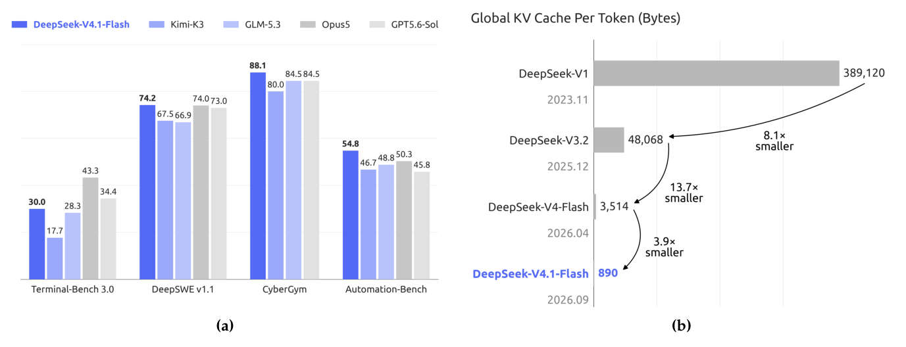
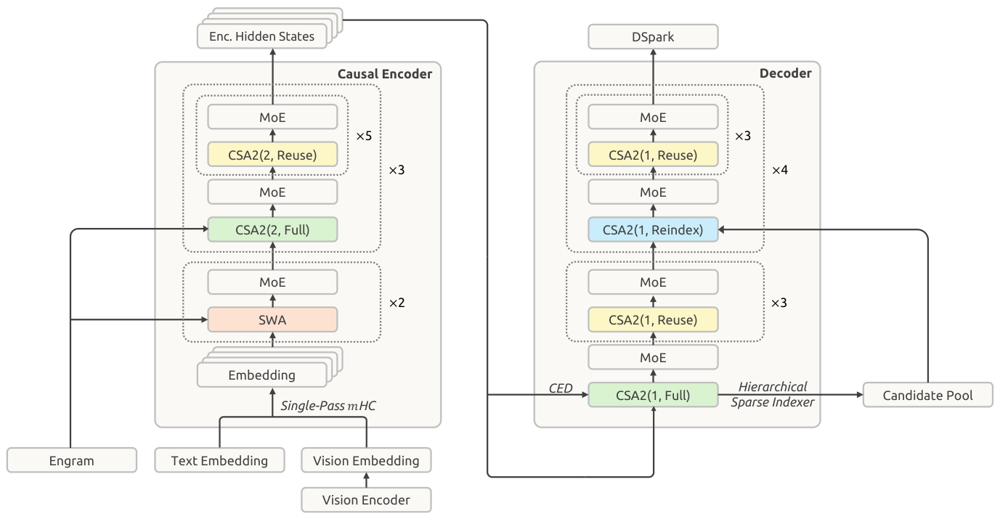
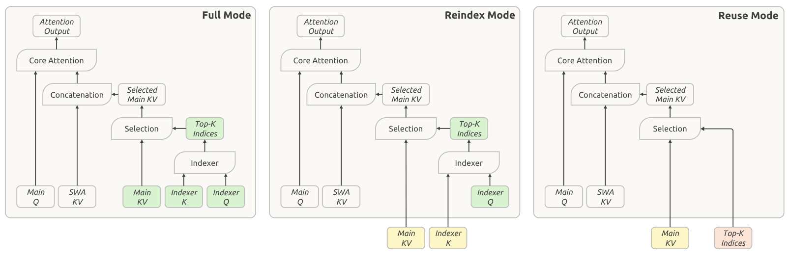
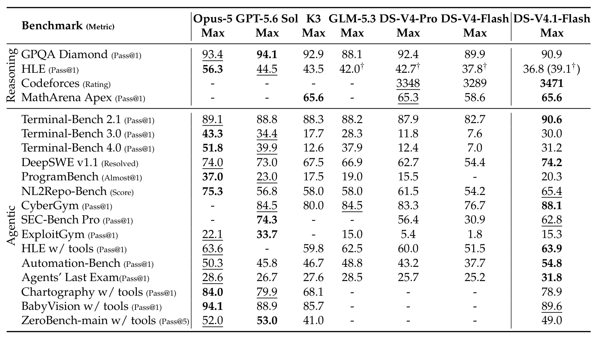
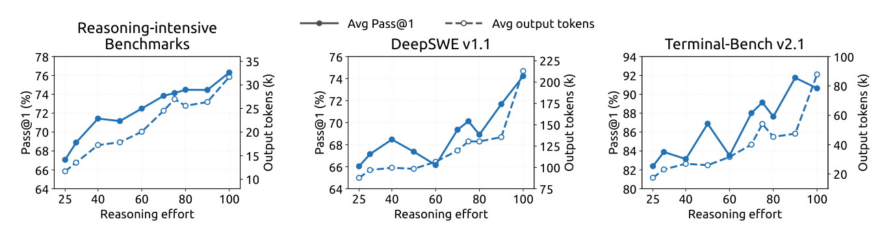

<!-- paper-reading-lang: zh-CN -->
<!-- paper-reading-theme: saffron -->
# DeepSeek-V4.1-Flash：把 KV 缓存的三类成本一起压下去

> **阅读定位**：这份技术报告回答的是部署侧的问题——长程智能体让负载变得输入重、缓存重，模型该为「算、存、传」三种成本分别做什么设计。DeepSeek-V4.1-Flash 是一个 552B 骨干参数的多模态 MoE 模型（prefill 每 token 激活 8B、decode 16B，支持 1M 上下文），用 CED 砍掉近半 prefill 计算，用 CSA2 跨层复用 + FP4 把全局 KV 压到 890 字节/token（约为 DeepSeek-V4-Flash 的 1/4），再用 SWA Bounded Replay 把持久 KV 压到约 1/8，同时在多数基准上超过前代。原文为 DeepSeek-AI 的 *DeepSeek-V4.1-Flash: Pushing the Limits of KV Cache Compression*。<span class="source-ref">本图谱依据所附 PDF《DeepSeek_V41_Tech_Report.pdf》（51 页，2026-09 生成，SHA-256 ba68e2e4…），覆盖 PDF §§1–6、Figs. 1–12、Tables 1–5、附录 A–C；与仓库英文样例同一份源文件，本篇为中文读者独立成篇。</span>

```paper-map
{
  "thesis":"长程智能体的部署瓶颈已经从长序列计算转移到 KV 缓存的算、存、传三类成本；DeepSeek-V4.1-Flash 用 CED、CSA2、FP4 与 SWA Bounded Replay 分别对症，在压缩缓存的同时提升能力。",
  "outcome":"552B 多模态 MoE（8B/16B 激活）：全局 KV 890 字节/token（约 1/4），持久 KV 约 1/8，prefill 计算约减半；后训练靠数据管线在多数智能体基准上追平或超过闭源前沿。",
  "outcomeSource":"PDF 摘要， §§1, 6, Figs. 1–2, Table 3",
  "items":[
    {"number":"01","label":"问题","signal":"算、存、传三类成本","text":"长程智能体负载输入重、上下文长：prefill 计算昂贵（缓存未命中时），全局 KV 撑满 HBM，持久 KV 撑满 SSD/主机内存，I/O 与互联带宽限制缓存迁移。稀疏注意力已把长序列计算成本压下来，存储与搬运成为主瓶颈。","source":"PDF §1"},
    {"number":"02","label":"机制","signal":"四件套各对一类成本","text":"CED：解码器全局 KV 从编码器末层投影而来，prefill 只算前一半层。CSA2：全局 KV 与索引 K 跨层共享、Top-K 索引可复用（Full/Reindex/Reuse 三模式）+ 层次稀疏索引器。FP4 主 KV（QAT）。SWA Bounded Replay：只重放最近 n_win 个 token 近似重建 SWA 状态，持久层不再存 SWA KV。","source":"PDF §§2.2–2.4, 3.2"},
    {"number":"03","label":"证据","signal":"压缩不失能 + 可控推理","text":"Base 模型对比（Table 1、Fig. 6 BPB）；后训练主表（Table 3）覆盖推理/智能体/安全/视觉 20 项；推理力度旋钮 25→100 的成本-质量曲线（Figs. 9, 12）；8 种脚手架稳健性（Tables 4–5）；多智能体初步实验（Fig. 10）。","source":"PDF §§4.3, 5.3, 附录 B"}
  ]
}
```

**证据入口总览：** 压缩主张的证据在摘要与结论的三项账本数字（890 字节/token、约 1/4、约 1/8）及其分解（§3.2.1）；「不失能」的证据分两层——Base 模型在内部评测框架下与 V4-Pro-Base 相当（Table 1、Fig. 6），后训练模型在 Table 3 上对比七个系统；effort 旋钮、脚手架稳健性、多智能体各有专门小节。注意全部评测除注明外均为作者内部或官方协议复测，非第三方独立测量。（PDF §§4–6）

## 01 / 全局：瓶颈换了地方，设计就跟着换

**一句话主线：** 作者认为，稀疏注意力把「长序列计算」这个旧瓶颈解决之后，真正卡住长程智能体规模化部署的是 KV 缓存的三类成本——prefill 计算（缓存未命中时的重算）、运行时全局 KV 存储（HBM）、持久 KV 存储与搬运（SSD/主机内存 + 带宽）——因此模型架构、缓存精度、部署策略必须联合设计，而不是各自优化。（PDF §1）

问题设定来自真实负载形态：长程智能体频繁调用工具，每次都产生大量 prefill 请求；上下文跨回合累积，KV 缓存既要撑住单请求的运行时容量，又要持久化以复用前缀。前代 DeepSeek-V4 用「全局注意力 + 滑动窗口注意力（SWA）」的组合：SWA 的 KV 在窗口固定时与序列长度无关，但全局 KV（main KV + indexer K）随上下文增长，长序列下主导 HBM 占用；持久 KV 则受 SSD 与主机内存约束。（PDF §1）

报告把解法组织成**四件套**，每件对准一类成本：

1. **CED（Causal Encoder-Decoder）** 对 prefill 计算：解码器的全局 KV 不从各层隐状态生成，而是从编码器末层（第 $L/2$ 层）投影而来，prefill 只需计算前一半层，整体 prefill 复杂度从 $O(NL)$ 降到约 $O(NL/2)$。（PDF §2.2）
2. **CSA2（Compressed Sparse Attention 2）** 对全局 KV 存储与索引计算：跨层共享 main KV 与 indexer K、复用 Top-K 索引，配合层次稀疏索引器把深层索引的打分范围限制在候选池内。（PDF §2.3）
3. **FP4 主 KV 缓存** 对存储精度：训练后量化感知训练（QAT），主 KV 用 E2M1 格式存储，约为 FP8 的一半。（PDF §2.4.4）
4. **SWA Bounded Replay** 对持久 KV 与搬运：不再把 SWA KV 写入持久缓存，缺失时只重放最近 $n_{\text{win}}$ 个 token 近似重建——用一点 prefill 重算换掉一整类持久存储。（PDF §§3.2.1–3.2.2）

配套还有 Single-Pass mHC、Engram 条件记忆、DSpark 投机解码三个扩展，以及训练/推理基础设施的协同改造。后训练部分的立场鲜明：**不引入算法新意**（SFT→RL→OPD 标准配方），全部增量投入在任务合成与环境构建的数据管线上，作者称观察到的收益几乎全部来自数据与环境的规模、多样性、可验证性。（PDF §5.1）

贡献可以概括为：(1) 一套「三类成本」问题分解与对应的架构/精度/部署联合设计；(2) 890 字节/token 的全局 KV 与约 1/8 的持久 KV 账本，decode FLOPs 随上下文几乎不涨（4K→1M 上下文只增加约 1/4）；(3) 后训练模型在多数推理与智能体基准上追平或超过闭源前沿，并暴露一个可控的推理力度旋钮；(4) 大规模智能体训练基建 DSec 与异步后训练系统。（PDF §§1, 6）

**原论文 Fig. 1 是全篇的证据鸟瞰，建议这样读：** 左半 (a) 是智能体基准上的性能对比条形图，看 DeepSeek-V4.1-Flash 相对各对手的位置；右半 (b) 是历代 DeepSeek 模型的全局 KV 字节/token 递减曲线，注意纵轴是对数刻度——V4.1-Flash 相对 V4-Flash 约 4 倍、相对 V1 约 437 倍的压缩都画在这条线上。（PDF p. 1, Fig. 1）



*原论文 Fig. 1，PDF p. 1。(b) 的纵轴为每 token 全局 KV 字节数（对数刻度），是「890 字节/token」主张的原始出处；(a) 的具体数值以正文 Table 3 为准。*

## 02 / 主路径：从部署瓶颈到联合优化

这份报告的主线不是训练流程，而是「把一类成本定住、逐个拆掉」的设计路径。下面的路径按成本对症的顺序展开：每一步先说它对准哪类成本、用什么机制、付出什么代价。（PDF §§1–3）

```paper-path
{
  "title":"三类成本的对症路径",
  "intro":"四件套各对准一类成本；注意 (iii) 与 (iv) 都是用「一点计算」换「一大块存储」，(i) 是纯节省，(ii) 是共享去重。",
  "stages":[
    {"title":"分解瓶颈","role":"设计前提","action":"把长程智能体的部署成本拆成三类：prefill 计算（缓存未命中）、运行时全局 KV（HBM）、持久 KV 与搬运（SSD/主机内存 + 带宽）。","why":"稀疏注意力已压低长序列计算成本，存储与搬运成为主导；混在一起优化会找错对手。","output":"三类成本各自的优化目标。","source":"PDF §1"},
    {"title":"CED 砍 prefill","role":"对症：计算","action":"把 40 层网络切成 20 层因果编码器 + 20 层解码器；解码器的全局 KV 从第 L/2 层隐状态投影（Eq. 1），prefill 只算前一半层；SWA 仍逐层计算。","why":"工具调用频繁、缓存未命中时 prefill 是主要算力开销；全局 KV 的生成深度可以由投影替代。","cost":"解码器 SWA KV 需额外重放 n_win×L/2 个 token——由 Decoder SWA Bounded Replay 截短到 n_win。","output":"prefill 复杂度 O(NL) → O(NL/2 + n_win·L/2) ≈ O(NL/2)。","source":"PDF §2.2, Eq. 1"},
    {"title":"CSA2 跨层复用","role":"对症：全局 KV 存储","action":"每层静态分配 Full / Reindex / Reuse 三模式之一：Full 算自己的 main KV 与索引并选出 Top-K；Reindex 复用前层 main KV 与索引 K、用自己的索引 Q 重打分出新 Top-K；Reuse 全部复用、直接做稀疏注意力。配合层次稀疏索引器（解码器）限制深层打分范围。","why":"沿条目、序列、层三个乘性维度联合压缩；只复用索引不省 main KV，只共享路由又伤性能，三种模式让「共享什么」与「重选什么」解耦。","cost":"稀疏选择可能出错（作者列为未刻画的稳健性边界）；模式是静态分配，不随输入自适应。","output":"全局 KV（含 FP4 后）约 890 字节/token，约为 V4-Flash 的 1/4。","source":"PDF §§2.3–2.3.2, Figs. 4–5"},
    {"title":"FP4 主 KV","role":"对症：存储精度","action":"后训练阶段引入 QAT，主 KV 用 E2M1 + 每 16 通道一个 E4M3 scale（NVFP4 风格、去掉二级全局 scale），RoPE 之后量化；SWA KV 保持 FP8。","why":"主 KV 量化只为省存储而非加速矩阵乘，可在注意力前反量化、对硬件无原生低精度 GEMM 要求；省去全局 scale 经幅值上界论证无损。","cost":"量化敏感的 SWA KV 仍占 FP8；QAT 需要在后训练中进行。","output":"主 KV 存储（HBM 与 SSD 落盘）相对 FP8 约减半。","source":"PDF §2.4.4"},
    {"title":"SWA Bounded Replay","role":"对症：持久 KV","action":"持久缓存不再存 SWA KV（迁入 10% 主机 DRAM 的分布式内存池、分钟级 TTL），全局 KV 留在 SSD 保证 ≥72 小时；缺失 SWA 时只重放最近 n_win 个 token 近似重建，查询在 [max(s, i−W+1), i] 上截断。","why":"SWA KV 只在会话内分钟级窗口复用，与持久缓存的长保留策略错配；精确重建要重放 L×n_win 个 token，成本在生产中不可接受。","cost":"重建的 SWA 状态是近似的，后缀计算结果依赖缓存命中位置；作者在后训练中模拟同样重放以适配。","output":"持久 KV 占用约为 V4-Flash 的 1/8（去掉 SWA KV 近乎减半 × 全局 KV 再 1/4）。","source":"PDF §§3.2.1–3.2.2"},
    {"title":"训练/推理协同","role":"让设计落地","action":"训练侧：视觉编码器分离执行、长序列图像分片、CSA2 影子索引器与流水线共享态；推理侧：EPD 分离、核融合（Reuse 模式层 prefill 15 核/decode 11 核）、Engram 表主机预取。","why":"跨层共享的组件可能落在不同流水线阶段；不改造基建，架构收益无法兑现。","output":"大规模多模态训练与长上下文部署的吞吐/延迟表现。","source":"PDF §§3.1–3.2"},
    {"title":"后训练数据管线","role":"对症：能力","action":"标准 SFT→RL→OPD，无算法改动；投入集中在任务三元组（问题、环境、验证系统）合成、通用/编码双环境流水线、DSec 百万级沙箱、可控推理力度 RL 与异步基础设施。","why":"作者称在固定且平常的优化流程下，数据与环境的规模、多样性、可验证性贡献了几乎全部增益。","cost":"数据管线复杂且强依赖内部工作流与人工反馈；评测奖励黑客风险上升。","output":"Table 3 的推理/智能体/安全/视觉能力面。","source":"PDF §§5.1–5.2"}
  ]
}
```

**两处「用计算换存储」的交换是主线的枢纽。** 其一，CED 让解码器全局 KV 由投影生成，代价是 SWA 侧要多算一点，而 Decoder SWA Bounded Replay 把这一点也截短到 $n_{\text{win}}$；其二，SWA Bounded Replay 用近似重建换掉整类持久存储，作者明确承认重建态「在数学上不等价」于完整前向，靠「实验显示质量影响可忽略」与后训练中的同模拟适配来兜底。这两处都是用少量重算换存储/带宽，读者应把「近似」当作设计的一部分而不是实现瑕疵。（PDF §§2.2, 3.2.2）

**原论文 Fig. 3 是架构总览，建议按「先分层、再看模块」读：** 40 层切分为左半因果编码器（20 层）与右半解码器（20 层）；编码器前两层是 SWA，其余为 CSA2(2, Full/Reuse) 分组；解码器是 CSA2(1, Full/Reindex/Reuse) 五组，注意 Reindex 组与层次稀疏索引器（Hierarchical Sparse Indexer）的位置；四周标注 Single-Pass mHC、Engram、DSpark、CED 投影关系。图中 CSA2(ratio, mode) 括号里的数字是压缩率 $m$。（PDF p. 7, Fig. 3）



*原论文 Fig. 3，PDF p. 7。阅读时对照 §4.2.1 的具体分组：编码器 18 个 CSA2 层（m=2）分三组、每组第 1 层 Full 其余 Reuse；解码器 20 层（m=1）分五组、第一组 Full 其余 Reuse，后四组第 1 层 Reindex 其余 Reuse。*

## 03 / 机制特写：四个关键操作

理解这份报告不需要记住全部模块，抓住四个操作即可：**KV 怎么来**（CED 投影）、**KV 怎么共享**（CSA2 三模式）、**丢了怎么补**（有界重放）、**长度怎么控**（effort 惩罚）。前三个决定存储账本，第四个决定成本-质量旋钮。

### KV 怎么来：CED 的投影替代

对全局注意力，CED 把下半 $L/2$ 层当作因果编码器；上半层（$l > L/2$）的 KV 条目不再来自各层自己的隐状态 $H_l$，而是从第 $L/2$ 层的 $H_{L/2}$ 经**逐层不同的投影权重**得到：（PDF §2.2, Eq. 1）

$$
C_l = H_{L/2} W^{KV}_l,\qquad Z_l = H_{L/2} W^{Z}_l,\qquad l > L/2
$$

其中 $C_l$ 是第 $l$ 层的 KV 条目，$Z_l$ 是对应的压缩权重。关键收益在 prefill：只需要计算前一半层就能拿到全部解码器全局 KV，prefill 复杂度从 $O(NL)$ 降到 $O(NL/2 + n_{\text{win}} \times L/2) \approx O(NL/2)$（$N \gg n_{\text{win}}$ 时）。注意 SWA 的键值仍然逐层从 $H_l$ 计算——局部路径保留完整计算深度，这正是需要 SWA 重放的原因。（PDF §2.2）

### KV 怎么共享：CSA2 的三模式与乘性分解

作者把 KV 压缩拆成三个**乘性**维度：条目大小（GQA/MLA 路线）、序列长度（每 $m$ 个 token 压成一个条目）、层维度（跨层复用）。已有工作各占一角——IndexCache 复用 Top-K 索引、YOIO 全网共享路由、HySparse 让稀疏层复用稠密层 KV——但「只复用索引不省 main KV，网络级路由共享伤性能，混合设计仍保留全注意力层」。CSA2 的做法是把层维度的三样东西解耦共享：（PDF §2.3–2.3.1）

| 模式 | main KV | indexer K | Top-K 索引 | 本层仍自算 |
|---|---|---|---|---|
| Full | 本层自算 | 由本层 main KV 投影 | 本层选出 | main Q、SWA KV |
| Reindex | 复用最近 Full 层 | 随 main KV 复用 | 本层重选（用自己的 indexer Q 重新打分） | main Q、SWA KV |
| Reuse | 复用 | 复用 | 复用最近索引产出层 | main Q、SWA KV |

**原论文 Fig. 4 把三模式画成并行对照，建议这样读：** 三列分别是 Full、Reindex、Reuse；绿色块是本层自算的量，黄色是复用最近 Full 层的 main KV 与 indexer K，红色是复用最近索引产出层的 Top-K 索引。注意三列底部都有本层自算的 main Q 与 SWA KV，再加选中的 main KV 拼接进核心注意力——区别只在「KV 与索引从哪来」。这张图是核对上表分工的原始画法。（PDF p. 10, Fig. 4）



*原论文 Fig. 4，PDF p. 10。与上表逐列对照阅读；层次稀疏索引器进一步限定 Reindex 层的搜索范围（Fig. 5）。*

相对 V4 的 CSA，CSA2 还简化了压缩器：去掉相邻条目重叠与绝对位置编码，indexer K 直接由 main KV 投影（不再走独立压缩路径）。**层次稀疏索引器**（只用于解码器）再收一层成本：解码器第一个 Full 层对全可见范围打分、并按块最大分数选出候选池（如 2,048 块 × 8 位置 = 16,384 个候选位置），后续 Reindex 层只在池内打分——固定池大小下，深层索引的每查询代价从随上下文线性变为常数。该机制在后训练中引入且训练/推理一致。（PDF §2.3.2, Fig. 5）

### 丢了怎么补：SWA Bounded Replay 的近似语义

精确重建 $L$ 层的 SWA KV 需要重放 $L \times n_{\text{win}}$ 个 token。有界重放只重放最近 $n_{\text{win}}$ 个 token，并把 SWA 截断到重放片段：重放起点为 $s$ 时，位置 $i$ 的查询只看到 $[\max(s, i-W+1), i]$ 的 SWA 键。（PDF §3.2.2）

持久层的账本由此重排：SWA KV 移出持久缓存（进 10% 主机 DRAM 池、分钟级 TTL），全局 KV 留 SSD（≥72 小时保证）；命中全局 KV 而缺 SWA KV 的请求走 Encoder SWA Bounded Replay 兜底——把「灾难性未命中」变成「廉价的近似降级」。两个乘性因子给出 1/8：去掉 SWA KV 近乎减半 × 全局 KV 经 CSA2+FP4 再压到 1/4。作者的原话是：重建态「在数学上不等价」于完整前向、后缀输出依赖命中位置，但实验显示质量影响可忽略，并在后训练中模拟同样的重放以适配。（PDF §§3.2.1–3.2.2）

### 长度怎么控：effort 惩罚与仿射推导

推理力度 $b \in \{1,\dots,100\}$ 作为显式条件写进系统提示（`Reasoning Effort: {effort}`）。RL 中每个 $(x, b)$ 子组内部做 GRPO 均值中心化，组间不直接比较；力度差异由长度惩罚制造：（PDF §5.1.4, Eqs. 8–10）

$$
r^{\text{len}}_{b,j} = -\min\left\{C_{\max},\ k(b)\,\frac{\ell_{b,j}}{L_{\text{norm}}}\right\},\qquad k(b) = k_0 \exp\left(-\frac{b - b_{\min}}{\tau}\right)
$$

$\ell_{b,j}$ 是推理 token 数，$L_{\text{norm}}$ 是参考长度，$C_{\max}$ 封顶扣分；$k(b)$ 随力度指数衰减——力度升 $\tau$，惩罚系数乘 $e^{-1}$。附录 C 给了局部模型下的动机：设 $p_x(\ell)$ 为 $\ell$ 个 token 后解出的概率、边际收益近似指数衰减，一阶条件给出偏好长度

$$
\ell^*_x(b) \approx C_x - s_x \log k_0 + \frac{s_x}{\tau}(b - b_{\min})
$$

即**指数惩罚 → 力度与偏好长度之间的仿射关系**。作者同时声明这只是奖励层面的局部近似，不是「实测平均长度必然线性/单调」的断言——effort 指令本身会改变推理策略、生成有随机性、封顶区需另行分析。部署侧 API 三档直接映射到标量：max=100、high=75、low=50。（PDF 附录 C；Table 2）

### 机制对照：SWA 状态的两条恢复路线

```paper-contrast
{
  "title":"缓存未命中时的 SWA 状态恢复",
  "intro":"V4 的 Zero SWA Caching 提出过重算路线，但精确恢复成本在生产中不可接受；V4.1 的有界重放把精度换成可负担的成本。",
  "branches":[
    {
      "name":"精确重建（V4 的 Zero SWA Caching 路线）",
      "lead":"不存 SWA KV，缺失时完整重放 L×n_win 个 token 精确恢复。",
      "scope":"数学上严格等价于连续前向，适用于对状态精度零容忍的场景。",
      "judge":"重放成本随层数线性增长；短回合多轮对话下频繁触发，生产部署中被证明代价过高。",
      "signal":"它保持语义不变，但把成本推给了每一次未命中。",
      "why":"SWA KV 只在分钟级窗口内被复用，为它保留持久存储又不划算——两条路都不理想。",
      "source":"PDF §3.2.1"
    },
    {
      "name":"SWA Bounded Replay（V4.1 采用）",
      "lead":"只重放最近 n_win 个 token，SWA 截断到重放片段 [max(s, i−W+1), i]，接受近似状态。",
      "scope":"Encoder/Decoder 两条路径：前者兜持久缓存未命中，后者把 CED 的 prefill 截短到 n_win。",
      "judge":"重建态不数学等价、后缀输出依赖命中位置；作者报告质量影响可忽略，并在后训练中做同模拟适配。",
      "signal":"把灾难性未命中变成廉价降级，从而敢把 SWA KV 整类移出持久缓存。",
      "why":"用少量重算换一整类持久存储与搬运成本；近似性是设计接受的交换，不是疏漏。",
      "source":"PDF §§3.2.1–3.2.2"
    }
  ]
}
```

## 04 / 实验图谱：压缩账本与能力面

实验分四类：**Base 模型对比**（压缩设计是否伤到语言/多模态基础能力）、**后训练主表**（能力面对比七个系统）、**effort 曲线**（成本-质量旋钮是否可控）、**稳健性与扩展**（脚手架、多智能体）。作者自述后训练「无算法创新」，因此能力归因应指向数据管线而非优化方法——这是读表的前提。（PDF §§4–5）

```paper-experiments
{
  "title":"DeepSeek-V4.1-Flash 的实验问题矩阵",
  "rows":[
    {
      "question":"压缩后的 Base 模型还站得住吗？",
      "setup":"内部评测框架、统一设置，对比 DeepSeek-V4-Flash-Base（284B/激活 13B）与 DeepSeek-V4-Pro-Base（1.6T/激活 49B）；五维 15 项基准 + 多模态 4 项 + 内部语料 BPB（Fig. 6）。分差 ≤0.3 视为同档。",
      "observation":"世界知识与理解与 V4-Pro-Base 同档（MMLU-Pro 74.1 vs 73.5，SuperGPQA 53.1 vs 53.9）；代码/数学多项更好（HumanEval 79.4 vs 76.8，GSM8K 93.0 vs 92.6，BigCodeBench 60.6 vs 59.2）；但 MultiLoKo 45.5、SimpleQA 42.3、MATH 61.1、MGSM 80.2、LongBench-V2 45.2 低于 Pro。多模态四项为 V4.1 独有（MMMU-Pro 56.5、DocVQA 95.6 等）。内部留出语料 BPB 全任务最低（Fig. 6）。",
      "source":"PDF §§4.3, Table 1, Fig. 6"
    },
    {
      "question":"后训练模型在推理与智能体上是什么位置？",
      "setup":"Table 3 七系统对比（Opus-5、GPT-5.6 Sol、Kimi-K3、GLM-5.3、V4-Pro、V4-Flash、V4.1-Flash，均 Max 力度），20 项基准覆盖推理/编码智能体/安全/通用/视觉；评测配置见 §5.3.1。",
      "observation":"领先项：Codeforces 3471、Terminal-Bench 2.1 90.6、DeepSWE v1.1 74.2、AutomationBench 54.8、ALE 31.8、HLE w/tools 63.9、CyberGym 88.1；持平项：MathArena Apex 65.6（=K3）。差距项：HLE 36.8（Opus 56.3）、Terminal-Bench 3.0 30.0（Opus 43.3）、Terminal-Bench 4.0 31.2（Opus 51.8）、ProgramBench 20.3（Opus 37.0）、视觉三项（Chartography 78.9 vs 84.0）。",
      "source":"PDF §5.3.2, Table 3"
    },
    {
      "question":"推理力度旋钮真的可控吗？",
      "setup":"力度 25→100 扫描：八项推理基准平均、DeepSWE v1.1、Terminal-Bench 2.1 的 Pass@1 与平均输出 token（Figs. 9, 12）；附录 C 给仿射推导。",
      "observation":"八项推理平均 67.1%→76.3%，DeepSWE 66.0%→74.2%，TB 2.1 82.4%→90.6%，输出 token 约 2.5×。收益前置：60–80 区间以不到一半 token 预算恢复大部分精度；到 100 会让智能体轨迹再拉长 1.6–1.8× 而只换来边际提升。各基准随力度单调变好、无退化（Fig. 12：Apex 2025 +40.3 分）。",
      "source":"PDF §§5.3.2–5.3.3, Figs. 9, 12；附录 B.3, C"
    },
    {
      "question":"能力是不是绑死在某个脚手架上？",
      "setup":"同一 checkpoint、解码配置、任务集，只换外壳：6 个脚手架家族 8 种配置（Claude Code、Codex、OpenCode、Pi、mini-SWE、DSH 的 Minimal/Standard/PTC），Max 力度，DeepSWE（N=8/题）与 TB 2.1（N=3/题）。",
      "observation":"DeepSWE 65.5–74.2、TB 2.1 84.1–90.6；DSH Minimal 在两榜均最高（74.2/90.6），Claude Code 四版本均值 68.9/87.8（Table 5）。附录 B.2 补充：各脚手架的力度-长度曲线形状不同，TB 2.1 近饱和时「选脚手架至少与选力度档同样重要」。",
      "source":"PDF §5.3.4, Tables 4–5；附录 B.1–B.2"
    },
    {
      "question":"多智能体协作值不值？",
      "setup":"DSH Agent Team 模式（lead + 常驻队友、共享仓库、信箱与任务板）；ProgramBench 高置信 172 题（参考解 ≥95% 通过）与 FrontierSWE v2 no-gpu 子集；每配置 516 次 rollout，按截止时间（1–12h / 1–20h）计分。标注为初步结果。",
      "observation":"两个基准、每个截止时间下多智能体均优于单智能体：ProgramBench Almost@1 多 13.59%→30.04%（1h→8h 峰值）vs 单 12.79%→20.39%；FrontierSWE v2 Mean@5 多 13.50%→32.90%（20h）vs 单 10.50%→28.20%。",
      "source":"PDF §5.3.5, Fig. 10"
    },
    {
      "question":"RL 与数据管线的规模有没有上限迹象？",
      "setup":"合成任务内异步 RL：单一脚手架内、同脚手架多版本、异构脚手架三种扩法，累计 RL 步数 vs Pass@1（Figs. 7–8）；跨轮次用模型合并重新初始化续训。",
      "observation":"三种扩法都随累计步数持续提升（DeepSWE、SWE-Bench Pro、TB 2.1/3.0）；1M 上下文继续改善超长程任务（TB 3.0）；合并重初始化进一步涨分且 token 效率更好。图为趋势证据，无对照消融隔离单一数据因子。",
      "source":"PDF §5.1.2, Figs. 7–8"
    }
  ]
}
```

**推理力度 25 → 100 的成本-质量变化**（本文重绘 · 原论文 Fig. 9；横轴为 Pass@1 百分点）：

```paper-chart
{
  "type":"paired",
  "title":"力度旋钮：25 → 100 的精度增益",
  "subtitle":"同一 checkpoint；输出 token 约增至 2.5 倍",
  "origin":"本文重绘 · 原论文 Fig. 9",
  "source":"PDF pp. 34–35, Fig. 9",
  "note":"八项推理基准平均指 AIME 2026、Apex 2025 Shortlist、GPQA Diamond、HLE、IMO-AnswerBench、LiveCodeBench、MathArena-Apex、SimpleQA-Verified 的平均 Pass@1；DeepSWE 用 mini-SWE、TB 2.1 用 DSH Minimal 评测。",
  "rows":[
    {"label":"八项推理平均 Pass@1","before":67.1,"after":76.3},
    {"label":"DeepSWE v1.1 Pass@1","before":66.0,"after":74.2},
    {"label":"Terminal-Bench 2.1 Pass@1","before":82.4,"after":90.6}
  ]
}
```

**骨干参数规模与激活量的对照**（本文重绘 · 原论文 Table 1；单位：十亿参数）：

```paper-chart
{
  "type":"bars",
  "title":"骨干参数规模（B）",
  "subtitle":"V4.1-Flash-Base 以约 1/3 的骨干参数达到 V4-Pro-Base 同档能力",
  "origin":"本文重绘 · 原论文 Table 1",
  "source":"PDF p. 24, Table 1",
  "unit":"B",
  "note":"每 token 激活参数：V4-Flash-Base 13B、V4-Pro-Base 49B、V4.1-Flash-Base prefill 8B / decode 16B（另有 196B Engram 参数，按需查找）。V4.1-Flash 的完整模型为 552B 骨干 + 196B Engram。",
  "rows":[
    {"label":"DeepSeek-V4-Flash-Base","value":284},
    {"label":"DeepSeek-V4-Pro-Base","value":1600},
    {"label":"DeepSeek-V4.1-Flash-Base","value":552}
  ]
}
```

**后训练主表的读法（Table 3）：** 这是一张系统级对比表，不是组件消融——每列是一个完整系统（模型 + Max 推理力度 + 各自官方/标准脚手架配置）。读它时盯三组数字：(1) 编码智能体三件套（TB 2.1 90.6、DeepSWE 74.2、NL2Repo 65.4）里 V4.1 拿了两项最佳、一项低于 Opus-5（75.3）；(2) 科学/高难推理仍有明显差距（HLE 36.8 vs Opus 56.3、TB 4.0 31.2 vs 51.8）；(3) 视觉智能体三项全部低于 Opus-5 但高于 Kimi-K3（如 Chartography 78.9 vs 84.0/68.1）。† 标注区分 HLE 文本子集口径（V4.1 全量 36.8、纯文本 39.1）。（PDF p. 33, Table 3）



*原论文 Table 3，PDF p. 33。列顺序为 Opus-5、GPT-5.6 Sol、Kimi-K3、GLM-5.3、V4-Pro、V4-Flash、V4.1-Flash；评测配置与防作弊措施见 §5.3.1。*

**effort 曲线的原始图（Fig. 9）** 值得与上面的重绘对照看：三块面板共享「实线 Pass@1（左轴）、虚线平均输出 token（右轴）」的画法，横轴力度 25–100；看虚线的单调上升与实线的收益前置（60–80 段最陡、80→100 趋平）。（PDF pp. 34–35, Fig. 9）



*原论文 Fig. 9，PDF pp. 34–35。注意右轴（输出 token）三面板量纲不同；「收益前置」的具体读法见 §5.3.2 正文。*

**定性与边界证据各一处：** Fig. 2 给出 decode FLOPs 随上下文的曲线——上下文扩 256 倍（4K→1M），V4.1-Flash 的单 token decode FLOPs 只增加约 1/4（BF16/FP8/FP4 按 1/0.5/0.25 加权），说明「缓存压住之后计算也稳住」。另一侧，§5.3.1 坦承评测中仍观察到模型的利用漏洞行为（如反编译 Ubuntu 核心包找漏洞），已采取断网、剥 Git 历史、清构建缓存等措施，并呼吁基准设计重视这类行为——这是全文最直接的可信度自我披露。（PDF p. 5, Fig. 2；§5.3.1）

## 05 / 综合：账本、旋钮与两条明确的边界

机制与证据的连接点是那本**存储账本**：890 字节/token 不是单点创新，而是四步乘出来的——CSA2 层维共享去重（跨层不再各存一份 main KV/indexer K）、压缩率与索引复用（序列/索引维）、FP4（精度维，主 KV 相对 FP8 减半）、Bounded Replay（把 SWA KV 整类移出持久层，持久占用再近乎减半）。每一步都对应 §02 路径里写明的代价：稀疏选择可能错、量化有敏感部分保留 FP8、重建态不等价。Fig. 1(b) 的 437×（对 V1）与 Fig. 2 的「decode FLOPs 几乎不随上下文涨」是这本账的两个投影。（PDF 摘要，§§2–3, 6）

能力侧的证据要按作者自己的口径读。Base 对比（Table 1）支持的是「压缩设计没有伤到基础能力，且数据管线有改进」——部分单项仍低于 1.6T 的 V4-Pro-Base（SimpleQA 42.3 vs 55.2、LongBench-V2 45.2 vs 51.5），「与 Pro 同档」成立在多数维而不是全部。主表（Table 3）支持的是「在编码智能体与部分推理任务上追平或超过闭源前沿」——同时 HLE、TB 3.0/4.0、ProgramBench 与视觉三项的差距是真实的，作者也在 §5.3.5 明说科学型智能体任务（如 TB 4.0）与巨型模型仍有差距。至于「完成超过 95% 真实任务」这类表述（§1），报告没有给出对应测量，应视为产品定位陈述。（PDF §§1, 4.3, 5.3, 6）

**effort 旋钮是第二条主线，其证据链最完整：** RL 内的指数长度惩罚（Eqs. 9–10）→ 附录 C 的仿射偏好长度推导 → Fig. 12 八个基准的单调、无退化响应 → Fig. 9 的收益前置 → Fig. 11 跨脚手架迁移（力度拉长轨迹在所有脚手架成立，但精度响应形状各异）。它说明「成本-质量工作点」可以被显式控制，也给出了使用建议：60–80 是日常智能体任务的性价比区间，max 档留给最难任务。需要保留的限定是作者自己的话：推导是局部奖励近似，实测长度不必线性；且 Fig. 11 显示近饱和任务上「选脚手架至少与选力度档同样重要」。（PDF §5.3.3–5.3.4；附录 B.2–C）

报告明确写下两条边界，读者应随结论一起带走。其一，**稳健性边界未刻画**：CSA2 的选择错误与有界重放的近似重建「可能在未测边界情形下导致能力退化」，作者将持续做长上下文稀疏检索与缓存续接处的压力测试。其二，**基准饱和下的表述纪律**：分数接近 Fable-5、GPT-6 Astra 这类系统「不意味着在复杂高难推理与边缘情形上匹配前沿能力」。再加上训练数据可能包含基准相关内容（报告未做污染声明，评测多在内部框架/自家脚手架下进行）与多智能体结果的「初步」标注，这份报告的可信结论是：**压缩账本与力度旋钮有完整设计与内部证据支撑；能力追平前沿的范围是编码智能体与多数日常任务，不是全部任务。**（PDF §§5.3.5–6）

<!-- 交互图决策记录（审计用，不进入阅读页）：本篇的核心关系——CSA2 三模式的共享/重选分工、有界重放的截断语义、effort 惩罚到长度的映射——分别由对照表、对照分支与公式推导完整承载；成本账本是四个乘性因子的乘积，一张静态表即可全览。读者无法通过点选分支获得论文中不存在的关系（三模式是静态分配、不随输入变化），故不加交互视图，全部内容以可见正文、静态图与原图承载。 -->
