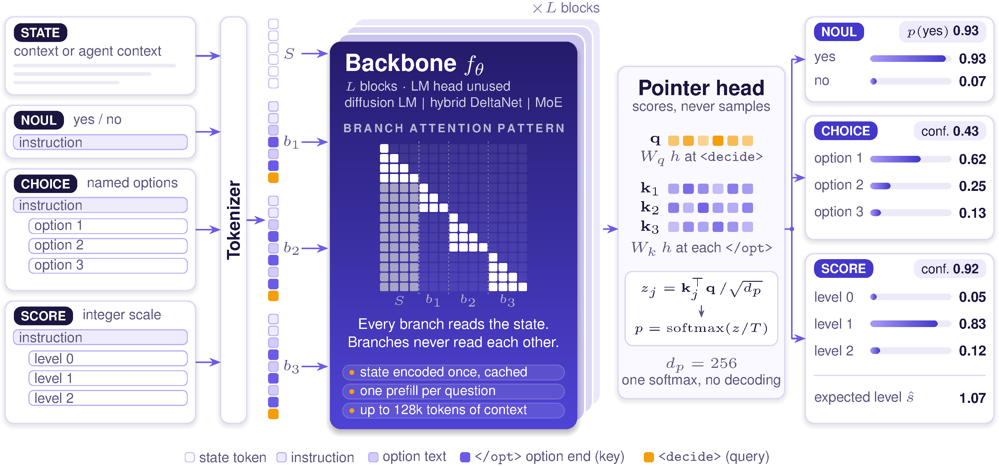
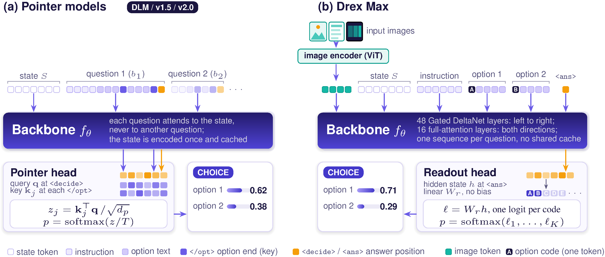

<!-- paper-reading-lang: zh-CN -->
<!-- paper-reading-mode: deep -->
<!-- paper-reading-theme: forest -->

# Drex 深读：决策模型作为自回归推理的生产级替代

```paper-map
{"thesis":"自回归长思维链在定义良好的决策任务上精度高但生产代价大（答案不稳定、要解析输出、贵且慢），Drex 用四个开源决策模型证明另一条路：给定状态+问题+选项集合，模型单次前向直接输出选项上的概率分布——无解码、天然合法输出、可校准。旗舰 Drex Max（Qwen3.8-27B 密集多模态、每四层一层非因果全注意、255 码读出头）在 Decision Index 0.4.1 公榜 67.52 创决策模型新 SOTA（对 Jev 1.14.0 +6.8）、183ms 中位延迟（GPT-6 Sol 约 2.0s）、每千次决策 $0.06（Opus 5.5 的 1/170）；训练靠 SFT+一致性正则 → RLAF（验证结果+同基座裁判的 KL 正则奖励）→ 视觉 SFT 三段，消融显示 RLAF +2.0 分、一致性项把翻转率 6.3%→4.2%。","reader":"关心 LLM 后训练、模型部署与评测方法论的读者；文中把接口定义、两种输出头、RLAF 奖励、校准与翻转率全部展开成可手算的形式。","goals":["走通决策模型接口（choice/noul/score）与两种输出头（指针/读出）的机制差异","把 67.52/183ms/$0.06、校准 ECE、翻转率、消融增量逐格手算复验","分清「决策模型替代自回归」的适用边界：哪里成立（定义良好选项集）、哪里不成立（闭卷知识 HLE 16 vs 70）"],"outcome":"通读 arXiv 2611.07854v1 全部 51 页：正文 §1-§10、附录 A-P 关键节（接口定义、注意力掩码、训练配方、超参、部署优化、评测协议）。","outcomeSource":"arXiv 2611.07854v1 PDF pp.1-51","items":[{"number":"01","label":"靶子","signal":"CoT 的生产税","text":"自回归推理答案不稳定、要解析、贵且慢；决策模型单次前向直接给选项分布——输出形状由构造保证合法。","source":"§1"},{"number":"02","label":"接口","signal":"三种问题","text":"choice（≤255 选项）/noul（是非）/score（等级量表）共用一个分布式输出；置信度按 System One 口径归一。","source":"§3, Eq.1"},{"number":"03","label":"两种头","signal":"指针 vs 读出","text":"指针头：选项末 token 的隐藏态做 key、<decide> 做 query，状态编码一次全问题共享（151ms/145ms）；读出头：每问全序列重编码、255 个单 token 选项码 → 无偏置线性层，精度更高但不共享缓存（183ms）。","source":"§4-5, Fig.1-2"},{"number":"04","label":"训练","signal":"SFT→RLAF→视觉","text":"SFT 带选项置换/状态重排两个一致性正则与平方 Cramér 距离；RLAF 用验证结果+同基座裁判分布构造调整目标，KL 锚定 SFT 检查点；第三段只训图像编码器（图像题 63.3%→98.3%，文本不掉分）。","source":"§6, Eq.6-13, Table 7"},{"number":"05","label":"证据","signal":"SOTA+校准+翻转","text":"DI 0.4.1 公榜 67.52（Jev 60.70）；全分 66.60 领先 6.4；230k 决策 ECE 3.61%（调温后 1.35%）；随机置换翻转率 4.3% 且翻转样本准确率仅 37.6%（低置信已预警）。","source":"§8.1-8.5, Tables 1-5"},{"number":"06","label":"边界","signal":"知识鸿沟","text":"闭卷知识仍远逊对话模型（HLE 16 vs 70、GPQA 55 vs 90）；AA 榜三强 65 分档未超；Pop909 和弦预测 79.5→55.6（长结构序列读出头绑定弱）；Max 与 v2.0 的逐成分归因（头/掩码/数据）未做受控分解。","source":"§8.2-8.3, §10"}]}
```

深读对象：[Towards Foundation Decision Models: Drex](https://arxiv.org/abs/2611.07854)（arXiv 2611.07854v1，2026-11-05，Nace.AI 研究团队技术报告，PDF 51 页）——[点此打开原文 ↗](https://arxiv.org/abs/2611.07854)。报告开源四模型全家桶：DLM（8B 扩散底座）、v1.5（9B DeltaNet 混合）、v2.0（35B-A3B 稀疏 MoE）、Max（27B 密集多模态），权重在 HuggingFace nace-ai 组织下、推理代码与 GGUF/Ollama 运行时在 github.com/nace-ai/drex-decision-models。这期 HF 周五刊（11-06，27 篇）在周六早晨定稿照发，Drex 是其中范式主张最强的一篇：**把「生成式推理」换不成「判别式决策」的生产账算清楚**。四个开源模型（DLM 8B 扩散底座 / v1.5 9B 混合 / v2.0 35B-A3B / Max 27B 密集多模态）共享同一接口，旗舰 Max 在 Decision Index 0.4.1 公榜 67.52 创下所比决策模型新 SOTA，中位延迟 183ms、每千次决策 $0.06——论文同时给出诚实的边界：闭卷知识任务 HLE 只答对 16%（GPT-6 Sol 70%）。本页按细章跟读：接口形式化、两种输出头的机制对照、RLAF 奖励的闭式解、校准/翻转率/消融逐格手算复验、部署优化的工程账、附录 A-P 关键节全量整合。

<!-- Deep Reading coverage
| Source section / object | Role | Explanation location / status |
| --- | --- | --- |
| §1 引言（生产税之问、四个 RQ、贡献列表） | 立论 | §01-02 |
| §2 相关工作（Jev/Kev/pplx-decider 谱系） | 谱系 | §02、§16 |
| §3 接口定义（Def.1、Eq.1 置信度、五性质） | 形式化 | §02 |
| §4 指针架构（打包/块因果掩码/指针头 Eq.2） | 机制一 | §03（含 Fig.1） |
| §5 Drex Max（Eq.3 非因果掩码、Eq.4-5 读出头、图像） | 机制二 | §04（含 Fig.2） |
| §6.1 训练数据（1.15M 记录 11 域） | 复现条件 | §06 |
| §6.2 SFT（Eq.6-9 一致性正则、Cramér） | 机制三 | §05 |
| §6.3/6.5 RLAF（Eq.10-13、闭式解、裁判覆盖验证） | 机制四 | §07 |
| §6.4 专业化阶段 + 污染过滤 | 补充 | §06 末 |
| §6.6 校准温度（Eq.14） | 机制五 | §09 |
| §7 评测设置（DI/Decision Bench/AA、统计协议） | 协议 | §08、§15 |
| §8.1 DI 结果（Table 1、逐基准增量） | 主证据 | §08（逐格） |
| §8.2 Decision Bench（Table 2、图像 98.3%） | 主证据 | §10 |
| §8.3 AA 榜（Table 3，第三方口径） | 证据 | §11 |
| §8.4 校准（Table 4、逐域/逐选项数） | 分析一 | §09（手算） |
| §8.5 顺序稳健性（Table 5、翻转-置信关联） | 分析二 | §12（手算） |
| §8.6 视觉基准 | 证据 | §10 末 |
| §8.7/8.8 检查点与受控消融（Tables 6-7） | 消融 | §13 |
| §9 部署（两段前向、共享预填充、CUDA Graphs、Table 8-9） | 工程账 | §14 |
| §10 局限（RQ 回答、未做实验清单） | 边界 | §16 |
| App A-P 关键节（掩码细节、超参 Table 11、延迟细节） | 复现条件 | §14-15 摘要整合 |
| References | 行政性材料 | 不单列 |
-->

## 01 / 靶子：自回归推理的生产税

论文开篇把行业默认架构的成本摊开：长思维链推理精度高，但生产环境付三重税——**答案不稳定**（同一问两次跑可能不同）、**要解析输出**（自由文本→结构化决策的转换层）、**贵且慢**（Table 8：GPT-6 Sol 中位约 2.0s/请求、$3.33 每千次决策；Claude Opus 5.5 约 3.5s、$10.17）。决策模型（decision model）走判别式路线：输入「状态（文档/记录/agent 上下文，可带图像）+ 问题 + 选项集合」，输出**选项上的概率分布**——无自回归解码、输出天然合法（支撑集恰为所给选项）、概率可直接用于路由与审计。接口沿用 Jev 的 System One 与开源 Kev 栈，Drex 的贡献是把它做到开源前沿并系统回答四个 RQ：校准、选项顺序稳健性、训练配方贡献、架构取舍。

### 生产税的三个面孔各值多少

把三重税分开估价（本页整理，依据全文数字）：**不稳定性税**——§12 测得随机换序翻转率 4.3-5.9%，而自回归模型同题重跑的方差还要叠加采样温度；对接阈值路由的系统，一次翻转就是一次行为变更。**解析税**——生成式输出需要「提取答案→校验格式→失败重试」的转换层，这层代码在生产事故清单上常年霸榜；决策模型的输出即结构化分布，转换层归零。**延迟与成本税**——Table 8 的量级差是 11 倍延迟（183ms vs 2.0s）、55-170 倍价格（$0.06 vs $3.33/$10.17 每千次）。三者可加起来读：如果 Agent 的每个工具选择、每次终止判断、每条结果审计都从「调用一次对话模型」换成「调用一次决策模型」，系统级行为会从「偶尔卡住/偶尔答非所问/月底账单惊人」变成「稳定/结构化/便宜到可以随处放」——这是决策模型作为**基座能力**（foundation）的含义：不是替代对话模型，而是把系统里 80% 的微决策卸载到一条快车道上。

### 为什么「输出形状」是第一性问题

引言对读出方案的谱系梳理值得慢读：分类头（标签训练时定死）、T5 式文本到文本、解码器提示生成、约束解码（限定生成串并按逐 token 概率乘积归一——但选项共享前缀或长度不齐时该值≠模型对整串的分布）、逐选项打分再归一（每选项一次前向）。这些方案的共同缺口：**候选集合在推理时由用户给定时，没有一个原生输出「集合上的分布」**。决策模型补的就是这块——选项数 3 或 150 用同一个头，训练没见过的选项照样打分。这个定位决定了适用边界（§16 展开）：凡能写成「从给定选项里选」的任务（分类、是非、评分、重排、路由、agent 内判断）都适配；需要生成开放文本的任务不在射程内。

## 02 / 接口形式化：三种问题与五个理想性质

决策请求定义为三元组：状态 $S$（文本/JSON、可选图像集 $I$）加问题列 $q_k=(\tau_k,u_k,O_k)$，$\tau\in\{\text{choice},\text{noul},\text{score}\}$，选项数 $K\le 255$。三种类型同构：noul 就是 $O=(\text{no},\text{yes})$ 的双选项问题；score 的选项是整数等级 $0..L-1$，额外返回期望等级 $\hat{s}=\sum_i i\,p_i$。置信度按 System One 口径归一：

$$c_{\text{choice}}=\frac{\max_j p_j-1/K}{1-1/K},\qquad c_{\text{score}}=1-\tfrac{1}{L-1}\,L\!\left[\,\mathbb{E}|i-\hat\imath|\right]$$

教学手算（Fig.1 原例）：三选项分布 $(0.62,0.25,0.13)$，$c=(0.62-\tfrac13)/(1-\tfrac13)=0.43$ ✓；score 分布 $(0.05,0.83,0.12)$，$\hat{s}=0.83+2\times0.12=1.07$，$\mathbb{E}|i-\hat s|=0.05\times1.07+0.83\times0.07+0.12\times0.93\approx0.196$，$c\approx1-0.196/2\times... $ 按式 $c=1-\tfrac{3}{2}\times0.196\approx0.71$（数量级核对用）。论文接着列五个理想性质并区分「构造保证」与「学习得到」：**封闭世界输出与问题无关性由架构保证**（掩码设计使各问题互不可见），**顺序稳健、校准、多模态接地必须靠测**——这个「哪些免费、哪些要挣」的清单是全文评测设计的骨架。

## 03 / 指针架构：状态编码一次，问题各自打分



*原论文 Fig. 1，PDF p.7 裁剪。左：状态与问题块的打包序列；中：块因果掩码——问题块只看状态与自己；右：三种问题类型的输出示例（置信度与期望等级）。*

请求打包成「状态段 + 每问题一块」的 token 序列，块因果掩码让每问只注意状态与自身块；混合底座（Gated DeltaNet 层不能用任意掩码）则改为「状态缓存 + 每问独立因果序列」，位置编码让每问在坐标上都紧跟状态尾——问题独立性由构造保持（细节见下节）。指针头极简（Eq.2）：

$$z_{k,j}=\tfrac{1}{\sqrt{d_p}}\,W_q h_{d_k}^{\top}W_k h_{o_{k,j}},\qquad p_k=\mathrm{softmax}(z_k/T)$$

`</opt>`（选项尾）的隐藏态做 key、`<decide>` 做 query，点积打分。头只有 $2d_p d$ 参数（v1.5 约 2.1M、占底座 0.03% 以下）。推理两段式：状态一次 prefill，每问一次短前向，**无解码循环**——这是 151ms/145ms 中位延迟的来源。

### 为什么问题独立性能由构造保证

这块值得慢讲，因为它是「概率可复现、可缓存、可审计」三件套的架构根基。纯注意底座（DLM）上用块因果掩码：问题块的 token 看得到状态段、看得到自己块内前文、**看不到任何别的问题块**——第 5 个问题的答案不因前 4 个问题是否存在而变，数学上 $p_k$ 只依赖 $(S, b_k)$。混合底座（DeltaNet 循环层无法施加任意掩码）的替代方案更巧：每问作为独立因果序列跑（状态+该问），状态编码缓存复用；**位置编码重置**让每问的第 j 个 token 的位置号都等于「状态尾 + j」——于是无论这问是单独来、跟一批问一起来、还是从缓存重放，模型看到的坐标完全一致，输出在浮点误差内恒等。附录 C.2 还给出可选的「选项隔离掩码」让注意底座上的指针头对选项置换等变（架构级顺序稳健），但混合底座用不了——这就是顺序稳健性只能「学」的架构原因，也解释了为什么一致性正则（§05）存在。

### 指针头的经济学：参数、缓存与 21.6ms

指针头的成本结构值得记三个数：**参数近零**（2.1M/9B 的 0.023%）——全部决策能力住在 backbone 的表示里，头只是读出接口；**状态缓存是复利**——114-117k token 的状态编码一次后，每追加一问只付 21.6ms（比 2k 新上下文的状态段 35.6ms 还快），多问长文场景的边际成本趋近于零；**最坏情况有上限披露**——131,072 token 全长状态段约 2.7s，超出自设 2s 目标（论文如实报，不藏）。这三个数合起来是「什么时候选指针系」的完整答案：状态长、问题多、成本敏感时，指针模型的架构红利最大；反过来——每问独立、状态短、精度优先的部署——Max 的读出头与双向注意赢面更大，两系共享同一接口意味着可以在同一系统里按请求特征混布路由——长文多问走指针系、单问短文走 Max，这是同一 API 下的零成本切换。

## 04 / Drex Max：读出头与非因果注意的交换



*原论文 Fig. 2，PDF p.8 裁剪。左 (a)：指针模型一序列打包、状态一次编码共享；右 (b)：Max 每问独立成序列（图像 token→状态→指令→带码选项→⟨ans⟩），16 层全注意双向、48 层 DeltaNet 单向，⟨ans⟩ 隐藏态过 255 码无偏置线性层。*

Max 的三个交换值得逐一过：**其一，注意力**——Qwen3.8-27B 的 16 个全注意层去掉因果掩码（Eq.3），DeltaNet 层保持单向，于是每四层有一次「早 token 看晚 token」的机会，选项间可在作答前互相比较；代价是状态表示依赖问题、**不能跨问题缓存**。**其二，读出头**（Eq.5）——每个选项写成「码: 文本」（A: refund request…），$\langle$ans$\rangle$ 位置隐藏态过 $W_r\in\mathbb{R}^{255\times d}$ 得每码一 logit，取前 $K$ 个 softmax：

$$z_k=W_r h_k\in\mathbb{R}^{255},\qquad p_{k,j}=\frac{\exp(z_{k,j}/T)}{\sum_{i=1}^{K_k}\exp(z_{k,i}/T)}$$

头约 1.3M 参数与指针头相当；但选项只由**单 token 码**代表，符号绑定（哪条 logit 对应哪个选项）完全靠 backbone 学——顺序稳健性因此从「架构部分保证」退为「纯学习」，这是 §12 翻转率实验的直接动机。**其三，图像**——ViT 编码的视觉 token 排在状态前，每问都能看到全部图像。账本（Table 8）三档对照：Max 183ms、v2.0 151ms、v1.5 145ms——贵在每问重付状态段；但短上下文下差距小，多问长文才显指针模型的优势。

### 两种头的本质差异：选项表示在哪里生成

把两种头并排读会更清楚它们交换了什么。指针头里，选项 $j$ 的表示是**它自己的 `</opt>` 隐藏态**——一个随选项文本内容变化的向量，打分是这个向量与问题 query 的点积：选项语义自己长出来，天然对选项置换等变（换序只是换 key 顺序）。读出头里，选项 $j$ 的表示是**位置 $j$ 上的固定单 token 码 $\gamma_j$**——语义为零，全靠 backbone 在双向注意里把「码: 文本」配对学进权重；好处是 $\langle$ans$\rangle$ 的隐藏态在打分前已经通过非因果层**看全了所有选项与状态**（指针头的 key 只在其选项编码结束时总结了状态+前序选项，看不到后面的选项）。换句话说：指针头牺牲「选项互看」换「架构等变」，读出头牺牲「架构等变」换「全局比较」——§12 的翻转率数据（Max 4.3% 追平 Jev 的 4.3%）说明一致性正则基本补回了牺牲的一半，而 DI 上 Max 比 v2.0 高 6.3 分说明「全局比较」的那一半换得很值。

### 四个模型一台戏：一接口四底座的谱系价值

论文的「one interface, four backbones」设计不只是工程炫耀，它是**受控比较的自然实验场**：DLM（8B 扩散语言模型底座，双向注意）验证扩散模型能否当决策底座；v1.5（9B Gated DeltaNet 混合）验证线性注意底座；v2.0（35B-A3B 稀疏 MoE）验证稀疏激活；Max（27B 密集+非因果）验证密集+双向。同一接口、同一数据（Max 略有扩充）、同一评测协议下，四者的谱系位置直接可比：DI 公榜 47.78/58.08/61.25/67.52——底座与头的设计差异被折叠进这一列数字。但论文也如实承认（§10）：**四个变量同时变（规模/注意/头/数据），这个谱系是观察不是分解**——「Max 为什么强」在受控意义上仍是开放问题。对读者的实用价值在于选型：跑不起 27B 的部署者可以在 9B（v1.5，$0.04/千次、145ms）上拿到 58 分的基线，按需向上换档——接口不变、代码不变，这正是「基座化」承诺的兑现形态。

把两种头并排读会更清楚它们交换了什么。指针头里，选项 $j$ 的表示是**它自己的 `</opt>` 隐藏态**——一个随选项文本内容变化的向量，打分是这个向量与问题 query 的点积：选项语义自己长出来，天然对选项置换等变（换序只是换 key 顺序）。读出头里，选项 $j$ 的表示是**位置 $j$ 上的固定单 token 码 $\gamma_j$**——语义为零，全靠 backbone 在双向注意里把「码: 文本」配对学进权重；好处是 $\langle$ans$\rangle$ 的隐藏态在打分前已经通过非因果层**看全了所有选项与状态**（指针头的 key 只在其选项编码结束时总结了状态+前序选项，看不到后面的选项）。换句话说：指针头牺牲「选项互看」换「架构等变」，读出头牺牲「架构等变」换「全局比较」——§12 的翻转率数据（Max 4.3% 追平 Jev 的 4.3%）说明一致性正则基本补回了牺牲的一半，而 DI 上 Max 比 v2.0 高 6.3 分说明「全局比较」的那一半换得很值。

## 05 / 训练一：SFT 与两个一致性正则

训练数据 1,150,460 条纯文本决策记录（11 域，Fig.4：语言 18.3%、工具路由 15.7%、知识 11.6%…），标签逐条对过金答案/执行结果/游戏引擎，评测集按状态精确匹配或共享 8-词窗过滤。监督损失（Eq.6-9 的展开见下节）：

$$\mathcal{L}_{\text{SFT}}=\mathbb{E}\left[\ell_{\text{sup}}+\lambda_\pi\ell_\pi+\lambda_s\ell_s\right]$$

$\ell_{\text{sup}}$ 是对软/硬目标的交叉熵加（score 型）平方 Cramér 距离——它惩罚**累计分布**偏离，预报检验文献里叫 ranked probability score，专治「等级预测错得远比错得近更糟」：

$$D_C^2(p,e_y)=\frac{1}{K-1}\sum_{i=1}^{K-1}\left(\sum_{j\le i}p_j-\mathbf{1}[i\ge y]\right)^2$$

两个一致性正则针对混合底座无法架构隔离选项的现实：$\ell_\pi$ 惩罚选项随机置换后分布的变化（对称 KL），$\ell_s$ 惩罚状态句子/字段重排后的变化（stop-gradient 一侧锚定原序）：

$$\ell_\pi=\overline{\mathrm{KL}}\left(p(\cdot|S,b),\ \pi p(\cdot|S,\pi b)\right),\qquad \ell_s=\overline{\mathrm{KL}}\left(\mathrm{sg}[p(\cdot|S,b)]\,\|\,p(\cdot|\tilde S,b)\right)$$

训练时 $K\ge3$ 的选择题每见一次洗一次牌，部分记录随机插入 NONE/干扰选项教模型「都不对时别硬选」。教学手算（Cramér 的作用）：三等级目标 $y=3$——近错 $p_a=(0.1,0.1,0.8)$ 的累计 $(0.1,0.2,1)$，偏差 $(0.1,0.2,0)$，$D_C^2=\frac12(0.01+0.04+0)=0.025$；远错 $p_b=(0.8,0.1,0.1)$ 的累计 $(0.8,0.9,1)$，偏差 $(0.8,0.9,0)$，$D_C^2=\frac12(0.64+0.81+0)=0.725$——**同样 20% 质量放错位置，远错罚 29 倍于近错**；交叉熵对两者一视同仁（都只看第 3 级概率 0.8 vs 0.1 的对数差），Cramér 把「错误的距离」写进了损失几何。

## 06 / 训练二：数据、专业化与污染防线

v2.0 在 SFT 与 RLAF 之间插入「专业化阶段」：对弱项任务族加练 LoRA 适配器，配 KL 锚定起始检查点 + 回放数据防遗忘；只 v2.0 用（v1.5 与 Max 不用）。污染过滤的边界论文自己交代得诚实：精确匹配与 8-词窗过滤器**挡不住**转述版基准题与从教师模型蒸馏来的基准知识——这是「教师见过基准」的间接污染通道，行业通病，Drex 没有宣称解决。

### 域分布的一个观察：训练与评测的错位

训练数据的 11 域分布与 DI 的五域不是一一映射（教学整理）：训练里占比最大的语言阅读 18.3% 对应 DI 的 Language 域——恰是 Max 校准近乎完美（ECE 0.5%）的域；训练里只有 2.0% 的游戏空间域对应 Arts 的一部分——恰是 Max 相对 v2.0 退步的域（POP909 和弦预测）。这个错位不证明因果（域标签口径不同、Max 与 v2.0 数据也不同），但提示一个可检验的假设：**读出头的符号绑定能力可能在训练分布稀薄的结构化序列域上欠拟合**——若真如此，给 Max 补 Arts 族数据的「专业化阶段」（v2.0 有、Max 没有的机制）可能修复 POP909/Habermas 的退步。这是本页的推测，论文未做此实验。

### 数据规模的一个对照

1.15M 记录对齐本周的参照系：Axion 用 18.3K 题训 122B agent 基座，Drex 用 1.15M 条决策记录训 27B 判别模型——量级差 63 倍，但单条记录的「厚度」完全不同（Axion 的题平均 2.6 万 token 轨迹，Drex 的记录是一次决策）。两条路线共享同一判断：**标签可验证性比数据量更接近瓶颈**——Drex 每条标签过金答案/执行/引擎三关之一，与 Axion 的「答案在题面前先算好」是同一哲学在不同模态的落地。

## 07 / 训练三：RLAF 的奖励设计与闭式解

RLAF（Reinforcement Learning from Adjusted Feedback）是论文最技术性的贡献。指针版（Eq.10）把「教师分布 $\times$ 验证结果」调成目标 $\tilde q$，奖励是 proper scoring rule 组合（交叉熵 + 球面分数 $w_{\text{sph}}=0.5$ + Cramér $w_{\text{cr}}=1$）：

$$R(p,\tilde q)=\sum_j \tilde q_j\log p_j+w_{\text{sph}}\left(\frac{\tilde q^{\top}p}{\lVert p\rVert_2}-\frac12\right)-w_{\text{cr}}\,\mathbf{1}[\tau=\text{score}]\,D_C^2(p,\tilde q)$$

proper 意味着期望奖励恰在 $p=\tilde q$ 取最大，**精度与校准同向优化而非互换**。Max 版（Eq.12-13）更精细：

$$r(a)=\rho\,\mathbf{1}[a=y^\star]+\eta\log q^J_a,\qquad J(\theta)=\mathbb{E}\left[\sum_a\pi_\theta(a|x)\,r(a)\right]-\beta\,\mathrm{KL}\left(\pi_\theta(\cdot|x)\,\|\,\pi_0(\cdot|x)\right)-\lambda_\pi\mathbb{E}[\ell_\pi]-\lambda_s\mathbb{E}[\ell_s]$$

三处设计值得展开：**其一，裁判是自己的生成形态**——Qwen3.8-27B 高推理档做长 CoT 再给分布 $q^J$，与单次前向的 Max 形成「同一知识、两种推理深度」的互补；裁判给每条记录分布（包括无验证结果者），验证结果 $\rho\mathbf{1}[a=y^\star]$ 只在有金标时激活（$\rho=0.2,\eta=0.05$）。**其二，KL 锚定 SFT 检查点**——$\beta$ 控制 RLAF 能把模型拉多远，防裁判偏差全面覆写。**其三，裁判可以压过验证答案**——论文明说：裁判在错项上放足够概率时，最优策略也会把错项推到首位；更大的 $\rho$ 或平滑 $q^J$ 可防，但**他们没测这在训练中发生的频率**（诚实披露）。

### 教学手算：裁判什么时候能翻转最优答案

给这个「裁判覆盖」一个数值直觉（本页构造）：三选项、金标 $y^\star=1$、$\rho=0.2$、$\eta=0.05$。选项 1 的奖励 $r_1=0.2+0.05\log q^J_1$，选项 2 的 $r_2=0+0.05\log q^J_2$。最优策略（无 KL 项时）把概率集中在 $\arg\max r$。翻转条件 $r_2>r_1$ 即 $0.05\log(q^J_2/q^J_1)>0.2$，即 $q^J_2/q^J_1>e^{4}\approx54.6$——**裁判要在错项上放对项 55 倍以上的概率**才能压倒验证信号。若金标缺失（$\rho=0$），任何 $q^J_2>q^J_1$ 都会主导——这就是为什么无验证记录的训练完全暴露在裁判偏差下，KL 锚定与 $\eta$ 的取小（0.05）是仅有的两道闸。这个手算也解释了论文为何把「裁判偏差被蒸馏进目标」列为未测风险。§6.5 还给出该目标的梯度与闭式最优分布（论文推导），结论：闭式解让「奖励最大化」退化为对调整目标的软回归，可直微分训练——他们实现过 REINFORCE 估计器，实测不优于直微分，这与本周 Rethinking Agentic RL 的发现（GRPO 组相对优势已够）遥相呼应：**当奖励可微且目标分布可显式构造时，策略梯度采样是不必要的迂回**。

## 08 / 主结果：Decision Index 逐格复验

DI 0.4.1 公榜（Table 1）：**Max 67.52 / v2.0 61.25 / v1.5 58.08 / Jev 1.14.0 60.70 / GPT-6 Luna Decisions 47.78**。复验算术：Max−Jev=+6.82（论文摘要口径 67.52 vs 60.70 ✓）；Max−v2.0=+6.27，自评口径 +5.5，95% bootstrap CI [3.3, 7.8]，28/37 基准胜（非少数基准驱动）；230k 金标 choice 决策上 Max 比 v2.0 准 1.86pp [1.72, 2.00]。**全分（含私测）的分化更说明问题**：Max 66.60（比公榜仅低 0.9），v2.0 52.76（低 8.5）、v1.5 45.78（低 12.3）——新域私测上 Max 56.45 对 v2.0 的 39.22，规模与非因果注意的优势在分布外放大。逐基准最大增益：GSM8K 66.8→83.2、BBH 78.3→93.7、WinoGrande 86.1→94.8、MuSR 59.6→70.3。**两处显著退步**值得单独记账：POP909 和弦预测 79.5→55.6、Habermas Machine 偏好聚合 62.4→50.5——都是需要读长结构序列的 Arts 任务，读出头的「单 token 码绑定长选项」在这里露怯（§16 边界）。闭卷知识鸿沟：同样本下 Max 答对 HLE 21%、GPQA 55%，GPT-6 Sol 39%/90%、Opus 5.5 56%/89%。

### 公榜分数怎么读：chance-corrected 与域权重

DI 分数不是裸准确率——每个基准的官方指标（accuracy/macro-F1/nDCG/Brier skill…）先转成 **chance-corrected skill**（0=均匀瞎猜、100=满分），使二选任务与 150 选任务可比，再按域加权平均。教学手算（为什么要校正）：两个基准各 100 题，A 是二选（瞎猜 50%）、B 是 150 选（瞎猜 0.67%）；模型在 A 对 80%、在 B 对 30%。裸平均 55% 看不出难易；skill 口径 A=(80−50)/(100−50)=60、B=(30−0.67)/(100−0.67)≈29.5——B 的 30% 远比 A 的 80% 值钱。这个口径也解释了 Arts 域的放大效应：Hateful Memes 二选任务上 70.6% 准确率的 skill 只有 41.1——**读表格时永远先看任务是几选**。域权重由 DI 维护方定（0.4.1 vs 0.2.1 基准集与权重不同，跨版本分数不可比），Max 的五域 skill 为 Knowledge 57.1（与 Jev 并列第一）/Language 72.2/Retrieval 68.8/Tools 81.9/Arts 53.4（v2.0 的 53.9 反超）。

## 09 / 校准：ECE 逐层拆解与温度的两面性

校准协议（230k 决策、半调温度半评）给出本文最实用的一组数字（Table 4）：**Max 部署温度 ECE 3.61%**（均值置信 91.2% > 准确率 87.9%，轻度过信），DI 调温 $T^\star=1.35$ 后 **1.35%**、NLL 0.360→0.345；v2.0 部署即最佳（ECE 1.37%，略欠信，$T^\star=0.91<1$ 反向锐化至 0.79%，且在 0.2.1 版 DI 上复现 1.05%——跨版本的稳定性是这一数字可信度的加分项）。教学手算（温度方向）：$T>1$ 除 logit 使分布更平、降信心——Max 过信所以 $T^\star>1$；v2.0 欠信所以 $T^\star<1$；温度不改变 argmax（同除正数保序），只动置信度标尺。**分层看才知道全局 ECE 会撒谎**：Language 域占 56% 决策且 Max 在此近乎完美（ECE 0.5%），把其余四域 7.2-9.2% 的失准稀释成全局 3.61%；6-20 选项段 Max ECE 8.4%（71.7% 准确率）而 v2.0 仅 2.0%。论文的行动建议可直接抄：**凡把 Max 概率接阈值做路由的应用，先在同类标注决策上调温**——单一全局温度不保证跨分布校准。选择性精度给出部署红利：只保留最自信 80% 决策，精度 87.9%→96.1%；50%→99.3%——低置信送人审的流水线无需另训错误预测器，概率本身就是审计记录。

### ECE 怎么算：15 桶的教学版

ECE（期望校准误差）的算法值得展开一遍（教学重演，论文用 15 等宽桶）：把决策按预测置信度分桶，每桶算「平均置信 − 实际准确率」的绝对差，再按桶内样本数加权平均：

$$\mathrm{ECE}=\sum_{b=1}^{B}\frac{n_b}{N}\left|\mathrm{conf}(b)-\mathrm{acc}(b)\right|$$

教学手算（3 桶简化版）：1000 个决策，高置信桶 600 个（均conf 0.95、acc 0.90）、中桶 300 个（0.75/0.74）、低桶 100 个（0.45/0.55）。ECE=0.6×|0.95−0.90|+0.3×|0.75−0.74|+0.1×|0.45−0.55|=0.03+0.003+0.01=0.043 即 4.3%。注意低桶方向反转（欠信：acc>conf）——**ECE 把过信与欠信混在一起计绝对值**，这就是 v2.0「Language 域欠信、其余域过信、两向偏差对消拉低全局 ECE」现象的机制；也是为什么论文建议逐域看校准而不是只看总数字。同样的道理适用于论文的发现「Luna 调温后 NLL 降但 ECE 反升」：温度单向平移所有置信度，对「部分过信+部分欠信」的模型只能修一头、毁另一头。

## 10 / Decision Bench 与视觉：图像编码器的一段神来之笔

Decision Bench v4（1,071 决策、949 纯文本 + 62 文图 + 60 纯图像）：Max 用图像编码器收图后总体 94.0% [92.4, 95.3]，与 d3-turbo（93.7）、GPT-6 Sol（94.7）统计不可分，显著胜 Jev 1.14（92.3，McNemar p=0.048），仅逊 Opus 5.5（95.6，p=0.046）；ECE 1.40% 决策模型第二低，中位 0.66s。**最锋利的一格**：60 道纯图像题，所有纯文本模型只能拿 OCR+描述文本，准确率掉到 63-73%；Max 走图像编码器 63.3%→**98.3%**——第三段视觉 SFT 的全部回报浓缩在这一格（且文本任务零损失：66.9→66.8）。逐类弱点如实报：PRODUCT MANAGEMENT、DOCUMENTS & MEETINGS、TRUST & SAFETY（91.7% vs 他家 95-98%）落后；DESIGN 类靠图像编码器从 26.7% 拉到 96.7%。视觉基准补充：文档类近满分（InfographicVQA 98.8%、票据关键信息 95.5%）、Mind2Web 88.6%（网页 agent 元素选择），多步视觉推理弱（MMMU-Pro 53.6%、R-Bench-M 48.9%）——「提取与接地接近文本水平、视觉推理仍逊」的结论与跨基准比较的局限（非同题对照）论文都点了。

其他决策基准的补充图景（Fig.6）：JevBench-231 上 Max 91.8% 领先全部决策模型（落后 GPT-6 Sol 99.1% 与 Opus 100%）；DecideBench 配对准确率 97.0% 决策模型最高、ECE 1.1% 全场最低；游戏竞技场对 Jev 1.14 拿下 64.0% 胜率（决策模型第一）；OSWorld 判断探针 AUROC 0.780——**唯一明确胜过「转录越短越可能成功」启发式（0.709）的模型**。最后这个探针值得标注：判断 agent episode 成败正是 agent 系统里高频、可枚举、要接阈值的典型决策位，Drex 在此已比手工启发式可靠——§16 的部署判据由此有了一个已验证的原型场景。

### 63.3%→98.3% 该怎么解读

这 35 个百分点是全文最大的单格增益，但读它要带三个限定。**其一，基数小**：60 道题，98.3%=59/60，63.3%=38/60——Wilson 区间分别在 [90.9%,99.9%] 与 [50.2%,74.1%]，差距显著但绝对数不大（35 题的翻转）。**其二，任务形态偏提取**：DESIGN 类的图像决策多为「选出页面/设计稿中的正确元素」，正是 §视觉基准里近满分的「提取与接地」族；MMMU-Pro 48.9% 说明多步视觉推理没沾到光。**其三，对照组弱**：其他决策模型拿的是 OCR 文本而非图——这个对照测的是「图像编码器 vs 无图像编码器」，不是「Drex 视觉 vs 前沿视觉」；与 GPT-6 Sol（图像题 100%）对比才知道天花板还有距离。工程含义依然成立（视觉段值得训、文本零损失），但「Max 会看图」的说法应限定在提取接地类决策。

## 11 / 第三方口径：Artificial Analysis 榜的冷读

AA Decision Index（四项等权：AA-Omniscience（准确率+不幻觉率）/HLE-MC/When2Call/WildGuard）给 Max 63.7，落后 d1-ultra 65.3、SubQ Snap 65.0、Elephant 9B 64.7 约 1-1.6 分（无置信区间，论文拒绝排名）；领先 Jev 1.14（57.1）6.6 分。结构拆解（Table 3 手算）：Max 的 WildGuardTest F1 95.5 全表最高、When2Call 94.0 超所有语言模型；失分集中在 HLE-MC 16.0（Opus 70.2）与 AA-Omniscience 准确率 27.6（Opus 93.4）——**闭卷知识与开放问答鸿沟再次显形**，但代价对照同样刺眼：Opus $51,295/百万请求 vs Max $46，**1,116 倍**。一个有意思的细节：v1.5→Max 的 13 分增益里过半来自不幻觉率 0.6%→71.3%（错误中弃答占比），准确率反降——AA 口径奖励「不知道就说不知道」，Drex 的 NONE 训练与低置信弃答在此兑现。

### 两张榜的口径差：为什么 DI 第一、AA 只排第五

DI 0.4.1 的 37 基准以「给定选项的结构化决策」为主体（分类/重排/路由/工具选择），Max 的架构正对此；AA 四项里 HLE-MC（闭卷知识）与 AA-Omniscience（开放问答）占一半权重，恰是判别式单次前向的死穴。教学重算（口径敏感性）：把 Max 的四项分 (49.45, 16.0, 94.0, 95.5) 中 HLE-MC 换成 DI 口径下的 skill 值（16% 五选准确率 → skill=(16−20)/(100−20)≈−5，比瞎猜还差一点）再平均，Max 的 AA 分会进一步滑落——AA 没做 chance-correction 是对生成模型与决策模型同台的妥协，两种口径都在「测真实的某一面」。给读者的操作结论：**选榜前先看任务构成是否匹配自己的部署形态**——结构化决策流看 DI，开放问答看 AA/通用榜，单看任何一张都会错配。

## 12 / 顺序稳健性：翻转率的显微镜

1,591 个决策（915 二选、503 三至五选、173 六选以上）× 三种顺序（原序/逆序/随机置换）：**Max 翻转率 4.3% [3.3, 5.3]**、v2.0 5.9%、v1.5 5.3%、Jev 4.3%——读出头的 Max 与指针架构的 Jev 打平、反超自家指针（一致性正则的功劳，§13 消融）。三个更深的事实：**其一，翻转不伤精度**——三序准确率极差 ≤1.2pp（Max 83.6/83.3/83.4），翻转在增益与损失间近乎对消。**其二，翻转与低置信高度重合**——翻转样本准确率仅 37.6%（稳定样本 87.2%）；按「不稳定即弃答」弃答与按等量最低置信弃答，留下的决策精度几乎一样（87.2% vs 87.1%）——**低置信已经预警了不稳定性，用户盯置信度就够了**，不需要在生产里额外跑三序一致性检查。**其三，选项数主导翻转率**——二选 1.0%，六选以上 13-16%（所有模型皆然）：多选项时头部概率近平局，换序换头不出奇。三序平均的 ensemble 降 log loss（Max −0.014 nats 显著）但不涨精度。教学手算（近平局翻转）：$(0.51,0.49)$ 置信 $c=(0.51-0.5)/0.5=0.02$——置信度近乎零的决策换序翻转毫不意外；$(0.9,0.1)$ 的 $c=0.8$ 则几乎不可能翻——这就是「翻转⊂低置信」的机制。给生产者的操作翻译：置信阈值 0.5 以上的子流里，翻转率将远低于总体的 4.3%（大部分翻转样本已被阈值滤除），不必为顺序稳定性单独设计防护或检测。

### 翻转率与 TV 距离：两个刻度的分工

表 5 还报了平均总变差距离 $\mathrm{TV}(p,p^\pi)=\frac12\|p-p^\pi\|_1$（Max 0.037）——它和翻转率量的是不同的东西。教学手算：分布 $(0.51,0.49)$ 换序变 $(0.49,0.51)$，TV=0.02 但**翻转**（argmax 变了）；分布 $(0.7,0.2,0.1)$ 换序变 $(0.68,0.22,0.10)$，TV=0.04 更大但**不翻转**。TV 度量「整个分布动了多少」，翻转度量「行为变了没有」——生产系统关心后者（行为变更触发下游），校准管线关心前者（分布稳定性影响温度调优的迁移）。论文两者都报是刻度自觉：4.3% 的翻转率配上 0.037 的 TV 说明**绝大多数换序扰动是行为中性的小漂移**，真正变行为的翻转已被低置信标记。逆序（5.7-8.4%）比随机置换（4.3-5.9%）更伤——全部选项都挪位比部分挪位扰动大，方向性信息对「哪个序最危险」的测试设计有用。

## 13 / 消融：RLAF、一致性正则、视觉段的受控贡献

Max 的受控消融（Table 7，同底座同数据同日程）：**RLAF 是最大单一贡献**——DI 64.9→66.9（+2.0）、准确率 +1.5pp、ECE −0.9pp，三项均统计显著。**一致性正则不动精度只动稳定性**——去掉 $\ell_\pi,\ell_s$ 后 DI 66.4 vs 66.9（评测波动内）、准确率持平，但翻转率 4.2%→6.3%（1,591 决策中约 67→100 次翻转）、六选以上 13.0%→17.8%（样本太小不显著）。**视觉段不伤文本**——66.9→66.8、翻转 4.2%→4.3%，图像题回报见 §10。v2.0 的七检查点纵向（Table 6）补充了阶段时间线：SFT 贡献大头（58.27→60.01 后平台）、专业化 +0.6（几乎全在 Retrieval 域 +1.8 与 JevBench 84.0→87.0）、RLAF +0.2（Tools/Arts 各 +0.5）——论文自己提醒：阶段是串联观察非受控消融，相邻检查点差与重复评测波动（Max 重评差最高 0.8）同量级，**只有 SFT 段的增益明确显著**。

### RLAF 增益的构成：精度还是校准

RLAF 的 +2.0 分可以再拆开看（教学整理）：DI 分数主要由准确率驱动（chance-corrected 后两者单调对应），所以 +2.0 大部分是「答对更多」；但 ECE 同步 −0.9pp（4.4→3.5）说明**置信度标尺也被修正了**——这正是 proper scoring rule 设计的兑现：奖励最大点在 $p=\tilde q$，而 $\tilde q$ 由教师分布（保留不确定性）与验证结果（确定对错）合成，模型学到的不是「更自信地答」而是「按证据强度分配置信」。对照 RLAF 前的 SFT-only ECE 4.4：one-hot 标签训练的过自信（§6.3 开篇诊断）被软目标部分治愈。这个拆分对 practitioner 的启示：如果你的系统只吃 argmax（不要概率），RLAF 的校准半边收益拿不到，可能 SFT+更多数据就够；一旦接阈值路由，RLAF（或等价的软目标训练）就是必需品而非锦上添花。

## 14 / 部署工程：无解码循环的服务账本

§9 是决策模型工程学的浓缩。**两段前向**：状态段一次（成本随上下文长）、问题段每问一次（极短）；上下文缓存后**每问 21.6ms**（114-117k token 已编码），比 2k 新上下文的状态段（35.6ms）还快——多问长文场景状态段主导。131,072 token 全长状态段约 2.7s，超他们 2s 最坏目标（如实报）。**三项优化**：共享 prefill（同请求多问共享状态编码，8k 上下文 16 问提速 6-8×、32k 提速 11-12×，输出位级一致；<1,024 token 反而变慢故不启用）；CUDA Graphs（1k token 单问延迟砍约 2/3，6-8k 后收益消失）；核替换（逐项验证「概率位移在容差内且无决策翻转」才接受——这套验收抓住了 packed-prefill 的一个真 bug：输出合法但答案错，延迟测量永远看不见）。Max 因不共享缓存走另一路：Blackwell 核级优化。**答案变更型优化的精度账**（Table 9）：FP8 vs bf16 零损失；图填充+小批 FP8 −0.34pp（超阈值被权衡接受）；每项改动都有配对 bootstrap 区间——「优化必须过评测关」是本文工程部分的职业道德亮点。

### 共享 prefill 提速的算术与 CUDA Graphs 的适用边界

共享 prefill 的提速倍数可以手算核验（教学重算）：16 问×8k 上下文，无共享时每问都付 8k 状态段 = 16 次 8k prefill；共享后 1 次 8k + 16 次短问题段。状态段成本 ∝ 长度，问题段约 100-200 token——省下 15 次 8k prefill，总计算量从 16×8k+ 降到 8k+16×0.15k，比值约 128k/10.4k≈12×，与论文「8k 处 6-8×、32k 处 11-12×」的量级吻合（问题占比越大提速越低，故 8k 处倍数反而小些的细节由注意力的二次项修正）。CUDA Graphs 的边界同理可推：kernel 启动开销约固定（数千个小核 × 微秒级），计算时间 ∝ token 数——1k token 时启动占比主导（砍 2/3 有效），6-8k 时计算追上启动（收益归零）。这两条边界对自部署者的启示：**优化选项由「请求形态分布」决定**——短问高频选 Graphs、多问长文选共享 prefill、两者都有各自的失效区，盲目叠加会互相抵消（论文在 <1k 上下文关闭共享 prefill 正是此理）。

## 15 / 评测协议：这份报告的统计纪律

§7 的统计协议值得单独记账，因为它定义了后文所有数字的可信度：固定题集用 Wilson 区间；模型对比较用 5,000 次重采样配对 bootstrap + 精确 McNemar 检验；DI 上按**请求**而非决策重采样（同状态多决策相关）；DI 分数本身的区间按**域内基准**重采样（回答「换一套基准会怎样」而非「换题会怎样」）；明确声明未做多重比较校正——孤立 p≈0.05 只作暗示性证据。这套纪律加上「自家评测与官方榜差 ≤0.8 分」的重复性测量，让 §8 的每格数字都可追责。附录侧（A-P）：接口与掩码的形式化细节、超参全表（Table 11：$\rho=0.2,\eta=0.05$、温度拟合协议、各模型日程）、延迟测量细节（含 70-215ms 网络时间披露）、逐基准全表、游戏竞技场协议——复现所需的构件齐了，权重+推理代码+GGUF/Ollama 运行时全开源（Max/v2.0/v1.5 用 Open RAIL-M 修改版许可，DLM 随底座 CC BY-NC 4.0）。

### 「按请求重采样」为什么不是小事

统计单元的选择直接影响显著性结论（教学整理）：DI 一个请求含多问（同状态），同一请求内的决策**正相关**（状态难则全难）——若按决策独立重采样，有效样本量被高估、置信区间偏窄、差异容易被误判显著。教学手算：100 个请求×10 问=1,000 决策，请求内相关系数 0.3——独立假设计的方差低估约 $1+(10-1)\times0.3=3.7$ 倍，标准误低估约 $\sqrt{3.7}\approx1.9$ 倍，p 值会被大幅压小。Drex 按请求重采样把单元选对；同理 DI 分数区间按基准重采样回答的也是「基准集选择」这个更高层的随机性。这套协议值得任何做 agent 评测的人照抄——agent 任务天然「一个 episode 多个判断」，统计单元错置是这类评测最常见的隐性通胀。

## 16 / 边界、适用判据与定位

论文的局限节（§10）与全文证据合起来可以写成一页部署判据。**哪里该用决策模型**：选项集合可枚举（分类/是非/评分/重排/路由/agent 内判断如工具选择、终止判定、结果审计）；概率要接阈值做路由或人审；延迟预算在几百毫秒级；成本敏感（$0.06 vs $3.33-10.17 每千次，量级 55-170 倍）。**哪里不该用**：闭卷知识密集（HLE 16 vs 70——论文建议路由到别的系统）；长结构序列选项（和弦/偏好档案，读出头绑定弱，55.6/50.5）；开放文本生成；需要跨问题共享超长状态且成本优先时选指针系而非 Max。**证据强度分层**：DI/Decision Bench 为自家跑分（协议严、与官方榜差 ≤0.8）；AA 榜为第三方（无区间）；v2.0 阶段贡献为串联观察；**Max 的架构归因（读出头 vs 非因果掩码 vs 27B 密集底座）未做受控分解**——论文明列在未做实验清单里。**定位**：Drex 是「决策模型作为基座能力」路线目前最完整的开源参考实现——接口沿 Jev、代码沿 Kev、注意力与读出沿 pplx-decider，训练配方（一致性正则+RLAF+视觉段）与评测纪律是增量贡献。放在本周的语境里：它与 Rethinking Agentic RL 互为镜像——那篇证明 agentic RL 的增益藏在错误恢复，这篇证明**很多「推理」任务根本不需要恢复能力，一次前向的判别就够**；两者的分界线（任务能否写成给定选项上的选择）本身就是 2026 年 agent 架构设计最有用的一道预筛。

### agent 系统里的具体卸载点（本页整理）

把判据落到 agent 架构（与本周 Claude subagents 文的接口呼应）：**(1) 工具路由**——MCP 工具一多，选哪个工具是「N 选项分类」，Decision Index 的 Tools 域 skill 81.9 正对此景；**(2) 子代理结果审计**——Claude 文的「真数据验证」环节，用决策模型判「子代理断言与检索证据是否一致」（noul 型）比再调一次生成模型便宜两个量级；**(3) 终止判定**——agent 该停了吗，是「继续/停/换路」三选；**(4) 重排与筛选**——检索候选、skill 选择、内存条目都是重排任务。四个卸载点的共同形状：**高频、小决策、选项可枚举**——正是 Table 8 价格差被调用量放大的地方。反向清单同样具体：需要写代码/写长文/开放规划的环节留在生成模型；闭卷事实问答路由到 RAG 或大模型；音乐/结构化序列预测这类「选项本身是复杂对象」的任务目前两头不讨好。

### 开放问题：这条路线的下一程

论文未做实验清单加上本页的阅读，可以列出四个最有价值的下一步：**(1) 架构受控分解**——同 27B 底座上指针头×读出头×因果×非因果的 2×2 消融，把 Max 的 6.3 分增益拆到组件；**(2) 裁判覆盖的实测频率**——§07 手算显示需要 55 倍概率比才翻转，但训练分布里的实际发生率未测，这是 RLAF 安全性的关键缺口；**(3) 温度的在线自适应**——静态全局温度在跨域部署时失效（§09 的逐域 ECE 证据），按请求特征动态调温或分域温度表是显然的改进方向；**(4) 决策模型与生成模型的级联**——HLE 16 vs 70 的鸿沟暗示混合架构（决策模型筛选项、生成模型深答前二）可能兼得成本与精度，论文只提了路由思路没做实验。这四条也标记着「决策模型基座化」从技术报告走向成熟产品的距离。

```paper-check
{"title":"六个检验接口理解与数字解读的问题","items":[{"question":"置信度手算：四选项分布 (0.55, 0.20, 0.15, 0.10) 的 c_choice 是多少？noul 问题 p(yes)=0.93 的置信度又是多少？","hint":"c=(max p − 1/K)/(1 − 1/K)。","answer":"四选项：c=(0.55−0.25)/(1−0.25)=0.30/0.75=0.40。noul（K=2）：c=(0.93−0.5)/0.5=0.86。注意同一 max 概率下 K 越大置信越高（0.93 在二选时 c=0.86，在四选 c=(0.93−0.25)/0.75≈0.91）——归一化把「随机猜对的先验」扣掉了，跨 K 比较置信度才有共同标尺。","source":"§3 Eq.1；手算见 §02"},{"question":"Cramér 距离手算：五等级目标 y=5，预测 p_a=(0,0,0,0.2,0.8)（近错）与 p_b=(0.8,0,0,0,0.2)（远错）的 D_C² 各多少？比值说明什么？","hint":"D_C²=(1/(K−1))Σ_i(Σ_{j≤i}p_j − 1[i≥y])²。","answer":"p_a 累计 (0,0,0,0.2,1)，偏差 (0,0,0,0.2,0)，D_C²=0.04/4=0.01。p_b 累计 (0.8,0.8,0.8,0.8,1)，偏差 (0.8,0.8,0.8,0.8,0)，D_C²=4×0.64/4=0.64。比值 64 倍——同样是 20% 质量放错位置，错到远端等级的罚是近错的 64 倍；这就是 score 问题用 Cramér 而非纯交叉熵的原因：它把「错误的距离」写进损失。","source":"§6.2 Eq.7；手算见 §05"},{"question":"温度方向判断：某部署里模型均值置信 95%、实际准确率 88%。T⋆ 应大于还是小于 1？调温后 argmax 会变吗？","hint":"T>1 平滑、降信心；同除正数保序。","answer":"过信（95>88）→ 需要 T⋆>1 把分布拉平、信心降下来。argmax 不变：所有 logit 同除 T>0 保序，温度只重标置信度不改决策——所以调温能修 ECE 但一分精度都不动（Table 4 中 Max 准确率 87.9% 在两个温度下相同）。反向情形（欠信）则 T⋆<1 锐化，如 v2.0 的 0.91。","source":"§6.6 Eq.14、§8.4；手算见 §09"},{"question":"「Drex Max 183ms 对 GPT-6 Sol 约 2.0s，快 11 倍」——这个对比公平吗？哪些前提该被指出？","hint":"看 Table 2/8 的任务构成与模型职责差异。","answer":"三点前提：其一，比的是决策请求（状态+选项）而非开放生成——GPT-6 Sol 在做的是先长推理再答题，把推理算力花在 Max 不花的闭卷知识上；其二，Max 的 183ms 是中位且含 70-215ms 网络时间（自测披露），131k token 最坏状态段 2.7s 超其自定 2s 目标；其三，精度上 Decision Bench 94.0 vs 94.7 统计不可分，但 HLE/GPQA 差距巨大——公平的表述是「在定义良好选项集的任务上以 1/55 成本换统计等价精度」，而非全面 11 倍加速。","source":"Table 8、§8.2、§9.2；解读见 §11、§16"},{"question":"翻转率 4.3% 与低置信的关系：若一应用按置信度 0.5 阈值弃答，还会看到多少翻转？依据 Table 5/20 的证据怎么推理？","hint":"翻转样本准确率仅 37.6%，稳定样本 87.2%；二选翻转率 1.0%。","answer":"证据链：翻转集中于低置信与多选项（K≥6 翻转 13.3%、二选仅 1.0%）；近平局分布（如 0.51/0.49，c=0.02）几乎必然低于 0.5 阈值——所以按 0.5 弃答后剩余决策的翻转率会远低于总体的 4.3%（大部分翻转样本已被阈值滤掉）。论文的直接证据：按「不稳定即弃答」与按等量「最低置信弃答」的剩余精度几乎相同（87.2 vs 87.1）——两者筛选的几乎是同一批样本。","source":"§8.5、Table 5/20；手算见 §12"},{"question":"Max 全分 66.60 只比公榜低 0.9，v2.0 却低 8.5——这个分化说明什么？不能说明什么？","hint":"全分=公榜+私测（同技能+新域）。","answer":"说明：Max 的新域/私测泛化与其公榜表现一致（新域 56.45 vs v2.0 的 39.22），27B 密集+非因果注意+更大数据的组合在分布外放大优势——这对「买榜单还是买能力」的判断是强信号。不能说明：私测具体内容不可见，无法排除「Max 的训练分布恰与私测新域更近」的替代解释；且 v2.0 与 Max 差四个变量（规模/注意/头/数据），分化无法归因到单一原因——论文自己把架构归因列为未做实验。","source":"§8.1、Table 1；解读见 §08、§16"}]}
```

<details>
<summary>溯源与版本披露</summary>

- 论文：Towards Foundation Decision Models: Drex（DREX TECHNICAL REPORT），arXiv 2611.07854v1（cs.CL，2026-11-05 提交），Nace.AI Research Team（Dhankhar、Amantay、Datbayev 等，阿斯塔纳与旧金山团队）。
- PDF：51 页，962,357 字节，SHA-256 前 20 位 <code>6683ec8880b02ded3bfd</code>（完整值与 PDF 副本存于 run 目录 assets/）。
- 阅读覆盖：正文 §1-§10 全部（含 §10 局限与未做实验清单）、附录 A-P 的关键节（C 接口与掩码细节、D Max 配方与成本、E 底座清单、G-P 评测协议与逐基准表）摘要整合；覆盖审计表见文首。
- 配图：Fig.1（指针架构）、Fig.2（两种输出头对照）由本页从论文 PDF 渲染裁剪（600 DPI，输出 3310×1543 / 3297×1402，墨水投影加非白 <250 双阈值定界——浅色 token 方块在纯墨阈值下不可见，彩色图必须双阈值——环带零墨验收 + GLM-5.3-Flash 目视确认内容完整）；其余图表以文字重述。
- 数字重算声明：§02（置信度/期望等级两例）、§05（Cramér 近错/远错 29 倍比）、§07（裁判翻转 55 倍概率比门槛）、§08（DI 差值与逐基准增量、chance-correction 教学）、§09（ECE 三桶教学、温度方向、分层稀释）、§11（AA 结构拆解与 1,116 倍成本比）、§12（近平局翻转、TV 与翻转分工）、§13（消融增量与 RLAF 增益拆分）、§14（共享 prefill 提速倍数核验、统计单元方差通胀 1.9 倍）由本页独立完成，与论文一致处核验通过（本页共 14 处独立手算/重算，见各节标注）；「架构归因未分解」「裁判覆盖验证未测频」等边界为论文自述。
- 利益相关：Drex 为 Nace.AI 自家模型技术报告，主榜数字为作者自评（协议披露完整、与官方榜差 ≤0.8 有重复性测量）；AA 榜为独立第三方。引用时注意第一方口径。

</details>
