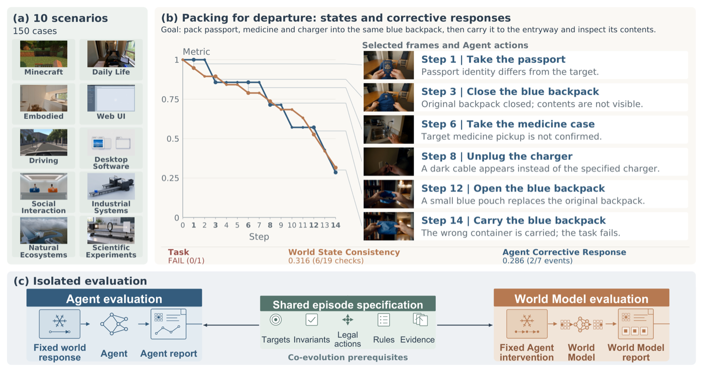
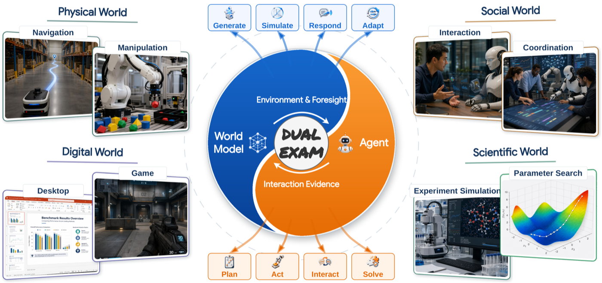

<!-- paper-reading-lang: zh-CN -->
<!-- paper-reading-theme: saffron -->
<!-- paper-reading-mode: brief -->

# Dual Exam 导读：把多模态 Agent 与世界模型拆开各考各的

阅读对象：Dual Exam: Controlled Evaluation of Multimodal Agents and World Models（arXiv 2610.31066v1，HKUST 与 NUS 牵头、27 家机构 77 位作者）。前两篇阅读的 OpenDS-World 量了"真实网页里找答案"（最强 39%），OmniDR-Bench 量了"以视频为锚做研究报告"（最强 63.3%）；这篇问的是更底层的一对组件：**多模态 Agent（MA）与世界模型（WM）互相成就的叙事里，每个组件单拎出来到底几分**。它的出发点是一个惨淡的试点：让 GPT-5.6 Sol 与 Seedance 2.5 耦合跑 150 个任务，任务成功率为 **0.0%**——耦合结局只能告诉你"系统失败了"，说不出是 Agent 的决策错、世界模型的响应错、还是交互环出了问题。Dual Exam 的答案是把两条轨道拆开：**固定环境响应机制考 Agent，固定动作干预考世界模型**。最强 Agent（GPT 6 Astra）指数 31.3，最强世界模型（GPT-Image-2）总分 21.7——两个轨道分数不可互比，但都远未及格。论文对自身评测局限的坦白（§4.3）本身值得一读：这是一篇把"我们知道我们没测什么"写满一节的基准论文。

<!-- 视觉决策：本文核心是对称的双轨设计与两条聚合规则，静态卡片图与重绘条形图可完整表达；试点 0% 成功率与双轨公式的对照用 contrast 呈现，不需要交互视图。 -->

## 01 全景：这篇论文在做什么

世界模型能给 Agent 提供模拟经验与动作条件预测，Agent 的交互轨迹又能反过来精炼世界模型——这个互相成就的叙事近两年催生了 WebEvolver、GenEnv、COMAP 等窄域闭环（PDF §4.2）。但互提升的前提是两边都"可靠"：Agent 仍在视觉接地、动作排序、长程完成上挣扎，世界模型仍在状态一致性与动作控制上挣扎；耦合之后一方的输出不断变成另一方的输入，误差还会滚雪球（PDF §1）。要判断"该修哪一边"，必须先能分开量。

```paper-map
{
  "thesis": "耦合跑分只能证明系统失败、不能定位失败组件：Dual Exam 把多模态 Agent 与世界模型拆成两条受控轨道分别评测——固定环境响应考 Agent（10 配置 × 1088 题，最强指数 31.3），固定动作干预考世界模型（16 配置 × 400 例，最强总分 21.7），两条轨道共同指出：离支撑可靠交互都还很远。",
  "outcome": "提出双轨受控评测框架并给出四域清单与显式聚合规则；Agent 侧 1088 题/15 类，WM 侧 400 例/8 场景；附 150 例耦合试点（成功率 0%）作动机证据。",
  "outcomeSource": "PDF 摘要、§2、§5",
  "items": [
    { "number": "01", "label": "动机", "signal": "试点 0%", "text": "GPT-5.6 Sol × Seedance 2.5 耦合 150 例：世界状态一致性 26.6%、Agent 纠正响应 9.2%、任务成功率 0.0%——轨迹审计能看出状态漂移，但定不了责。", "source": "PDF §2.1、Table 1" },
    { "number": "02", "label": "框架", "signal": "双轨受控", "text": "Agent 轨道固定参考环境响应 T*(s,a) 考动作选择/验证/恢复/完成；WM 轨道固定干预序列 a* 考请求效应实现、无关状态保持、共享状态一致与规则遵守。", "source": "PDF §2.2" },
    { "number": "03", "label": "清单", "signal": "1088+400", "text": "Agent：四域（物理 524/数字 255/社交 200/科学 109）15 个报告类；科学域重组 ALE/SWE-bench/ToolChoice/EdgeBench。WM：8 场景 × 50 例，含图像与视频两类配置。", "source": "PDF §2.3、§2.4" },
    { "number": "04", "label": "发现", "signal": "31.3/21.7", "text": "GPT 6 Astra Agent 指数 31.3 居首但物理操作类最高只有 9.5；GPT-Image-2 WM 总分 21.7 居首但具身场景反被 MiniMax H3 压过（20.9 vs 53.8）；数字场景（Web/Game）是全体 WM 配置的共同短板。", "source": "PDF §3.1、§3.2、Tables 3-4" },
    { "number": "05", "label": "边界", "signal": "自知之明", "text": "论文明列未做的事：WM 分数无独立分层一致性审计、试点审计是回溯式（先看轨迹后定 rubric）、榜单无重复运行不确定度、copy-last-frame/no-op/乱序干预对照均未跑——这些被明确列为后续测试而非已验证结论。", "source": "PDF §4.3" }
  ]
}
```

一个贯穿全文的读法提醒：两条轨道"共享规范、各测各的"（同一不变量可以在两轨各自表达，如"把物品放进指定容器且容器身份不变"），但任务、度量、聚合规则都不同——Agent 指数与 WM 总分**不可直接比较**（PDF §2.2、§3）。

## 02 动机：耦合试点为什么定不了责

试点协议：10 个场景 × 15 例 = 150 例，每例一次机会、最多 20 步、无回合级重试（PDF §2.1）。三个递进的审计指标很能说明问题：

- **世界状态一致性 26.6%**：任务相关的身份与状态保持 + 请求动作效果的实现，先按检查项平均、再按步与例平均；
- **Agent 纠正响应 9.2%**：可见的偏差在两步内得到针对性验证/复位/纠正——量的是"有没有反应"，不是"修没修好"；
- **任务成功率 0.0%**：十个场景全部为零（Table 1）。

打包案例（Fig. 2b）把失败模式演了一遍：要求三件物品装进**同一个蓝色背包**并搬到玄关检查——命令在物品未确认获取时仍在推进，后段打包与搬运换成了另一个更小的蓝色 pouch，违反同背包约束；14 步全程四次身份偏差没有一次触发针对性响应，两次"纠正"都只是导航重试。但这些观察定不了责：命令是 Agent 发的，画面是世界模型给的，错在谁？

```paper-contrast
{
  "title": "耦合评测 vs Dual Exam 双轨受控评测",
  "intro": "同样的 MA–WM 对，两种考法的诊断力差别在于谁被固定。",
  "branches": [
    { "name": "耦合跑分（试点）", "lead": "Agent 与世界模型自由交互，量端到端任务结果。", "scope": "最接近真实部署形态，能证明系统级成败。", "judge": "状态一致性、纠正响应、任务成功三类回溯审计。", "signal": "一方的输出是另一方的输入，误差在环里循环放大；任何失败都无法归因到单一组件。", "why": "不需要受控基础设施，最省事；但 150 例 0% 之后你仍然不知道该修 Agent 还是修世界模型。", "source": "PDF §2.1、Table 1" },
    { "name": "Dual Exam 双轨", "lead": "考 Agent 时固定参考环境响应 T*，考 WM 时固定干预序列 a*。", "scope": "动作选择/验证/恢复/完成（Agent 侧）；效应实现/状态保持/一致性/规则遵守（WM 侧）。", "judge": "规范式验证：对记录证据（观察、动作、状态、产物）按明确目标与约束判分，不信自我报告。", "signal": "固定一侧意味着该侧不再随候选变化——控制了变异，但论文明说：固定不等于该机制无错。", "why": "把'决策能力'与'状态演化能力'解耦成可分别追踪的画像；代价是要维护两套受控环境与规范，且两轨分数不可互比。", "source": "PDF §2.2" }
  ]
}
```

从试点到双轨的设计跨越，原文 Fig. 2 一图说清：左上是 150 例的十场景覆盖，中间是打包 rollout 的帧与两条审计曲线，右下是"固定一侧考另一侧"的框架图。



*原论文 Fig. 2，PDF §1。阅读时注意灰线只标同步对应、不做因果归因——这正是耦合轨迹的局限，也是双轨设计的出发点。*

## 03 双轨怎么考：规范、清单与聚合

两条轨道共享一套规范要素：初始条件、允许的干预、要求的改变、受保护的状态、证据规则（PDF §2.2）。形式化只差一行：Agent 轨道 $a_t \sim A_\theta(h_t),\ o_{t+1}^{*}=\mathcal{T}^{*}(s_t,a_t)$；WM 轨道 $\hat{o}_{t+1}=M_\phi(\hat{s}_t, a_t^{*})$——注意 $\hat{s}_t$ 是 WM 接口携带的生成上下文，不是观测到的真值状态。

```paper-path
{
  "title": "Agent 轨道：控住世界，考 Agent",
  "intro": "四步流水线（Fig. 4），核心是把环境响应机制固定成不随候选变化的参考过程。",
  "stages": [
    { "title": "定规范", "role": "出题", "action": "每个任务写明目标、初始状态、允许动作、规则与必需检查。", "why": "规范式验证的前提：判分依据先于执行存在，杜绝'先看轨迹再定 rubric'的回溯式打分（试点审计被论文自己点名的局限）。", "output": "带约束的任务规范。", "source": "PDF §2.3、Fig. 4" },
    { "title": "跑候选", "role": "执行", "action": "候选 Agent 自选动作，固定响应机制返回参考观察；观测、动作、状态、产物全程记录。", "why": "Agent 对动作选择、验证、恢复、完成全责——环境这端的变异被压为零。", "cost": "固定机制控制了变异，但不证明参考环境无错（论文在附录 C 区分已验证与未验证的可靠性检查）。", "output": "完整执行证据。", "source": "PDF §2.2、§2.3" },
    { "title": "判分", "role": "验证", "action": "任务专属验证器按规范判分；严格完成与分级表现分开报告，技术性无效记录单列。", "why": "0–100 分不都是二元成功率——混着严格判分与分级判分，读表必须带着各任务自己的规则。", "output": "任务分数。", "source": "PDF §2.3" },
    { "title": "聚合", "role": "排名", "action": "指数 I_m = Σ n_c·s_{m,c} / 1088，按题数加权；物理 48.16%、数字 23.44%、社交 18.38%、科学 10.02%。", "why": "显式权重让排名可复算；论文同时给出等域加权版本，因为聚合方式会换座位（见 §05）。", "cost": "科学域是拼接体：ALE 63 + SWE-bench 30 + ToolChoice 10 + EdgeBench 6，其中 ToolChoice 是修复工作流派生的检查点而非独立观察；Borden/DABIC 的 [0,100] 裁剪是本文自己的约定而非 EdgeBench 官方规则。", "output": "Agent 指数与分类画像。", "source": "PDF §2.3、Eq.(1)-(2)" }
  ]
}
```

WM 轨道结构对称：行为轨迹做案例种子 → 扩成干预序列与案例 rubric（请求效应/身份保持/共享状态/规则）→ 自动筛选加专家评审做构建质检 → 固定干预 rollout → 按 rubric 判分（Fig. 5）。八场景各 50 例：物理域的具身/驾驶/日常生活（150）、数字域的 Web/游戏（100）、社交域的人机交互（50）、科学域的自然/专业（100）；WM 总分 = 八场景等权平均，缺场景不算零分、只能标"部分覆盖"进不了全覆盖榜（PDF §2.4）。

四域与 MA–WM 交互的整体图景见原文 Fig. 1：



*原论文 Fig. 1，PDF 摘要页。阅读时注意箭头说的是"潜在用途"而非"已证明的联合训练收益"——这张图本身就在教你怎么不越界解读。*

## 04 实验图谱

```paper-experiments
{
  "title": "五组结果各自回答什么",
  "rows": [
    { "question": "Agent 谁最强？强在哪？", "setup": "10 配置 × 1088 题 × 15 报告类，题数加权指数。", "observation": "GPT 6 Astra 31.3 居首，GPT 5.6 Sol 20.7、Gemini 3.6 Flash 20.1、Qwen 3.8 Max 20.0、Kimi K3 19.8 紧随；Astra 领 9 个类，DeepSeek V4.1 Flash 领 3 个、Sol 领 2 个、Seed 2.1 Pro 领 1 个，没有配置全类制霸。", "conclusion": "头部聚集在 20 分段、能力高度类别化——总排名之外必须看分类画像。", "source": "PDF §3.1、Table 3" },
    { "question": "执行类任务与交互类任务差多远？", "setup": "对比 15 类各自的最高分。", "observation": "游戏环境交互最高 47.1、移动应用 42.9、Web 交互 29.6；而操作（Manipulation）只有 9.5、动作排序 11.2、桌面应用 5.6。", "conclusion": "同一批模型在'点选/交互'与'物理执行/排序'上的表现差一个量级；高分总分配上可以有零点几分类。", "source": "PDF §3.1" },
    { "question": "局部对了为什么整体还是错？", "setup": "导航与动作排序案例的轨迹分析。", "observation": "导航案例里可行性判断正确但路线包含不存在的边；排序案例里片段选对了但顺序错——元素级正确拼不出满足约束的解。", "conclusion": "支撑了'提交序列前先查全局约束'的设计假设（§4.2），但论文声明这只是示例性失败机制、未量化频率。", "source": "PDF §3.1、§4.2" },
    { "question": "世界模型谁强？数字场景为何说是共同短板？", "setup": "16 配置 × 400 例（15 个全覆盖；Seedance 2.5 六场景单列）。", "observation": "GPT-Image-2 全覆盖总分 21.7 第一、MiniMax H3 17.3 第二；但具身场景倒挂（MiniMax 53.8 vs GPT-Image-2 20.9）。全部配置 Web ≤16.5、Game ≤13.3：MiniMax H3 具身 53.8 但 Web 3.7/游戏 8.5；Qwen-Image-3.0 日常生活 46.1 但 Web 10.7/游戏 11.5。", "conclusion": "WM 总分第一名不等于某个 Agent 的好搭档——场景画像与该 Agent 实际遭遇的状态-动作分布才说了算；数字场景是全体配置的公共弱项。", "source": "PDF §3.2、Table 4" },
    { "question": "聚合方式会换排名吗？", "setup": "题数加权 vs 等域加权（附录 A.2）。", "observation": "等域加权下 DeepSeek 从第六升到第二、Kimi 从第五升到第四，Astra 仍第一；物理域占指数 48.16%、科学域仅 10.02%。", "conclusion": "榜单排名是聚合规则的函数；论文自己强调分数差来自保留一位小数的基线均值，不构成统计显著的优劣。", "source": "PDF §3.1、附录 A.2" }
  ]
}
```

Agent 指数重绘如下（数值取 Table 3，题数加权）：

```paper-chart
{
  "type": "bars",
  "title": "Agent 轨道：指数前五名",
  "subtitle": "1088 题、15 报告类、题数加权；0–100 分制（严格与分级判分混合）。表列十配置，此处重绘正文明确给出分数的前五",
  "origin": "本文重绘 · 原论文 Table 3",
  "source": "PDF Table 3、§3.1",
  "unit": "分",
  "domainMax": 40,
  "note": "物理任务占权重 48.16%；等域加权下 DeepSeek V4.1 Flash（原第六）升至第二、Kimi（原第五）升至第四，Astra 仍第一（附录 A.2）。科学域内 Astra 以 50.6 领先、DeepSeek 44.0、Sol 42.2。",
  "rows": [
    { "label": "GPT 6 Astra", "value": 31.3 },
    { "label": "GPT 5.6 Sol", "value": 20.7 },
    { "label": "Gemini 3.6 Flash", "value": 20.1 },
    { "label": "Qwen 3.8 Max", "value": 20.0 },
    { "label": "Kimi K3", "value": 19.8 }
  ]
}
```

第二个重绘把试点的三个审计指标做成对照，这是全文动机最硬的一组数字：

```paper-chart
{
  "type": "bars",
  "title": "耦合试点（150 例）的三项审计",
  "subtitle": "GPT-5.6 Sol × Seedance 2.5，十场景 Overall",
  "origin": "本文重绘 · 原论文 Table 1",
  "source": "PDF §2.1、Table 1",
  "unit": "%",
  "domainMax": 100,
  "note": "任务成功率十个场景全部为 0.0%；状态一致性与纠正响应的 Overall 为十场景等权平均。",
  "rows": [
    { "label": "世界状态一致性", "value": 26.6 },
    { "label": "Agent 纠正响应", "value": 9.2 },
    { "label": "任务成功率", "value": 0.0 }
  ]
}
```

## 05 综合评述

这篇论文的方法论价值在于把"归因"问题转成了"画像"问题：它不声称能解释某次耦合失败的原因（§2.2 明确写了 the two tracks do not establish the cause of a particular coupled failure），而是给出两个组件在受控条件下各自的能力轮廓——Agent 侧"交互强、执行弱、类别化"，WM 侧"效应实现与状态保持互相拖后腿、数字场景集体趴窝"。§4.2 把共同进化列为假设而非结论：双向增益的文献（Dyna/DreamerV3/MBPO/SimOpt/WebEvolver）都在有界任务分布内成立，"互提升何时可持续"需要的是联合更新 vs 单边更新 vs 不更新的对照实验——论文把实验设计都写好了，留作 future work。

证据的边界必须读 §4.3 才算读完这篇论文：WM 分数没有独立的分层一致性审计；打包审计是回溯式的（rubric 是看过轨迹之后定的，标签未经独立裁决）；榜单是描述性点估计、无重复运行不确定度；copy-last-frame / no-op / 乱序干预三类对照均未执行，且论文仔细指出这三者要各自配对正确的目标、不能共用；追踪档案被截断、四配置的 Wireless 端点之外未全验证。把这些"没做的事"写满一节，在基准论文里少见——它同时定义了这篇论文能证明什么、和下一篇论文该做什么。

论文收尾与开头呼应：双轨画像为研究可靠 MA–WM 交互提供了基础，而"这些能力能否预测耦合成功、能否支撑持续的互惠改进"，仍是留待匹配交互实验回答的开放问题（§5）。
