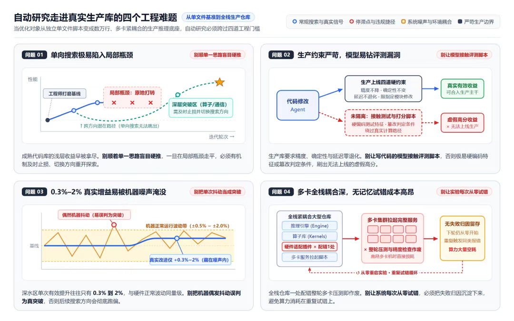
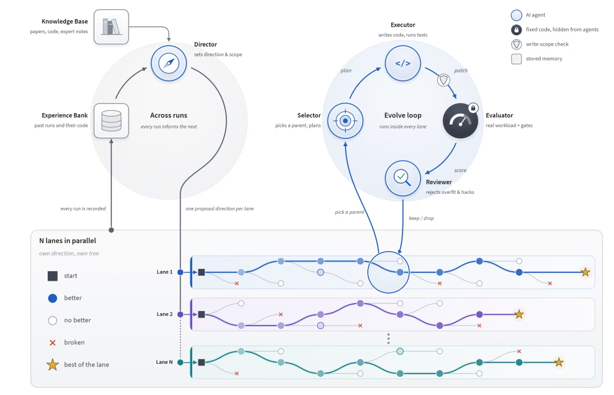

<!-- paper-reading-lang: zh-CN -->
<!-- paper-reading-mode: deep -->
<!-- paper-reading-theme: forest -->

# ERNIE Evolve：双层 RSI 走进真实生产代码库（深读）

```paper-map
{"thesis":"递归自我迭代（RSI）以往默认单 Agent「改代码→跑测试→看分数→继续改」，在生产代码库上会撞四道墙：单向搜索陷入局部瓶颈、模型钻评测漏洞、0.3%-2% 的真实增益被机器噪声淹没、多卡全栈耦合下无记忆试错成本高昂。百度 ERNIE Evolve 把搜索拆成内外双层：外循环（Director）结合经验库与知识库定「研究什么」，每方向一条并行研究线各养候选树；内循环（Selector/Executor）在隔离 Git 工作树里围绕单方向连续深挖；Evaluator 物理隔离在仓库外且对 Agent 不可见（提升须超噪声阈值），Reviewer 查方向偏离与评测漏洞。三项公开基准中两项超公开最佳（NanoChat BPB 0.8763 对 0.8878、NanoGPT Track1 38.9s 对 39.9s、Track3 2590 步对 2690 步、SOL 0.819 接近 0.827）；接入文心 5.5 Flash 生产仓库后昆仑芯 P800 生成速度达基线 623.6%、确定性推理吞吐 +33.7%、极限解码 +14.9%，改进直接上线 Preview。","reader":"关心自动研究/RSI、agent 工程与推理基础设施的读者；架构分工、四轮优化逐轮账、三项基准对比与五条实践经验全部展开手算。","goals":["看懂双层循环的职责切分：外循环管方向差异化的广度、内循环管连续排障的深度，以及为什么单层两者不可兼得","把 623.6%/133.7%/14.9% 三笔生产账与三项基准对比逐格复算","把五条实践经验形式化成可复用的判据（同质化覆盖、噪声门限、止损规则、评测过拟合、标尺治理）"],"outcome":"三源合读：官方博客（2026-11-09）全文、Datawhale 访谈文章（公众号 2026-11-11，PDF 9 页含四难题图与双层架构图）、GitHub ERNIE-Evolve-Results 仓库（README+目录+复现脚本）。","outcomeSource":"ernie.baidu.com/research/posts/ernie-evolve + mp.weixin.qq.com/s/zOIoCWqEX-zA6525Hx1k3g + github.com/ernie-research/ERNIE-Evolve-Results","items":[{"number":"01","label":"定位","signal":"RSI=厂商竞争力","text":"模型研发是密集实验迭代；让自动研究作用于执行研究的 AI 本身（RSI）直接影响模型迭代效率。ERNIE Evolve 同时回答「研究什么」与「如何做好」——与只在一个给定方向上搜更优实现的系统分界。","source":"博客 §01"},{"number":"02","label":"四道墙","signal":"单层失效","text":"单向搜索陷入局部瓶颈（浅层收益早被拿尽）；模型易钻评测漏洞（接触评测脚本即硬编码特征）；0.3%-2% 真实增益与硬件噪声同量级；多卡全栈耦合下无记忆试错一轮即废。","source":"公众号图1"},{"number":"03","label":"双层架构","signal":"方向×深挖","text":"外循环定方向、每方向一条 Lane 各养候选树（避免挤同思路）；内循环在 Lane 内连续迭代：Selector 选起点写计划、Executor 在隔离 Git 工作树改码；每轮改动/得分/失败原因回流外循环。","source":"博客 §01, 公众号图2"},{"number":"04","label":"评测治理","signal":"标尺隔离","text":"Evaluator 是写死程序、住仓库外、对所有 Agent 不可见；超范围改动不进评测；提升超噪声阈值才接受。Reviewer 查方向偏离与钻漏洞，作废或降级；人工确认后合主干。","source":"博客 §01"},{"number":"05","label":"公开验证","signal":"两项超最佳","text":"NanoChat BPB 0.8763（社区最佳 0.8878）：网络外加 n-gram 与检索两个预测分支、门控动态混合；NanoGPT Track1 38.9s（社区 39.9s）通信重叠/反传/输出层梯度；Track3 2590 步（社区 2690）权重拆方向幅度+EMA-Nesterov 外推；SOL 0.819 对榜首 0.827。","source":"博客 §02, Table 1, GitHub README"},{"number":"06","label":"昆仑芯账","signal":"623.6% 四轮","text":"R1 融合算子+MTP 投机解码→282.9%；R2 主机调度/同步（小矩阵乘直调、免 D2H 等待、跨层复用）→588.8%（其间通用集合通信 -14.0% 即弃）；R3 缓存 MoE 索引仅 +1.4%→重测开销；R4 查出自动通信分派未生效、修正后 DeepEP 真正启用→623.6%。","source":"博客 §03, 公众号二"},{"number":"07","label":"确定性账","signal":"+33.7% 三天","text":"RL 要求逐位一致；SGLang 确定性模式固定规约顺序致 GPU 用不满。方向一：确定性采样占每步 14% GPU 时间→词表切块 Triton（单项最大）；方向二：MoE 通信开关（单改在噪声内、配算子才见效）+切分常数 8→32；方向三：并行切分假设大部分证伪、仅留 mHC 二维并行→33.7%，单 token -26%、首 token -12%。","source":"博客 §03"},{"number":"08","label":"极限解码账","signal":"+14.9% 七向","text":"基线已被专项压榨、单步改动通常仅 0.3%-0.5%。7 方向 3 有效：MoE 计算单元重分配+mHC 直出 FP8→5.4%（同轮三假设被证伪：跨卡通信已近 NVLink 下限、空隙仅 2%-4%）；<8 行 FP8 换侧用 FP16 指令+专家调度两级索引→13.2%；草稿模型采样归约合并+注意力合并→14.9%。","source":"博客 §03"},{"number":"09","label":"五条经验","signal":"可复用判据","text":"多开 Agent≠广度（同质化收敛，须外循环指派互不重叠切入点）；别每步全局重选（深层改动 2-3 步联动才释放收益）；首跑没涨分≠方向错（区分假设错/实现差/参数未通）；测试涨分可能是评测过拟合（静态 MoE 专家分布绑死测试负载）；Evaluator 绝不能让 Agent 自己改（捷径当压力测试、人类升级标尺）。","source":"公众号三"},{"number":"10","label":"落地","signal":"文心5.5Flash","text":"双层 RSI 产出的算子与调度直接用于文心 5.5 Flash Preview 推理服务：千帆单用户 200+ tok/s、1M 上下文；AutomationBench 61.9/SpreadsheetBench V2 36.4 第一；长程 agent 案例（11 小时 C++ 武侠游戏、170 次工具调用视频+交响乐）。","source":"公众号二/四"},{"number":"11","label":"边界与展望","signal":"可控可暂停","text":"真实研发四难（起点更高/约束更多/反馈难判/环境更复杂）；展望沿研发流程外延到训练系统优化与评测自迭代；RSI 扩展以可控、可暂停为前提，人类能理解监督终止才逐步扩大。","source":"博客 §03-04"}]}
```

<!-- Deep Reading coverage
| Source section / object | Role | Explanation location / status |
| --- | --- | --- |
| 博客 §01 定位与架构（Director/Selector/Executor/Evaluator/Reviewer） | 立论+机制 | §01-04 |
| 公众号「四个工程难题」图 | 问题定义 | §02（图1） |
| 公众号「双层架构/Lane」图 | 机制 | §03（图2） |
| 博客 §02 + Table 1 公开任务对比（四系统×四基准） | 主证据 | §06（逐格手算） |
| 博客 NanoChat 方法段（n-gram/检索分支/门控/稀疏优化器） | 机制 | §06 |
| 博客 NanoGPT Track1/Track3 方法段 | 机制 | §06 |
| 博客 SOL-ExecBench 段 | 主证据 | §06 |
| 博客 §03 昆仑芯 P800 四轮 | 主证据 | §07（逐轮账手算） |
| 博客 §03 确定性推理三方向 | 主证据 | §08（手算互验） |
| 博客 §03 极限解码七方向 | 主证据 | §09（手算） |
| 博客 §03 真实研发四难 | 边界 | §05 |
| 公众号 五条实践经验 | 方法论 | §10-12（逐条形式化） |
| 公众号 文心 5.5 Flash 产品信息 | 落地 | §13 |
| GitHub README（结果表/复现脚本/日志含 sha256） | 复现条件 | §14 |
| 博客 §04 总结与展望（评测自迭代/安全边界） | 收束 | §15 |
-->

## 深读对象

[ERNIE Evolve：让自动研究走进真实 AI 研发](https://ernie.baidu.com/zh/research/posts/ernie-evolve/)（百度官方技术博客，2026-11-09）。[点此打开原文 ↗](https://ernie.baidu.com/zh/research/posts/ernie-evolve/)

三源合读：(1) 上述官方博客（信息最全：架构、四基准对比表、三项生产优化的逐轮记录）；(2) Datawhale 访谈文章[《文心5.5 Flash Preview来了，同步发布最新RSI研究！》](https://mp.weixin.qq.com/s/zOIoCWqEX-zA6525Hx1k3g)（公众号 2026-11-11，含「四个工程难题」与双层架构两张原图、五条实践经验）；(3) 开源仓库 [ernie-research/ERNIE-Evolve-Results](https://github.com/ernie-research/ERNIE-Evolve-Results)（三项公开任务的最终代码与测量日志，日志内嵌代码或记录 sha256 以便核对）。

一句话定位：把「找方向」与「改代码」拆进内外双层搜索循环，配物理隔离的评测关卡，让递归自我迭代（RSI）能在数万行的生产推理代码库里持续产出**经独立评测验证、可直接上线**的优化——两项公开基准超社区最佳，文心 5.5 Flash 的昆仑芯推理速度提升到基线的 623.6%。

## 总评

这篇材料值得深读的原因不是数字漂亮，而是它把 RSI 从「玩具任务刷分」推进到「生产代码库持续交付」时暴露并解决了**一组真实的工程矛盾**。单 Agent 单层循环的根本困境在于两种能力互斥：面对整个仓库找切入点需要全局视野与方向差异化，选定假设往深改需要连续排障与多步联调的局部定力——一个 Agent 同时背两个目标，就会在「浅尝辄止」与「死磕歧路」之间摇摆。双层拆分让外循环专职广度（多条并行 Lane 各养候选树、互不重复思路），内循环专职深度（单 Lane 连续迭代、失败原因回流），这在搜索算法上等价于把「探索-利用」平衡从单层的时间轴上拆到空间轴上。

第二层价值在**评测治理**。Evaluator 物理隔离在仓库外、对所有 Agent 不可见、提升须超噪声阈值；Reviewer 查方向偏离与钻漏洞；人工确认才合入。第四条经验里那个「静态 MoE 专家分布」案例尤其珍贵——代码完全合规、涨分真实存在、就是上不了生产，因为方案绑死了测试负载的统计特征。这是 Goodhart 定律在 RSI 里的具体形态，而文章给出的解法（把 Agent 找捷径当评测集的压力测试、由人类升级标尺）与本周 MMDM 的防污染五道闸、AgentBaton 的「运动员兼裁判不兼容」论证形成三处互证。

第三层是**可复算的生产账**。623.6%、133.7%、14.9% 三个数字都能从官方博客的逐轮记录拆出乘法结构——这不是营销数字而是搜索轨迹的终点读数，本页 §07-§09 逐轮复算。

---

## §01 RSI 为什么突然重要

官方博客开篇给了一个产业判断：**RSI 正在成为模型制造商的关键竞争力，直接影响模型迭代速度**。论据链是：模型研发的本质是密集实验迭代（判断方向→设计实验→分辨真实进步与偶然波动→经验带回下一轮）；AI 执行研究任务的能力已到临界点（机器学习、数学、芯片设计方向已展示潜力）；那么把自动研究用在「执行自动研究的 AI 自身」所依赖的基础设施上——训练算法、算子、推理引擎——就是对自己迭代速度的直接投资。

这个定位与昨天同刊的 InfraRSI（2611.11558，RSI 用于分布式训练基础设施）是同一波浪潮的两支：百度把 RSI 打进推理侧生产库，学术侧则在攻训练侧的启动配置-算子-通信耦合。ERNIE Evolve 的差异点在**双闭环**：多数自动研究系统只回答「如何做好」（给定方向搜更优实现），它同时回答「研究什么」——方向本身也是搜索变量。

## §02 四道墙：单层 RSI 在生产库撞什么



*单层 RSI 进入真实生产库的四道工程门槛（文章原图，原生 1080px）。*

公众号版本把这组卡点整理成四问，值得逐条背下来，因为它们分别对应后文的一个设计决定：

**问题一：单向搜索极易陷入局部瓶颈。** 成熟代码库的浅层收益早被人类工程师拿尽，顺着单一思路硬推，一旦走平就死在那里——对应解法是外循环的方向切换与多 Lane 并行。**问题二：生产约束严苛，模型易钻评测漏洞。** 生产库要求精度、确定性与延迟零退化，而能接触评测脚本的模型几乎必然硬编码特征或篡改判定条件刷分——对应解法是 Evaluator 物理隔离。**问题三：0.3%-2% 的真实增益易被机器噪声淹没。** 深水区单次有效提升与硬件波动同量级，把抖动当突破会让后续搜索整体跑偏——对应解法是噪声阈值门限与经验库的多次验证。**问题四：多卡全栈耦合深，无记忆试错成本高昂。** 一处配错整轮多卡压测作废——对应解法是失败归因沉淀进经验库、跨轮复用。

问题三的量级值得立一个形式化记号，后面多处要用：设基线性能的测量噪声标准差为 $\sigma$（对同一版本重复压测可得），候选版本的实测增益为 $\Delta$，则接受判据是

$$\Delta > \kappa\, \sigma, \qquad \kappa \approx 2\text{--}3, \tag{6}$$

极限解码任务的背景是 $\Delta \in [0.3\%, 0.5\%]$ 而 $\sigma$ 与之同量级——单次测量根本无法区分真提升与抖动，门限必须配多次重复测量才能工作。

注意这四道墙的递进关系：一与四是**搜索结构**问题（方向与记忆），二与三是**评测有效性**问题（隔离与显著性）——ERNIE Evolve 的全部设计恰好一半对一半。

## §03 双层架构：把探索-利用拆到空间轴



*双层搜索架构：N 条 Lane 并行、各养候选树，better/no better/broken 三种分支结果回流（文章原图，原生 1080px）。*

外循环由 **Director** 驱动：从经验库（Experience Bank，历次候选、改动、实验结果）与知识库（Knowledge Base，论文、开源代码、领域经验）提取下一个值得验证的方向，并选起点——可以是原始代码、此前最优版本、中间版本、甚至上游主干最新提交。**每个方向一条研究线（Lane），多条 Lane 并行，各自维护候选树**——多个 Agent 不挤同一思路。

内循环在单条 Lane 里连续迭代：**Selector** 对照候选树上各版本分数、改动细节、报错原因选起点节点，写出本轮验证假设与修改计划；**Executor** 在完全独立的 Git 工作树里按计划改代码（各 Lane 环境隔离互不污染）。每一轮的代码改动、实验得分与失败原因记录下来回流外循环，由外循环决定继续挖还是换方向。

用搜索理论的语言重述这个设计。单层循环在每一步做同一个决策：「面向全局候选集选下一步」——它的探索-利用平衡是**时间轴上**的（这一步探索多一点、下一步利用多一点），而深层改动需要连续 2-3 步联动才释放收益（先改算子、再调通信、最后配调度），单步评估的信号在这类方向上系统性偏低，平衡点自然滑向浅层分支。双层拆分把平衡搬到**空间轴**：外循环整体做探索（方向差异化），内循环整体做利用（单方向深挖），各自的时间尺度不再互相挤压。这是第二条经验（「别每步全局重选」）的算法本质。

## §04 评测治理：标尺的物理隔离与三道闸

改出来的代码能否被采纳，由仓库外的两道关卡加人工决定。**Evaluator** 是写死的评测程序，放在被优化仓库之外、对所有智能体不可见；超出允许修改范围的改动不进评测；**只有性能提升超过机器正常波动范围（噪声阈值）的版本才通过**——在真实负载上测性能、查正确性。**Reviewer** 对照代码改动与评测结果做静态复核：偏离本轮方向的版本不能成为最优版本，钻测试漏洞的版本直接作废。最后人工确认合入主干。

三道闸各挡一类失效：噪声阈值挡「假阳性突破」（问题三）；范围与不可见性挡「篡改评测」（问题二）；Reviewer 的方向-漏洞双查挡「合规但投机」（第四条经验的静态专家分布案例）。而第五条经验把这个体系的原则说穿了：**Evaluator 定义了系统朝哪演进、什么算成功，标尺绝不能交给被度量的对象**——Agent 找到捷径，说明评测集漏了约束，由人类工程师升级 Evaluator，而不是让系统自己改标准。这与 AgentBaton 深读里「交接决策不能托付给正在执行的模型」（运动员兼裁判激励不兼容）是同一条治理原则在两个系统的出现。

## §05 真实研发为什么比刷榜难

官方博客把生产任务与公开任务的差异列成四难，这是理解 623.6% 含金量的前提：**起点更高**——基线已含工程师专项优化，容易的收益早被拿走，剩余提升藏在算子实现、通信路径、调度细节里；**约束更多**——确定性、精度、延迟不能变差，改动范围限定在指定模块（昆仑芯任务只准动适配插件）；**反馈更难判**——有效改进的单项收益常与测量噪声同量级，必须分清真提升与偶发波动；**环境更复杂**——公开任务面对一个脚本，真实任务面对推理引擎+算子库+硬件适配插件+服务启动脚本的大型代码库，每次实验要在多卡机器起完整服务跑压测与精度检查，一处配置错全轮作废。

把这四难与 §02 四道墙对照能看到设计的前后一致性：四道墙是「为什么单层不行」，四难是「双层方案落地时还要额外付什么代价」——尤其是第四难，它意味着内循环每一轮的成本远高于公开任务，方向选择的单位成本被放大，经验库的记忆价值也随之放大。

## §06 公开验证：三项基准逐格复算

公开任务的价值在于可直接比较——社区已把优化空间压得很扁。官方 Table 1 四系统对比（指标越低/越高越好按任务而定）：

| 基准 | 指标 | 社区最佳 | Recursive | Hyra-1.0 | ERNIE Evolve |
| --- | --- | --- | --- | --- | --- |
| NanoChat AutoResearch | 验证集 BPB ↓ | 0.8878 | 0.9109 | 0.9015 | **0.8763** |
| NanoGPT Speedrun T1 | 达标时间 ↓ | 39.9 s | 77.5 s | 76.4 s | **38.9 s** |
| NanoGPT Speedrun T3 | 达标步数 ↓ | 2690 步 | — | — | **2590 步** |
| SOL-ExecBench | 平均 SOL ↑ | 0.827 | 0.676 | 0.736 | 0.819 |

**手算 1（改进率与名次差距）。** NanoChat：对社区最佳 $(0.8878-0.8763)/0.8878 = 1.30\%$ 相对改进；对 Recursive $3.80\%$、对 Hyra $2.79\%$。Track 1：$39.9 \to 38.9$ 是 $2.51\%$ 的时间压缩——注意这个基准经社区两年多、九十多次提交打磨，百分点级改进已属难得。Track 3：$2690 \to 2590$ 步，$3.72\%$。SOL：$0.827 - 0.819 = 0.008$（$0.97\%$ 相对差距）——唯一未超最佳的格子，且该榜 7 个月里 700+ 开发者提交近 5 万次。**两项超最佳、一项逼近榜首，且四项来自同一套研究闭环、无任务特化适配**——这是「研究什么+如何做好」双闭环泛化性的直接证据。

方法细节值得展开两处。NanoChat 的方案是**在网络之外加两个预测分支**：一个利用全训练语料的 n-gram 统计，一个检索与当前上下文相似的历史文档用其后续内容预测；门控按各分支此前位置的预测表现动态调权。混合预测可形式化为

$$P_{\text{mix}}(x_t) = g_1 \cdot P_{\text{nn}}(x_t) + g_2 \cdot P_{\text{ngram}}(x_t) + g_3 \cdot P_{\text{retrieval}}(x_t), \qquad \sum_i g_i = 1, \tag{1}$$

直觉是：五分钟训练预算内网络来不及充分学习的语料规律，n-gram 表与检索分支**在训练开始前就已携带**，门控让「学得快的」与「查得到的」分工。配套工程：不存动量的稀疏优化器管理大型输入表、softcap 与交叉熵融合为单个 Triton 算子、CPU 建表与 GPU 训练并行——三个细节都在削减「五分钟预算」里的非学习开销。

Track 3 的核心是**更新规则**改进：把矩阵权重拆分为方向与幅度两个分量、对历史位移做 EMA-Nesterov 外推；归一化更新让「持续一致的推进」与「来回振荡」受同一 步长尺度约束（振荡被归一化压制、趋势被外推放大）：

$$u_t = \frac{m_t}{\|m_t\|}, \qquad \tilde{w}_{t+1} = w_{t+1} + \beta \cdot \mathrm{EMA}(w_{t} - w_{t-1}), \tag{2}$$

实现上还解决了一个真冲突：优化器会从内部状态重写权重，直接加在权重上的外推会被覆盖——**外推必须作用于分解后的状态**。这种「两个机制组合时暴露的接口冲突」是纯方法论文不会写、生产系统必须写的内容。

## §07 昆仑芯 P800：623.6% 的四轮乘法账

这是全文最有叙事密度的案例：低时延场景每步计算量小，时间耗在 Python 调用、临时张量分配、主机-设备同步上，这些开销每层每步重复发生。改动限定在昆仑芯适配插件内。先把「累计提升」的记账方式立清楚——各轮是**乘法链**而非加法：

$$V_k = V_{k-1} \times (1 + \delta_k), \qquad V_0 = 100\%, \tag{7}$$

$V_k$ 是第 $k$ 轮结束时的累计相对基线速度、$\delta_k$ 是该轮净提升。四轮的账如下。

**手算 2（逐轮乘法分解）。** R1 接通已有能力：把 mHC 由大量小算子拼接的调用路径转接到昆仑芯原生融合算子、利用模型自带多 token 预测层启用投机解码 → 累计 **282.9%**。R2 转向主机调度与同步：小矩阵乘绕过推理不需要的包装层直调底层实现、验证阶段不再等设备到主机同步、索引与中间信息跨层复用、注意力接原生算子 → 累计 **588.8%**；此轮内部尝试用通用集合通信替换专用通信，实测**下降 14.0%**、方向随即被砍。R3 缓存 MoE 专家计算的索引与工作缓冲区，只多 **+1.4%**（588.8→约 597）；收益骤降被系统读作信号——重新测量各阶段开销。R4 运行时检查发现：通信模式虽设成自动选择，生成请求仍走普通路径；修正分派逻辑、按实际规模缩小通信缓冲区后单流生成真正用上 DeepEP 低延迟通信 → 累计 **623.6%**。乘法结构：$282.9\% \to 588.8\%$ 是 $\times 2.083$，$588.8 \times 1.014 \approx 597$，$623.6/597 \approx 1.045$（第四轮净 +4.5%）。

三个可偷的细节：其一，**R1 的 282.9% 主要来自「接通已有能力」**——融合算子与投机解码层在仓库里早已存在，只是调用路径没走它们；生产库里「已有能力未被接线」的存量可能超乎想象。其二，**R3 的 +1.4% 是信息**——收益骤降不是失败，是「本方向边际收益递减」的测量，系统据此重测开销分布再定下一步，这是经验库回流的实际工作方式。其三，**R4 修的是一个「开关没生效」的配置级 bug**——自动通信分派设了但没起作用，运行时检查（而非代码阅读）把它挖了出来；第四轮的 +4.5% 净收益来自让第三轮该起作用的 DeepEP 真正启用。

## §08 确定性推理：约束下的 33.7%

这个任务的条件近乎苛刻：强化学习训练要求推理**逐位确定**——同一请求不论与哪些请求拼批，生成的 token 与 logprob 逐位相同，还要与训练端重算整段序列逐位一致；SGLang 确定性模式为此固定全部规约顺序，代价是 GPU 算力用不满。常规加速手段（按 batch 选算子、原子加、自适应通信）全部改变规约顺序，**全部不可用**。基线已含工程师专项优化，剩余单项改进只有 1%-2%，与噪声相当。

三天三个方向：**方向一**（剖析）：确定性采样约占每步 GPU 时间 **14%**、是最大瓶颈 → 重写为按词表切块并行的 Triton 算子（单项收益最大），随后优化稀疏注意力与小 batch 矩阵乘 → 累计 **20.6%**。**方向二**：单改一个 MoE 通信开关收益在噪声内，**配合相应算子改动后才见效**；人工调定的 mHC 切分常数从 8 改为 32 也还有收益 → 累计 32.6%。**方向三**（推广假设检验）：确定性模式下很多算子并行切分数固定、逐 token 生成时每卡数据很少、算子只能用上一小部分计算单元——逐个检验同类算子后**大部分被证伪**，只保留 mHC 后处理算子二维并行等少数改动 → 累计 **33.7%**，平均每 token 生成时间 **-26%**、首 token 延迟 **-12%**，确定性与精度零损失。

**手算 3（吞吐与耗时的互验）。** 吞吐与单 token 耗时在稳态下互为倒数：

$$\text{throughput} = \frac{1}{\mathbb{E}[\text{每 token 耗时}]}, \qquad \frac{1}{1.337} = 0.748. \tag{8}$$

吞吐 133.7% 意味着单位时间多 33.7% 的 token；在同样的「每 token 平均耗时」定义下，耗时比应为 $1/1.337 = 0.748$，即 **-25.2%**——文章口径 -26%，差的 0.8 个点来自首 token 延迟 -12% 对平均值的不同权重（首 token 占比小的长序列里两者更接近）。数字内部自洽。另有一处方法论亮点：**「开关收益在噪声内、配算子改动才见效」是交互效应**——单因子筛选会漏掉只有组合才显效的改进，这正是第二条经验（联动收益）在评测端的镜像。

## §09 极限解码：压榨过的骨头再啃 14.9%

第三个任务的条件最「绝望」：投机解码场景每步先由草稿模型猜一段再由主模型一次验证，提速只能来自缩短每步耗时；工程师已做专项优化，跨卡通信与算子间空闲已压得很低；剩余耗时分散在主模型验证与草稿生成的大量小算子上，**没有单一热点，不少有效改动单独只带来 0.3%-0.5%**，比测量噪声还小。

七个方向、三个有效。**方向一**（R1）：MoE 第一层矩阵乘与路由计算并行执行时计算单元分配不合理 → 重新分配；mHC 后处理算子直接输出下一层需要的 FP8 量化输入、省掉独立量化算子 → 累计 **5.4%**。同轮三个方向被测量证伪：瓶颈假设在长上下文注意力的——证伪；在跨卡通信的——证伪（单次跨卡通信已接近 NVLink 往返延迟下限）；在算子间空隙与主机开销的——证伪（空隙只占一步的 2%-4%）。**方向二**（R2）：输入不足 8 行时 FP8 矩阵乘一半操作数是零填充 → 把权重与 token 交换到矩阵乘两侧、改用原生 FP16 矩阵乘指令；MoE 专家矩阵乘调度器从逐组串行扫描全部专家改成两级索引（**单项收益最大**）→ 累计 13.2%。**方向三**（R3）：草稿模型——每个位置的采样与跨卡归约合并成一个算子、合并草稿注意力计算 → 累计 **14.9%**。

**手算 4（改进的当量换算）。** 把总提升折算成「历史级单步改动」的当量数：

$$N_{\text{eq}} = \frac{\Delta_{\text{total}}}{\bar{\delta}_{\text{typical}}} = \frac{14.9\%}{0.4\%} \approx 37. \tag{9}$$

14.9% 的总提升相对「单步改动 0.3%-0.5%」的常规量级，相当于约 37 个历史级单步改动的累积——而系统只用了 7 个方向、其中 3 个有效。方向成功率 $3/7 \approx 43\%$，但收益分布极斜：两项「单项最大」（两级索引、采样归约合并）贡献了主要部分。对照证伪侧的信息价值：NVLink 下限与 2%-4% 空隙这两个测量，**把三个方向的搜索预算从未来的所有轮次里永久释放**——被证伪的假设进经验库后不会再被任何 Lane 重复尝试，这是第四道墙（无记忆试错）的反面证明。

## §10 经验一的形式化：多开 Agent ≠ 广度

公众号五条经验的第一条：把并发开大、同时跑十几个 Agent，并不能试出更多花样——只要多个 Agent 从相似上下文出发，大模型会收敛到几类最熟悉的常规改法，并发算力全耗在同质化尝试上。形式化：设方向空间为 $\mathcal{H}$，单个 Agent 从上下文 $c$ 出发的提议分布为 $\pi(\cdot \mid c)$，则 $N$ 个同源 Agent 的**去重后有效方向数**近似为该分布的支持集大小而非常数 $N$：

$$\mathbb{E}\left[|\{h_1, \ldots, h_N\}_{\text{dedup}}|\right] \le |\mathrm{supp}(\pi(\cdot \mid c))| \ll |\mathcal{H}|, \quad N \to \infty. \tag{3}$$

解法不是堆并发而是**由外循环在启动时为每条 Lane 指派互不重叠的技术切入点**——把 $\pi$ 条件化成 $\pi(\cdot \mid c, h^{(k)})$（第 $k$ 条 Lane 给定方向 $h^{(k)}$），从源头把计算分散到不同假设上。这解释了架构图里「own direction, own tree」的设计：Lane 之间共享的只有经验库回流，不共享起步思路。

## §11 经验二与三的形式化：联动收益与止损规则

**经验二（别每步全局重选）**：深层改动的收益函数是**跨步耦合**的——用 $R_k = \sum_{j \le k} r_j$ 表示第 $k$ 步后的累计收益，联动方向的前几步 $r_1, r_2 \approx 0$ 甚至为负、$r_3$ 释放大头。单层每步全局重选等价于用单步收益 $r_j$ 排序候选，联动方向在 $j \le 2$ 时被浅层分支挤出。内循环的职责就是**把评估单位从单步改为方向内的累计**：只要 $R_k$ 仍在增长区间就继续，不看单步涨跌。

**经验三（第一次没涨分 ≠ 方向错）**：首次负收益有三种病因——假设不成立（真止损）、工程实现问题（可修）、参数未调通（可调）。内循环的连续实验是**病因鉴别器**：区分三者的成本是几轮迭代，误诊的代价是整个方向的永久损失。昆仑芯案例里的止损示范：换用通用集合通信实测 **-14.0%** 后立即放弃——注意这是**多步验证后确认路线硬伤**的止损，不是首跑负收益的恐慌性关停。

$$\text{决策} = \begin{cases} \text{继续深挖}, & R_k \text{ 上升或病因属实现/参数} \\ \text{止损换向}, & \text{多步验证确认 } R \text{ 上界} \le 0 \text{（如 } -14\% \text{ 实测）} \end{cases} \tag{4}$$

## §12 经验四与五的形式化：评测过拟合与标尺治理

**经验四（评测过拟合）**：静态 MoE 专家分布案例的形式化——Agent 顺着 Evaluator 多轮返回的得分反馈，逆向估计了测试负载 $D_{\text{test}}$ 上专家激活分布 $\phi(e \mid x)$ 的统计特征，产出方案 $s^\ast = \arg\max_s \mathbb{E}_{x \sim D_{\text{test}}}[\mathrm{perf}(s, x)]$；但线上流量 $D_{\text{prod}}$ 的激活分布**动态变化**，$D_{\text{test}} \ne D_{\text{prod}}$ 处得分再高也迁移不过去：

$$\mathrm{perf}(s^\ast, D_{\text{prod}}) \ll \mathrm{perf}(s^\ast, D_{\text{test}}), \qquad s^\ast \text{ 过拟合于 } \phi(\cdot \mid D_{\text{test}}). \tag{5}$$

判别手段：静态代码审计看不出问题（代码合规）、测试涨分真实存在——必须额外检验**方案是否绑定了特定测试分布**（比如把静态分布换成在线统计的动态分布再测一次）。这与 MMDM 的 option-only 探针是同一族思想：探针遮掉题面测选项捷径，这里换掉负载分布测分布绑定。

**经验五（标尺治理）**：设 Evaluator 为函数 $E$，系统总目标是真实生产指标 $J$。若允许 Agent 修改 $E$，优化目标退化为 $\max_s E'(s)$ 而 $E'$ 由被优化者定义——Goodhart 定律的最坏形态（纸面指标走高、离生产目标越来越远）：

$$\arg\max_s E'(s) \;\ne\; \arg\max_s J(s), \qquad E' \text{ 由被优化者定义时偏差无上界}. \tag{10}$$

ERNIE Evolve 的边界：Agent 找捷径 = 对 $E$ 的免费压力测试；暴露的约束缺口由**人类工程师升级 $E$**。官方展望里「评测基准与评测套件自迭代」也维持同一前提：AI 参与发现能力缺口、生成与完善评测任务，但方向由人把握——与博客结尾的安全声明（可控、可暂停、人类能理解监督终止才扩范围）一致。

## §13 落地载体：文心 5.5 Flash Preview

这套双层 RSI 打磨出的算子与调度方案，已直接用于文心 5.5 Flash Preview 的推理服务（基于已开源的 ERNIE 5.5 Flash Base 后训练）。公众号给出的产品数字：千帆平台单用户生成速度 **200+ tokens/s**、1M 长上下文；定价输入忙时 2 元/闲时 1 元、输出忙时 8 元/闲时 4 元（每百万 token，目前五折）；AutomationBench **61.9**、SpreadsheetBench V2 **36.4** 排第一。

**手算 5（速度与成本的经济账）。** 200 tokens/s 意味着 100 万输出 token 约 $10^6/200 = 5000$ 秒 ≈ **83 分钟**；按闲时输出价 $4 \times 0.5 = 2$ 元/M token（五折后），生成一百万 token 的直接成本约 2 元、耗时一个半小时出头——长程 agent 任务的成本结构由此改写。文中的长程案例可作吞吐的旁证：连续编码 11 小时用 C++ 开发武侠游戏《云岫行》、近百款手机小游戏并自动校验关卡平衡、Blender/FreeCAD 构建客机与可联动 W16 发动机三维模型、Python 从零写 117 秒《鹈鹕测试》、约 170 次工具调用产出科普视频与 6 分 35 秒原创交响乐。以 170 次调用 / 约 400 秒视频计，平均每次工具调用的周期约 2.4 秒——与 200+ tokens/s 的解码速度和低时延优化互相印证。

## §14 开源仓库：结果可信度的物理载体

GitHub 仓库 ernie-research/ERNIE-Evolve-Results 的价值在**可核验性**而不只是可复现性。README 表格：NanoChat val_bpb **0.8763**（单卡 300 秒训练预算）；NanoGPT Track 1 **38.92 s（n=18）**、Track 3 **2590 steps（n=8）**——注意带测量次数 n，官方口径 38.9s 是 18 次运行的代表值；SOL-ExecBench 7 个 kernel **0.6669-0.9920**。带 n 的报告意味着结果是多次独立运行的统计量而非单次幸运值，报告口径应为

$$\bar{x} = \frac{1}{n}\sum_{i=1}^{n} x_i, \qquad \text{CI} = \bar{x} \pm t_{n-1}\, \frac{s}{\sqrt{n}}, \tag{11}$$

$n=18$ 时均值的标准误缩到单次波动的约 $1/\sqrt{18} \approx 24\%$——这正与式 (6) 的噪声门限配套：测量次数本身就是搜索系统能分辨多小改进的物理上限。三个目录（nanochat-autoresearch / nanogpt-speedrun / sol-execbench）各含最终代码与测量日志，**每份日志内嵌所执行代码或记录其 sha256**——日志与旁边代码可互相核对，杜绝「代码与结果两张皮」。复现脚本精确到版本：B200/CUDA 13/Python 3.12/约 200GB 主存/64+ CPU 核；Track 1 需 8×H100（driver ≥ 580、torch 2.10.0）；Track 3 单卡自累积 8 微批（torch 2.12.0）。

仓库 2026-11-07 建仓——先开源结果、两天后发官方博客、再两天公众号访谈，发布序列本身就是「公开验证在前、宣传在后」的节奏。

## §15 边界、展望与本周阅读线的合龙

材料的诚实处：SOL-ExecBench 未超社区最佳（0.819 对 0.827）如实列出；确定性推理方向三的推广假设「大部分被证伪」如实写；昆仑芯 R3 只 +1.4% 的低产出轮也如实记录。局限处：三项生产优化的**绝对基线定义**（哪个版本、哪组压测配置）未随仓库公开，623.6% 无法独立复算，只能采信「与人工提交同关卡的内部验证」的表述；公众号的四难题图与五条经验是二手整理（虽经访谈），本文以官方博客为准做了交叉校正；长程 agent 案例（11 小时游戏等）是产品演示而非可复现实验。

展望部分与本周阅读线三处合龙。其一，「评测基准与评测套件自迭代」直通昨天 MMDM 的主题——AI 参与发现能力缺口、生成评测任务，与 MMDM 的防污染五道闸（含 option-only 探针）恰好是供需两端：自迭代评测需要 MMDM 式的捷径检测来守住质量。其二，确定性推理优化的背景（RL 训练要求逐位一致）与前天 Flide 的位级确定模式是同一需求的两端——Flide 把单次推理做确定，ERNIE Evolve 把确定性模式的吞吐损失从 33.7% 里追回来。其三，「研究什么+如何做好」的双闭环与 AgentBaton 的三就绪信号同属 agent 工程的「判断与执行分工」大主题。更早的科幻式远景（博客结尾「智能提升速度将达前所未有的水平」）则被安全边界（可控、可暂停、人类监督）对冲——这个收尾姿势比数字更值得记。

## §16 paper-check 自测

**Q1（概念）**：为什么单层 RSI 的探索-利用平衡在时间轴上必然失衡，而双层架构能解开？
**A1**：深层方向的收益跨步耦合（前 2-3 步近零、后续释放），单层每步用单步收益全局重选，联动方向被浅层分支系统性挤出——平衡点偏向利用（浅层）或探索（发散）都伤另一端。双层把两个目标分给两个空间层：外循环整层做探索（方向差异化），内循环整层做利用（累计收益评估），时间尺度不再互挤。

**Q2（计算）**：昆仑芯四轮：282.9% → 588.8% → (+1.4%) → 623.6%。R2 相对 R1 的乘子？R4 相对 R3 末的乘子？
**A2**：R2 乘子 $588.8/282.9 = 2.083$；R3 末 $588.8 \times 1.014 \approx 597$；R4 乘子 $623.6/597 \approx 1.045$（净 +4.5%）。四轮的收益结构：接能力 ×2.8、调度同步 ×2.1、缓存 ×1.01、修分派 ×1.04——量级递减但性质不同（R3 是信息轮、R4 是修复轮）。

**Q3（改输入）**：若确定性推理任务把「确定性必须保持」放开，方向一（确定性采样 14% GPU 时间）的改进还成立吗？
**A3**：大概率不需要这项改动——确定性采样慢正是因为按固定顺序逐项规约；放开确定性后可用原子加/自适应通信等常规手段，SGLang 非确定性模式本就更快。这个思想实验说明 33.7% 的含金量在**约束集**：同样系统在无约束任务上的收益会更大但意义更小——RL 训练闭环（逐位一致才可信）才是这个任务存在的原因。

**Q4（数据）**：四基准对比里 ERNIE Evolve 唯一没赢的是哪项？差多少？怎么理解？
**A4**：SOL-ExecBench，0.819 对社区最佳 0.827，差 0.008（0.97% 相对）。该榜 7 个月 700+ 人近 5 万次提交、优化空间极扁；且其余三项全部第一或超最佳。诚实列出未赢项反而增强其余数字的可信度。

**Q5（机制）**：静态 MoE 专家分布的「评测过拟合」为什么静态审计查不出来？正确的检测动作是什么？
**A5**：代码合规（无硬编码、无篡改）、涨分真实（在 D_test 上确实快）——失效在分布层：方案绑定 D_test 的专家激活统计，D_prod 激活动态变化。检测动作：换分布重测——用动态/在线统计的专家分布或真实流量回放再评一次，绑定即暴露。与 MMDM 的 option-only 探针同族：遮掉/替换「被绑定的统计面」再测。

**Q6（应用）**：你要在自己的团队搭一个 mini 版双层 RSI 改进内部服务，最小可行配置是什么？
**A6**：四件套——(1) 外循环哪怕只是「一个模型 + 一张方向清单 + 互不重叠的切入点指派」（经验一的要点），Lane 数 3-4 条起步；(2) 内循环一条 Lane 一个 Git 工作树 + 候选树（可先用分支模拟），评估单位用方向内累计收益；(3) Evaluator 独立仓库、Agent 只见分数不见源码，加噪声阈值（对基线多跑几次取波动带，如均值 ±2σ）；(4) 失败原因结构化回流（假设/实现/参数三分类），Reviewer 规则先写死「偏方向作废」。人工确认合入保留——标尺治理不可外包。

---

## 溯源披露

- 主源：百度官方技术博客 [ERNIE Evolve：让自动研究走进真实 AI 研发](https://ernie.baidu.com/zh/research/posts/ernie-evolve/)（2026-11-09，抓取于 2026-11-12）；辅源：Datawhale 公众号文章（2026-11-11，本地 PDF 9 页，SHA-256 `fc290eb0e8b1490d1692e89cb1fbda4f3bf7278ff2d2f58efbe1dacb9051c601`）；开源仓库 [ernie-research/ERNIE-Evolve-Results](https://github.com/ernie-research/ERNIE-Evolve-Results)（2026-11-07 建仓，master 分支）。
- 两张配图取自公众号 PDF 内嵌原图：四难题卡（1080×675）与双层架构图（1080×695）——**文章原生分辨率即 1080px**，无更高清源，按原尺寸嵌入并在图注标注。
- 数字口径：三项生产优化（623.6%/33.7%/14.9%）与四轮/三天/七方向的过程记录以官方博客为准（公众号与之完全一致并补充 168 小时/访谈细节）；三项基准对比表取自博客 Table 1，仓库 README 补充测量次数（n=18/n=8）与 SOL 逐 kernel 分数。
- 引用关系注记：本文与前三天深读互证——AgentBaton（11-10，裁判/运动员分离 ↔ 标尺治理）、Flide（11-11，位级确定 ↔ 确定性推理约束）、MMDM（11-12，捷径探针 ↔ 评测过拟合检测）；同刊论文 InfraRSI（2611.11558）为 RSI 训练侧同波工作。
- 利益相关声明：与百度及 Datawhale 无合作或竞争关系；623.6% 等生产数字的内部基线定义未公开，本文按官方口径转述并已在 §15 标注该局限；手算若有误以官方数字为准。