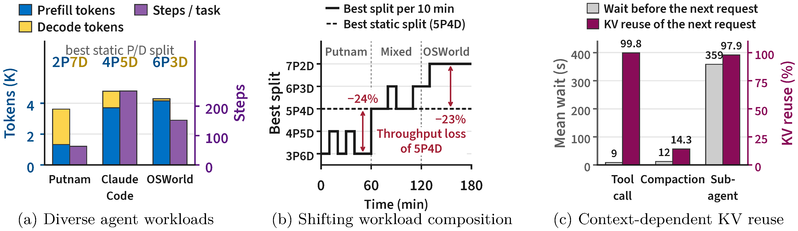
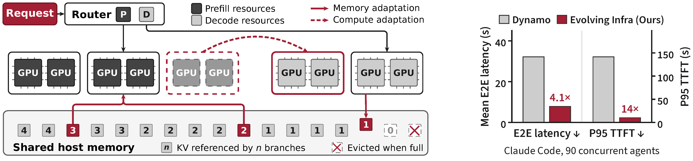
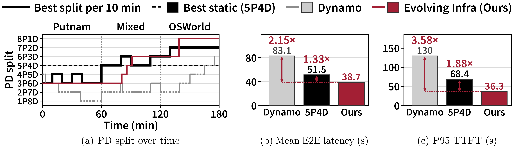

<!-- paper-reading-lang: zh-CN -->
<!-- paper-reading-mode: deep -->
<!-- paper-reading-theme: cobalt -->

# Evolving Infra：Agent 负载自适应的 LLM 服务系统（深读）

```paper-map
{"thesis":"Agent 已成 LLM 推理需求的主体，但现有 PD（prefill-decode）分离服务系统为它做得很少：阶段切换要么重启节点（Dynamo 平均 681 秒停机）要么丢 KV（Arrow 丢 55.5% 复用）；规划器靠队列深度等粗信号错估算力需求（最好静态切分也要损 24% 吞吐）；LRU 驱逐误判复用——等待工具的分支 KV 被逐、压缩替换掉的死历史被留。根因是算力分配与 KV 缓存管理耦合、三组件共享粗信号。Evolving Infra 用对称引擎（节点免重启 0.7s 换相）+ 共享宿主内存 KV 池（换相不丢 KV）解耦两者；在线学习的迭代时间模型（误差 <7%、1 分钟收敛）把 KV 复用计入 prefill 工作量；规划器只在候选切分增益超 2σ 统计门槛时切换；集群级 KV 目录按「活跃分支引用计数」驱动驱逐（压缩掉的旧历史=0 引用先逐）。编码/数学/计算机使用三类 agent、GLM-5.2 与 Kimi K2.6、36-256 张 GB300：平均 E2E 延迟最高 4.1×、P95 TTFT 最高 14× 优于 Dynamo；3072 卡仿真中分区规划再提 1.42×。","reader":"关心 agent 基础设施、LLM 推理服务系统与 KV 缓存管理的读者；动机量化、双模型推导、全部主表与规模化附录都展开手算。","goals":["看懂三个解耦设计：对称引擎/共享 KV 池/引用计数目录如何让换相成本从 681s 降到 6.2s、KV 损失从 55.5% 降到 0.3%","把迭代时间模型（roofline+MoE 路由专家分数）、2σ 切换门槛、离线画像成本账逐式手算","沿「agent 感知服务」谱系给 Dynamo/Arrow/Llumnix/ThunderAgent 定位，与本周 Flide/ERNIE Evolve 合龙"],"outcome":"通读 arXiv 2611.12304v1 全部 40 页：正文 §1-§7、附录 A（引擎与池细节）、B（模型推导含稀疏注意力）、C（测量与画像）、D（规模化：256 GPU/3072 仿真/开环/异构并行/ThunderAgent 对照）、E（伪代码）。","outcomeSource":"arXiv 2611.12304v1 PDF pp.1-40","items":[{"number":"01","label":"靶子","signal":"agent 负载三重变","text":"负载多样（Putnam 2P7D 到 OSWorld 6P3D 最佳切分跨度极大）、组成漂移（最好静态切分在部分时段损 24% 吞吐）、上下文管理改变复用（等待 359s 子代理后 98% 复用、12s 压缩后仅 14%——recency 不预测复用）。","source":"§1-2, Fig.2"},{"number":"02","label":"量化三罪","signal":"681s/55.5%/24%","text":"Dynamo 换相重启 681s 平均停机；Arrow 原地换相丢 55.5% KV 复用；两个在线规划器分别比最优静态少 49%/65% 吞吐；路由两难——cache-aware 挤爆热前缀节点（P95 TTFT 27-34s），load-aware 重算前缀（65s），加内存池反而 95s（取回阻塞 prefill）。","source":"§3, Fig.3"},{"number":"03","label":"诊断","signal":"耦合+粗信号","text":"引擎把 KV 索引在本地状态、相位启动即定 → 换相必丢 KV；规划器用队列深度/全长输入估 prefill（把已缓存前缀也算成工作）、被子代理短爆发触发抖动切换；LRU 分不清「等待工具的活分支」与「压缩替换的死历史」。","source":"§2.2, §3"},{"number":"04","label":"对称引擎","signal":"0.7s 换相","text":"扩展 SGLang 为单调度循环双相位引擎 + 任意两节点双向 KV 传输（复用 Mooncake RDMA）；路由器在运行时而非部署配置层分离 P/D——换相=路由器改派请求类型，节点免重启。","source":"§4.1"},{"number":"05","label":"共享 KV 池","signal":"换相不丢 KV","text":"全部节点宿主内存（L2）聚成共享池，两相位都写穿；prefill 节点经 RDMA 直读对端 L2（无独立存储层额外拷贝）；关键差异：请求排队期间就完成整个 KV 取回并预载入 GPU，取回延迟被排队完全掩盖。","source":"§4.2"},{"number":"06","label":"引用计数目录","signal":"分支级复用判据","text":"集群级前缀树为每块记录「活跃分支引用数」：追加只计新块、压缩升版本释放旧块计数、分支结束全释放、同相位迁移移计数、跨相位传输双侧保留——0 计数块（死历史/已结束子代理/迁移残拷贝）即无可复用 KV。","source":"§4.3, Fig.4"},{"number":"07","label":"迭代时间模型","signal":"在线拟合 <7% 误差","text":"prefill 按计算受限 roofline：T=c0+c1·t_uc+c2·A+c3·t_rst（A 为 query-key 对数，把 KV 复用从 prefill 工作量里剥离）；decode 按内存受限：T=d0+d1·φ(B)+d2·B（φ(B)=1-(1-k/E)^(t_fwd·B) 为 MoE 路由专家期望分数）；非负最小二乘纯在线拟合，1 分钟收敛。","source":"§5.1, Fig.5, 式1-4"},{"number":"08","label":"规划器","signal":"2σ 门槛防抖","text":"吞吐=min(ΣP,ΣD) 由慢相位决定；对每个候选切分算窗口内 m 切片增益，均值超 2 倍标准误（ḡ>2σ/√m）才切换——子代理短爆发改变瞬时负载但不改窗口平均工作 → 不再抖动切换。","source":"§5.2, 式5-6"},{"number":"09","label":"驱逐与路由","signal":"0 计数先逐","text":"驱逐按 (引用数>0, 最后访问时间) 升序——零计数块按 LRU 先逐，活分支 KV 只在无零计数块时才动；路由不再贴着缓存走：异步取回让 KV 移动变快，路由器把请求派给「预测 TTFT 最短」的节点（队列+取回成本都计入式 7）。","source":"§5.3"},{"number":"10","label":"主证据","signal":"4.1×/14×","text":"稳态三负载：吞吐 1.10-2.73× Dynamo、KV 复用损失降 81-95%、E2E 1.15-4.12×、P95 TTFT 最高 13.92×；换相 6.2s（含等在跑请求）对 Dynamo 754s——超 100 倍；CC 上最热 prefill 节点排队 1.75-1.85× 均值（cache-aware 为 2.29-2.61×）。","source":"§6.2, Fig.6"},{"number":"11","label":"变组成","signal":"轨迹追踪","text":"Putnam→混合→OSWorld 三小时漂移：规划器 PD 切分轨迹贴着每 10 分钟最优窗走（1P8D→8P1D）；对 Dynamo 2.15× E2E / 3.58× P95 TTFT，对最好静态切分 1.33×/1.88×，吞吐 2.14×/1.28×。","source":"§6.3, Fig.7"},{"number":"12","label":"消融与规模化","signal":"0.3% 成本","text":"初始切分不敏感（四种起点延迟差 1.8%、全收敛 4P5D）；基础设施+智能驱逐路由 alone 已 1.37× 最好静态；开自适应仅损 0.3% 吞吐——而离线画像二分要 10,752 GPU 时（=服务一遍的 14 倍）。256 卡上静态 P95 TTFT 418s 对 EI 10-14s；3072 卡仿真：静态让 2/8 分区失衡（排队 13.9× 均值），分区规划 1.42×。","source":"§6.4, App D"}]}
```

<!-- Deep Reading coverage
| Source section / object | Role | Explanation location / status |
| --- | --- | --- |
| §1 引言（agent 负载、三问题） | 立论 | §01-02 |
| §2 背景（负载多样性/上下文管理/现有系统） | 谱系 | §01, §03 |
| §3 动机量化（Fig.3 三罪） | 主证据 | §02（逐项手算） |
| §4.1 对称引擎 | 机制 | §04 |
| §4.2 共享 KV 池 | 机制 | §05 |
| §4.3 KV 目录与计数（Fig.4） | 机制 | §06 |
| §5.1 迭代时间模型（式1-4, Fig.5） | 机制 | §07（手算） |
| §5.2 在线规划器（式5-6） | 机制 | §08（手算） |
| §5.3 驱逐与路由（式7） | 机制 | §09 |
| §6.1-6.2 稳态实验（Fig.6） | 主证据 | §10（手算） |
| §6.3 变组成（Fig.7） | 主证据 | §11 |
| §6.4 消融（Fig.8） | 对照 | §12（手算） |
| App A 引擎/池实现细节 | 复现条件 | §04-05 摘要 |
| App B 模型推导（含 DSA 稀疏注意力） | 推导 | §07 摘要 |
| App C 测量细节 | 补充 | §10 摘要 |
| App D 规模化/开环/异构/对照 | 补充 | §12-13 |
| App E 伪代码 | 复现条件 | §06/§08 摘要 |
| References | 行政性材料 | 不单列 |
-->

## 深读对象

[Evolving Infra: Agent-Adaptive LLM Serving at Scale](https://arxiv.org/abs/2611.12304)（Hao Kang 等，Georgia Tech / UIUC / UC Berkeley / NVIDIA / OpenAI / MIT，韩松组等。arXiv 2611.12304v1，2026-11-09）。[点此打开原文 ↗](https://arxiv.org/abs/2611.12304)

一句话定位：把 PD 分离服务系统里「算力怎么分」和「KV 缓存怎么管」这两件被耦合了太久的事拆开，让服务集群能跟着 agent 负载的多样、漂移与上下文管理实时变形——阶段切换从 681 秒降到 6.2 秒、KV 复用损失从 55.5% 降到 0.3%、对 NVIDIA 生产框架 Dynamo 平均延迟最高 4.1 倍、P95 TTFT 最高 14 倍，而这一切纯在线完成、不需要任何离线画像。

## 总评

这篇是「agent 时代的第一个服务系统改版提案」该有的样子。它没有发明新算子或新调度算法，而是做了三件结构性的事：**对称引擎**让节点免重启换相位、**共享宿主内存 KV 池**让换相位不丢缓存、**分支引用计数目录**让「这块 KV 还有没有人要」变成一个可查询的数字而不是猜测。三个设计合起来才成立——只做对称引擎，KV 还是绑在节点上；只做共享池，取回延迟照样堵 prefill；只做计数驱逐，没有池和快取回就是空转。这种「机制互相解锁」的结构感是好系统论文的标志。

最值得学的是它的**信号哲学**。现有系统读队列深度、输入全长、访问时间——都是「集群此刻的表象」；Evolving Infra 读的是「agent 工作负载本身」：窗口平均工作 $\bar{w}$（含 KV 复用后的净 prefill 量）、分支引用计数（上下文管理事件的直接投影）。表象会被子代理爆发、长上下文这些代理侧现象污染，本体不会。规划器的 2σ 门槛、路由器的预测 TTFT、驱逐的零计数优先，全部从这两个本体信号派生——一个干净的抽象换一串正确的机制。这个「表象 vs 本体」的判据也适用于别处：MMDM 的 option-only 探针（遮掉题面测选项捷径）量的是题目本体而非表象得分，ERNIE Evolve 的方向累计收益量的是假设本体而非单步涨跌——好系统都在想办法绕过表象直接量本体。

三个基础设施的成立顺序也值得复述一遍，因为每层都是下一层的使能条件：对称引擎让换相免重启 → 才有资格谈「换相不丢 KV」；共享池让 KV 脱离节点归属 → 异步取回才有意义；取回变快 → 路由才敢只看负载；目录给出引用计数 → 驱逐才有判据、规划器的 prefill 工作量才能剥离缓存。**机制之间是链条不是清单**——抽掉中间任何一环，后面的全部失效。

与本周阅读线的合龙也顺理成章：**Flide**（第 28 篇）解决决策模型的「一状态多问题」执行效率；**ERNIE Evolve**（第 30 篇）用 RSI 优化推理引擎内部；本文解决「很多 agent 长跑」的集群层服务——三者分别对应 agent 推理需求的「单请求形态、内核实现、集群编排」三个层次。而论文自己服务的模型是 GLM-5.2 与 Kimi K2.6、对照组是 NVIDIA 的 Dynamo——从作者列表（NVIDIA、OpenAI、Berkeley、MIT）看，这条线是工业界真在疼的问题。

---

## §01 Agent 负载到底特殊在哪

论文把「agent 推理需求」拆成三个正交的变动维度，这是全文所有设计的靶子。先立一个基础事实：agent 以步为单位执行任务，每步 = 一次模型请求 + 其触发的工具调用，harness 在步间更新上下文——所以**相邻请求共享长前缀**，KV 缓存复用是 agent 服务经济的命脉；同时三个维度的变化让「怎么摆算力、怎么管缓存」没有一个一劳永逸的答案：

**负载形态多样**。Putnam 数学 agent 每请求生成长推理轨迹（decode 重），OSWorld 计算机使用 agent 每步往上下文追加一张截图（prefill 重），Claude Code（CC）介于两者之间且最爱折腾上下文。最佳 PD 切分从 2P7D 跨到 6P3D（xP yD = x 个 prefill 节点 + y 个 decode 节点）——同一集群白天跑数学、晚上跑计算机使用，最优配置完全不同。这个跨度的含义值得掂量：**一张静态部署图无论怎么画，都至少对其中一种负载错配 3 个节点以上**（9 节点集群上 2P7D 与 6P3D 相差 4 个节点的角色）。

**组成随时间漂移**。生产研究（1170 万请求）显示用户触发的任务启动遵循工作日节律、自动触发的任务全天均匀——集群负载组成天然随时间变化，离线画像出的「最佳静态切分」注定过时。论文还引了另一个生产观测佐证漂移的真实性：单一模型的平均输入长度从午夜到下午涨 13%、平均输出长度落 18%——即便负载类型不变，P/D 需求比也在日内缓缓走。

**上下文管理改写复用**。harness 会压缩历史（compaction）、分叉（fork）、起子代理（sub-agent）。压缩会把最近刚访问过的历史从后续请求里删掉；而一个分支等工具/子代理/用户 359 秒后回来，前缀复用率仍高达 98%。**访问新旧预测不了复用与否**——这是对 LRU 驱逐最致命的一击。



*Agent 负载在三个维度上变化：跨 agent（最佳切分 2P7D 至 6P3D）、跨时间（最优静态切分部分时段损 24%）、agent 内部（359 秒等待后 98% 复用对 12 秒压缩后仅 14%）。*

## §02 三重失效的量化画像

动机实验（9 节点 4×GB300、GLM-5.2、90 并发 CC 回放一小时）把现有系统的问题钉在数字上：

**换相太贵。** Dynamo 的规划器每次换相要重启该节点的 worker——平均 681 秒节点停摆；Arrow 原地换相不停机，但换过去节点的 KV 变成孤岛，整个运行丢掉 55.5% 本可达到的 KV 复用。论文给了一个干净的度量把两种代价放进同一把尺：

$$\text{lost KV reuse} = 1 - \frac{h}{h^*}, \tag{10}$$

h 为实际 KV 命中率、h\* 为「无限缓存全节点共享且无换相」的理想命中率——Dynamo 损 5.1%、Arrow 损 55.5%，一个用停机换 KV 完整、一个用 KV 换不停机，各有各的疼法。

**需求算不准。** 两个在线规划器分别比最优静态切分（4.9 req/s）低 49% 与 65%。方向还相反：Arrow 用全长输入预测 prefill 时间——把已缓存前缀也算成工作量——且对子代理齐刷刷启动的短爆发过度反应，34 次切换漂移到 8P1D；Dynamo 跟着队列深度与 KV 利用率走，被长上下文的高利用率骗到 2P7D。注意这里的讽刺：Dynamo 已经拿全集群 KV 事件建了前缀树，规划器却不用它修正自己的 prefill 工作量估计——**信息在系统里，只是没接进决策**。两个失败模式（把缓存当工作、把爆发当趋势）刚好相反，说明问题在信号本身不在调参。

**复用判不对。** 路由两难量化：cache-aware/粘性路由把同前缀请求全压到持有它的少数 prefill 节点，P95 TTFT 27-34 秒；load-aware 的 Dynamo KV 路由把请求派去没有前缀的节点重算，65 秒；给它加共享内存池，反而 95 秒——因为池要等请求开始 prefill 才把 KV 载入 GPU，取回延迟直接串行加进 prefill。这是一个三难：**贴缓存则挤、离缓存则重算、加池则取回堵 prefill**——三个方案各自修一头、坏另一头，症结在于「KV 在哪儿」和「负载在哪儿」被绑死。LRU 驱逐则在 CC 上把「等待中分支的 KV」逐掉、把「压缩替换的死历史」留下——这部分占 Dynamo KV 复用损失的 34-46%（附录 C.1 把损失分解为换相丢失与 LRU 误逐两族）。

**手算 1（换相与 KV 损失的量级）。** Dynamo 换相 681s（动机实验）/754s（主实验均值），节点完全停服；Evolving Infra 换相 6.2s（含等待在跑请求自然结束，期间节点继续服务）——纯切换 0.7s，**比例 681/0.7 ≈ 973 倍**；含等待口径 754/6.2 ≈ 122 倍。KV 复用损失：Arrow 55.5% → EI 0.3%，**降约 185 倍**；对 Dynamo 的 5.1% → 0.3% 也降 17 倍。注意量纲的第二个用途：若集群一天换相 3.6 次（Dynamo 实测均值），停摆时间 = 3.6×754s ≈ 45 分钟/天/节点——大约 5% 的集群产能被换相本身吃掉，这还不算换相后 KV 丢失带来的重算。

## §03 根因：一对耦合与一串粗信号

论文把三重失效归到两个根因。**其一，算力分配与 KV 管理耦合**：引擎把缓存 KV 索引在本地状态（如 prefill 引擎的前缀树），相位在启动时写死——换相必然「重启丢节点」或「原地里丢 KV」二选一；共享池方案要么固定分配、要么靠重启改分配。**其二，三组件（规划器/路由器/内存池）共享的信号全是表象**：请求延迟、输入全长、访问历史，没有一个直接反映 agent 负载组成或上下文管理。§4 的三个基础设施解开第一个根因，§5 的三个算法把信号换成本体。

## §04 对称引擎：换相变成改路由

Evolving Infra 扩展 SGLang 造出**对称引擎**：一个调度循环服务两个相位（而不是 SGLang 默认的 prefill/decode 各自独立调度路径、启动即定相位），配上任意两节点间双向 KV 传输协议（复用 Mooncake 的 RDMA 传输、换相后仍可用）。**换相在路由器层发生**：规划器改派某节点的请求类型，节点上在跑的请求原地跑完，然后开始接新相位的请求——不重启、不迁移、不丢任何状态。

换相的完整时序是：路由器先把该节点排队中的请求移交给同相位的其他节点 → 在跑请求原地服务至完成（节点全程不空转）→ 引擎切换调度循环的相位标签 → 开始接收新相位请求。整个过程的 0.7 秒纯切换时间里没有任何服务中断，这就是主实验里「换相 6.2s（含等在跑请求）」的构成——把「等在跑」也算进去是出于诚实（那段时间节点产能确实在衰减），但对比 Dynamo 换相期间节点完全停摆，口径差异一眼即辨。

## §05 共享宿主内存 KV 池：排队时把 KV 备好

全部节点的宿主内存（L2）聚成一个集群级 KV 池，两相位都写穿（GPU L1 → 本机 L2）；prefill 节点通过 RDMA **直读对端节点 L2**（不像 SGLang 的存储层方案还要经一个独立 store 多一跳拷贝），节点内 GPU 间去重进一步扩容。decode 节点只写不读（从宿主内存取会拖慢解码；它需要的 KV 由 prefill 节点经更快的 GPU-to-GPU 通道送来）。

关键的**异步取回**：HiCache 只在请求开始 prefill 时才把取回的 KV 逐层载入 GPU（取回串行加进 prefill——§2 那个 95 秒 TTFT 的直接原因）；Evolving Infra 在**请求还在排队时**就完成整个取回（对端 L2 → 本机 L2 → GPU → 广播到节点内各 GPU），取回延迟被排队时间完全掩盖。这一步是后面「路由器可以不看缓存位置只看预测 TTFT」的前提——KV 变得便宜可移，路由才敢去负载最短的地方。

池的两个配套细节也值得点名。**节点内去重**：同一 KV 块在节点内 4 张 GPU 上只存一份于 L2（GPU 上各留各的计算副本），宿主内存有效容量近似翻四倍——附录 A.5 的 dedup 让「L2 缓存 4 倍于 L1 的 token 数」成为可能。**decode 只写不读**：decode 迭代是访存受限的，从宿主内存拉 KV 会直接拖慢每个 token 的生成；所以 decode 节点把生成 KV 写穿进池（供本分支下一步 prefill 复用），但从不从池读——它要的前缀 KV 由 prefill 节点经 GPU-to-GPU 高速通道送来。读写的非对称设计对应两相位成本结构的非对称。

## §06 引用计数目录：复用从猜测变查询

集群级 KV 目录（前缀树）在每个节点每个 KV 块上记录**活跃分支引用计数**，计数规则精确跟随上下文管理事件（Figure 4）：

- **追加请求**（同分支下一步）：只给新增块 +1，复用块计数不变（早前步骤已计）；
- **压缩**：分支版本号 +1，被替换旧块的计数 −1（降到 0 即死）、新包含块 +1；
- **分支结束**（harness 上报）：全部分支计数释放；
- **同相位迁移**（P2P/D2D）：计数随分支搬到目标节点、源释放——分支在该相位只用目标拷贝；
- **跨相位传输**（P2D/D2P）：双侧都保留——下一步两相位都要用；
- **换相**：D→P 清零本机计数释放内存，P→D 保留以护住 KV。

结果是一个不变量：**每个活跃分支在每相位至多持有一份拷贝的计数**。零计数块 = 压缩死历史 / 已结束子代理上下文 / 同相位迁移残拷贝——精确就是「没有任何活跃分支会再用」的 KV。附录 E.1/E.2 用伪代码给出了全部计数转移规则；工程上这些规则由 harness 的两个标识符驱动（请求带的分支 ID + 上下文被重写时递增的分支版本号），目录随之在路由器维护、节点按目录下发的计数调整驱逐优先级——**上下文管理的语义被无损投影成了缓存管理的判据**，中间没有启发式。

## §07 迭代时间模型：把 KV 复用从工作量里剥离

规划器需要「一个请求净要多少 prefill/decode 算力」，论文用在线拟合的迭代时间模型回答。两模型都建立在 roofline 直觉上：kernel 要么算力受限（时间∝浮点运算量）要么带宽受限（时间∝读写字节）。

**Prefill（计算受限为主）**。chunked prefill 每次迭代处理数个请求的未缓存 token；线性层时间∝未缓存 token 数，注意力时间∝query-key 对数。因果注意力下第 i 个未缓存 token 要看 t_c 个缓存 token 加前 i 个未缓存 token，所以一个请求的注意力对数为

$$A = t_{uc}\, t_c + \frac{t_{uc}(t_{uc}+1)}{2}, \tag{8}$$

迭代时间模型为

$$T^{iter}_{P,n} = c_{n,0} + c_{n,1} \sum t_{uc} + c_{n,2} \sum A + c_{n,3} \sum t_{rst}, \tag{1}$$

四项分别是固定开销、线性层、注意力、从宿主内存恢复 token 的残余成本——**缓存 token 只出现在 A 与 t_rst 里，不再被算成 prefill 工作量**（对 Arrow 式全长估算的直接修正；附录 B.2 证明同样形式适用于滑窗/线性/稀疏注意力含 GLM-5.2 的 DSA）。

把迭代时间折算到「单个请求占用节点多久」，规划器才有决策单元。prefill 侧把固定成本按未缓存 token 比例摊给各请求：

$$T^{req}_{P,n}(w) = c_{n,0}\, \frac{t_{uc}}{\bar{t}_n} + c_{n,1}\, t_{uc} + c_{n,2}\, A + c_{n,3}\, f_n\, t_c, \tag{3}$$

decode 侧每个迭代把 B 个在跑请求各推进 t_acc 个 token，一个输出 t_out 的请求要 t_out/t_acc 个迭代、且与 B 个同伴分摊每个迭代：

$$T^{req}_{D,n}(w) = T^{iter}_{D,n}(B)\, \frac{t_{out}}{B\, t_{acc}}. \tag{4}$$

节点吞吐即 μ_{P,n} = 1/T^{req}_{P,n}、μ_{D,n} = 1/T^{req}_{D,n}（请求/秒）。

**Decode（带宽受限为主）**。每次迭代全量读稠密权重（固定项），MoE 层只读被路由到的专家。B 个在跑请求、每请求每迭代喂 t_fwd 个 token（投机解码下 >1）、每 token 选 k/E 个路由专家，则迭代读取的专家期望分数为

$$\phi(B) = 1 - \left(1 - \tfrac{k}{E}\right)^{t_{fwd} B}, \qquad T^{iter}_{D,n}(B) = d_{n,0} + d_{n,1}\,\phi(B) + d_{n,2}\, B. \tag{2, 9}$$

**手算 2（φ(B) 的弹性）。** 取 k/E = 8/256：B=1、t_fwd=1 时 φ = 1−(255/256)⁸ ≈ **3.08%**（单请求只激活极少数专家）；B=64 时 φ = 1−(255/256)⁵¹² ≈ **86.5%**（64 个请求几乎读满全部路由专家）。d₁ 项（读全部专家权重的成本）随批从几乎不出场变成主导——这解释了为什么 decode 吞吐对批大小如此敏感、也说明「B≥8 后上下文长度只改迭代时间 2-7%」从而模型敢省略该项。

**手算 3（A 的量级）。** 8K 未缓存 + 128K 缓存前缀：A = 8192×131072 + 8192×8193/2 ≈ 1.074×10⁹ + 3.36×10⁷ ≈ **1.107×10⁹ 对**。若误按全长估算（136K token 全算 prefill），线性项与注意力项双双虚高——Arrow 类规划器把 128K 可复用前缀当成 128K 新工作，prefill 需求直接翻十几倍。

**拟合**：暖机期各节点以共存模式两相位都跑，按固定窗口记录工作完成量、非负最小二乘拟合、冻结系数；之后只周期性重测两个随组成变化的量（每迭代平均新 token 数、宿主恢复比例）。拟合 20 个单请求设定 + 10 个 decode 点，**1 分钟内收敛到低误差，拟合设定外平均误差 4.2%-6.3%**（prefill 单请求/批）、2.6%（decode）。这套「暖机共存 → 冻结物理系数 → 在线只追两个慢变量」的方案有两处巧思：非负约束天然排除物理上无意义的负系数（拟合对小样本噪声鲁棒）；冻结的是**模型+硬件+并行度**的函数，换任何一样才需重拟——负载变化永远不触发重拟。对照 ERNIE Evolve 用五模型筛选守护数据质量、MMDM 用 option-only 探针守护题目质量，这里用物理形式（roofline）守护模型质量——三家都在用「结构先验」替代「更多数据」。

## §08 规划器：统计门槛挡住抖动

每个规划窗口（T_win=600s、m=10 切片）结束时，规划器用模型评估所有候选切分的预测吞吐。请求要过两相位，**慢相位决定集群吞吐**：

$$\Theta(P, D; \bar{w}, \bar{q}) = \min\Big( \sum_{n \in P} \mu_{P,n},\ \sum_{n \in D} \mu_{D,n} \Big), \tag{5}$$

其中 μ 由式 (3)(4) 按**窗口平均工作** $\bar{w}$ 评估——$\bar{w}$ 刻画负载本体，子代理短爆发改瞬时排队不改它。候选 (P′,D′) 在切片 i 的增益与统计门槛为

$$g_i = \Theta(P', D'; \bar{w}_i, \bar{q}_i) - \Theta(P, D; \bar{w}_i, \bar{q}_i), \qquad \bar{g} > \frac{2\,\sigma_g}{\sqrt{m}}, \tag{6}$$

**仅当均值超过 2 倍标准误才切换**，且切到 ḡ 最大者。

**手算 4（2σ 门槛的作用）。** 设某候选真实增益为 0，但 m=10 个切片因随机波动测得 ḡ=0.02 req/s、σ_g=0.03。门槛 = 2×0.03/√10 ≈ 0.019——ḡ=0.02 恰好压线，真零增益的候选有约 5% 概率过线（正态近似下单侧 2σ）；再设子代理爆发让 2 个切片虚高 0.15，则 ḡ=(8×0+2×0.15)/10=0.03、σ≈0.066，门槛 2×0.066/3.16≈0.042 > 0.03——**爆发被均值稀释且被方差门槛拦下**（虚高同时抬大了 σ，门槛水涨船高，这是该设计最漂亮的自适应之处）。对照实验：Arrow 34 次切换漂到 8P1D，Evolving Infra 平均每运行 2.0 次切换。

**手算 5（离线画像的天价账）。** 离线搜索的一般成本公式：

$$\text{cost}_{\text{binary}} = O(N g T \log N), \qquad \text{cost}_{\text{exhaustive}} = O(N^2 g T), \tag{12}$$

N=64 节点、每节点 g=4 卡、trace 长 T=3h、暖机 T_w=0.5h：每个候选切分评估成本 = (3+0.5)×256 = 896 GPU 时；二分 12 次 = **10,752 GPU 时**，是服务一遍 trace（768 GPU 时）的 14 倍；穷举 63 次 = 56,448 GPU 时。且二分假设吞吐单峰——实测 P/D 从 0.78 到 1.00 又回升，二分可能停在局部最优，可靠搜索退化为穷举；相邻切分只差 3%（与跑间波动同量级），每个候选还得重复跑。而 Evolving Infra 在窗口末用模型在 CPU 上评估全部 N−1 个候选，O(Nm) 次算术、**零额外 GPU 时间**。

## §09 驱逐与路由：零计数先走，TTFT 最短者得

**驱逐序**：按键 (引用数>0, 最后访问时间) 升序——零计数块按 LRU 先逐尽，活分支块（哪怕等工具很久）只在无零计数块时才被动。形式化地，节点按

$$\big(\, \mathbb{1}[R_b > 0],\ T_b \,\big) \tag{11}$$

的字典序升序驱逐（R_b 为块 b 在本节点的引用数、T_b 为最后访问时间）——第一键把「死活」放在「新旧」之前，LRU 的「等工具=旧=逐」与「刚压缩=新=留」两个错误同时纠正。

**路由**：异步取回让「把 KV 搬到请求处」变得便宜，路由器因此敢把请求派给**预测 TTFT 最短**的 prefill 节点而非持有其前缀的节点：

$$\hat{T}_n(w) = T^{rem}_n + \sum_{j \in Q_n} T^{req}_{P,n}(w_j) + T^{req}_{P,n}(w), \tag{7}$$

三项 = 在跑批剩余时间 + 队列中各请求服务时间（式 3）+ 本请求服务时间，附录 E.3 还把「取回超出等待的残余部分」与「取回产生的重复拷贝」计价进去。效果（CC）：最热 prefill 节点排队时长降到均值的 1.75-1.85×（cache-aware 为 2.29-2.61×），P95 TTFT 降 3.25-13.92×。

## §10 稳态主实验：三负载全面占优

三负载（Putnam 数学 224/256/288 并发、CC 编码 90/108/126、OSWorld 计算机使用 128/144/160；GLM-5.2 服务前两者、Kimi K2.6 服务第三者；NVFP4 量化 + FP8 KV + MTP 投机解码、TP4、9 节点 36 张 GB300）对 Dynamo v1.5.1：

- **吞吐 1.10-2.73×**；最低并发下也达最优静态切分的 0.98-1.38×（纯在线、无离线画像）；
- **KV 复用损失降 81-95%**（如 CC 最低并发 5.13%→0.32%、OSWorld 4.00%→0.21%）；Dynamo 无缓存 prefill 的 token 比例最高是 EI 的 2.99×；
- **平均 E2E 延迟 1.15-4.12×**（CC 最大 4.12×：54.4s→13.2s；OSWorld 2.69×：84.4s→31.4s；Putnam 1.23×）；**P95 TTFT 最高 13.92×**（CC 最高并发 142s→10.2s）、OSWorld 4.59×（163s→35.5s）；
- **换相 6.2s 对 754s**（九设定平均，含等待在跑请求自然结束的 5-10s；纯切换 0.7s）；Putnam 上规划器只留 1-2 个 prefill 节点保吞吐、以 P95 TTFT 换均值——论文如实标注这个 trade-off，且这是 decode 重负载下「让慢相位吃满」的合理选择；
- 规划器行为本身也可检验：平均每运行只切 **2.0 次**（Dynamo 3.6 次且 41-100% 的时间偏离该负载最优切分），且在 CC 上自动选 3P6D-4P5D、在 OSWorld 上选 8P1D——与两类负载的 prefill/decode 构成一致。

读 Figure 6 的正确姿势是横向对比三行：KV 复用损失（顶行）与延迟（中/底行）的改善幅度**不同步**——Putnam 复用损失降 93% 但延迟只 1.15×，因为单分支无上下文管理的负载本来就没什么可丢；CC 复用损失降得最少（0.32% 绝对值已极低）但延迟改善最大，因为它的收益来自换相快+路由均载。**收益结构与负载形态对应**，这是评估此类系统时最该带的视角。



*系统总览与对 Dynamo 的加速：Claude Code 90 并发下平均 E2E 延迟 4.1×、P95 TTFT 14×。*

## §11 变组成：切分轨迹贴着最优窗走

三小时 Putnam(288) → 混合(144+72) → OSWorld(144) 漂移实验（Kimi K2.6）：Evolving Infra 的 PD 切分轨迹跟着每 10 分钟最优窗从 1P8D 一路走到 8P1D，与 SGLang 画像出的最优窗基本贴合（OSWorld 段稳定在 8P1D，比 SGLang 最优多一个 prefill——对称引擎本身会平移最佳点）；Dynamo 的规划器大部分时间偏少 prefill 节点，且图中能看到其换相期间（虚线段）只有 8 个节点在服务。整段对 Dynamo E2E 2.15×/P95 TTFT 3.58×、对最好静态 1.33×/1.88×，吞吐 2.14×/1.28×，**每个时段都拿到最高吞吐**。

这个实验的设计本身值得抄：三段负载的选择让「最优切分」在整条时间轴上单调漂移（decode 重 → prefill 重），中间夹一段混合作为过渡带——静态切分在混合段短暂最优、在两端各输一头的形态一目了然；把它与 Figure 2b 的「每 10 分钟最优窗」叠画，在线规划器的追踪质量可以用肉眼检验，不需要额外指标。做系统评测时「让基线在时间轴上轮流占优」比「找一个基线全程赢的负载」诚实得多也更有说服力。



*负载组成从数学漂向计算机使用：PD 切分在线追踪每 10 分钟最优窗（1P8D→8P1D），延迟全程压过 Dynamo 与最好静态切分。*

## §12 消融：每个部件值多少

**初始切分不敏感**：四种起点（3P6D 至 6P3D）最终 E2E 延迟差 ≤1.8%，全部收敛 4P5D——在线自适应不挑起点。**组件贡献**：仅基础设施（对称引擎+池）+ 智能驱逐路由、不做在线切分，已在 4P5D 上达最优静态的 1.37×；其中异步取回 alone 对上游 SGLang 1.12×（prefill 节点空闲时间 23.6%→14.4%）。**自适应的净成本**：在已是最好的静态切分上开自适应只损 0.3% 吞吐。**对照 ThunderAgent**（暂停等工具的 agent 来保 KV）：0.95× 无增益——GB300 节点上 KV 容量不是瓶颈，暂停只损吞吐；「让 agent 等」与「让系统懂 agent」是两条路线的分野，后者赢在不对上层作业做任何牺牲。把组件贡献拆开排序：异步取回（1.12×，改时序）→ 池+对称引擎+智能驱逐路由（合计 1.37×，改结构）→ 在线切分自适应（再 +0.3% 成本换跨负载通用性）——**时序修正的性价比最高、结构改造的收益最大、自适应买的其实是鲁棒性**。

## §13 规模化：失衡从集群层转入分区层

附录 D.2 把实验推到 256 卡与 3,072 卡仿真（CC trace、每卡 10 agent）。**静态切分的吞吐敏感度随规模降低**（256 卡上 P/D 从 0.33 到 1.29 都保有 24P40D 的 81-103% 吞吐——多 agent 的聚合需求自我平滑），**但节点间失衡暴涨**：静态 P95 TTFT 从 36 卡 142s 涨到 256 卡 418s（约 3×）——节点越多，cache-aware 路由把请求压到越多的「前缀持有节点」上。Evolving Infra 靠异步取回+TTFT 路由把负载摊平：P95 TTFT 稳定 10-14s，均值 E2E 只涨 16%。3,072 卡仿真（8 个 384 卡分区各配路由/规划/目录）：集群聚合 P/D 只波动 7%，但静态切分让 2/8 分区严重失衡（排队高达均值 13.9×）——失衡期间分区总工作量变化 <12.3% 而 P/D 漂移达 42.4%，**问题不在量在构型**；各分区规划器跟住本地漂移，吞吐再提 1.42×。

附录 D 的另外三块补齐可信度。**D.3 开环到达**：按固定速率放 agent 而非闭环补位——Evolving Infra 能撑住的到达率是最好静态切分的 **2 倍**（agent 来得越快规划器给 prefill 越多节点）。**D.4 异构并行**：prefill 用 TP4、decode 用 TP8 等不同并行度时，模型按节点分别拟合、切换依然快——对称引擎不要求两相位同构。**D.6 异步取回的机制账**：仅把 HiCache 的「prefill 开始才载入」改成「排队期间载入」，prefill 节点空闲时间从 23.6% 降到 14.4%——一个时序调整值 1.12× 吞吐，是全部组件里性价比最高的一处改动。

## §14 与本周阅读线的合龙：agent 推理栈三层齐了

把本周四篇叠起来，agent 推理基础设施的三个层次各有一篇代表作：**请求形态层**——Flide 把决策模型「一状态多问题」压进一次前向（单请求内的树）；**内核实现层**——ERNIE Evolve 用双层 RSI 在生产推理仓库里挖出 623.6%（引擎内部怎么变快）；**集群编排层**——本文让「成百上千个 agent 长跑」的服务集群随负载变形（多租户多负载怎么摆）。三者互为上下文：Flide 假设的「一状态多问题」在真实集群里就是本文目录里的「同分支连续请求」；ERNIE Evolve 优化的 DeepEP/调度开关正是本文对称引擎这类系统的原料；而本文的三负载（Putnam/CC/OSWorld）就是上周 MMDM 评测的那些 agent 在生产里的影子。

方法谱系上，本文与 Llumnix/xLLM/Arrow 一系「动态 PD 规划」的区别不在「要不要动」而在「凭什么动」——把凭据从排队表象换成负载本体（$\bar{w}$+引用计数），是这篇文章最可迁移的洞见：**任何要随负载自适应的系统，先问你的信号是表象还是本体**。

对做 agent 平台的读者还有一个直接可摘的构件：**分支引用计数协议**（harness 上报分支 ID 与重写事件、服务端维护版本与计数）几乎可以原样搬进任何自建 agent 网关——它同时解决了缓存驱逐判据与 prefill 工作量估计两个问题，而且不依赖本文的任何基础设施。如果你的平台在 vLLM/SGLang 前面已有自研路由层，这个协议是成本最低、收益最直接的一块移植件。

## §15 批判与边界

五条边界。**其一，依赖 harness 配合**。分支 ID 上报、压缩/结束事件上报——这套协议需要 harness 侧支持（论文用 Trie 回放器保证 CC trace 带全这些信号）；不上报的 harness 只能退回表象信号，收益打折。真实生态里 harness 五花八门（论文自己引的 11.7M 请求生产研究就是另一套 harness 语义），协议采纳率是落地的第一变量。**其二，单路由器的扩展天花板**。3,072 卡已要 8 分区各自路由；更大规模或跨分区负载不均时，分区间的再平衡是未答题。**其三，基线条件不齐**。Llumnix 因 Arm CPU 跑不了、SGLang 运行时换相因拒绝投机解码被排除——两个最接近的对手都以环境/功能理由缺席主表（附录 A.1 在 H200 补了 Llumnix）。**其四，专用硬件耦合**。GB300 + NVFP4 + MTP + Mooncake RDMA 的组合离通用部署有距离；对称引擎的 KV 传输协议复用 Mooncake，但换互联（如 NVLink-domain 外）成本未讨论。**其五，稳态收益分布不均**。Putnam 只 1.15-1.23× 且 P95 TTFT 有所牺牲；最大收益集中在上下文管理最活跃的 CC——**负载越「agent」收益越大**这个规律本身诚实，但也意味着收益上限取决于工作负载形态。此外实验全部用回放（Trie 固定输出长度与工具时长），真实 agent 的输出随系统延迟变化会反过来改变负载（快了就多跑几步）——这种闭环效应在回放里天然缺席。

## §16 paper-check 自测

**Q1（概念）**：为什么「访问新旧」预测不了 agent KV 的复用，而「分支引用计数」可以？
**A1**：复用由上下文管理决定而非时间：压缩会立刻杀死刚访问过的历史（引用数随版本升级归零），分支等工具 359 秒回来前缀仍 98% 复用（计数一直为正）。LRU 只看事件间隙的表象，引用计数直接跟踪「这块 KV 还在不在某活跃分支的上下文里」的本体。同分支等工具、异分支同前缀、压缩后残留——三种情形在 LRU 眼里都是「最近没用」，在计数体系里分别是「保留」「可共享」「先逐」。

**Q2（计算）**：φ(B)：k/E=8/256，t_fwd=1。B=1、16、64 各多少？说明什么？
**A2**：φ(1)=1−(255/256)⁸≈3.08%；φ(16)=1−(255/256)¹⁶≈6.07%；φ(64)=1−(255/256)⁶⁴≈22.2%（若 t_fwd=8：φ(64)=1−(255/256)⁵¹²≈86.5%）。MoE 专家读取随批超线性逼近全量——decode 迭代的 d₁ 项从可忽略变主导，批大小是 decode 吞吐的第一杠杆。

**Q3（改输入）**：请求 t_uc=4K、t_c=132K。A 是多少？若被全长（136K）误算成 prefill，工作量虚高多少倍（只看注意力项）？
**A3**：A = 4096×135168 + 4096×4097/2 ≈ 5.53×10⁸ + 8.39×10⁶ ≈ 5.62×10⁸ 对。全长误算：136K 全未缓存时 A′=136192×136193/2≈9.28×10⁹——**虚高约 16.5 倍**。Arrow 类全长估算法在重 KV 复用的 agent 负载上系统性高估 prefill 需求。

**Q4（机制）**：换相时 KV 为什么不丢？D→P 与 P→D 的计数处理为何不同？
**A4**：KV 住共享宿主池、目录集群可见，节点换相只改路由器派给它的请求类型，池与目录不动。D→P 清零本机计数（decode 产生的 KV 若无 P 侧需求可释放）；P→D 保留计数护住 KV——下一步分支回来做 prefill 还要用。

**Q5（数据）**：256 卡上静态切分吞吐敏感度下降但 P95 TTFT 涨 3 倍，矛盾吗？
**A5**：不矛盾。吞吐看集群聚合——多 agent 需求互相平滑，P/D 比在 0.33-1.29 都保 81-103%；TTFT 看单请求——节点越多，cache-aware 路由把同前缀请求压向越多的前缀持有节点，单点排队恶化（142s→418s）。聚合健康与尾延迟恶化并存，正是「表象平稳、内部失衡」的规模版；3,072 卡仿真进一步把失衡下沉到分区层（2/8 分区排队 13.9× 而总量只变 12%），修法也随之从全局切分变成分区级规划。

**Q6（应用）**：你的集群 32 节点跑混合 agent 负载、每天组成两班倒。离线画像每切分评估要 64 GPU 时、二分 5 次。画像一次多少钱？本文方案多少钱？
**A6**：5×64=320 GPU 时/次，负载一变就得重跑（两班倒=每天两次）。Evolving Infra：窗口末用模型评估全部 31 个候选，CPU 算术 O(Nm)、零 GPU 时间、1 分钟在线拟合——画像成本从「每天几百 GPU 时」变「零」。这就是 10,752 对 0 的具体形状。

---

## 溯源披露

- 原文：arXiv:2611.12304v1 [cs.DC]，2026-11-09 提交，40 页（正文 14 页 + 附录 A-E 至第 40 页，含 E.1-E.3 伪代码）。
- 本地 PDF SHA-256：`0079220bd8460e160d0bcc258ae1b32813f601d37dd039251e392aa5347381ad`（1,380,227 字节，双栏 A4 版式；三负载 Putnam/CC/OSWorld 分别对应数学、编码、计算机使用三类 agent）。
- 深读覆盖正文 §1-§7 全部与附录 A（引擎/池实现，含节点内去重与 L2 直读论证）、B（模型推导含稀疏注意力与 MoE 专家分数）、C（测量细节 C.1-C.4，含 KV 损失分解与规划器行为）、D（规模化 256/3072 卡、开环、异构并行、ThunderAgent 对照 D.1-D.6）、E（计数与规划伪代码 E.1-E.3）全部；三张配图（Fig 1 总览 / Fig 2 动机三联 / Fig 7 变组成）600 DPI 提取。
- 引用关系注记：本文对照组 Dynamo 为 NVIDIA 生产框架（作者含 NVIDIA 与 OpenAI 研究者）；与本周深读 Flide（2610.42148，第 28 篇，请求形态层）、ERNIE Evolve（第 30 篇，内核实现层）构成 agent 推理栈三层；负载源 PutnamBench/OSWorld/Claude Code traces 与 MMDM（第 29 篇）评测的 agent 生态同源。本文为仓库第 31 篇深读。
- 利益相关声明：与论文作者无合作或竞争关系；深读中的数值复算若有误，以原文表格为准。