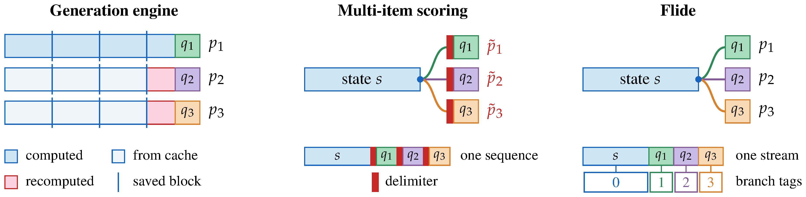
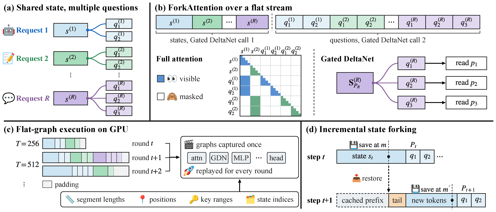
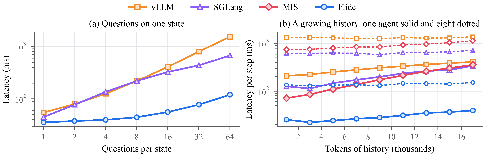

<!-- paper-reading-lang: zh-CN -->
<!-- paper-reading-theme: cobalt -->
<!-- paper-reading-mode: deep -->

# Flide：用精确状态分叉加速决策推断（深读）

```paper-map
{"thesis":"决策模型（读长上下文、输出离散选项分布）是 agent 高频微决策的专用件，但 vLLM/SGLang 为文本生成设计：每问题独立序列反复算共享状态（混合架构上缓存只能在块边界恢复 GDN 状态），multi-item scoring 拼接加分隔符则污染概率分布（实测翻转最多 29% 的阈值决策）。根因是请求的逻辑树与物理执行流被绑死。Flide 把一整轮请求摊平成一条 token 流、树结构住进 GPU 元数据：ForkAttention 用可见性下标隔离兄弟问题、GDN 层两次调用让每个问题从躯干末状态重启递推，精确算术下与单独提问逐位一致（Proposition 1）；CUDA 图族形状只依赖流长，任意负载组合零重编译。最快 9.5 倍于 vLLM/SGLang，答案与 float32 参考一致率最高，可选位级确定模式代价 ≤10%。","reader":"关心 agent 基础设施、推理引擎与决策模型服务的读者；机制证明、全部主表与附录 A-H 都展开手算。","goals":["看懂 ForkAttention 两层分叉：注意力 mask 可见性下标 + GDN 两次调用状态重启（不拷贝、只索引）","把成本比 ρ、9.5 倍加速、0.88ms/千 token 步进斜率逐格手算","分清快的三种来源：状态只算一遍 / CUDA 图消启动 / 一遍前向跑完整个请求"],"outcome":"通读 arXiv 2610.42148v1 全部 20 页：正文 §1-§5、附录 A-H（证明、引擎配置、负载构造、全量结果、深入分析、复发状态、正确性测试、29 个支持模型表）。","outcomeSource":"arXiv 2610.42148v1 PDF pp.1-20","items":[{"number":"01","label":"靶子","signal":"三重失配","text":"生成引擎把每个问题当独立 prompt 反复算状态（混合架构块边界坑）；MIS 拼接分隔符改变隐藏状态扭曲分布；动态批浮点归约顺序漂移致决策不稳定。","source":"§1, Fig.1"},{"number":"02","label":"诊断","signal":"逻辑树≠物理流","text":"状态是躯干、问题是枝条；生成引擎把逻辑结构强加给物理序列（慢），MIS 把物理结构强加给逻辑树（不准）——目标是分支一起跑且各算各的。","source":"§1"},{"number":"03","label":"形式化","signal":"成本比 ρ","text":"朴素成本 Q·Ls+Σ|q| 对 Flide 的 Ls+Σ|q|；QuALITY,all 负载理论比 14.4 倍——问题越密状态越长，结构性收益越大。","source":"§3.1, Table 2"},{"number":"04","label":"注意力分叉","signal":"可见性下标","text":"查询可见 = 同请求 ∧（躯干∨本问题）∧ 因果——键集合与独立序列逐元素一致；滑窗层因位置一致而同样成立。","source":"§3.2.1"},{"number":"05","label":"GDN 分叉","signal":"两次调用","text":"GDN 把此前 token 折叠进单一循环状态、mask 挡不住兄弟污染；拆两次调用：先算所有状态段存末状态，问题段通过状态索引从各自 S_Ls 起步——零拷贝。","source":"§3.2.2"},{"number":"06","label":"精确性","signal":"Proposition 1","text":"逐层归纳证明：点式层 token 独立、注意力可见集一致、GDN 从正确状态续推——任何扁平排版下每个问题等于单独计算；附录 G 测试梯队每次引擎改动都过。","source":"§3.2.3, App A/G"},{"number":"07","label":"扁平图执行","signal":"形状只看流长","text":"段长/位置/键范围/状态索引全住 GPU 缓冲区，kernel 形状只由流长决定——同一族捕获图吃任意请求组合；选择性读出让末层只算问题末 token。","source":"§3.3"},{"number":"08","label":"增量分叉","signal":"0.88ms/千token","text":"状态内部位置 m 打检查点（GDN float32 状态+卷积窗+注意力 KV），agent 下一步从检查点恢复只算新 token；与答题同遍前向完成。","source":"§3.4, Table 7"},{"number":"09","label":"位级确定","signal":"≤10% 代价","text":"固定归约顺序+每问题独立 tile/chunk，任何负载下答案位级不变；对比 SGLang 批不变 kernel 损失 34%。","source":"§3.5, Table 12, App E"},{"number":"10","label":"主证据","signal":"9.5×且最准","text":"多问题负载全尺寸全并发领先（QuALITY,all 362→37.7ms）；Agr 与 float32 参考每个负载最高、Stab 100%；消融四部件各砍一刀各讲一个成本故事。","source":"§4.2-4.4, Tables 3-5"},{"number":"11","label":"生态","signal":"29 个模型","text":"通用树引擎跑赢专用 vllm-jev（约 3 倍）；Table 18 列 29 个决策模型含 Drex v1.5（2.95-7.44 倍）——决策模型四层拼图（训练/判断/执行/服务）合龙。","source":"Table 6/18, App H"}]}
```

<!-- Deep Reading coverage
| Source section / object | Role | Explanation location / status |
| --- | --- | --- |
| §1 引言（三重失配、根因诊断） | 立论 | §01-03 |
| §3.1 问题形式化（式 1-2、成本账） | 协议 | §04（手算 1） |
| §3.2 ForkAttention（注意力/GDN/精确性） | 机制 | §05-07（手算 2-3） |
| §3.3 扁平图执行（元数据/图族/读出） | 机制 | §08-09 |
| §3.4 增量状态分叉（检查点） | 机制 | §10（手算 4） |
| §3.5 位级确定性 | 性质 | §11 |
| §4.1 实验设置（负载/基线/指标） | 协议 | §12 |
| §4.2 主结果（Table 3, Fig.3/5） | 主证据 | §13-14（手算+逐格） |
| §4.3 答案保真（Table 4/11, Fig.4） | 主证据 | §15（手算 5） |
| §4.4 消融与专用模型（Table 5/6） | 对照 | §16-17（手算 6） |
| App E 深入分析（Table 9-17） | 补充 | §18-19 |
| App A 证明 / B 配置 / C 负载 / D 全量 / F 复发 / G 正确性 / H 模型表 | 复现条件 | §07/§12/§17-19 |
| References | 行政性材料 | 不单列 |
-->

## 深读对象

[Flide: Accelerating Decision Inference with Exact State Forking](https://arxiv.org/abs/2610.42148)（Bobo Li、Jiajia Song、Wynnie Hsu、Mong Li Lee，新加坡国立大学；Hao Fei，牛津大学。arXiv 2610.42148v1，2026-10-30）。[点此打开原文 ↗](https://arxiv.org/abs/2610.42148)

一句话定位：为决策模型（decision model）量身打造的推理引擎——把一个请求「共享状态 + 多个问题」的逻辑树，压进一条扁平 token 流里一次算完，用 ForkAttention 保证每个问题的输出与单独提问时**逐位可证地一致**，同时把延迟压到 vLLM/SGLang 的 1/9.5。

## 总评

这篇论文处理的是 LLM agent 技术栈里一个正在成型的裂缝：决策模型（Jev、Open-Jev、StartLux 等）以「读长上下文、输出离散选项的概率分布」为工作形态，是路由、响应评估、agent 下一步选择这类高频微决策的专用件；但 vLLM 和 SGLang 这一代推理引擎是**为文本生成设计的**——它们的基本工作单元是单条线性序列，于是要么把每个问题当独立 prompt 反复计算共享上下文（慢，混合架构上前缀缓存只能在块边界恢复循环状态），要么把所有问题拼进一条序列加分隔符（快，但分隔符 token 进入每个问题的输入，污染概率分布）。作者把这两种失败的根因统一诊断为「请求的逻辑结构与物理执行的耦合」，然后给出一个同时解决效率与精确性的引擎。

最打动我的是这篇论文的**证明意识**。系统论文常见做法是给近似正确性一个直觉论证，而这里给了 Proposition 1 的逐层归纳证明（精确算术下每个问题算出的隐藏状态与单独前向完全一致，附录 A），配一套浮点层面的验证梯队（内核级对 PyTorch 参考、前向级对 float64、每次引擎改动都要过）。「快」在推理引擎论文里不稀奇，「快且与 float32 参考的逐答案一致率最高、可选模式下位级确定」才是这篇的护城河——因为决策模型的下游是**带阈值动作**（概率过 0.5 就执行），1% 的概率漂移在阈值附近就是翻转。

与本周阅读线的连接尤其紧密：附录 Table 18 列出 Flide 支持的 29 个决策模型，其中就有上周深读的 Drex v1.5（9B，Qwen3.5 底座）——Flide 服务它比原厂 transformers 引擎快 2.95-7.44 倍。上周的图景是「决策模型便宜但不快」，这一篇补上服务层：**便宜 × 快 × 精确**三件套在 agent 基础设施层合龙。

---

## §01 背景：决策模型与 System One 工作负载

论文开篇把决策模型放进 LLM agent 系统的实际位置：路由请求、评估响应、决定 agent 下一步。这些任务有三个共同特征——上下文长（一段对话或一条 agent 轨迹）、输出是**离散选择上的分布**而非自由文本、每个被路由的请求和每个 agent 动作都要过一遍。生成 token 来做分类选择既浪费算力又增加延迟，于是 Jev 与各专用决策模型出现：读完整上下文，对每个问题输出选项上的概率分布，由严格阈值直接消费这些概率。

这种负载对引擎的要求可以概括为一句话：**又快又准**。快是因为它部署在每个请求的必经之路上；准是因为阈值动作对概率漂移零容忍。论文引用的 Decision Index 是这类模型的能力基准，而本文的全部实验负载里都包含它的采样。

值得强调的是作者对工作负载形态的刻画，这直接决定了后面的设计：一个决策请求 $r = (s, q_1, \ldots, q_Q)$ 由一个 $L_s$ token 的状态和 $Q$ 个问题组成，每个问题 $q_j$ 有 $|q_j|$ 个 token。**状态是共享的躯干，问题是分叉的枝条**——这个树形逻辑结构是负载的本相，也是后面一切设计的出发点。

## §02 现有引擎的三重失配

论文用 Figure 1 把三种执行方式摆在一起：同一请求（状态 + 三个问题）分别交给生成引擎、multi-item scoring 和 Flide。这张图值得细读，因为它把「快」与「准」的两难画成了一条物理序列的排版问题。



*同一请求、三个问题、三种执行方式的对照。红条是分隔符 token，波浪号标记可能因此改变的答案。*

**第一重：独立序列的重复计算。** vLLM 与 SGLang 的决策端点把每个问题当独立 prompt：渲染、分词、调度各来一遍，共享上下文被计算 $Q$ 次。最新的 vLLM 已经支持先把请求的共享上下文算一遍再答问题，但每个问题仍以自己的序列从前缀缓存恢复——而混合架构（Qwen3.5、Gemma 4 这类在多数层用 Gated DeltaNet 的模型）上，缓存只能在**块边界**恢复循环状态，每个问题、每个 agent 步骤都要把最后一条边界之后的 token 重算一遍。块边界这个坑值得多解释一句：注意力层的缓存键值可以按 token 粒度恢复，GDN 的循环状态却只在分块处理时于块间落盘，前缀若不在边界上，恢复就得回退到上一条边界重算尾巴——问题越短、问题越多，这个尾巴占的比例就越大，等于把缓存的好处按比例吐回去。

**第二重：multi-item scoring 的分隔符污染。** SGLang 的 MIS（multi-item scoring）走另一条路：把所有问题拼进一条上下文，每个问题前插一个分隔符 token。它确实只算一遍状态，但每个问题的输入里**多了这个分隔符**——它改变隐藏状态，进而扭曲输出概率，与单独提问的结果不可比。这不是工程瑕疵而是原理性的：输入变了，函数值当然变。污染的传导路径在混合模型上格外直接：分隔符 token 先被短因果卷积混进问题开头几个 token 的表示，再经 GDN 的递推写进整个问题段的状态，最后在输出头的 logits 上留痕——一个 token 的修改沿两层机制放大到整段输出分布。论文后面用数据说话：MIS 的答案与 float32 参考的总变差距离是 Flide 的约 12 倍，最多翻转 29% 的分类决策。另有一层工程代价：MIS 的 GDN 分支元数据在 CPU 上构建、CUDA 图必须关闭，吞吐优势也被抵消。

**第三重：动态批次的数值漂移。** 即使前两重都不考虑，动态 batching 下浮点求和的顺序随批组成变化，同一请求在不同服务器负载下可能得到不同决策。对一个阈值直接作用于概率的系统，这意味着「白天高峰与凌晨低峰的路由决策不一致」——这是可靠性问题，不只是性能问题。

## §03 根因诊断：逻辑树与物理流的耦合

论文的贡献之一是把上面三重失败追溯到**同一个根因**：决策请求的逻辑结构（树）与物理执行结构（线性序列）被绑死了。生成引擎把逻辑结构强加给物理结构——每个问题一条序列，于是躯干被复制 $Q$ 份；MIS 把物理结构强加给逻辑结构——树被写进序列本身，分隔符进入每个分支的输入。两种绑法各修一头、坏另一头。

正确的目标形态是：**分支一起跑（快），但每个分支算的还是它单独跑时会算的东西（准）**。物理流必须把并排摆放的分支在计算上隔离开。全注意力层可以用 mask 隔离，但 Gated DeltaNet 层没有 attention matrix 可 mask——它把之前所有 token 折叠进一个固定大小的循环状态 $S$，同一序列里的两个问题会通过这个状态互相污染。所以真正的难点在混合架构：**让每个分支在计算躯干的那一遍 pass 内部，从躯干末尾的精确状态重启**。

这个诊断的价值超出本文：任何「共享前缀 + 多查询」的负载（路由、重排序、多问阅读理解、agent 步进）都踩同一个坑。

## §04 问题形式化与成本账

先把论文的形式化写清楚，因为后面的成本分析和实验解读都挂在它上面。决策模型对问题 $q_j$ 的每个选项 $o$ 输出

$$P_j(o) = \frac{\exp(o^\top h_j)}{\sum_{o' \in O_j} \exp(o'^\top h_j)}, \tag{1}$$

其中 $h_j$ 是模型处理 $s \oplus q_j$（状态拼接该问题）时最后一个 token 的最终隐藏状态，$o$ 是输出头里该选项对应的行——chat 模型里是标签 token，决策模型里是训练好的槽位。精确算术下 $P_j(o)$ 只依赖 $s$ 和 $q_j$，与同轮其他问题、其他请求无关。**这句话就是全文要守住的不变量。**

朴素做法（每问题独立序列）的 token 计算量是 $Q \cdot (L_s + |q_j|)$ 量级，共享状态被重复评估 $Q$ 次；理想做法是状态与每个问题各算一次：

$$C_{\text{naive}} = \sum_{j=1}^{Q} \left( L_s + |q_j| \right), \qquad C_{\text{Flide}} = L_s + \sum_{j=1}^{Q} |q_j|. \tag{2}$$

把两个成本的比值定义为负载的**分叉密度**：

$$\rho \;=\; \frac{C_{\text{naive}}}{C_{\text{Flide}}} \;=\; \frac{Q \cdot L_s + \sum_j |q_j|}{L_s + \sum_j |q_j|}. \tag{6}$$

$\rho$ 随问题数 $Q$ 线性增长、随状态相对变长而增大——它是负载本身的属性，与引擎无关。引擎能做的只是逼近这个理论上限。

**手算 1（成本比）。** 用论文 Table 2 的实测负载算了三个：QuALITY,all 平均每请求状态 5,835 token、18.1 个问题、问题合计约 1,619 token（流长 7,454 − 状态 5,835）。朴素成本 $C_{\text{naive}} \approx 18.1 \times 5835 + 1619 \approx 107{,}484$（表列 sequences 107,085，差的 1.5% 来自逐问题长度不齐，量级吻合）；Flide 成本 $C_{\text{Flide}} = 7{,}454$。比值 $107{,}085 / 7{,}454 \approx 14.4$ 倍——这就是「多问题共享状态」负载的理论节省上限，也解释了为什么 Flide 的最大加速恰好出现在 QuALITY,all 和 MultiRC（47.6 问/请求，序列总量 17,808 对流长 2,663，比值 6.7）上。注意一个细节：**问题数越多、状态越长，朴素法越亏**；反之单问题负载（RACE，1 问/请求）下两种成本相同，Flide 的收益只能来自执行层开销——这解释了后文实验里两个增长规律的差异。

Flide 的方案：把一整轮请求摊平成**一条连续 token 流**，请求之间、状态与问题之间不加 padding：

$$s^{(1)} \mid s^{(2)} \mid \cdots \mid q_1^{(1)} \mid \cdots \mid q_Q^{(1)} \mid q_1^{(2)} \mid \cdots \tag{3}$$

每个 token 携带元数据：请求号 $r$、分支号 $b$（$b{=}0$ 表示躯干）、顺序位置 $p$。**树是逻辑结构，流只是物理排版**，元数据完成两者之间的映射。问题的位置编码从躯干末尾继续，因此问题 token 的旋转位置与独立序列 $s \oplus q_j$ 完全一致——这是「输入逐 token 相同」的第一块拼图。

## §05 ForkAttention 之一：全注意力层的可见性规则

点式操作（线性投影、归一化、MLP）对每个 token 独立处理，天然不在乎流里邻居是谁——状态分叉只需要干预 token 混合层。全注意力层的规则是：查询 token $x_i$ 能看到键 token $x_k$ 当且仅当

$$r_i = r_k, \qquad b_k \in \{0,\ b_i\}, \qquad p_k \le p_i. \tag{4}$$

三个条件分别保证：同一请求、键在共享躯干或本问题内、因果顺序。每个问题因此恰好只看到自己的躯干和自己——与 $s \oplus q_j$ 单独跑时的可见集**逐元素相同**。滑窗层（如 Gemma 4 的窗口宽度 $w$）只需加 $p_i - p_k < w$；由于位置与独立序列一致，选出的键集合也一致。

这与投机解码里的 tree attention 是近亲（验证候选 token 树时用 mask 隔离兄弟分支），论文自己也点了这层亲缘。差别在规模与完整性：投机解码的树是「一条 prompt + 几个候选尾巴」，Flide 的树是「整轮任意请求混合 + 任意深度的状态检查点」，而且必须同时处理循环层。

**手算 2（可见性集合验证）。** 设流排版为 $s^{(1)}(4\text{ tok}) \mid s^{(2)}(3) \mid q_1^{(1)}(2) \mid q_2^{(1)}(2) \mid q_1^{(2)}(2)$，即流位置 $1..13$。问题 $q_2^{(1)}$ 的 token 在流位置 8-9，按式 (4)：可见 = 同请求且（躯干或 $q_2^{(1)}$）且不晚于自己 = 流位置 1-4（躯干 $s^{(1)}$）∪ 8-9（自身）。对比独立序列 $s^{(1)} \oplus q_2^{(1)}$ 的可见集 = 位置 1-6 中的全部前缀 token——**键集合逐元素一致，位置编码一致，attention 输出必然一致**。而流位置 5-7（请求 2 的躯干）被 $r$ 条件排除，5-6（$q_1^{(1)}$）被 $b$ 条件排除——兄弟隔离正是靠这两个下标。

## §06 ForkAttention 之二：Gated DeltaNet 的两次调用

混合模型多数层不是注意力而是 Gated DeltaNet：一个矩阵值的循环状态 $S$ 把每个 token 折叠进去，

$$S_t = S_{t-1}\left(I - \beta_t k_t k_t^\top\right) + v_t k_t^\top, \qquad o_t = S_t q_t, \tag{5}$$

衰减与写入强度 $\beta_t$ 由 token 自身计算，前面还有一段短因果卷积混合近邻。问题来了：$S$ 已经包含之前所有 token，**mask 挡不住它**——同一序列里的第二个问题会通过 $S$ 继承第一个问题的痕迹。所以 GDN 层的分叉不能靠 mask，必须让每个问题从**躯干末尾的循环状态 $S_{L_s}$** 重启递推。

Flide 的做法是把每层 GDN 拆成**两次调用**跑同一条流：第一次处理所有请求的状态段，输出每个请求的 $S_{L_s}$ 和卷积窗口；第二次一次处理所有请求的问题段，每个问题通过**下标**（而非拷贝状态）从自己请求的 $S_{L_s}$ 起步。卷积同样通过下标读前驱 token，让问题的前几个 token 能看到躯干的最后几个 token。「不拷贝、只索引」这个细节有工程意义——状态分叉是零成本的元数据操作，不是数据搬运。

**手算 3（GDN 分叉的状态一致性）。** 取状态维最简的标量版：$S_t = (1 - \beta_t k_t^2) S_{t-1} + v_t k_t$。设躯干两 token：$(\beta,k,v) = (0.5, 1, 1), (0.5, 1, 1)$，则 $S_1 = 0.5 S_0 + 1$，$S_2 = 0.5 S_1 + 1 = 0.75 S_0 + 1.5$（取 $S_0 = 0$ 则 $S_2 = 1.5$）。两个问题各一 token，$q^{(1)} = (\beta{=}0.2, k{=}1, v{=}3)$，$q^{(2)} = (\beta{=}0.2, k{=}1, v{=}5)$。Flide 第二次调用：问题 1 从 $S_2 = 1.5$ 起步得 $S^{(1)} = 0.8 \times 1.5 + 3 = 4.2$；问题 2 同样从 $1.5$ 起步得 $S^{(2)} = 0.8 \times 1.5 + 5 = 6.2$。对照独立序列：$s \oplus q^{(1)}$ 单独算也是 $S_2 = 1.5$ 后接同样更新，结果同为 4.2 ✓；**若两个问题不幸被放进同一条序列（MIS 式）**，问题 2 会从 4.2 起步得 $0.8 \times 4.2 + 5 = 8.36 \ne 6.2$——偏差 2.16，正是「兄弟污染」的最小示例。分叉的正确性不靠直觉，靠的就是这个「两边算出来必须相等」的结构。

## §07 Proposition 1：精确性及其归纳证明

把上面两层拼起来，论文给出核心命题：**因果模型在精确算术下，Flide 在问题 $q_j$ 任意 token 处算出的隐藏状态，与模型单独处理 $s \oplus q_j$ 时在该 token 的隐藏状态完全相同，与同轮其他请求、其他问题无关。**

证明思路（附录 A）是逐层归纳：每个 token 以它在独立序列里的 token id 和位置进入流；点式层逐 token 作用，输入相等则输出相等；全注意力层由式 (4) 保证每个 token 恰好看到它在 $s \oplus q_j$ 里看到的键；GDN 层由两次调用保证从 $S_{L_s}$ 和正确的卷积窗口继续。层间归纳到底，命题成立。检查点恢复的是新鲜 pass 在其位置会到达的值；选择性读出只删掉没有任何读取会用到的行——两者都保持等式。

我喜欢这个证明的地方在于它把「正确性」从内核测试提升到了**结构性质**：等式对任何扁平排版、任何轮次组合、任何请求混合都成立，因为没有任何一步涉及本轮的其他请求或问题。浮点层面差异留在舍入量级，附录 G 的测试梯队每次引擎改动都要过：内核对 PyTorch 参考在所有头数、滑窗、round 布局下误差停在 float32/bfloat16 舍入水平；前向对 float64 的最大误差不得超过 transformers 库误差（6.0×10⁻³ 量级）的两倍；eager 前向、CUDA 图、图内合并重放、带图像视频、从保存状态恢复，全部要落在这个界限内。**「每次改动都过一遍」**——正确性在这里是持续测试的产物，不是一次性的证明仪式。

## §08 扁平图执行：形状只依赖流长

第二个挑战是 GPU 启动开销。一个短决策请求只占几毫秒 GPU 时间，逐个启动几千个 kernel 的话，启动本身就成了主要成本。CUDA 图能消掉这些启动，但**捕获的图固定了每个 kernel 的形状**，而服务器每轮遇到的请求组合千变万化——这是 CUDA 图与传统动态 batching 的经典矛盾。

Flide 的解法优雅在**把树的形状从 kernel 形状里完全剥离**。所有由轮次组成决定的变量——段长、位置下标、键范围、状态索引——全部住进紧凑的设备端缓冲区，kernel 从缓冲区里读自己的工作量。于是每次启动的形状只取决于**流的长度**这一个数。服务器初始化时按流容量捕获一族扁平图，每族再预留固定的请求数、问题段数、GDN chunk 数、读出行数容量；每轮选能装下的最小图，token 紧凑打包、只在尾部 padding（稠密层照算 padding 行但没有有效 token 会访问它们）。轮超过最大图容量就沿请求边界拆成多次重放；单个超大请求直接走无图执行。

几个工程细节值得单独划线。注意力 kernel 从两个来源取键——请求的共享状态和本问题——跳过流里插花的其他请求的状态；tile 表直接在 GPU 上构造，**完全可见的键块不加 mask 直读**，mask 只施加在部分可见的块上（这也是位级确定性的一部分：直读块与带 mask 读返回相同位）。GDN 层迭代一张定长 chunk 列表，未用满的条目立即返回。改变请求组合只改缓冲区内容，不改任何启动配置——这就是「同一张图吃任意负载」的全部秘密。

这套设计与传统的长度分桶图捕获（SGLang 的做法）是什么关系？论文明确说是在其上构建：分桶捕获解决的是「序列长度多变」一维问题，Flide 把它推广到「树形结构多变」——不仅流长可变，请求边界、问题依赖、检查点位置全都是运行时数据。可以把它理解成把 CUDA 图从「形状模板」升级成「形状模板 + 数据解释器」：重放时 GPU 自己读元数据决定谁看见谁、从哪里继承状态。代价是图族要按容量维度预留（流长、请求数、问题段数、GDN chunk、读出行五个刻度），换来的是任何负载组合零重编译。

## §09 选择性读出：最后一层只算答案行

输出头（式 1）只读每个问题**最后一个 token** 的 $h_j$。于是最后一层里，前面的 token 仍要贡献自己的键值（别人还要 attend 它们），但层的其余部分——含 MLP——只在这些读出行上运行。一个固定大小的索引缓冲区放在每张图里。QuALITY,all 的流长约 7,460 token、每请求 18 个问题，最后一层的 dense+head 计算量直接砍到不足 0.3%；精确算术下什么都没变（被跳过的行本来就没有读取者）。消融表里这项贡献 3-8% 的吞吐，是「免费午餐」型优化。

## §10 增量状态分叉：agent 历史的检查点

agent 轨迹的连续步共享大部分状态，也就是大部分躯干。Flide 在状态的内部位置 $m$ 打检查点：保存每个 GDN 层在 $m$ 处的 float32 循环状态与卷积窗口、全注意力层 $m$ 之前的键值。后续请求只要 token 到 $m$ 为止都匹配，就能从检查点恢复——恢复的请求与新鲜请求在精确算术下算的是同一个函数：

$$h^{\text{resume}}(x_i) \;=\; h^{\text{fresh}}(x_i), \qquad \forall\, i > m, \tag{9}$$

即从检查点接续计算在 $m$ 之后任何 token 处的隐藏状态，与从头完整计算相等。$m$ 的放置有讲究：略早于状态末尾，让下一步可能变化的部分（比如对话轮末尾的 token）落在检查点之后。

妙处在于检查点与答题在**同一遍前向**里完成：状态段按检查点分两级，GDN 层顺序处理两级，第一级末状态存为检查点，通过问题分叉同款的状态索引机制传给第二级；全注意力把缓存键值与新算键值并在一个代表状态历史的缓冲区里，恢复的状态不必占流里一段连续区间。每个 agent 步因此只算新 token 和一小段未缓存尾部（对所有问题只算一次），存一个检查点给下一步，再从完成的状态分叉问题。

**手算 4（步进成本账）。** Table 2 的 DI 负载状态平均 323 token。设 agent 每步追加 50 token 新轨迹：朴素法每步要重算 323+50 前缀（或块边界后的部分），Flide 每步只算 50 新 token + 尾部。把历史增长的边际成本定义为斜率

$$\gamma = \frac{T_{>12\text{k}} - T_{<4\text{k}}}{12 - 4} \quad \text{（ms / 千 token 历史）}, \tag{11}$$

论文的实测版本（Table 7，Qwen3.5-0.8B）：Flide $\gamma = (18.7 - 11.7)/8 \approx 0.88$ ms/千 token——「每千 token 约一毫秒」。对照组 vLLM $\gamma = (333.7 - 173.8)/8 \approx 20.0$ ms/千 token，差 23 倍。MIS 两点斜率 $(88.3-52.4)/8 \approx 4.5$，看似不大，但它缓存被关闭后每步重算全部历史，>12k 时每步 88.3 ms 已是 Flide 的近五倍——论文 Growth 列给它的 2.9 是全程回归斜率，两个口径都说明它付的是「全量重算」税。

## §11 位级确定性：可选模式与代价

Proposition 1 保证精确算术下布局无关，浮点下仍有隐患：行数更多的矩阵乘可能选不同的 kernel、tile 形状或归约切分，重排一个输出元素的求和顺序（He & Thinking Machines Lab 那篇批不变推理的经典观察）。Flide 的可选批不变模式让**没有任何归约依赖于轮次组成**：每个矩阵乘不论行数多少都以固定顺序累加每个输出元素；每个问题拿到自己的 attention tile 和 GDN chunk，归约精确地从分叉点起步。单独问的问题在本模式下就是「状态 + 一个分支」，从完整状态算出的每个答案因此在同硬件同软件的任何负载下保持位级不变。

代价实测：至多损失 64 并发下 10% 吞吐——对比 SGLang 的批不变 kernel 在 Qwen3-8B 上损失 34%，而且 vLLM 的批不变模式干脆跑不了 GDN 层。Table 12 全部六个模型六个负载 Bits=100%。这一节对 RL 训练侧的读者有额外意义：可复现训练需要的确定性推理，在这里是内置选项而不是外挂补丁。

## §12 实验设置：负载、基线与指标

六个负载覆盖问题密度光谱：RACE（1 问/状态）、QuALITY 截断 3,600 token（1 问）、DI（5.4 问/请求）、RACE,all（4.0）、QuALITY,all（18.1）、MultiRC（47.6——把每个候选答案转成是非题堆进一段落，上限 64 问）。基线四件套：vLLM 与 SGLang 的决策端点、SGLang MIS、专用引擎 vllm-jev（含 RadixFlow 调度器）配 Open-Jev-2B/9B。模型横跨 Qwen3.5 0.8B-27B 与 Gemma 4 E2B-31B（混合 GDN），bfloat16、CUDA 图开（MIS 除外——它的工作机制决定了必须关图）。全部跑在单张 H200，每级前清空缓存、32 个预热请求；冷态设置里每行副本状态开头带唯一标记行，杜绝跨请求复用状态。指标除延迟/吞吐外，保真度四件套：Agr（与 float32 参考 top 答案一致率）、TV（平均总变差）、P99、Flip（0.5 阈值下翻转的决策占比），另有 Stab（64 并发与单客户端 top 答案一致率）。**把 float32 单跑当参考答案**这个设计选择本身就是论文立场的声明：引擎的目标是复现隔离计算，不是互相靠近。

## §13 主结果：快在哪里，快多少

Table 3 三条发现，我逐条核了数。

**单问题也快。** Qwen3.5-0.8B 上单请求延迟 vLLM 19.9 ms → Flide 6.2 ms（3.2 倍），收益来自一轮一次扁平图重放对比生成引擎的前端与调度器。负载高到模型计算成为瓶颈时（长文单问的 QuALITY）Flide 与最好基线打平——诚实的边界陈述，加速不再免费。

**多问题才是主场。** Flide 在所有模型规模、所有并发上领先，最大延迟比 9.6 倍、吞吐比 8.5 倍。加速的定义：

$$S = \frac{T_{\text{best baseline}}}{T_{\text{Flide}}}. \tag{10}$$

逐格手算：Qwen 0.8B QuALITY,all 延迟 362 → 37.7 ms 得 $S = 362/37.7 =$ **9.60**（论文摘要口径 9.5 倍，属保守取整）；MultiRC $154/16.8 =$ 9.2；RACE,all $47.3/7.2 =$ 6.6。**加速排序 QuALITY,all > MultiRC > RACE,all 与 §04 手算 1 的理论 token 比 14.4 > 6.7 >（RACE,all 理论比 1283/546 ≈ 2.3）完全同向**——收益的第一来源就是「状态只算一遍」，模型越大、并发越高，这个结构性优势越难被摊薄。

**纯注意力模型也在赢。** Gemma 4 上即使对手是已经把共享状态算一遍的 vLLM 前缀缓存，Flide 仍把多问题请求延迟再砍 1.1-2.9 倍——一遍前向跑完整个请求的价值超出前缀缓存本身。



*四面板架构总览：(a) 请求树 (b) 扁平流上的 ForkAttention（GDN 两次调用）(c) 按流长索引的扁平图族 (d) 增长状态的增量分叉。*

## §14 问题数与历史长度的两条扩展曲线

Figure 5 把两个增长维度拆开。**问题数曲线**：固定一段约两千 token 的 QuALITY 文章，问题数 1 → 64。vLLM/SGLang 每个问题独立成序列，延迟随问题数陡增；Flide 的流只增每个问题的 token，64 问时快 12.7 倍——这正是式 (2) 两项成本随 $Q$ 的不同斜率。**历史曲线**：重放 SWE-agent 轨迹截断出上千个状态，每轮对完整历史提问，Flide 每千 token 历史的边际延迟约一毫秒（§10 手算 4 的来源），不管 agent 数量多少，最终以最强基线 4.4-7.2 倍的步速收尾。两条曲线合起来回答了「agent 在线决策」最关心的两个量：问题多了不疼，历史长了不疼。顺带一提，这两条曲线也是引用这篇论文时最该带走的图——延迟承诺必须挂在「多少问题、多长历史」的坐标上才有意义，脱离负载形态引用 9.5 倍是误用。



*左：单状态上问题数从 1 到 64 的延迟曲线。右：agent 历史从 2k 到 16k token 的每步延迟。均为 Qwen3.5-4B。*

## §15 答案保真：MIS 的分隔符到底多贵

Table 4 与 Table 11 是这篇论文「准」字当头的证据链，我把关键数字重排成一个对比逻辑。先立尺子——两个保真度指标的定义：

$$\mathrm{TV}\left(P, P_{\text{ref}}\right) = \frac{1}{2}\sum_{o \in O} \left| P(o) - P_{\text{ref}}(o) \right|, \tag{7}$$

$$\mathrm{Flip} = \frac{1}{N}\sum_{j=1}^{N} \mathbb{1}\!\left[ \arg\max_o P_j(o) \ne \arg\max_o P_{\text{ref},j}(o) \right] \quad \text{（0.5 阈值口径下取决策侧）}. \tag{8}$$

TV 度量整条分布的漂移，Flip 度量下游真正消费的东西——阈值动作翻了多少。一个分布可以 TV 很小但恰好在阈值附近翻转，所以两个都要看。

四个 Qwen 尺寸平均下来，Flide 与 float32 参考的 top 答案一致率（Agr）在**每个负载**上都是最高：RACE 99.8 对 vLLM 99.5 / SGLang 99.2，QuALITY 99.1，DI 99.4-99.9，MultiRC 99.7。准确率与 vLLM 每格差在 1.2 分以内——**快是免费拿的，准没付账**。稳定性（Stab）Flide 全列 100.0：单客户端与 64 并发的 top 答案完全一致；vLLM 最多漂 3.2%、SGLang 1.7%、Flide 至多 0.2%（默认模式；不变模式直接 100%）。

真正的审判在 MIS：Table 11 里它的 TV（对 float32 参考）在 0.8B 的 QuALITY 格 14.80 点对 Flide 的 1.11——**13.3 倍漂移**；四尺寸平均后 QuALITY 上 6.69 对 0.55（12 倍）；0.5 阈值决策的翻转率最坏到 **28.9%**（QuALITY 0.8B 格），Flide 全表最大翻转 2.3%。Figure 4 的密度图把这件事画得很直观：MIS 的分布整体右移一个数量级，另外三家的曲线几乎重叠。

还有一个容易漏读的指标对：Agr 与 Acc 的分离。Flide 的 Agr 全面最高，但 Acc（对数据集金标准的正确率）三家几乎相同——0.8B RACE 上 67.2/67.2/66.4 之类一格一格都咬得很紧。这说明引擎间的概率漂移大多发生在**金标准判对判错的边界之外**（题目本身太难或太易，top-1 翻不翻不影响对错），只有把参考换成 float32 隔离计算、把判据换成阈值动作，引擎质量差才显形。给后来者的方法论提醒：评测决策模型服务，拿准确率当指标会系统性低估引擎差异。

**手算 5（翻转率的实际含义）。** 28.9% 翻转（QuALITY 0.8B 格）是什么概念？这个负载每请求平均 18.1 个问题，一个请求平均翻转 $0.289 \times 18.1 \approx 5.2$ 个答案；四尺寸平均后 MIS 在 QuALITY 翻转 11.4% 对 Flide 的 1.0%。有个值得玩味的负载差异：MultiRC 上 MIS 的翻转反而温和（0.8B 仅 1.7%），但 TV 仍差 8 倍（3.10 对 0.37）——是非题只有两个选项，top-1 翻转需要概率差越过 0.5，而多选项题在分布漂移下更容易换序。**翻转率与 TV 刻画的是两种脆弱性**：TV 低保证分布形状、Flip 低保证下游动作。对照论文开头引用的场景——阈值直接作用于概率的部署——拼接换取的吞吐是在用决策正确性付费。这个数字也回击了一种常见辩护：「差一点点概率没关系」——在阈值系统里，差一点点概率就是换一边决策。

## §16 消融：四个部件各砍一刀

Table 5 在 Qwen3.5-4B 上逐个拆除部件（引擎内计时、去 HTTP 前端），每行讲一个不同的成本故事：

- **去分叉**：QuALITY,all 延迟 135.6 → 1,868.5 ms，**13.8 倍崩塌**——回到每问题独立序列，重复计算是最大的一座成本山；
- **去 CUDA 图**：DI 延迟 8.8 → 76.1 ms（8.7 倍）——短请求上几千次顺序 kernel 启动本身就是主要成本；
- **去扁平图**：RACE 吞吐 210.3 → 134.9 req/s（−36%）——每请求单独重放剥掉了「一轮一图」的合并收益；
- **去选择性读出**：各负载 2-8% 吞吐损失——量小但白拿。

四个部件对应四种不同的成本（重复状态计算 / kernel 启动 / 图重放 / 末层工作），互不替代。消融表最值得学的是**选负载来放大每个部件**的做法：拆分叉看多问题负载、拆图看短请求负载——部件的价值要在它针对性的负载上才显形。

## §17 专用引擎与模型生态：通用树的胜利

对专用决策模型的对照（Table 6）是这篇论文最锋利的一刀：vllm-jev 与其 RadixFlow 调度器是**专门为 Open-Jev 架构写的引擎**，Flide 作为通用引擎在它的主场全面领先。

**手算 6（主场对决）。** Open-Jev-2B 的 RACE：vllm-jev 41.8 ms、+RadixFlow 34.3 ms、Flide 8.9 ms——对两者分别 $41.8/8.9 = 4.7$ 倍与 $34.3/8.9 = 3.9$ 倍；C64 吞吐 133.9/114.8 对 412.1 req/s，**3.1-3.6 倍**。9B 长文 QuALITY（前向计算主导、最不利于执行层优化的格子）仍 $141.9/108.2 = 1.3$ 倍延迟、$8.5/11.4$ 吞吐 1.34 倍。结论那句总结很有味道：在逻辑请求树上操作的通用引擎跑赢了重度专用系统。

Table 18 把生态摊开：**29 个决策模型**已经能被 Flide 服务，从 4B 到 31B、底座覆盖 Qwen3.5 与 Gemma 4（含 Qwen3.8 架构同款）、原厂引擎从 transformers 到 vLLM/SGLang/自研。加速比谱系 1.10-14.26。几个亮点格：Sieve 31B 在 MultiRC 上 14.26 倍；OneJev 0.8B 对原引擎 qev 11.89 倍；表格下半还有两种变体形态（双向读状态、两问题一状态、整请求一序列）的适配说明——树的元数据表达容纳了这些方言。

这张表透露的生态事实比数字本身更有信息量：决策模型已经不是论文里的概念而是一个**二十九家模型在产的真品类**，而且底座高度收敛（Qwen3.5/Gemma 4 两种混合架构）——正是因为底座收敛，一个通用分叉引擎才能一次覆盖全场。反过来看，这张表也是 Flide 依赖面的披露：它的两层机制（mask 式可见性 + GDN 状态索引）都长在「因果模型 + 混合架构」的具体假设上，表格里那些「双向读」的模型需要专门说明状态不读问题所以仍然可分叉——假设边界在表格注释里若隐若现。**对我们阅读线的直接连接：Drex v1.5（9B）在列，DI 2.95 / RACE 4.30 / MultiRC 7.44 / QuALITY 1.34 倍。**上周深读 Drex 时「便宜但不快」的缺口，这里补上了服务层答案；连同 AgentBaton 的强轻交接，agent 成本工程从训练侧（BudgetMix）、判断侧（Drex）、执行侧（AgentBaton）到服务侧（Flide）四块拼图齐了。

## §18 时间与内存：把开销拆到可见

附录 E 的两张表回答了「快从哪来」的最后一个层次。Table 13 把 0.8B 上的单个请求拆开：vLLM 端点对 QuALITY 文章比直接喂 token id 慢 187 ms——全花在每个问题的**渲染与分词**上；MultiRC 慢 57 ms 同理。端点之下，vLLM/SGLang 仍计算 Flide 1.5-6.5 倍的 token（每问题自带状态副本，前缀缓存只救回一部分）；MIS 的 token 数与 Flide 相差不到 2%（每问题一个分隔符），但单请求延迟任何尺寸都更慢、64 并发下少服务 1.1-4.0 倍请求——因为它没 CUDA 图、GDN 分支元数据在 CPU 上建。**token 相同、时间不同**，这一格干净地分离了「算什么」与「怎么调度」两个成本层。

Table 14 内存侧：Flide 峰值 18.8 GiB（模型 + 2.1 GiB CUDA 图 + 最大轮工作区），vLLM/SGLang 默认把大半张卡留给 KV 缓存所以峰值 130+ GiB；限到十分之一卡后三家峰值相近（17-19 GiB），Flide 的领先保持。64 并发 DI 上各家 kernel 忙碌率 71-91% 相当，但 Flide 把忙碌时间换算成 **68.4k 有效 token/s**，对手 32-46k——忙碌率衡量 GPU 有多满，有效 token 衡量这些忙碌有多少是决策真正需要的。把两者相除得到「忙碌的含金量」：

$$U = \frac{\text{有效 token/s}}{\text{busy\%}} \times 100, \tag{12}$$

Flide $U \approx 68.4/0.88 \approx 78$，SGLang $37.1/0.91 \approx 41$，MIS $46.4/0.71 \approx 65$——Flide 的忙碌有八成在做决策需要的计算，SGLang 不到一半。这是一个很会挑指标的论文：忙不等于有用。

## §19 图像、启动与复发状态

三个边角补完实用画像。**图像**（GQA，397 图 4,525 个是非问题，平均 11 问/图）：Qwen3.5 原生多模态，Flide 把视觉编码表示每状态替换一次占位符、保留原生多模态旋转位置，答一图比两家基线的聊天端点快 5.0-7.5 倍，64 并发多服务 3.1-5.4 倍请求，三引擎准确率都在参考值半点以内。**启动**：Triton kernel 首用编译+调参要几分钟，Flide 把编译调参好的 kernel 随包发行——0.8B 服务器首答 35 s 对 181 s（**5.2 倍**），答案逐位相同。**复发状态**（Table 16，缓存全开）：同一状态反复到达时 Flide 从保存的循环状态恢复、不算任何块，4B 上 QuALITY 复发 18.4 ms 对 vLLM 39.1 / SGLang 75.0——前缀缓存在 GDN 模型上的块边界缺陷被状态级恢复根治。

## §20 批判与边界

三个我认为值得记下的边界。**其一，收益分布不均。**单问题长文负载（QuALITY,1）上 Flide 与最好基线打平（62.3 对 68.6 ms），因为前向计算本身成为瓶颈而那部分谁都要算；摘要的 9.5 倍是结构性多问题负载的上界，不是普遍承诺——论文自己说清了这一点，引用时要带着负载条件。**其二，评测者与被评者的关系。**Flide 与 vLLM 读同一 prompt、SGLang 自带模板，MIS 关 CUDA 图是它机制使然——基线配置大体公允，但「对比生成引擎的决策端点」本身有口径差（Table 13 的 endpoint vs token id 两行就是在补这个洞，加分）。**其三，单卡单客户端世界。**所有实验一张 H200、闭循环客户端至多 64；多卡分片、连续 batching 与生成流混跑、优先级抢占这些生产 serving 的复杂度未触及——「决策专用引擎」在真实集群里如何与生成负载共存，是留给下一篇的问题。另有一点工程现实：扁平图的固定容量族意味着内存上界按最大图预留，18.8 GiB 里 2.1 GiB 是图——小卡部署时这比模型权重更值得先算。

## §21 paper-check 自测

**Q1（概念）**：为什么 GDN 层不能像全注意力层那样用 mask 隔离兄弟问题？
**A1**：mask 只能屏蔽「还没进入计算的信息」。全注意力里每个查询显式读取键集合，mask 改变可见集即可；GDN 把之前所有 token 折叠进单一循环状态 $S$，第二个问题开始递推时兄弟的信息已经溶在 $S_{L_s}$ 之后的继承链里，没有可屏蔽的显式读取路径。必须让递推从躯干末尾状态 $S_{L_s}$ 重启（两次调用 + 状态索引），而不是事后遮蔽。

**Q2（计算）**：状态 2,000 token、64 个问题各 20 token。朴素法与 Flide 的 token 计算量各多少？比值？
**A2**：朴素 $64 \times (2000+20) = 129{,}280$；Flide $2000 + 64 \times 20 = 3{,}280$；比值 $39.4$。问题越密，式 (2) 两项的差距越大——这是 Figure 5a 陡峭对照的解析版。

**Q3（改输入）**：把 Q2 的问题数减半到 32，其他不变，比值变多少？说明什么？
**A3**：朴素 $32 \times 2020 = 64{,}640$，Flide $2000 + 640 = 2{,}640$，比值 $24.5$。比值从 39.4 降到 24.5：**共享越薄（问题少、状态短），结构性收益越小**，极限是单问题时比值收敛到 1——这正是 Table 3 里单问题负载只剩执行层优势的原因。

**Q4（数据）**：MIS 在 QuALITY,all 的 0.8B 格 TV 是多少？对 Flide 同格几倍？翻转率对比？
**A4**：Table 11 Qwen 0.8B QuALITY（all questions 口径列）MIS TV 14.80、Flip 28.9%；Flide TV 1.11、Flip 2.1%。倍数 $14.80/1.11 \approx 13.3$；翻转差 $28.9/2.1 \approx 13.8$ 倍。分隔符的「一个 token」代价在分布层面放大了一个数量级。

**Q5（机制）**：为什么改变请求组合不需要重新捕获 CUDA 图？
**A5**：因为所有组合相关变量（段长、位置、键范围、状态索引）住在 GPU 常驻缓冲区，kernel 启动形状只由流长决定。捕获时按流容量建图族，重放前填缓冲区即可——组合是数据，不是形状。

**Q6（应用）**：一个 agent 每步 50 新 token、决策间隔阈值 5 ms/步（1B 级模型）。Flide 能撑多长历史？
**A6**：按 Table 7 的 0.8B 斜率 0.88 ms/千 token 与 <4k 时 11.7 ms 基线：延迟 $\approx 11.7 + 0.88 \times H_{\text{千}}$。5 ms 阈值下 $H \le (5-11.7)/0.88 < 0$——即 0.8B 单 agent 在该斜率下基线已超 5 ms；但 32 agent 并发时 Flide 每步 208.2 ms/32 agent ≈ 6.5 ms/agent·步。若阈值指单步 wall-clock（并发摊销后），1B 级在 16k token 内可守住约 6-19 ms/步区间，对比 vLLM 的 56-98 ms/步仍有近一个数量级余量。**要点：这类估算必须先明确阈值是单请求延迟还是摊销吞吐，两者在闭循环并发下差 3-10 倍。**

---

## 溯源披露

- 原文：arXiv:2610.42148v1 [cs.CL]，2026-10-30 提交，20 页（正文 11 页 + 附录 A-H 至第 20 页）；项目页 flide.org，代码开源于 GitHub OmniJev/flide。
- 本地 PDF SHA-256：`f38d29a43734c0b93600609c794c345efc3db7fc0453dceefa6ec77cf49a87e1`（951,642 字节）。
- 深读覆盖正文 §1-§5 全部与附录 A（证明）、B（引擎配置）、C（负载构造）、D（全量结果）、E（深入分析含 Table 9-17）、F（复发状态）、G（正确性测试）、H（支持模型表）全部；三张配图（Fig 1 / Fig 2 / Fig 5）以 600 DPI 提取。
- 引用关系注记：本文所引 Drex v1.5 为本刊 2026-11-07 深读对象（仓库第 25 篇）；AgentBaton（2026-11-10 深读，第 26 篇）与本文共同构成 agent 成本工程版图的执行侧与服务侧两块。
- 利益相关声明：与论文作者无合作或竞争关系；深读中的数值复算若有误，以原文表格为准。

