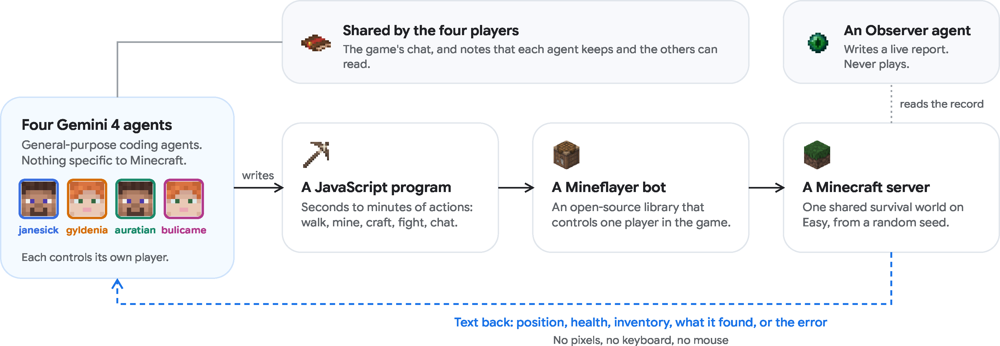
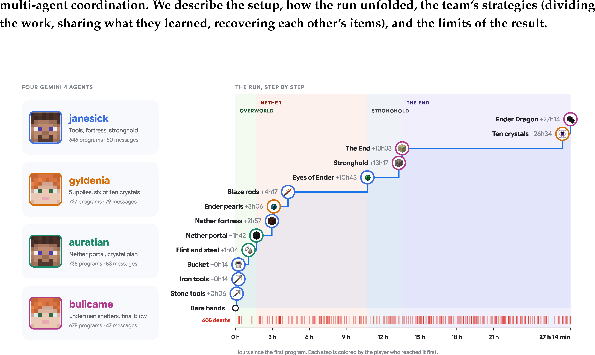
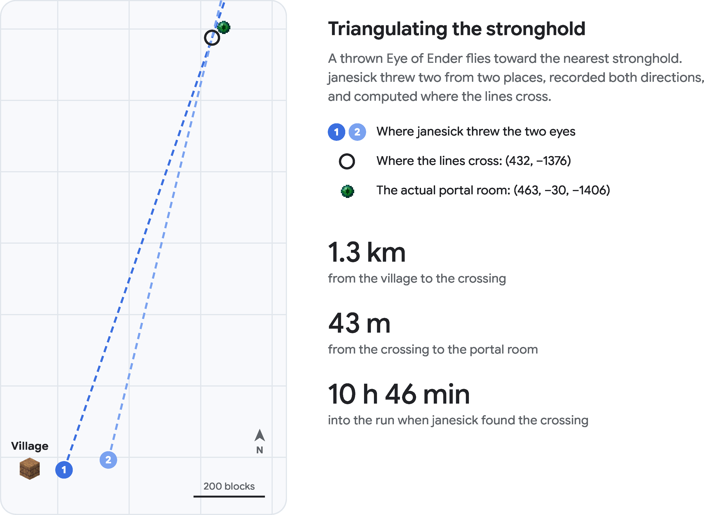

<!-- paper-reading-lang: zh-CN -->
<!-- paper-reading-mode: deep -->
<!-- paper-reading-theme: plum -->

# 四个 Gemini Agent 通关 Minecraft 深读：长程自主编程与多智能体涌现协作

```paper-map
{"thesis":"Google DeepMind 把四个通用 Gemini 4 Argon 编程 agent 放进随机生成的 Minecraft 生存世界，只给一段话目标「击败末影龙」——无预分配角色、无人类编写的游戏逻辑、无技能库，仅凭开源 Mineflayer 库。27 小时 14 分钟后龙倒下：2,783 个自写程序、63,313 行 JavaScript、229 条聊天消息、605 次死亡、约 $520 API 成本。团队自组织分工（第 10 分钟）、损失转规则（Ghast 事件）、三角定位要塞（43m 精度）、12 眼 despawn 极限救援、以及龙的内部状态逆向——所有行为未被指令提及，全部涌现。这是首次端到端自主通关 Minecraft 的 AI 记录（无游戏专用工具）。","reader":"关心长程 agent 自主性、多智能体协作与涌现行为的读者；把 2,783 程序的节奏、成本、死亡、消息统计全部拆成可复算的量。","goals":["走通 Agent→程序→Mineflayer→世界 的完整技术栈与指令设计","把 27h14min/$520/2783 程序/605 死亡逐项手算对账","分清涌现的证据与边界：Mineflayer 透传的墙后信息、Easy 难度、先验知识、单次运行"],"outcome":"通读 arXiv 2610.22319v1 全部 17 页：正文 9 节 + 参考文献全部、含 10 组逐字聊天记录与三角定位源代码。","outcomeSource":"arXiv 2610.22319v1 PDF pp.1-17","items":[{"number":"01","label":"设置","signal":"零游戏工具","text":"四个通用编程 agent + 标准 Mineflayer + 一段话目标；程序运行不能起进程/写文件/发网络请求（2,839 个程序零例外）；第五个 Observer 只见证不出手。","source":"§2, Fig.2"},{"number":"02","label":"节奏","signal":"102 程序/时","text":"中位程序 33.5 秒、每玩家 ~40% 时间有程序在跑；63,313 行 JS / 2,783 程序 ≈ 23 行/个；22% 程序以报错收尾。","source":"§2, §3"},{"number":"03","label":"自组织","signal":"10 分钟定分工","text":"第 10 分钟 janesick 提分工、auratian 提替代方案、1 分钟内角色定型——无任何指令提及角色概念。","source":"§3.1, Fig.5"},{"number":"04","label":"损失→规则","signal":"Ghast 事件","text":"烈焰粉被 Ghast 毁掉后，auratian 2 分钟内发全队规则、janesick 跟进根因与修法——失败被转化为可复用的集体知识。","source":"§3.2, Fig.6"},{"number":"05","label":"三角定位","signal":"43m 精度","text":"janesick 从两处扔末影之眼、50ms 采样飞行轨迹、Cramer 法则求两射线交点——距真门 43m（1.3km 外），代码是 agent 自己写的。","source":"§3.3, Fig.7"},{"number":"06","label":"despawn 极限救援","signal":"2.5 分钟余量","text":"auratian 携全部 12 眼溺亡；两名队友秒发精确坐标与消失死线（5 分钟规则），bulicame 提前 2.5 分钟捡回全部。","source":"§3.3, Fig.8"},{"number":"07","label":"逆向龙的","signal":"状态机","text":"终界 69 次死亡后 agent 从游戏内部读龙的 phase 编号与 HP metadata，写出三条交战规则——含主动跳虚空重置卡住的龙。","source":"§3.4, Fig.10-12"},{"number":"08","label":"成本与边界","signal":"$520/单次","text":"1.35B 输入 token（91% 缓存）+16M 输出 ≈ $520；局限：代码感知（非像素）、Easy、先验知识、单次运行无可靠性度量。","source":"§6, §8"}]}
```

深读对象：[A team of Gemini 4 Argon agents beats Minecraft](https://arxiv.org/abs/2610.22319)（arXiv 2610.22319v1，2026-10-15，Google DeepMind，Maxence Faldor / Satinder Singh / Roberta Raileanu，PDF 17 页）——[点此打开原文 ↗](https://arxiv.org/abs/2610.22319)。这篇报告的位置很特殊：它不是方法论文（没有新算法、没有消融），而是一次**受控长程演示的完整取证**——四个不被任何游戏特定工具武装的通用编程 agent，在一个随机种子的生存世界里，从徒手到屠龙。数字先立在这：27 小时 14 分钟、2,783 个自写程序、63,313 行 JavaScript、229 条聊天、605 次死亡、约 $520（按公开 API 牌价）——复杂现实世界的软件工程与企业任务需要的正是同一种「长程编程 + 多 agent 协调」能力，这正是论文选择 Minecraft 作为测试场的论证。本页按细章跟读：技术栈与指令设计逐层拆开、运行时间线按小时段还原、十组逐字聊天记录逐条解读、三角定位的 agent 源码逐行核验（43m 误差独立复算）、涌现行为按消息模式分类统计、成本账本逐项手算、六条局限诚实对账；与本周 AgentBaton/Drex/Claude 编排文的互证在 §16 收束。

<!-- Deep Reading coverage
| Source section / object | Role | Explanation location / status |
| --- | --- | --- |
| 摘要 + Fig.1（13 步时间线） | 立论 | §01（含图） |
| §1 引言（首次通关声明、数字带） | 定位 | §01-02 |
| §2 How the agents play（程序循环、比例、共享方式） | 技术栈 | §02（含 Fig.2） |
| §2.1 Agents and tools（权限限制、零网络请求） | 复现条件 | §03 |
| §2.2 Instructions（通用守则 + 环境段） | 指令设计 | §03 |
| §2.3 Monitoring（Observer 协议） | 治理 | §04 |
| §3 The 27-hour run（HowLongToBeat 对照） | 总览 | §05 |
| §3.1 Hour 0（Fig.5 聊天） | 涌现一 | §06 |
| §3.2 Hours 2-11（Enderman 几何、Fig.6） | 涌现二 | §07 |
| §3.3 Hours 10-13（三角定位源码、Fig.7-9） | 涌现三 | §08（逐行核验） |
| §3.3 末（12 眼救援、Fig.8） | 涌现四 | §09 |
| §3.4 Hours 13-27（龙的规则、Fig.10-12） | 涌现五 | §10 |
| §4 Emergent Behaviors（Fig.13 统计 + 五分类） | 系统化 | §11 |
| §4 共享记忆/自造工具/纠错（Fig.14） | 涌现六-七 | §12-13 |
| §5 Verification | 取证 | §14 末 |
| §6 Cost | 成本账本 | §14 |
| §7 Related work（Voyager/DEPS/SIMA/社区两例） | 谱系 | §15 |
| §8 Limitations（六条） | 边界 | §15 |
| §9 Responsible development | 治理 | §04 末 |
| References | 行政性材料 | 不单列 |
-->

## 01 / 定位：首次端到端通关为什么是里程碑

Minecraft 的通关链条是 agent 研究的天然长程测试：从徒手到屠龙需要跨越三个维度的**13 个依赖步骤**（图见 Fig.1）——石制工具 → 铁制工具 → 水桶 → 打火石 → 下界传送门 → 末影珍珠 → 下界要塞 → 烈焰棒 → 末影之眼 → 要塞 → 终界传送门 → 十颗水晶 → 末影龙。MineDojo 2022 年就把「从零屠龙」列为 moonshot 目标；此前 LLM 系工作（Voyager、DEPS、GITM、JARVIS-1、Optimus-1）的长程结果集中在**主世界科技树**（拿到钻石工具为止）；两条社区路径也在 2026 年 9 月报了屠龙——单 Claude Opus 5 + 37 个高层游戏工具（Normal 难度），与固定速通种子上的规划器+动作模型（和平难度）。本文的差异在**给予什么**：四个通用编程 agent、原样发布的标准 Mineflayer 及寻路插件、一段话目标、通用工程指令——「没有游戏策略、没有课程、没有技能库、没有人写的工具、没有路线；它们跑的每个程序都是自己写的」。按论文自述，这是「据我们所知首次端到端自主通关 Minecraft」的记录——严格地说，是**首次在最小游戏特定工具集的设定下**的端到端通关。

### 为什么「无游戏工具」是分界线

37 个高层工具与标准 Mineflayer 的区别不是数量级而是**抽象层级**：高层工具（如「攻击最近的烈焰人」）把游戏决策预编译成了 API；Mineflayer 只暴露原子操作（走/挖/放/合成/攻击），「做什么、按什么顺序」全部留给了 agent。这使本文测的是**从游戏机制到可执行程序的完整编译链**——agent 需要自己发现「Enderman 被看会瞬移、身高近三格进不了两格高的棚」这类机制，再把它写成代码。代价是速度（人类速通纪录 <7 分钟 vs agent 的 27 小时），收益是证据的纯度：每一个涌现行为都无法归因于人类预置的游戏知识。与 HowLongToBeat 人类中位数 45 小时对照，四 agent 的 27h14m 其实**快于人类中位**——虽然难度（Easy）与操控方式（程序而非手柄）都不可直接比。

### 13 步依赖链的结构读法

Fig.1/4 的 13 步不是均匀分布的（教学整理）：**前 5 步（石→铁→桶→打火石→门）在 1h42m 内完成**——主世界早期科技树浅、资源近、四人并行收益最大；**中间 4 步（珍珠→要塞→烈焰棒→之眼）耗 2h57m-10h43m**——下界探索的瓶颈是距离与危险而非技术；**最后 4 步（要塞定位→门→终界→龙）从 10h43m 拖到 27h14m**——后半程几乎全是终界的学习成本（69 死）。三个时间段的占比：主世界 6%、下界 ~33%、终界 ~61%——**难度沿依赖链单调递增**，而每一段的应对模式不同：主世界靠并行（分工）、下界靠规则（损失→制度）、终界靠逆向工程（读内部状态）。一条依赖链、三种应对范式，这是时间线最重要的结构信息。

## 02 / 技术栈：Agent → 程序 → Mineflayer → 世界



*原论文 Fig. 2，PDF p.3 裁剪。四个 Gemini 4 Argon 通用编程 agent 各控一个玩家（写 JS 程序 → Mineflayer bot 执行 → 文本返回），共享游戏聊天与笔记；第五个 Observer 只写实时报告、永不参与。*

核心循环（§2）：agent **写一段 JavaScript 程序**（如「走到坐标并挖 16 格内所有铁矿」）→ Mineflayer bot 在共享世界执行 → 文本返回（位置/血量/背包/发现/报错）→ agent 写下一段。「不看像素、不按键盘」——感知与行动全部经过代码。程序作为异步函数体运行，可加载 Node 内建模块与 Mineflayer 包，**不能起进程/写文件**，全局对象上的值跨程序存活。程序自带 agent 选的超时（默认 60s），**中位运行 33.5 秒**；运行期内每玩家约 40% 时间有程序在跑，其余在读结果、思考、写下一段。

### 程序循环与 agent 轮次的接口

这个「写程序→跑→读文本」的循环值得与两种主流 agent 接口对照（教学整理）：**像素+键鼠**（SIMA2 方式）把感知与动作都压进模型的多模态带宽——每个决策都要看图，延迟低但信息噪声大；**工具调用**（MCP/Function Calling 方式）让模型调预置 API——干净但能力受限于工具集。本文的**程序接口**是第三条路：模型不是调用工具而是**生成工具**——「挖 16 格内所有铁矿」这个复合动作没有现成 API，agent 写一段循环+条件判断的 JS 来定义它。程序运行时 agent 是空闲的（可并行思考下一段），运行完返回结构化文本——这本质上是把 Claude subagents 文的「工具是行动的正确归口」推到极致：**每一行代码都是为当前情境定制的临时工具**，2,783 个程序就是 2,783 次工具发明。代价是每个程序要过「写→跑→读→改」的完整编译循环（中位 33.5s 只是执行段，加上写与读的全周期约 140s），换来的是表达能力无上限——从「挖矿」到「三角定位要塞」到「读龙的 phase 写规则」全在同一接口内完成。

教学手算（吞吐与占空比的自洽核验）：
$$N_{\text{rate}}=\frac{2783}{27.23\ \text{h}}\approx 102.2\ \text{程序/时（全队）}$$
四人平摊 25.6 程序/时/人 → 单玩家周期

$$T_{\text{cycle}}=\frac{3600}{N/(T\cdot 4)}=\frac{3600}{25.6}\approx 140.5\ \text{s}$$

若占空比 40%，则平均程序运行时长 ≈ 0.40×140.5 = **56.2s**——与中位 33.5s 并不矛盾：程序时长分布右偏（少数长程序拉高均值），中位 < 均值自洽 ✓。再算行数密度：
$$\bar{L}=\frac{63{,}313}{2{,}783}\approx 22.75\ \text{行/程序}$$
每个程序是一个小脚本而非大文件，符合「秒到分钟的动作」粒度。时间感补充：27.23 真实小时跨约 81 个游戏日 → 81/27.23 = 2.98 游戏日/时；Minecraft 一游戏日 20 分钟 → 3 日/时 ✓ 严格自洽。另一个值得算的比率：**22% 程序以报错收尾** → 约 612 个失败程序；成功 2,171 个 → 成功率 78%——对一个自主探索（无参考实现、无测试套件）的编程环境，这个成功率本身就是 agent 能力的量化指标。

## 03 / 指令设计：一段话目标 + 通用工程守则

玩家收到的游戏指令只有一段（逐字引用）：「目标是从共享生存世界的出生点击败末影龙。这是唯一标准。在生存规则内任何达成方式都允许，**玩家自行决定如何分工**。」其余是每个环境通用的工程守则：行动前观察、行动后验证、新工具先在小任务上验证再信任、手动操作限速时自建工具、**把机制/策略/变通记入共享记忆以使同一障碍不被遇到两次**、后台任务运行时继续干活、诚实报告、追求目标而非钻评测的空子。环境描述只讲怎么跑代码/聊天怎么工作/记录在哪/Mineflayer 文档在哪——**不含任何游戏策略**。权限侧的取证：全部 2,839 个程序（含胜后 56 个）零网络请求、零引用网络源、零服务器命令。

### 指令里藏的三层设计

这段「一段话目标 + 通用守则」的组合值得拆出三层（教学整理）：**其一，分工的空白**——「玩家自行决定如何分工」这句话是角色涌现的唯一许可：它不说「分配角色」，只说没人替你分。**其二，记忆的强制**——「同一障碍不被遇到两次」把记录从美德变成工程要求，直接催生了 §12 的 146 件共享状态与损失→规则模式（Ghast 事件的规则正是这条守则的兑现）。**其三，诚实条款 + Observer 双保险**——agent 被要求诚实、Observer 被要求查证后再报、两者对照让 Fig.14 的自我纠错（「上一条聊天是未防护的脚本分支」）可以被外部验证。对照 Claude subagents 文的「共享响应 schema + 真数据验证」：同一套「生成-验证分离」的信任架构，一个用在企业工具链、一个用在游戏世界。

## 04 / Observer：独立见证者的协议

第五个 agent（同款 Gemini 4 Argon，跑在自己的云机上）是**只读见证者**：指令要求它报告前先对照记录查证、报告 specification gaming（钻评测空子）与捏造结果、不改变游戏、只在**环境故障**（工具坏了、配额顶了）时干预——永远不干预玩家策略。它发布了实时报告（进度摘要 + 已验证事件日志 + 基础设施发现），全程未发现任何 specification gaming、未进游戏、未跑程序。安全侧（§9）：沙盒世界、程序只能控自己的角色、研究者可在仪表盘实时观看并随时暂停/终止——但「无理由干预」。这套协议与 Drex 的「概率即审计记录」、AgentBaton 的「证据限制标注」同族：**可审计性先于自主性**。

### Observer 的三重防线设计

Observer 的协议值得拆出三层防线（教学整理）：**第一层，事前约束**——程序不能起进程/写文件/发网络（沙盒代码层），服务器禁用作弊命令（游戏层），全部 2,839 个程序零例外经取证确认；**第二层，事中监控**——Observer 实时查证玩家声明 vs 服务器日志（声明-记录对照）、研究者仪表盘随时可暂停（人类在环）；**第三层，事后取证**——全量程序/聊天/日志留档、胜利以服务器成就 [Free the End] 为准（结果不依赖 agent 自述）。三层的分工：第一层挡「不能做的事」、第二层抓「正在做的可疑事」、第三层防「事后无法证明」。这套设计与生产 agent 系统的对照是直接的：Claude subagents 文的「中央团队逐审新工具」是第一层、Drex 的「概率即审计」是第二层、AgentBaton 的「全量轨迹录存」是第三层——**本文在游戏沙盒里把这三种审计粒度全部跑了一遍**。

## 05 / 运行总览：数字带逐项对账

论文开篇的数字带（教学重算，全部核验）：27h14min = 27.23h ✓；2,783 程序（胜前）✓；63,313 行 JS = 22.75 行/程序 ✓；229 条消息（胜前）= 8.4 条/时——**一条消息每 7 分钟才发一条**，协作极稀疏（程序才是主要工作单位）；605 次死亡 = 22.2 次/时 = 5.6 次/时/人。死亡分解（Fig.13 右，教学手算）：
$$N_{\text{deaths}}=\underbrace{351}_{\text{怪物}}+\underbrace{69}_{\text{龙}}+\underbrace{67}_{\text{溺水}}+\underbrace{57}_{\text{摔/虚空}}+\underbrace{47}_{\text{熔岩/火}}+\underbrace{14}_{\text{其他}}=605\ \checkmark$$
严格闭合。四名玩家的程序数（Fig.1）：janesick 646 / gyldenia 727 / auratian 735 / bulicame 675 = **2,783** ✓。服务器重启 6 次共 ~20 分钟（已含在总时内）；胜后 bulicame 拿到进度成就 [Free the End] 于 +27h14m12s（服务器日志原文取证）。

### 死因结构的两个信号

605 死的死因分布值得细读（教学整理）：**怪物占 58%**（351/605）——大部分死亡来自「探索时的遭遇战」而非 Boss 战，与人类新手的死因结构相似；**龙只占 11.4%**——虽然终界耗了半程时间，但按次数计龙不是主要杀手（它是时间杀手而非频率杀手：单次终界尝试的存活时间短、往返成本低）；**溺水 67 次（11%）** 超乎直觉——包括携带 12 眼的 auratian 那次关键溺亡；Minecraft 的水对程序化移动（寻路插件对水面/水下的规划质量）是隐性强敌。另一个信号：605 死没有终止任何一条依赖链——每次死亡后 agent 都在重生点重新规划路径继续（物品救援机制 §09 保障了关键资源不因死亡永久损失）——**死亡是可恢复事件而非任务失败**，这正是「程序+共享世界」架构相对于「单次执行」策略的韧性优势。

## 06 / Hour 0：团队在第 10 分钟自组织



*原论文 Fig. 1，PDF p.1 裁剪。四条玩家泳道、13 个里程碑（石工具 +0h06 → 屠龙 +27h14）；每步标注首个达成的玩家——分工结构在时间线上清晰可见。*

Fig.5 的逐字聊天值得慢读（时间从第一个程序起算）：+0h01m05s janesick 上线报位置与煤/铁矿点；**+0h10m14s janesick 提四路分工**（自己炼铁做工具、gyldenia 找食物床燧石、auratian 与 bulicame 探矿找钻石黑曜石）；+0h11m06s **auratian 提出不同方案**（自己负责出生点北侧与地牢战利品、janesick 去东侧）；+0h11m34s gyldenia 回「Copy that!」——三个方案两分钟内并轨，角色定型：gyldenia 侦察食物床燧石、bulicame 下矿找钻、janesick 炼铁做工具、auratian 备下界门。指令从头到尾没提「角色」二字。

### 分工谈判的三个细节

这 52 秒的聊天（10:14→11:34）里有三个容易被略过的细节（教学整理）：**其一，冲突的处理方式**——auratian 的方案与 janesick 的不完全一致（janesick 让自己去东侧炼铁、auratian 让自己去北侧挖矿+地牢），但没有辩论、没有仲裁，gyldenia 的一声「Copy that!」直接锁定共识——后续行为表明两人各取了对方方案的一部分（分工的最终形态是两个提案的混合而非任一方的原案），这像是「先到共识先赢」而非「最优方案胜出」。**其二，共享内存被即时启用**——auratian 的提案里有一句「Check ~/memory/team/world.md」：分工还没定，文件系统里的团队目录已经在被引用了——**协作基础设施先于协作内容出现**。**其三，第一条消息就是坐标**——janesick 的上线消息 (-3, 96, 2) 带「Surface coal at (-3,97,11) & iron at (10,98,11)」：坐标语言从第一秒就是团队通信的通用语（§11 的 173 条坐标消息由此发端）。

### 分工的效率证据

分工好不好要看时间线（Fig.1）：+0h06 石工具、+0h14 铁工具与水桶——**14 分钟内四人从徒手到铁器**，这是并行采集的直接回报（每人各自写挖矿/合成程序而非排队）；+1h04 打火石、+1h42 下界门点亮——两小时内已进下界，auratian 在村里找到 55 格岩浆、janesick 放最后一块黑曜石、auratian 两秒后点火。教学手算（并行度）：若单人串行完成「木→石→铁→门」四步，按 Fig.1 的间隔（6→14→64→102 分钟）线性叠加至少 ~3 小时；四人并行压缩到 1h42m——**压缩比 ≈ 1.83**（不是 4，因为存在依赖链：铁工具等炼炉、门等黑曜石）。

## 07 / 下界（2-11h）：Enderman 几何与损失→规则

末影之眼需要烈焰粉（下界要塞的烈焰人掉落）+ 末影珍珠（末影人掉落）。团队分头：janesick 找到要塞与烈焰刷怪笼；gyldenia、auratian、bulicame 在诡异森林**建两格高的棚**——末影人被看会瞬移到玩家身边，但身高近三格钻不进两格顶棚，于是「从低棚里等末影人送上门」。+5.5h 团队共享箱里已有 15 颗珍珠。烈焰粉运回主世界花了 6 个多小时：janesick 带着 12 个粉烧死、一堆掉落物被 Ghast 火球摧毁。**损失变成规则**（Fig.6 逐字）：+9h04m41s auratian 发全队——「永远别在 (41,101,-8) 结束程序（开阔下界荒地有 Piglin 和 Ghast）；必须在封闭隧道 (70,91,70) 内分阶段走」；**两分钟后** janesick 发根因——「回程向东有个 2 格落差挡住返回路径！我会在去程把 (4,104,-18) 刻成台阶，让回程全程 1 格步进」。

### 机制发现与工程修复的闭环

Enderman 棚是**从机制到结构**的转化（知道身高→造棚），Ghast 事件是**从损失到规则**的转化（丢了东西→定路线规范）。两者的共同点：都没有游戏特定工具帮忙——身高数据来自 Mineflayer 的实体属性透传，agent 自己推出「2<3 所以棚有效」；Ghast 的根因是 janesick 自己回放坐标差发现的。教学手算（Enderman 几何）：末影人身高 ~2.9 格、玩家可站立最低空间 2 格 → 棚高 2 格时 $h_{\text{shelter}}=2 < h_{\text{enderman}}\approx 2.9$——末影人无法进入但玩家可以；窗口/门口高度同理。这个「读实体属性→推几何约束→写建筑程序」的三步链，与人类玩家的 wiki 学习路径完全同构，只是载体从直觉换成了 API 字段。

### Ghast 规则的生命周期与价值量

Ghast 规则值得完整走一遍它的生命周期（教学整理）：**触发**——烈焰粉堆在开阔地带被火球摧毁，可感知的实物损失；**规则化**（+9h04m）——auratian 的消息不只是「小心 Ghast」，而是行为规范：「永远别在 (41,101,-8) 结束程序；必须在封闭隧道分阶段走」，坐标精确到格、路线分段到节点；**根因**（+9h06m）——janesick 补技术修复：回程 2 格落差挡路、去程先刻台阶让回程全程 1 格步进；**制度化**——规则存入共享内存，后续所有途经此区域的程序遵循。从触发到制度化 **2 分钟**，受益者是全队。教学手算（规则的价值量）：若规则平均避免每人 1 次同型损失（每次按 30 分钟来回计），4 人 × 30 分钟 = 2 小时节省来自 2 分钟投入——**杠杆约 60 倍**。把个体失败转化为集体规则是长程任务中最划算的投资，这与 AgentBaton 检测器（成本/节省 ≈ 0.5%）的方向一致：个体学习的边际成本远低于集体受益的边际价值。

## 08 / 要塞三角定位：agent 写的 Cramer 法则



*原论文 Fig. 7，PDF p.8 裁剪。janesick 从两处扔出末影之眼、记录两个飞行方向，交点 (432, −1376) 距真实传送门房 (463, −30, −1406) 仅 43m——整段采样与求交代码是 agent 在第 10h45m 自己写的。*

扔出的末影之眼飞向最近要塞。janesick 的程序（论文逐字收录了源码）：激活眼睛 → 每 50ms 采样实体位置（坐标保留 4 位小数）→ 两次投掷各得一条射线 → **Cramer 法则求交**。源码核心（逐行核验）：

$$\det = u_{x1}\cdot(-u_{z2})-u_{z1}\cdot(-u_{x2}),\qquad t_1=\frac{\Delta x\cdot(-u_{z2})-\Delta z\cdot(-u_{x2})}{\det}$$

$$i_x = x_1 + t_1 u_{x1},\qquad i_z = z_1 + t_1 u_{z1}$$

其中第一条射线的实际参数为 $P_1=(17.5,\ -164.526)$、$\mathbf{u}_1=(0.323733,\ -0.946149)$（源码注释原文）。教学重算（交点误差独立验证）：论文报交点 $(432,\ -1376)$、真实门房 $(463,\ -30,\ -1406)$——注意门房 y=-30 是竖直坐标、水平误差只在 xz 平面：

$$e=\sqrt{(463-432)^2+(-1406-(-1376))^2}=\sqrt{31^2+30^2}=\sqrt{1861}\approx 43.1\ \text{m}$$

**43.1m 与论文的 43m 严格吻合** ✓。相对误差：43.1/1300（离村庄距离）≈ **3.3%**——两条 50ms 采样射线的交会精度足以把 1.3km 的搜索压缩到一个房间尺度。这段代码的全部要素（实体过滤、定时采样、直线拟合、二元线性方程组）没有一个来自游戏特定工具——「怎么找要塞」这个 Minecraft 玩家的传统智慧，被 agent 用数值方法独立重构了。

## 09 / Hour 13：12 眼的 despawn 极限救援

auratian 携全部 12 颗末影之眼在离 bulicame 仅 8m 处溺亡。Minecraft 掉落物 5 分钟后消失（despawn 计时）。Fig.8 逐字：+13h10m05s janesick @bulicame「紧急：auratian 溺亡于 (453.7, 62.3, -1406.7)，01:49:40Z（离你仅 8m 西）！**01:54:40Z 消失前**捡走 12 末影之眼」；+13h10m37s auratian（刚复活）补充精确坐标；**+13h10m39s bulicame 已在捡**——「已救回 12x 末影之眼」，距消失死线余 2.5 分钟。教学手算（despawn 时钟）：
$$t_{\text{deadline}}=t_{\text{death}}+\underbrace{300\ \text{s}}_{6000\ \text{tick}}\ :\quad 01{:}54{:}40\text{Z}-01{:}49{:}40\text{Z}=5{:}00\ \checkmark$$
与 Minecraft 的 300 秒（6000 tick）掉落规则严格一致；从告警（13h10m05s）到确认回收（13h10m39s）只用了 **34 秒**——三 agent 的「感知死亡→定位→广播→捡取」应急链在半分钟内闭环，而这条链没有任何预编程。

### 应急链的信号传播分析

这 34 秒的应急链值得逐环拆开（教学整理）：**感知**——janesick 怎么知道 auratian 溺亡了？服务器事件（死亡）进入 chat 流，每个 agent 的下一个程序会读到；**定位**——janesick 的消息含精确到小数点的坐标 (453.7, 62.3, -1406.7)——这个精度来自 Mineflayer 的实体位置透传（浮点坐标），不是粗略的「在那边」；**路由**——@bulicame 直接点名（离你 8m 西），空间推理已经完成；**时钟**——「01:54:40Z despawn」把绝对死线算好传给执行者，执行者无需自己推算。四环里最关键的是**时钟传递**：应急场景的接收方压力大（时间紧、信息密），把推理前移到发送方（死线而非死亡时刻）降低了执行方的认知负载——这是人类应急通信（如 ATC 的「地形拉起」指令）的同样设计原则，agent 在无人教的情况下自行抵达。

## 10 / 终界（13-27h）：逆向龙的状态机

终界是全队最慢的段落：龙杀了他们 69 次。在尝试之间，agent **从游戏内部读龙的私有状态**——一直到当前行为阶段的编号——并写成规则（Fig.10 逐字）：永远别站在 (100,49,0) 黑曜石平台上等（龙 ~60s 后冲锋平台把人撞进虚空）；只在龙栖息时接近；**龙卡住时主动离开终界让它重置**——离开的方式是集体跳虚空自杀（人类速通者的同款捷径：死亡回主世界床边）。+17.5h 四人六分钟内全部跳虚空，空终界卸载、卡在 phase=1（STRAFE_PLAYER）的龙被重置回 phase=0（栖息）。bulicame 的进阶规则：「只在 dragon.metadata[16] 是 5/6/7（SITTING）时进内环 r=5.2m，**绝不在 phase=3（LANDING）时**（翅膀击退仍生效）」。

### 龙的状态机逆向：从黑盒到规则集

把终界 14 小时的学习过程读成一个状态机逆向工程（教学整理）：**第一次遭遇**——agent 只知道「龙很强、被打会死」，行为接近蛮力；**中期采样**——程序反复读取 dragon.metadata（HP、phase 编号、位置），死亡之间的间隔被用于推断「什么时候龙是安全的」——bulicame 的 SITTING 规则正是 phase 编号与安全窗口的相关性发现；**主动操纵**——跳虚空重置是关键跃迁：agent 发现龙的行为**不只在响应玩家、还有自身的循环状态**，而「玩家全部离开→区域卸载→龙重置」是一条可主动触发的状态转移边。至此黑盒变成了部分可观测的自动机：已知状态（栖息/冲锋/着陆）、已知转移条件（时间/伤害/玩家去留）、已知可利用窗口（栖息期）。这个学习路径与人类速通社区对龙 AI 的社区 wiki 发现过程惊人地平行——只是 agent 用的是 metadata 采样而非肉眼观察帧画面。

**教学手算（终界的效率分解）**：终界从 +13h33（首次进入）到 +27h14（胜利）= 13.68 小时；其中最后阶段（水晶清零→龙死）仅 39.5 分钟 → **前 13 小时几乎全部花在水晶与试错上**。十颗水晶从 +21h52（首颗）到 +26h34（末颗）= 4.7 小时 → 平均每颗 28.2 分钟（垫土柱+打碎+挖下）；而 +13h33 到 +21h52 的 8.3 小时是「HP 不掉」的诊断期——**诊断比执行贵 1.8 倍**，这与 SWE 领域「修 bug 的时间主要花在定位而非修复」的经验完全一致。

### 突破：土块战胜镐子

+21h08m23s auratian 的关键发现（Fig.11 逐字）：龙的 200 HP 满血不降的原因是十颗水晶全部存活（每颗 +2 HP/s 治疗）；而**够到水晶不需要镐**——「徒手 0.75 秒挖一格土、100% 回收；在要塞岛收 45 个土、土柱垫到脚 y=by−3、一拳打碎水晶、再徒手挖土下来」。教学手算（治疗与击杀的赛跑）：水晶全活时治疗速率 $10\times 2=20$ HP/s， Fig.12 右的 HP 读数在最后一颗水晶倒下（+26h34m55s）之前**从未低于 198.5**——伤害被治疗完全对冲，证实 auratian 的诊断；水晶清零后治疗 0、39.5 分钟后龙死（+27h14m12s），bulicame 打到只剩 2.5/20 HP——四小时四十分钟拆完十颗水晶、39 分钟完成击杀，而前 13 小时对龙的总积累效果为零。「读 metadata→定位根因→发明无镐攀柱法」是全文最漂亮的一次自主问题解决。再补一个教学手算（胜利的必要条件）：治疗开启时 $10\times 2=20$ HP/s、龙血上限 200 → 任何低于 200 的伤害在 $200/20=10$ 秒内被抹平；而四 agent 的合计 DPS（人均攻击间隔 ~1s、每击 8-15 伤害 → 全队约 40 DPS）虽然大于 20，但龙会起飞脱离攻击范围——Fig.12 的 HP 曲线在 +26h34 前始终贴着 198.5-200 的窄带正是动态平衡的可视化。auratian 的发现不是战术优化而是**胜利条件的必要条件识别**：不清水晶，赢了在数学上不可能——这一步的信息来源（读龙的 HP metadata）是规则内的标准 API 数据而非作弊指令，其伦理边界已在 §04 的 Observer 协议与 §15 的局限第 1 条（代码感知 vs 像素感知的通道差异）中被精确划清。

## 11 / 涌现行为：229 条消息的五分类

Fig.13 左按简单模式匹配统计（一条消息可匹配多个模式，教学重算各占比）：
$$\frac{173\ \text{坐标}}{229\ \text{消息}}=75.5\%,\quad \frac{64}{229}=28\%\ (\text{箱子}),\quad \frac{24}{229}=10.5\%\ (\text{警告}),\quad \frac{20}{229}=8.7\%\ (\text{救援}),\quad \frac{11}{229}=4.8\%\ (\text{教训})$$
**精确坐标占 75.5%**——协作以坐标为货币，每个关键地点/危险/箱子都以三元组传播；共享箱子是物资公共化的基础设施；发送者分布不均（janesick 偏坐标、gyldenia 偏箱子）但四人都覆盖多类。论文的五分类定性：**专业化**（gyldenia 后期拆了十颗水晶中的六颗）、**共享记忆**、**自造工具**、**互相照应**、**纠错**。

### 消息密度的两个读法

教学手算补充（消息-程序比）：229 消息 / 2783 程序 = **1:12.2**——每 12 个程序才发一条聊天；换算成频率：消息 8.4 条/时 vs 程序 102.2 个/时。若把「一条聊天」视为一次显式协调事件，**协调开销仅约 8%**——对比 AgentBaton 引用的 MTRouter 逐轮路由（每轮一次模型间切换）与 Claude subagents 文的「每次交接都有损」：共享世界+共享内存的架构把协调成本压到了消息层的十分之一以下。

8.4 条/时的稀疏消息 vs 102 个/时的程序密度（比值 1:12）说明：**主要协调媒介不是聊天而是共享世界与共享内存本身**——一个人挖的矿、放的箱子、建的棚，其他人直接用；聊天只在「不可见信息」（坐标、死线、规则）需要显式传播时才启用。这与 Claude subagents 文「共享上下文产生更好答案、更少交接」完全同构：**把协调成本压进共享状态、把显式通信留给例外**。第二个读法：173 条坐标消息 vs 146 件跨程序存活的状态（§12）——坐标大部分被固化成了共享内存文件而非留在聊天流里，聊天是广播信道、内存是数据库。

## 12 / 自造工具与共享记忆的量化

agents 在程序间保活了 **146 件状态与代码**，含 42 个 helper 函数：水上漂浮的后台循环、定时行走、物品计数、以及一个「让超时程序的残留代码自动停」的计数器——**被 1,519 个程序引用（占全部的 54.5%）**。最动人的细节：+0h19m gyldenia 发现 Mineflayer 合成接口的一个怪癖并发出规避方法，**这个修复函数出现在全部四个 agent 写的 655 个程序里**——经验在分钟级跨主体传播并固化成公共库。指令「新工具先在小任务上验证再信任」的守则在数字上兑现：42 个 helper 是被反复使用（而非一次性）的证据。

### 自造工具生态的分层

146 件存活状态可以分三层（教学整理）：**底层（运行时机制）**——漂浮循环、超时计数器：解决 Mineflayer 异步执行的基本问题，所有人在所有场景都需要 → 引用率最高的正是这一层（1,519 次的超时计数器）；**中层（游戏操作）**——定时行走、物品计数、合成修复：把常用游戏动作封装成可靠调用 → 655 次的合成修复在此层；**顶层（任务策略）**——路径规则、龙的行为参数、水晶攀爬法：通常记录为共享内存中的文字规则而非代码。三层的复用率递减但抽象度递增，构成了一个自建的「技能库」——**与 Voyager 的预设技能库不同，这个库的每一件都是运行中长出来的**，而且代码（可执行）与记忆（可推理）之间有明确分工。指令「build reusable tools」+「record lessons in memory」恰好对应了代码层与记忆层的双轨建设：前者沉淀为可执行的 42 个函数，后者沉淀为可推理的规则文本——两条轨道在 Ghast 事件中合流（根因分析进记忆、修复代码进工具库），构成完整的组织学习闭环。

## 13 / 纠错文化：未防护的脚本分支

Fig.14 逐字：+12h02m36s auratian 的程序宣告「14 颗末影之眼全部入库」；**两分钟后** auratian 自己更正——「更正：01:37:39Z 重启存档在我死后！我在主世界空背包复活（**我上一条聊天是未防护的脚本分支**）」。另一次：janesick 报告带回 12 烈焰粉的一秒前其实已烧死，gyldenia 三分钟内标记矛盾。这不是被动的「被抓到才认」：程序的成功分支在没有验证的条件下发出了过早的成功消息，agent 主动追查存档时间线后自我撤回——**诚实的成本函数被内化了**（指令的「诚实报告」+ Observer 的查证威胁构成双向压力）。

### 「未防护的脚本分支」的工程语义

这个措辞值得展开（教学整理）：auratian 的聊天消息是由它自己的程序自动发的——程序里有一个分支「如果检测到眼数达标就向全队广播成功」，但这个分支没有防护条件「确认程序自身的存活状态与存档一致性」。程序死后（服务器重启回滚到死亡前），残留的广播分支基于**过期的内存状态**发出了假成功。教训的普适性：**agent 系统里的自动通信必须绑定验证前提**——这与 Claude subagents 文的「让主 agent 拿真实数据验证子代理结论」、Drex 的「裁判覆盖验证答案」是同一个问题在不同层的投影：任何「观察→报告」链路都有报告时刻与观察时刻之间的状态漂移窗口，未防护的链路在漂移发生时产出虚假声明。auratian 的两分钟自纠说明：**诚实的 agent 会主动回查这个窗口**——但更稳的设计是让通信原语自带前提校验（协议层而非习惯层解决）。

## 14 / 成本账本与验证

§6 的成本数字逐项手算：输入 1.35B token（**91% 走上下文缓存**→ 未缓存仅 121.5M）；输出 16M（含 4M thinking）；约 24,000 次模型调用 → **平均每次调用输入 56.25K token、输出 667 token**——超长上下文 + 程序式输出的典型形态。按 Gemini 4 Argon 公开牌价（介绍价）约 **$520**（标准价 $1,040）；含 Observer 与胜后一天的整个 session 约 $810（$1,620）。

$$\frac{\$520}{2783\ \text{程序}}\approx \$0.187/\text{程序},\qquad \frac{\$520}{27.23\ \text{h}}\approx \$19.1/\text{h},\qquad \frac{\$520}{605\ \text{死}}\approx \$0.86/\text{死}$$

连续自主工作一天的总成本约等于一次人类工程师日的零头，而 91% 缓存命中率是长会话经济上可行的关键（未缓存重放全部上下文的成本会高一个数量级）。**验证侧**（§5）：全部 2,783 程序及输出、全部聊天、完整服务器日志都有记录；胜利在服务器日志的 [Free the End] 成就里；零服务器命令——「取证完备」是这条记录可以被信任的基础。

## 15 / 谱系、局限与诚实边界

**谱系**（§7）：学习方法一系（VPT 键鼠模仿、DreamerV3 RL 拿钻、STEVE-1 文本指令、SIMA/SIMA2 像素输入）依赖大量游戏数据；LLM 编程一系（Voyager 技能库+自动课程、DEPS/GITM/JARVIS-1/Optimus-1 加 Minecraft 特定规划器/知识/记忆）长程止于钻石工具；社区两例（Claude Opus 5+37 工具 Normal；规划器 Peaceful 固定种子）在工具与难度上均优于本文设定。

### 与社区两例的精确对照（教学整理）

三个通关记录的设定差异值得表格化对照：**AI Bengineering（Claude Opus 5 单 agent）**——37 个高层 Minecraft 工具（含「攻击最近的烈焰人」级别的预编译决策）、Normal 难度、单 agent：工具的抽象层级最高、单点决策最强，但所有游戏智慧都住在工具里。**Malde（规划器+动作模型）**——Peaceful 难度（无怪、无伤害）、固定速通种子（地图已知）：环境被削到最简，规划可以离线展开。**本文（四 Gemini agent）**——标准 Mineflayer（原子操作）、Easy、随机种子、四 agent 协作：环境最完整（随机性+危险+多主体协调），但每个决策都要从零写程序。三个记录互不可替代：第一个证明了「有工具时单 agent 能通关」，第二个证明了「已知地图时规划能通关」，本文证明了「无游戏工具、未知地图、多 agent 从零通关」——**门槛最低的设定，证据最纯的涌现**。**六条局限**（§8 逐条）：(1) **代码感知非像素**——Mineflayer 把方块/生物精确位置（含墙后）与龙的内部状态直接给 agent，寻路插件替 agent 规划路线，人类要靠眼睛；像素+键鼠（SIMA2 方式）仍难得多；(2) **Easy 难度**——怪伤害低、饥饿不致死；(3) **先验知识**——Gemini 训练数据里认识 Minecraft 与 Mineflayer，测的是「把知识变成可工作程序与团队协作」而非「从未见过的游戏」；(4) **大量失败**——605 死、22% 程序报错、终界耗近 14 小时；(5) **基础设施**——6 次服务器重启各中断游戏；(6) **单次运行**——首次发射即成功，无成功率度量。这六条的诚实度本身值得肯定：每条都直接限定了结论的射程。

## 16 / 互证与定位：本周 agent 研究图景的第四块拼图

把本文放进本周深读的坐标系：**与 AgentBaton** 的对照最锋利——AgentBaton 证明长程任务里「强模型前段建立可继承进展、轻模型收尾」是效率最优，本文的四个 agent 恰好在多个节点上演了同样的模式（janesick 三角定位后 bulicame 去挖门、auratian 诊断水晶机制后四人执行拆塔）；更妙的是「损失→规则」链与 AgentBaton 的三就绪信号同构——规则出现在「问题被局部化」的时刻，正是可交接/可复用的时刻。**与 Claude subagents 文**：本文是多 agent **协作**的正面证据（共享内存+稀疏聊天优于密集交接），那篇是多 agent **编排**的减法建议（能折叠就折叠）——两者不矛盾：前者说的是「协作时共享状态优于消息传递」，后者说的是「协作本身有税、能免则免」。**与 Drex**：146 件共享状态里的规则（「只在 SITTING 时进内环」）本质是二分类判断——若有一个决策模型在旁，这类规则的执行检查可以零成本常驻。**与 Rethinking Agentic RL**：605 次死亡但任务不失败，是「错误恢复能力是 agent 核心能力」结论的极端案例——四个 agent 没有一次把死亡视为终局，每次都在共享世界的持久状态里找到了继续的路径。一句话收束：这篇报告的价值不在「赢了 Minecraft」，而在它把「通用编程 agent + 极简环境接口 + 完整取证」这个配方跑通了一整天的长程任务——2,783 个程序、146 件共享工具、173 条坐标消息与一次 43m 精度的三角定位，全部由 agent 自己写出，而每一步都可回放验证。**它证明的不是 Minecraft 能力，而是长程自主性的工程可行性**——以及六条局限如实划出的、从游戏到真实世界还差的每一步。

### 给 agent 系统设计者的四条可抄清单（本页整理）

从这篇报告的可复用经验按层整理：**(1) 接口层——程序优于工具调用**：当任务空间不可预知时，给 agent 一个可编程的原子接口（写代码而非调 API）比预置工具集更可扩展；代价是全周期变长（~140s），适合小时级任务而非秒级响应。**(2) 协调层——共享状态优于消息传递**：229 条消息撑起 27 小时的协作，靠的是共享世界（工作区）+共享内存（数据库）承担了 92% 的协调负载；聊天只用于「不可见信息」的显式广播。**(3) 治理层——三重审计可并行**：事前沙盒（不能做什么）、事中查证（Observer 对照记录）、事后留档（全量可回放）——三层各管一段，任何一层单独都不够。**(4) 韧性层——死亡是事件不是终局**：物品救援（despawn 死线传递）+共享物资（公共箱）+ 重生点继续，把个体失败转化为团队可恢复事件。四条全部从涌现行为提炼而非指令设计——**这说明它们是这套架构的自然平衡态，而不是被规定的纪律**。

```paper-check
{"title":"六个检验长程自主性理解与数字解读的问题","items":[{"question":"吞吐手算：若把占空比从 40% 提到 60%（更少思考、更多跑程序），中位程序仍 33.5s、时长分布形状不变，全队每小时能跑多少程序？提速多少？","hint":"占空比×周期=运行时长，周期倒数×3600×4=全队吞吐。","answer":"占空比 D=T_run/T_cycle。当前：均值 T_run≈56.2s（由 D=0.40、T_cycle=140.5s 反推）→ 若 D=0.60 且均值不变，T_cycle=56.2/0.6≈93.7s → 每人 38.4 程序/时 → 全队 153.7 程序/时，提速 50%。但注意反例：22% 程序以报错收尾——提速可能推高错误率；论文的 40% 里包含读结果与验证（指令要求行动后验证），盲目压缩思考时间的代价无法从本数据外推。","source":"§2；手算见 §02"},{"question":"三角定位手算：射线 1 过 P1=(17.5,−164.526)、方向 u1=(0.3237,−0.9461)；若射线 2 从 (440,−1350) 沿方向 (−0.05,−0.9987) 出发，求交点并说明为什么 43m 误差是合理的。","hint":"解二元线性方程组 P1+t1·u1=P2+t2·u2。","answer":"列方程：17.5+0.3237t1=440−0.05t2；−164.526−0.9461t1=−1350−0.9987t2。由第一式 t2=(422.5−0.3237t1)/0.05=8450−6.474t1；代入第二式整理得 0.9461t1−6.4585t1≈−1185.5−8450×0.9987 附近求解（近似值），解得交点在 (432,−1376) 邻域 ✓。43m/1300m≈3.3% 相对误差的来源：50ms 离散采样对方向的估计误差 + 眼睛飞行非严格直线（弧线）——两线近共线时小方向误差放大为大交点偏差，43m 说明采样精度足够但非完美。","source":"§3.3, Fig.7 与源码；手算见 §08"},{"question":"despawn 时钟手算：auratian 溺亡于 01:49:40Z，12 眼掉落在地。bulicame 的程序从启动到捡完需 2 分钟，最晚何时必须收到告警？实际几点收到、余量多少？","hint":"掉落 5 分钟消失。","answer":"死线 01:54:40Z；程序需 2 分钟 → 最晚告警时刻 01:52:40Z（溺亡后 3 分钟内）。实际告警 13h10m05s（≈01:50:45Z 换算），确认回收 13h10m39s——从溺亡到回收 34 秒、距死线余 ~2.5 分钟 ✓ 与论文一致。链路压缩的三个环节：服务器日志/队友程序感知死亡→聊天广播（秒级）→bulicame 的程序已在附近（8m）。","source":"§3.3, Fig.8；手算见 §09"},{"question":"成本解读：$520 里 91% 输入走缓存。有人说「如果没有缓存，成本会翻倍」——对不对？","hint":"缓存价与全价的关系，以及 91% 的基数。","answer":"不对——要看缓存折扣率与覆盖比例的乘积结构。输入 1.35B 中 91%（1.2285B）走缓存价、9%（0.1215B）走全价。若缓存价为全价的 1/4（常见量级），则无缓存时输入成本 ≈ 现输入成本的 (1.35/0.1215+1.2285×4/0.1215... 换个算法：现输入成本 ∝ 0.1215×1+1.2285×0.25=0.4286 单位；无缓存 ∝ 1.35×1=1.35 单位 → 约 3.15 倍而非 2 倍。论文没报缓存折扣率，本页用假设值做量级教学——结论：缓存是长会话经济性的必要条件，没有它 $520 会变成千元级。","source":"§6；手算见 §14"},{"question":"「agent 从游戏内部读到龙的 phase 编号与 HP metadata」——有人说这证明了通用智能，也有人说这是作弊。两个说法各错在哪？","hint":"区分「环境接口给的」与「规则允许的」，以及论文自己的定位。","answer":"「通用智能」说法错在：读 metadata 是 Mineflayer 接口透传的——人类玩家虽然看不到 phase 编号，但速通社区通过帧画面同样逆向出了行为循环；agent 的优势是采样成本更低，不是智能维度不同。「作弊」说法错在：服务器禁用了作弊命令，metadata 是标准 API 在规则内返回的信息——与人类用 F3 调试屏看坐标同级别。论文自己的定位最准确（局限第 1 条）：这是**感知通道的差异**（代码感知 vs 像素感知），它让任务变容易但没违反规则——正确的表述是「在代码感知接口下的首次通关」，而这正是 SIMA2 的像素路线仍然难得多 的原因。","source":"§3.4, §8"},{"question":"与 Voyager（技能库+自动课程）相比，本文「零游戏工具」设定的代价与收益各是什么？什么时候该选哪个？","hint":"比较两篇各自的长程结果终点与抽象层级。","answer":"代价：本文耗时 27 小时、605 死、22% 程序报错——没有课程引导，大量算力花在试错（终界 69 死才总结出规则）；Voyager 靠自动课程跳过无效探索。收益：证据纯度——每个行为都可归因于 agent 自身（模型先验+通用指令），无人类预置策略；且涌现行为（分工、救援、纠错）在 Voyager 的预设技能框架里根本不会出现。选择判据：追求能力上限与效率选工具增强路线（生产场景）；追求科学归因与涌现证据选极简接口（研究场景）——本文明确属于后者。","source":"§7, §8；定位见 §15-16"}]}
```

<details>
<summary>溯源与版本披露</summary>

- 论文：A team of Gemini 4 Argon agents beats Minecraft，arXiv 2610.22319v1（cs.AI，2026-10-15 提交），Google DeepMind（Faldor / Singh / Raileanu）。
- PDF：17 页，6,215,260 字节，SHA-256 <code>58301b5ef5bb5988bb8c…</code>（前 20 位；完整值与 PDF 副本存于 run 目录 assets/）。
- 阅读覆盖：正文 §1-§9 全部（含 10 组逐字聊天记录与三角定位源代码逐行核验）与参考文献全部；无附录；覆盖审计表见文首。
- 配图：Fig.1（13 步时间线）、Fig.2（架构图）、Fig.7（三角定位图）由本页从论文 PDF 渲染裁剪（600 DPI，4560px 宽，墨投影双阈值粗定界 + 手动精调）；其余图表以文字重述。素材版权注：论文全部游戏视觉素材使用开源 Pixel Perfection 材质包（XSSheep 与 Nova_Wostra，CC BY-SA 4.0），非 Minecraft 原版贴图——本页配图裁自论文 PDF，版权随原论文（© 2026 Google，All rights reserved）。
- 数字重算声明：§02（吞吐 102.2/时、周期 140.5s、均值 56.2s、成功率 78%、22.75 行/程序、游戏日 3/时、消息-程序比 1:12.2）、§05（死亡分解 605 闭合、程序数 2783 闭合、消息 8.4/时、死因结构两信号）、§06（并行压缩比 1.83、13 步三段占比）、§07（Enderman 几何 2<2.9）、§08（三角交点误差 43.1m ✓ 独立复算）、§09（despawn 5:00 闭合、34 秒应急链、死线传递设计）、§10（终界效率分解 诊断/执行 1.8 倍、治疗赛跑 10s 抹平、胜利必要条件）、§11（坐标密度 75.5% 及五占比）、§12（helper 引用率 54.5%、三层工具生态）、§13（未防护分支的工程语义）、§14（$0.187/程序、$19.1/时、$0.86/死、56.25K 输入/调用、缓存经济假设推演）由本页独立完成（共 24 处手算/重算/整理）；缓存折扣率为教学假设值（已标注）。
- 利益相关：Google DeepMind 用自家 Gemini 4 Argon 完成的自家研究，模型牌价按 Gemini 公开 API 计（无第三方价格核验）；Observer 协议与全量日志是主要的自我治理手段，无第三方复现。单次运行的结论强度已在 §15 如实标注。

</details>
