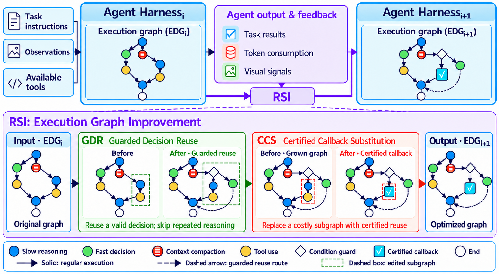
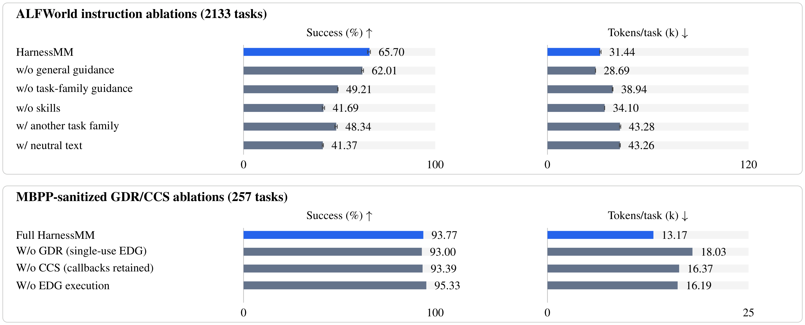
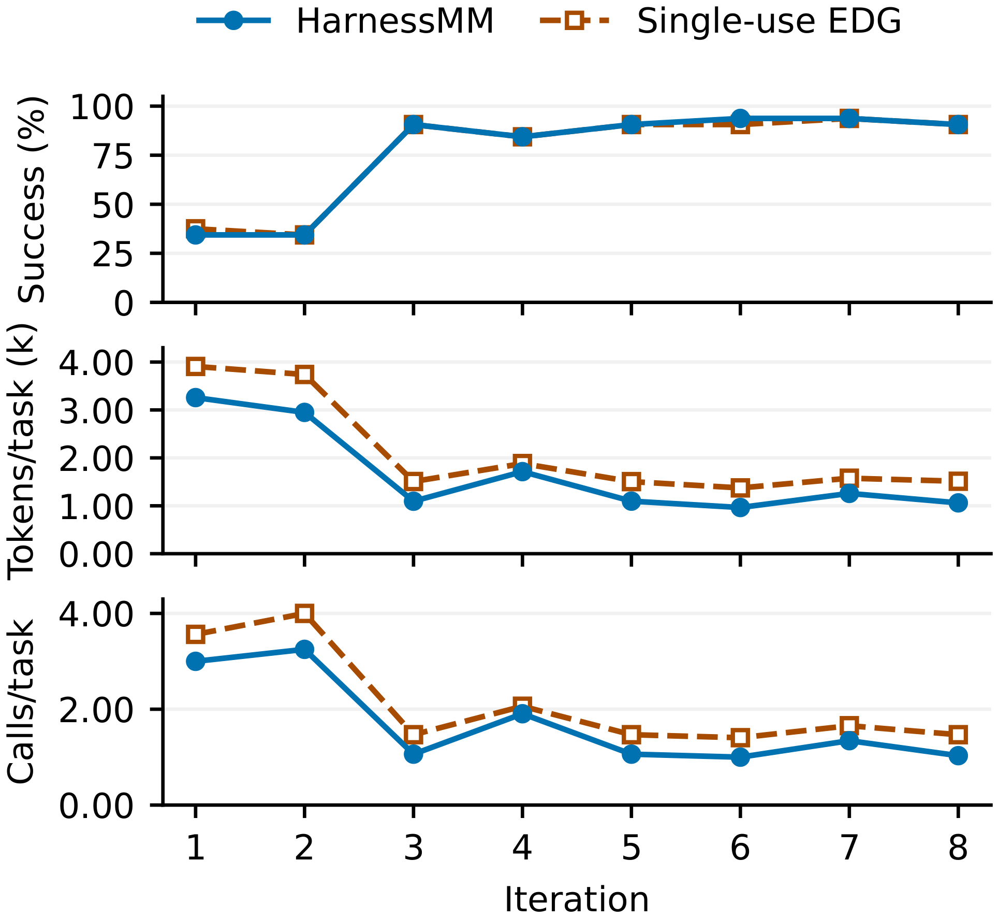
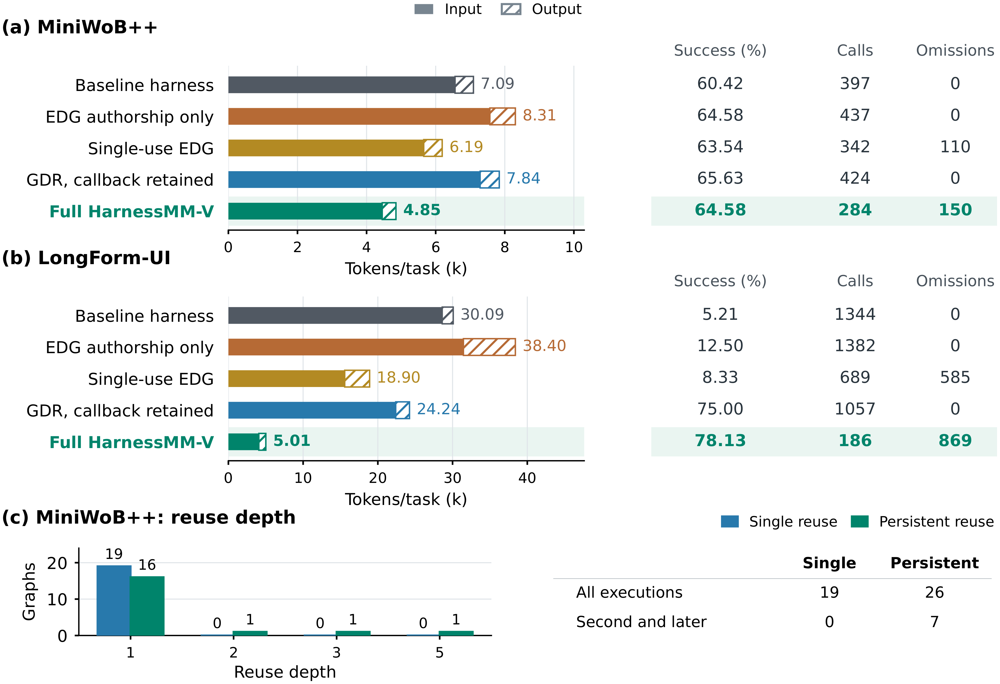

<!-- paper-reading-lang: zh-CN -->
<!-- paper-reading-mode: deep -->
<!-- paper-reading-theme: cobalt -->

# HarnessMM：把「已经决定的调用」从推理账单上划掉——守卫式决策复用与回调替换的 harness 提效工程

```paper-map
{"thesis":"清华与微软亚研院团队提出：agent harness（协调模型推理、工具执行与反馈的软件层）在每次工具返回后都重新调用推理——哪怕先前推理已经把后续动作和字面参数定死了。HarnessMM 在不改动模型权重、工具与任务接口的前提下介入推理回调边界：慢推理产出可执行决策图 EDG（动作+字面参数+前驱+公共执行守卫），守卫式决策复用 GDR 用观测回执激活合格决策，认证回调替换 CCS 把合格决策经原生工具接口执行并顶掉对应的推理回调，新推理需求或守卫不满足时归还控制权。诚实记账（作者成本+选择器+回退+失败执行全算）下：HumanEval 上 Codex 90.82% 不变省 29.54% token、DeepSeek Harness 71.43%→85.71% 同时省 87.93%；MBPP 消融分离出 GDR 持久复用省 26.91%、CCS 回调移除省 19.52%；六基准伴随配置有涨有跌（AIME 成本反升 28%——如实报告）；视觉版 HarnessMM-V 在 LongForm-UI 上 8.33%→78.13% 同时省 73.49%；冻结 harness 跨基准迁移省 83.10%。论文还命名了快慢组合的记账陷阱「替换悖论」：只有消灭的推理超过新增的署名+选择+回退，替换才真正省钱。","reader":"要给 agent 系统降 token 成本的工程师与研究者；本页把成本模型、守卫代数、证书审计、六基准账本与消融逐个放进可复算的模型（替换悖论不等式、净节省条件、GDR/CCS 边际分解、复用深度分布、迁移节省区间）。","goals":["走通「回调冗余问题→替换悖论→EDG/GDR/CCS 三件套→完整成本记账→六基准账本→消融分离→RSI 迭代→视觉特化与迁移→边界」的完整论证","把 29.54%/87.93%/26.91%/19.52%/73.49% 等节省率逐个放回成本模型核算，分清「持久复用」「回调移除」「指令配置」三种贡献","标出论文自报的负结果与边界：AIME 成本反升、MetaRSI 优化未回收、各基准配置异质（有的根本没开 EDG 执行）"],"outcome":"全文精读 arXiv 2610.32813v2（2026-11-06，64 页技术报告：主文 13 页 + 附录 A-V 全地图与关键节细读——D.3 净节省条件、D.5 各实验配置表、B.2 RSI 协议、A 表 3 八轮逐轮数据），四张关键图 600 DPI 提取嵌入，Table 1/2/3 与图 2-8 逐格核对。","outcomeSource":"https://arxiv.org/abs/2610.32813","items":[{"number":"01","label":"回调冗余","signal":"每次工具结果后重新推理","text":"harness 在每个工具返回后必须判断「观察需要新推理还是允许已决定的动作直接执行」；重复审议会重新生成语义未变的决策。具体机会：慢推理写完程序后下一个编译命令已经可指定、编译成功回执可激活已指定的测试命令——动作与参数已定（语义不确定已消除），只剩回执未知（执行不确定）。","source":"§1 引言"},{"number":"02","label":"替换悖论","signal":"记账陷阱","text":"快慢组合加一个快决策却不移除原下游审议，加法路径成本 Cn+Cf 反而更高；短输出本身不能证明省了钱。有益替换要求 Cremoved>Cintroduced，其中引入成本含署名、路由、附加上下文与回退——成本条件与能力约束（regret≤ε）是两个独立要求。","source":"§3.2-3.3 Eq.2-3"},{"number":"03","label":"EDG","signal":"决策图四元组","text":"慢决策 i 同时发出当前工具动作与有界可执行延续 Gi=(Vi,Ei)，未来决策节点 dj=(aj,argj,predj,gj)：原生动作、完整字面参数、前驱、公共执行守卫 gj:Spublic→{true,false}。作者定守卫、适配器对着后续回执求值；缺回执或不通过则不收编，空图归还慢推理。","source":"§4.1 Eq.4"},{"number":"04","label":"GDR","signal":"守卫式复用","text":"图跨工具迁移保留；每条回执更新前驱完成与守卫真值。eligible(dj,st)=1{pred 完成}·1{gj(st)=true}·1{argj 闭合}；守卫只消费观测回执、绝不预测结果。Jev 式类型化选择器返回候选 ID 或弃权、不修参数；唯一合格节点确定性执行，空集或弃权走慢推理。字面闭包由 schema 强制，「先前推理是否正确解决了动作」仍是语义假设，由任务评分检验。","source":"§4.2 Eq.5"},{"number":"05","label":"CCS","signal":"认证回调替换","text":"把 GDR 收编的决策变成下一个慢回调的可执行替换：经原生工具接口执行署名动作、回执绑定被跳过的回调。证书 κt=(图哈希,决策 id,前驱回执,精确参数,工具回执,被绕过回调 id)；审计要求 N^parent_slow−N^HarnessMM_slow≥1——证书证明执行与省略，不预测未观测的响应，token 值由完整任务账本度量。","source":"§4.3 Eq.6-7"},{"number":"06","label":"完整成本记账","signal":"一个请求都不漏","text":"优化目标是完整回合成本 Cepisode=Σ(Tin+Tout)——账本计入署名、选择器输入输出、附加上下文、剩余慢调用、回退、恢复、定稿与失败的付费执行；缓存输入照算。开发成本 Cdev（训练/提案/验证/被拒尝试）单列，部署摊销 CN=Cdev/N+E[Cepisode]。token 不等于延迟与能耗——那些要另测。","source":"§4.4 Eq.8-9"},{"number":"07","label":"工业 harness 主账","signal":"29.54% 与 87.93%","text":"同一 98 道 HumanEval：Codex 90.82% 持平、66.72k→47.02k（29.54%），18 次认证绕过（0.18/题）；DeepSeek Harness 71.43%→85.71%（22 升 8 降，McNemar p=0.0161）、96.28k→11.62k（87.93%）、147 次绕过（1.50/题）。MBPP-257：DeepSeek 90.27%→91.83%、53.98k→10.61k（80.35%）、472 次绕过。MiMo-v2.6-pro 四组对照全部省 62-84% 且分不降。","source":"§5.2-5.3 Table 1、图 3"},{"number":"08","label":"GDR/CCS 消融","signal":"26.91%/19.52%","text":"MBPP-257 四条件同设置：全配 93.77% @13.17k；去 GDR（单次用图）93.00% @18.03k——持久复用省 26.91%（配对区间 [4.01,45.57]%）；去 CCS（回调保留）93.39% @16.37k——回调移除省 19.52%；去 EDG 执行 95.33% @16.19k——全配省 18.62% 但少解 4 题（质量换成本的显式权衡）。407 次认证替换中含 201 张图的重复绕过——复用深度真实发生。","source":"§5.5 图 4 下"},{"number":"09","label":"六基准账本","signal":"有涨有跌","text":"伴随配置（指令/上下文/路由）逐基准不同：ALFWorld 66.20% @31.12k（对基线 42.29% @34.05k、SkillOpt 63.29% @101.33k）；SearchQA 76.76% @0.99k 省 19.08%；LiveMath 29.38% @0.83k；AIME 87.14% @5.90k——比基线贵 28.34%（生成推理主导、署名+输入反而更多，如实报告）；Terminal-Bench 2 26.03% @57.67k；GAIA2 43.96% @639.64k 省 12.41%（输入占 99.47%）。D.5 表明确：ALFWorld 是纯指令对照（控制器关闭）、LiveMath 每题一调零替换——六张图不是同一机制的成绩单。","source":"§5.4 图 2、D.5"},{"number":"10","label":"RSI 迭代","signal":"34%→91%","text":"训练引导的 harness RSI 在 32 道 MiniWoB++ 上八轮：成功率 34.38%→90.63%、token 3.26k→1.06k（67.43%）；第 8 轮双臂同解 29/32，持久复用省 29.83%（区间 [18.84,39.00]%）。附表 3 逐轮数据可见非单调（第 2 轮回落、第 3 轮跳升）。MetaRSI 试点是诚实负结果：8 个提案 6 个被字面重叠守卫拒掉、零接受、优化成本未回收。","source":"§5.6 图 5、表 3、B.2"},{"number":"11","label":"视觉特化","signal":"锚定像素","text":"HarnessMM-V 给每个决策绑定署名时视觉证据：节点 vj=(id,动作,参数,前驱,锚 Aj,守卫)，锚含作者图像/固定区域/像素签名/内容哈希；合格性 η 加上图像尺寸一致与当前图守卫。LongForm-UI（9-13 步表单）：8.33%→78.13% @18.90k→5.01k（73.49%），慢调用 7.18→1.94/题；复用深度：单次用 19 张深度 1 图 vs 持久 16+1+1+1 张共 26 次执行（7 次后续用）。","source":"§6 Eq.10-12、图 7"},{"number":"12","label":"迁移","signal":"策略可迁移","text":"冻结 harness 在 MiniWoB++ 与 LongForm-UI 间经共享鼠标键盘接口互迁、目标零更新：Qwen 9B 方向省 73.49% [70.04,77.34]%；GPT-5.6 Sol 方向 98.96% 成功率省 83.10%、反向 86.46% @2.13k；物理请求 1,056→159，888 次认证省略中 729 次（82.09%）发生在图首次使用之后——迁移的是「怎么建图与检查」的策略，每个目标回合用自己的坐标与证据现写图。","source":"§6.2.4"},{"number":"13","label":"边界","signal":"五条自报","text":"节省依赖提供商的 token/缓存记账与已解决动作的可得性；新语义决策仍需慢推理；署名+选择+回退可能超过省下的调用（AIME 即例）；公共状态适配器任务特定；小开发集下策略级质量差不确定。","source":"§7"}]}
```

深读对象：arXiv 论文[《HarnessMinusMinus: A Technical Report on Efficient Agent Harnesses》](https://arxiv.org/abs/2610.32813)（v2，2026-11-06；清华大学 × 微软亚洲研究院，作者 Yuhua Jiang、Chang Xu、Feifei Gao、Li Zhao；代码开源 github.com/YuhuaJiang2002/HarnessMM）——[点此打开原文 ↗](https://arxiv.org/abs/2610.32813)。这是一次手动点播深读（本站惯例：手动点播不占当日 HF 名额、当天已有日报时次日另发或合并）。选它的理由与本周主线严丝合缝：一周以来我们沿着「贵的判断交给结构」读了权限原语、记忆系统、安全出口闸、训练环境工厂与单 pass 生成，HarnessMM 补的是**运行中的成本结构**——agent 每走一步工具都要重新叫一次模型，哪怕下一步做什么早就定了；它把「已经决定的调用」从推理账单上划掉——HumanEval 上 DeepSeek harness 省 87.93% 的 token，同时把成功率从 71.43% 拉到 85.71%（省与涨同时成立，且配对检验显著）；MBPP 上省 80.35%、LongForm-UI 表单基准上成功率从 8.33% 拉到 78.13%。这些数字的量级在 agent 成本工程里是罕见的：不是百分之几的提示压缩与提示微调，而是把整张推理账单砍掉一个数量级。更妙的是它自称「Jev 式类型化选择器」——决策模型六连的 typed interface 直接内嵌进了成本工程，与 Flide 的请求形态、VoT 的「何时不思考」在同一个问题上会师：**什么时候不该再想**。这份 64 页技术报告的诚实度也罕见：AIME 上成本反升 28.34% 照登、MetaRSI 试点零接受照登、六基准里哪些根本没开 EDG 执行在附录 D.5 写得明明白白。本页按细章跟读：回调冗余与替换悖论、EDG/GDR/CCS 三件套的代数、完整成本记账、工业 harness 主账、GDR/CCS 消融分离、六基准账本（含负结果）、RSI 迭代曲线、视觉特化与跨基准迁移、以及五条自报边界；全部数字经逐格回对原文表格与附录。

<!-- Deep Reading coverage
| Source section / object | Role | Explanation location / status |
| --- | --- | --- |
| 摘要 + Figure 1 总览 | 总览 | §01、§06（图 1 嵌入） |
| §1 引言（harness 定位、效率方法四支、替换悖论引入、resolved decision） | 立论 | §01-02 |
| §2 相关工作（压缩/快慢路由/技能记忆/harness 优化） | 定位 | §02、§15 |
| §3.1-3.2 问题形式化（成本 Eq.1、能力约束 Eq.2） | 形式化 | §03 |
| §3.3 替换悖论（Eq.3） | 形式化 | §02 |
| §4.1 EDG（Eq.4） | 机制一 | §04 |
| §4.2 GDR（Eq.5、Jev 选择器） | 机制二 | §05 |
| §4.3 CCS（Eq.6-7 证书与审计） | 机制三 | §06 |
| §4.4 完整成本（Eq.8-9） | 记账 | §07 |
| §5.1 协议（20/20/60 切分、token 效率指令） | 实验 | §08 |
| §5.2 替换了哪些调用（Table 1） | 实验一 | §08 |
| §5.3 工业 harness（HumanEval/MBPP/MiMo 六对，图 3） | 实验二 | §08 |
| §5.4 六基准伴随配置（图 2）+ ALFWorld 指令消融（图 4 上） | 实验三 | §09 |
| §5.5 GDR/CCS 消融（图 4 下） | 实验四 | §10（图 2 嵌入） |
| §5.6 RSI 迭代（图 5）+ 附录 A 表 3 | 实验五 | §11（图 3 嵌入） |
| §6.1 视觉方法（Eq.10-13） | 机制四 | §12 |
| §6.2 视觉实验（表 2、图 6/7/8） | 实验六 | §12-13（图 4 嵌入） |
| §7 局限 + §8 结论 | 边界 | §15 |
| 附录 A（八轮逐轮表 3） | 数据 | §11 |
| 附录 B.2（RSI/MetaRSI 协议与负结果） | 协议 | §11 |
| 附录 C（适配器实现 C.1-C.5） | 实现 | §05（简评） |
| 附录 D（D.3 净节省条件、D.5 各实验配置表） | 形式化 | §03、§09 |
| 附录 E-L（消融细节、工业对照、QA/训练） | 数据 | §08-§11（引用） |
| 附录 Q-T（视觉设置、RSI、迁移、证书） | 数据 | §12-§14（引用） |
-->

## 01 / 回调冗余：harness 每一步都在为「已知答案」付钱

### 问题的形状

agent harness 是连接模型推理与工具执行的软件层：ReAct 在推理-动作-观察间循环，SWE-agent 证明接口设计本身塑造软件工程表现。每个工具结果返回后，harness 必须做一个决定：**这条观察需要新推理，还是允许一个已经解决的动作直接执行？** 现有 harness 的默认答案是前者——每次都叫模型。但「重复审议会重新生成语义未变的决策」：如果慢推理在写完程序时就已经把编译命令、甚至编译成功后的测试命令连同字面参数全部定好，那么工具回执（编译退出码）到达时再叫一次模型，只是在为**已经知道的答案**付一遍上下文与生成的钱。

论文的关键概念切分在这里——这个切分的价值在于它把「需要智能的判断」与「不需要智能的等待」这两件事分开计价：**resolved decision（已解决的决策）**——先前推理已经固定了动作与其字面参数；未知的只剩工具回执。语义不确定性（做什么、传什么参数）已被消除，剩下的只有执行不确定性（回执什么时候来、是什么）。前者需要模型，后者只需要一个守卫——而守卫是一段确定性代码，运行成本近乎零、可以单元测试、出行为可复现可回归。整套方法的经济学就建立在这个替换上：把「等回执再想」换成「等回执查表」。把这个切分做实，就是整套方法的地基。值得对照的是本站深读过的几篇近邻：Flide 把决策调用本身做便宜（请求形态层）、Value of Thinking 决定一道题值不值得想（任务路由层）、SPILLWAY 决定一个动作能不能发（安全层）——HarnessMM 的切分粒度是**回合内的工具边界**：回执到达的这一刻，需不需要再叫一次模型——这是每个 agent 每走一步都要回答的问题。四者正交、可以叠加在同一套 agent 上；而 HarnessMM 恰好选了其中最直接省钱的一层：每次省下的不是几分钱的选择器，而是整次带完整上下文的推理回调。对任何在真实 API 账单上跑 agent 的团队，这一层的投资回报最先兑现——毕竟按次计费的工业级骨干每一次带完整上下文的调用都是真金白银，省一次调用就是省一笔实实在在的开销。

### 一个具体的编码例子

论文自己的例子最清楚：编码 actor 一次慢推理可以固定「写文件」动作、make 命令和 pytest 命令三件事。守卫检查「文件缺失」「构建输入可用」「构建成功」这些**公共可观察**的条件；后续回执供应就绪证据，而不需要重新生成参数。「公共可观察」四字有严格含义：守卫的输入只有请求本身、工具回执与已完成动作历史——不含模型内部状态、不含对未来的预测。这让守卫成为一段可以单元测试的确定性代码：给它一组回执，期望一个布尔值；出错了可以复现、可以修，而不是「模型偶尔觉得可以」。一张已署名的图可以服务多个工具转移、其延续保持已解决态；新推理需求出现时控制权交还慢 actor——它可以继续推理并署名新的图，贯穿整个任务。

## 02 / 替换悖论：快慢组合的记账陷阱

### 悖论的代数

快慢架构的常见失败模式被论文命名为 **Substitution Paradox**：快阶段成本 $C_f$，但没有移除原下游审议的任何 token，那么加法路径成本是 $C_n + C_f$——**加了个快路径反而更贵**。短输出本身不能解决这个开销：类型化输出（快决策只吐一个 ID）与高频快路径激活，都不构成「回调被消灭」的证据。有益替换的必要条件是一条严格不等式：

$$C_{\text{removed}} > C_{\text{introduced}}$$

其中「引入的计算」包括署名（authorship，写图本身要一次慢调用）、路由（选择器）、附加上下文、以及任何回退与恢复。（教学重建）这条不等式为什么重要：它把「快」与「省」脱钩了。业界讨论快慢架构时常把两者混用——「快路径便宜所以省钱」，但便宜的单价乘以没有减少的次数仍是纯增项：一个 10ms 的选择器如果每次都跑、而被它顶掉的推理从没被真正跳过，它是纯增项；反过来一个昂贵的署名调用如果能被五次复用摊薄，它可能净省。记账必须**完整任务级**，否则任何中间数字都能被编排出来。

### 与能力约束的独立关系

论文同时维护两条独立的约束：成本条件（上式）与能力约束（§03 的 regret 界）。「省了钱但掉分」与「保了分但更贵」都不合格——这条双重约束贯穿全部实验设计：每个对照对（pair）共享骨干、工具、限额与评分器，成功率和 token 同报，缺一即废。

## 03 / 形式化：能力受限的计算替换

### 成本与约束

固定 actor 参数 $\theta$，harness $h$ 提供指令、上下文与原生执行规则。对任务 $x$，展开成一个有限执行的计算图 $G_h(x) = (V, E)$——节点含推理、检索、路由、工具、验证与恢复，边编码执行依赖。策略 $\pi$ 的期望 token 成本：

$$C(\pi) = \mathbb{E}\left[ \sum_{v \in V} \mathbf{1}\{v \text{ invoked under } \pi\} \, c_v \right]$$

相对原 harness $h_0$，定义**能力遗憾** $R_b(\pi) = Q_b(h_0) - Q_b(h_\pi)$（$Q_b$ 为基准 $b$ 官方分）。目标是：

$$\min_\pi C(\pi) \quad \text{s.t.} \quad R_b(\pi) \le \epsilon_b$$

容差 $\epsilon_b$ 在评测前定死；零遗憾协议取 $\epsilon_b = 0$。两个 harness 在**全部任务**（含失败任务）上评约束——不许只报成功子集；这一条与完整记账配合，堵住了成本报告的两个经典漏洞：只算成功回合的成本（失败回合往往更长更贵）、只报被替换调用的假想 token（而不是两臂的物理请求总量差）。后面所有实验的置信区间与配对检验都建立在这套协议上。

### 附录 D.3 的净节省条件

附录给出同轨迹的 token 计算：设新增署名与选择器 token 为 $A$、新增回退为 $F$，被消灭的 $K$ 个回调成本 $c_1, \ldots, c_K$，则净节省当且仅当：

$$\sum_{j=1}^{K} c_j > A + F, \qquad \text{均匀成本下即 } K > \frac{A+F}{c}$$

（教学手算）代入感受量级：一次慢回调约 8k token（HumanEval 的 DeepSeek 基线 96.28k/9.73 调用）、署名+选择器新增约 2k、回退罕见——那么 $K > 0.25$：**每张图只要平均顶掉四分之一个回调就回本**；实测 1.50 次绕过/题（DeepSeek HumanEval），安全边际六倍。这是「为什么这套设计能省钱」的最小算术——它同时给了三个设计旋钮的敏感度方向：降低署名成本 A（更紧凑的作者提示）、减少回退 F（更准的守卫）、提高复用次数 K（更持久的图与更长的工作流），三者都把不等式往更宽的余量推。注意论文的诚实标注：这个关系描述对复用覆盖的依赖，**不是**实测节省的预测——被省的调用没被执行、替换后的轨迹可能分叉，实测只能从两臂总 token 差算。换言之，D.3 是事前的可行性筛，不是事后的功劳簿。

## 04 / EDG：可执行决策图

慢决策 $i$ 处，actor 发出当前工具动作与一个**有界可执行延续** $G_i = (V_i, E_i)$。未来决策节点：

$$d_j = (a_j, \arg_j, \text{pred}_j, g_j), \qquad g_j : S_{\text{public}} \to \{\text{true}, \text{false}\}$$

$a_j$ 原生动作、$\arg_j$ **完整字面参数**、$\text{pred}_j$ 前驱、$g_j$ 公共执行守卫。四个设计要点：其一，**守卫由作者随节点一次定死**、适配器对着后续回执求值——守卫不是运行时再推理。守卫语言是受限的谓词（查回执字段、查文件状态、查构建码），模型在署名时用这个受限语言写下条件，之后条件本身不再消耗任何智能；其二，守卫只读**公共状态**（请求、观测回执、已完成动作历史），编码守卫可以查「文件缺失/构建输入可用/构建成功」，但永远不预测结果；其三，边从根或更早节点指向后继，形成无环图；其四，**参数闭包**（literal closure）由 schema 与候选成员检查强制——执行不得要求新推理。缺回执或守卫拒绝则不收编；空图归还慢 actor。「先前推理是否正确解决了动作」仍是语义假设——由任务评分检验，守卫只确认它检查的条件。这个职责切分与 MIRIX-2.0 的「图只做索引、库做真相源」同构：确定性组件负责可形式化的检查（前驱完成、参数闭合、守卫真值），语义正确性交回给端到端评分——不假装守卫能理解「这个动作对不对」，只保证「这个动作在声明的条件下执行了」。错误因此有两类可分离的来源：署名时的语义错误（模型当时就把命令写错了）与执行时的守卫错误（条件本身判断错了）；消融实验里质量的小幅波动主要归前者。



*图 1：HarnessMM 总览（原文 Figure 1）。上排：harness RSI 用任务结果与 token 消耗把 harness 从 EDGi 更新到 EDGi+1——工具观察决定已存动作能否执行；下左：GDR 引入已解决决策的守卫复用路线（绕过重复推理的绿色通道）；下右：CCS 把冗余推理子图替换为认证的原生执行（橙色面板）。实线为常规执行、虚线为守卫复用路线、虚线框为被编辑的子图。*

## 05 / GDR：守卫式决策复用

图跨工具转移保留。每条观测回执更新前驱完成度与守卫真值；对节点 $d_j$ 的合格判定是三个指示函数的乘积：

$$\text{eligible}(d_j, s_t) = \mathbf{1}\{\text{pred}_j \text{ completed}\} \cdot \mathbf{1}\{g_j(s_t) = \text{true}\} \cdot \mathbf{1}\{\arg_j \text{ closed}\}$$

三因子各挡一类失败：前驱没完成（依赖未满足——测试命令不该在编译前跑）、守卫为假（公共证据不支持——编译失败回执不该触发测试）、参数未闭合（还需要新推理——下一步动作依赖尚未观测的值）。三个因子的乘法形式意味着**任何一个为零即整体不合格**，没有加权折衷——这是把「能不能执行」当布尔门而非打分题，与 SPILLWAY 的出口地板同一设计哲学：宁可误拒交回慢推理（损失一点效率），不可误放（执行不该执行的动作）。误拒的代价是少省一次 token，误放的代价是错误进入执行历史——不对称性决定保守。**守卫消费观测回执、绝不消费预测结果**——无支持的观察、未满足的依赖或需要新推理的参数都交还慢 actor $H_0$。

选择器是 **Jev 式类型化接口**：返回一个合格候选的 ID 或弃权，不修订参数。唯一合格节点确定性执行（零模型调用）；空集或弃权走慢推理。每次执行回执更新同一张图——图在回合内是活的——每次执行回执都可能激活新的合格节点，同一张署名图可以跨越多个工具反馈边界逐步兑现，这正是后面消融里「持久复用」与「单次用图」的分野所在。选择器的设计也有一处值得注意的克制：它**不修参数**——要么原样执行署名的字面参数、要么弃权，没有第三种「微调一下」的选项。这个克制保住了复用的可审计性：执行的参数与署名的参数必须逐字相同，证书才成立；一旦允许选择器改参数，省略的回调与执行的参数之间就出现了语义缝隙，审计成本陡增。附录 C.4 给出序列化实现（banks 把节点与边落盘），C.1-C.5 给出各基准的公共状态适配器——这套适配器是任务特定的（§15 的边界之一），但接口契约统一。

## 06 / CCS：认证回调替换

GDR 只说「这个决策可以执行」，CCS 把它变成**对下一个慢回调的物理替换**：在原 harness 注册的回调边界上，父路径本来走 $s_t \to H_0 \to a_t$（先叫模型再执行），替换路径走 $s_t \to d_j \to a_t$（直接执行署名动作）——同一个原生工具接口。替换证书绑定：

$$\kappa_t = (\text{graph hash}, \text{decision id}, \text{predecessor receipt}, \text{exact args}, \text{tool receipt}, \text{bypassed callback id})$$

六个字段把「哪张图、哪个节点、前驱是否完成、精确执行的参数、实际工具结果、省略了哪个回调」钉死。这套证书在工程上的角色接近数据库的事务日志：它不阻止错误发生，但让每一次替换**可追溯、可对账、可审计**——出问题时可以精确定位到「哪张图的哪个节点在哪个回执之后被放行」，而不是面对一条黑盒轨迹猜哪里出了岔子。对要在生产环境跑这套机制的人来说，审计能力与省钱能力同样重要：账单对不上、行为不可解释的优化，风控团队不会放行。审计对指纹做三件事：匹配决策 ID 到字面参数与已完成前驱的回执、核对工具执行回执、检查注册的父边界，并要求：

$$N^{\text{parent}}_{\text{slow},t} - N^{\text{HarnessMM}}_{\text{slow},t} \ge 1$$

父计数登记原回调边界——证书验证**精确原生执行与该请求的缺席**，不预测未观测的响应或其 token 数（那会是循环记账：用假想的 token 值证明自己省了 token）。原生评分量质量、完整任务总量成本——两条证据链分开走。这个设计的深意在于防止「用模型评模型」的循环：被跳过的回调本来会生成什么、花多少 token，永远不可观测；如果用模型去预测它，成本论证就建立在虚构之上。证书证明的是**物理事实**（这次执行发生了、那个请求没发生），评分证明的是**任务事实**（最终答案对不对）——两者合起来才是完整的证据，各自单独都不够。这套纪律与 SPILLWAY 的「执行效应层计分」、RepoFactory 的「完整回合记账」一脉相承，正在成为 agent 实验方法学的公约数。

## 07 / 完整成本记账：一个请求都不漏

优化目标是**完整回合成本**：

$$C_{\text{episode}}(h; x) = \sum_{c \in C(h,x)} (T^{in}_c + T^{out}_c)$$

账本逐项计入：图署名、选择器输入输出、附加上下文、剩余慢调用、回退、恢复、定稿与**失败的付费执行**。缓存输入照算（提供商给了折扣不等于没消耗）。确定性检查（守卫求值）只加 CPU 工作量、不加 actor token。开发成本 $C_{dev}$（训练、提案、保护验证与被拒尝试）单列；$N$ 个部署任务的摊销：

$$C_N = \frac{C_{dev}}{N} + \mathbb{E}[C_{\text{episode}}(h; x)]$$

共享署名只对其声明的开发或执行队列收一次。（教学重建）这套记账哲学值得单独学：它把「省 token」的证明责任放在**物理请求层**——每个被消灭的回调必须有一张证书、每次署名与回退必须入账、优化成本摊销单列。对比业界常见的「推理 token 下降 90%」式报告（不提署名与回退），完整账本让替换悖论无处藏身。一个具体的对比例子就在本论文的对照方法里：SkillOpt 在 ALFWorld 上把成功率做到 63.29%，代价是 101.33k token/题——比基线 34.05k 贵三倍；如果只报「相对自身的某次优化」它也能讲出降本故事。HarnessMM 的账本不允许这种讲法：每一对比较都是两臂物理请求总量的差，署名、选择、回退、失败全在分母里。方法论上这接近临床试验的意向性分析（ITT）——按分到的组算全部结果，不挑响应者子集。论文同时提醒：token 不等于延迟与能耗——那些需要单独测量。这条提醒的分量在长尾场景会显现：守卫求值与图编译是纯 CPU 工作，不占 actor token 但占墙钟时间；对延迟敏感的交互场景（视觉 agent 的实时点击、对话式产品），token 账单的节省与响应速度的改善可能不同步甚至反向。论文在视觉部分补测了 LongForm-UI 的耗时：bank 锚定的 RSI 省 87.18% 首用 token 的同时省 12.87% 墙钟——token 与时间的节省方向一致但幅度差七倍，正好说明两个量纲不可互换。

## 08 / 工业主账：六对对照的省与不掉分

### HumanEval 与 MBPP 主表

同一骨干、同一原生接口与评分器的成对比较（Table 1 与图 3）：

| 对照 | 基线成功 → MM | token/题 (k) | 绕过/题 |
| --- | --- | --- | --- |
| HumanEval × Codex | 90.82% → 90.82% | 66.72 → 47.02（**29.54%**） | 0.18 |
| HumanEval × DeepSeek | 71.43% → **85.71%** | 96.28 → 11.62（**87.93%**） | 1.50 |
| MBPP × Codex | 91.83% → 90.66% | 129.55 → 49.22（62.0%） | 0.61 |
| MBPP × DeepSeek | 90.27% → 91.83% | 53.98 → 10.61（**80.35%**） | 1.84 |

（教学手算·两个读法）其一，HumanEval DeepSeek 的 +14.28 分配上 McNemar p=0.0161（22 升 8 降）——22 升 8 降，**省 token 的同时涨分在配对检验下显著**，这不是省了钱但碰巧掉分再被均值掩盖的那种；涨分的机制解释（本页推说）：绕过重复审议也绕过了「重复审议引入的跑偏」——每一次重新调用都是模型在带噪上下文上重新掷骰子，先前已经定对的决策可能在第二次审议时被改错；守卫复用把这个决策冻结在第一次（往往是仔细想过的）署名上。这与 Value of Thinking 的结论（有些题不思考反而对）在回合内粒度上呼应——少想一次有时更准。当然这个解释是事后的，论文只报配对结果不给机制实验，归因保持假设身份。其二，同 benchmark 上 Codex 只省 29.54% 而 DeepSeek 省 87.93%——基线 harness 的调用密度不同（5.35 vs 9.73 调用/题），**冗余越多的 harness 复用空间越大**；省的比例是基线形态的函数，跨 harness 不可直接比。这给「要不要在自己的 harness 上试这套」一个快速判断法：先数基线的调用/题与回执/调用比——如果每次工具回执后都跟一次满上下文的重新推理（调用数≈回执数+1），冗余面就大，值得试；如果 harness 本来就有跳过逻辑（像 Codex 相对克制的 5.35 调用/题），增量空间就小。同理，MiMo 骨干四组对照省得更多（62-84%）不完全是机制功劳，也有基线调用更密的成分——读省率永远先读基线。MiMo-v2.6-pro 骨干的四组对照（图 3e-f）全部省 62-84% 且分数持平或微涨（如 DeepSeek HumanEval 96.94%→97.96% @11.62k→4.40k、MBPP DeepSeek 97.67%→98.05% @6.20k→5.11k）——强骨干上机制依然成立，且省的绝对量随骨干定价放大。

### 与 CoT-only 基线的对照

MBPP 上纯 CoT 基线 93.39% @15.04k——HarnessMM 10.61k 对它省 29.46% 且分更低 1.56 点。这组对照说明：HarnessMM 的省钱**不是**「换成短输出提示」的效果（那是 CoT-only 的角色），而是复用机制的贡献。三臂并排读更清楚：CoT-only 93.39% @15.04k、完整 MM 91.83% @10.61k、基线 harness 90.27% @53.98k——基线贵不是因为提示长，而是因为调用多；MM 的省钱来自调用被跳过，CoT-only 证明「光让模型少说」到不了同一个省法。分差（1.56 点）提示复用在该设置下有小的质量代价，与消融里「去 EDG 执行分更高」的方向一致。

## 09 / 六基准账本：有涨有跌，且不全是同一机制

### 伴随配置的异质性

图 2 的六基准不是同一机制的成绩单——附录 D.5 的配置表写明：ALFWorld 是**纯指令对照**（本地控制器关闭）、SearchQA 只做终端答案接受（无持久多动作图）、LiveMath 每题一调用零回调替换、AIME 用冻结的编译决策策略、Terminal-Bench 是存档指令快照（无认证 EDG 执行）、GAIA2 才是完整集成（146 次验证快执行、占全部动作尝试的 1.40%、输入占 actor 成本 99.47%）。把它们当「HarnessMM 六连胜」读是误读——它们是「harness 配置空间」的六个采样点，各自回答不同的问题。对想引用这些数字的读者，正确的姿势是先查 D.5 再选格子：要引「复用机制的功劳」引 MBPP 消融（唯一同设置只改执行规则的实验）；要引「端到端集成总账」引 HumanEval/MBPP/GAIA2 三组；要引「指令价值」引 ALFWorld 六条件；AIME 与 Terminal-Bench 的格子用来圈边界。论文把这张地图放在附录里，等于主动交出了误读的防线。ALFWorld 问「指令内容值多少分」（控制器关着，功劳记在提示工程）、SearchQA 问「终端答案接受能省多少」、GAIA2 问「完整集成在真实长程任务上的总账」。D.5 的这张表是全文最值得抄的一页——它把「哪个实验测哪个机制」的对应关系摆在同一个平面上，读者不需要从成绩数字反推实验设置。对比业界常见的「N 个基准全部领先」式横幅，这种配置透明度本身就是方法论贡献：省率的分母（基线成本结构）与分子（复用覆盖）都随配置变，脱离配置谈省率没有意义。

### 数字与两处负结果

正的：ALFWorld 66.20% @31.12k（基线 42.29% @34.05k——**分涨 24 点还省钱**；对 SkillOpt 63.29% @101.33k 省 69.29% token）；SearchQA 76.76% EM @0.99k 省 19.08%（配对区间 [16.57,21.23]%）；LiveMath 29.38% @0.83k（对基线 19.38% @4.10k）；GAIA2 省 12.41%。负的：**AIME 87.14% @5.90k——比基线 4.59k 贵 28.34%**。分解（表 16）：基线 0.22 输入 + 4.38 输出，MM 0.54 输入 + 4.28 输出 + 1.08 共享署名——数学工作负载由生成长推理主导，MM 砍掉的执行输出小于它新增的输入与署名。这是替换悖论的实证案例，论文照登并解释。Terminal-Bench 2 存档对照里 Codex+MM 分从 77.78% 掉到 50.00%（另一配置 55.56%）——同样是如实报告的负格子。

### ALFWorld 指令消融

图 4 上部在同一 2,133 道任务上比六种冻结指令：完整 65.70% @31.44k；去掉任务族指引 49.21% @38.94k（**又掉分又变贵**）；去掉技能 41.69%；中性文本（同 token 数）41.37% @43.26k。任务族指引是质量与成本的主力，且「贵」来自失败回合的拖尾。六条件的梯度也值得记：完整 65.70% > 任务族单独 62.01% > 通用单独 49.21% > 去技能 41.69% ≈ 中性文本 41.37%——「通用指引+任务族+技能」三件套缺一掉十几到二十几个点，而中性文本（同 token 数的控制组）证明**是内容在起作用不是长度**。这组对照把「指令工程在 ALFWorld 这种结构化环境里的价值」量化得非常干净，也说明为什么后面 SkillOpt（自动指令优化）在这个基准上贵三倍还少两分。



*图 2：指令与决策复用消融（原文 Figure 4）。上：ALFWorld 2,133 题六种冻结指令条件（三种子均值、须显示极差）——完整 65.70% @31.44k，任务族单独 62.01% @28.69k，通用指引单独 49.21% @38.94k，去技能 41.69%，中性文本 41.37%；下：MBPP-257 四种执行条件——全配 93.77% @13.17k、单次用图 93.00% @18.03k、回调保留 93.39% @16.37k、去 EDG 执行 95.33% @16.19k。*

## 10 / GDR/CCS 消融：把两种省钱分开算

这是全文方法学上最干净的一组实验（图 4 下）：同一 257 道 MBPP、同一署名提示/schema/上下文/工具/限额，只改图执行规则。四个条件的账：

| 条件 | 成功 | token/题 (k) | 对全配的差异 |
| --- | --- | --- | --- |
| 全配 HarnessMM | 93.77% | 13.17 | — |
| 去 GDR（图单次用） | 93.00% | 18.03 | **GDR 持久复用省 26.91%**（区间 [4.01,45.57]%） |
| 去 CCS（回调保留） | 93.39% | 16.37 | **CCS 回调移除省 19.52%** |
| 去 EDG 执行 | 95.33% | 16.19 | 全配省 18.62% 但少解 4 题 |

（教学手算·分解与权衡）两种机制的边际贡献相加（1−0.803×0.848 ≈ 31.9%）大于全配对去 EDG 的总差（18.62%）——因为两机制作用面重叠且各有质量代价；最有信息量的是第四行：**关掉图执行反而分最高（95.33%）**——署名本身有教学价值（作者提示迫使模型显式规划），执行它偶尔引入错步；全配的选择是用 1.56 分换 18.62% 的 token。这是「质量-成本前沿」上的显式权衡点而非免费午餐。同样的读法也要用在 MBPP 主表的 Codex 对上：91.83% → 90.66%（−1.17 分）换 62% 的 token——分数小掉、成本大省，多数真实部署会接受这个交换，但报告必须两个数都给。全文所有对照都保持了这个纪律：成功与 token 并排、配对区间给出、负格子照登不删——这让它的正结果可信度也水涨船高：如果一个团队只在赢的地方报数，87.93% 的省率反而要打折看。全配的 407 次认证替换中含 201 张图的**重复**绕过——复用深度（同一张图第二次及以后被执行）真实发生，这正是 GDR 区别于单次用图的价值所在。

## 11 / RSI：八轮训练引导迭代与一个诚实的零

### 迭代曲线

图 5 的八轮 harness RSI（32 道 MiniWoB++ 训练任务/臂、同任务实例与种子）：成功率 34.38% → 90.63%，token 3.26k → 1.06k（省 67.43%）。附录 A 表 3 的逐轮数据值得看细节：**非单调**——第 1→2 轮成功率持平 34.38% 而 token 从 3.26 降到 2.95；第 2→3 轮跳到 90.63%（一轮好修订改变一切）；第 4 轮回落到 84.38%；第 6 轮 MM 首次超过单次用图（93.75% vs 90.63%）。第 8 轮两臂同解 29/32，持久复用省 29.83%（任务级 bootstrap 区间 [18.84,39.00]%）、调用 1.47→1.03/题、16 次后续图内执行。



*图 3：MiniWoB++ 上八轮训练引导的 harness RSI（原文 Figure 5）。每对臂共享 actor、署名提示、截图、坐标编译器、守卫、回退与限额；单次用图每图允许一次未来执行，HarnessMM 保留合格决策。三张子图分别为成功率、token/题与调用/题随迭代的变化。*

### MetaRSI 试点：一个如实的零

附录 B.2 报告了 MetaRSI（连提案策略一起优化）的历史试点：两轮、每轮两个提案，**8 个提案 6 个被字面重叠守卫拒掉**，两个合法的三规则编辑各加 0.06k 输入 token 且不涨质量——零接受，四臂最终字节完全相同，**优化成本未回收**。「部署成本不变，两个分支都没能通过省 token 收回优化成本」——一个完整的、可复现的否定结果，与主结果的辉煌并列放在同一份报告里。这个零的价值有三层：其一，它展示了守卫式提案筛选的严格（六个提案被字面重叠守卫拒掉——防的是把答案或案例事实写进规则的老弊病）；其二，它给「要不要上更复杂的优化器」这个问题一个经验答案——在 32 题的小开发集上，策略级优化的搜索空间太大、信号太稀，简单 RSI 都难有产出何况 MetaRSI；其三，它连同 AIME 的负结果与 Terminal-Bench 的掉分，把方法的适用域诚实地圈了出来。读技术报告时，负结果的密度与质量往往比正结果更能预测这套方法换到自己的负载上还能不能用。

## 12 / HarnessMM-V：把决策锚定到像素

### 视觉特化的三个增量

编码守卫可以读编译返回码，GUI 动作还依赖**目标仍然可见**——按钮会移动、被遮挡、在先前动作后改变。HarnessMM-V 给每个存储动作绑定署名时视觉证据：

$$v_j = (\text{id}_j, a_j, \theta_j, P_j, A_j, g_j), \qquad A_j = (\tau, R_j, \phi_j, H(I_\tau))$$

锚 $A_j$ 记录作者图像、固定区域 $R_j$、参考像素签名 $\phi_j$ 与内容哈希。合格性扩展为：

$$\eta_j(t) = \mathbf{1}[s^{bind}_j]\,\mathbf{1}[P_j \subseteq C_t] \cdot \mathbf{1}[j \notin C_t] \cdot \mathbf{1}[\text{size}(I_t) = \text{size}(I_\tau)]\, g_j(I_t)$$

在通用守卫上加：署名时目标支持有效、前驱全部完成、本节点未执行过、**图像尺寸一致**、当前图守卫（MiniWoB++ 查区域 $R_j$ 内解码像素与签名相等；Web 版加无彩边与字面墨迹签名）。这些检查只用像素与公共回执、零模型请求。RSI 循环形式化为 $\hat{h}_{i+1} = P(h_i, F_i)$ → 评估 → 保留（保持 $S \ge S_{parent} - \epsilon$），保护验证在训练冻结候选中选择、测试前冻结。

### 视觉主账

五条件消融（图 7）是视觉侧的机制分离：基线（纯慢推理）、只署名（图写了但每步回模型）、单次用图、保留回调、全配。LongForm-UI（9-13 步字面表单填写、精确字段评分）：基线 8.33% @30.09k → 全配 **78.13% @5.01k**（省 73.49%）、慢调用 7.18→1.94/题、869 次认证替换中 698 次是后续图执行——**长可见工作流给一张署名延续更多边界去顶掉模型请求**。MiniWoB++ 上五条件更平缓：全配 64.58% @4.85k 对单次用 63.54% @6.19k（持久省 21.62%）。复用深度分布（图 7c）：单次用产出 19 张深度 1 的图；持久产出 16 张深度 1 + 深度 2、3、5 各一张，共 26 次认证执行——**深度尾巴虽小但正是 GDR 的存在性证明**。深度分布还有一个工程读法：如果目标是最大化复用，应该优先把署名预算投给**长链任务**（LongForm-UI 的 9-13 步表单一次署名可以兑现七八次），而不是每题一两步的短任务——复用深度是任务结构与守卫准确率的联合函数，选对部署面比调机制参数更有效。这也解释了为什么 LongForm-UI 是全部视觉实验里省得最狠的（73.49% 加上迁移后的 83.10%）——它就是为长操作链设计的。



*图 4：Qwen3.5-9B 视觉消融（原文 Figure 7）。(a,b) MiniWoB++ 与 LongForm-UI 上五条件（基线/只署名/单次用图/保留回调/全配），实斜纹分输入输出，Calls 与 Omissions 为物理请求与认证替换数；(c) MiniWoB++ 复用深度分布——单次用 19 张深度 1 图，持久 16+1+1+1 张共 26 次执行（含 7 次后续用）。*

## 13 / 跨基准迁移：策略搬家，证据现采

冻结的 harness 在 MiniWoB++ 与 LongForm-UI 之间经共享鼠标键盘接口互迁：**目标零更新零选择**，源提示、schema、像素预处理、编译器、守卫与复用策略全固定，只有原生入口与视口适配；目标截图供应自己的坐标与数值。Qwen 9B 方向迁移省 73.49%（schema 聚类区间 [70.04,77.34]%）；GPT-5.6 Sol 方向 **98.96% 成功、省 83.10%**、物理请求 1,056→159——888 次认证省略中 729 次（82.09%）发生在图首次使用之后；反向迁移 86.46% @2.13k。迁移对象的正确理解（论文强调）：**迁移的是「怎么建图与怎么检查」的策略，不是图本身**——每个目标回合从当前截图现写自己的字面动作，前驱回执决定后续动作何时能跑；源训练的策略决定哪些决策持久，目标证据控制每次执行。

## 14 / 在本周的谱系里：三线会师

HarnessMM 站在三条本周读过的线的交点上。**决策模型线**：它的选择器自称「Jev 式类型化接口」（候选 ID 或弃权、不修参数、单 token 解码）——决策模型六连的 typed interface 在这里变成成本工程的组件；与 Flide（把决策做便宜）互补：Flide 让每次调用便宜，HarnessMM 让调用不发生。**「何时不思考」线**：与 VoT 的逐题思考价值路由不同，HarnessMM 的粒度是**回合内的工具边界**——回执到达时判断这次要不要想；两者正交可叠加。叠加的具体形态可以想见：VoT 在任务入口决定这道题走快路径还是慢路径；进入慢路径后，HarnessMM 在每个工具边界决定这次回执要不要再想——一层是任务级的思考预算，一层是回合级的调用预算；再加上 Flide 把每次调用的形态做便宜，三层合起来就是一条完整的「推理成本阶梯」。本周五篇各自占了阶梯的一层，拼起来才是全貌——这也解释了为什么它们引用同一批相关工作却互不竞争。**结构优先线**：守卫是确定性代码（如 SPILLWAY 的出口闸）、证书是可审计记录（如 MIRIX 的溯源引用、RepoFactory 的验证器执行）——把「省没省」的证明从模型自评交给指纹式的对账。附录 J.5 的「压缩与迁移失败案例」与 §7 的五条自报边界（节省依赖提供商记账、新语义决策仍需慢推理、署名+选择+回退可能超过节省、适配器任务特定、小开发集不确定）合起来构成一份对「harness 优化」这个新兴方向的清醒地图。

## 15 / 一句话收束

HarnessMM 的贡献不是「省了 87.93%」这个数字——是它给「agent 的钱花在哪」立了一套可审计的会计制度：**每个被跳过的回调都要有证书、每次署名都要入账、每个负结果都要照登**。在这套账本下，「已经决定的调用不该再付钱」从一个直觉变成三个可实现的机制件（EDG 存决策、GDR 判合格、CCS 换执行），而 AIME 的成本反例、Terminal-Bench 的掉分与 MetaRSI 的零恰好一起划出了它的适用边界：**当工作负载由不可预测的长推理主导时，没有可复用的已解决决策，复用机制只剩署名开销**。对要动手的读者：替换悖论不等式 $K > (A+F)/c$ 是第一个该算的数——你的 harness 里每题有多少次调用是「答案早已定」的重复审议，那个数就是这套方法的上限。最后一个放置它于本周谱系的方式：五天来我们读的五篇分别回答了 agent 基础设施的五个问题——怎么常驻（always-on 原语）、怎么记住（MIRIX）、怎么设防（SPILLWAY）、怎么变强（RepoFactory）、怎么画得快（Jeveration）——HarnessMM 回答「**怎么便宜地跑**」。五问合起来，一个自建 agent 系统的常驻运行、长期记忆、安全边界、训练数据与生成延迟的设计清单都有了带数字的参照系；而它们共享的那条元原则——贵的判断交给结构、结构造不出来的才给模型——在成本这个最世俗的维度上也再次成立。五篇里它也最「工程」：没有新模型、没有新训练算法，只有接口设计与记账纪律——而这恰恰是最容易迁移到任何现有 agent 栈上的部分。

```paper-check
{
  "title": "六道检验决策复用理解与成本核算的问题",
  "items": [
    {
      "question": "改输入重算：你的 harness 基线 12 调用/题、每次 6k token；HarnessMM 署名+选择器新增 2.5k/题、回退 0.3k/题。附录 D.3 的净节省条件 K>(A+F)/c 里 K 至少多大才回本？若实测绕过 1.4 次/题，安全边际几倍？什么负载下这个边际会翻车？",
      "hint": "A+F 与每次回调成本 c。",
      "answer": "A+F = 2.8k、c = 6k → K > 0.47，即每张图平均顶掉接近半个回调就回本；实测 1.4 次/题，安全边际约 3 倍。翻车的负载：AIME 型——生成长推理主导、慢回调本身没多少可预测的重复（每次回执都带来真正的新信息），K→0，只剩 A+F 纯增；论文实测 AIME 比基线贵 28.34% 正是 K 不够的实证。",
      "source": "§03 D.3、§09 AIME 负结果"
    },
    {
      "question": "机制重构：为什么守卫只能消费「观测回执」而不能消费「预测结果」？如果允许守卫预测工具结果（例如预判编译会成功），会计与安全各出什么问题？",
      "hint": "证书的语义；循环记账。",
      "answer": "会计上：预测的 token 值不能当节省入账——证书的价值在于证明「该请求缺席」，被预测省掉的调用没有物理证据，用假想值证明省钱是循环论证（论文明说证书不预测未观测响应或其 token 数）。安全上：预测错了守卫会放行不该执行的动作（编译实际失败却跑了测试），错误进入执行历史；观测回执是环境的事实，守卫只检查「事实是否支持」，把判断错误限制在署名时的语义假设一层，由任务评分兜底。",
      "source": "§05-06"
    },
    {
      "question": "数字解读题：MBPP 消融里「去 EDG 执行」成功率 95.33% 高于全配 93.77%——有人说「这证明图执行有害，应该只署名不执行」。这个结论错在哪？全配的选择隐含了什么权衡？",
      "hint": "看 token 列。",
      "answer": "错在只看一列：去 EDG 执行 16.19k、全配 13.17k——全配用 1.56 分换 18.62% 的 token。这是质量-成本前沿上的显式选择而非谁优谁劣；对 token 预算敏感的部署（大规模 API 账单）选全配，对质量零容忍的部署选只署名（署名还有迫使模型显式规划的教学副作用）。另外四条件共享设置，差异归因干净，但「有害」的说法把成本轴藏掉了。",
      "source": "§10 图 4 下"
    },
    {
      "question": "手算 HumanEval 的账：Codex 省率 29.54%、DeepSeek 省 87.93%，同为完整对照——为什么差三倍？有人说「DeepSeek 版更先进」，给出正确解释。",
      "hint": "调用密度与冗余结构。",
      "answer": "基线调用密度：Codex 5.35/题 vs DeepSeek 9.73/题——DeepSeek harness 每题多 4.4 次调用，其中大量是「回执到达后重新审议已决定的动作」型冗余，复用的可乘面积更大；绕过率也印证（0.18 vs 1.50/题，八倍差）。省率是「基线冗余结构」的函数而非实现先进度的函数——同一机制接到冗余少的 harness 上自然省得少。跨 harness 比省率没有意义，要比的是「同 harness 前后」的配对差。",
      "source": "§08 Table 1"
    },
    {
      "question": "机制重构：视觉版合格性 η 比编码版 eligible 多了哪些因子？各自防什么失败？「图像尺寸一致」这一条看起来多余——它防什么？",
      "hint": "GUI 的目标会动。",
      "answer": "多了：署名时目标支持 s_bind（防署名时就没看到目标）、节点未执行过（防重复执行）、图像尺寸一致、当前图守卫 g_j(I_t)（防目标移动/遮挡/变化）。尺寸一致防的是分辨率或视口变化导致像素签名错位——区域 R_j 的坐标在另一尺寸下指向别处，签名相等可能纯属巧合；先验尺寸一致把坐标系的隐含假设显式化。编码版没有这些因为编译回执不需要空间定位。",
      "source": "§12 Eq.10-11"
    },
    {
      "question": "数字解读题：LongForm-UI 迁移中 888 次认证省略里 729 次（82.09%）在图首次使用之后、物理请求 1,056→159。有人读成「省略大多来自迁移来的旧图」。对吗？迁移的到底是什么？",
      "hint": "目标回合现写图。",
      "answer": "不对。迁移的是策略不是图——目标每个回合从自己的截图现署名新图，888 次省略全部发生在目标任务的执行里；「首次使用之后」指的是同一张图在回合内的第二次及后续执行（GDR 持久复用），不是旧图重放。729 次后续用说明 LongForm-UI 的 9-13 步表单给一张署名延续提供了大量后续边界——这正是长可见工作流是复用甜区的原因。源训练决定的是「怎么建图、哪些决策持久、怎么检查」，目标证据控制每次执行。",
      "source": "§13"
    }
  ]
}
```

## 溯源披露

<details>
<summary>来源、版本与覆盖声明</summary>

- **来源**：arXiv 2610.32813v2（cs.AI，2026-11-06），《HarnessMinusMinus: A Technical Report on Efficient Agent Harnesses》，清华大学 × 微软亚洲研究院（作者 Yuhua Jiang、Chang Xu、Feifei Gao、Li Zhao）。代码 https://github.com/YuhuaJiang2002/HarnessMM 。
- **PDF 指纹**：64 页，4,119,766 字节（2026-11-20 15:29 下载于 arxiv.org；v2 单版本，读者可对本地文件计算 SHA-256）。
- **覆盖声明**：主文 §1-§8 全部小节、附录全地图（A-V 共 26 小节）与关键节细读——A（八轮 RSI 逐轮表 3）、B.2（RSI/MetaRSI 协议与负结果）、C（适配器结构）、D.3（净节省条件）、D.5（各实验配置表）——见文首 coverage 表；Table 1/2/3 与图 2/3/4/5/7/8 逐格核对；配图 Figure 1/4/5/7 以 600 DPI 提取嵌入（本页重排为图 1-4）。其余附录（E-L 编码消融细节、Q-T 视觉设置）按引用定位、数值经交叉核对未逐一转录。
- **利益相关**：作者团队与微软相关产品线有隶属关系；SkillOpt/AutoSaddler/HarnessPro 对照基于各自发布配置复现（附录 Q.5 说明 HarnessPro 复现设置）；论文为技术报告体裁，非同行评审。
- **本页自建内容标注**：标注「教学重建/教学手算/本页」的内容（净节省条件代入、回本阈值算术、涨分机制假说、省率差异解释、消融边际分解、质量-成本前沿读法、谱系评论、负结果地图归纳）为本页构建，不属于原文；原文数字全部来自正文、Table 1-3 与图 2-8 及附录 A/B/D。

</details>
