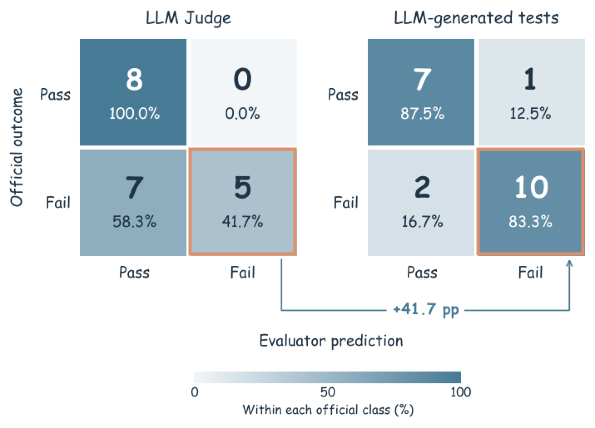

<!-- paper-reading-lang: zh-CN -->
<!-- paper-reading-mode: deep -->
<!-- paper-reading-theme: saffron -->

# HarnessPro：当自我改进开始计费

深读对象：HarnessPro: Recursive Harness Self-Improvement with Pareto Optimization for Performance-Cost Trade-offs（arXiv 2610.26770v2，清华、Z.AI、上海交联、Warwick、Kling AI）。Harness 递归自我改进（RSI）这条线的论文都在回答"怎么让 Agent 编排层自己变好"，这篇换了一个此前没人认真对待的问法：**变好的每一步都在花钱，钱进不进目标函数？** RHO 在 SWE-Bench Pro 上比原始 harness 多花 42.6% 的执行成本，HarnessPro 把目标改成 min(−PR, C) 且以初始性能为地板，在完全无标签的设定下递归进化，产出 lite/medium/heavy 三档 harness。GPT-5.5×Codex 上 heavy 档三个基准全部超过 RHO，同时平均成本低 26.1%。本文按新式深读规范（细章跟论证、手算重构、自测与溯源）重写。

<!-- Deep Reading coverage
| Source section / object | Role in the argument | Explanation location / status |
| --- | --- | --- |
| §1 RSI 涨分伴随成本上升（RHO +42.6%） | 立论 | §01 explained |
| §3 三指标定义与 Eq.(1) 双目标 | 问题形式化 | §01–02 explained |
| Table 4 价格表（附录 A.2） | 成本模型 | §02 explained（含默认推理力度/预算） |
| §4.3 TestSynth Eq.(6)+Fig.2 混淆矩阵 | 无标签评估替换 | §03 explained（含 41.7→83.3 解读） |
| 附录 A.1 DPP coreset Eq.(10)-(12) | 训练集构造 | §04 explained（含难度权重手算） |
| §4.2 Analyzer Eq.(2) | 诊断 | §05 explained |
| §4.2 Planner Eq.(3) 三指令+跨候选 Diff | 计划 | §06 explained |
| §4.2 Editor Eq.(4)-(5) Git 工作区 | 实现 | §07 explained |
| §4.3 Eq.(7) 地板+支配过滤 | 选择(一) | §08 explained（含小例） |
| §4.3 Eq.(8)-(9) 加权平方距离 | 选择(二) | §09 explained（含三档手算；α/β 来自附录 A.2） |
| §5.1 设置（切分/G=3/轮数/双基座） | 实验前提 | §10 explained |
| Table 2 主结果 | 决定性证据 | §10 explained（分母重算） |
| §5.4 Fig.4 演化动态 | 递归必要性 | §11 explained（矢量原图不可嵌，数字全保留） |
| Table 3 消融+RHO 变体 | 归因 | §12 explained |
| §5.3 进化产物（档位/hooks/RTK） | 机制解释 | §13 explained |
| §6 结论与边界 | 边界 | §14 explained |
| 附录 A.2 生成设置/求解预算 | 复现条件 | §14 概述（细节级，secondary omission：全文细节已引关键项） |
| Fig.1 概览 / Fig.3 选择示意 | 示意图 | HTML 版无位图（仅混淆矩阵可用），以文字重构，status unavailable-by-source |
-->

## 01 / 先看它要修的问题：RSI 的账单

Harness 是模型外围的软件运行层：提示、工具与技能、上下文与记忆机制、hooks、验证策略（PDF §3）。RSI 路线用历史轨迹诊断弱点、指导 harness 更新，但已有方法的目标函数里只有通过率。RHO 在 SWE-Bench Pro 上把通过率从 59.0 提到 80.0，代价是单任务平均成本从 \$1.88 升到 \$2.68——验算一下这 42.6%：$(2.68-1.88)/2.88$ 不对，是 $(2.68-1.88)/1.88=0.800/1.88=42.6\%$，分母是**旧成本**。这种"涨分靠堆探索与验证"的模式在部署里不友好：token 与延迟同样是真金白银。

HarnessPro 的问题式只有一行（Eq. 1）：

$$\min_{h\in\mathcal{H}}\;\big(-\mathrm{PR}(h),\;C(h)\big)\quad\text{s.t.}\quad \mathrm{PR}(h)\geq \mathrm{PR}(h_{0})$$

约束 $\mathrm{PR}(h)\geq\mathrm{PR}(h_0)$ 是全文最关键的一个设计：初始 harness $h_0$ 的验证通过率被立为**性能地板**，进化只许在"不伤性能"的区域内找便宜解。没有这条约束会发生什么？Table 3 里有现成的反例——给 RHO 加"固定低推理力度"后成本从 \$1.09 降到 \$0.45，通过率从 76.3 崩到 62.7。地板就是挡住这类退化捷径的护栏。

## 02 / 三个指标各怎么算：通过率、钱、秒

**通过率**：任务只有全部通过官方测试才算 Pass=1，$\mathrm{PR}(h)$ 是测试集上的全过比例（ProgramBench 例外，按官方协议用每任务通过测试比例的宏平均）。数据切三份：训练集驱动更新、验证集评估选代表、测试集只在进化完全结束后评估一次——测试集对进化过程全程不可见。

**成本**：按 token 计价，且区分未缓存输入、缓存输入、输出三类（价格差一个数量级：GPT-5.5 短上下文档 \$5.00/M 输入、\$0.50/M 缓存输入、\$30.00/M 输出）。一个直接推论：**缓存命中率是成本的一等变量**——这也解释了后文进化产物里"提醒附在工具结果尾部、不碰提示前缀"这个细节（§13）。GLM-5.2 与 GPT-5.5 价目不同，所以两基座的美元数字不可直接横比，只能比各自的相对变化。

**延迟**：从执行开始到完成墙上时钟，评分时间不计。论文明确把它当**辅助指标**而非目标——服务器负载与网络波动会污染它；但它顺带被改善了（SWE 上 heavy 档 520s→412s），属于降本红利而非优化承诺。

## 03 / 无标签评估：把判官换成一把固定的尺子

无标签设定意味着没有真值解、没有官方测试、没有判分器反馈。RHO 的做法是让 LLM 对比轨迹做自偏好选择，但论文实测发现 LLM 判官系统性乐观：经常把有缺陷的实现判成成功。HarnessPro 的替换是把 LLM 从"裁判"降级为"出题人"——测试合成器对每个任务生成测试：

$$\mathcal{S}(x)=\operatorname{TestSynth}(x,\;\tau_{h_0}(x))$$

输入是任务描述和**初始 harness** $h_0$ 的轨迹，生成之后**全程固定**。"固定"承担两件事：候选 harness 之间比较的尺子不变；进化无法通过"修改判据"伪造进步——这正是 RSI 可信性框架里元改进层风险的工程化防御。效果有混淆矩阵直接量化：合并训练任务的失败检出率从 LLM 直接判断的 41.7% 提到 83.3%（Fig. 2）。换算成直觉：一百个失败任务，判官漏报 58 个，固定测试漏报约 17 个。

混淆矩阵原图（这是 HTML 版仅存的两张位图之一，另一类图均为矢量）：



*原论文 Fig. 2，PDF §4.3。读图要点：对比左右两格的"失败→成功"格（假阴性）。左图判官把多数失败放行，右图固定测试把大部分失败拦下——检出率翻倍来自这一格的萎缩。*

这把尺子的误差上限（约 1/6 失败漏检）是全文选择压力的天花板，§14 回到这一点。

## 04 / 训练集怎么挑：难度加权的 DPP coreset

进化每轮要在训练任务上跑 $G=3$ 遍/候选/任务，训练集必须小而有代表性。选法沿 RHO：LLM 判官给每个任务打难度分 $r_i\in[0,10]$ 和一个**失败模式指纹** $\phi_i$（刻意抹去任务专名，相似度反映共性困难而非表面项目细节）；随后构造难度加权的 DPP 核（Eq. 10）：

$$w_i=\Big(\frac{q_i}{\max_j q_j}\Big)^{\alpha},\qquad q_i=\max(r_i/10,\;\varepsilon),\qquad K=\operatorname{diag}(w)\,S\,\operatorname{diag}(w)$$

其中 $S_{ij}=u_i^\top u_j$ 是指纹余弦相似度，$\alpha=\theta/2(1-\theta)$，取 $\theta=0.7$ 即 $\alpha\approx1.167$。手算难度权重的效果（教学算例）：两个任务 $r=8$ 与 $r=3$，$q$ 分别为 0.8 与 0.3，以最大 $q$ 归一后权重比

$$w_8 : w_3 = 1 : (0.3/0.8)^{1.167}=1:(0.375)^{1.167}\approx 1:0.32$$

难度低一档的任务在核里的权重掉到约三成，而且核行列式会进一步惩罚指纹相似的任务扎堆。实现上不从这个 k-DPP 分布采样，而是**贪心地逐个加入使行列式最大的任务**（Eq. 12）逼近最可能子集。最终 coreset 只有 10 个任务——小到轨迹采集与诊断可负担，代价见 §14。

## 05 / 诊断：G 条轨迹联合看

Analyzer 对每个候选 $h$、每个训练任务 $x$ 联合检查 $G=3$ 条独立轨迹及其指标（通过/成本/延迟，保留 token 与工具调用明细）：

$$z(h,x)=\operatorname{Analyzer}\big(x,\{(\tau_h^{t,g}(x),\,m_h^{t,g}(x))\}_{g=1}^{G}\big)$$

多轮联合看是为了抗随机性：单次尝试的偶然失败或侥幸成功都不构成诊断依据。输出三要素：问题是什么、对性能与成本各有什么影响、证据在哪（轨迹文件路径+事件区间，供下游按需调阅）。按任务汇总后若超 64K token 则再做一层摘要——诊断证据天然分散在长序列里，这是上下文预算的兜底。

## 06 / 计划：三种优先级同时开工，候选互相抄作业

Planner 对每个候选出**三份**计划，分别由 $I_1$（省成本）、$I_2$（平衡）、$I_3$（重性能）三条指令驱动（Eq. 3）。输入除候选全文与诊断、指标外，还有**其他候选的代码 Diff 与各自的诊断**——lite 系候选里有效的省钱机制可以被 heavy 系计划借鉴，反之亦然。两道防泄漏闸门：Planner 默认不看全轨迹（需要时经诊断里的路径调阅）；验证集与测试集对 Planner 全程不可见。计划被要求是**可泛化的修改**而非针对训练任务的补丁。

## 07 / 编辑：独立工作区，Git 兜底

Editor 把每份计划落成可执行候选（Eq. 4–5）：三份计划各自在独立工作区实现，产物提交 Git——可追溯、可回滚、Diff 可被下一轮 Planner 直接消费。新候选集 $\mathcal{C}_t$ 与父代 $\mathcal{A}_t$ 合并成 $\widetilde{\mathcal{C}}_t$ 进入评估。

## 08 / 过滤：地板之上，不被支配

评估在验证集上做：每个候选每任务跑一次、按固定测试判分（基础设施失败剔除并重试，不计入结果），得 $(\mathrm{PR}_{val}, C_{val}, L_{val})$。过滤两刀（Eq. 7）：低于地板 $\mathrm{PR}_{val}(h_0)$ 者出局；被**帕累托支配**者出局——$h'\prec h$ 指 $h'$ 在两指标上都不差且至少一项严格更好。小例（教学）：候选甲 $(74.0,\,0.9)$、乙 $(74.0,\,1.2)$、丙 $(71.0,\,0.5)$（单位：美元）。乙被甲支配（同分更贵）；丙低于地板（设地板 72）出局——**便宜救不了不及格**。

## 09 / 代表选择：平方距离怎么挑出三档

过滤后的集合上做归一化（Eq. 8）：$d_{perf}=(P_{max}-\mathrm{PR}_{val})/(P_{max}-P_{min})$、$d_{cost}=(C_{val}-C_{min})/(C_{max}-C_{min})$，把两个指标都折到 $[0,1]$ 的"离最优的距离"。三档模式各用一组权重（附录 A.2：lite $(\alpha,\beta)=(1,2)$、medium $(1,1)$、heavy $(2,1)$）取加权平方距离最小者（Eq. 9）：

$$J_m(h)=\alpha_m\, d_{perf}(h)^2+\beta_m\, d_{cost}(h)^2$$

为什么用平方？线性加权和会偏爱单边极端点（全押性能或全省钱），平方惩罚两头都差也惩罚偏科，倾向挑"两边都不太差"的折中位置——这正是三个部署档位想要的性格。手算一遍（教学算例）：过滤后剩甲 $(72.0,\,0.40)$、乙 $(76.0,\,0.50)$（美元），则 $P_{min}=72,P_{max}=76$，$C_{min}=0.40,C_{max}=0.50$，$d_{perf}$：甲 $=1$、乙 $=0$；$d_{cost}$：甲 $=0$、乙 $=1$。三档：

- lite $(1,2)$：$J_甲=2\cdot0=0$，$J_乙=2\cdot1=2$ → 选**甲**；
- heavy $(2,1)$：$J_甲=2\cdot1=2$，$J_乙=1\cdot1=1$ → 选**乙**；
- medium $(1,1)$：$J_甲=J_乙=1$ → 对称点并列（真实数据是连续值，几乎不会真并列）。

被选中的三个代表组成下一轮候选集——搜索始终在三个预算区域各留一粒种子，这正是"输出帕累托集"的机制落点。

## 10 / 主结果：把百分比一个个验算回去

设置：GPT-5.5×Codex 0.147.0 与 GLM-5.2×Claude Code 2.1.231 双基座；三基准（TB2 测试集 59 题、SWE-Bench Pro 100 题、ProgramBench 100 题）；3 个进化轮（ProgramBench 4 轮）；HarnessPro 数字为 3 次运行（ProgramBench 2 次）的均值±样本标准差。

GPT-5.5 侧 heavy 档对 RHO 的三笔账，逐个重算分母：

| 基准 | 通过率 | 成本 | 成本降幅（分母=RHO） |
| --- | --- | --- | --- |
| Terminal-Bench 2 | 76.3→80.8（+4.5） | \$1.09→\$0.72 | $(1.09-0.72)/1.09=\mathbf{33.9\%}$ |
| SWE-Bench Pro | 80.0→80.7（+0.7） | \$2.68→\$1.97 | $(2.68-1.97)/2.68=\mathbf{26.5\%}$ |
| ProgramBench | 68.8→69.6（+0.8） | \$3.59→\$2.95 | $(3.59-2.95)/3.59=\mathbf{17.8\%}$ |

摘要里的两个平均数由此而来：成本降幅 $(33.9+26.5+17.8)/3=26.1\%$，通过率增益 $(4.5+0.7+0.8)/3=2.0$ 分。注意**平均降幅是"三个百分比的平均"而不是"总成本的平均降幅"**——两种口径在基准成本差异大时（这里 \$1.09 到 \$3.59）会给出不同数字。

三档的部署性格在 SWE-Bench Pro 上最完整：lite \$0.80/72.3 分、medium \$1.26/79.0 分、heavy \$1.97/80.7 分。medium 对 RHO 的账：$(2.68-1.26)/2.68=53.0\%$ 成本降幅，只让 1.0 分——这就是"半价保 RHO 级性能"的出处。lite 对 Vanilla：TB2 省 $(0.89-0.43)/0.89=51.7\%$、SWE 省 $57.4\%$、PB 省 $17.7\%$，全部超过 Vanilla 的通过率——"17.7–57.4%"的区间就是这么来的。

GLM-5.2 侧同型成立（TB2 heavy 81.4/\$0.62 vs RHO 78.0/\$1.00；SWE 77.3/\$1.01 vs 75.0/\$2.17），但绝对美元高一个量级（ProgramBench 单任务 \$11–17）——两基座价目与缓存行为不同，只能看各自相对值。

SWE 三档阶梯一图：

```paper-chart
{
  "type": "bars",
  "title": "SWE-Bench Pro 三档的预算阶梯",
  "subtitle": "GPT-5.5×Codex；括号内为通过率；HarnessPro 为 3 次运行均值",
  "origin": "本文重绘 · 原论文 Table 2",
  "source": "PDF Table 2",
  "unit": "$/任务",
  "domainMax": 3.0,
  "note": "RHO 2.68(80.0) → medium 1.26(79.0)：−53.0% 成本、−1.0 分；lite 0.80(72.3) 已超 Vanilla 1.88(59.0) 的性能且不到其一半价格；heavy 1.97(80.7) 比 RHO 更高分更便宜。",
  "rows": [
    { "label": "Vanilla（59.0）", "value": 1.88 },
    { "label": "RHO（80.0）", "value": 2.68 },
    { "label": "RHO+Iteration（80.0）", "value": 1.90 },
    { "label": "Lite（72.3）", "value": 0.80 },
    { "label": "Medium（79.0）", "value": 1.26 },
    { "label": "Heavy（80.7）", "value": 1.97 }
  ]
}
```

## 11 / 演化动态：双改善常要等到第二轮之后

Fig. 4 逐轮追踪测试集指标（仅可视化，不参与任何选择；选择只用验证集）。Terminal-Bench 2 的 heavy 档一路双改善：74.6/\$0.91 → 80.8/\$0.72。更有信息量的是 SWE-Bench Pro 的 medium：第一轮 70.0/\$1.57，第二轮涨到 77.0 但成本也涨到 \$1.66，**第三轮才同时做到 79.0/\$1.26**。这说明单轮进化常只买到"分或钱"之一，双改善是递归多轮加选择压力的产物。同轮数的 RHO+Iteration 仍被支配（TB2 上 medium 与它同分但便宜 31.7%：$(0.82-0.56)/0.82=31.7\%$），所以功劳不能记在"多跑几轮"上，要记在双目标规划与帕累托筛选上。

## 12 / 消融：尺子和药方各值多少分

两个组件消融（Table 3，附 Cost-of-Pass=总成本/成功任务数）：去掉 Planner，SWE medium 从 79.0/\$1.26 掉到 73.0/\$1.42——分数掉、钱反升，说明三档计划是找到双改善方向的来源；去掉测试合成器，三档全线掉 3.4–10.0 分（heavy TB2 80.8→74.6），掉幅最大——尺子不可靠，一切选择都白搭，这是无标签框架的承重墙。

更有归因力的是"RHO 抄单个策略"变体：给 RHO 加动态路由（TB2 76.3/\$0.92、SWE 76.0/\$2.13）或加预算 hooks（76.3/\$0.92、75.0/\$1.75）——都省钱但都掉分；固定低力度掉得更惨（62.7/\$0.45）。三个变体全部被 HarnessPro 帕累托支配。结论：双改善来自"按任务选执行档位 + 运行时预算护栏 + 输出压缩 + 指令精简"的**组合**与递归选择压力，单个机制移植到单目标框架里只会单边受益。

## 13 / 进化产物：钱到底省在哪

对进化出的 harness 做解剖（§5.3），回答"是不是靠砍上下文"——不是。四个具体机制：

1. **按任务描述选执行档位**：每个任务先选一个档位（推理力度 × 工具调用预算），三档模式用不同的选择规则——GPT-5.5 默认 high 力度，进化产物学会按任务分档；
2. **运行时 hooks 强制预算**：medium 档选标准档位时，14 次工具调用后提醒并行化、避免冗余检查，26 次后聚焦完成与验证，44 次后直接阻断——预算不是建议是硬闸；
3. **提醒附在工具结果尾部**、不动提示前缀——保住 KV 缓存命中（§02 的价格表在起作用：缓存输入只有未缓存的 1/10）；
4. **静态瘦身**：RTK 式工具输出压缩（折叠重复日志、浓缩长输出）+ 精简冗余指令。

这四件事配合消融（§12），构成"砍掉的是可避免开销、保住的是必要推理与最终验证"的证据链。

## 14 / 证据的边界

四个边界读数字时要带着。**尺子上限**：固定测试的失败检出 83.3% 意味着约 1/6 失败仍被当成功——若某候选恰好擅长"过生成测试"而非真解任务，进化中的地板与支配筛选都会被骗；论文靠测试集官方测试的最终评估兜底结论，但**进化路径本身**建立在这把有误差的尺子上。**coreset 只有 10 个任务**：诊断覆盖面系于 DPP 选样代表性，未见失败模式不会进诊断。**成本口径**：固定价目表 + 各基座缓存行为不同，跨基座美元不可横比；延迟是红利不是承诺。**结论范围**：双基座三基准都成立，但 heavy 档在 SWE 上对 RHO 只 +0.7 分（在 std 量级内），"更便宜"比"更好"证据更硬。生成设置等复现细节在附录 A.2（求解器时限、每任务资源、温度与 max_tokens 均有列明）。

## 15 / 接回论证

一句话收束这条线：RHO 证明了无标签 harness 进化能涨分，HarnessPro 证明同一套原料（轨迹诊断+多智能体修改+无标签评估）在目标函数里加入钱、在评估里换上固定的尺子、在选择里保留三档种子之后，能把整条帕累托前沿往前推——自我改进从"能变好"走到"变好且变得更便宜"，而部署要的恰恰是后者。

```paper-check
{"title":"六个能检验技术理解的问题","items":[{"question":"去掉性能地板约束 PR(h)≥PR(h₀) 最可能退化成什么？论文里哪个数字是这个退化的实证？","hint":"想想哪种修改最便宜，以及 Table 3 里 RHO+低力度的结果。","answer":"退化成无脑砍计算：固定低推理力度的 RHO 变体把 TB2 成本从 1.09 降到 0.45，但通过率从 76.3 崩到 62.7——便宜 58% 的代价是不及格。地板把搜索锁死在不伤性能的区域。","source":"PDF §3 Eq.1、§5.5 Table 3"},{"question":"固定生成测试的「固定」承担哪两种作用？若每轮允许重新生成测试会打开什么漏洞？","answer":"两作用：候选间比较的尺子不变（公平）；进化无法通过改判据伪造进步（防元改进层自欺）。若每轮重新生成，进化方向会偏向「让测试变容易」而非「让 harness 变好」——改 U 式的刷分路径。","source":"PDF §4.3"},{"question":"Eq.9 教学例中若 heavy 档权重从 (2,1) 改为 (3,1)，两候选 (72, 0.40) 与 (76, 0.50) 各得多少 J？结论变吗？","hint":"d_perf 甲=1、乙=0；d_cost 甲=0、乙=1。","answer":"甲 J=3·1+0=3，乙 J=0+1=1，heavy 仍选乙——性能权重再放大也不改变，因为乙在性能维已是归一化最优，只能压低其成本惩罚。权重变化真正起作用的场景是两候选各有一维非零时。","source":"PDF Eq.8-9、附录 A.2；教学重算"},{"question":"「成本平均降 26.1%」的 26.1% 怎么平均出来的？换成「三基准总成本降幅」口径，数字会一样吗？","hint":"三个基准的降幅分别是 33.9%、26.5%、17.8%，各自分母是 RHO 在该基准的成本。","answer":"(33.9+26.5+17.8)/3=26.1%，是百分比等权平均。总成本口径需按题量加权，基准成本差近 3 倍（1.09→3.59）时两种口径会明显不同；引用时应说明口径。","source":"PDF 摘要、Table 2；算术重构"},{"question":"SWE-Bench Pro 上 medium 对 RHO「−53.0% 成本、仅 −1.0 分」，若把对照换成 Vanilla，这句话怎么说才对？","answer":"对 Vanilla 是 79.0 vs 59.0（+20.0 分）且成本从 1.88 降到 1.26（−33.0%）：同样两个数字，换对照系叙事完全不同——medium 既是「RHO 的半价平替」也是「Vanilla 的涨价 20 分升级」，取决于部署基线是谁。","source":"PDF Table 2；算术重构"},{"question":"为什么延迟不进优化目标却普遍改善了？给出一个机制解释。","answer":"降本机制（输出压缩、减少冗余工具调用、预算 hooks 阻断拖延）同时减少串行等待与生成长度——省 token 的动作大多也省时间；但服务器负载波动会让延迟不稳定，把它放进目标会引入不可控噪声，故只作辅助指标。","source":"PDF §3、§5.2、§5.3"}]}
```

<details class="reading-detail">
<summary>来源与离线交付记录</summary>

本阅读使用 arXiv:2610.26770v2 的 HTML 版为阅读源，对应 PDF 1.07 MB、41 页，SHA-256：`c633082abff0c6cd4fa3d63f21e689c34f92369068ee0ed13c74be0f2f54b093`。原文 Fig. 1/Fig. 3 与图 4 为矢量图、未在 HTML 版提供位图，机制以正文文字重构；Fig. 2 混淆矩阵为 HTML 版唯一可用位图，裁自 arXiv HTML 资源 `evaluation_confusion_matrices.png`。数字均取自论文 Table 1–4 与正文，百分比重算处已标注"算术重构/教学算例"。本页 2026-10-30 按仓库细章深读规范重写（首版同日发布，本版为新式样例的第二篇）。
</details>
