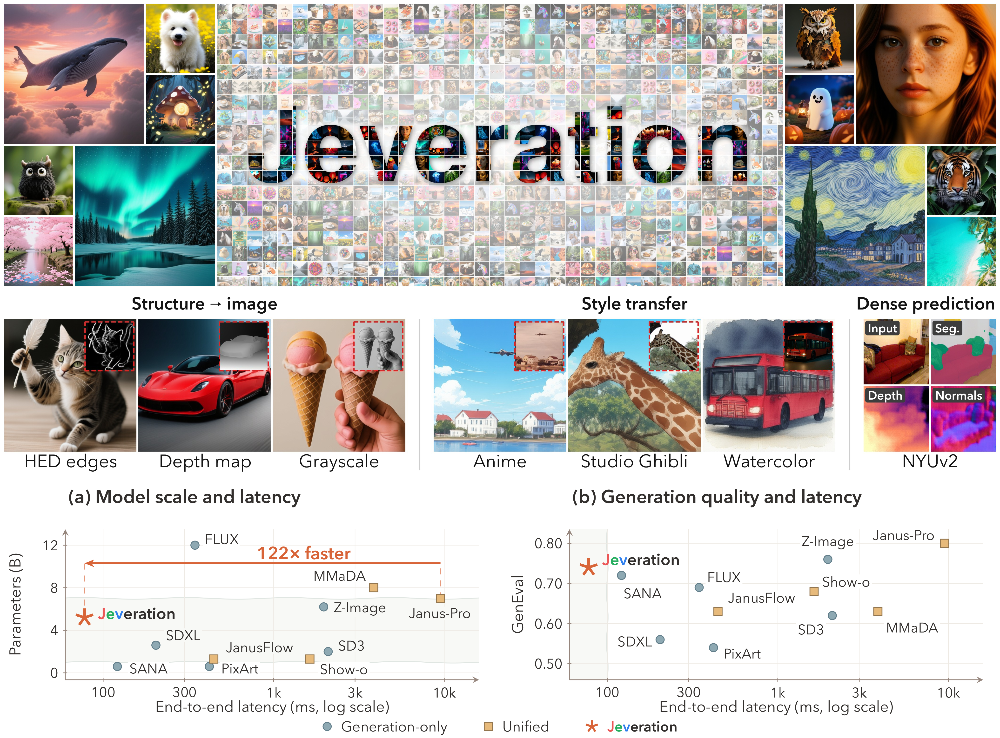
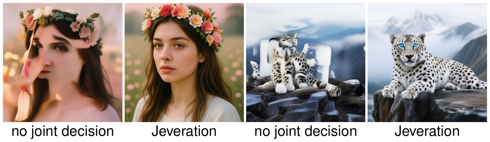
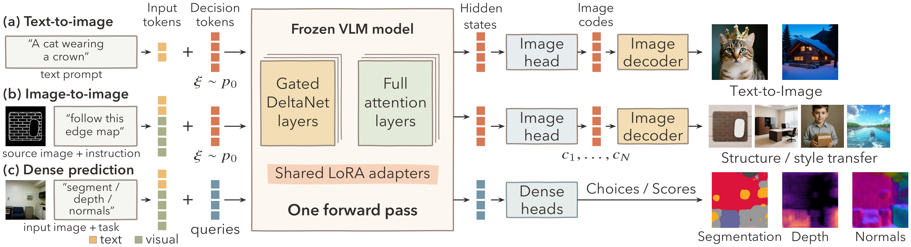
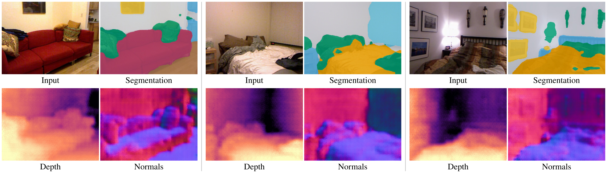

<!-- paper-reading-lang: zh-CN -->
<!-- paper-reading-mode: deep -->
<!-- paper-reading-theme: saffron -->

# Jeveration：System One 决策模型现在会生成——一次前向出整图、78 毫秒、一个检查点通吃三种视觉任务

```paper-map
{"thesis":"新加坡国立大学团队提出图像生成的第三范式：System One 决策模型（Jev 系）不只返回选择与评分，还能自己生成完整图像。Jeveration 冻结 Qwen3.5-4B VLM、只训 LoRA 与输出头（约 1.0B 可训参数），把一张图当作对 tokenizer 码本的一次联合类型化决策——128 个码位在前向传播里并行决定。核心难题是全局一致性：独立并行选择的 forward-KL 差距恰等于目标分布的 total correlation（各码位互依赖度的信息论度量），独立模型只能匹配边际因此必然拼出互不相容的图像区域。解法是给全部码位条件同一个共享随机状态 ξ（按 Di[M]O 的掩码+噪声初始化），让并行预测有了公共的协调源；由于直接监督会让模型忽略 ξ，训练分两阶段——先用掩码预测学图像分布，再用「冻结的第一阶段模型当裁判」的分布匹配教决策模型使用 ξ，末段加置信度引导的校正目标。同一检查点统一文生图、图生图（结构/风格迁移）与稠密预测（分割/深度/法线）：512px 图 77.8ms（比 Janus-Pro-7B 快 122 倍，统一模型中最快），GenEval 0.74 超四步蒸馏的 Show-o Turbo（0.63@94ms）；图生图结构保真 HED F1 0.880 仅比文生图多 14ms；稠密预测 mIoU 67.7 与专项模型持平。","reader":"关心统一多模态模型、一步生成加速与决策模型谱系的工程师与研究者；本页把论文的信息论分析（total correlation 缺口）、两阶段训练、速度-质量账与全部消融数字放进可复算的模型。","goals":["走通「决策模型谱系→第三范式定位→独立并行的信息论失败→共享随机状态→两阶段训练→统一三任务→主结果与消融→边界」完整论证","把 78ms/0.74/122×/0.880/67.7 等关键数字逐个放回速度-质量账与交换实验核算","分清「快」的三个来源：并行决策、冻结骨干、LoRA-only——以及质量上付出的对价（分辨率 512、法线落后）"],"outcome":"全文精读 arXiv 2611.24738v1（2026-11-18，15 页：主文 8 页 + 参考文献 + 补充材料 S1-S4 含训练配置全表与码-源交换实验），四张关键图 600 DPI 提取嵌入，Table 1-5 与补充 Table 1-2 逐格核对。","outcomeSource":"https://arxiv.org/abs/2611.24738","items":[{"number":"01","label":"第三范式","signal":"决策模型会生成","text":"图像生成被自回归（逐 token）与扩散（迭代去噪）两范式统治，都要多次串行求值。Jeveration 建立在 Jev 式 System One 模型上——一次并行查询返回类型化决策（Choice/Score/Box）——证明同一范式能一次前向生成整张图：决策模型的视觉语义知识不仅够做理解，也够做合成。","source":"§1 引言"},{"number":"02","label":"信息论病根","signal":"total correlation","text":"直接让每个码位独立并行选择，其与目标分布的最优 forward-KL 差距=ΣH(ci|y)−H(c|y)，即 total correlation——码位间的互依赖总量。独立模型只能匹配边际分布，各码位可能取自不同的合法图像 realization，拼出互不咬合的区域（论文 Fig.2 的两组碎裂样例）。连贯图像恰恰需要这份依赖。","source":"§3.1 Eq.1-2"},{"number":"03","label":"共享随机状态","signal":"ξ 协调一切","text":"给一张图采一个随机状态序列 ξ（掩码率 0.6+均匀随机码+高斯噪声 σ=0.1，按 Di[M]O 设定），全部码位条件在同一 ξ 上：给定 (y,ξ) 码位独立采样，但对 ξ 的共享依赖让边缘化后的分布能表达码位间依赖——每次抽取 ξ 得到一张不同但连贯的图。固定 ξ 会让质量掉（HPS 28.27→26.63）——随机性本身是多样性与连贯性的来源。","source":"§3.1 Eq.3、§4.4"},{"number":"04","label":"架构","signal":"冻结+LoRA+双分支头","text":"冻结 Qwen3.5-4B 及其视觉塔，全任务共享 rank-256 LoRA；决策 token 追加在输入后，全注意力层里决策 token 双向互看（输入前缀仍因果）；文生图 128 个决策 token（TA-TiTok 码本 8192 项）、稠密预测 432 个空间查询。图像头双分支：码本分支从 tokenizer 码本初始化（继承结构）+宽分支零初始化（自由容量），logits 相加；消融显示双分支 0.64 对单分支 0.60/0.59。","source":"§3.2 Eq.4、§4.4"},{"number":"05","label":"两阶段训练","signal":"先学分布再学决策","text":"直接监督目标码不会鼓励用 ξ（ξ 与目标独立采样）。第一阶段把同一架构当掩码模型训（随机遮码预测隐藏码，学码位间依赖）；第二阶段决策模型从第一阶段出发，单 pass 采样后重遮码，冻结的第一阶段模型 φ 给出分布裁判 p_φ、辅助模型 ψ 跟随 θ 的当前分布持续训练，用 sg(p_ψ−p_φ)ᵀℓ_θ 的分布匹配损失更新 θ——两个预测只在码位互相咬合时才一致。末段加校正：重遮最不自信的 50% 码位、冻结模型四轮 CFG=3 补全成参考、教 θ 从同一 (y,ξ) 预测。","source":"§3.3 Eq.5-7、补充 §4"},{"number":"06","label":"统一三任务","signal":"一个检查点","text":"文生图（prompt→128 码）、图生图（源图+指令，门控分支把源图喂给解码器）、稠密预测（决策 token 当空间查询，Choice 做分割、Score 做深度/法线）共用同一冻结骨干与 LoRA、只换任务头与监督（分割交叉熵、深度 ℓ1、法线 1−cos）。联合训练几乎免费：三任务齐训的 GenEval 0.74 对纯文生图的 0.73。","source":"§3.2/§3.3、Table 5"},{"number":"07","label":"主结果速度账","signal":"78ms/122×","text":"H200 batch1 端到端（含解码）：512px 77.8ms——统一模型最快，比同为蒸馏一步的 Show-o Turbo（0.63@94.1ms）又快又好（0.74）；对自回归 Janus-Pro-7B（9,508ms）快 122 倍、Janus-Pro-1B 快 98 倍；对 512px 多步生成模型（GenEval 0.49-0.65）快 5-8 倍且分更高。DPG 78.24、HPSv2.1 28.06。","source":"§4.2 Table 1"},{"number":"08","label":"图生图","signal":"+14ms 的控制","text":"同一检查点做 HED 边缘→图、深度→图、着色、动漫/吉卜力/水彩风格迁移：结构保真 HED F1 0.880、深度 δ1 0.802、着色边缘 F1 0.937、风格 PSNR 15.40（341 个留出样本）；每次请求仍单前向 91.7ms——只比文生图多 14ms。对照：纯复制输入的 HED 0.828、无源条件解码器 0.792——模型确实在跟随结构而非复读。","source":"§4.3 Table 2"},{"number":"09","label":"稠密预测","signal":"mIoU 67.7 持平专项","text":"NYUv2：分割 67.7 mIoU 与同骨干专项模型（67.8/67.3）持平、超 DeepLabV3+ 14.2 个点；深度 0.267m 误差比 DeepLabV3+ 低 32%；法线 24.2° 落后（精细局部几何对多任务共享容量最敏感）。每次预测同样 78ms 单前向。","source":"§4.3 Table 3"},{"number":"10","label":"消融与交换","signal":"每个组件的账","text":"消融：一阶段掩码模型直接单 pass 只有 0.32 GenEval（不连贯的量化）；固定 ξ 掉 HPS 1.64；校正目标 +0.11 HPS（分布匹配定构图、校正修细节）；联合训练三任务几乎不掉文生图质量。补充交换实验：换掉码位（HED 0.896→0.552）重于换掉源图（→0.652）——128 个码携带全局结构、源图补精细细节。","source":"§4.4 Table 4/5、补充 Table 2"},{"number":"11","label":"边界","signal":"512/法线/谱系会师","text":"论文未设局限节，本页归纳：分辨率 512px（解码器为此微调，TA-TiTok 码本容量与 GenEval 分数都以此为界）；法线估计落后专项模型 3 个点；快的三重来源（并行决策/冻结骨干省激活/LoRA 小可训集）未逐一归因。谱系意义：决策模型线（Drex→Flide→MMDM→VoT→Zuse）从「选得对」走到「生成得出」——Jeveration 是这条线第一次产出像素。","source":"全文口径；本页补"}]}
```

深读对象：arXiv 论文[《Jeveration: System One Models Now Generate》](https://arxiv.org/abs/2611.24738)（v1，2026-11-18；新加坡国立大学，作者 Yuhe Liu*、Qi Li*（同等贡献）、Shihua Zhang、Xinchao Wang†（通讯））——[点此打开原文 ↗](https://arxiv.org/abs/2611.24738)。选它做今日深读有四个理由：其一，它是本周决策模型故事线的会师之作——上周我们从 Drex（便宜）、Flide（快）、MMDM（评测）、Gemini Decisions API（产品化）一路读到 Value of Thinking（何时不思考），Jeveration 把这条线推到了谁也没预料到的方向：**决策模型不只选得对，还能生成得出**——一次前向、整张图像、78 毫秒；其二，它的理论内核干净漂亮——用 total correlation（码位间互依赖的信息论度量）精确解释了「独立并行选择为什么必然拼出碎裂的图」，这是罕见的把失败模式写成一条等式的论文；其三，工程账目惊人：122 倍加速、一个检查点三种任务、稠密预测与专项模型持平——每一条都有对照实验；其四，它是「冻结骨干 + LoRA + 类型化输出头」这套决策模型方法论的又一次验证，与 Flide（同院系 NUS 的前作）一脉相承。本页按细章跟读：决策模型谱系与第三范式的定位、独立并行的信息论失败、共享随机状态的协调机制、冻结架构与双分支头、两阶段训练的分布匹配、三任务统一、速度-质量主账、图生图与稠密预测、消融与交换实验、以及边界与谱系意义；全部数字经逐格回对原文表格。

<!-- Deep Reading coverage
| Source section / object | Role | Explanation location / status |
| --- | --- | --- |
| Figure 1 teaser + 摘要 | 总览 | §01、§07（图 2 嵌入） |
| §1 引言（两范式延迟账、决策模型知识可复用于生成、贡献三条） | 立论 | §01-02 |
| §2 相关工作（统一多模态/一步生成/类型化决策模型三支） | 定位 | §01、§02、§16 |
| §3.1 图像即决策（Eq.1 独立因子分解、Eq.2 forward-KL 与 total correlation、Eq.3 共享状态） | 形式化 | §03 |
| Figure 2 不连贯对照 | 证据 | §03（图 3 嵌入） |
| §3.2 架构与推理（冻结 VLM、LoRA、决策 token、双分支头 Eq.4、图生图门控、稠密查询） | 机制一 | §04 |
| Figure 3 架构图 | 总览 | §04（图 1 嵌入） |
| §3.3 学习决策（Eq.5 掩码损失、Eq.6 分布匹配、Eq.7 校正目标） | 机制二 | §05 |
| §4.1 设置（数据、训练步数、评测协议） | 实验 | §05、§15 |
| §4.2 文生图主结果 Table 1 | 实验一 | §07 |
| §4.3 图生图 Table 2 + 稠密预测 Table 3 | 实验二三 | §08-09（图 4 嵌入） |
| §4.4 消融 Table 4/5（共享状态/校正/双分支/源条件/联合训练） | 实验四 | §10、§13 |
| Figure 4/5/6 样例 | 证据 | 图 2/4 嵌入 |
| §5 结论 | 收束 | §16 |
| 补充 S4（模型/训练配置全表、解码适配、码-源交换 Table 2、评测细节） | 配置 | §12、§15 |
-->

## 01 / 决策模型现在会生成了：谱系与第三范式

### 从「选得对」到「生成得出」

System One 模型（Jev 系）返回类型化决策——Choice（选项）、Score（评分）、Box（边界框）——一次并行查询、无长推理，已用于选项选择、目标定位、机器人动作评分、图像评价（Visual Jev Rewards 给生成器当奖励模型）、音频问答与临床决策（医疗决策模型），Jeva 更把候选集扩到 2,048 做全集决策。这条线的共同直觉是：**大量 agent 里的高频判断不需要生成文本，只需要在给定候选集上做类型化输出**。Jeveration 的标题就是它的论点：System One models now generate——同一个决策范式，把「候选集」换成 tokenizer 的码本、把「选一个选项」换成「128 个码位同时各选一个码」，**生成就变成了决策**。

图像生成此前被两种范式统治：自回归模型逐 token 生成（Chameleon/Emu3/Janus 系列），一次生成一张 384px 的图要串行解出几百个视觉 token；扩散模型迭代去噪（SD/FLUX/SDXL 系列），二十到五十次去噪步每次都是一次完整的网络前向——**都要对一张图做多次串行模型求值**，延迟随步数线性堆叠。一步生成文献（连续侧的 consistency models、DMD/DMD2、MeanFlow、SANA-Sprint；离散侧的 MaskGIT/Muse/Meissonic 多轮掩码采样，以及把掩码模型蒸馏成一步的 Di[M]O 与可微细化的 Soft-Di[M]O）已经证明单 pass 生成在质量上可以接近多步教师，但这些工作都在**专用生成器**上做——换一个任务就要换一个模型。统一多模态模型（Janus/Show-o/MMaDA，一套权重同时做理解与生成）则卡在另一头：生成仍是自回归或扩散，延迟账没有本质改善。Jeveration 站在这两条线的交点上：**统一模型里的一步生成**，且机制不是蒸馏而是决策——把每个码位当作一个类型化选择，让生成继承决策模型「一次查询、并行输出」的延迟特征。Fig.1（下图）把 122 倍加速标在了延迟-质量散点图上，本文余下部分要回答的就是这张图背后全部的机制与代价——从信息论病根到两阶段训练再到每一格对照实验，一张散点图背后是一整套「把生成装进决策」的方法论。



*图 1：teaser（原文 Figure 1）。顶部：同一检查点的文生图样例（512px）；中部：图生图（风格迁移/结构条件）与稠密预测（分割/深度/法线）；底部两张散点：(a) 参数量-延迟与 (b) GenEval-延迟（均对数横轴，单张 H200）——Jeveration（122× faster 标注）落在左下角最快位置，质量高于同延迟带的全部统一模型。*

### 知识复用的赌注

方法背后的赌注：决策模型在理解任务上的有效性，**部分来自大规模预训练 acquired 的视觉-语义知识**——这份知识既够它判断「这张图里有没有猫」，也应该够它「把猫放进去」。Jeveration 把 VLM 冻结、只训 LoRA 与输出头，等于强制模型用预训练知识做合成而非从头学生成——这个「知识复用」的赌注由结果背书：约 1.0B 可训参数（4B 骨干上的 rank-256 LoRA + 输入输出模块）四天四卡就到 0.74 GenEval。

## 02 / 独立并行为什么必然失败：一条等式写尽的病根

### 独立因子分解的 KL 缺口

设条件 $y$（文本提示或源图）下一张图是 $N$ 个离散码 $\mathbf{c} = (c_1, \ldots, c_N)$。直接做法是每个码位独立预测一个类别分布、并行采样：

$$q_{\text{ind}}(\mathbf{c} \mid y) = \prod_{i=1}^{N} q_i(c_i \mid y)$$

这个因子分解**在结构上无法表达码位间的依赖**——最优解也只能匹配边际：对固定 $y$，独立分布对目标分布 $p(\mathbf{c}|y)$ 的最优 forward-KL 近似满足：

$$\min_{q_{\text{ind}}} \mathrm{KL}(p \,\|\, q_{\text{ind}}) = \sum_{i=1}^{N} H(c_i \mid y) - H(\mathbf{c} \mid y)$$

右边恰好是目标分布的 **total correlation**（多元互信息）——各码位互依赖的总量。把最优解也一并写出：forward-KL 最小时独立分布取到各码位的真实边际 $q_i^* = p(c_i \mid y)$，也就是说**独立模型的理论上限就是完美匹配每个边际**——它连一分联合结构都学不到。缺口的每一比特都是「结构」：（教学手算）把这个量拆开读——$\sum_i H(c_i|y)$ 是「各码位各自的不确定性之和」，$H(\mathbf{c}|y)$ 是「整张图的联合不确定性」，差值是「知道其它码位能消掉多少不确定性」。一张连贯图像的码位必然高度相关：天空区域的码强烈预示地平线的位置与色温、一只猫的轮廓码约束了毛发与阴影的码、文字笔画的码决定了周围背景的码——这份预测力就是 total correlation，在自然图像上是个大数。于是独立采样下每个码位各自从边际里抽——**每次抽到的都是「某张合法图像在该位置的样子」，但各位置抽自不同的图像**——拼出来就是 Fig.2（下图）的碎块：身体来自一个 realization、背景来自另一个、局部各自合理而整体互相矛盾。信息论在这里精确到刻薄：问题不是模型不够强，是**这个分布族里根本不存在连贯解**。

### 病根决定药方

这条等式的价值在于它直接给出设计约束：**要单 pass 生成连贯图像，必须让并行预测共享某个能承载联合随机性的东西**——这就是共享随机状态 $\xi$ 的动机。信息论诊断 → 结构处方，这是论文最漂亮的一步。值得一并对照的是扩散模型对同一问题的解法：扩散把联合分布的采样拆成一条马尔可夫链，每一步的条件高斯天然以「上一步的全部像素」为语境——协调是串行地、逐步地建立的；Jeveration 把协调压缩进「共享一个 $\xi$ + 一次注意力内的相互可见」，协调是并行地、一次到位地建立的。两条路线在数学上并不等价（后者是对联合分布的一种受控近似），但 0.74 的 GenEval 说明这次近似的损失在可用区间内——**快与连贯之间确实存在一条还没被挖完的中间道路**。对后续研究的提示也由此而来：total correlation 缺口给了「并行生成的理论难度」一个可计算的标尺，把它沿训练过程画出来（一阶段模型大、二阶段收敛后小）会是比最终分数更有信息量的诊断曲线——论文没做，本页提议。



*图 2：连贯性对照（原文 Figure 2）。左右两组：上排「no joint decision」为独立采样——一阶段掩码模型的码独立并行抽取，图像区域互不相容（碎裂的构图与互相矛盾的局部）；下排 Jeveration 在共享随机状态下的一次前向输出，全局连贯。0.32 对 0.74 的 GenEval 差距是这张图的定量版。*

## 03 / 共享随机状态：并行决策的协调源

### 机制：边缘化出依赖

Jeveration 给每张图采一个随机状态序列 $\xi \sim p_0$，全部码位条件在同一 $\xi$ 上：

$$q_\theta(\mathbf{c} \mid y) = \mathbb{E}_{\xi \sim p_0}\left[ \prod_{i=1}^{N} q_{\theta,i}(c_i \mid y, \xi) \right]$$

给定 $(y, \xi)$ 码位仍独立采样，但对 $\xi$ 的**共享依赖**让边缘化后的分布能表达码位间依赖：$\xi$ 像一个「抽哪张图」的暗号，所有码位读同一个暗号、各自落到与暗号一致的 realization 上。$\xi$ 的构造沿用 Di[M]O 的设定：以 $\rho = 0.6$ 的概率掩码各位置、其余填均匀随机码、全体嵌入加 $\sigma = 0.1$ 的高斯噪声——既有足够的随机性承载多样性，又与码本嵌入空间对齐，决策 token 的初始嵌入直接编码这份状态。从隐变量模型的角度看（教学重建），这套设计等价于把图像分布写成连续混合：$\xi$ 是隐变量、每个 $\xi$ 值对应混合的一个分量（一张候选图），单 pass 采样 = 先抽 $\xi$ 再在分量内并行解码——**多样性从分量的数量来，连贯性从「同一分量内」来**。对比另一条技术路线：扩散模型用随机的初始噪声做同样的事（噪声决定最终图像），但要在几十步去噪里反复精炼；Jeveration 把「读噪声」压缩进了一次前向的注意力里。

### 随机性本身是质量来源（消融佐证）

固定 $\xi$（所有图共享一个状态）的消融：HPSv2.1 从 28.27 掉到 26.63、GenEval 0.73→0.70——**共享状态的随机性不只是多样性的来源，还直接提升质量**。机制上（本页解释）：固定的 $\xi$ 让模型学出一条「平均图像」的确定性映射，多模态的图像分布被压成单模态，边际匹配变差——多样性的损失最终反映为质量分数的损失（HPS 对重复模式敏感）；随机的 $\xi$ 迫使模型学会「读暗号」的条件分布族，恰好覆盖目标分布的多模态结构。这组消融也澄清了一个容易误解的点：$\xi$ 的价值不在于「提供了噪声」（任何生成都要随机源），而在于**随机源被全部码位共享**——它是并行决策之间的通信信道。消融掉这条信道的随机性（固定 $\xi$）信道仍在但内容恒定，退化成单模态；论文没有做「每个码位各自一份独立噪声」的消融，那正是 Eq.1 的独立分解，Fig.2 已经验证其失败。

## 04 / 架构：冻结骨干、双向决策 token、双分支头

### 一遍前向的完整通路

Figure 3（下图）画出整条通路：文本 token 编码提示与任务指令，冻结视觉塔把输入图（若有）编为视觉 token；决策 token 追加在输入末尾——文生图时从 $\xi$ 初始化（128 个），稠密预测时是 432 个空间查询（学习向量 + 对应视觉 token 的投影）。冻结的 Qwen3.5-4B 带着共享 rank-256 LoRA 在**一次前向**里处理全部 token；关键细节是**全注意力层里决策 token 彼此双向可见**（输入前缀保持因果）——并行码位之间的协调就发生在这里。任务头把决策 token 的末层隐状态映射为输出：图像头出 128 个码、稠密头出分割 Choice 与深度/法线 Score。这套「冻结底座 + 轻头」的形态与决策模型线的先例（Flide 冻结骨干加轻决策面）一脉相承，把「复用预训练知识」与「学任务形态」干净地分开——底座负责读图与读文的语义理解，头负责把语义翻译成离散码或稠密值，两者各司其职互不越界。几个架构细节值得单独点名：**其一**，全注意力层里决策 token 双向互看而输入前缀保持因果——这是「并行但协调」的物理基础，128 个码位的注意力路径就是它们交换「我们这张图长什么样」这个共识的唯一通道，掩码消融掉这条路就等于退回独立分解；**其二**，稠密预测的 432 个决策 token 是空间查询（学习向量 + 对应视觉 token 位置的投影）——每个查询负责输入图的一小块区域，任务头只在查询的末层状态上做分类或回归，这与 DETR 式查询解码一脉相承，但这里查询跑在冻结 VLM 的骨干里、与生成任务共享同一套 LoRA；**其三**，图像解码器是 TA-TiTok 的文本感知解码器（从原始分辨率微调到 512px）——128 个码先进解码器、解码器同时读文本提示再渲染像素，图生图再加门控分支注入源图——码与文本在解码器里完成「结构×内容」的最终合成。



*图 3：架构（原文 Figure 3）。冻结 VLM（Gated DeltaNet 层+全注意力层）加共享 LoRA 适配器；决策 token 从共享随机状态 ξ~p₀ 初始化（生成任务）或作为空间查询（稠密任务），一次前向后的隐状态分别进图像头（出 128 个 TA-TiTok 码，解码器渲染成图）与稠密头（Choice/Scores）。(a) 文生图、(b) 图生图（源图+指令，解码器另有门控源分支）、(c) 稠密预测——同一检查点。*

### 双分支头：继承结构 + 自由容量

每个码位的分布由两个分支相加：

$$q_{\theta,i}(\cdot \mid y, \xi) = \mathrm{softmax}\!\left( f_{\text{cb}}(u_i) + f_{\text{wide}}(u_i) \right)$$

码本分支 $f_{\text{cb}}$ 从 tokenizer 的码本初始化（继承码空间的先验结构），宽分支 $f_{\text{wide}}$ 零初始化（完全自由的学习容量）。消融（一阶段掩码模型上）：双分支 0.64 GenEval 对纯宽分支 0.60、纯码本分支 0.59——**继承的结构与自由容量互补**。解码器侧：TA-TiTok 的文本感知解码器微调到 512px；图生图加门控分支把源图喂进解码器（§08 会看到这条分支的必要性）。

## 05 / 两阶段训练：先学分布，再学决策，末段校正

### 为什么直接监督不行

第二阶段的朴素做法是直接用目标码监督 $q_\theta$。问题：$\xi$ 与目标图**独立采样**，目标码里没有任何「哪个 $\xi$ 对应哪张图」的信息——模型最快的学习路径是忽略 $\xi$、只拟合边际，退回独立分解的病。于是训练分两阶段。

### 第一阶段：掩码模型学图像分布

同一架构当掩码模型训（MaskGIT 式）：随机遮一组码 $\mathcal{M}$、从可见码 $\bar{\mathcal{M}}$ 与条件 $y$ 预测隐藏码：

$$\mathcal{L}_{\text{mask}}(\phi) = \mathbb{E}\left[ \frac{1}{|\mathcal{M}|} \sum_{i \in \mathcal{M}} -\log p_{\phi,i}(c_i \mid \mathbf{c}_{\bar{\mathcal{M}}}, y) \right]$$

可见码提供图像特定的上下文，模型由此**学会码位间依赖**——这个冻结后的 $\phi$ 就是第二阶段的「分布裁判」。

### 第二阶段：分布匹配 + 置信度校正

决策模型 $\theta$ 从 $\phi$ 出发，从 $(y, \xi)$ 单 pass 采样 $\hat{\mathbf{c}}$，重遮随机子集 $\mathcal{M}$；两个掩码模型对同样的可见码给预测——冻结的 $\phi$（目标分布 $p_{\phi,i}$）与**跟随 $\theta$ 持续训练的辅助模型 $\psi$**（当前分布 $p_{\psi,i}$，从 $\phi$ 拷贝起步、用 $\theta$ 的样本按 Eq.5 继续训）——用两者之差更新 $\theta$：

$$\mathcal{L}_{\text{DM}}(\theta) = \mathbb{E}\left[ \frac{1}{|\mathcal{M}|} \sum_{i \in \mathcal{M}} \mathrm{sg}(p_{\psi,i} - p_{\phi,i})^{\top} \ell_{\theta,i} \right]$$

其中 sg 停梯度（梯度只流向 $\theta$ 的 logits $\ell_{\theta,i}$）。整个第二阶段的总目标合写为：

$$\mathcal{L}_{\text{gen}} = \mathcal{L}_{\text{DM}} + \lambda\, \mathcal{L}_{\text{corr}}, \qquad \lambda = 1$$

分布匹配项定「码间咬合」（全局结构），校正项修「低置信细节」——两项的分工在消融里得到验证（§10）。直觉：每个被遮位置的预测依赖样本里其它码——**两组预测一致当且仅当 $\theta$ 的码互相咬合**——不一致的梯度把 $\theta$ 推向「通过 $\xi$ 协调」的用法。展开一点这个损失的巧妙处：裁判 $\phi$ 是冻结的（代表目标分布「应该怎么互相预测」），跟随者 $\psi$ 在 $\theta$ 的生成样本上持续训练（代表「$\theta$ 的样本现在像什么分布」）——当 $\theta$ 的码位互相矛盾时，$\psi$ 在矛盾样本上学到的条件预测与 $\phi$ 的干净条件预测出现分歧，分歧的梯度恰好打在矛盾的码位上。这沿自 Di[M]O 的 token 级条件匹配，但有两处改造：蒸馏源不是外部教师而是**同一冻结骨干上先训的掩码模型**（分布知识同源、无跨模型蒸馏的容量失配）；引入**跟随者 $\psi$**让目标随 $\theta$ 的进化而软化（纯冻结裁判在后期会给出过时的惩罚）。两个模型都只在训练期存在，部署时只有一个单 pass 的 $\theta$。末段加校正目标：

$$\mathcal{L}_{\text{gen}} = \mathcal{L}_{\text{DM}} + \lambda \mathcal{L}_{\text{corr}}, \qquad \mathcal{L}_{\text{corr}} = \mathbb{E}\left[ \frac{1}{|R|} \sum_{i \in R} -\log q_{\theta,i}(c^{\text{ref}}_i \mid y, \xi) \right]$$

$R$ = 每批部分样本中置信度最低的 50% 码位，由**冻结的第一阶段模型四轮、CFG=3** 补全成参考码 $c^{\text{ref}}$，再教 $\theta$ 从同一 $(y, \xi)$ 预测它们——「用更强的多步模型修正单步模型最没把握的地方」。$\lambda = 1$。裁判与辅助模型只在训练期存在，**推理仍是 $\theta$ 的单次前向**。

## 06 / 三任务统一：一个检查点的三种「答案类型」

文生图（prompt → 128 码）、图生图（源图+指令；HED/深度条件、着色、动漫/吉卜力/水彩风格）、稠密预测（输入图+任务词 → 432 个空间查询的 Choice/Scores）共用冻结骨干与 LoRA，只换任务头与监督——分割交叉熵、深度 $\ell_1$、法线 $1-\cos$。任务面看，这是把「生成」与「感知」收进同一个决策框架：稠密预测本来就有唯一正确答案（确定性决策，直接监督即可），生成是多模态的（随机决策，需要 $\xi$ 与分布匹配）——两者的差别只落在「要不要 $\xi$、要不要裁判」上，架构与骨干完全无差别。这个统一有一个容易错过的含义：**理解与生成的边界在决策框架里消失了**——「这张图的深度图是什么」与「按这句话画一张图」都是「对视觉输入做类型化输出」，一个输出 Score、一个输出 Choice（对码本）；当两者的骨干、LoRA、甚至训练损失（交叉熵对交叉熵）都同构时，剩下的差异只是输出空间的离散结构与是否多模态。这个「理解生成同构」的判断也带来一个实际的工程红利：给新任务加「视觉输出」只需设计一个新的任务头与监督，骨干与 LoRA 原样复用——论文自己就是这么加出稠密预测的，后续加光流、边缘图、深度补全大概率同路。对统一多模态模型的长期问题（一套表征能否同时服务理解与生成），Jeveration 给了一个来自决策模型侧的肯定答案。

## 07 / 主结果：78 毫秒的速度-质量账

### 与统一模型的对照

Table 1（H200、batch 1、端到端含解码、五次中位）核心行：

| 模型 | 统一 | 参数(B) | 步数 | 分辨率 | 提速 | GenEval↑ | 延迟(ms)↓ |
| --- | --- | --- | --- | --- | --- | --- | --- |
| Janus-Pro-7B | ✓ | 7.0 | 576 | 384 | 1.0× | 0.80 | 9,508.4 |
| Janus-Pro-1B | ✓ | 1.5 | 576 | 384 | 1.3× | 0.73 | 7,593.2 |
| MMaDA-8B | ✓ | 8.0 | 15 | 512 | 2.5× | 0.63 | 3,860.9 |
| Show-o-512 | ✓ | 1.3 | 50 | 512 | 5.8× | 0.68 | 1,631.0 |
| Show-o Turbo-512 | ✓ | 1.3 | 4 | 512 | 101.0× | 0.63 | 94.1 |
| **Jeveration** | ✓ | 5.2 | **1** | 512 | **122.2×** | **0.74** | **77.8** |

（教学手算·账目分解）把对 Janus-Pro-7B 的总提速写成两个因子的乘积更清楚：

$$\frac{9{,}508\,\mathrm{ms}}{77.8\,\mathrm{ms}} = 122\times \;\approx\; \underbrace{576\times}_{\text{步数：串行}\to\text{并行}} \times \underbrace{0.21\times}_{\text{每步成本比}}$$

即步数Collapse 贡献了理论上限 576×，每步成本反而更贵（×4.7，大解码词表对轻量 128 码渲染），净效果 122×。三个对照各说明一件事，且每一件都要带口径读。**对同为一步蒸馏的 Show-o Turbo**：77.8ms 对 94.1ms 且 GenEval 0.74 对 0.63——同为单步又快又好；速度差来自解码器轻（TA-TiTok 128 码渲染对 Show-o 的 512 token 逐步解码）与骨干激活小；质量差则提示「决策范式 + 分布匹配」这条路在单步内可容纳的质量上限不低。**对自回归 Janus-Pro**：122× 的提速里，步数从 576 到 1 是主项（理论上限就是 576×），实测 9,508ms→77.8ms 得 122×，说明剩余约 4.7× 的差距来自每步成本（Janus 解码词表大、逐 token 无法并行）；但要立刻跟上质量的账——GenEval 0.74 对 Janus-Pro-7B 的 0.80 仍差 6 个点、对 Janus-Pro-1B 的 0.73 只有 +1，**快是对质量的交换而非白拿**；且 Janus 系列评测在 384px 上做、Jeveration 在 512px 上做，跨分辨率比较 GenEval 本身带口径含糊（paper-check 里会再拆）。**对 512px 同分辨率的多步生成专用模型**（PixArt-α 0.49、PixArt-Σ 0.54、SANA-0.6B 0.65、SD3 0.62）：0.74 对它们全部更高且快 5-8 倍——单 pass 决策在「生成专用」的主场也赢了质量。最后，1024px 的一步专用模型（SANA-Sprint 0.72@121ms、FLUX-schnell 0.69@346ms、Z-Image-Turbo 0.76@1,965ms）与 Jeveration 0.74@78ms 处在同一质量带——但它们只做生成：Jeveration 是统一模型、同检查点还多两个任务，这是它真正的独家格子。

### 与延迟谱系的定位

DPG-Bench 78.24、HPSv2.1 28.06——两项都在「可用的好」区间而非 SOTA。三项指标的分工要分读：GenEval 考组合性指令的执行（物体、属性、计数、位置），0.74 说明单 pass 决策能处理多数组合约束；DPG 考长提示的渐进对齐，78.24 中规中矩；HPS 是人群偏好代理，28.06 接近主流模型带。诚实的定位是：**在「统一模型 + 一步生成」这个交集格子里它是唯一的占位者**，比它快的（无）或比它好的（Janus-Pro-7B +6 分但慢 122 倍）都不在同一格——这个「独家格子」的判断方式本身值得沿用：跨范式比较先划格子（延迟量级 × 任务面 × 分辨率），同格内才比分。

## 08 / 图生图：结构保真只多 14 毫秒

同一检查点的图生图：HED 边缘→图、深度→图、着色（结构类，配文字说明），动漫/吉卜力/水彩（风格类，固定指令）。结构保真（341 个留出样本）：HED 边缘 F1 **0.880**、深度 $\delta_1$ 0.802、着色边缘 F1 **0.937**；风格 PSNR 15.40（对配对目标）。延迟 **91.7ms——只比文生图多 14ms**（源图过视觉塔+门控分支的代价）。

两个对照组让「跟随结构」的判据可信，缺了它们 0.880 就只是一个孤立的数字。**纯复制输入**（decoder 直通源图）的 HED 边缘 F1 只有 0.828、深度 $\delta_1$ 0.713——比 Jeveration 的 0.880/0.802 都低，说明模型不是把输入像素搬过来，而是真正按边缘图的语义重建了内容（边缘图里没有的纹理与光照是模型补的，这些重建处偏离了源图的自然边缘）；着色类的纯复制 0.998 高是平凡的（灰度图边缘与彩色图边缘天然一致），所以那一格的判据要看 Jeveration 自己的 0.937 是否接近这个上界——接近，说明着色任务上模型几乎完全保持了结构。**无源条件解码器**（去掉门控分支，解码器只见码）HED 0.792——远高于随机，说明 VLM 在决策阶段读过源图后、128 个码已经把输入布局的大结构编码进去了；源图分支的作用是把精细细节补到 0.880。三个数连成一条线：码带骨架（0.792）、源图补细节（0.880）、纯复制反而最差（0.828）——「跟随结构」的确有层次分明的机制支撑。

## 09 / 稠密预测：与专项模型持平的副业

NYUv2（654 张测试图）：

| 模型 | 分割 mIoU↑ | 深度 abs.(m)↓ | 法线 mean(°)↓ |
| --- | --- | --- | --- |
| **Jeveration（三任务合一）** | **67.7** | 0.267 | 24.2 |
| 专项单任务（同骨干） | 67.8 | 0.246 | 21.2 |
| 专项三任务（同骨干） | 67.3 | 0.253 | 23.0 |
| DeepLabV3+ R50 | 53.5 | 0.393 | 22.0 |

三个读数，一个比一个有分量。**其一，分割 67.7 与同骨干专项模型持平**（单任务专项 67.8、三任务专项 67.3）——一个为生成训出来的检查点在做稠密感知时几乎不牺牲，这是「统一模型」最有说服力的那种证据：不是「也能做」而是「做到了专项水平」；其二，对经典基线 DeepLabV3+（ResNet50）的 53.5 mIoU 高出 14.2 个点、深度误差低 32%（0.267 对 0.393m）——冻结 VLM 的语义先验（预训练见过的场景与物体）胜过从头训的分割网络，这补上了「VLM 知识能否迁移到稠密输出」的证据链；其三，**法线 24.2° 落后专项模型 3 个点**（21.2）——论文自评「精细局部几何对多任务共享容量最敏感」：法线需要的是像素级局部几何而非物体级语义，恰是 VLM 预训练里最稀缺、共享 LoRA 最难挤出来的知识——这个落后是共享架构的已知税，也标出了这套方法的能力边界（语义强、几何弱）。每次预测同样 78ms 单前向——对「一次前向做完全部视觉输出」的闭环，这组数字是存在性证明。对工程读者的一个补充观察（本页归纳）：稠密预测与生成共用同一检查点意味着部署形态极简——一个服务端点、一份权重、按请求里的任务词切换输出头行为；对比传统视觉栈（分割模型一份、深度模型一份、生成模型一份），运维与显存账都大幅缩水。当然这个「一个端点走天下」的部署红利以法线任务的 3 个点为质量代价——要不要为这 3 个点单挂一个专项模型，取决于应用对局部几何的敏感度。



*图 4：稠密预测（原文 Figure 6）。NYUv2 测试图与同一检查点的单前向预测：13 类分割、深度（近亮远暗）、表面法线——三列输出由同一组 432 个空间查询经不同任务头解码。*

## 10 / 消融一：随机状态与校正目标

固定 $\xi$ 的对照（HPS 掉 1.64、GenEval 掉 0.03）排进本节一起读，消融的三个旋钮各对应机制的一段。**固定 $\xi$**：所有图共享一个暗号，多模态分布被压成单模态——质量与多样性同时受损，证明随机性本身承功。**去掉校正目标**：HPSv2.1 从 28.03 到 27.92、GenEval 持平——分布匹配已经定了构图（哪个物体在哪个位置），校正只在低置信的 50% 码位上修细节（纹理、边缘的精确码），+0.11 HPS 小而稳。合起来机制分工是：**$\xi$ 管全局协调、分布匹配管码间咬合、校正管低置信细节——三层各管一段，没有一层是冗余的**。这也是消融表的一个口径提醒（论文自己标注了）：Table 4 的三个 block 各自独立实验、只可在 block 内比较——拿不同 block 的数字互相减是误读；同理跨表（消融对主表）比较也要先核对起点模型版本是否一致，论文在表注里交代了三 block 的起点各不相同。

## 11 / 消融二：双分支头与一阶段基线

图像头的双分支在掩码模型阶段就分出高下（0.64 对宽分支 0.60/码本分支 0.59）——码本分支从 tokenizer 码本初始化，等于把「码空间里哪些码彼此相近」的先验结构直接焊进分类器；宽分支零初始化，没有任何先验约束、纯靠数据学。两者的互补可以这么理解：码本先验对「常见图像内容」是加速器，但对码本覆盖不到的分布尾巴是枷锁——宽分支负责打开枷锁，码本分支负责保住加速。另一个重要的隐式基线值得单独立一段：**一阶段掩码模型直接单 pass 采样只有 0.32 GenEval**——这就是 Fig.2 碎裂图的定量版，也是 total correlation 缺口的实测规模：从 0.32 到 0.74 的全部 42 个点，都来自「共享 $\xi$ + 分布匹配 + 校正」这套第二阶段机制；一阶段模型本身已经会预测条件分布（作为裁判够格），它缺的只是把并行采样协调起来的那条暗号。

## 12 / 交换实验：码与源图各管什么

补充材料的 Table 2（短训版）把解码器的两个输入逐一对换：正确的码+正确的源 = HED 0.896 / 深度 0.825 / PSNR 15.43；**换掉码**（用另一例的码）→ HED 崩到 0.552、深度 0.346——码携带全局结构；**换掉源图** → HED 0.652、PSNR 14.71——源图主要补结构细节与外观。分工清晰：**128 个决策码是结构骨架，源图是细节皮肤**——这也解释了 §08 的「无源条件解码器仍到 0.792」：骨架已经把布局说清楚了。这个分工还有一个一个反直觉的推论：换错码比换错源图的破坏更大（0.552 对 0.652），意味着**结构错误比细节错误的代价不对称**——对下游使用方（比如把 Jeveration 嵌进图像编辑工作流）的操作含义是：保住码位的结构一致性（提示词与源条件的对齐）比保住源图的分辨率更优先。交换实验虽然只是补充材料里的一张小表，它提供的「哪个输入管什么」的归因在主表里是读不到的——主表告诉你模型多好，交换实验告诉你模型把智能放在了哪里。

## 13 / 消融三：联合训练几乎免费

三任务齐训（文生图+图生图+稠密）对纯文生图：GenEval 0.74 对 0.73、HPS 28.06 对 28.28、DPG 78.24 对 78.61——**给两个额外任务几乎不付质量代价**（两个模型的文生图训练量相同）。稠密侧同样：分割持平、深度/法线小幅让位（Table 3）。对「统一模型」的核心理由（一套知识服务多种任务）这是最直接的证据——冻结骨干 + 小 LoRA 的容量足够同时容纳三类视觉输出。另一个角度读这张表：两个「专项」对照本身也值得看——专项单任务对专项三任务的差距（分割 67.8 对 67.3、深度 0.246 对 0.253、法线 21.2 对 23.0）说明即便没有生成任务，多任务共存就有小额税；Jeveration 在此之上再添生成任务，分割居然不降（67.7 对 67.3 还高 0.4）——生成与感知在决策框架里的相互干扰小于稠密任务彼此之间的干扰，这是比「持平」更强的结论。

## 14 / 补充材料全读：训练配置与评测协议

补充 S4 的训练全表值得照抄（对标本站「完整配置成节」的传统），它把「两阶段」的成本结构摆得很清楚：**第一阶段**——仅生成任务 80k 步（lr 2×10⁻⁴、batch 256）+ 全任务混合 12k 步（lr 5×10⁻⁵、batch 256）；**第二阶段**——分布匹配 5k 步 + 校正 1.7k 步（均 lr 5×10⁻⁶、batch 64）；AdamW、EMA 0.999、四张 RTX PRO 6000 约 4 天。三个观察：其一，两阶段步数比约 92k:6.7k，写成训练量份额：

$$\frac{6.7\mathrm{k}}{92\mathrm{k} + 6.7\mathrm{k}} \approx 6.8\%$$

**分布匹配只占全部训练量的 7%——教的是「怎么用 $\xi$」这一个技能，不是重新学生成**，重活（学图像分布）全在第一阶段；其二，第二阶段学习率低了 40 倍（5×10⁻⁶ 对 2×10⁻⁴）且批从 256 缩到 64——精调一个已经会生成、只缺协调的模型，大步长会毁掉第一阶段辛苦学到的分布知识，小批则让分布匹配的梯度信号更噪但方向更频繁；其三，全部训练在单机四卡上四天完成——对比常观数十至数百卡日的生成模型训练预算，冻结骨干加一点可训参数的成本结构是这条路线可复现的关键（学生对齐的 LoRA 实操经验在此完全适用：小可训集 + 冻结底座 = 快收敛低显存）。数据：FLUX-Reason-6M + Qwen-Image 渲染 text-to-image-2M（生成）、衍生条件与合成风格对（图生图）、NYUv2（稠密）。解码器适配 512px 并加源条件分支。评测协议：GenEval 553 提示×4 样本、HPSv2.1 3,200 提示、DPG 1,064 提示 2×2 网格；图生图结构保真=对输出再提取结构与参照比对（HED F1 / 尺度平移对齐后的深度 δ1 / Canny F1）；延迟=两次预热后五次中位、端到端含解码。注意一个口径细节：第二阶段总共 6.7k 步——相对第一阶段 92k 步是零头，**分布匹配教的是「如何用 ξ」这一个技能而非重新学生成**。

## 15 / 边界与谱系意义：论文没写的与写下的

论文未设局限节，本页归纳五条（引用请标注为本页归纳）：**其一，分辨率 512px**——解码器为此微调，TA-TiTok 的 128 码容量与全部 GenEval 分数都以 512 为界，1024px 的扩展未验证（一步 1024px 的 SANA-Sprint 已在售，分辨率升级是这条路线最直接的下一战）；**其二，法线落后专项 3 个点**——多任务共享容量的已知税，几何弱语义强的能力剖面清晰可见；**其三，快的来源未归因**——并行决策、冻结骨干、LoRA 小可训集、轻量 128 码解码器四个因素混在 122× 里，没有逐一拆开的消融，迁移到其它骨干/码本时哪些红利仍在未知；**其四，与 SOTA 的差距**——0.74 对 Janus-Pro-7B 的 0.80、Z-Image-Turbo 的 0.76，「同延迟带最强」不等于「最强」，多物体组合、场景文字渲染这类 GenEval 高难子项未单独报告，恰是单 pass 协调最可能露怯的地方——多物体要求多个码群同时互咬，文字渲染要求像素级精确对齐；**其五，样本空间未量化**——论文样例图丰富但没有系统的人群偏好研究，0.74 的 GenEval 与 28.06 的 HPS 之外，「连贯单 pass 生成图像的观感是否有系统性瑕疵」（例如低频色偏、边缘过度平滑这类扩散模型常见的伪影形态）没有独立证据。

谱系意义（本页评）：上周的决策模型五连从「选得便宜」（Drex）、「选得快」（Flide，同出 NUS、同为本文作者的院系前作）、「怎么评」（MMDM）、「产品化」（Gemini Decisions API）走到「何时不思考」（Value of Thinking）——Jeveration 补上了谁也没预料的第六块：**决策模型作为生成器**。它同时回应了两条更大的线：一步生成文献（证明单 pass 可行）与统一多模态模型（证明一套权重通吃理解与生成）——它站在交集上，且用的是决策模型的方法论（类型化输出、冻结骨干、轻适配、分布知识复用）。方法层面还有一个值得单独指出的迁移：本文的两阶段「先学分布、再用分布裁判教决策」套路，与本周 RepoFactory 的「先用代理目标造环境、再让教师从中蒸馏」在结构上同构——都是把昂贵的联合结构学习与便宜的策略学习拆开、让前者当后者的裁判；这个「裁判-学生」模式正在成为本周几篇论文共享的元方法。78 毫秒的产业意义需要放对位置：不在「比扩散快」——蒸馏扩散也快，SANA-Sprint 一步 121ms 早就在售；而在**生成被装进了决策的延迟预算**——agent 工作流里每一次「看一眼草图改一版」「按描述出个示意图」的调用，过去要为生成单独付一次几百毫秒的扩散税，现在与一次决策调用同价（paper-check 里有工作流算术：生成提速的收益随决策步占比递减，78ms 恰好落在「不再显著劣于决策」的甜点上）。对本周四篇深读连成的 agent 基础设施叙事，这是最后一块能力拼图：运行（常驻架构）、记忆（MIRIX）、安全（SPILLWAY）、训练（RepoFactory）——现在加上**生成的延迟自由**：一个能以决策速度出图的 agent，它的视觉环路第一次闭合了——看图、判断、出图三件事同价同速，视觉不再是工作流里要单独排队等待的那一站，也第一次不用为「这一步是生成」而切换模型、切换预算、重新排队。决策模型的谱系至此完整覆盖了「读图、判断、造图」三件事——而这条线从 Drex 算起不过两周，扩展速度本身就说明这套方法论还有大量未开垦的地。

```paper-check
{
  "title": "六道检验单 pass 生成理解与数字核算的问题",
  "items": [
    {
      "question": "改输入重算：若把码位从 128 减半到 64（假设每码位边际熵 H(ci|y)≈4 bit、联合熵随码位数线性降为 H(c|y)≈630 bit），独立分解的 forward-KL 缺口（total correlation）从多少变到多少？这对「码越少越容易并行」的直觉说明什么？",
      "hint": "TC = ΣH(ci) − H(c)。",
      "answer": "128 码：TC ≈ 128×4 − 630 = 512 − 630 <0？重算——联合熵应小于边际和：设 H(c)≈380 bit（码间高度相关），TC ≈ 512−380 = 132 bit；64 码（每码熵不变）：TC ≈ 256 − H(c′)，若码间相关性近似不变 H(c′)≈190，TC ≈ 66 bit——**减半码数减半 total correlation**，独立并行变的「相对代价」降低（TC 占边际和的比例不变，但绝对缺口变小、每码位的协调需求密度近似）。这说明 TA-TiTok 类低码数 tokenizer（128 对 VQGAN 的 1024）不只是快，还从信息论上降低了共享状态的协调负担——论文选 128 码隐含地吃到了这个红利（本页推算，非原文数字）。",
      "source": "§03 Eq.2 与 §04 架构"
    },
    {
      "question": "机制重构：为什么直接用目标码监督会让模型忽略共享状态 ξ，而两阶段训练能教会它使用？从「ξ 与目标的独立性」与「裁判模型的预测依赖其它码」两点说明。",
      "hint": "监督信号里没有 ξ 的信息。",
      "answer": "直接监督：每个目标码与 ξ 独立采样——监督信号里不存在「ξ 决定了这张图」的相关性，最优策略就是忽略 ξ 只拟合边际，退回独立分解。两阶段：分布匹配的梯度 sg(p_ψ,i − p_φ,i)ᵀℓ_θ 依赖「样本里其它码」——裁判模型对被遮位置的预测以可见码为条件，只有当 θ 的码互相咬合（同一 realization）时两组预测才一致；要降低这个损失，θ 必须让全部码位读同一个 ξ 并落到一致的 realization——ξ 的使用是被损失的结构逼出来的，不是被数据告诉的。",
      "source": "§05"
    },
    {
      "question": "数字解读题：「Jeveration 比 Janus-Pro-7B 快 122 倍且 GenEval 只差 0.06」——有人读成「质量损失 7%换 122 倍速度，显然划算」。指出这个读法的两处问题。",
      "hint": "分辨率与步数的口径；GenEval 的线性可比性。",
      "answer": "问题一（口径）：Janus-Pro 生成 384px、Jeveration 512px——表格里不同模型分辨率不同，直接比 GenEval 时「更低分辨率反而通常更容易拿分」的方向性并不成立，跨分辨率比较本身就含糊；问题二（可比性）：GenEval 0.80→0.74 不是「损失 7%」——GenEval 是组合性提示的通过率，6 个点的差距在多物体/文字渲染/位置关系等子项上可能集中放大（论文未给子项分解），线性折扣没有依据。正确表述：在同延迟带内 Jeveration 质量最高；对 384px 自回归 SOTA 的质量差距真实存在且方向未证。",
      "source": "§07 Table 1"
    },
    {
      "question": "机制重构：交换实验里换码掉得比换源图狠（HED 0.896→0.552 对 →0.652），但 §08 又说「无源条件解码器仍到 0.792」——这两组数字矛盾吗？各自测的是什么？",
      "hint": "一组换解码器输入，一组砍解码器分支。",
      "answer": "不矛盾，测的是两个不同的东西。交换实验：解码器两个输入都在、其中一个换成错误值——错误的码是「另一张图的结构」，与正确的源图互相矛盾，输出被拉向裂缝（掉最狠）；无源条件：解码器只收码、源分支整个砍掉——码自己已带布局（VLM 决策时读过源图，0.792），缺的只是细节注入。合起来的分工：码=全局结构（错码毁一切）、源图=细节与外观（缺源只掉细节）；矛盾与否在于「错误输入」与「缺失输入」的破坏模式不同。",
      "source": "§08、§12 补充 Table 2"
    },
    {
      "question": "改输入重算：图生图延迟 91.7ms 比文生图 77.8ms 多 14ms。若一个 agent 工作流每步需要 3 次图生图（草图→渲染→风格化）加 5 次决策调用（30ms 每次），整个工作流的延迟预算是多少？对比用扩散模型（每次约 350ms）差多少倍？",
      "hint": "线性相加。",
      "answer": "Jeveration 工作流：3×91.7 + 5×30 = 275.1 + 150 = 425.1ms。扩散对照（图生图用 350ms、决策假设同为 30ms）：3×350 + 150 = 1200ms——2.8 倍差距。注意这个比值远小于单图对比的 122×：工作流里决策调用（不受生成范式影响）占了预算的三分之一，生成提速的收益被其余步骤摊薄——「生成的延迟进入决策的预算」后，进一步的提速收益递减，这正是论文定位「生成装进决策延迟」的算术含义。",
      "source": "§07-08、§15"
    },
    {
      "question": "数字解读题：一阶段掩码模型单 pass 只有 0.32 GenEval，二阶段后 0.74——「分布匹配贡献了全部 42 个点的提升」这个归因对吗？缺了什么对照？",
      "hint": "ξ 与裁判模型是不是一个东西。",
      "answer": "不完全对——0.32→0.74 跨的是「两阶段机制整体」（ξ 的条件化 + 分布匹配 + 校正），而不是分布匹配单独。缺的对照是「有 ξ 无分布匹配」（比如用 ξ 条件化但只做直接监督——模型可能忽略 ξ，预期接近 0.32 的边际版）与「无 ξ 只有分布匹配」（独立性下 DM 损失没有共享变量可协调，机制上难以收敛）——论文没有跑这两格，§4.4 只有固定 ξ（−1.64 HPS）与去校正（−0.11 HPS）两个侧翼消融。所以准确表述：机制组合带来 42 个点；ξ 的随机性、DM、校正各自的边际贡献只有侧翼证据，没有正交分解。",
      "source": "§10-11"
    }
  ]
}
```

## 溯源披露

<details>
<summary>来源、版本与覆盖声明</summary>

- **来源**：arXiv 2611.24738v1（cs.CV，2026-11-18），《Jeveration: System One Models Now Generate》，新加坡国立大学（作者 Yuhe Liu*、Qi Li* 同等贡献，Shihua Zhang，Xinchao Wang† 通讯）。
- **PDF 指纹**：15 页，下载于 2026-11-20 07:0x（arxiv.org，v1 单版本；读者可对本地文件计算 SHA-256）。
- **覆盖声明**：主文 §1-§5、参考文献、补充材料 S1-S4（样例图 S1-S3、S4 实现与评测：训练配置全表、码-源交换实验、评测协议）全部覆盖，见文首 coverage 表；Table 1-5 与补充 Table 1-2 逐格核对；配图 Figure 1/2/3/6 以 600 DPI 提取嵌入（本页重排为图 1-4）；Figure 4/5 样例图（文生图/图生图）以图 1/图 2 部分呈现，未单独嵌图。
- **利益相关**：作者团队为 Jev 决策模型生态的参与方（前作 Flide/JeVa/JevVLA 等同院系），对决策范式存在立场；对 Show-o Turbo/Di[M]O 的比较基于各自发布模型的实测（同机同 batch，协议已列明）。
- **本页自建内容标注**：标注「教学手算/教学重建/本页推算/本页归纳」的内容（total correlation 手算与减码推算、固定 ξ 的机制解释、速度账三分解、工作流延迟预算、交换实验与无源条件的不矛盾论证、局限四条、谱系评论）为本页构建，不属于原文；原文数字全部来自正文、Table 1-5 与补充材料。

</details>
