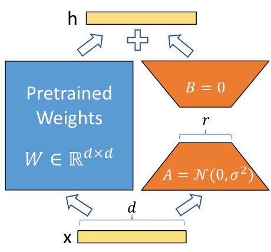
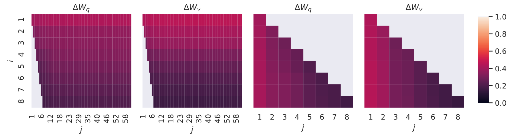

<!-- paper-reading-lang: zh-CN -->
<!-- paper-reading-theme: cobalt -->
<!-- paper-reading-mode: brief -->
# LoRA 导读：少量参数怎样改变大模型

<span class="source-ref">原文：Hu 等，LoRA: Low-Rank Adaptation of Large Language Models，arXiv:2106.09685v2，2021-10-16，26 页。只使用该版本，不把后续 LoRA 实现或论文结果混入本页。原始 PDF SHA-256：e9a0d3128767db616085dc0f4e6e455e672e89af823e8ed1282793682787395a。</span>

```paper-map
{"thesis":"把大模型的任务更新写成两个小矩阵的乘积，冻结底座；在所测任务上用很少的可训练参数保留微调质量。","outcome":"参数节省来自更新空间的约束；可用性取决于底座已学到什么、适配哪些矩阵，以及任务需要多少变化。","outcomeSource":"PDF §4–5、§7、Table 2–7、Appendix H.2","items":[{"number":"01","label":"现实约束","signal":"多任务部署","text":"全量微调为每个任务更新并保存与底座同规模的参数，GPT-3 175B 的副本成本尤其高。","source":"PDF pp. 1–3、§1–2"},{"number":"02","label":"核心机制","signal":"冻结加增量","text":"保留原权重，只学习低秩更新 BA；训练结束后可把更新合并进原权重。","source":"PDF pp. 4–5、§4.1、Eq. 3"},{"number":"03","label":"效果证据","signal":"理解与生成","text":"GLUE、GPT-2 数据到文本、GPT-3 三项任务显示参数效率；比较条件与误差范围决定结论强度。","source":"PDF pp. 6–8、Table 2–4"},{"number":"04","label":"解释边界","signal":"经验而非定理","text":"rank 扫描和子空间分析支持低秩适配的可行性，不能证明所有任务的最优更新都低秩。","source":"PDF pp. 10–12、§7、Appendix H.2"}],"reader":"了解基础神经网络；会做矩阵乘法即可起步，子空间分析配有二维算例。","goals":["跟算一次低秩更新，并验证两条支路如何合并","分清可训练参数、任务存储与训练总显存","判断小 rank 的实验支持什么、还不能推出什么"]}
```

> **先选一条路线。** 初次接触 LoRA：从第01节顺读；想先动手：[跟算更新](#section-3)，再回看[实验依据](#section-4)；已熟悉机制：[检查小 rank 的解释](#section-5)。完整表格和扩展协议按需展开。

## 01 / 先弄清楚省掉的是什么

想象你已拥有一个通用语言模型，现在要让它分别做 SQL 生成、自然语言推断和对话摘要。全量微调会让每项任务产生一整套模型权重。LoRA 的问题是：**能否让所有任务共用同一套基础知识，每项任务只保存一份小修改？** 它并没有把 GPT-3 从 175B 参数压缩成一个小模型，而是压缩“为这个任务需要学习和保存的变化”。（PDF pp. 1–3，§1–2）

**论文陈述。** 作者受低内在维度研究启发，假设适配时的权重变化有低“内在秩”。原矩阵可以满秩，更新矩阵仍可低秩；两者是不同对象。低秩约束限制的是调整方向，并不要求预训练模型本身只能表达少数方向。（PDF pp. 2、4，§1、§4.1）

**为什么这个假设值得试？** 若预训练已学到大量可复用特征，下游任务可能主要需要重新组合、强调其中一部分。少量更新方向于是可能足够。这是作者的机制解释与经验假设，后面的实验检验其在具体任务上是否可用，没有给出普遍成立的证明。（PDF §7.2–7.3、§8）

| 成本对象 | 全量微调 | LoRA 实际改变什么 |
|---|---|---|
| 每任务可训练参数 | 基本等于底座参数量 | 仅选中矩阵的 A、B，底座冻结 |
| 训练梯度与 Adam 状态 | 为大量权重保存 | 大幅减少，但仍有底座、激活等开销 |
| 每任务新增 checkpoint | 一套完整权重 | 一套小增量；底座仍需共享保存 |
| 推理中的模型矩阵大小 | 原模型规模 | 合并后仍是原模型规模 |
| 不同任务混在一个 batch | 各自模型/实现决定 | 合并不同增量后不便直接共用一次前向 |

以上机制与限制来自 §4；表格是本文的整理。不要把“可训练参数减少一万倍”读成“总显存减少一万倍”。（PDF pp. 4–5）

## 02 / 一次输入怎样经过 LoRA

先看 Fig. 1 的两条支路：左侧原权重保持不变，右侧输入先经过 A 的窄通道，再经 B 回到原维度，最后相加。要注意图中 B 从零开始，意味着接入 LoRA 的第一刻不会改变底座输出；这使训练从已有模型出发，而非先打乱它。



*原论文 Fig. 1 局部，PDF p. 1。蓝色为预训练权重；橙色 A、B 是本任务要训练的分支。*

```paper-path
{"title":"从共享底座到任务模型","intro":"这里是方法的实际操作顺序。训练阶段保留两路，部署时可以折叠成一路。","stages":[{"title":"选中适配位置","role":"配置","action":"选择注意力投影矩阵；多数实验适配 Wq、Wv，其余权重包括 MLP 冻结。","why":"在预算内改变注意力的查询与值，避免更新全模型；矩阵选择由实验比较辅助决定。","cost":"选择具有启发式成分；本文未系统验证 MLP、LayerNorm 和 bias 的适配。","output":"待适配的原矩阵 W0 与 rank r","source":"PDF §4.2、§7.1、Table 5"},{"title":"接入小分支","role":"初始化","action":"A 用高斯随机数初始化，B 设为零；同一输入送往 W0 和 BA。","why":"BA 初始为零，让初始函数与底座一致。","cost":"更新受低秩结构限制；r 太小可能无法满足困难任务。","output":"原输出加低秩修正的前向函数","source":"PDF §4.1、Eq. 3、p. 10 footnote 6"},{"title":"只优化 A、B","role":"训练","action":"用任务损失反向传播，更新小矩阵，不更新 W0。","why":"省去底座权重的梯度与优化器状态，降低训练及任务存储成本。","cost":"训练仍须经过大模型，不能省去底座计算与所有激活内存。","output":"任务特定增量 ΔW","source":"PDF §2 Eq. 2、§4.1–4.2"},{"title":"合并再推理","role":"部署","action":"先形成 W0 加缩放后的 BA，然后按普通线性层推理。","why":"两条线性支路可以代数合并，无须每次推理额外执行 A、B。","cost":"不同任务使用不同合并权重；同一 batch 混合多个适配器不再直接成立。","output":"原形状的任务权重 W","source":"PDF §4.1–4.2"}]}
```

**Wq、Wv 分别改什么？** 注意力先把 token 表示投影成查询 Q、键 K 和值 V：Q 与 K 的匹配决定从哪些位置取信息，V 提供被加权汇总的内容。改变 Wq 会改变“如何匹配”，改变 Wv 会改变“取回什么”。这是帮助理解适配位置的简化说明；后面的受控预算实验才用于比较位置是否有效。（PDF §4.2、§7.1；角色说明为本文解释）

两路能够合并的原因是线性：对任意输入 x，先相加矩阵再乘 x，与分别乘 x 后相加完全一致。常见 adapter 在主路径中增加带非线性的模块，不能用同一个线性矩阵把这段额外计算消去。因此 LoRA 的延迟优势依赖“可合并的线性更新”，而不只是参数数量小。（PDF §3–4、§6）

## 03 / 为什么两个小矩阵就省参数

设一个原权重 $W_0\in\mathbb{R}^{d\times k}$，输入 $x\in\mathbb{R}^{k}$。LoRA 学习 $A\in\mathbb{R}^{r\times k}$、$B\in\mathbb{R}^{d\times r}$，其中 $r\ll\min(d,k)$。论文 Eq. 3 写出未经缩放的结构，正文随后引入 $\alpha/r$；把二者合写得到

$$
h=W_0x+\frac{\alpha}{r}BAx,\qquad
\Delta W=\frac{\alpha}{r}BA,\qquad
\operatorname{rank}(\Delta W)\leq r.
$$

这里 $\alpha$ 控制更新幅度，r 控制中间维度。先算 $Ax$，得到 r 个坐标，再用 B 将这 r 个坐标展开为 d 维修正。对任意输入，修正都落在 B 的列空间里；底座输出 $W_0x$ 本身仍可包含其余方向。这就是“只给修改设窄通道”的具体含义。（PDF p. 4，§4.1、Eq. 3；秩与列空间说明是本文的代数推导）

全量更新一个矩阵需要 dk 个自由参数；LoRA 的存储/可训练参数数目为

$$
N_{\mathrm{full}}=dk,\qquad N_{\mathrm{LoRA}}=r(d+k),\qquad
\frac{N_{\mathrm{LoRA}}}{N_{\mathrm{full}}}=\frac{r(d+k)}{dk}.
$$

对正方形矩阵，比例变成 $2r/d$。例如 d=12,288、r=4 时，一个矩阵从 150,994,944 个可训练数变成 98,304 个，减少 1,536 倍。**这是单矩阵的计算示例，不是论文整模型的一万倍数字。** 整模型还冻结了没有适配的矩阵，因而相对全模型的比例会更小。（PDF §4.2、§5.1；本段数值为本文计算）

### 一个能手算的 rank-1 更新

下面是本文构造的教学例，令缩放系数 $\alpha/r=1$：

$$
W_0=\begin{bmatrix}1&0&0\\0&1&0\\0&0&1\\1&1&1\end{bmatrix},\quad
A=\begin{bmatrix}1&0&-1\end{bmatrix},\quad
B=\begin{bmatrix}1\\2\\0\\-1\end{bmatrix},\quad
x=\begin{bmatrix}2\\1\\1\end{bmatrix}.
$$

于是 $Ax=1$，底座输出是 $(2,1,1,4)^\top$，低秩修正是 $(1,2,0,-1)^\top$，最终输出为 $(3,3,1,3)^\top$。原矩阵有 12 个元素，A、B 合计 7 个；小例子的节省有限，维度很大且 r 很小时节省才明显。更换输入会改变修正幅度，但修正方向仍沿 B；学习 A、B 则能改变“检测什么”和“向哪个方向修正”。

下面的可选演示沿用同一个 A、B、W0，只改变输入的第一、第三个数。观察 **输入 → Ax → B(Ax) → 两路相加**，再核对合并后的矩阵是否给出相同输出。试着令 x1=x3：此时 Ax=0，修正消失，但底座输出仍然存在。演示中的参数预算是另一项独立计算：d=k=4,096、r=8 时，65,536 个参数占完整矩阵的 0.390625%，少 256 倍。它不预测训练效果或显存。

<!-- archify:lora-rank.workflow.html|改变输入，跟算低秩修正与权重合并 -->

### 为什么 A、B 不能都从零开始

A 随机、B=0 同时解决两个问题：接入时不改变底座，又让分支可以开始学习。**下面是对参数化的链式法则推导，并非论文新增实验。** 令缩放系数 c=α/r，g 为任务损失 L 对输出 h 的梯度；有

$$
\frac{\partial L}{\partial B}=c\,g(Ax)^\top,\qquad
\frac{\partial L}{\partial A}=c\,B^\top g x^\top.
$$

这里 g 是 d 维列向量，两项分别与 B、A 同形。初始 B=0 时，A 的这一项梯度为零；随机 A 则让 Ax 可以非零，于是 B 可以先更新，之后 A 也能收到梯度。若 A、B 都为零，这两项梯度都为零，靠这条分支的任务梯度无法启动。冻结 W0 是不更新其参数，并不禁止梯度经过它流向更早的层。（PDF §4.1；梯度式为本文推导）

**跟一次真正的参数变化。** 另取一个标量教学例：W0=1、A=1、B=0、x=2，目标 y=3，缩放 c=1。用平方损失 L=(h−y)²/2 与学习率0.1的普通 SGD，先前向再更新：

| 时刻 | 前向与损失梯度 | 哪些参数改变 |
|---|---|---|
| 初始 | h=2，g=h−y=−1；∂L/∂B=−2，∂L/∂A=0 | W0 冻结；一次 SGD 后 B=0.2，A 仍为1 |
| 重新前向 | h=2+0.2×1×2=2.4，g=−0.6 | 此时 ∂L/∂A=0.2×(−0.6)×2=−0.24，A 已能接到学习信号 |

这里用标量和 SGD 只为解释第一步怎样启动，不用于展示省参数；原论文的大模型实验使用其报告的优化器与任务损失。**“初始 A 的梯度为零”只描述初始这一步，不能读成 A 在整个训练中不学习。** 上面的交互则固定 A、B，只改变输入，演示的是前向机制而非这个训练过程。

### 训练目标仍然是任务目标

LoRA 改的是参数化方式，不另造一种语言建模目标。论文的条件生成目标是

$$
\max_{\Theta}\sum_{(x,y)\in\mathcal Z}\sum_{t=1}^{|y|}
\log p_{\Phi_0+\Delta\Phi(\Theta)}(y_t\mid x,y_{<t}).
$$

$\mathcal Z$ 是上下文与目标文本的训练对，$\Phi_0$ 是冻结的全部预训练参数，$\Theta$ 收集待训练的小矩阵，$\Delta\Phi(\Theta)$ 是它们编码的模型增量。每个目标 token 根据上下文和之前的目标 token 被预测。全量微调直接优化整套参数，LoRA 在受约束的更新集合中寻找同一任务的好解。（PDF p. 3，§2、Eq. 1–2）

### 一万倍、显存三倍和速度分别对应什么

论文用 GPT-3 175B、r=4、适配各层 Wq/Wv 的情形说明存储收益：任务 checkpoint 从约 350GB 降至约 35MB，仍需保留约 350GB 的底座；100 个任务共享底座约 354GB，而不是 100 份完整模型约 35TB。按层数 96、d=12,288 计算，小矩阵共有 18,874,368 个数，与论文取整后的预算一致。（PDF p. 5、footnote 4，§7.1；参数数目为本文计算）

训练显存的报告是 **1.2TB → 350GB**，约 3.4 倍下降，远小于增量 checkpoint 的下降倍数。论文还报告每张 V100 的吞吐量 **32.5 → 43.1 tokens/s**，条件为相同模型并行权重分片数。按这两个数计算吞吐提高约 32.6%，或每 token 用时减少约 24.6%；正文写“25% speedup”，本页保留原始数值以免混淆分母。这里是作者特定大模型设置的报告，本页没有重跑测量。（PDF p. 5，§4.2、footnote 5）

## 04 / 实验究竟支持了什么

实验不是一张统一排行榜。模型、数据、选参和比较来源不同，应该逐项回答问题。下表区分观察与结论，不把一整套方法的表现当成某个组件单独造成的效果。

```paper-experiments
{"title":"从可用性到机制的证据链","rows":[{"question":"少量更新能否保持语言理解质量","setup":"RoBERTa base/large、DeBERTa XXL；GLUE 八任务；对照全量微调、BitFit 与多种 adapter。","observation":"LoRA 可训练参数分别为 0.3M、0.8M、4.7M；原文混合指标平均为 87.2、89.0、91.3，全量微调为 86.4、88.9、91.1。","conclusion":"支持在这些设置中保留竞争力；平均值混合准确率与相关系数，不能叫作统一的准确率提升。","source":"PDF p. 6、Table 2、§5.2–5.3、Appendix D.1–D.2"},{"question":"这种效率是否也出现在生成任务","setup":"GPT-2 medium/large；E2E；与全量微调、prefix、adapter 等比较；另有 WebNLG 和 DART。","observation":"E2E BLEU：medium 全量微调 68.2、LoRA 70.4±0.1；large 68.5、LoRA 70.4±0.1。LoRA 仅训练 0.35M/0.77M。","conclusion":"支持在所测数据到文本任务上的参数效率；不同指标和基线并非全部由同一批运行得到。","source":"PDF p. 7、Table 3、Appendix D.3、F.1"},{"question":"扩展到 175B 是否仍可用","setup":"GPT-3；WikiSQL 逻辑形式验证准确率、MNLI matched 验证准确率、SAMSum ROUGE。","observation":"4.7M LoRA 对全量微调：WikiSQL 73.4 vs 73.8；MNLI 91.7 vs 89.5；SAMSum R1/R2/RL 53.8/29.8/45.9 vs 52.0/28.0/44.5。","conclusion":"三个任务呈现接近或更高表现，并非每个配置、每个指标都高于全量微调；WikiSQL 差值需结合约 ±0.5 的种子波动。","source":"PDF p. 8、Table 4、§5.5、Appendix D.4、F.2"},{"question":"零额外延迟有何依据","setup":"合并后的 LoRA 代数结构；GPT-2 medium 单次前向、RTX8000、100 次平均，对照 adapter。","observation":"batch=1、长度=128：全量微调/合并 LoRA 19.8±2.7ms，AdapterL 23.9±2.1ms，AdapterH 25.8±2.2ms。","conclusion":"在合并后保持原前向结构；adapter 的额外延迟在小 batch 短序列场景更明显，不能将此数值外推到所有硬件。","source":"PDF p. 4、Table 1、§4.1、Appendix B"},{"question":"效果来自大 rank 还是改对位置","setup":"GPT-3，相同约 18M 参数预算下改变注意力矩阵分配；另固定矩阵集合扫描 r。","observation":"Table 5 中 Wq(r=8) 的 WikiSQL 为 70.4，Wq/Wv(r=4) 为 73.7；Table 6 中 Wq/Wv 在 r=1 到 64 间多数结果接近。","conclusion":"参数放到哪些矩阵至少与 rank 一样值得关注；支持特定任务的小 rank 可用，不给出普遍最优 r。","source":"PDF p. 10、Table 5–6、§7.1–7.2"}]}
```

### 先看方向，再核对完整比较

下图将同一张表中的 4.7M LoRA 与全量微调放在共同的 0–100 准确率尺度上。先看方向，再看差值：WikiSQL 小幅下降，MNLI 上升；这比“LoRA 总是更好”更接近数据。

```paper-chart
{"type":"paired","title":"GPT-3 两项验证准确率","subtitle":"全量微调 → 4.7M LoRA；单位为准确率 %，差值为百分点","origin":"本文重绘 · 原论文 Table 4","source":"PDF p. 8、Table 4","note":"WikiSQL 的论文典型种子波动约 ±0.5 个百分点，MNLI-m 约 ±0.1；本图没有把这些典型值冒充逐格置信区间。","rows":[{"label":"WikiSQL","before":73.8,"after":73.4},{"label":"MNLI-m","before":89.5,"after":91.7}]}
```

**先带走两个条件。** WikiSQL 的小差距要结合约 ±0.5 个百分点的典型种子波动；4.7M 是参数预算，不是唯一矩阵/rank 配置。整套结果支持所测任务上的竞争力，不能直接变成任意任务的复现配方。完整数据、配置冲突和跨组比较条件保留在下面。

**还有一个未解决的原文冲突。** 37.7M 配置在 Appendix D.4 与 Table 15 中对应的 rank 不一致；同一参数预算也可以分配给不同矩阵，得到不同分数。这里保留各自报告值，无法仅凭 Table 4 的预算恢复唯一配置；下方列出具体差异，不将其作为已解决的复现配方。

<details class="reading-detail">
<summary>核对完整 Table 4、配置冲突与 GLUE 比较条件</summary>

这些是 Table 4 的报告值，M 表示百万可训练参数。WikiSQL 和 MNLI 的准确率越高越好，SAMSum 三个 ROUGE 指标也越高越好。它们的测量对象不同，不能混成一个“总提升百分比”。（PDF p. 8，Table 4）

| GPT-3 适配方法 | 可训练参数 M | WikiSQL % | MNLI-m % | SAMSum R1 / R2 / RL |
|---|---:|---:|---:|---|
| 全量微调 | 175,255.8 | 73.8 | 89.5 | 52.0 / 28.0 / 44.5 |
| BitFit | 14.2 | 71.3 | 91.0 | 51.3 / 27.4 / 43.5 |
| PreEmbed | 3.2 | 63.1 | 88.6 | 48.3 / 24.2 / 40.5 |
| PreLayer | 20.2 | 70.1 | 89.5 | 50.8 / 27.3 / 43.5 |
| AdapterH | 7.1 | 71.9 | 89.8 | 53.0 / 28.9 / 44.8 |
| AdapterH | 40.1 | 73.2 | 91.5 | 53.2 / 29.0 / 45.1 |
| LoRA | 4.7 | 73.4 | 91.7 | 53.8 / 29.8 / 45.9 |
| LoRA | 37.7 | 74.0 | 91.6 | 53.4 / 29.2 / 45.1 |

**比较条件。** GPT-3 训练两轮、batch=128，使用 AdamW，对各方法和数据组合调整学习率，报告每次运行的最佳验证表现。作者因训练成本高只提供任务层面的典型标准差，而非每个单元格的区间；WikiSQL 约 ±0.5，MNLI 约 ±0.1，SAMSum 约 ±0.2/±0.2/±0.1。它们帮助判断波动尺度，不足以直接宣称统计显著。（PDF §5.5、Appendix D.4、Table 12）

**4.7M 不是一个固定配置。** Appendix D.4/F.2 允许不同任务/预算采用不同矩阵组合。例如 Table 15 的 MNLI 91.7 对应仅 Wv、r=2，而 Wq/Wv、r=1 在同样 4.7M 下为 91.3。因此不能用 Table 4 的 91.7 来声称“所有实验只要给 Wq/Wv 设 r=1 就能复现”。（PDF pp. 20、23，Table 15）

原文的 37.7M 配置还存在冲突：D.4 把四矩阵 r=2 列为 37.7M，而 Table 15 将它列为 18.8M，四矩阵 r=4 才为 37.7M。Table 4 的 37.7M MNLI 为 91.6，Table 15 四矩阵 r=4 为 91.7。本页保留各表报告的数值，不能由这些表恢复唯一的精确复现配置。

**GLUE 的公平性也需要分组。** Table 2 中带 † 的运行采用更受限的设置：序列长度 128，MRPC/RTE/STS-B 从未适配 MNLI 的预训练模型开始；普通 LoRA 运行则可从最佳 MNLI LoRA checkpoint 接着适配。相同 0.8M 参数的 RoBERTa large，普通 LoRA 平均 89.0，† LoRA 为 88.6；应按受限设置分组比较，而不是跨组挑最高分。† 也不表示所有超参数一致：Table 9 中 LoRA† 的 batch 为 4，而 adapter† 为 32。RoBERTa/DeBERTa 报告 5 个种子的中位数并选每次运行最佳 epoch；GPT-2 报告 3 个种子均值，不能混称为同一种统计汇总。（PDF §5.2、Appendix D.1–D.3）

</details>

### 从一个生成任务理解附录

**DART 检查的是“结构化事实怎样变成文字”。** 输入是一组实体—关系—实体三元组；模型把它作为上下文，逐 token 生成描述，与参考文本比较。教学示意输入“（蓝杉餐厅，所在城市，杭州）”，可写成“蓝杉餐厅位于杭州”；这不是原数据样本或实测输出。BLEU 衡量与参考文本的 n-gram 匹配并考虑长度，分数高不等于逐项事实都正确。这个任务要求模型把给定事实表达出来，与 MNLI 判断两句话关系的输入输出不同。（PDF Appendix C、F.1；中文示意为本文构造）

Table 13 中 GPT-2 medium 的 BLEU 为全量微调 46.2、LoRA 47.1±0.2。这项结果补充了语言理解以外的生成证据；扩展到其他任务仍须看各自协议。

<details class="reading-detail">
<summary>展开附录任务、完整补充数字与比较边界</summary>

| 附录证据 | 具体观察 | 可以读出什么 |
|---|---|---|
| GPT-2 DART，Table 13 | medium BLEU 全量 46.2、LoRA 47.1±0.2；large 47.0、47.5±0.1 | 生成任务证据不限于 E2E，但仍是特定数据到文本设置 |
| GPT-2 WebNLG，Table 14 | large 全部类别 BLEU：LoRA 57.0±0.1，23M AdapterL 57.7±0.1 | LoRA 不是每个对照中的最高分；需看预算与 seen/unseen 划分 |
| GPT-3 少数据 MNLI，Table 16 | 100/1k/10k/392k 条训练样本，LoRA 为 63.8/85.6/89.2/91.7，全量为 60.2/85.8/88.9/89.5 | 少数据下也可竞争，但样本规模改变时训练轮数和 batch 也改变，不是只改样本数 |
| LoRA 与 prefix 组合，Table 15 | WikiSQL LoRA+PE 最大配置 76.2；MNLI 为 91.3 | 组合的收益依任务而异，且参数预算增加，不能称作免费提升 |

以上为本文整理，方向与条件来自 Appendix E、F；少数据设置详见 Table 17。（PDF pp. 21–24）

</details>

## 05 / 小 rank 的解释能走多远

### 先改对位置，再讨论 rank

固定约 18M 参数预算，Table 5 的 WikiSQL：只改 Wq 为 70.4，只改 Wv 为 73.0，改 Wq/Wv 为 73.7，四种注意力矩阵全改也为 73.7。MNLI 则分别为 91.0、91.0、91.3、91.7。**观测支持把预算分到多个有用位置，而不是单纯加大一个矩阵的 rank。** 原表 caption 称 Wq/Wv “overall best”，但四矩阵组合在 WikiSQL 持平、MNLI 更高；本页按表格数据保留这一区别。（PDF p. 10，§7.1、Table 5）

接着固定 Wq/Wv，Table 6 的 rank 扫描如下：

| r | WikiSQL 验证准确率 % | MNLI 验证准确率 % |
|---:|---:|---:|
| 1 | 73.4 | 91.3 |
| 2 | 73.3 | 91.4 |
| 4 | 73.7 | 91.3 |
| 8 | 73.8 | 91.6 |
| 64 | 73.5 | 91.4 |

这条曲线没有“r 越大越好”。但表中的 WikiSQL 73.4 到 73.8 只有 0.4 个百分点，而作者报告该任务典型波动约 ±0.5；不要将其中最小差距解释成可靠排序。GPT-2 的 Appendix H.2/Table 18 更显示 BLEU 在 r=4 达到 70.38，r=1 为 68.72；最合适的 r 与模型、任务、指标及调参有关。Table 18 的部分超参数在 r=4 上调整；原文提醒它们对其他 r 未必最优。（PDF p. 10、p. 26）

### 子空间重合提供线索，不替代任务效果

先把“方向重合”压到二维。**以下是本文教学例，不是论文测量。** 一条单位方向 u=(1,0)，另一条 v=(3/5,4/5)。内积 uᵀv=3/5，表示 v 沿 u 的分量；平方后为 9/25=0.36。若 v=u，重合为1；若 v=(0,1)，重合为0。方向的正负不应改变同一直线是否重合，所以这里使用平方。

奇异值分解（SVD）为 A 找出一组互相垂直的输入方向，并按 A 对它们的作用强弱排序。正交基就是这些互相垂直、长度为1的方向；取前几个，相当于拿出一个子空间。比较两组基的内积，再把所有内积平方相加，就把刚才的一条线比较推广到多个方向。Frobenius 范数的平方恰好是矩阵所有元素的平方和；分母则按较小空间的维数归一化。因此这个量回答“方向有多少重合”，不回答“模型准确率有多高”。

作者比较 r=8 与 r=64 学到的 A 的主要奇异向量方向。这里沿用原文记号 U_A，指 A 的右奇异向量基。对于两组正交基的前 i、j 个方向，正文 Eq. 4 的归一化相似度为

$$
\phi(A_8,A_{64},i,j)=
\frac{\left\|U_{A_8}^{i\top}U_{A_{64}}^j\right\|_F^2}{\min(i,j)}\in[0,1].
$$

$U^i$ 表示所选奇异方向组成的正交基；分母让不同维数的重合程度可比较。这里的 1 意味着较小子空间完全包含在较大者中，0 表示两者正交，并不是模型准确率。（PDF p. 11，§7.2、Eq. 4）

Fig. 3 应先看左边两个热图的最上方，再看右边的放大图：r=8 与 r=64 的首要方向较重合，更多方向没有同样稳定的共同结构。它为“小 rank 抓住共同的重要方向”的解释提供线索；颜色本身不证明其余方向全是噪声。



*原论文 Fig. 3，PDF p. 11。i、j 是选入的奇异方向数，颜色为归一化子空间相似度。*

作者还在不同随机种子间比较，并以随机高斯矩阵为对照；Appendix H.1 将分析扩展至第 1、32、64、96 层。结果与少数稳定方向的解释一致。**读者推断。** 这是对学习到的低秩参数化的经验分析，不能反过来证明未受约束的全量微调最优解必然同样低秩，也没有把具体语义功能逐一定位到奇异向量。（PDF pp. 11–12、25–26，Fig. 4、6–7）

<span class="source-ref">公式校对：Appendix G p. 24 将相似度和 Projection Metric 距离 d 联系时排成 (1−d²)/p；由 PDF p. 23 的距离定义 d²=p−Σσ²，正确代数关系应为 1−d²/p。本页使用正文 Eq. 4 的范数定义，不沿用该附录等式。</span>

### “放大预训练特征”是怎样得到的解释

先用一个二维教学例理解“在更新方向上看原权重”。令原矩阵 W=diag(4,1)，更新 ΔW=diag(0,3)：原矩阵最强的是第一方向，但更新只改第二方向。沿第二方向看，原权重的大小为1、更新大小为3，二者之比为3；这并不意味着任务表现提高3倍。Frobenius 范数把矩阵整体大小写成“元素平方和再开根”，而投影先只保留选定方向上的分量。原论文用这个思路检查更新是否强调了底座中已有但较弱的方向；本例的方向、数字和推演均由本文构造。

Table 7 取 GPT-3 第 48 层 Wq。r=4 时，完整原矩阵 Frobenius 范数为 61.95；将原矩阵投影到更新的左右奇异方向后范数为 0.32，而更新范数为 6.91，比例约 21.6。若用原矩阵自身的前四个奇异方向，投影范数为 21.67；随机方向则为 0.02。（PDF p. 12，§7.3、Table 7）

**观察。** 更新方向在原矩阵里有比随机更强的成分，但并非原矩阵最强的几个方向。**作者解释。** LoRA 可能放大预训练中已存在、却没有被充分强调的任务相关特征。**边界。** 范数和子空间几何只提供间接支持；论文没有通过干预某个可命名特征来证明“这个语义特征被放大，所以准确率提高”。21.6 也是此层此配置的投影比，不是全模型性能提高倍数。（PDF §7.3、Appendix H.3–H.4）

## 06 / 参数效率与任务能力的关系

LoRA 的价值取决于一条具体的依赖链：**预训练模型已经提供可复用能力 → 任务所需修改可以被少数方向近似 → 在合适矩阵上学习这些修改 → 用很小的任务增量获得接近全量微调的结果。** 第一环越不成立、任务越需要大范围变化，小 rank 限制越可能成为瓶颈；作者也用跨语言任务作为小 rank 未必足够的思想例子。（PDF p. 10 footnote 6、§8）

论文较有力地展示了“无需为每个任务训练和保存整套权重，也能在这些理解与生成任务上有竞争力”。它把参数预算、训练状态、checkpoint 和部署合并连在了一起。对于底座可共享、任务很多、单任务推理延迟敏感的场景，这种组合尤其有吸引力；这是基于方法结构与论文测量的适用性推断，并非本页新增的部署实验。

低秩分析说明小修改可能足够，却没有给出自动选择适配位置或 rank 的通用规则。读完这篇论文后，合理的实践预期是：以小 rank 和有依据的矩阵位置开始，使用目标任务验证集检查质量与成本，再决定是否增加更新容量；不能根据“一万倍”直接推出任意任务、任意底座都只需相同比例的参数。这里的数值是 2021 年 v2 报告的结果，本页未复现实验，也未将其扩展为后续模型的结论。

```paper-check
{"title":"合上答案，试着计算、迁移和判断","items":[{"question":"把 rank-1 算例的输入改成 x=(1,1,1)。LoRA 修正和最终输出分别是什么？为什么？","hint":"先算 Ax，再分别计算 W0x 和 B(Ax)。","answer":"A=(1,0,−1)，所以 Ax=0；低秩修正为零。W0x=(1,1,1,3)，最终输出也是 (1,1,1,3)。这说明固定的 A 会决定输入在 B 方向上的修正幅度，低秩分支不会对每个输入都产生相同修正。","source":"PDF §4.1、Eq. 3；第03节为本文构造的教学例与代数推导"},{"question":"为什么“任务 checkpoint 小约一万倍”不能推出训练总显存也小一万倍？","answer":"每个任务只保存小矩阵增量，但训练仍要保存并运行冻结底座，也有激活等开销。原文 GPT-3 checkpoint 约 350GB→35MB，训练显存报告为 1.2TB→350GB，分母和成本对象不同。共享底座也仍占存储。","source":"PDF p. 5、§4.2、footnote 4–5"},{"question":"Table 4 中 4.7M LoRA 的 WikiSQL 73.4、全量微调 73.8，MNLI 91.7 对 89.5。能否概括成“LoRA 在所有任务都更好”？","answer":"不能。WikiSQL 验证准确率低0.4个百分点，MNLI验证准确率高2.2个百分点；任务与误差尺度要分别看，作者报告WikiSQL典型波动约±0.5。4.7M也是预算，不是唯一矩阵/rank配置。原表支持所测任务上的竞争力，不能外推到所有任务或宣称统计显著。","source":"PDF p. 8、Table 4、Appendix D.4、F.2、Table 15"},{"question":"一个输入4维、输出6维的线性层，最多能新增20个可训练参数。r=1、2、3 中最大可选哪个？r=3 还比全量更新省参数吗？","hint":"将新维度代入 r(d+k)，并与 dk 比较。","answer":"全量更新有6×4=24个参数。r=1、2、3分别需要10、20、30个；预算允许的最大rank是2。r=3反而比24个全量参数更多。参数化需要的数与实际矩阵秩或任务准确率是不同对象；预算满足不保证任务质量。","source":"PDF §4.1–4.2 的参数化；本题维度与预算为本文教学设定"}]}
```

[查看 arXiv 指定版本](https://arxiv.org/abs/2106.09685v2) · [原始 PDF](https://arxiv.org/pdf/2106.09685v2)

<!-- 交互选择：改变输入可揭示 Ax 如何控制沿 B 的修正，比较两路与合并输出；另保留 rank 参数预算关系。静态公式、默认输出、参数表和手算例保持可读。自测使用原生details，不需要脚本。图中原文结果没有被模拟。 -->
<!-- 新 Skill 重构复核 2026-10-27：重新获取指定 v2 PDF，SHA-256 与 assets/lora-provenance.json 一致；对照方法、全部决定性结果、子空间分析与任务/协议附录。初始化 SGD 算例为独立教学推演，不是原论文优化器或实验；原文冲突的主要影响保持可见。没有重跑论文实验或真人理解测试。 -->
