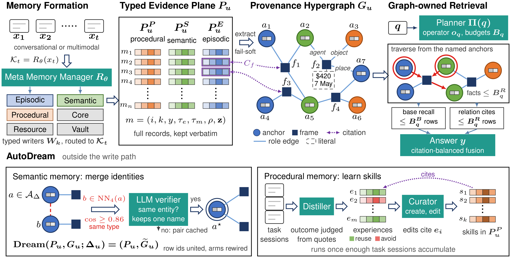
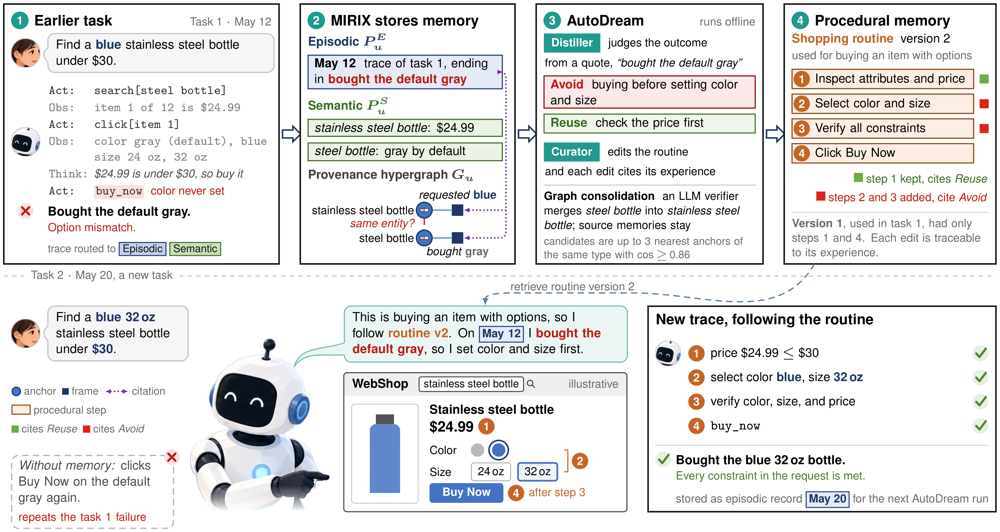
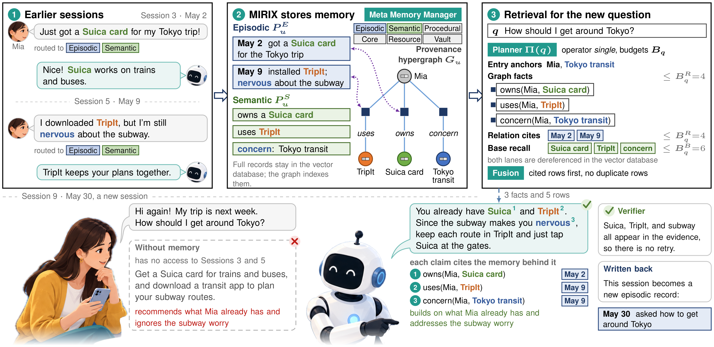
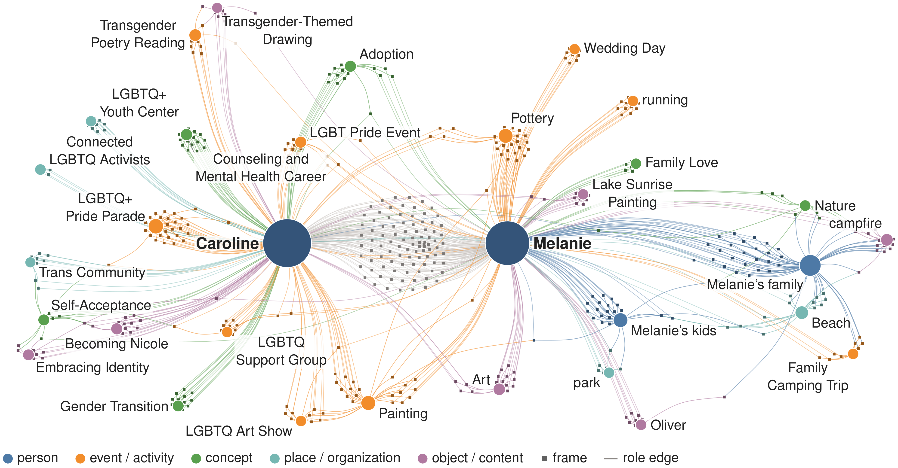

<!-- paper-reading-lang: zh-CN -->
<!-- paper-reading-mode: deep -->
<!-- paper-reading-theme: cobalt -->

# MIRIX-2.0：证据层做真相源、超图只做索引——多智能体记忆系统的三难突围

```paper-map
{"thesis":"MIRIX AI 团队提出：LLM agent 的长期记忆要同时满足准确（名字/日期/计数/事件区分可恢复）、实用（免训练、闭源开源模型都能跑、答案可溯源、整合不破坏存量）、高效（证据集有界不随历史增长）三难，而现有每条路线各弃其一——整合式丢细节、全量保存丢效率、二元三元组碎片化 n 元事实、文件系统记忆靠摘要路由（点名 Claude Code auto memory 的 size-capped index）、参数化记忆要训练。MIRIX-2.0 的解法是分层：六个类型化记忆 agent 把完整记录写进向量库作为唯一真相源，溯源超图只做索引（n 元帧携带字面量并引用源行、发生身份区分相似事件），检索在算子预算内走图（双车道+引用均衡融合+答案时验证），AutoDream 在写路径之外只并身份不重写记录、只蒸馏技能不改证据。结果：LoCoMo 91.4%、LongMemEval-S 72.6%（领先最强基线 14.3 分）、文档 QA 单跳/多跳领先 31/22 分，程序记忆在 ALFWorld/WebShop/MetaClaw-Bench 均列记忆方法第一；代价是文档摄取慢 3.8-4.0 倍、DetectiveQA 输给 MemoryBank、ALFWorld 的 Pick/Look 类任务低于无记忆。","reader":"在为 agent 选型或自建长期记忆层、关心「图记忆 vs 向量记忆 vs 文件记忆」之争的工程师与研究者；本页把论文的每个设计决策与结果数字放进可复算的模型（增量核算、预算表摊销、摄取/查询成本账、逐任务涨跌、token 悖论）。","goals":["走通「三难→四家族失败模式→分层架构（证据面+超图索引）→预算化检索→AutoDream 双面整合→五基准+三 agent 环境→成本账→边界」的完整论证","把 91.4/72.6/+31/+22/76.4/37.4/49.2 等关键数字逐个放回增量与成本模型核算，分清图增益与整合增益","标出论文自己承认的未证之处：组级消融、单跑用户记忆结果、LLM 评审、DetectiveQA 反例与 ALFWorld 干扰退步"],"outcome":"全文精读 arXiv 2611.12068v1（2026-11-09，29 页：主文 16 页 + 附录 A.1-A.7 与 B.1-B.3 全读），四张关键图（总览/用户向走廊/agent 向走廊/conv-26 超图）600 DPI 提取嵌入，Table 1/2/3/4/6/7/8/10/11/12 逐表核对。","outcomeSource":"https://arxiv.org/abs/2611.12068","items":[{"number":"01","label":"三难困境","signal":"accurate×practical×efficient","text":"部署级记忆要同时满足三个要求：源保真（细节经写入与整合后可恢复）、有界访问（查询只看小邻域与有界引用行）、时间身份（相似措辞的不同发生不合并）。整合式系统丢细节、全量系统丢效率、二元三元组丢 n 元连接、文件记忆靠摘要路由丢 recall、参数记忆丢实用性——每族弃一。","source":"§1 引言"},{"number":"02","label":"点名文件记忆","signal":"Claude Code auto memory","text":"论文直接把 Claude Code 的 auto memory 当作对照家族：纯文件+size-capped 索引，agent 靠一行摘要决定开哪个文件；摘要没提的细节只能字符串搜索（既不能跨文件解析实体也不能顺关系走），超容量的索引条目根本不加载——两家（文件/超图摘要）都在为省成本做自顶向下剪枝，用 recall 付账。","source":"§1 文件系统记忆段"},{"number":"03","label":"分层架构","signal":"库是真相源图是索引","text":"六类型（Core/Episodic/Semantic/Procedural/Resource/Vault）各配专属 writer，Meta Memory Manager 路由；只有 episodic 与 semantic 进超图。向量库先提交、图构建后跑且 fail-soft：图写失败不回滚记忆、图读报错回退直检。","source":"§2.2 与 A.1"},{"number":"04","label":"溯源超图","signal":"n 元帧+发生身份","text":"锚点带键规范化与准入闸（拒通用词、每记录 ≤16/18 锚点）；n 元帧把 agent/origin/destination 等角色挂在一帧上、日期价格计数做字面量、引用源行；语义帧 idS=H(u,p,σ(f)) 累积引用，事件帧 idE 加发生键 χ（显式事件时间否则记忆 id）——同日两提共享、不同日相似措辞分开。","source":"§2.3 与 A.2"},{"number":"05","label":"预算化检索","signal":"算子定预算","text":"确定性规划器出 5 种算子（single/temporal/intersection/list-union/count）与行预算（6/4 至 8/12）；锚点入口 15 向量召回+≤16 精确命名，hub 惩罚；双车道（基础召回+关系引用，谓词先在 Neo4j 内过滤、帧上限 240）；九项事实打分；引用均衡融合（引用行优先、不重复行）；答案时验证器按规则触发最多一次补检+重写。证据集由算子定界，不随历史长。","source":"§2.4 与 A.3/A.4"},{"number":"06","label":"AutoDream","signal":"只并身份不重写","text":"语义侧：安全类型（person/org/location/object/concept）内 NN4+cos≥0.86 候选、LLM 判同、无损结构合并（并引用/加计数/重接臂），中间轮 ≤80 对、终轮 ≤120+60 修复对、负判定按类型缓存；证据库原样返回。程序侧：Distiller 从引文判结果（引文核不上降级 unclear）、Curator 增删改技能且每处编辑的引文要核过才记引用。","source":"§2.5 与 A.5"},{"number":"07","label":"对话记忆结果","signal":"91.4 与 72.6","text":"LoCoMo（1,540 题）：85.7(M0)→88.4(M1 图)→91.4(M2 整合)；HyperMem 自跑 91.0（其自报 92.7）。LongMemEval-S：58.8→70.0→72.6，领先 HyperMem 14.3 分，其中图贡献 11.2。增益集中于多跳（图 +5.7）与时间类（整合 +3.4）。","source":"§3.2 Table 1/7、图 4/5"},{"number":"08","label":"文档 QA 与反例","signal":"+31/+22 与 Detective","text":"MemoryAgentBench（M1）：SHDoc 83.0 对 HyperMem 52.0（+31.0）、MHDoc 71.0 对 49.0（+22.0）——保源细节+关系结构的合并效应；但 DetectiveQA 64.8 低于 MemoryBank 67.6 与 HyperMem 66.2：组织显式证据不保证侦探式推理，论文自认无误差分析分不清漏检与推理失败。","source":"§3.2 Table 8"},{"number":"09","label":"程序记忆","signal":"技能可复用也可干扰","text":"ALFWorld：GPT-6 Luna 76.4 对 AWM 73.6/无记忆 69.4；但逐任务看 Clean +14.0、Heat +26.1 而 Pick/Look/Pick Two 低于无记忆（检索到的例行程序会干扰本来就擅长的任务），且 GPT-5.6 版标准差 14.0。WebShop 37.4 领先（ReasoningBank 25.7 低于无记忆）。MetaClaw-Bench：GPT-5.2 下 49.2 对技能库 44.0，完成率 +10.6 比准确率 +5.2 更显著。","source":"§3.3 Table 3/10/11、图 6/7"},{"number":"10","label":"成本账与边界","signal":"摄取4倍慢查询全快","text":"文档摄取 M1 比 M0 慢 3.8-4.0 倍（23,784s 对 6,227s）；但对话摄取反而比 HyperMem 快 3 倍多（21,416s 对 69,467s）；答案延迟五个基准全低于 HyperMem（省 0.63-5.81s/题）；token 四省一费（Detective 1.16M 对 0.35M）。未证之处：组级消融不分离 n 元帧/引用行/验证器、用户记忆单跑+LLM 评审、M2 全系统未计时、合并精度与保留率未测。","source":"§3.4 Table 12、§3.5、§5 局限"}]}
```

深读对象：arXiv 论文[《MIRIX-2.0: Multi-Agent Memory System》](https://arxiv.org/abs/2611.12068)（MIRIX AI，2026-11-09 提交 v1，29 页含附录；作者 Wei-Chieh Huang、Weizhi Zhang、Jiayan Nan、Peng Xia、Yu Wang，代码与网站公开：github.com/Mirix-AI/MIRIX / mirix.io）——[点此打开原文 ↗](https://arxiv.org/abs/2611.12068)。选它做今日深读有三个理由：其一，它是本周「记忆线」的学界对位——昨天深读的 Claude 工程文把常驻智能体的记忆原语定为「四类文件 + 指针规则 + dreaming 策展」，本文恰好把该家族（文件系统记忆）点名列为被超越的对象之一，学理对话直接成立；其二，它把「图记忆 vs 向量记忆」的路线之争翻译成了一个可检验的分层主张——库做真相源、图只做索引，这个切分对任何要给 agent 配记忆的人都是架构级决策；其三，论文的诚实度罕见：DetectiveQA 输了就列输、ALFWorld 三个任务类型低于无记忆就写干扰、M2 全系统没计时就明说没测。本页按细章跟读：三难与四家族失败模式、分层架构与四条硬不变量、锚点/帧/发生身份的写入管线、预算化检索的两车道、AutoDream 的双面整合、五基准与三 agent 环境的逐表核算（增量怎么加、成本怎么换）、以及论文自认的未证清单；全部数字经逐格回对原文表格。

<!-- Deep Reading coverage
| Source section / object | Role | Explanation location / status |
| --- | --- | --- |
| §1 引言（三要求、四家族失败模式、用户向/agent 向二分） | 立论 | §01-02 |
| §2.1 问题设置（S=(P,G)、三技术要求） | 形式化 | §03 |
| §2.2+A.1 类型化证据面（六类型、路由、先提交后索引） | 架构一 | §04 |
| §2.3+A.2 溯源超图（锚点/键/准入、n 元帧/字面量、发生身份、修复审计） | 架构二 | §05-07 |
| §2.4+A.3+A.4 预算化检索（规划器/预算表/入口/双车道/打分/融合/验证器） | 架构三 | §08-09 |
| §2.5+A.5 AutoDream（语义合并代数与上限、程序蒸馏/策展与引文核验） | 架构四 | §10-11 |
| §3.1 设置与 M0/M1/M2 变体定义 | 实验 | §12 |
| §3.2 Table 1/7/8/9 与图 4/5（LoCoMo/LME-S/文档 QA/MemoryCD） | 实验一 | §12-13 |
| §3.3 Table 3/10/11 与图 6/7（ALFWorld/WebShop/MetaClaw） | 实验二 | §14 |
| §3.4 Table 4/12 与图 8（摄取/延迟/token/图规模） | 实验三 | §15 |
| §3.5 实验确立了什么 | 收束 | §15-16 |
| §4 相关工作（记忆系统/多智能体/自反思与整合） | 定位 | §02、§16 简评 |
| §5 结论与局限、伦理声明 | 边界 | §16 |
| 附录 A.6 复杂度与不变量、A.7 conv-26 超图实例 | 支撑 | §03（不变量）、§05（规模数字）、§16 |
| 附录 B 全表（Table 7-12） | 数据 | §12-15 逐表 |
-->

## 01 / 三难：准确、实用、高效为何难以同时

论文开篇把「记忆基准分数」与「部署可用」分开：基准只看答案对不对，而一个团队真要把记忆接进产品，要的是三样同时成立——**准确**（accurate）：名字、日期、计数、两个事件的区分，这些 particulars 在写入之后、整合之后都必须可恢复；**实用**（practical）：用现有模型就能跑、零训练、答案可追溯到存储记录、整合操作不能毁掉已存内容；**高效**（efficient）：单题延迟与 token 成本不随历史变长而增长。三个词不是口号，后面每一条都会被落成可检验的约束（§03 的不变量、§08 的预算表、§10 的合并代数）。

### 家族失败模式表：每族弃一

论文对现有路线的清点直截了当，每一族各弃一个顶点：

- **整合式**（提取事实/摘要后丢弃原文）：紧凑但**丢细节不可逆**——被丢掉的细节永远没了，整合出的记忆甚至可能从有用经验蒸馏成错误记忆（引用 Zhang et al. 2026a 的发现）；
- **全量保存式**：什么都不丢但**检索要在越来越大的噪声历史里搜**，效率随历史单调恶化；
- **图记忆（二元三元组）**：把 n 元事实拆成碎片，**参与者之间的连接丢失**——一趟航班变成几条互不相连的三元组，谁跟谁同机这一信息在拆分时就没了；
- **超图记忆（既有）**：超边记录「哪个单元属于哪个主题」而非「一个事实的参与者是谁」，且检索从**写入时写的主题摘要**自顶向下走——细节只有在它的主题先被检回时才可达，摘要层成了新的瓶颈；
- **文件系统记忆**：详见 §02；
- **参数化记忆**（权重/潜状态）：**要训练、排除闭源模型**——实用性出局。

### 三顶点空位的形式化

（教学重建）这张失败模式表可以形式化成一个三元组覆盖问题：设要求空间为 $\{$准确, 实用, 高效$\}$，每族系统最多守住两个顶点。整合式守住实用+高效、丢准确；全量式守住准确+实用、丢高效；参数式守住（潜在的）准确+高效、丢实用。**三顶点全守的设计空间就是本文要占的空位**——这句话也预告了为什么后文的每个组件都带着「不破坏已存内容」「不随历史增长」的约束出现：缺了任何一条，系统就滑回某个已知的失败家族。

论文还补了一个二分法给后文的实验铺路：**用户中心记忆**（user-centric，个性化 agent，要广记并连接用户历史的任何细节）与 **agent 中心记忆**（agent-centric，积累 agent 自身经验，要精确精炼——检索太多反而把注意力从当下任务拉走）。两用的挑战是反的，而「一个存储同时服务两用」本身被论文当贡献列示——对应实验的两组基准（§12-13 对话/文档 vs §14 交互任务）。

## 02 / 点名文件记忆：与 Claude Code auto memory 的直接对话

### 摘要路由的死穴

对本周读过 Claude「常驻智能体」深读的读者，§1 里最扎眼的一段是对文件系统记忆的点名批评，被点名的正是 **Claude Code 的 auto memory**：「纯文件、背后一个尺寸封顶的索引（size-capped index）随每个 session 加载，agent 靠一行摘要决定打开哪个文件。**摘要没提到的细节只能靠字符串搜索**——字符串搜索既不能跨文件解析同一实体，也不能顺着它的关系走；而且**超出容量上限的索引条目在 session 开始时根本不加载**。」论文的判词是：文件记忆与「摘要路由的超图记忆」是同一类病——**都在为压成本做自顶向下剪枝，都用摘要没覆盖的细节的 recall 付账**。

这个批评的分量要放在昨天的语境里读：Claude 工程文把「目录 + 索引 + 按需取回」当作务实基线（每 run 只读索引、用到才开文件），本文承认这个设计便宜，但指出它的检索面被一行摘要焊死了——摘要没写的细节在检索语义上不存在；索引一满，连「知道有这个文件」都会丢。

### 锚点路由怎么接

本文的回应不是抛弃文件思路，而是把「摘要路由」换成「**锚点路由 + 引用回读**」：入口是实体锚点不是摘要（§05），入口之后回读的是**被引用的原始行**（§08）——细节的可达性不再依赖任何摘要是否提到它，而只依赖「它挂在哪个实体上」。两篇相隔四天、一个出自产品团队一个出自研究团队，恰好构成「基线 vs 超越基线」的完整叙事：文件记忆解决「存什么」，锚点路由解决「怎么找到」。

## 03 / 状态与不变量：把系统钉在四条硬性质上

### 问题设置

问题设置很干净：用户 $u$ 有输入流 $X_u = (x_1, \ldots, x_T)$，写入时**未来查询未知**，writer 必须产出持久状态

$$S_u = (P_u, G_u)$$

其中 $P_u$ 是证据库（类型化存储的集合），$G_u$ 是索引图；之后的查询 $q$ 从 $S_u$ 得到**有界证据集** $R(q; S_u)$ 回答。「写入时未来未知」这个前提值得停一下——它排除了「按预想查询优化存储」的捷径，写路径必须为一切可能的问题保留信息，这正是源保真要求的来源。

### 四条硬不变量与学习/确定性分工

三条技术要求——**源保真**、**有界访问**、**时间身份**（相似措辞的不同发生不得合并）——在附录 A.6 被落成四条**硬不变量**（不论 LLM 行为如何都成立）：① 每个返回的图事实都暴露其源记忆的标识符；② 来自不同记忆行的未标日期事件得到不同的帧身份；③ 检索与 Dream 都在显式候选/输出上限内运行；④ 图写失败不能破坏已提交的记忆、图读报错回退直接证据检索。配合 Dream 的契约（§10），①④ 给出源保真、③ 给出有界访问、② 给出时间身份。

配套的还有一个**学习/确定性分工表**：LLM 负责路由、写入、抽帧、修复、判同、蒸馏、策展；确定性代码负责安全边界——准入名单、候选白名单、帧身份、预算、合并代数、变更顺序。「LLM 可以提议两个锚点相同，但不能在检索到的候选集之外命名锚点，更不能直接删除证据」——这句话值得整段背下来：它不靠提示词求 LLM 别犯错，而是让**架构**保证 LLM 的错误够不到要害。附录还给了复杂度：写一条记忆进图 $O(d+h)$（$d$ 锚点数、$h$ 帧数）；检索排序 $O(K_A + K_F + K_M)$；Dream 近邻生成 $O(|\Delta_u| \log |A_u|)$、LLM 验证上限 80+180 对——全部常数显式。

## 04 / 类型化证据面：六 agent 分治，先提交后索引

### 六类型与七元组

写路径第一跳是 **Meta Memory Manager**：把每个输入 $x_t$ 路由到要更新的记忆类型子集 $K_t = R_\theta(x_t)$，六类各配专属 writer，writer 产出记录 $m_t^{(k)} = W_k(x_t, P_u^{t-1})$ 并**独占该类型的 schema 与更新操作**：

| 类型 | 职责 | 进超图？ |
| --- | --- | --- |
| Core | 用户与 agent 的持久状态 | 否 |
| Episodic | 时间锚定的事件 | **是** |
| Semantic | 持久事实与概念 | **是** |
| Procedural | 可执行工作流（技能） | 否 |
| Resource | 文档与多模态产物 | 否 |
| Knowledge Vault | 敏感逐字值 | 否 |

只有 episodic 与 semantic 进图——因为跨记忆遍历需要的是事件证据与关系证据；其余类型走各自的直检路径（Table 5，A.1）。Vault 不进图是个隐私设计：敏感值不进索引就不可被图检索面扫到。这个切分也解释了「六类不是一类」：把 Core/Procedural 也塞进图，等于让「当前状态」和「技能指令」跟「事实证据」共享同一套身份与引用规则——而它们的时间语义完全不同（状态要覆盖更新、技能要版本化、事实要累积引用）。

证据记录的 schema 是七元组：

$$m = (i, k, y, \tau_e, \tau_m, \rho, z)$$

$i$ 不可变行标识、$k$ 类型、$y$ 存储文本、$\tau_e$ 事件时间、$\tau_m$ 提及/写入时间、$\rho$ 源与分块溯源、$z$ 检索嵌入。「事件时间」与「提及时间」分离、计划中的事件带着计划日期存——这两条 writer 提示词约束（A.1 的 source-faithful writing：完整列表、名字、计数、标题、地点、日期保存在 details 里而不是概括掉）是后面时间身份与时间类问题涨分的源头。

### 先提交后索引：fail-soft 的次序学

最关键的顺序约束：**向量库提交（Algorithm 1 line 3）先于任何图构建**，图构建是 fail-soft 钩子——图挂了只记日志，记忆已经在库里。证据面是「system of record」，不是图构建的副产品。这个次序把「存储」与「索引」的可靠性要求解耦了：存储必须成功（否则源保真被破坏），索引允许失败（它只是加速层，坏了就退化成直检——不变量④的后半句）。图侧只有标识符与紧凑结构元数据，全文细节永远只在库里——图丢了可以重建，库丢了才是真丢。



*图 1：MIRIX-2.0 总览（原文 Figure 1）。类型化 writer 填充证据面 $P_u$（完整记录 m=(i,k,y,τe,τm,ρ,z) 逐字保存），溯源超图 $G_u$ 用引用源行的 n 元帧索引 episodic 与 semantic 记录，检索在显式预算 $B^B_q$/$B^R_q$ 内从锚点遍历，AutoDream 在写路径之外合并重复锚点并把任务 session 蒸馏为技能。*

## 05 / 锚点：键规范化与准入闸

### 键与准入闸

图侧第一层是**锚点**（anchor）：

$$a = (i_a, n_a, t_a, e_a, I_a^E, I_a^S)$$

规范名、实体类型、名字嵌入、以及提及它的 episodic/semantic 行标识。两个确定性闸门管住入口：

**键 $\kappa(n)$**：小写、标点换空格、删 11 个冠词虚词、≥4 字母的词单数化、词序排序——Mobile App 与 Mobile Apps 同键；**数字保留**——10 Gallons 与 20 Gallons 分开；只动复数尾——Training 与 Trains 分开。（教学手算）$\kappa$ 的设计目标是「同实体异表面合并、异实体保形分开」：前一对必须同键（复数变体是同一实体的表面噪声），后两对必须分键（数量不同是不同实体、词根相近是巧合）——三个例子恰好把键空间的两侧边界各标了一次。

**准入闸**：拒通用归档词（advice/details/information/plan/tips）与对话角色伪实体（user/assistant），且按规范键判定——一条 user 挡掉所有 User/Users/the user；每条记录锚点上限 **episodic 16 / semantic 18**。论文给上限的理由值得注意：上限是「按一个断言的参数量」而不是「按关键词袋」定的——一个七参数帧不该耗尽配额，所以 16/18 够装一条复杂断言的全部参与者、又挡住了把记录当关键词袋抽的浪费。

### 注册表引导判同：嵌入提议、不授权

表面归一化判不了「语义相近的两个名字是否同一实体」。对每个抽出的实体，向量索引取 4 个近邻、余弦 ≥0.72（索引分数 0.86，换算 $\text{score} = (1+\cos)/2$，A.2 两处口径统一），**每条记录一次 LLM 调用**对该记录全部实体做保守判同；改名只允许改选检索到的候选。提示词明令不得合并不同的数量、不同日期/月份、不同型号、相近但不同的概念。「嵌入提议、LLM 判定、候选白名单封顶」三件套让这步 LLM 的错误半径被限定在「四个近邻之内」——判错了也只是并错/漏并一个已存在的名字，造不出新实体。

## 06 / n 元帧：把一趟航班存成一帧而不是五条三元组

### 帧结构与三个设计点

第二层是**事实帧**（frame）：

$$f = \left[p, \{(r_j, a_j)\}_{j=1}^{d_f}, \ell_f, \tau_e, \tau_m, C_f\right]$$

谓词 $p$、开放词表角色 $r_j$ 连接锚点 $a_j$、字面量表 $\ell_f$、时间戳、以及**源行引用集 $C_f$**。三个设计点：

其一，**日期、价格、计数、时长、度量一律做字面量挂在帧上**而非做成锚点——$420、7、three months 跟着它修饰的断言走，值与断言不分离（「一张 $420 的票」里，420 永远不会脱离「票」变成独立节点被误检）；其二，**帧只在参数解析到 ≥2 个不同锚点时物化**（$|A_f| \ge 2$）——单锚点的「事实」没有关系内容，不值得占图；其三，角色 $r_j$ 是**开放词表**——抽取器可以造新角色名（agent/origin/destination/carrier/companion），不必挤进固定 schema，这让「一趟航班」天然是一帧五臂而不是五个谓词模板。

### 确定性审计与有界修复

对源文本做**确定性审计**：引文短语、数字、具体视觉内容若没被帧覆盖（视觉内容按内容词覆盖率 <45% 判未覆盖），触发**一次有界修复调用**（最多送 12 个缺失项）——修复**只能加帧不能删**，加出的帧过同一套规范化/准入/身份规则。单独缺日期不触发修复（session 日期到处都是、溯源已保），只有缺引文/数字/视觉细节时捎带补日期。「审计是确定性的、修复是单向的」——这条管线又是一个「LLM 提议、代码裁决」的实例（§03 的分工表）。

对照 §01：二元三元组把 n 元事实拆碎（一趟航班的五个参与者变成五条断开的边），帧把五条臂挂在一个节点上——多跳问题（+31/+22 分的那两类）的增益直接来源于此。

## 07 / 发生身份：同日两提共享、异日相似分开

### 双身份公式

第三层是论文最精巧的小设计——**身份规则按记忆类型分叉**。设 $\sigma(f)$ 是角色-锚点键的排序集：

$$\text{id}_S(f) = H(u, p, \sigma(f)) \qquad \text{id}_E(f) = H(u, p, \sigma(f), \chi(f))$$

$$\chi(f) = \begin{cases} \text{显式事件时间} & \text{若抽出} \\ \text{不可变记忆行 id} & \text{否则} \end{cases}$$

语义帧（持久断言）用 $\text{id}_S$：同一断言的重复支持**累积引用**到一个节点上——证据越滚越厚，这正是「semantic 只在安全类型内做身份合并」的写路径镜像。事件帧加发生键 $\chi$：同一天的两个提及共享一帧，**没标日期、措辞相似的两个事件保持分离**——因为第二个的 $\chi$ 是不同的记忆行 id。

### 手算例与读侧镜像

（教学重建）手算一例：用户 5 月 12 日与 5 月 20 日各说了一次「跑了个测试跑，效果不好」，两次都没给日期。文本视角下两条记录几乎相同；在 $\text{id}_E$ 下，$\chi_1 = \text{row}_{12}$、$\chi_2 = \text{row}_{20}$，两帧身份不同，「跑了几次测试」的计数题不会把两次并成一次。若用户第二遍说的是「还是 5 月 12 日那次的问题」——显式时间被抽出，$\chi_1 = \chi_2 = $ 5 月 12 日，两帧共享、引用累积。「有没有给日期」这个用户随口的行为，被身份公式变成了确定性的聚合边界。

检索侧还有个对称设计（A.3）：近重复的 episodic 释义**只在共享日历日期时**才折叠——写时的发生身份与读时的折叠条件互为镜像，两侧都不会把异日事件压扁。计划/完成状态是帧上的状态字面量，**不改变身份**——「打算去」和「去了」是同一个事件帧的两个状态，这在计数类问题里由打分函数惩罚计划态（§08 的 $s_{state}$ 项）。

## 08 / 读路径：算子定预算，入口定锚点

### 预算表：证据集的上界落在这里

检索被定义为「**构造一个有界证据集**」而非开放式相似搜索——episodic/semantic 候选**必须从图进入**，向量库只对图遍历选中的标识符做去引用与重排（这条边界防止「藏在暗处的全表搜索干了归给图的活」；只有图读报错才回退直检）。**规划器**是确定性的，把查询映到：

$$\Pi(q) = \langle o_q, P_q, C_q, Y_q, T_q, B_q^B, B_q^R \rangle$$

五种算子与行预算（Table 6 全转录）：

| 算子 | $B_q^B$（基础行） | $B_q^R$（引用行） |
| --- | --- | --- |
| single | 6 | 4 |
| temporal | 6 | 6 |
| intersection | 7 | 7 |
| list-union | 7 | 9 |
| count | 8 | 12 |

（教学手算）预算随算子单调递增的逻辑：单值查询只要装着那个值的一行，引用预算最小；**计数要把集合的成员都看到**，所以 count 的 $B_q^R=12$ 是 single 的三倍。证据集的总上界由此闭合：

$$|R(q)| \le B_q^B + B_q^R \le 20 \text{ 行}$$

无论用户聊了 30 天还是 3 年——有界访问的「界」就落在这张表上，这是「高效」顶点从口号变成代码的地方。

### 锚点入口与 hub 惩罚

**锚点入口**：向量召回 15 个锚点；关系查询再加 ≤16 个**被问题精确命名**的锚点；并集打分：

$$s_A = s_{vec} + s_{exact} + s_{lex} + s_{pred} + s_{spec} - s_{hub}$$

向量分主导，精确提及/词重叠/谓词兼容/多词特异性破平，**对数度数惩罚**压通用 hub（人名 hub 除非被点名否则吃更重惩罚——§15 的 conv-26 图里两个说话人各挂 650/529 帧，没有 hub 惩罚它们会吃掉所有入口名额）。两条入口服务两类问题：向量召回找「名字是问题释义」的锚点，精确查找找「被关系问题点名」的参与者——关系车道从被点名的参与者起跑，而不是从它们的近似释义起跑。

## 09 / 双车道、融合与验证器：引用行优先的深意

### 双车道的三个工程细节

选定锚点开两条**有界车道**。**基础召回车道**：锚点直接关联的行 + 遍历入射 n 元帧带来的被引用行 + 有界的共同参与者行；同块支持与紧邻时间邻居**从溯源信息重算**而不是在图里记账——图里不存「复述证据库已有信息」的边。**关系引用车道**（查询计划含关系时开）：被精确命名的锚点做索引邻接查找，**谓词过滤在 Neo4j 内部先做**、帧上限 240——一个挂着几百条帧的显式命名 hub 不会触发全遍历；过了上限的帧按帧标识符的**确定性序**筛——哪些帧通过不依赖数据库遍历顺序（可复现性细节，多跑同一问题得到同一证据集）。

事实打分九项：

$$s_F = s_{rel} + s_{entity} + s_{constraint} + s_{type} + s_{time} + s_{intersection} + s_{specificity} + s_{role} + s_{state}$$

前七项管关系/实体/字面量/答案类型/时间兼容、交集题的共享对象、绑定参数量；$s_{role}$ 奖励问题隐含的论元方向与帧类型化角色一致；$s_{state}$ 奖励事件时间匹配、**在计数/列表/时间题里惩罚计划态**（没发生的事不该被数进去）；无事件时间的帧 $s_{state}$ 以半权重回退到源记录时间。

### 引用均衡融合与答案时验证器

**引用均衡融合**：先填 ≤$B_q^R$ 条引用行、再填 ≤$B_q^B$ 条基础行、剩余容量从两车道补、**行标识符不重复**。引用行优先的理由论文写得很直白：「一个没有支撑行的图事实会让答案不可验证」——溯源不是装饰，是融合顺序的第一原则。

**答案时验证器**（A.4）：规则触发的补检+重写，最多给一道题加一次搜索一次模型调用。触发清单：显式不确定、计数无数值或与列举计数矛盾、时间答案无时间、答案里的数字/月份既不在证据账本也不在问题里、账本证据角色不兼容、计数题里出现计划态事件、**所有交集题一律触发**（第一轮检索可能只满足交集的一侧而看起来已经完整）。验证器在答题 agent 侧而非记忆服务侧、**从不看参考答案**——这让它属于 harness 而非作弊面，也意味着部署者可以按需换掉整个验证层而不动记忆服务。

## 10 / AutoDream 语义侧：只并身份、永不重写

### 契约与候选生成

AutoDream 跑在写路径之外，对两类记忆**反着来**。语义侧的契约是一个函数签名：

$$\text{Dream}(P_u, G_u; \Delta_u) = (P_u, \tilde{G}_u)$$

**证据库原样返回**，只有图被整合。整合对象是「身份稳定类型」$\mathcal{T}_{safe} = \{$person, organization, location, object, concept$\}$ 的锚点；event/date/content/method/other 类型**明确排除**——并掉两个相近的日期或事件会压扁不同的发生（与 §07 的身份规则同源）。候选对生成：

$$C_\Delta = \{(a,b) : a \in A_\Delta,\ b \in \text{NN}_4(a) \setminus \{a\},\ \cos(e_a, e_b) \ge 0.86,\ t_a = t_b \in \mathcal{T}_{safe}\}$$

只看**新写入的语义前沿** $\Delta_u$（成本随新活动而非总库规模）、四个近邻、索引分 0.86（=余弦 0.72 的 (1+cos)/2 换算，A.2/A.5 口径统一）。LLM 判同且只能从提交的对里选规范名（发明新名会被拒）。

### 合并代数、上限与负缓存

**合并是纯结构代数**：并集行标识、保留别名、加总提及计数、取最大准入分、把每条角色臂重接到幸存锚点——并、加、最大都是交换结合的，**合并顺序不影响可达证据**；被弃锚点在值与边全部转移后才删除。上限：中间轮 ≤80 对、终轮 ≤120 对、若终轮有合并则修复轮再 ≤60 对；**负判定按（类型+排序对）缓存**，本轮没轮到的对不算被拒、下次还在候选里。

（教学手算）缓存与前沿的组合拳：一批新写 5 个语义锚点、每个出 3 个候选对，中间轮 15 对 < 80 上限全查；其中 12 对判负被缓存——下一批 5 锚点再遇到其中 8 对时直接免查，LLM 调用从 15 降到 7。**成本控制三件套是「前沿化（只看新增）+ 成对上限（80/180）+ 负缓存（不重付）」**，对应不变量③。语义 Dream 从不重写库里的记忆、从不整合 episodic-only 锚点与事实节点——这个不对称是刻意的：语义身份可以增量精炼，事件发生与其引用是**观察**，观察不允许被事后改写。

## 11 / AutoDream 程序侧：引文核验的技能蒸馏

### Distiller 与 Curator

程序侧不合并、**精炼**。队列攒够 5 个任务 session 后后台启动：**Distiller** 从 transcript 的**引文**里判每个 session 的结果（判「成功/失败」的依据必须是 transcript 里真实出现的引文——引文核对不上就降级为 unclear 而不是信），蒸馏出「值得复用的教训」与「值得避开的错误」；**Curator** 把经验落成 procedural store 里的技能——可建、可改、可删，也可标记「已覆盖/不值得成技/暂缓」而不动库。

### 引文核验与两侧溯源的统一

技能编辑的**引用核验**是这侧的灵魂：Curator 的一次编辑想引用某条经验，只有当它新增文本里引的那句话**真能在经验文本里核到**时，引用才被记录——被引用的技能步骤由此可以穿透经验、回溯到被引用的原始 session。原文 Figure 3 的购物例（下图）把这个管线走了一遍：一次「买错颜色」的失败产出一条 Avoid 与一条 Reuse，curator 给购物例程 v2 加两步、每步分别挂着这两条经验的引用；v1 只有步骤 1 和 4，v2 新增「先选颜色尺寸」「核验全部约束」。



*图 2：agent 中心记忆的完整走线（原文 Figure 3）。WebShop 任务 1 买了默认灰色（颜色未设）→ 轨迹存入 episodic、关键事实存入 semantic → AutoDream 离线运行：Distiller 从引文「bought the default gray」判定失败、蒸馏出 Avoid（先设颜色尺寸再买）与 Reuse（先核价格）；Curator 修订购物例程到 v2，两处新增步骤分别引用这两条经验；图合并把 steel bottle 并入 stainless steel bottle（源记忆不动）。任务 2 到来时检索例程 v2，逐步执行，蓝色 32 oz 全约束达成——新轨迹再存为 episodic 记录供下一轮 AutoDream。*

这与超图侧「每个事实引用源行」是同一条溯源原则在两种记忆上的落地：**语义侧溯行、程序侧溯经验**——两条 LLM 调用（Distill/Curate）都被引文核验兜住。对照 §10：语义整合改「证据怎么连」、程序精炼改「指令是什么」——一个绝不动文本、一个专门改文本，分界线是「用户的事实观察 vs agent 的行为策略」。伦理声明里补了一句实在话：错误记忆会持久化、被注入的对话内容可能被存下来当可信内容检索——引文核验降低但不消除这个风险，高风险场景仍要人工审。

## 12 / 实验一：对话记忆的增量核算

### 设置与 LoCoMo 增量分解

设置先说清楚（§3.1）：三个配置 **M0**=平面向量记忆（=MIRIX-1.0，无图无 Dream）、**M1**=加图检索关 Dream、**M2**=全配置；答题与抽取用 gpt-4.1-mini（temperature 0、seed 42）、嵌入 text-embedding-3-small；LoCoMo/LME-S 用 gpt-4o-mini 评审、3 票多数。**LoCoMo（1,540 非对抗题）**：85.7 → 88.4 → 91.4。（教学手算·增量分解）图 +2.7、Dream +3.0；M0→M1 的 multi-hop **+5.7**（83.3→89.0）是 n 元帧连接效应的直接证据，M1→M2 的 temporal **+3.4**（86.0→89.4）对应「身份整合给检索更一致的入口但不压扁事件」——两类增益落在不同题型上，与机制的分工一致。

原文 Figure 2（下图）把用户侧的完整链路走给读者看：Mia 五月的两条对话（买 Suica 卡、装 TripIt 但对地铁紧张）分别存入 episodic/semantic，图上长出 owns/uses/concern 三条帧；六月新 session 问「东京怎么逛」，规划器选 single 算子、从 Mia 与 Tokyo transit 两个锚点进入，3 条图事实 + 5 行记录回读，答案带引用上标——「你已经有 Suica 和 TripIt 了，既然地铁让你紧张，把路线存 TripIt、进站直接刷 Suica」，而不是无记忆时「买张 Suica 卡、下个公交 App」的废话推荐。



*图 3：用户中心记忆的完整走线（原文 Figure 2）。Session 3/5 的两条记录被路由到 episodic 与 semantic，超图长出 owns(Mia, Suica)、uses(Mia, TripIt)、concern(Mia, Tokyo transit) 三条帧并引用 5 月 2 日/9 日两行；Session 9 的新问题经规划器（single 算子、预算 6/4）从锚点进入，两车道回读 3 事实 5 行，融合后答案的每个主张带上标引用；验证器检查 Suica/TripIt/subway 都在证据中故不重试；本轮对话本身再存为新 episodic 记录。*

### LME-S 与 HyperMem：领先从哪来

**LongMemEval-S（300 题）**：58.8 → 70.0 → 72.6；图增益 **+11.2**、Dream +2.6。对最强基线 HyperMem：LoCoMo 91.4 对 91.0（论文自跑值；HyperMem 自报 92.7——**自跑低于自报**这个事实论文原样披露，且 B.1 写明自跑协议是「按其原始设定原样运行、本文全部 HyperMem 数字都出自这些自跑」，不是择优复现）；LME-S 72.6 对 58.3，领先 14.3 分，其中图增益占近八成（11.2/14.3）。两个基准的增量结构完全不同：LoCoMo 上 Dream 占优，LME-S 上图压倒性——论文的解释是「平面检索难以恢复相关历史时，证据组织的价值放大」，且诚实标注 LME-S 没有类别分解、增益归因到题型不可证。题型分解（Table 1）：M2 的优势集中在 **temporal 89.4（HyperMem 84.4，+5.0）与 multi-hop 91.8（+0.7）**，open-domain 74.0 与 single-hop 94.1 **仍低于 HyperMem**（76.0/95.2）——「更强的是关联与时间锚定事实的恢复，不是全面碾压」这句论文自评与增量结构一致。

## 13 / 实验二：文档 QA 的 +31/+22 与 Detective 反例

### +31 分是什么档位

MemoryAgentBench 三个文档任务用 **M1**（关 Dream——是实验选择不是能力限制）：SHDocQA **83.0** 对 HyperMem 52.0（**+31.0**）、MHDocQA **71.0** 对 49.0（**+22.0**）。（教学手算·领先幅度）+31 分换算成错误率：HyperMem 错 48%、M1 错 17%——

$$\text{错误减少率} = 1 - \frac{0.17}{0.48} \approx 64.6\%$$

**错误砍掉近三分之二**，不是一个「略好」是一个档位差。论文的归因是「保源细节 + 关系结构的组合效应」，并立即自我设限：「对比测的是整条管线，**没有分离**这两个特征各自的贡献」——机制归因停在假说层。

### Detective 反例与三指标分离

DetectiveQA **64.8**——**低于 MemoryBank 67.6 与 HyperMem 66.2**，是五基准里唯一的落败。论文处理它的方式值得学：承认输（−2.8 对 MemoryBank）、给出机制假设（「组织显式证据本身不保证侦探式推理所需的推断」）、再承认「没有误差分析，分不清是漏检证据还是在已检证据上推理失败」。三个可能：证据没检回、检回了但推理没接上、或两者皆有——**测的是完整管线，故障定位不在本论文能力内**。同任务上还叠着一个 token 反向（§15）：M1 更快（7.24s 对 13.05s）却更贵（1.16M 对 0.35M）还更不准——**延迟、成本、质量必须分维度评估**，任何单一指标都会误判。

MemoryCD 个性化生成（Table 2/9）：跨域总结四指标全最高（R-L .1510 对最强基线 .1430；B-4 .0209 对 .0162），评论生成两设置全列最高但差距很小（单域 R-1 .2868 对 long-context .2865）；论文同样自限：没测事实一致性/偏好满足/用户认可，且配置记录不支持在此基准上拆图与 Dream 的贡献。

## 14 / 实验三：程序记忆——技能可复用，也可干扰

### ALFWorld 的涨跌分界

**ALFWorld**（39 训练任务→134 held-out 剧集、50 步上限、3 跑均值）：GPT-6 Luna 下 MIRIX-2.0 **76.4** 对 AWM 73.6、无记忆 69.4；GPT-5.6 Luna 下 61.7 对 58.0/54.2。但均值之下必须看逐任务（Table 10/Figure 7）：GPT-6 下 **Clean +14.0（60.2→74.2）、Heat +26.1（47.8→73.9）**——例行程序补上的是 actor 缺的动作结构；而 **Pick −4.1、Look −1.9、Pick Two −3.9，三个类型低于无记忆**——检索到的例行程序会**干扰本来就擅长的任务**。分界线 = 「任务瓶颈是否恰是记忆供给物」：Heat/Clean 缺动作序列骨架，检回的例程正好补；Pick/Look 单轮能力已够，例程挤占上下文、把通用能力导向特定路径，净效应为负。这是「记忆 ≠ 单调改进」的实证——对照组 ReasoningBank 在两个环境都**低于无记忆**（ALFWorld 66.9 对 69.4；WebShop 25.7 对 31.9），「加经验记忆不必然改进 actor」。

还有两个不能略的数字：步数上 MIRIX 成功剧集 13.2 步对无记忆 14.2（GPT-5.6 下 12.4 对 16.1 更显著）——但论文立即注明成功子集不同、非配对测量；GPT-5.6 版的**标准差 14.0**，三跑 establish 不了对 AWM 的稳定优势——论文原话。

### WebShop 与 MetaClaw：完成率比准确率受益更大

**WebShop**（40 训练→140 指令、15 步上限）：**37.4** 对 AWM 36.0、无记忆 31.9；品类分解领先 Fashion +4.5、Beauty +8.0，平 Garden/Grocery，落后 Electronics −3.4；步数 8.2 略高于无记忆 7.9——收益是更高成功率配轻微更多交互，不是步数全面下降。**MetaClaw-Bench Part I**（346 题、跨 30 天）：GPT-5.2 下 baseline 41.1 → MetaClaw 技能库 44.0 → **MIRIX-2.0 49.2**；**完成率 14.7 → 17.1 → 27.7**（+10.6）——完成率的增益几乎是准确率增益（+5.2）的两倍，「可复用程序帮着把产物做出来」比「答对题」受益更大，这对拿 agent 干活的部署是个比准确率更贴身的指标。Qwen3.6-35B-A3B 下增益缩水到 +0.9（51.8→52.7）、完成率打平 30.8——**收益依赖骨干**；且 GPT-5.2 基线是 MetaClaw 论文报告值、非受控重跑，无跑间方差、无程序组件消融。

## 15 / 成本账：摄取付账、查询收利、一个 token 悖论

### 摄取账与延迟账

全部计时测的是 **M1**（AutoDream 关）——M2 没测，论文明说「M2 的总摄取/答案成本与图缩减必须直接测过才能把 M1 的延迟声明挂到全系统上」。（教学手算·三笔账）

**摄取账**：文档三任务 M1 比 M0 慢 **3.8-4.0 倍**（SHDoc 23,784s 对 6,227s，$23784/6227 = 3.82$；MHDoc $55301/13792 = 4.01$；Detective $39491/10321 = 3.83$）——建图把抽取与索引的钱**预付**在查询到来之前。但对话两基准**反超** HyperMem：LoCoMo 摄取 21,416s 对 69,467s（**快 3.2 倍**）、LME-S 70,626s 对 170,224s（快 2.4 倍）。同一系统在两种负载上成本结构反转——对话流每 chunk 产物少、文档抽取重，论文没有深挖这个反差，是留白。

**延迟账**：M1 答题延迟五个基准**全部**低于 HyperMem：SHDoc 5.45s 对 10.55s（省 5.10）、MHDoc 9.01 对 10.65、Detective 7.24 对 13.05（省 5.81）、LoCoMo 5.46 对 9.70、LME-S 10.10 对 10.73（省 0.63）。但 M0 在文档任务上比 M1 还快（SHDoc 3.76s）——图检索不是天然便宜，它买的是**结构化证据的可达性**，延迟优势是对 HyperMem 而非对平面向量。

### token 账与图规模

**token 账**：四省一费——SHDoc 1.40M 对 3.79M、MHDoc 1.33M 对 3.06M、LoCoMo 15.7M 对 16.5M、LME-S 4.02M 对 4.10M；**Detective 反向 1.16M 对 0.35M（3.3 倍）**。「更快、更贵、更不准」三者在同一任务上共存（§13）——延迟/成本/质量必须分维度评估的最好例证。agent 侧 token（Table 4）：WebShop 上 MIRIX 训练 1.815M/测试 4.975M **双料最少**且成功最高；ALFWorld 上测试 3.813M 却是记忆方法中**最高**（步少但每步上下文重——检回的程序加长了每步 prompt）。「少步 ≠ 少 token」是论文给的明确提醒：程序记忆该按「成功与复用」评价，别默认省 token。

图规模（A.7/Table 12）：LoCoMo 23,820 节点/32,394 边，LME-S 181,131/205,428。conv-26 单例（原文 Figure 9，下图）：792 锚点、1,379 帧、3,303 角色边；双说话人 hub 各挂 650/529 帧、94 帧跨两侧、Self-Acceptance 一个锚点以 13 帧串起 10 个 session 的证据（LGBTQ 支持组、pride parade、Becoming Nicole、画作 Embracing Identity）——「一个锚点跨 session 聚合证据」的具象化，也正是 §08 对数 hub 惩罚存在的原因（这两个 hub 不压，入口名额全被吃掉）。注意该图用 Claude Haiku 5.5 抽取、Cohere Embed v4 嵌入（与主实验模型不同，论文标注）。



*图 4：LoCoMo conv-26（Caroline 与 Melanie，2023 年 5-10 月对话）构建的超图（原文 Figure 9，取帧数最多的 32 个锚点与连接它们的 448 帧）。锚点按类型着色、按帧数定大小；两个说话人是最大 hub（650/529 帧），各自话题聚在各自一侧，94 帧只连两个说话人（灰色），painting 与 art 从两侧都可到达；每帧还带角色标签、日期字面量与源记录引用（图中省略）。*

## 16 / 未证之处：论文自己开的清单

### 对账单

把 §3.5 与 §5 的局限合并成一张对账单（引用本文结论时请带着这张表）：

- **消融按组不按件**：n 元帧、引用源行、发生身份、答案时验证、程序侧的 judge/distiller/curator 都没有被单独隔离——§3 的机制解释全部是「解释」不是「归因」；
- **用户记忆单跑**：M0/M1/M2 是三个配置不是三次重复，无方差可报；LoCoMo/LME-S 是 LLM 评审（gpt-4o-mini 3 票）——评审模型本身是误差源；
- **部分基线是他引**：MetaClaw 的 GPT-5.2 基线是原论文报告值；HyperMem 是本文自跑（91.0 低于其自报 92.7）——跨来源比较要打折；
- **M2 未计时**：所有延迟/摄取/token 都是 M1；AutoDream 的合并调用会加摄取成本、会改后续检索行为；
- **没测的量**：合并精度、源细节保留率、技能溯源覆盖率、六 writer 路由策略的贡献、用户记忆摄取 token、记忆长度——图规模与答案 token 都替代不了这些；
- **两个负结果无误差分析**：DetectiveQA 与 ALFWorld 干扰退步都定位不到是检索还是推理；
- **伦理面**：记忆让错误持久化、注入内容可能被存下来当可信内容检索；错合并只改索引、程序编辑有引文核验，但高风险场景仍应人工审技能与合并、定期审计存量；Vault 不进图是隐私减害不是访问控制。

### 一句话收束

这篇论文真正的贡献不是 91.4% 这个数，而是一个**层间契约**——「完整记录是真相源，图只是有界索引，整合只改连接不改变存在」。它把「图记忆 vs 向量记忆」的路线之争改写成了「谁做 system of record」的架构问题；而它的诚实（输了就列输、没测就说没测）让这份契约可信。对要动手的读者，先问自己的负载像文档（摄取慢 4 倍可接受、查询要快）还是像对话流（摄取反而省），再决定要不要付这张图的预付费。

```paper-check
{
  "title": "六道检验分层记忆理解与数字核算的问题",
  "items": [
    {
      "question": "改输入重算：若某部署把 count 算子的预算改成与 single 相同（B^B=6、B^R=4），按 §08 的逻辑哪类问题最先退化？把本文 LoCoMo 四题型与这条改动的危害对上。",
      "hint": "count 需要看到集合的全部成员。",
      "answer": "计数题最先退化：count 的原预算 8/12 是五种算子中最大的，因为数一个集合要把成员行都检回；砍到 6/4 后 12 成员集合最多见 4 条引用行，计数必然漏项。在 LoCoMo 四题型里，最先受害的是对「发生次数」敏感的 temporal 与 multi-hop（需要连接多条记录），open-domain 次之，single-hop 几乎不受影响（它本来就只要一行）。这与 Table 1 的结构一致：M2 对 HyperMem 的优势恰好集中在 temporal（+5.0）与 multi-hop，而非 single-hop。",
      "source": "§08 Table 6 与 §12 Table 1"
    },
    {
      "question": "改输入重算：LongMemEval-S 上若图增益减半（11.2→5.6）而 Dream 增益不变，M2 对 HyperMem 的领先还剩多少？这如何印证「图增益占总领先近八成」的说法？",
      "hint": "M0 是共同起点 58.8，HyperMem 58.3。",
      "answer": "M2 = 58.8 + 5.6 + 2.6 = 67.0，对 HyperMem 58.3 领先 8.7 分——比实际的 14.3 少 5.6。原配置中图增益 11.2 占总领先 14.3 的 78%，减半后占比降到 5.6/8.7≈64% 仍居大头。这说明该基准上 MIRIX 的优势主要来自「证据组织」而非「离线整合」，与 LoCoMo（图 2.7/Dream 3.0，Dream 占优）的增量结构相反——两个基准考验的失败面不同。",
      "source": "§12 与 Table 7"
    },
    {
      "question": "改输入重算：DetectiveQA 上 M1 用 1.16M tokens 对 HyperMem 的 0.35M（71 题）。每题平均 token 差多少？结合它同时更快（7.24s 对 13.05s）且更不准（64.8 对 66.2），说明为什么延迟/成本/质量必须分维度评估。",
      "hint": "三组数字方向不一致。",
      "answer": "每题 token 差 = (1.16M−0.35M)/71 ≈ 11.4K tokens/题，约 3.3 倍的每题成本。同任务上 M1 延迟省 5.81s/题（好）、token 多 3.3 倍（差）、准确率低 1.4 分（差）——三个维度两个方向，任何单一指标都会误判：只看延迟会以为 M1 全面胜出。原因在机制：M1 的验证器/重写路径会加搜索与生成（token↑），而图入口减少了漫无目的的扫描轮次（延迟↓）——两条通路影响不同账户。",
      "source": "§13 与 Table 12"
    },
    {
      "question": "机制重构：为什么「向量库先提交、图构建 fail-soft」这个顺序约束，比「图库同事务提交」更符合源保真？给出一次图写中途崩溃在两种设计下的最终状态。",
      "hint": "不变量④。",
      "answer": "同事务设计下，图写失败会回滚整条事务——记忆行也不存在，本次对话对用户而言「没存住」，源保真被破坏（细节永久丢失，用户不会重说）。先提交+fail-soft 下：崩溃时记忆行已在向量库（durable），只有索引缺失；该记录对图检索暂不可见，但直检路径与后续修复可及，且不会出现「库里没有但图里有」的幻影。这正是不变量④「图写失败不能破坏已提交记忆」的实现方式——把可失败的操作放在不可失败操作之后。",
      "source": "§03-04 与 A.1/A.6"
    },
    {
      "question": "机制重构：ALFWorld 的 Pick/Look/Pick Two 低于无记忆，而 Clean/Heat 大幅高于无记忆——用「记忆供给什么」解释这条分界，并给一个部署侧的缓解设计（论文没给的）。",
      "hint": "Heat/Clean 类任务有固定动作序列结构。",
      "answer": "Clean/Heat 类任务的困难在「动作结构」（先找再热再放回的序列），检回的例行程序恰好补上 actor 缺的骨架，所以 +14.0/+26.1；Pick/Look 是 actor 单轮能力已够的任务，检回的例行程序挤占上下文、把通用能力导向特定路径，净效应为负。分界线=「任务瓶颈是否恰是记忆供给物」。部署侧缓解（本页设计）：给技能检索加一个「自信度门」——actor 对当前任务类型的无记忆成功率高于阈值时不检索技能，或让技能只作为 fallback 而非默认注入；这对应论文「检回的例行程序会干扰本来擅长的任务」的观察，论文未做此消融。",
      "source": "§14 Table 10/Figure 7"
    },
    {
      "question": "数字解读题：某竞品宣称「我们的记忆系统在 LoCoMo 上 92.0%，超过 MIRIX-2.0 的 91.4%」。仅凭这句话能得出「记忆质量更好」吗？列出至少三条本文给出的、需要先对齐的口径。",
      "hint": "想想 HyperMem 91.0 与 92.7 的关系。",
      "answer": "不能。至少三条口径要先对齐：(1) 是否同一评审——本文 LoCoMo 用 gpt-4o-mini 3 票多数评 1,540 非对抗题，换评审模型或换题目集（含对抗题）分数不可比；(2) 是否同一运行协议——HyperMem 自报 92.7 而本文按其原设定自跑只得 91.0，运行环境/嵌入/温度都能吃掉 1.7 分；(3) 配置与伴随指标——M2 含 AutoDream、答案时验证器与预算化检索，单点准确率背后还有延迟（5.46s/题）、token（15.7M）、摄取时长（21,416s）与题型结构（temporal/multi-hop 强、single-hop 弱于 HyperMem）这些不同方向的账；只报一个 92.0 隐藏了全部取舍。本文的对照表所以可信，正因为它把自跑/他引、评审协议、配置差异全部标了出来。",
      "source": "§12-13、§3.1、§16"
    }
  ]
}
```

## 溯源披露

<details>
<summary>来源、版本与覆盖声明</summary>

- **来源**：arXiv 2611.12068v1（cs.CL，2026-11-09 提交），《MIRIX-2.0: Multi-Agent Memory System》，MIRIX AI（作者 Wei-Chieh Huang*、Weizhi Zhang*†、Jiayan Nan*、Peng Xia*、Yu Wang*†，* 同等贡献；作者单位标注 UIC/同济/UNC/UCSD 邮箱）。PDF 直链 https://arxiv.org/abs/2611.12068 ；代码 github.com/Mirix-AI/MIRIX ，网站 mirix.io。
- **PDF 指纹**：29 页，1,943,739 字节（2026-11-17 07:04 下载于 arxiv.org；v1 单版本，SHA-256 读者可自行对本地文件计算）。
- **覆盖声明**：主文 §1-§5 全部小节、附录 A.1-A.7、B.1-B.3 与 Table 1-12 全部逐表核对；配图 Figure 1/2/3/9 以 600 DPI 提取嵌入（图注忠实于原文 caption，重排为本页编号图 1/2/3/4）；图 4-8 为数据图，其数值已并入正文核算，未单独嵌图。
- **利益相关**：MIRIX AI 为论文作者所在公司，系统叙述存在自身产品立场；对 Claude Code auto memory 的批评（§02）为论文观点，本页在转述处已标注「论文判词」。
- **本页自建内容标注**：标注「教学重建/教学手算」的模型（三难覆盖形式化、键规范化边界例、发生身份双记录例、证据上界闭合、错误减少率换算、缓存-前沿组合账、摄取三笔账、自信度门缓解设计）为本页构建，不属于原文；原文数字全部来自 Table 1-12 与正文，其中 HyperMem 91.0 为本文自跑值、92.7 为其自报值，两处均已按原文标注。

</details>
