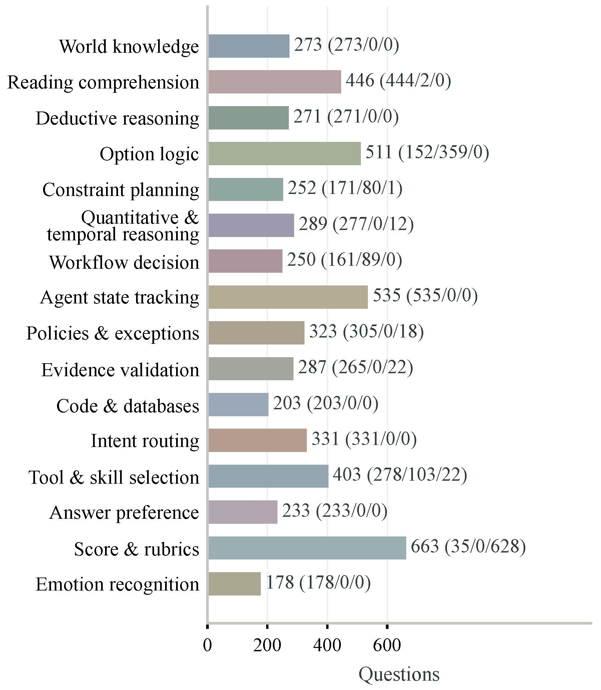
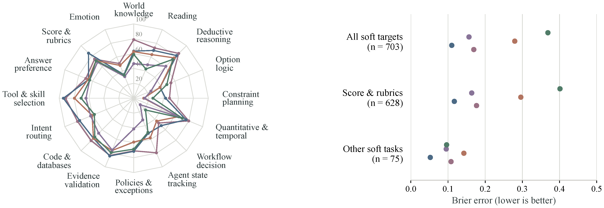
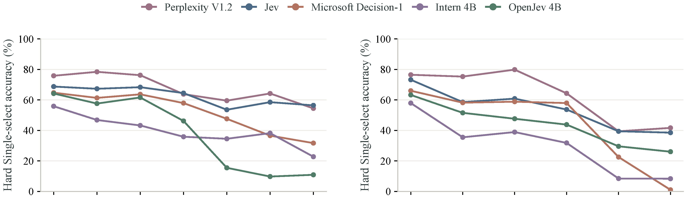

<!-- paper-reading-lang: zh-CN -->
<!-- paper-reading-mode: deep -->
<!-- paper-reading-theme: saffron -->

# MMDM：大规模多任务决策能力基准（深读）

```paper-map
{"thesis":"System-1 决策模型正在进入软件与 agent 流水线，但既有评测复用公开基准（污染风险）、且从未同时覆盖长上下文、大选项空间与完整多选。MMDM 用 5,448 道新题（改写+可执行重组+全新构造三路线，option-only 探针剔捷径）评 16 类任务、选项 2-1,024、输入至 64,817 token，单选/多选/软标签三轨 + SB-F/Brier/nMAE 指标评 28 个模型。核心发现是能力解耦：单选差不到 1 点的两个模型 Brier 差近一半（KnowLine vs WeMM-JEV）；世界知识 78.8% 的模型选项逻辑只有 53.9%；多选最高 36.81%、全部 SB-F<0.2（认得出一个丢得掉一群，正确项覆盖率中位 37.8%）；长输入与大选项两轴排名反转。","reader":"关心决策模型、agent 评测与基准构造的读者；三轨指标、全部主表与附录 A-F 都展开手算。","goals":["掌握三轨评测协议与 SB-F 指标的设计逻辑（min-max 判据、分离×均衡）","把能力解耦的三组证据逐格手算（概率质量差 53%、两轴反转、Brier 案例复算）","学会按任务剖面选模型而非总分——工具目录 800 项/上下文 20K 的选型路径"],"outcome":"通读 arXiv 2611.14309v1 全部 43 页：正文 §1-§5 与 Limitations/Ethics、附录 A-F（类别分布、构造与验证、模型与协议、附加结果含配对队列、复现性、16 类示例库）。","outcomeSource":"arXiv 2611.14309v1 PDF pp.1-43","items":[{"number":"01","label":"缺口","signal":"污染+断层","text":"既有决策评测复用公开基准（先验暴露推分）、长上下文与大选项从未同时出现、完整多选普遍缺位——Table 1 六基准对照 MMDM 四项全勾。","source":"§1-2, Table 1"},{"number":"02","label":"形式化","signal":"三轨语义","text":"决策实例 (s,q,O) 映射到概率单纯形；硬单选独热、硬多选等概率全集、软标签按不确定性分布——三种部署契约不可互相代理。","source":"§3.1, 式 1-4"},{"number":"03","label":"指标","signal":"min-max+SB-F","text":"单选/多选严格不等式（最弱正确项压过最强干扰才对）；SB-F=分离×均衡度量「险胜到不可用」；软轨 Brier 与期望分数 nMAE 成对报。","source":"§3.1, 式 5-11"},{"number":"04","label":"构造","signal":"三路线","text":"源接地改写（保留答案与证据）+ 可执行重组（状态转移/约束/评分机制可重算）+ 全新构造；干扰项按失败模式设计（过期规则/混淆实体/忽略前提）。","source":"§3.2, App B"},{"number":"05","label":"验证","signal":"五道闸","text":"五模型多数筛选 → 双人初审（97.3% 一致）→ 第三复审裁决 → 语义/可执行复核 → option-only 捷径探针（遮题面仍可解即剔除）。","source":"§3.2, App B.4"},{"number":"06","label":"规模","signal":"2→1,024 选项","text":"5,448 题/16 类/62 源；中位 827 token、p95 13,318、最大 64,817；512 选项技能题里选项占 token 99.4%——长输入与大选项常是同一件事。","source":"§3.3, Fig.2, App A/D.5"},{"number":"07","label":"总榜","signal":"单选≠概率","text":"28 模型：WeMM 单选 76.00 最高、多选 36.81 最高；KnowLine Brier 0.1233/nMAE 0.0624 最低——单选差 <1 点的两模型概率质量差近一半。","source":"§4.2, Table 2, Fig.1"},{"number":"08","label":"任务剖面","signal":"联合一致性弱","text":"推理强≠约束强（WeMM 演绎 86.3% 但选项逻辑 57.9%）；路由强≠agent 决策强（GPT-6 Luna 意图路由领先但工具/状态/工作流全面落后）；低分模型也有单项冠军。","source":"§4.3, Table 3"},{"number":"09","label":"校准","signal":"任务条件置信","text":"OpenJev 最高 bin 0.97 置信 0.87 准确；Jev 检索 0.969/97.6% 对情绪 0.968/50.0%——同一阈值不同任务错误率差数倍，必须按模型×任务校准。","source":"§4.4, Fig.3, App D.6"},{"number":"10","label":"扩展轴","signal":"两轴反转","text":"OpenJev 每个选项 bin 领先 Intern-4B（大目录 26.0% 对 8.3%）但 >8K 输入反落后 19 点——长输入与大选项是两种独立能力，总分会搅在一起。","source":"§4.5, Fig.4"},{"number":"11","label":"案例","signal":"三种病","text":"审批后编辑（时序依赖失效）、报告集（一致性求解失败）、3/9 抽样评分（分布主次反转）——失败模式可直接翻附录 F 看原始输出。","source":"§4.6, Fig.5, App F"},{"number":"12","label":"边界","signal":"静态+偏斜","text":"全部固定状态-查询-选项（无交互/多模态）；多选集中四类、软标签多来自评分；改写保留源材料，状态级记忆防不住；头部差距已在噪声边缘。","source":"Limitations, §4, App D.2"}]}
```

<!-- Deep Reading coverage
| Source section / object | Role | Explanation location / status |
| --- | --- | --- |
| §1 引言（品类定位、评测缺口） | 立论 | §01 |
| §2 相关工作（六基准对照） | 谱系 | §02（Table 1 逐项） |
| §3.1 任务形式化（式 1-11） | 协议 | §03-06（手算 1） |
| §3.2 数据构造与验证 | 协议 | §07-08（App B.4 整合） |
| §3.3 覆盖与统计（Fig.2） | 数据 | §09 |
| §4.1 实验设置（28 模型/协议） | 协议 | §10, App C |
| §4.2 总榜（Table 2, Fig.1） | 主证据 | §10-11（手算 2） |
| §4.3 任务剖面（Table 3） | 主证据 | §13（手算 3） |
| §4.4 校准（Fig.3） | 主证据 | §14 |
| §4.5 扩展轴（Fig.4） | 主证据 | §15（手算 4） |
| §4.6 案例（Fig.5） | 主证据 | §16（手算 5 Brier 复算） |
| App A 类别与分布 | 补充 | §09 |
| App B 构造与验证（B.1-B.4） | 复现条件 | §07-08 |
| App C 模型与协议（C.1-C.2） | 复现条件 | §10/§17 |
| App D 附加结果（D.1-D.6, Table A5-A11） | 补充 | §12/§15/§17 |
| App E 复现性 / App F 16 类示例 | 复现条件 | §17 |
| References | 行政性材料 | 不单列 |
-->

## 深读对象

[MMDM: Measuring Massive Multitask Decision Making](https://arxiv.org/abs/2611.14309)（Junhao Shen、Hong Cheng（香港中文大学），Qing Zong（HKUST），Yue Guo、Zhanqiu Zhang（LIGHTSPEED），Yiwen Guo（独立研究者）。arXiv 2611.14309v1，2026-11-10）。[点此打开原文 ↗](https://arxiv.org/abs/2611.14309)

一句话定位：给 System-1 决策模型做的「MMLU 式」大规模多任务评测——5,448 题、16 个任务类、选项空间 2 到 1,024、输入最长 64,817 token，覆盖单选/多选/软标签三种答案语义，评了 28 个决策模型。结论扎心：**单选准的概率不一定准，推理强的联合约束不一定强，而「把所有正确选项都找全」这件事，最好的模型也只有 36.81%**。

## 总评

这篇论文出现的时间点很微妙：决策模型（Jev、OpenJev、Microsoft Decision-1、Intern-Decision……）刚经历一轮爆发，推理引擎侧上周刚有 Flide 把服务延迟压到 150ms 级，而今天 AIHOT 头条是 Google 发布 Gemini Decisions API——这个品类正在标准化。此时 MMDM 回答的问题是：**这些模型到底行不行、行在哪、缺什么**。

它的三个设计选择值得先记住。第一，**抗污染是第一约束**：既有决策评测大多直接复用公开基准，测试材料可能已进训练数据，MMDM 用「保留源答案与证据的改写 + 语义重组 + 全新构造」三路线造新题，并用 option-only 探针（遮掉状态与问题、只给选项）剔除可走捷径的题。第二，**答案语义三轨制**：单选考察选对、多选考察选全、软标签考察分布对——三条轨道对应三种真实部署需求（下一步动作、全部可用工具、不确定性下的评分）。第三，**指标成对出现**：正确率与 Brier/nMAE 分开报，因为「选得对」与「概率可信」可以被证明是两种能力。

最有价值的发现是**能力解耦的三组证据**：KnowLine 与 WeMM-JEV 单选准确率差不到一个点，但 Brier 差近一半；Perplexity V1.2 世界知识 78.8% 却在选项逻辑 53.9%、约束规划 48.0%；GPT-6 Luna 意图路由超过 Jev 与 Microsoft Decision-1，但工具选择、状态追踪、工作流决策全面落后。这些交叉剖面说明**总分榜会骗人**——按工作负载选模型必须看类别剖面。对本阅读线而言，MMDM 是决策模型三部曲的收官：Drex（11-07，模型侧「便宜」）→ Flide（11-11，服务侧「快」）→ MMDM（评测侧「缺什么」）。

一个阅读提示：本文数字密度很高，但骨架其实只有一问一答——「决策质量由哪几个互相独立的维度构成」（选对/选全/分布对/置信可信/两条扩展轴）与「当前模型在每个维度上到哪了」。后面各节按这个骨架展开，公式集中在 §03-§06，证据集中在 §11-§16，附录深读在 §17。

---

## §01 System-1 决策模型与评测缺口

论文开篇定位品类：System-1 决策模型在单次前向里对「请求指定的选项」输出结构化概率，不生成推理轨迹或文本回复。Jev 引入类型化决策接口与校准决策强化学习，把概率质量变成训练目标；开源实现各找各的路——SemIf 直接读选项 token 的 logits 并支持共享前缀复用、OpenJev 在请求定义的选项上学共享决策头（先监督后强化）、Intern-Decision 与 H2O-Lightning 把类型化决策扩展到多模态、Microsoft Decision-1 在 Qwen3.5-9B 上后训练单遍打分用于路由/验证/工作流控制。它们正在进入软件与 agent 流水线，所以「证据、前提与选项互相作用时决策质量是否保持」就成了必须回答的问题。

从系统视角看，这个品位的分工已经相当清晰：**生成模型负责想，决策模型负责断**。路由器在每个请求入口决定用哪个模型；验证器在每条候选回复后决定采纳与否；工作流控制器在每个步骤边界决定下一步走哪条分支。这些「断点」的共同点是高频、时延敏感、输出封闭——恰好都是自回归生成的弱项（生成一个 token 也要走完整解码路径，且自由文本还要再解析成决策）。决策模型把选项集直接映射成概率分布，天然匹配这些接口；代价是它必须一次读懂全部上下文与选项间的依赖——MMDM 度量的正是这种「读懂」在什么条件下失守。

既有评测的缺口有三：**污染**（大量复用公开基准，先验暴露会推高分数）；**覆盖缺口**（真实决策同时要求长上下文、大选项空间、复杂逻辑依赖，现有基准没有同时抓住）；**多选缺位**（JEVal、DecisionBench、ReflexBench 等主评测都把完整多选恢复留在盲区）。论文举的例子很具体：一个实用的模型要能追踪当前 agent 状态、判断早前的批准是否仍有效、从带异构前提条件的大目录里选出合格工具——这三件事没有一件能被「四选一的世界知识题」代理。

## §02 与既有基准的对照

Table 1 把六个先行基准拉平对比（最大选项数 / 上下文长度 / 是否新题 / 是否多选 / 是否软标签 / 是否评分任务）：JEVal 255 选项、82,678 token 但全是复用；DecisionBench 1.0 255/35,435 同样复用；JevBench 有新题但无多选；DecideBench 1.1 只有 6 选项 229 token 的对比决策；Jev Evaluation 与 ReflexBench 都无多选。MMDM 是唯一四项全勾的：**1,024 选项、64,817 token、新题、多选、软标签、评分**。

这张表的价值不在「我们最大」，而在指出评测范式的两个断层：其一，长上下文与大选项空间此前从未同时出现，而真实工具目录选择恰恰是「选项本身就占几千 token」的负载；其二，多选与软标签是 agent 工作流的真实需求（找出**所有**可用工具、给评分**分布**），此前却无基准度量。

为什么 1,024 这个数字值得单独一提？因为选项数的量级决定评测能不能覆盖「目录选择」这个决策模型最重要的落地场景。255 选项量级（JEVal/DecisionBench）对应的是「从一页列表里挑」；1,024 对应的是「从企业工具注册表/MCP 服务器目录/技能库里挑」——这时候选项本身不再是短标签而是带判据的描述，选项间的判据还会互相引用（§03 的设计），选择从模式匹配变成逐项条件核查。当前模型在这个量级上的表现（Figure 4 右端的普遍塌陷）说明**目录规模恰恰是能力断层的所在**，而这正是决策模型被买来干的活。

## §03 决策实例形式化

决策实例定义为三元组：状态 $s$（证据与当前情形）、查询 $q$（要做什么决定）、有序选项集 $O = (o_1, \ldots, o_K)$，每个选项 $o_j = (a_j, c_j)$ 含名字与可选的适用性判据。决策模型映射为

$$x = (s, q, O), \qquad p = f_\theta(x) \in \Delta_{K-1}, \tag{1}$$

其中 $\Delta_{K-1}$ 是概率单纯形（$p_j \ge 0$，$\sum_j p_j = 1$）。**选项随请求提供**是关键设计：名字、含义、数量都可变，超出固定输出词表——而且判据 $c_j$ 可以引用其他选项，逼模型把选项集与状态、查询联合解读。这一条直接把「选项间依赖」变成可构造的考题维度（§13 的选项逻辑类就长在这里）。

## §04 三种答案语义

每种实例带一个参考分布 $\pi \in \Delta_{K-1}$，三种语义对应三种现实问题：

**硬单选**——只有一个正确选项 $y$（如唯一满足请求的工具），参考分布退化为独热：

$$\pi_j = \mathbb{1}[j = y]. \tag{2}$$

**硬多选**——完整有效集 $G$（如都能完成请求的多个工具），要求每个成员排在所有无效选项之上，等概率参考表达等价有效：

$$\pi_j = \frac{\mathbb{1}[j \in G]}{|G|}. \tag{3}$$

**软标签**——按状态描述的不确定性给每个结果分概率。例子：工具调用因服务间歇可用可能成功或失败，若状态蕴含 70% 成功率，参考给成功 0.7、失败 0.3。对结果集 $\Omega$ 与映射 $r$：

$$\pi_j = \sum_{\omega \in \Omega} P(\omega \mid x)\, \mathbb{1}[r(\omega) = j]. \tag{4}$$

评分任务用带数值的有序选项（如报告完整度等级）：已知分数退化为硬单选，不确定结果给等级上的软分布，期望分数把分布汇总到量尺上。**这三种语义不是三种题型而是三种部署契约**：阈值动作吃单选概率、目录筛选吃多选完整性、风险评估吃分布保真——§11-§12 会证明三者互相不可代理。

## §05 指标一：硬轨正确性与 SB-F

两个硬轨的逐题正确性是严格不等式：

$$a_{\text{single}}(p, y) = \mathbb{1}\!\left[ p_y > \max_{j \ne y} p_j \right], \qquad a_{\text{multi}}(p, G) = \mathbb{1}\!\left[ \min_{j \in G} p_j > \max_{j \notin G} p_j \right], \tag{5}$$

即单选要求正确项严格居首，多选要求**最弱的正确项都要压过最强的干扰项**——这是「选全」的严格化：错一个、漏一个都不算对。失败请求与边界平票都计为错。

严格不等式（而不是 ≥）是一个深思熟虑的选择：平票意味着下游按概率取 top-k 时行为不确定——今天取这个明天取那个，对阈值系统等于抛硬币。把它计错不是刁难，是把「部署上不可依赖」如实记账。同理，「失败请求计错」把 API 层的容量失败（超选项上限、超长截断失败）也纳入账本——工程可用性是决策质量的一部分，不是评测之外的免谈区。

但严格正确率对多选太苛刻，一步错就归零会掩盖「差一点」与「完全没头绪」的区别。论文为多选设计了 **Separation–Balance F 分数**。设 $N = |G|$、正确项均值 $\mu$、最强干扰项概率 $b$（全对时 $b=0$），分离度

$$S(p, G) = \frac{1}{N} \sum_{i \in G} \frac{\max(p_i - b,\, 0)}{\max(p_i, \mu) + b}, \tag{6}$$

每个正确选项只有超出 $b$ 的部分挣分（与干扰项持平不挣），$\mu$ 在分母防止微小概率挣满额；均衡度

$$B(p, G) = \frac{\left( \sum_{i \in G} p_i \right)^2}{N \sum_{i \in G} p_i^2}, \qquad \mathrm{SB\text{-}F} = S \times B. \tag{7}$$

**手算 1（SB-F 的两个极端）。** 取 $G$ 两项：情形 A，$p = (0.5, 0.5; b{=}0)$（两正确项各 0.5、无干扰）→ $S = \frac{1}{2}[\frac{0.5}{0.5} + \frac{0.5}{0.5}] = 1$，$B = \frac{1^2}{2 \times 0.5} = 1$，SB-F = 1（完美）。情形 B，$p = (0.9, 0.1; b{=}0.15)$（一个正确项 0.9 一个仅 0.1、最强干扰 0.15）→ $S = \frac{1}{2}[\frac{0.75}{1.05} + \frac{0}{0.25}] \approx 0.357$，$B = \frac{1}{2 \times 0.82} \approx 0.61$，SB-F ≈ 0.218。**情形 B 的单选视角是「对的选项在首位」**（0.9 > 0.15），但 SB-F 只有 0.22——漏掉第二个正确项的代价被显式计价。这正是 §12 要展示的「认得出一个、丢得掉一群」现象的度量基础。

## §06 指标二：软轨 Brier 与评分 nMAE

软标签的分布误差用 Brier：

$$\mathrm{Brier}(p, \pi) = \sum_{j=1}^{K} (p_j - \pi_j)^2, \tag{8}$$

评分任务用期望分数的归一化绝对误差（$v_j$ 是等级数值，分母是量尺宽度）：

$$e_{\text{score}}(p, \pi, v) = \frac{\left| \sum_{j=1}^{K} v_j (p_j - \pi_j) \right|}{\max_j v_j - \min_j v_j}. \tag{9}$$

两个指标故意都报，因为**期望分数会把整条分布压成一个数**：

$$\mathbb{E}[v] = \sum_{j=1}^{K} v_j\, p_j, \tag{10}$$

不同等级上的概率误差可以互相抵消——把 0.1 的概率从等级 3 挪到等级 1，期望分数变化的方向取决于量尺，两条反向挪动在期望上互相抵消后 Brier 依然如实记账。D.6 的诊断给出极端例：两个模型期望分数误差只有 0.0127 与 0.0690 的量级差异时，背后的分布误差可能完全不同。部署视角：如果你只消费最终评分，nMAE 够用；如果你要把概率再喂给下游决策（比如期望效用计算），Brier 才是命门。

校准部分（§14）还会用到期望校准误差，一并立在这里：把预测按置信分 $B$ 个 bin，记每 bin 的平均置信 $\mathrm{conf}(b)$ 与经验准确 $\mathrm{acc}(b)$：

$$\mathrm{ECE} = \sum_{b=1}^{B} \frac{n_b}{N} \left| \mathrm{acc}(b) - \mathrm{conf}(b) \right|. \tag{11}$$

MMDM 的可靠性分析取十等宽 bin 的 3,537 条共享单选预测。

## §07 数据构造：三路线与干扰项设计

MMDM 的防污染不靠「换皮」而靠三条各带验证机制的构造路线：

**改写（rewrite）**：保留源答案与支撑证据，重述状态、查询与干扰项——语义与选项质量检查过滤产物。这条路建立在此前研究证明的「基准改写可缓解记忆性涨分」之上。**重组（recomposition）**：从源数据库或 agent 历史出发，用**可执行机制**构造互相作用的选项、受约束的计划、状态转移与评分结果——答案可计算。**全新构造（newly constructed）**：直接写新题。三路线共同的杀手锏在干扰项：每个干扰项围绕可识别的失败模式设计——**套用过期规则、混淆实体、忽略前提**。这让错误有类型学：模型错了不只扣分，还能从干扰项的选择反推它栽在哪种失效上。

三条路线的可验证性等级不同，这一点常被忽略。改写题的锚是**源证据**：答案与支撑材料来自原数据集，改写只动表皮，正确性靠语义检查与源对照背书；重组题的锚是**可执行机制**：状态转移、约束求解、评分规则都是代码，答案可以现场重算——附录 D.5 的「事务状态」「目标范围」题型就是这么造出来的，机制天然免疫标注错误；全新构造题的锚最弱，只能靠五模型筛选加双人复审兜底。混用三路线的隐含好处是**错误谱系有对照**：如果模型在重组题（机制保证无歧义）上与改写题（可能有语义残留）表现同步崩，说明问题在能力；若只有改写题崩，先怀疑题目。可惜论文没报分路线的剖面——这是一个可以追问作者的实验。

选题标准是「能落到一个有显式选项、可检验答案的具体决策」：QuALITY 与 LongBench v2 供文档接地问题、BIRD 供数据库题、ComplexFuncBench 与 ToolTalk 供交互历史——62 个注册源标识、80 个类-子类组合。

## §08 验证与筛选：两道人工关卡与捷径探针

构造后的质量链（附录 B.4）：先用**五模型多数筛选**，再由独立人类专家复审边界案例，两阶段用同一套标准（干扰项质量、答案泄漏、重复、源重叠）。两位初审人的初始决策一致率 **97.3%**，分歧由第三位复审人裁决；修正案再过对应语义或可执行检查后才收录。最终 5,448 题。

最巧妙的一道闸是 **option-only 探针**：把状态与查询遮掉、只给选项，让模型作答——如果这种「无题面」版本也能被解出，说明存在语义捷径（比如选项措辞本身暴露答案），该题直接剔除。这是把「题目是否真的需要读状态」变成可检测的性质，比笼统的「人工看过」强得多。

这条质量链的可贵之处在于**每道闸都可复述**：五模型多数（可重跑）、双初审 97.3% 一致率（可审计的比例）、第三复审裁决（有人的责任主体）、语义/可执行复核（有机器校验）、捷径探针（有操作定义）。对比「经人工审核」四个字的黑箱声明，MMDM 的构造章节事实上给出了一份**基准质量清单**——往后任何自称抗污染的新基准，都可以拿这五道闸当 checklist 逐项对照。

## §09 规模与覆盖：数字全景

5,448 题 = 4,112 硬单选 + 633 硬多选 + 703 软标签（其中评分 663 题：35 硬等级 + 628 软目标）。选项数 2 到 1,024（94 题超过 255 个选项）。完整输入（状态+查询+选项名与判据）按 Qwen3.5-4B 分词器计量：**中位数 827、95 分位 13,318、最大 64,817 token**。16 个类别从世界知识、阅读理解、演绎推理、选项逻辑、约束规划，到工作流决策、agent 状态追踪、政策与例外、证据校验、代码与数据库、意图路由、工具与技能选择，再到答案偏好、评分与量规、情绪识别。



*16 个任务类的题量与答案语义构成，每条标注总数与（单选/多选/软）计数。*

规模设计的用心处：**两条轴都拉到极端**。64K 的长输入承载长文档推理与大目录选择；1,024 选项承载目录规模决策——而 D.5 的分析会显示 512 选项的技能选择题里，选项名与判据占输入 token 的 99.4%，即「长输入」与「大选项」在真实负载里往往是同一件事。

16 个类别的排布本身是一个决策能力分类学。左端是经典语言能力（世界知识、阅读、演绎、量化与时序）；中段是论文的招牌——**依赖密集型任务**：选项逻辑（选项互指，单看都对合看才知真假）、约束规划（计划要整体可行，单个动作合法不够）、工作流决策（动作有前提与顺序）、agent 状态追踪（历史事件改变当前合法动作）、政策与例外（规则有生效期与豁免）、证据校验（多源互相印证或矛盾）；右端是判断与评估（意图路由、工具与技能选择、答案偏好、评分量规、情绪识别）。从左到右，难度来源从「知道什么」迁移到「把多个条件合在一起检查什么」——而实验结果（§13）会显示当前模型的能力断层恰好切在中段。

## §10 总榜：28 模型的五种格局

Table 2 评了 28 个模型加 Random 参照。Random 均匀基线给出地板：单选 25.35%、多选 3.28%、Brier 0.2051、nMAE 0.1624——注意多选的随机地板只有 3%，因为「最弱正确项压过最强干扰项」在随机分布下几乎不可能成立。

闭源五家：Jev 1.14.0（67.17 单选 / 22.12 多选 / Brier 0.1101 全场最低之一 / nMAE 0.0926）、Microsoft Decision-1（61.36 / 21.96 / Brier 0.2795 / nMAE 0.1836）、Liquid-d1-Ultra（73.32 / 24.33——闭源单选最佳）、Liquid-d1、GPT-6 Luna Decisions（56.57 / 12.01 / Brier 0.3333）。开源阵营头部：**WeMM-JEV 27B 单选 76.00 全场最高、多选 36.81 全场最高**；KnowLine 31B Gen1 75.07 / 32.39 / **Brier 0.1233、nMAE 0.0624 全场最低**；Perplexity Decider-V1.2 74.42 / 33.81。尾部：NanoJev 0.6B 26.68 单选（离 Random 只差一点）、Intern-Decision 0.8B 32.17。

榜面还有几处值得停留的结构性观察。**闭源不必然领先**：Liquid-d1-Ultra 的 73.32 高于 Jev 的 67.17，但开源 WeMM-JEV 的 76.00 又压过全部闭源——目前决策能力的头部竞赛是开源 27B/31B 在领跑，这与 chat 模型「闭源代差」的格局截然不同，可能因为决策头是在现成强底座上后训练、数据配方比预训练红利更可复用。**同厂多档位的分化明显**：Perplexity Decider-V1.2 74.42 对 Decider-Flash-V1.2 62.06，差 12 个点——快慢档不是同一个能力的两档速度，而是两份不同的答案。**规模仍有效但斜率平**：Intern-Decision 从 0.8B 到 4B 单选 32.17 → 49.03，每翻一倍约 +8 点，但 NanoJev 0.6B 的 26.68 说明小到一定程度后架构细节（决策头设计）比参数量更决定命运。



*五个代表性决策模型的能力画像：左为 16 类任务的单选准确率，右为软目标 Brier 误差。*

## §11 解耦证据一：单选准 ≠ 概率准

总榜最重要的单行结论藏在 WeMM-JEV 与 KnowLine 的对比里。

**手算 2（概率质量差多少）。** 两模型单选准确率 76.00 对 75.07，差 0.93 个百分点（不到 1%）。但 Soft Brier：0.2327 对 0.1233——KnowLine 的分布误差只有 WeMM 的 **53%**（$0.1233/0.2327 \approx 0.53$）；Score nMAE：0.2203 对 0.0624——**28.3%**（$0.0624/0.2203 \approx 0.283$，不到三分之一）。也就是说：一个「十次里选对七次半」的模型，它给出的概率与期望分数可能与另一个差一倍以上。如果你的下游是「置信度 > 0.8 才自动执行」或「按期望分数排序」，**单选准确率榜对你毫无预测力**。D.2 的配对队列给了统计背书：共享单选题上 Perplexity 比 Jev 高 7.93 个百分点（95% CI [6.41, 9.44]），但共享软标签题上 Jev 的 Brier 反而低 0.0592（95% CI [0.0515, 0.0661]）——2,000 次按源父组配对 bootstrap，方向相反的两件事在置信区间里都稳。

## §12 解耦证据二：多选的全面塌方

多选轨是全场的灾难区：最高准确率 36.81%（WeMM-JEV），全部 28 个模型的 SB-F 都低于 0.20，Random 地板 3.28%。这个数字要放回部署语境里掂量：agent 工作流里「从工具目录找出**所有**能干这活的工具」是再普通不过的调用——按 36.81% 的上限，三次调用约两次会漏工具或多选废工具。而且多选不是「难一点的单选」：D.3 显示五个代表模型全部在工具与技能选择上表现最好（选项独立适用、无依赖），在需要解依赖或验证完整计划的选项逻辑、约束规划、工作流决策上准确率低得多——**多选的难点与单选的难点不同源**，前者考联合一致性，后者考知识。这解释了为什么单选榜领先者（WeMM-JEV）在多选上领先幅度骤减（76.00 对 36.81，近乎腰斩再腰斩），也预告了 SB-F 中位数 0.113 的分离度困境：模型会「平均地看好每个正确选项」，但拉不开与干扰项的距离。附录 D.4 把塌方拆成三层：

**认得出一个，丢得掉一群。** Table A10（284 题固定队列）：GPT-6 Luna 与 Jev 分别在 184 与 181 题上把**某个**正确选项排在首位，但把**整个正确集**压过全部干扰项的只有 36 与 57 题——识别出一个正确选项之后，其余正确选项大概率被留在干扰项堆里。**有均衡没分离。** 全模型中位数：分离度 0.113、均衡度 0.862、正确项覆盖率仅 **37.8%**——模型普遍把概率均匀撒在正确项之间（均衡高）却拉不开与干扰项的差距（分离低）。Jev 是标本：均衡 0.915、分离只有 0.137；在工具与技能选择上 SB-F 0.465，到选项逻辑掉到 0.022（均衡仍 0.973，分离 0.023）——**「把互相依赖的真假陈述分开」是当前最难的事**。**递归分组也救不了。** D.3：超出现模型选项上限的目录要递归分组归约，准确率在需要归约的目录上保持低；523 题共享队列单次调用完整选项集，最强也只有 36.90%——难度不来自协议，来自任务本身。

## §13 解耦证据三：任务剖面互相打架

Table 3 的 16 列剖面给出三组「总分看不见」的对照：

**推理强 ≠ 联合约束强。** Perplexity V1.2 世界知识 78.8%，选项逻辑 53.9%、约束规划 48.0%——差 25-31 个点。WeMM-JEV 演绎推理领先全场（86.3%），但选项逻辑 57.9%、约束规划 47.4%、工作流决策 49.1% 全部低于 60%。KnowLine 同样：演绎 86.0%，选项逻辑 54.6%、约束规划 48.5%。这些任务的共性是**选项单独看都对、合起来冲突**——与演绎推理的区别正是 MMDM 想分离的「联合一致性」。

**路由强 ≠ agent 决策强。** GPT-6 Luna 在意图路由上超过 Jev 与 Microsoft Decision-1，但在工具与技能选择、agent 状态追踪、工作流决策上全面落后，工作流决策（要考虑前提与动作顺序）差距最大。「会分诊」不等于「会从当前状态选对动作」。

**低分模型也有单项冠军。** Quyet 总分 57.4 却拿证据校验第一（89.1%）；Mapika 总分 56.5 拿情绪识别第一（64.0%）。选模型看工作量载体，不看总分。

**手算 3（状态追踪的三层难度）。** D.5 把 agent 状态追踪拆成三种同 16 选项的题型：工件版本题（按源版本/验证/批准识别产出）47 题，Jev 与 Perplexity 全对；事务状态题（在修订、锁、容量约束下应用有序事务序列）24 题，Jev 8.3%、Perplexity 16.7%；目标范围题（按 owner/workspace/revision 判断哪些指令适用）100 题，Jev 26.0%、Perplexity 75.0%。从 100% 到 8.3% 的跨度发生在**同一类别内**——类别标签也骗人，题型机制才是难度的载体。

## §14 校准：置信度的三种病症

Figure 3 在 3,537 道共享单选题（原生全状态预测、唯一最大值）上画可靠性曲线与 ECE。三张病历：**Intern-Decision 中段过置信**（曲线在对角线下方）；**OpenJev 高端过置信**——最高置信 bin 平均置信 0.97、实际准确 0.87；**Microsoft Decision-1 中高置信区间整体偏低对角线**（ECE 五模型中最大）。Perplexity 与 Jev 的 ECE 最低。

把校准放进部署算术里看得更清楚：假设策略是「置信 ≥ 0.9 自动执行、否则转人工」。OpenJev 的高端 bin 意味着这条策略在它身上每 100 次自动执行约 13 次是错的；而同样的 0.9 阈值套在 Jev 上（检索策略 0.969 置信 97.6% 准确）每 100 次只错 2-3 次——**同一行策略代码，两个模型的错误预算差 5 倍**。更麻烦的是 Jev 的情绪任务：0.968 置信对应 50% 准确，阈值形同虚设。这就是「置信度必须按模型×任务二元组校准」的工程化表述，也是 MMDM 把校准做成独立章节的理由：单点准确率榜对「能不能安全自动化」这个问题几乎没有发言权。

两个跨指标的交叉让校准单独成章。其一：OpenJev 单选准确率高于 Intern-Decision（57.2 对 49.0），ECE 反而更大——**更准与更可信是两回事**。其二（D.6）：同一置信阈值在不同任务上错误率天差地别——Jev 在检索策略上平均置信 0.969（123 条预测）准确 97.6%，在情境情绪上平均置信 0.968（50 条）准确只有 50.0%；OpenJev 55 条高置信 SQL 全对，38 条高置信情绪题只有 63.2%。**「置信 0.97」这个数字本身不带任务语境就没有意义**——部署侧的阈值必须按任务校准，或者干脆学习任务条件化的置信映射。

## §15 两条扩展轴：长输入与大选项是两种能力

Figure 4 的两个面板分别按完整输入长度（<1K 到 32-65K 八个 bin）与选项数（2-4 到 129-1,024 六个 bin）画五模型单选准确率。核心发现是**排名在两条轴上反转**：

**手算 4（反转的量化）。** OpenJev 对 Intern-Decision 4B：**每个选项数 bin 都领先**（129-1,024 选项：26.0% 对 8.3%，领先 17.7 个点）；但完整输入超过 8K 后反超变落后——8K-16K bin，OpenJev 15.5% 对 Intern 34.5%，**落后 19 个点**。同两个模型，两条轴，一正一负。另一个例子：Jev 与 Microsoft Decision-1 在 2-4 选项上差约 7 个点，到 129-1,024 选项差距拉大到 37 个点以上。Perplexity 在最大选项 bin 保住第一，但相对 Jev 的优势比 9-16 选项时小得多。**如果只看总分会把两种能力搅在一起**：长输入负载与大目录负载需要分别选型。D.5 补了机制侧写：512 选项的技能选择题里选项占输入 token 的 99.4%——「选项多」的题干就是选项本身，读不完就是读不完。



*左：按完整输入 token 分 bin 的单选准确率；右：按选项数分 bin 的准确率。同一对模型的相对优劣在两轴间反转。*

## §16 案例三连：错在哪里看得见

Figure 5 保存了三个具体决策的模型原始输出，是全文最「教学」的部分。

**案例 A（审批与后编辑）。** Finch 认证当前内容，Lumen 与 Fern 随后修改，发布要求证书匹配最终修订版——正确顺序是「编辑、转换、更新信封、再审批发布」，先审批再编辑则证书失效。Perplexity V1.2 以 0.353 选了**无效**顺序；Jev（0.520）与 Microsoft Decision-1（0.894）选对。错因清晰：没有把「后续修改使早前批准失效」纳入选项间的时间依赖。顺带注意三个模型的置信跨度（0.35 到 0.89）：同一个错误在不同模型上伴随的「自信程度」完全不同——又回到 §14 的主题。

**案例 B（报告集完整性）。** 八份报告互相引用（Hazel 说 Maple 的报告是假的，Maple 说 Pine 或 Willow 的报告是真的……），唯一一致解释下七真一假（Hazel 假）。三个模型全部把 Hazel（假报告）排在至少一份真报告之上——Perplexity 给 Hazel 0.083、最弱真报告只有 0.075。**一致性求解失败**不是概率精度问题，是逻辑搜索问题。

**案例 C（评分分布）。** 九条记录抽三条，八条全过四项检查、一条缺评审章；每项检查只有抽到的三条全过才得一分。缺陷记录被抽中的概率是 3/9，所以参考分布是 Score3=0.333、Score4=0.667。

**手算 5（案例 C 的 Brier 复算）。** 三模型输出（只列 3、4 两档）：Perplexity (0.649, 0.331)，Jev (0.590, 0.310)，Microsoft (0.191, 0.754)。逐个算 Brier（只计两档，低档概率为 0）：Perplexity $(0.649{-}0.333)^2 + (0.331{-}0.667)^2 = 0.0999 + 0.1128 = 0.213$ ✓（论文 0.213）；Jev $0.0660 + 0.1275 = 0.194$，论文报 0.197（差在四舍五入与低档残余）；Microsoft $(0.191{-}0.333)^2 + (0.754{-}0.667)^2 = 0.0202 + 0.0076 = 0.028 \approx 0.029$ ✓。**注意方向性**：Perplexity 与 Jev 把主次概率整个**反转**了（低分概率更高），Microsoft 保持了正确的主次但幅度失真——同一个 Brier 数量级内藏着三种不同的病。而生成式模型做这题大概率会「算出 1/3 但说成三分之一」然后写对——决策模型的失败模式（分布直接给错）与生成式的失败模式（过程对结论抄错）在这里分道扬镳。

## §17 附录深读：配对队列、机制分析与工具链

**D.2 配对队列与 bootstrap。** 共享题上做模型对比较，置信区间由 2,000 次**按源父组配对**的 bootstrap 重采样给出——按源分组重采样保留了同源题的相关结构，比逐题 i.i.d. bootstrap 稳。这套协议值得任何基准论文抄。

**D.5/D.6 的机制诊断是附录里最值得偷的两节。** D.5 的「长度与决策要求」控制实验把两个常被混淆的变量拆开：同为阅读理解类、同长度区间内，长文档理解与多跳推理两族题准确率不同——长输入的困难不（只）是长，是任务机制；而大选项对照（512 选项技能选择对计划比较，选项数与推理模式固定）把「找可用技能」与「检查完整计划是否满足约束」分离——前者是检索式检查，后者是组合验证。D.6 的任务条件化置信诊断（§14 已引用的 Jev 检索 0.969/97.6% 对情绪 0.968/50.0%）还有一个管理含义：**如果部署侧按任务分桶设阈值，同一模型可以同时做到「检索上 0.9 阈值放行」与「情绪上 0.9 阈值拦截」**——置信度的任务条件化不是缺陷报告，是可用的校准资源。

**C 组评测协议的公平设计。** 答案类型标注与正确项数量**不给模型**——单选、多选、软标签共享同一预测接口，模型不知道自己被考哪一轨；超上下文预算时确定性截断状态中段；超选项上限时分组归约（组内最高者晋级），参考基数与金标身份全程隐藏。**协议本身就是一个实验变量**（D.3 显示归约目录上准确率更低），论文如实报告而不掩饰。

**E 复现性。** 数据在 HuggingFace（shenjunhao/mmdm），工具链在 GitHub（mmdm-benchmark/mmdm），榜单挂在 mmdm-benchmark.github.io——工具链支持断点续跑与预测导出。**F 示例库。** 16 类每类一道带模型原始预测的完整示例（含概率与判定），失败模式可以直接翻看——把「错误类型学」从论文正文延续到可复用的材料。

## §18 与本周阅读线的合龙：决策模型栈的第三块

把三天的深读叠起来看：**Drex v1.5（11-07）**证明高频微决策不需要旗舰模型——判断侧的成本经济学；**Flide（11-11）**把「一状态多问题」的决策服务压进一次前向、150ms 级延迟、位级确定——服务侧的效率工程；**MMDM（今天）**给出能力剖面：28 个模型的单选/多选/分布/校准/两条扩展轴全景。三者拼出决策模型栈的完整图景：**模型便宜了（Drex）、服务快了（Flide）、现在知道短板在哪了（MMDM：联合一致性、完整多选恢复、概率支持）**。

更巧的是时间上的互文：MMDM 评测名单里的 Microsoft Decision-1 是后训练 Qwen3.5-9B 的产物，Flide 的 Table 18 里 Intern-Decision、OpenJev、KnowLine、Drex 全部在列——**同一个生态，三个观测面**。今日 AIHOT 头条 Google 发布 Gemini Decisions API（150-250ms、256K 输入、一次 1000 题）说明大厂正把这类接口产品化；MMDM 的发现（多选 36.81% 上限、大目录掉 37 个点）恰好预告了这类产品在真实目录负载上会踩的坑。如果 Google 们想给 Gemini Decision 1 拉个内榜，MMDM 的三轨协议与 SB-F 是现成的度量衡。

对训练侧的读者，MMDM 同时是一份数据配方目录。它点名的三类短板——联合一致性（选项逻辑/约束规划）、完整多选恢复（SB-F 分离度）、分布保真（Brier 与期望分数的解耦）——每一类都自带可执行的造题机制（互相引用的报告集、带前提的动作序列、可计算的概率源如 3/9 抽样），意味着这些短板可以**直接变成后训练数据**：用同样的机制造百万量级合成题，配合决策头的强化学习校准（Jev 的 RLCD 路线），是一行看得见的技术路径。评测基准的最优归宿从来不是榜，是被训掉。

## §19 批判与边界

四条值得记录的边界。**其一，静态快照。** 全部评测基于固定状态-查询-选项，Limitations 自己承认：多模态输入与交互式轨迹未覆盖——而 agent 状态追踪的成绩（事务状态 8.3%）暗示交互式版本可能更惨。**其二，多选分布偏斜。** 633 道多选题集中在选项逻辑、约束规划、工作流、工具选择四类，软标签 703 题大多来自评分——三轨的题量与类别覆盖不均衡，跨轨可比性有限。**其三，「新题」的相对性。** 改写与重组保留源材料，作者承认底层素材的先验暴露仍可能发生；option-only 探针堵的是选项捷径，堵不了「见过类似状态」的更软性记忆。**其四，榜单的快照属性。** 28 模型是某时点的横断面，Liquid-d1-Ultra 与 WeMM-JEV 差 2.7 个单选点、与 Perplexity 差 1.1 个点——头部差距已在噪声边缘，且部署协议（分组归约、截断）对排名的敏感性论文未做扰动分析。引用 MMDM 数字时建议带两件东西：任务剖面（总分别单独用）与置信区间（D.2 提供了协议）。

还有一条容易放过的方法论边界：**「三模型案例」的代表性**。Figure 5 与附录 F 的示例只用 Perplexity/Jev/Microsoft 三个模型的原始输出做质性分析，恰好是三个风格不同的失败样本（时序依赖、一致性求解、分布反转）——读起来有说服力，但案例挑选本身没有声明筛选规则（是首批命中还是精选最典型？）。附录 F 的 16 类示例部分缓解了这一点，引用案例时最好注明「示例性证据」而非「系统性发现」。

## §20 paper-check 自测

**Q1（概念）**：为什么硬多选的正确性判据用 $\min_{j \in G} p_j > \max_{j \notin G} p_j$ 而不是「正确选项平均概率最高」？
**A1**：多选的现实契约是完整恢复有效集：任何正确选项低于任何干扰项，都会让按概率截断的下游漏选或错选。「平均高」允许 0.9 + 0.1 的失衡通过（0.1 的弱正确项被 0.15 的干扰项压住），min-max 判据把它判错——与 SB-F 的分离度设计（只给超出 b 的部分计分）同一哲学。

**Q2（计算）**：SB-F：$G$ 两项，$p = (0.6, 0.6)$，一个干扰项 $b = 0.1$。求 S、B、SB-F。
**A2**：$\mu = 0.6$；$S = \frac{1}{2}[\frac{0.5}{0.7} + \frac{0.5}{0.7}] \approx 0.714$；$B = \frac{(1.2)^2}{2 \times 0.72} = \frac{1.44}{1.44} = 1$（两项等概率，完美均衡）；SB-F ≈ 0.714。对比手算 1 情形 A（无干扰 b=0）：干扰存在使分离度从 1 降到 0.71——SB-F 对「干扰项贴得多近」敏感。

**Q3（改输入）**：把 Q2 的干扰项概率从 0.1 升到 0.55（仍低于 0.6），SB-F 变多少？说明什么？
**A3**：$S = \frac{1}{2}[\frac{0.05}{1.15} \times 2] \approx 0.0435$；B 仍为 1；SB-F ≈ 0.044——**崩塌 16 倍**。正确项仍全部排在干扰项之上（硬判据 $a_{\text{multi}}$ 判对！），但概率几乎贴平。硬准确率说「对」，SB-F 说「险胜到不可用」——这就是两个指标必须共存的原因。

**Q4（数据）**：WeMM-JEV 与 KnowLine 的三组数字（76.00/36.81/0.2327 对 75.07/32.39/0.1233）各差多少？结论？
**A4**：单选差 0.93 点（1.2% 相对）；多选差 4.42 点；Brier KnowLine 只有 WeMM 的 53%。结论：单选榜前二名互换不影响「选对率」叙事，但概率质量差一倍——按期望分数或置信阈值部署的话选错模型的代价是结构性的。

**Q5（机制）**：option-only 探针防的是什么？防不了什么？
**A5**：防选项措辞捷径——遮掉状态与查询后仍可解的题说明选项本身泄漏答案。防不了状态级记忆：模型可能背过改写前的原始状态-答案对（改写保留源答案与证据），这类暴露在探针下不可见，只能靠改写幅度与源多样性缓解。

**Q6（应用）**：你要给一个工具目录 800 项、上下文平均 20K 的 agent 系统选决策模型，MMDM 的哪张表最该看？
**A6**：Figure 4 右面板（129-1,024 选项 bin）优先——大目录是主负载；再看左面板 16-32K bin 确认长输入不掉崖（OpenJev 的教训：选项强不等于长文强）。Table 3 的 TSS（工具与技能选择）列与 D.3 的归约目录分析是第二道关。总分榜（Table 2）只做初筛——Liquid-d1-Ultra 总分高但 Brier 0.1321，若下游吃概率还要对 KnowLine/Jev 这类分布质量好的模型做 A/B。

---

## 溯源披露

- 原文：arXiv:2611.14309v1 [cs.LG]，2026-11-10 提交，43 页（正文 9 页 + 附录 A-F 至第 43 页含 16 类示例库）；数据集 HuggingFace shenjunhao/mmdm、工具链 GitHub mmdm-benchmark/mmdm、榜单 mmdm-benchmark.github.io。
- 本地 PDF SHA-256：`0fa6ef2df054a8817679c96be6d12ce87ee7950ea0b2c34ce2f69f4c0f94787c`（1,264,612 字节，双栏 A4 版式）。
- 深读覆盖正文 §1-§5 与 Limitations/Ethics 全部，附录 A（类别与分布）、B（构造与验证，B.1-B.4）、C（模型与协议，C.1-C.2）、D（附加结果，D.1-D.6 含 Table A5-A11 与配对队列分析）、E（复现性）、F（16 类示例）全部；三张配图（Fig 1 能力画像 / Fig 2 任务覆盖 / Fig 4 扩展轴）600 DPI 提取。
- 引用关系注记：本文所评 28 模型中 Intern-Decision、OpenJev、KnowLine、Quyet 等十余个与上周 Flide（2610.42148，第 28 篇）Table 18 的服务名单重叠（Flide 另服务 Drex v1.5）；Drex v1.5 为本刊 2026-11-07 深读对象（仓库第 25 篇）；本文为决策模型三部曲收官篇（Drex 模型侧 → Flide 服务侧 → MMDM 评测侧）。今日 AIHOT 头条 Google Gemini Decisions API 发布与本文主题同日呼应。
- 利益相关声明：与论文作者无合作或竞争关系；深读中的数值复算若有误，以原文表格为准；文中「手算」均按论文原始数字独立重算，四舍五入差异已随文标注。
