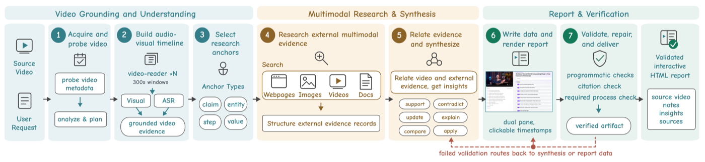
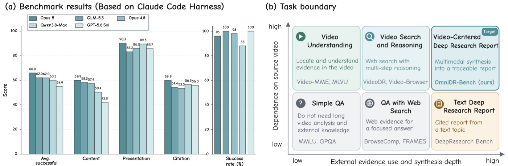
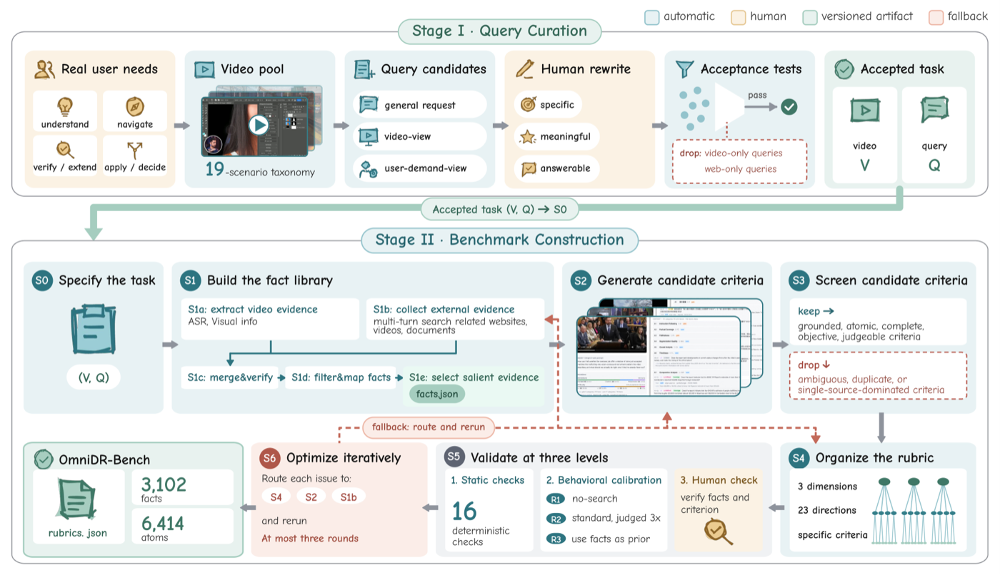
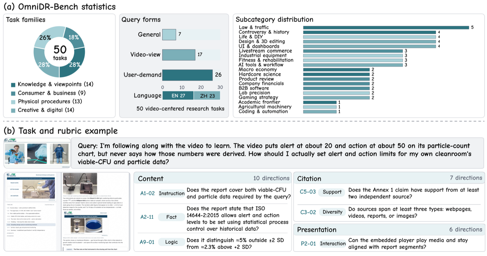

<!-- paper-reading-lang: zh-CN -->
<!-- paper-reading-theme: plum -->

# OmniDR-Bench 深读：以视频为锚点的深度研究报告评测

深读对象：Beyond Watching and Searching: Benchmarking Agents for Video-Centered Deep Research Reports（arXiv 2610.31158v1，北大 + 阿里 Qwen 团队）。昨天深读的 OpenDS-World 测的是"Agent 能否在真实网页里找到唯一事实答案"；今天这篇把终点从短答案推进到**完整研究报告**——给定一段源视频和用户请求，Agent 要识别值得研究的论断、检索外部多模态证据、写出带引用和视频时间链接的交互式 HTML 报告。这是一篇"任务 + 参考工作流 + 基准"三位一体的论文：它定义了 Video-Centered Deep Research 任务（§2），给出了七阶段技能化工作流（§2.2），用 Omni 原子评分树（Omni-ART）与审计式构建流程（ARC）建成 50 题、6414 条原子判据的 OmniDR-Bench（§3），再对 18 个 Agent 配置做系统评测（§4）。最强系统 63.3/100：呈现层接近满分区间，内容与引用不及一半——"会写报告，不会做研究"是全部系统的共同短板。

<!-- 视觉决策：本文核心是两条流水线（七阶段工作流、ARC 构建流）与评分公式，静态卡片图与重绘条形图足以完整表达；证据阶梯（L0-L3）用条形图比分层图更直白，不嵌入交互视图。 -->

## 01 全景：这篇论文在做什么

文本深度研究 Agent 能产出带引用的长报告，但不看视频；视频深度研究把源视频证据与开放网页检索结合，但基准大多止步于短答案 QA；文图报告系统综合多模态网页材料，却不以某段给定视频为研究锚点（PDF §1、Table 1）。本文的任务填的是三者交集处的空位：**以一段给定视频为组织核心的完整、可审计研究报告**。

```paper-map
{
  "thesis": "以源视频为锚点的深度研究报告是未被评测的能力：18 个前沿 Agent 配置中最好成绩仅 63.3/100，呈现层平均 81.8 分而内容与引用只有 45.4 与 47.8 分——报告写得出来，研究做不进去。",
  "outcome": "提出 Video-Centered Deep Research 任务与七阶段参考工作流，发布 OmniDR-Bench（50 个中英文任务、19 个子类、6414 条原子判据）及代码数据。",
  "outcomeSource": "PDF 摘要、§3.1、§6",
  "items": [
    { "number": "01", "label": "任务", "signal": "H=A(V,Q,E)", "text": "输入一段源视频 V 与用户请求 Q，Agent 在开放工具环境 E 中产出交互式 HTML 报告 H：识别研究锚点、检索外部多模态证据、把证据连回视频时刻。", "source": "PDF §2.1 Eq.(1)" },
    { "number": "02", "label": "工作流", "signal": "七阶段", "text": "技能化参考工作流：视频摄入与时间线对齐 → 锚点选择 → 四路证据分支（网页/图像/视频/文档）→ 证据关联 → 综合 → 交互渲染 → 校验修复；主 Agent 携带共享状态防长程漂移。", "source": "PDF §2.2、Fig. 2" },
    { "number": "03", "label": "评分", "signal": "Omni-ART", "text": "原子评分树三层：内容/引用/呈现三维度，23 个共享诊断方向，任务特定的二元原子判据；语义判据由 GPT-5.6 Sol 裁判，结构判据由确定性程序与浏览器探针执行。", "source": "PDF §3.2、§3.3" },
    { "number": "04", "label": "构建", "signal": "ARC S0-S6", "text": "审计式构建：独立采集视频证据图与网页证据图 → 生成候选判据 → 筛选组装 → 行为校准（R1<R2<R3）+ 两轮人工验证（82→60→50 题，终验抽检 94%+ 正确）→ 冻结发布。", "source": "PDF §3.2、附录 A.5、Table 7" },
    { "number": "05", "label": "发现", "signal": "63.3 封顶", "text": "18 配置中 Claude Opus 5 最高 63.3、GLM-5.3 以 100% 完成率得 62.0；直接视频事实通过率 79.9%，外部证据、跨源验证、多事实组合分别只有 8.7%、8.8%、5.0%。", "source": "PDF §4.2、Table 3" }
  ]
}
```

一个值得先记住的定位：OmniDR-Bench 刻意只留 50 题（每题平均 128 条判据，一份报告约耗时 2 小时，一个系统完整跑完约 100 Agent 小时），用密集诊断换短答案基准的题量——这是"深度评测"与"广度评测"的一次明确取舍（PDF §3.1）。

## 02 任务定义与七阶段工作流

任务的形式定义只有一行 $H=\mathcal{A}(V, Q, \mathcal{E})$（PDF §2.1 Eq. 1），真正的约束在"什么才算有效报告"上：必须保持视频中心性（不能只是摘要）、必须贡献超出视频的研究增量、重要发现必须同时连接外部来源与相关视频时刻、正文-媒体-引用-交互要让读者可检验。任务收录还有两道门槛：仅靠视频分析不够，且通用网络研究无法替代源视频（PDF §2.1）。

它与五类既有设定（视频摘要、文本深度研究、开放网页视频搜索、视频深度研究 QA、文图研究报告）的边界，论文用 Table 1 一次说清——五种设定各占"源视频 / 开放网页 / 视频检索 / 长报告 / 时间链接"五列中的某几列，只有本任务五列全占。下面把两条最易混淆的邻居拉出来对照：

```paper-contrast
{
  "title": "视频深度研究 QA vs 视频中心研究报告",
  "intro": "两者都要求读源视频并检索开放网页，差别在输出的形态与被测能力的重心。",
  "branches": [
    { "name": "视频深度研究 QA", "lead": "给定视频与一个难题，输出短答案。", "scope": "考多步检索与跨模态推理，答案可对错二判。", "judge": "答案正确性，通常 LLM 参考答案判定。", "signal": "研究过程被压缩成一个事实点；证据的组织、呈现与可审计性不在评测内。", "why": "短答案可大批量自动评分，但无法暴露报告级能力：引用闭合、时间链接、结构化呈现。", "source": "PDF §1、Table 1" },
    { "name": "视频中心研究报告（本文）", "lead": "给定视频与请求，输出带引用与视频时间链接的交互式报告。", "scope": "考研究锚点识别、多模态证据获取与关联、跨源综合、可验证呈现的全链路。", "judge": "Omni-ART：内容（10 方向）、引用（7 方向）、呈现（6 方向）共 6414 条二元原子判据。", "signal": "开放输出没有唯一参考答案，评分必须落到原子判据层并保证可审计：每片叶子绑定独立事实记录或可执行检查。", "why": "报告是深度研究 Agent 的真实交付物；代价是评分链路复杂，需要 ARC 这样的构建流程保证判据可靠。", "source": "PDF §2.1、§3.2" }
  ]
}
```

参考工作流是一条七阶段流水线，论文将其打包为"视频研究技能"（13 个技能套件之一，媒体读取器作为子 Agent 被调用）（PDF §2.2）：

```paper-path
{
  "title": "七阶段参考工作流",
  "intro": "从视频摄入到报告修复；主 Agent 在各阶段间携带时间线、研究锚点、外部证据、跨源关系、未解问题与报告数据这一共享状态。",
  "stages": [
    { "title": "视频摄入与对齐", "role": "建时间线", "action": "获取视频，把视觉观察与语音对齐到同一条时间线。", "why": "后续所有锚点与时间链接都挂在这条时间线上；视听不对齐会让引用时刻漂移。", "output": "带时间戳的视听事实底座。", "source": "PDF §2.2、Fig. 2" },
    { "title": "研究锚点选择", "role": "定研究对象", "action": "从视频里挑出与请求相关的论断、步骤、参数、实体与开放问题，附时间戳或帧证据，作为研究锚点。", "why": "锚点把'研究什么'从泛化话题收敛到视频具体内容，防止检索漂移到主题级泛搜。", "cost": "锚点选择的质量直接决定后续证据分支的覆盖面，是工作流的隐性单点。", "output": "请求相关的研究锚点集。", "source": "PDF §2.2、Fig. 2 Stage 3" },
    { "title": "四路证据检索", "role": "并行取材", "action": "并行分支检索网页、图像、视频、文档四类来源，每路返回带出处的结构化证据。", "why": "不同模态证据需要不同的读取器与检索策略；并行化控制长程时延。", "output": "带溯源的多模态证据池。", "source": "PDF §2.2、Fig. 2 Stage 4" },
    { "title": "证据关联", "role": "跨源连接", "action": "记录外部证据对视频内容的支持、矛盾、更新、解释、对比或应用关系。", "why": "研究增量体现在'关系'而非'材料堆'：支持/矛盾/更新六类关系让证据与视频时刻显式挂钩。", "output": "跨源关系记录，连接外部来源与视频时刻。", "source": "PDF §2.2、Fig. 2 Stage 5" },
    { "title": "综合与报告数据", "role": "成文", "action": "主 Agent 综合证据写出有支撑的发现，生成结构化报告数据。", "why": "把'找到'变成'用上'：只有进入报告数据且被引用支撑的发现才计分。", "output": "结构化报告数据。", "source": "PDF §2.2、Fig. 2" },
    { "title": "交互渲染", "role": "交付", "action": "渲染带视频时间导航的交互式 HTML 报告。", "why": "时间链接与交互是本任务区别于纯文报告的交付要求，也是呈现维度的判据来源。", "output": "可交付的交互式报告。", "source": "PDF §2.2、Fig. 2" },
    { "title": "校验与修复", "role": "收口", "action": "跑程序化检查、引用检查与必需流程检查，失败的检查回退到证据综合或报告数据做定向修复。", "why": "报告是长程产物，末端校验-修复环把'生成了'与'合格了'之间的差距收掉。", "cost": "修复环增加轨迹长度与预算消耗，与质量构成论文后文量化的质量-成本权衡。", "output": "通过校验的最终报告。", "source": "PDF §2.2、Fig. 2" }
  ]
}
```

七阶段全貌与"研究锚点连接视频时刻与外部证据"的走向，看原文工作流图：



*原论文 Fig. 2，PDF §2.2。阅读时注意 Stage 3 的锚点如何条件化 Stage 4 的四路检索，以及末端校验失败回到证据综合或报告数据的修复回路。*

任务边界与总览的直观图景，看原文 Fig. 1：左图是各系统得分与任务成功率，右图是"源视频视听上下文 + 外部文/图/视频证据 → 交互式带引用报告"的任务闭环。



*原论文 Fig. 1，PDF §1。阅读时注意右图的证据流向：外部证据不是附录，而是通过与视频时刻的连接进入报告正文。*

## 03 ARC：基准是怎么造出来的

开放输出没有唯一参考答案，评分判据本身就是基准的核心资产。ARC（Audited Rubric Construction）用七个阶段把"事实库"与"判据树"都造出来并验证（PDF §3.2、Fig. 4）：

```paper-path
{
  "title": "ARC 构建流水线（S0–S6）",
  "intro": "先独立采证、再写判据、后校准修复；被评系统的报告永不进入证据采集或判据生成。",
  "stages": [
    { "title": "S0 定范围", "role": "防漂移", "action": "固定任务范围与检索路线。", "why": "防止证据采集漂移到宽泛主题，保证证据库围绕这段视频这个请求。", "output": "任务规格与检索路线。", "source": "PDF §3.2、Fig. 4" },
    { "title": "S1 独立采证", "role": "建事实库", "action": "隔离的 Agent 分支分别产出视频证据图（带时间戳的视听事实）与网页证据图（网页/文档/图像/相关视频的多模态检索），再经支持/矛盾调和、去冗余，保留与请求相关的显著证据。", "why": "先有独立事实库再写判据：被评报告可能遗漏有效事实或偏向某系统选的来源，用被评报告采证会把这些偏差固化进基准。", "cost": "隔离双分支增加构建成本，但换来证据库与被评系统解耦。", "output": "两张证据图及六类跨源关系构成的事实库。", "source": "PDF §3.2、Fig. 4 S1" },
    { "title": "S2 生成判据", "role": "事实→判据", "action": "把事实库与报告要求转成二元候选判据，使每片叶子可直接判定。", "why": "二元原子判据让'该说的说了没有'变成可判的问题，避免整段打分的模糊性。", "cost": "生成判据可能含糊、重复、弱支撑或方向失衡，需要 S3 筛选。", "output": "候选原子判据集。", "source": "PDF §3.2、Fig. 4 S2" },
    { "title": "S3 筛选", "role": "质量控制", "action": "保留有证据或可执行行为支撑、原子、无需隐含上下文即可判定、措辞客观、指派裁判可判的判据；查唯一性、来源支撑与方向覆盖。", "why": "判据的可判定性决定评分链路的可信度；这条是后续一切分数的质检门。", "output": "合格判据集。", "source": "PDF §3.2、Fig. 4 S3" },
    { "title": "S4 组装封顶", "role": "防偏科", "action": "把保留的叶子按三维度、23 方向组装，并对高产方向设上限 κ。", "why": "事实覆盖、因果分析、对比三个方向天然判据多，不封顶会淹没其他方向。", "output": "结构化的 Omni-ART。", "source": "PDF §3.2、Fig. 4 S4" },
    { "title": "S5 校准验证", "role": "行为测试", "action": "静态检查后做行为校准：用 Claude Opus 4.8 生成三个报告层级——仅视频 R1、全工具 R2、事实库辅助 R3，要求每题满足 R1<R2<R3 且 R3−R1>δ；R2 每题评三次，判据不一致率平均仅 0.89%。", "why": "判据树必须对'证据可及性'有响应：只看视频的报告应显著更低，否则判据测的是文风不是研究。", "output": "通过响应性检验的判据包。", "source": "PDF §3.2、附录 Table 13" },
    { "title": "S6 人工复核", "role": "终审", "action": "人工审事实与判据，可修复问题路由回原阶段；两轮验证把任务池从 82 收到 60 再到 50，抽检 1000 项中 94%+ 正确后冻结发布。", "why": "自动校准测响应性，测不出'判据本身写错了'；人工两轮是事实与判据正确性的最终保证。", "cost": "任务池缩水 39%，换来的是每条判据都有独立证据绑定。", "output": "冻结的证据、Omni-ART 与裁判版本。", "source": "PDF §3.2、附录 A.5、Table 7" }
  ]
}
```

50 个任务覆盖四族视频——知识与观点（要解释验证）、消费与商业（要比对决策）、物理操作（要忠实复现与诊断）、创意与数字（要流程、工具与可迁移实践）——共 19 个子类；查询池由通用报告请求加两个聚焦视角（视频视角：理论/案例/对象/论断；用户需求视角：决策/诊断/复现/应用）构成，标注员改写后要求每条查询"既需要这段视频、又需要外部证据、且公共来源可答"（PDF §3.1、附录 C）。

构建全景与任务构成看原文两张图：



*原论文 Fig. 4，PDF §3.2。阅读时注意 S1 的隔离双分支与 S5 的三级报告校准——这两处是判据可靠性的关键设计。*



*原论文 Fig. 3，PDF §3.1。下排展示一个任务的内容/引用/呈现判据样例，可对照 §04 的评分公式看叶子如何聚合成维度分。*

## 04 评分机制：Omni-ART 怎么算分

Omni-ART 的三层结构：第一层三个维度——**内容**（10 个方向：指令遵循、事实覆盖、视频忠实度、分段、因果分析、时效性、对比、跨源连接、逻辑一致、伦理安全）、**引用**（7 个方向：来源数量、引用闭合、来源多样性、权威性、论断支撑、新鲜度、多模态材料）、**呈现**（6 个方向：视频-笔记对齐、交互性、视觉质量、图文匹配、可读性、格式使用）；第二层 23 个方向全基准共享，保证上层可比；第三层是任务特定判据，每片叶子是一条带预期结果、裁判与证据难度的二元判据，语义叶子绑定独立事实记录，结构叶子绑定可执行程序或浏览器检查（PDF §3.2、§3.3、Table 2）。

聚合计分是本文最值得细看的机制（PDF §3.3 Eq. 2–3）。方向 $d$ 的原始通过率是 $r_d=\frac{1}{|A_d|}\sum_{j\in A_d}a_j$；对事实覆盖、因果分析、对比三个高产方向，计分率取 $c_d=\min(1, r_d/\tau_d)$（$\tau_d$ 为满分阈值），其余方向 $c_d=r_d$。门（gate）方向失败则该方向记零。维度分与报告总分：

$$D_k=\frac{\sum_{d\in\mathcal{D}_k}w_d\,g_d\,c_d}{\sum_{d\in\mathcal{D}_k}w_d},\qquad S=100\sum_{k\in\{C,R,P\}}\lambda_k D_k$$

其中 $w_d$ 为适用判据数（高产方向封顶 $\kappa_d$），$\lambda_k$ 为维度权重（释放权重"研究实质 > 来源支撑 > 呈现"，具体值见附录 A.1；附录 F.2 做了权重敏感性检验）。这套设计有三处门道：

- **饱和阈值 $\tau_d$**：一份报告的篇幅装不下全部审计事实，$\tau_d$ 按"报告证据预算 ÷ 保留事实量中位数"定，把分数变成预算归一化的 rubric 分——原始通过率另报，避免"没写满=全零"的惩罚过重（PDF 附录 A.4）；
- **守卫式引用 N/A**：一个事实被完全省略时，它名下失败的引用判据能否转 N/A，要比较"内容边际增益估计 $\widehat{\Delta}_C$"与"引用分母增益估计 $\widehat{\Delta}_R$"（附录 A.4 Eq. 5），只有内容增益更大才允许——防止"省略事实换分母缩小"的刷分路径；
- **裁判分工**：语义与视觉判据由 GPT-5.6 Sol 单裁判、温度 0，普通判据判一次、门判据判三次取多数；结构判据由确定性程序与浏览器探针执行（附录 A.3）。论文明说：固定裁判提升系统间可比性，但不消除模型偏好——分数要在"释放的裁判 + 提示 + 评估器版本"之下解读。

## 05 实验图谱

18 个配置 = 6 个模型家族 × 3 个 harness（Claude Code 12 个、Codex 3 个、OpenClaw 3 个），每个配置跑全部 50 题，900 次尝试中 835 份报告可评、65 次失败（其中 19 次是检测出的未填充界面骨架）（PDF §4.1）。

```paper-experiments
{
  "title": "六组实验各自回答什么",
  "rows": [
    { "question": "谁最强？强多少？", "setup": "50 题 × 18 配置，Avg. 计失败为零，附任务自助法 95% 置信区间。", "observation": "Claude Opus 5 最高 63.3（成功率 96.0%），GLM-5.3 100% 完成率得 62.0；两者 1.3 分之差的置信区间为 [-4.0, 5.6]，排序不确定。Qwen3.8-Max 成功报告均分 60.1，但 88% 完成率把总均分拉到 52.9。", "conclusion": "头部系统的排序在题量下不可分离；完成率与成功报告质量是两个要分开看的量。", "source": "PDF §4.2、Table 3" },
    { "question": "报告的短板在哪一层？", "setup": "三维度得分 + 证据深度阶梯（直接视频事实/外部证据/跨源验证/多事实组合）逐配置统计。", "observation": "呈现平均 81.8 分，内容 45.4、引用 47.8；证据阶梯 L0-L3 通过率 79.9% / 8.7% / 8.8% / 5.0%，事实覆盖、因果分析、对比仅 7.6% / 9.5% / 4.6%；视频忠实度 92.4% 但逻辑一致 21.2%、论断支撑 15.9%；失败以省略审计过的研究目标为主，明确矛盾是少数。", "conclusion": "共享界面模板下'排版人人会、研究没人会'：视频本身读得不错，把视频当研究起点去外部取证、跨源验证、组合多事实才是断崖。", "source": "PDF §4.2、附录 Table 16" },
    { "question": "找到来源等于用上来源吗？", "setup": "引用维度细分方向通过率 + 轨迹检查。", "observation": "Claude Code 下 GPT-5.6 Sol：来源数量 98.0%、多模态材料 93.5%，论断支撑仅 23.9%；Gemini-3.8-Flash：多模态材料 93.0% vs 论断支撑 13.9%；轨迹检查发现引用常堆在末尾 Sources 区而不落在其应支撑的论断旁。", "conclusion": "检索量不等于证据整合；行内引用与来源记录之间的'引用闭合'是当前 Agent 的系统性缺口。", "source": "PDF §4.2、附录 Table 17" },
    { "question": "工作流的每一层技能值多少分？", "setup": "15 个匹配任务上五级累计消融（GPT-5.6 Sol + Claude Code，同迭代上限/超时/重试/报告契约）。", "observation": "仅界面 28.0 → +视频 31.8 → +文本网页检索 45.5（成功率 73.3%→100%）→ +多模态检索 46.6（内容 +5.2 但引用 -5.3）→ +完整编排（VDR）53.9（较全原子技能 +7.3，配对 95% 区间 [3.4, 11.1]，其中引用 +20.7、内容仅 +0.8）；代价：中位步数 103→167、耗时 0.7→1.6 小时、token 2.3M→4.7M。", "conclusion": "文本网页检索是最大单级增量；多模态检索带来更富证据但引用整合跟不上；编排技能的收益几乎全在引用质量——工作流的价值是逼着证据落位，不是多找材料。", "source": "PDF §4.3、Table 5" },
    { "question": "harness 有多重要？", "setup": "三个 harness 各跑 GPT-5.6 Sol、GPT-5.5、Qwen3.7-Max 三个同模型配置。", "observation": "Claude Code 与 Codex 在三模型上均分同为 48.4，但 Codex 完成率 99.3% vs Claude Code 96.0%；Claude Code 在两个 GPT 上领先，Codex 在 Qwen3.7-Max 上领先且无中位工具错误；OpenClaw 工具与 token 用得最少但均分最低（39.4）、完成率最低（84.7%）。", "conclusion": "harness 效应依赖模型组合，没有普适最优；省资源的 harness 以完成率为代价。", "source": "PDF §4.3、附录 F.6、Table 22" },
    { "question": "研究轨迹长什么样？长就是好吗？", "setup": "18 配置的阶段顺序统计与失败模式检查。", "observation": "Claude Code 下成稿后搜索占比中位数从 GPT-5.6 Sol 的 33.3% 到 Claude Opus 5 的 61.5%，GLM-5.3 为 54.2%（15.5 个中位写作块）；8/18 配置满足交错规则；短轨迹留证据缺口，长轨迹可能重复犯错或未能把证据转写进报告；步数、token、工具错误数都不能预测质量。", "conclusion": "写作暴露证据缺口进而触发检索（交错）是常见模式，但'有效的证据转写'比轨迹长度更决定质量。", "source": "PDF §4.3、附录 Tables 23-24、F.7" }
  ]
}
```

Claude Code 下 12 个配置的总均分重绘如下（数值取 Table 3 的 Avg. 列，失败计零）：

```paper-chart
{
  "type": "bars",
  "title": "Claude Code 下 12 个配置的总均分",
  "subtitle": "OmniDR-Bench，50 题，失败计零；三 harness 全表见 Table 3",
  "origin": "本文重绘 · 原论文 Table 3",
  "source": "PDF Table 3",
  "unit": "分",
  "domainMax": 70,
  "note": "Claude Opus 5（63.3）与 GLM-5.3（62.0）之差的 95% 置信区间为 [-4.0, 5.6]，头部排序不可分；GLM-5.3 是唯一 100% 完成率的头部配置。",
  "rows": [
    { "label": "Claude Opus 5", "value": 63.3 },
    { "label": "GLM-5.3", "value": 62.0 },
    { "label": "Claude Opus 4.8", "value": 60.7 },
    { "label": "Qwen3.8-Omni-Flash", "value": 59.3 },
    { "label": "Claude Opus 4.7", "value": 58.4 },
    { "label": "GPT-5.6 Sol", "value": 54.9 },
    { "label": "Qwen3.8-Max", "value": 52.9 },
    { "label": "Gemini-3.8-Flash", "value": 52.6 },
    { "label": "Kimi-K3", "value": 50.7 },
    { "label": "GPT-5.5", "value": 50.4 },
    { "label": "Qwen3.7-Max", "value": 39.9 },
    { "label": "Qwen3.5-Omni-Plus", "value": 28.1 }
  ]
}
```

第二个重绘把"共享瓶颈"量化到证据深度阶梯——这是全文最刺眼的一组数字（配置级未加权均值）：

```paper-chart
{
  "type": "bars",
  "title": "证据深度阶梯：报告用了多深的研究证据",
  "subtitle": "各配置方向通过率的未加权均值；L0=直接视频事实，L1=外部证据，L2=跨源验证，L3=多事实组合",
  "origin": "本文重绘 · 原论文 §4.2 与附录 Table 16",
  "source": "PDF §4.2、附录 Table 16",
  "unit": "%",
  "domainMax": 100,
  "note": "视频忠实度方向平均 92.4%，而逻辑一致 21.2%、论断支撑 15.9%——读得懂视频，做不成研究。",
  "rows": [
    { "label": "L0 直接视频事实", "value": 79.9 },
    { "label": "L1 外部证据", "value": 8.7 },
    { "label": "L2 跨源验证", "value": 8.8 },
    { "label": "L3 多事实组合", "value": 5.0 }
  ]
}
```

查询形式与视频族的表现差异要读得保守：通用请求 41.3、视频视角 52.5、用户需求 50.4 分；四个视频族只差 2.0 分（52.8–54.8），子类差 46.0–59.1——但论文自己声明这些差异是描述性的：子类只有 1–5 题、查询形式也未随机分配（PDF §4.2、Table 4、附录 F.4）。

## 06 综合评述

这篇论文的三个组件互相咬合得很紧：任务定义把"视频中心性 + 研究增量 + 可审计呈现"定为有效报告的硬约束（§2.1）；ARC 先建独立于被评系统的事实库、再写判据、再用三级报告校准判据的响应性、最后两轮人工验证（§3.2）——它防的正是"用被评系统的输出造考题"这一开放输出评测最常见的循环论证；Omni-ART 的计分机制（饱和阈值、方向封顶、守卫式 N/A、门归零）则在"报告没有唯一答案"的前提下把分数做成可审计的量（§3.3、附录 A.4）。

实验部分的边界也要读准。其一，题量 50 是成本换深度（一系统约 100 Agent 小时），头部分数的置信区间宽到容纳 1–5 名的换位；其二，裁判固定为 GPT-5.6 Sol，跨系统可比性以模型偏好为代价，论文自己把这一点写成解读条款（附录 A.3）；其三，判据的"预算归一化"意味着满分不等于覆盖全部审计事实——原始通过率与 rubric 分要说的是两件事；其四，50 题虽经 19 子类分层，族间差异仍在置信噪声量级。此外 18 配置里 12 个挤在 Claude Code 一个 harness 下，harness×模型的组合空间只被角点采样。

**与读者研究方向的关联（读者推断，非论文内容）**：其一，这篇基准对你的 SciSage（论文分析与综述生成）几乎是直接对标——它的报告契约（行内引用闭合、时间链接、结构化呈现）和 Omni-ART 的"原子二元判据 + 行为校准"可以直接迁移到综述质量评测，比整段打分可控得多；其二，"来源数量 98% vs 论断支撑 24%"的引用闭合缺口对 ChartWalker 式跨源 RAG 是一个可写进训练信号的指标：奖励应挂在"证据落在它支撑的论断旁"，不是检索量；其三，七阶段技能化工作流（锚点条件化检索 → 证据关联六关系 → 校验修复环）是一个现成的 Agentic RAG 编排模板，消融表（Table 5）恰好量化了每层的边际价值，其中"编排几乎全部收益在引用质量"值得在设计自己的研究 Agent 时优先考虑；其四，GLM-5.3 以 100% 完成率排第二，对你在 GLM 生态的工作是一个可引用的参考点。与昨天 OpenDS-World 连起来看：短答案搜索（39% 上限）与视频中心报告（63% 上限、内容 45%）把"深度研究 Agent"的能力边界从两端量了出来——外部证据获取与跨源整合是两个基准共同的断崖。

论文的收尾很克制：OmniDR-Bench 是"研究长程化与证据整合"的具体地基，后续方向是更好的视听利用、效率、推理与引用（§6、附录 I）。代码与数据开源于 github.com/marinero4972/OmniDR-Bench。
