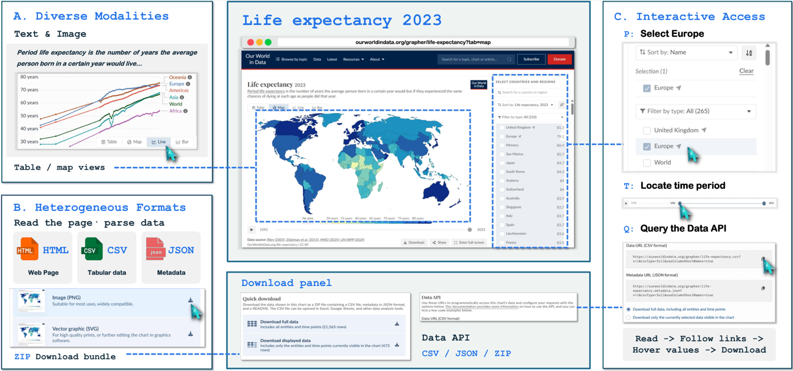
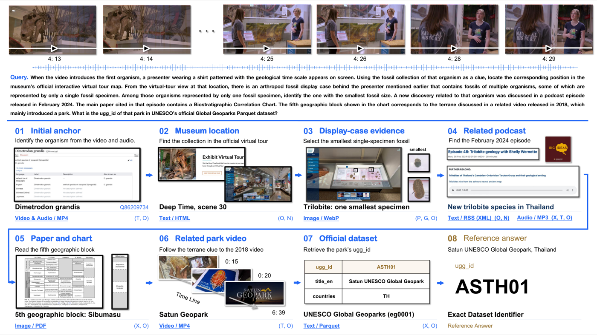
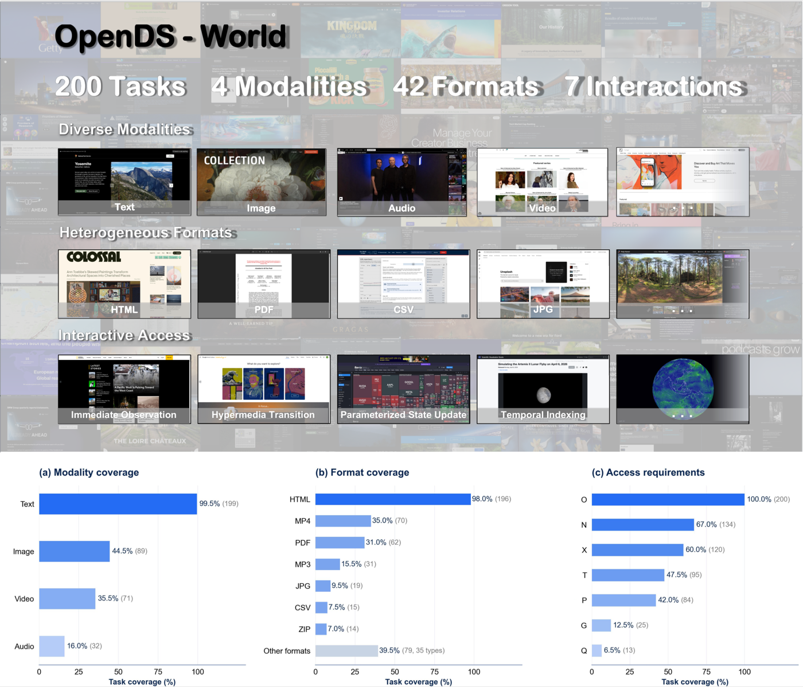
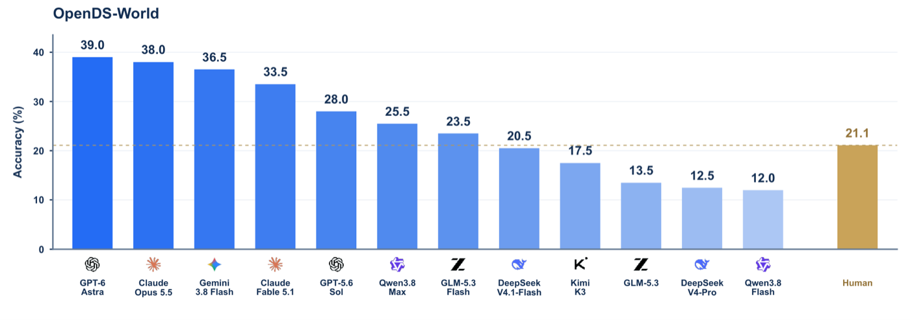

<!-- paper-reading-lang: zh-CN -->
<!-- paper-reading-theme: cobalt -->

# OpenDS-World 深读：把深度搜索 Agent 放回真实开放网页

深读对象：*Deep Search in Real-World Web Environments*，即 [arXiv:2610.30181v1](https://arxiv.org/abs/2610.30181v1)（HKUST(GZ) 牵头，14 家机构、25 位作者）。论文首先构建 200 道题和 787 个标注证据条目的任务集合，再用统一环境评测 12 个模型。它要测的是“能否自己找到、取得并连接证据”，而不是只在已给定文本里找答案。<span class="source-ref">arXiv v1 记录日期 2026-10-19，PDF 首页标 2026-10-20；本文固定到同一份 30 页 PDF，SHA-256：55e1f307c37dd53b0cc5ad6deef7bf3caadc4cc3d3c8f868132fe477811d8204。已核对摘要、正文 §§1–5、Figs. 1–16 的相关文字/图注、Tables 1–8 及附录 A–E；既有 Fig. 1/2/3/5 原图另核对图中内容。原文核对日期：2026-10-27。</span>

<!-- 视觉决策：本文为基准论文，核心关系（构建流水线、三类工具、难度分组）用静态卡片图与重绘条形图已能完整表达，未嵌入交互视图。 -->

## 01 全景：这篇论文在做什么

论文的出发点是：现有评测虽已覆盖搜索、导航和多模态的部分挑战，仍未充分同时覆盖真实网页上的复杂证据获取。真实网页不是这样——信息散布在不同网站、不同模态（文/图/音/视频）、不同文件格式（HTML、PDF、Parquet、ZIP……），而且有些证据必须通过交互（导航、填参数、拖动时间轴、下载文件）才能拿到（PDF §1）。OpenDS-World 的做法是：把"证据获取过程本身"作为被测对象。每道题从一段真实视频出发，Agent 要自己在开放网页里搜索、访问、处理并串联证据，最终给出唯一事实性答案（PDF §2.1.1）。

```paper-map
{
  "thesis": "在真实开放网页环境中，本次评测的 Agent 端到端深度搜索能力仍有限：最强模型 200 题只答对 39.0%，且大量消耗并未换来正确率。",
  "reader":"熟悉搜索或 RAG、希望理解基准如何定义和测量能力的读者；无需预先了解网页工具接口。",
  "goals":["从原图的一道题重走实体识别、交互取证与最终数据查询","用分母算清任务覆盖率、难度分组和总体准确率","区分答案计分、轨迹诊断与尚未验证的改进设想"],
  "outcome": "提出 OpenDS 任务形式，构建并开源 200 题、787 个标注证据条目的 OpenDS-World 基准，附独立人工验证与 1000 次人类实测标定。",
  "outcomeSource": "PDF 摘要、§2、§5",
  "items": [
    { "number": "01", "label": "问题", "signal": "评测缺口", "text": "静态检索基准无法评估真实网页中的证据获取：多模态、异构格式、交互式访问三者交织，现有评测覆盖不足。", "source": "PDF §1" },
    { "number": "02", "label": "任务", "signal": "OpenDS", "text": "给定事实性问题与初始线索（一段视频），Agent 须自主探索开放网页，跨源搜索-访问-处理-连接证据，得出唯一可验证答案；证据位置与获取方式不预先告知。", "source": "PDF §2.1.1" },
    { "number": "03", "label": "基准", "signal": "200 题", "text": "8 个领域、4 种模态、42 种格式、7 类访问方式；每题证据链平均 3.94 个来源条目，10 名独立评审验证证据有效性与答案唯一性。", "source": "PDF §2.2、§2.4" },
    { "number": "04", "label": "协议", "signal": "统一环境", "text": "12 个前沿模型在相同 16 工具环境（搜索/GUI/视频处理）与相同预算（3600 秒、100 次工具调用）下评测，Qwen3.8-27B 做语义等价裁判。", "source": "PDF §3.1、附录 C" },
    { "number": "05", "label": "发现", "signal": "本次最高 39.0%", "text": "GPT-6 Astra 以 39.0% 居首，人类独立求解仅 21.1%；跨模型的调用、时间消耗与准确率没有简单排序关系，预算耗尽、工具失败时间代价与终止时答错暴露出不同问题。", "source": "PDF §3.2–§3.6" }
  ]
}
```

**第一遍路线：** 先读[任务属性](#section-2)，再沿[原图中的一道题](#section-3)理解为什么“搜到页面”还不够；接着用[预算与计分追踪](#section-4)确认测到什么，最后在[结果与附录诊断](#section-5)判断结论边界。构建者先铺通证据链再反向出题，求解者只拿到问题和视频，必须自行恢复中间对应关系。这两条相反方向的路线不能混为一谈。

一个贯穿全文的数字是人类总体正确率 21.10%（211/1000 次独立尝试），而 42.5% 的**题目**在五次人类尝试中全未解出。人类没有统一单题时限、不能用 LLM；模型有 3600 秒/100 次调用预算和特定工具。因此模型超过 21.1% 只是两个协议下的观察，不能当成同工具、同时间或同人群的公平优劣实验。（PDF §2.3、§3.1）

## 02 任务定义：深度搜索到底难在哪

OpenDS 的任务定义本身只有一句话：给定问题和初始线索，Agent 在开放网页中自主完成多步证据搜索与推理，输出唯一可验证的事实答案（PDF §2.1.1）。真正的信息量在"开放网页"被拆成的三个互补属性上——它们分别刻画信息的表现形式、组织结构、获取方式（PDF §2.1.2）：

- **多模态（Diverse Modalities）**：证据可能在网页正文、图片、语音或多媒体资源里，同一题的不同阶段可能依赖不同模态；
- **异构格式（Heterogeneous Formats）**：同为"文本信息"，可能装在 HTML、PDF、XML、Parquet 里，解析与处理方式完全不同；
- **交互式访问（Interactive Access Requirements）**：有些证据无法直接检索到，必须导航、输入参数、时间索引、操作图形界面、结构化查询或下载文件后才能获得。

**原图 Fig. 3 要回答的是“同一个来源怎么会要求不同能力”。** 先看 A 的寿命曲线和文字：这是模态；再看 B 的 HTML、CSV、JSON、ZIP：这是承载格式；最后跟 C 的 Europe 选择框、时间滑块、API 查询：这是取得目标证据的操作。同一数据网站里的三个层次可以同时存在，不能把“会读网页文本”当成已经取得某地区、某年份的正确数据。（PDF §2.1.2、Fig. 3）



*原论文 Fig. 3，PDF §2.1.2。同一个页面里 (A) 文本+图表两种模态，(B) HTML/CSV/JSON/ZIP 多种格式，(C) 区域选择、时间索引、API 查询等交互访问。阅读时注意：拿到证据需要在这三层表示之间来回切换。*

与静态检索评测的对照，可以精确定位这篇论文的位置：

```paper-contrast
{
  "title": "静态检索评测 vs OpenDS 真实网页深度搜索",
  "intro": "这是帮助定位论文的概念对照，不是对所有既有基准的二分归类；OpenDS 特别强调多类证据获取要求的共同出现。",
  "branches": [
    { "name": "静态/受控语料评测", "lead": "在给定或受控的证据集合中检索与推理；具体任务仍可能很难。", "scope": "考检索质量、多轮搜索策略、跨源推理。", "judge": "答案对错为主，执行过程通常不进入评测。", "signal": "证据已经在语料里，获取成本被评测设计抹平了。", "why": "固定语料有助于控制证据条件，但不必然覆盖活网页中的动态访问、异构资源与模态转换。", "source": "PDF §1、§4" },
    { "name": "OpenDS 真实网页评测", "lead": "证据分布在活网页上，位置与获取方式不告知。", "scope": "考自主搜索、交互访问、资源处理、跨源连接的连续协作。", "judge": "造题时验证证据链与答案唯一性；模型计分以最终答案为主，工具、成本和终止轨迹另作诊断。", "signal": "证据获取本身就是被测对象：导航、参数更新、时间索引、下载解析都计入能力。", "why": "直接对齐真实研究场景，代价是活网页的可复现性风险——本文用归档锚点视频与证据链多源佐证来控制。", "source": "PDF §2.1、§2.2" }
  ]
}
```

## 03 基准构建：从视频锚点到可验证问题

基准论文的主线是"任务宇宙怎么造"。OpenDS-World 的构建是一条五段流水线，前三段造题，后两段验题与标定难度（PDF §2.2、§2.3）：

```paper-path
{
  "title": "OpenDS-World 构建流水线",
  "intro": "从一段真实视频出发，正向铺证据链，再反向出题，最后用独立人类验证与实测收口。",
  "stages": [
    { "title": "真实世界锚点", "role": "起点", "action": "专家标注员从 500 个候选视频（覆盖 8 领域）中选取视频，分析连续视觉帧与音频，确定一个必须依靠视听内容才能识别的实体锚点，并要求该实体唯一映射到一个 Wikidata 条目。", "why": "锚点必须看/听视频才能识别，防止起点退化为页面文本搜索；Wikidata 映射用于固定目标实体的语义指称。", "cost": "锚点视频需归档随基准分发以固定起始输入，评测不依赖原 YouTube 视频的可用性。", "output": "视频 + 初始锚点 + Wikidata 条目，作为证据链扩展起点。", "source": "PDF §2.2.1 Stage 1、附录 C.1.2" },
    { "title": "开放网页证据扩展", "role": "正向铺链", "action": "沿证据链逐步扩展：每步先基于当前节点构造查询、Google 检索候选来源，逐一检查后选中有明确语义关系且证据可验证的来源，再从中抽取新实体作为下一节点，递归直到到达唯一稳定的终节点。", "why": "证据链在真实网页上动态生长，天然带入模态、格式与访问方式的多样性；标注员在选源时有意兼顾三类属性的覆盖。", "cost": "每个新节点不绑定单一来源：链上每个节点都要求多个网页来源独立佐证，防止证据链依赖单点失效。", "output": "一条多跳、多源、经过佐证的证据路径，终点即参考答案。", "source": "PDF §2.2.1 Stage 2" },
    { "title": "问题反演", "role": "出题", "action": "把完整证据路径反演成一组相互依存的约束，中间节点不直接暴露，每个节点改写为基于前序证据的间接指称描述。", "why": "设计意图是让约束组合逐步收窄候选空间，降低直接检索目标的可能性；求解者通常需恢复中间关系，但构造规则未形式化排除捷径或其他正确证据路径。", "cost": "题目难度高度依赖反演措辞的质量，需要下一阶段人工把关。", "output": "候选事实性问题，含参考答案与完整证据链（不对 Agent 公开）。", "source": "PDF §2.2.1 Stage 3" },
    { "title": "独立人工验证", "role": "验题", "action": "共有 10 名独立评审参与逐题重走证据链的核验：核对证据有效性（事实准确、来源真实可访问、多源交叉验证、相邻节点转移有证据支撑）与任务有效性（题意清晰、约束一致、答案唯一），不合格题目直接剔除。", "why": "由未参与构造的评审复核证据有效性与答案唯一性，为测量前提提供质量控制；这不构成标注错误率为零的保证。", "output": "最终 200 道题的基准，每题有明确参考答案与可验证证据路径。", "source": "PDF §2.2.2" },
    { "title": "人类实测标定", "role": "定标", "action": "50 名求解者分 10 组各解 20 题（共 1000 次独立尝试），只给原始输入，可用常规浏览器但禁用任何 LLM 工具，无统一时限，提交答案、耗时与 0–5 主观难度评分。", "why": "用独立人类的真实求解成功率给难度分组提供经验标定，同时提供人类性能基线。", "cost": "总投入约 646 小时（人均 12.92 小时/20 题，单次尝试均值 38.8 分钟），难度评级均值 3.884/5。", "output": "人类基线 21.10%；按每题 5 人中答对人数划分 Low（≥2 人，54 题）/ Medium（1 人，61 题）/ High（0 人，85 题）。", "source": "PDF §2.3、§2.3.2、Table 1 脚注" }
  ]
}
```

### 先把 Fig. 2 的真实例子走通

**Fig. 2 中先跟蓝色 01→07 的证据路径，再看 08 的参考答案。** 问题从视频里第一种生物及穿着地质年代表上衣的讲解者出发，最后要的却是 UNESCO 数据集中的地质公园标识符。关键不是猜公园名，而是说明每个跨来源的指称怎样确定下一步该找什么。（PDF §1、Fig. 2）



*原论文 Fig. 2，PDF §1。从输入视频出发，经虚拟游览与展柜、相关播客、论文图表、另一个视频，再进入结构化数据集。阅读时注意箭头之间的"获取动作"：每一步都需要先决定去哪、再决定怎么拿。*

原图中的操作可以展开成下表；这是**论文给出的任务实例**，没有重新执行活网页或宣称独立解出了该题。每次输出的实体/属性都成为下一步输入，任何一步拿错对象都可能沿着一条“看似合理”的链走向错误答案。（PDF Fig. 2）

| 已有线索 | 为取得证据必须做什么 | 得到的下一节点 |
|---|---|---|
| 输入视频中的生物与讲解场景 | 结合视频和音频识别实体 | *Dimetrodon grandis*，图中对应 Wikidata Q86209734 |
| 该生物的馆藏 | 找到官方虚拟游览对应位置并切换视点 | Deep Time，scene 30；讲解者身后的展柜 |
| 展柜里仅有单件标本的生物 | 检查图像、比较标本尺寸 | 最小的三叶虫标本 |
| 相关新发现与 2024 年 2 月播客 | 找播客并追它所引的论文 | 泰国三叶虫的新发现及其论文 |
| 论文中的 Biostratigraphic Correlation Chart | 查第 5 个地理区块 | Sibumasu，再与 2018 年介绍公园的视频相连 |
| 公园视频与官方结构化数据 | 将 Satun Geopark 对应到 UNESCO 记录，读取目标字段 | `ugg_id = ASTH01` |

“识别出 Satun”还没完成任务：公园名与 `ugg_id` 是不同字段。最后一步必须把已识别实体与官方记录对应起来，不能直接把名称当标识符交卷。这也说明答案唯一性依赖**全部约束及字段要求**。发布的标注链是验证过的一条路径，评分并不要求模型逐步复制这条路径；其他证据路径也可能得到同一正确答案。（PDF Fig. 2、§2.2、附录 C.4）

### 把具体实例接回构建方向

上述例子中，构建者已经知道各节点，才把它们改成“视频中的生物”“展柜中最小的单件标本”“图表第 5 个区块”等间接指称。这是**问题反演**：把显式实体隐藏在可核验的关系中，让组合约束逐步收窄候选。独立评审则重走节点与边，检查“这条边有证据”及“组合后只剩一个答案”。它减少直接暴露答案的线索，并不是对搜索泄漏或任何未来作弊策略的形式化保证。（PDF §2.2.1 Stage 3、§2.2.2）

### 统计先问分母，再问多样性

任务宇宙的覆盖面最终落在统计上。200 题共标注 787 个来源条目（平均每题 3.94 个，55.5% 的题需要至少 4 个），**这些证据链统计排除单独提供的起点视频**；任务级文本出现率 99.5%，但图片 44.5%、视频 35.5%、音频 16.0%，82.5% 的题跨至少两种模态；格式上 HTML 覆盖 98% 的题、MP4 35%、PDF 31%，96.0% 的题跨至少两种格式，条目级还剩 13.72% 的长尾格式（FASTA、DICOM、KML、3D 资产等 35 类）；访问方式上 67.0% 的题需要页面/嵌套导航，60.0% 需要文件下载转移，47.5% 需要时间索引，42.0% 需要参数化状态更新，95.5% 的题涉及至少两类访问（PDF §2.4、附录 B.1–B.3）。

**Fig. 5 下排要横读三种任务覆盖率，不要把各柱相加当作互斥占比。** 例如音频 16.0% 是 32/200 道题含后续音频证据，并非只有 32 道题给了起点视频。格式图的 Other 是 79/200 题（39.5%）含长尾格式；正文/附录的 108/787 条目（13.72%）则是另一个分母。原图上半是来源示例，下半的百分比才是覆盖统计。（PDF Fig. 5、附录 B.2–B.3）



*原论文 Fig. 5，PDF §2.4。上：三类维度下的代表性来源；下：(a) 模态覆盖、(b) 格式覆盖、(c) 交互访问类型覆盖，各柱百分比与括号计数以 200 道题为分母；Other 另注明 35 种格式。阅读时注意三类属性可在同一题内重叠。*

### 附录 B 怎样标注一次证据获取

附录 B.4 的七类标签描述的是**操作要求**，不等于七个工具。用它自己的报告例子：跟随链接是 N（超媒体转移），下载报告是 X（文件转移），读到内容是 O（即时观察）。视频定位可同时是 T（时间索引）和 O。P 是输入显式参数，G 是操作空间/图形表示，Q 是用结构化查询表达检索条件；一个工具可以实现多类操作，同一类操作也可花多次工具调用。（PDF Table 3、附录 B.4）

**教学标注算例：** 若一题有两个后续来源，第一项报告标 N/X/O，第二项视频标 T/O，任务级标签取并集 $\{N,X,O,T\}$，所以是四类访问要求；O 不重复计数。它不是五次或六次工具调用，也不是四个证据条目。论文的 95.5% 多访问类型覆盖率，正是对 200 题各自并集计数后汇总，而非按工具调用日志计算。（PDF 附录 B.2、B.4；算例为本文教学构造）

## 04 评测协议：预算怎样变成一次计分

模型侧选了 12 个前沿模型：GPT-6 Astra、GPT-5.6 Sol、Claude Opus 5.5、Claude Fable 5.1、Gemini 3.8 Flash、Qwen3.8-Max/Flash、DeepSeek-V4.1-Flash/V4-Pro、Kimi K3、GLM-5.3-Flash/GLM-5.3，其中 DeepSeek-V4-Pro 与 GLM-5.3 为纯文本模型（表中标 (T)）。所有模型使用相同任务输入、系统提示、工具环境与执行预算（PDF §3.1）。

关键条件先留在可见处：每题的搜索阶段最多 **3600 秒、100 次工具调用**，任一触顶便停止搜索；若没有完整答案，进入**无工具**的收尾阶段，最多两次请求共享 5000 输出 token。记录“为什么停止”与“最终答案是否正确”是两件事。（PDF §3.1、附录 C.2）

<details class="reading-detail">
<summary>16 个工具与上下文压缩配置</summary>

```paper-map
{
  "items": [
    { "number": "01", "label": "搜索工具", "signal": "4 个接口", "text": "text_search、image_search、open_page、youtube_search：定位潜在信息来源。", "source": "PDF Table 4" },
    { "number": "02", "label": "GUI 工具", "signal": "10 个接口", "text": "browser_navigate/get_markdown/get_clickable_elements/click/form_input_fill/press_key/scroll/screenshot/get_download_list/get_download_content：导航、读取、点击、输入、截图与下载物检查。", "source": "PDF Table 4" },
    { "number": "03", "label": "视频工具", "signal": "2 个接口", "text": "youtube_read_video（默认采样 10 帧，可指定时间窗，1–100 帧）与 youtube_read_subtitle（全段或时间窗字幕）：处理输入视频与外部视频。", "source": "PDF Table 4、附录 C.1.2" },
    { "number": "04", "label": "执行预算", "signal": "3600s / 100 次", "text": "搜索阶段每题 3600 秒、全部工具共享 100 次调用上限，任一触顶即终止并进入无工具的收尾作答阶段（≤2 次请求、5000 token 输出预算）。", "source": "PDF §3.1、附录 C.2" },
    { "number": "05", "label": "上下文管理", "signal": "确定性压缩", "text": "最近 4 条工具观察保持完整；更早的搜索结果只留前 2 条、文本截断至 2000 字符；图像上下文默认上限 250 张，超出以文本占位符替换。", "source": "PDF Table 5、附录 C.2.2" }
  ]
}
```

</details>

### 附录 C 的输入视频读取也有一个具体操作

起点视频以只读本地文件、统一 ID `input_video` 提供。默认 10 帧取等长时间区间的中点；**教学例**中若视频长 120 秒，10 帧落在 6、18、30、…、114 秒。短暂线索若出现在 60 秒附近，全球采样可能错过；再指定 50–70 秒、4 帧，会取 52.5、57.5、62.5、67.5 秒。这是按附录规则演算的采样位置，不是论文新增命中率实验；时间窗重读会使用额外工具调用，字幕还需独立接口读取。（PDF 附录 C.1.2、Table 4）

### 跟一次预算耗尽走到计分

**教学执行追踪：** 某模型先读取视频，再搜索与操作网页，累计完成第 100 次工具调用，但还没给出完整答案。此时不能申请第 101 次搜索；系统以既有上下文进入无工具 finalization。若它输出正确的 `ASTH01`，仍可记作正确；若它完整地输出了错误 ID 或“证据不足”，则记错。“正常生成一句话”与“有证据支持的正确答案”因此不是同一个事件。（PDF 附录 C.2.3、C.4；执行情景为教学构造）

裁判 Qwen3.8-27B 接收**问题、参考答案、候选答案、执行状态及错误字段**，用参考答案判断语义等价与完整性；它不独立解题、不调用外部工具。数字、实体、日期、方向、列表成员必须正确，拒答、证据不足、空答案或失败执行的答案按错误计。主指标 ACC 是最终答案正确比例；它**不逐边重审模型的搜索轨迹**。造题时的人工证据验证、答题时的自动答案计分和日志诊断必须分开读。（PDF §3.1、附录 C.4）

<details class="reading-detail">
<summary>收尾请求与长期上下文的边界</summary>

收尾最多 2 次请求共享 5000 输出 token，首请求默认 4000；必须非空、完整且无工具调用。搜索期间，最近 4 条工具观察不压缩，更早的搜索观察只保留前 2 条，文本字段截到 2000 字符；其他字段不受这些文本规则影响。图像超限时，旧图用省略标记代替，原图仍保留在运行轨迹供后续分析。Table 5 写默认上限 250 张，C.2.1 同时提醒实际值应以该次运行配置为准。对比模型必须保持实际配置一致，不能把默认值当作所有历史运行的唯一配置。（PDF 附录 C.2、Table 5）

</details>

## 05 实验图谱

```paper-experiments
{
  "title": "先判断答案能力与人类定标是否一致",
  "rows": [
    {
      "question": "前沿模型整体能答对多少？",
      "setup": "12 模型 × 200 题，统一工具与预算，ACC 为主指标。",
      "observation": "GPT-6 Astra 39.0%（78/200）居首，Claude Opus 5.5 38.0%、Gemini 3.8 Flash 36.5%、Claude Fable 5.1 33.5% 紧随；最弱模型 12.0%。最强模型在 200 题中失败 122 题（61.0%）。",
      "conclusion": "真实开放网页的端到端深度搜索对当前最强模型仍是未解难题，头部分数远未饱和。",
      "source": "PDF §3.2、Table 1"
    },
    {
      "question": "难度上升时性能如何衰减？",
      "setup": "按人类求解人数分 Low（54 题）/Medium（61 题）/High（85 题）。",
      "observation": "12 模型等权平均从 Low 39.66% 降到 Medium 23.50%、High 16.76%；GPT-6 Astra 三档为 59.26/40.98/24.71%，Gemini 3.8 Flash 在 High 档居各模型之首（28.24%），Qwen3.8-Flash 与 DeepSeek-V4-Pro 在 High 档仅 4.71% 与 3.53%。",
      "conclusion": "人类零解的 High 档仍构成普遍挑战，且难度越高模型间策略差异越明显。",
      "source": "PDF §3.2、Table 1"
    }
  ]
}
```

**先算清难度和总体分母。** 人类每题五次尝试中答对人数 ≥2 为 Low（54 题）、1 为 Medium（61 题）、0 为 High（85 题）。GPT-6 Astra 的三个正确数是 32、25、21：

$$
\mathrm{ACC}=\frac{32+25+21}{54+61+85}\times100\%=39.0\%.
$$

直接平均三档的 59.26%、40.98%、24.71% 会得到约 41.65%，因为把不同大小的分组等重，不能还原总体。High 的“0”来自五名指定人类求解者，不等于题目不可解；Gemini 在该组答对 24/85（28.24%）就是反例。（PDF Table 1；41.65% 为表值演算）

同样，人类的 **211/1000=21.1%** 是尝试准确率，而 **115/200=57.5%** 是至少一人成功的题目比例；它们回答不同问题。若把后者与单模型准确率直接对比，就相当于给每题合并五个人的机会。论文的构建、难度分组和人类基线都依赖这批数据，难度不是独立于人群的绝对属性。（PDF §2.3.2；解释）

**资源诊断的关键反例留在这里：** Astra 与 Sol 消耗约 187M/186M token，却得 39.0%/28.0%；Gemini 约 976M token、36.5%，也未超过 Astra。这说明跨模型消耗没有简单排序关系，不等于证明增加同一模型的预算无效。自然终止也不是正确率：Astra 分别为 69.0% 和 39.0%；失败调用仅占 6.34%，却占记录的工具执行时间 42.57%。（PDF §§3.2–3.5、Figs. 6–8）

<details class="reading-detail">
<summary>保留完整成本、工具转移、失败恢复与预算分析</summary>

```paper-experiments
{
  "title": "成本、工具、错误与预算的诊断",
  "rows": [
    {
      "question": "花得越多是否答得越对？",
      "setup": "对比各模型总 token、总耗时与准确率。",
      "observation": "GPT-6 Astra 与 GPT-5.6 Sol 总 token 几乎相同（187M vs 186M）但差 11 个百分点；Gemini 3.8 Flash 耗 token 约 5.22 倍于 Astra（976M vs 187M）反而更低分；DeepSeek-V4-Pro 耗时 2.39 倍于 Astra 只得 12.5%。",
      "conclusion": "这些跨模型观察不支持“消耗更多必然更好”；没有操纵同一模型的预算，不能据此断言增加预算无效。",
      "source": "PDF §3.2、§3.3"
    },
    {
      "question": "模型用什么方式搜索？",
      "setup": "统计工具调用在 Search/GUI/Other 三类的分布与类间转移。",
      "observation": "GPT-5.6 Sol 74.50% 调用给搜索、17.77% 给 GUI；Claude Opus 5.5 与 Qwen3.8-Flash 的 GUI 占比相近（51.52% vs 49.42%）但准确率 38.0% vs 12.0%；类内连续转移占主导（Gemini 的 Search→Search 84.63%，Qwen3.8-Flash 的 GUI→GUI 84.97%）。",
      "conclusion": "工具构成本身不解释性能差异；持续同类操作可能是策略也可能是打转，需结合结果看。",
      "source": "PDF §3.4、Fig. 7"
    },
    {
      "question": "搜索如何终止、失败如何恢复？",
      "setup": "统计 200 题终止原因、失败调用占比与其时间代价、失败后下一步决策。",
      "observation": "自然终止率：GPT-6 Astra 69.0%、GPT-5.6 Sol 65.0%、Claude Opus 5.5 60.5%，Qwen3.8-Flash 仅 6.5%（80.0% 打满调用上限）；工具失败只占调用的 2.83–9.42%，却占执行时间的 19.27–61.90%（Astra：6.34% 调用 vs 42.57% 时间）；失败后换工具是最常见决策（Claude Opus 约 83%），Kimi K3 与 GLM 5.3 更倾向改参重试（约 38%/37%）。",
      "conclusion": "自然终止≠答对（Astra 69% 自然终止仍只有 39% 正确）；工具失败的时间代价被严重放大。",
      "source": "PDF §3.5、Fig. 8"
    },
    {
      "question": "预算耗尽有多严重？",
      "setup": "统计触顶 3600 秒或 100 次调用的任务比例及触顶类型。",
      "observation": "至少触达一项上限的比例：Claude Opus 5.5 16.5%、GPT-6 Astra 25.5%，而 Qwen3.8-Flash 81.5%、DeepSeek-V4.1-Flash 78.0%、GLM 5.3 73.0%、DeepSeek-V4-Pro 72.5%；调用触顶为主（Qwen3.8-Flash 80.0% 仅调用触顶）与时间触顶为主（GLM 5.3 41.0% 仅时间触顶）是两种失败形态，双触顶至多 1.0%。",
      "conclusion": "完成搜索预算管理与终止后答对是两个不同问题；此分析没有单独识别信源选择、证据整合或停止策略的因果贡献。",
      "source": "PDF §3.6、Fig. 9"
    }
  ]
}
```

</details>

12 个模型的总体准确率重绘如下（数值取自 Table 1 的 Overall 列，200 题）：

```paper-chart
{
  "type": "bars",
  "title": "12 个前沿模型的总体准确率",
  "subtitle": "OpenDS-World，200 题，统一工具环境与预算",
  "origin": "本文重绘 · 原论文 Table 1",
  "source": "PDF Table 1",
  "unit": "%",
  "domainMax": 60,
  "note": "DeepSeek-V4-Pro 与 GLM-5.3 为纯文本模型（原文标 (T)）；参考线：人类 1000 次独立尝试均值 21.10%（PDF §2.3.2）。",
  "rows": [
    { "label": "GPT-6 Astra", "value": 39.0 },
    { "label": "Claude Opus 5.5", "value": 38.0 },
    { "label": "Gemini 3.8 Flash", "value": 36.5 },
    { "label": "Claude Fable 5.1", "value": 33.5 },
    { "label": "GPT-5.6 Sol", "value": 28.0 },
    { "label": "Qwen3.8-Max", "value": 25.5 },
    { "label": "GLM-5.3-Flash", "value": 23.5 },
    { "label": "DeepSeek-V4.1-Flash", "value": 20.5 },
    { "label": "人类（1000 次尝试）", "value": 21.1, "approx": true },
    { "label": "Kimi K3", "value": 17.5 },
    { "label": "GLM-5.3 (T)", "value": 13.5 },
    { "label": "DeepSeek-V4-Pro (T)", "value": 12.5 },
    { "label": "Qwen3.8-Flash", "value": 12.0 }
  ]
}
```

**Fig. 1 对应的是总体结果，不是分难度曲线。** 先看蓝色模型柱的 39.0%、38.0%、36.5%，再看金色人类柱与 21.1% 虚线；纵轴是准确率百分比。它把两个协议的总体快照放到同一坐标，但不显示个人成功分布，也不能单凭 39.0 对 38.0 的差值断言统计显著。（PDF Fig. 1、Table 1）



*原论文 Fig. 1，PDF p. 1。阅读时注意：该图是总体准确率柱图；人类 21.1% 来自 1000 次尝试，模型各来自 200 题。独立人类成功人数的分布另见原文 Fig. 4。*

分组数据还有一个值得留意的细节：难度分组本身由人类求解人数定义（Low≥2、Medium=1、High=0），而 High 组的构成差异——音频覆盖从 Low 的 7.4% 升到 22.4%、ZIP 从 1.9% 升到 12.9%、超媒体导航从 61.1% 升到 72.9%，同时图片/视频覆盖反而下降（附录 B.5、Fig. 12）——表明人类定标分组的证据组成也发生变化，不能把分组差异直接解释成音频或 ZIP 导致失败。尤其不能说“音频对所有模型都更难”：附录 D.2 中 Gemini 的音频准确率为 16/32=50.0%，高于它的总体 36.5%，这些类别还彼此重叠。（PDF 附录 B.5、D.2、Table 6）

### 附录 D–E 把覆盖表接到行为诊断

附录 D.2 的代表性测量是：先从 200 题中选择“标注后续音频证据”的 32 题，再对同一批模型计算正确数/32。Gemini 与 Claude Fable 都是 16/32=50.0%，Astra 为 14/32=43.75%；这里的同一题也可能同时属于 Text、Video 或 PDF 组。因此不能把四类模态准确率再平均成总分，也不能称为控制其他难度后的纯音频识别能力。Declarative Query 组只有 13 题，Astra 的 8/13=61.54% 还要保留小分母。（PDF 附录 D.2、Tables 6–8）

附录 E 再把标注链与执行轨迹分开：3、4、5、≥6 个标注来源的题，其工具调用中位数为 74、56、72、82.5，既远多于来源数，也不单调。标注链描述成功后的证据骨架；日志还包含找错页面、检查候选、交互取证和重试，所以不能拿“平均 3.94 个来源”推断四次调用应足够。（PDF 附录 E、Fig. 15）

**把失败代价算成可解释的量：** 用 Astra 的统计，失败调用平均执行时间相对全部调用均值约为 $42.57/6.34\approx6.71$ 倍。这是由两种占比推得的**记录工具执行时间**比，不是完整端到端任务时间，也不是失败必然造成总分下降的因果估计。附录 E 据此提出从日志识别重复失败、改进恢复和停止策略的研究方向，但没有实际报告一次递归自我改进训练后的分数提升。（PDF §3.5、附录 E、Fig. 16；比值为本文推导）

## 06 综合评述

把机制与证据放回一起看，这篇论文的测量声明由三层支撑咬合：**任务定义**把"证据获取"从检索评测的背景变成了前景（§2.1）；**构建流水线**用"视频锚点 + 正向证据扩展 + 反向问题反演 + 独立验证 + 人类定标"为 200 个任务的真实性与可验证性提供质量控制（§2.2–2.3）；**统一协议**用相同工具与预算把 12 个模型放进同一环境，过程性指标（工具分布、终止原因、失败恢复、预算触顶）让"为什么错"变得可分析（§3）。

结果的边界也要读准。它证明的是"在 200 道经人工验证、答案唯一的多跳事实问题上"的能力分布：题目不追求知识前沿而追求证据获取复杂度；活网页存在漂移风险，论文用归档锚点视频控制输入端，但证据链中段仍依赖真实网页的存续（附录 C.1.2 只覆盖输入视频）；裁判为单模型参考答案判定，语义等价的边界案例可能被严格规则放大（附录 C.4）。另外 12 模型的排名是特定预算（3600s/100 次）下的快照：Qwen3.8-Flash 80% 的题打满调用上限，它的 12.0% 是该预算下的结果；提高预算后能多答对多少题尚未由该实验测定（§3.6）。

论文把它定位为研究长程搜索与递归自我改进的环境；这项工作交付的是任务和诊断证据，后续改进是否有效仍需要在新任务上验证。（PDF §5、附录 E）


```paper-check
{
  "title":"重建一次 OpenDS 测量",
  "items":[
    {"question":"Fig. 2 中已经确定 Satun Geopark，为什么还不能直接交这个名称？构建者与求解者沿证据链的方向有什么不同？","answer":"问题要的是 UNESCO 记录中的 ugg_id，必须将公园实体对应到数据集字段，图中答案是 ASTH01。构建者先知道并核验证据链，再把中间实体反演成间接约束；求解者只有视频和问题，要恢复这些对应关系。答案裁判检查最终答案，不要求复制完全相同的路径。","source":"PDF Fig. 2、§2.2、附录 C.4"},
    {"question":"迁移标注：一题的报告证据需要 N/X/O，视频证据需要 T/O，第三个 API 证据需要 Q/O。任务级访问类型有几个？能否据此确定工具调用数？","answer":"并集是 N、X、O、T、Q，共五类，O 只计一次。不能确定调用数：标签描述访问要求，一个工具可能实现多类操作，同一操作也可能反复调用；三条来源也不等于三次工具调用。","source":"PDF 附录 B.4、Table 3；增加 API 来源的教学例"},
    {"question":"一个模型在 Low/Medium/High 三档答对 27/54、12/61、17/85。总体准确率是多少？能否直接平均三档百分比？","answer":"总正确数 56，分母 200，总体准确率 28.0%。不能等权平均三个分组准确率，因为分组大小不同；应按 54、61、85 加权。该正确数是教学构造，不是另一项模型实测。","source":"PDF Table 1 的分组定义；教学计算"},
    {"question":"某模型第 100 次工具调用后仍未作答，收尾输出一个完整但错误的 ID。它算自然终止、正确答案，还是预算终止后答错？这能否证明加预算无效？","answer":"研究阶段因调用预算终止，收尾可以形成完整答案，但答案错误；终止原因与正确性分别记录。单次失败以及跨模型资源比较都不能证明增加同一模型预算无效，需要匹配预算的干预比较。","source":"PDF 附录 C.2.3、C.4；§§3.3–3.6"}
  ]
}
```
