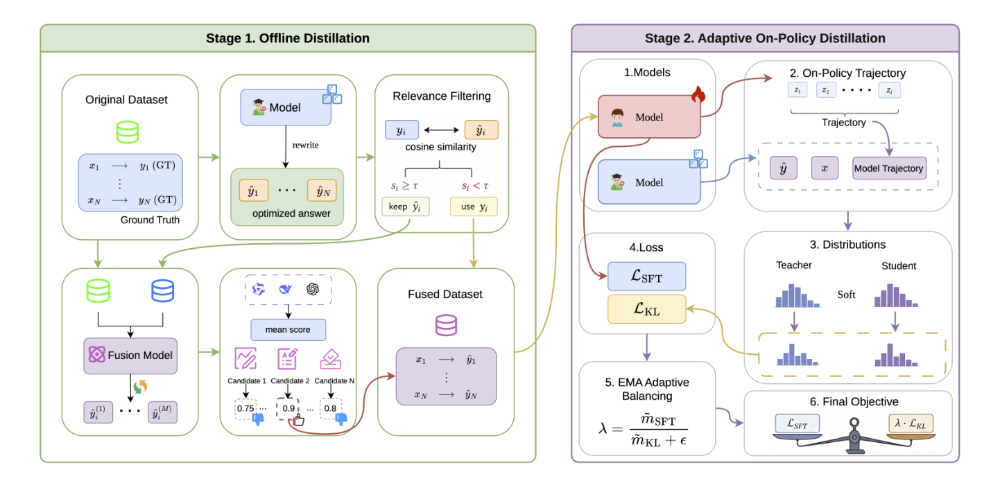
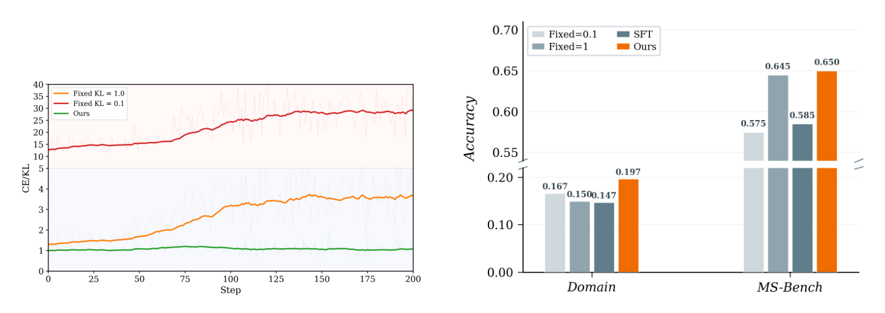
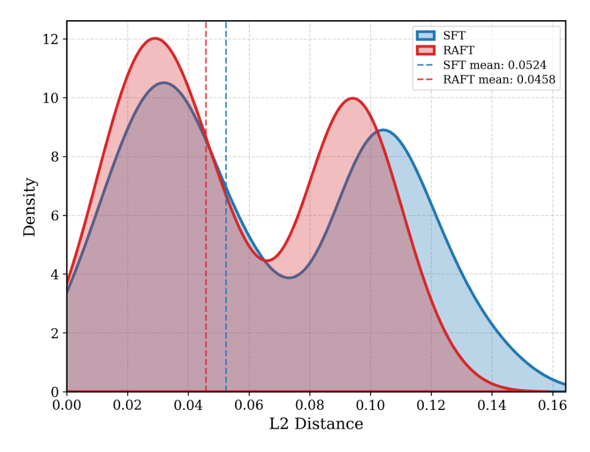

<!-- paper-reading-lang: zh-CN -->
<!-- paper-reading-theme: forest -->
<!-- paper-reading-mode: brief -->
# RAFT：用融合答案连接数据精炼与轨迹保持

> **阅读定位**：领域 SFT 提升领域能力的同时，往往损伤模型的通用能力。这篇论文从两条具体缺口解释损伤，提出两阶段框架 RAFT，并让同一份“融合答案”同时充当兼容的监督信号与教师的答案上下文，把数据端和训练端的补救扣在一起。原文为 Yuduo Li、Xiaofeng Shi（通讯）、Qian Kou、Longbin Yu、Hua Zhou 的 *RAFT: Data Refinement and Adaptive Distillation for Domain Fine-Tuning with Alleviated Forgetting*（BAAI × 北京交通大学）。<span class="source-ref">本图谱依据 <a href="https://arxiv.org/abs/2606.00147v1">arXiv:2606.00147v1</a>（2026-05-29）PDF，共 19 页。已核对正文 §§1–6、Figs. 1–8、Tables 1–4、附录 A–H（正文结论在 p. 9、局限在 p. 10，附录自 p. 12 起）。PDF SHA-256：152118d76720a8083be878871579c7141c862ee7a0833e8e7155f974f47aec6e。原文核对日期：2026-10-27。</span>

<!-- 视觉决策：一条样本的离线分支和在线双轨可用静态路径与并列表完整展开；不需要脚本切换状态。完整分布公式、训练配置和次级指标使用原生 details，关键反例、数值冲突与权衡留在可见正文。 -->

## 01 / 全局：遗忘从两条缺口进来

**一句话主线：** 作者认为，领域 SFT 的灾难性遗忘不是单一原因造成的——它同时来自“监督信号与模型不兼容”（数据端）和“模型自身轨迹上没有约束”（训练端）；只补一端的方法都不够，RAFT 用一份融合答案把两端耦合起来。（PDF §§1, 3.1）

第一条缺口是**监督兼容性缺口**（supervision-compatibility gap）：领域数据的标准答案在表达风格和推理格式上与模型自己的输出分布相距很远。强迫模型拟合这样的答案会造成剧烈的参数漂移，覆盖预训练获得的知识。（PDF §1）

第二条缺口是**轨迹保持缺口**（trajectory-preservation gap）：teacher-forced 的 SFT 只在固定目标 token 上优化，从不约束模型在“自己生成的前缀”上的行为。而模型实际推理时走的恰恰是自己的前缀——原始行为因此得不到保持。（PDF 摘要， §1）

论文的关键论点是**两条缺口耦合而非独立**：只改数据（如自蒸馏 SDFT）改善参考答案，却管不住模型在自己轨迹上的漂移；只做在线策略蒸馏（on-policy distillation）约束轨迹，但教师不知道目标答案，会变成一个“保守锚点”，反而限制领域适应。RAFT 的应对是让**融合答案身兼两职**：既是模型兼容的 SFT 监督，又是蒸馏时教师可见的答案上下文。（PDF §1）

```paper-map
{
  "thesis":"作者从'监督不兼容 + 轨迹无约束'两条耦合缺口解释领域 SFT 遗忘；RAFT 用同一份融合答案同时补上两端。",
  "reader":"了解 SFT 与下一个 token 预测、但不熟悉在线策略蒸馏的读者；用同一条问答样本解释教师上下文、KL 与 EMA。",
  "goals":["追踪同一份融合答案在 SFT 目标和教师上下文中的两种角色","算出截断 KL 与 EMA 权重，并说出它们没有约束什么","区分相对提升、基座保持率与主表中的反例"],
  "outcome":"数据阶段产出模型兼容的融合监督；训练阶段在其上做答案条件的在线策略蒸馏，两者共享融合答案。",
  "outcomeSource":"PDF §§1, 3.2–3.3",
  "items":[
    {"number":"01","label":"问题","signal":"两条耦合缺口","text":"监督兼容性缺口：领域答案的风格/格式与模型自身分布不匹配，作者认为强拟合可能引发参数漂移。轨迹保持缺口：teacher-forcing 不约束模型自身前缀上的行为。","source":"PDF §1"},
    {"number":"02","label":"机制","signal":"离线精炼 + 在线蒸馏","text":"阶段一离线蒸馏：自条件改写 → 余弦相似度过滤 → 融合模型与多评审优选，得到融合数据集。阶段二自适应在线蒸馏：学生自采样轨迹，答案条件教师给出 Top-K 温度软目标，EMA 自适应平衡两类损失。","source":"PDF §§3.2–3.3, Fig. 1"},
    {"number":"03","label":"证据","signal":"3 模型 × 5 领域","text":"SmolLM3-3B、Llama-3.2-3B-Instruct、Phi-4-mini-instruct 上五个领域的主表，数据/目标/平衡三组消融，参数 ℓ2 距离、MMLU 与保持率三组旁证。","source":"PDF §4, Tables 1–4, Figs. 2–8"}
  ]
}
```

**第一遍路线：** 从[一条样本的两段旅程](#section-2)出发，在[四个关键操作](#section-3)算出数据选择、分布约束和权重，再用[主表与消融](#section-4)判断它们实际带来什么。主线是：让监督更贴近原模型 → 在学生自己的前缀上约束下一步 → 用已知融合答案给教师方向 → 检查领域收益是否伴随通用恢复。两条缺口是作者的机制解释，实验对所提方案提供支持，没有将所有遗忘原因穷尽或逐一识别。

**证据入口总览：** 主结果（Table 1）是三模型 × 五领域的完整矩阵；消融（Table 2、Fig. 2）分别比较数据融合、整套在线蒸馏目标和固定/自适应平衡；没有把目标内部每个组件都单独隔离；附录补充超参扫描（τ、T、K）、权重距离（Fig. 3）、MMLU（Fig. 8）和保持率（Table 4）。（PDF §4，附录 A–H）

## 02 / 主路径：一条样本的两段旅程

RAFT 的流程可以跟着一条样本走完：先在离线阶段被改写成更“合身”的监督，再在在线阶段同时驱动 SFT 损失和蒸馏约束。下面的路径图标出每个阶段的输入、动作、设计理由和产出。（PDF §§3.2–3.3, Fig. 1）

```paper-path
{
  "title":"从原始问答到带约束的领域微调",
  "intro":"阶段一（离线蒸馏）只动数据，阶段二（自适应在线蒸馏）在所得数据上更新学生；融合答案 ŷ 是两个阶段的连接点。",
  "stages":[
    {"title":"自条件改写","role":"让监督向模型靠拢","action":"对每条样本 (x, y)，由原指令模型以标准答案 y 为条件重新生成答案 ỹ ∼ p_θ(·|x, y)。","why":"保留事实内容，但把表达风格适配到模型自身的输出分布，缩小监督与模型之间的距离（Eq. 1）。","output":"风格兼容、但事实需要核对的候选答案 ỹ。","source":"PDF §3.2, Eq. 1"},
    {"title":"语义过滤","role":"挡住语义漂移","action":"用预训练句向量 φ 计算原答案与改写的余弦相似度 s（Eq. 2）；s ≥ τ 才采用改写，否则回退原答案 y（Eq. 3）；默认 τ = 0.8。","why":"无质量控制的自我改写可能偏离原意，直接采用会把错误累积进训练数据。","output":"逐样本可信的改写结果 ȳ。","source":"PDF §3.2, Eqs. 2–3；附录 E.1"},
    {"title":"融合与多评审优选","role":"产出最终监督","action":"通过过滤的样本由融合模型（Qwen3-3B）把 y 与 ȳ 融合成更高质量答案 ŷ；多个评审模型独立打分，多轮融合取平均得分最高者，均分 ≥ 0.8 可提前停止。","why":"单次融合有随机性，多评审、多轮优选用于抑制个体波动、提高被采用答案的质量。","output":"融合数据集 D̂：过滤通过处用 ŷ，未通过处保留 y（Eq. 4）。","source":"PDF §3.2, Eq. 4；附录 C–D"},
    {"title":"学生自采样轨迹","role":"把约束放到真实行为上","action":"每个训练步，当前学生模型先对 x 自回归采样一条轨迹 z（Eq. 6）。","why":"采样覆盖当前学生会访问的前缀；固定参考答案无法保证覆盖这些前缀。","output":"学生自己的回答轨迹 z。","source":"PDF §3.3, Eq. 6"},
    {"title":"答案条件教师软监督","role":"目标感知的轨迹约束","action":"原指令模型充当教师，输入是「参考知识提示 r + 融合答案 ŷ + 问题 x + 学生前缀 z_{<t}」的拼接；在相同轨迹位置上给出软目标分布（Eq. 7，拼接模板见附录 H）。","why":"学生轨迹可能偏离教师的自然写法；教师「看着答案」评分，才能既保通用行为、又把学生引向领域目标，而不是单纯保守回拉。","output":"逐位置、目标感知的教师分布。","source":"PDF §3.3, Eq. 7；附录 H"},
    {"title":"Top-K 温度 KL + EMA 平衡","role":"稳定地融合两类损失","action":"教师/学生 logits 经温度 T = 1.5 平滑后，只在教师概率最高的 K = 512 个 token 上重归一化并计算 KL（Eqs. 8–10）；λ(s) 由 SFT 与 KL 损失的 EMA 比值自适应给出，总损失 L = L_SFT + λ(s)·L_KL（Eqs. 11–12）。","why":"温度平滑教师信号，Top-K 聚焦教师高概率 token；两项损失尺度随训练变化，EMA 用近期均值调节标量权重。","output":"最终训练目标；用损失均值比替代固定蒸馏系数。","source":"PDF §3.3, Eqs. 8–12"}
  ]
}
```

### 把同一条问答沿两条训练轨迹展开

下面是**教学样本，非论文数据与实测 logits**。问题 $x$ 为“某馆藏的登记年份是什么？”，原答案 $y$ 是“登记年份为 1908 年”。原模型以 $(x,y)$ 为条件改写；过滤通过后，融合模型将原答案与改写合成“该馆藏于 1908 年登记”作为 $\hat y$。如果过滤不通过，则这条样本直接保留原答案，**不继续做融合**。余弦相似度只是语义门槛，不能证明每个数字都正确；多模型评审也是质量控制，不能提供事实正确的数学保证。（PDF §3.2、附录 C–D；教学解释）

进入训练后，要分清两种前缀：

| 计算 | 这一步看到什么 | 在哪里计算损失 |
|---|---|---|
| SFT | 问题 $x$ 与融合答案的正确前缀 $\hat y_{<t}$ | 对融合答案真实下一个 token 做交叉熵 |
| 学生在线预测 | 问题 $x$ 与学生自己采样的前缀，例如“登记于” | 给出该前缀下的学生分布 |
| 固定原模型教师 | 融合答案作为参考知识 + 问题 $x$ + 同一学生前缀“登记于” | 给出与学生位置对齐的软目标分布，参与 KL |

因此，SFT 沿“该馆藏于……”的参考轨迹学答案，KL 可能沿“登记于……”这条**学生轨迹**约束预测；两条轨迹不必逐字相同。推理时只给问题，不再附加融合答案或教师。训练时教师额外知情是蒸馏信号的构造，不等于评测时给学生泄露参考答案。（PDF §3.3 Eqs. 5–7、附录 H）

“在线”指用当前学生重新采样前缀、重新计算监督；教师仍是微调前的原指令模型。后文的 EMA 用于损失均值，不是用学生参数滑动更新教师。（PDF §3.3）

附录 H 的实现细节决定能否对齐：先拼接参考提示、融合答案、问题、回答标记、学生轨迹的 token 张量，再抽取**轨迹位置对应的预测 logits**与学生对齐；不能把教师额外上下文的第一个位置硬配到学生轨迹第一个位置。表中的“登记于”只是展示这种偏移问题，没有复现真实 tokenizer 的切词。（PDF 附录 H.1–H.4）

**角色核对：** 原 PDF §3.2 指定 **Qwen3-3B 是融合模型**；§4.1 的 **Qwen3-32B 是 D-Acc 评测裁判之一**。它们不是同一角色，本文不把裁判名称替换成融合模型名称。附录 D 说明融合阶段采用多个评审，但没有在该模板中列出这些评审的完整模型身份，不能据此假定它们就是 §4.1 的三名评测裁判。

**两阶段如何“耦合”？** 耦合点不是流程上的串联，而是同一份融合答案 ŷ 的双重身份：在 SFT 损失里它是学生要拟合的目标；在蒸馏损失里它是教师的上下文。作者的这一设计把教师从“纯粹保守的锚”变成“知道目标的向导”——学生学领域知识的同时，仍被约束在原模型的行为模式附近。（PDF §3.3 末段）

**原论文 Fig. 1 是整个框架的鸟瞰，建议按下述路线读：** 左半（绿色）是阶段一离线蒸馏——原始数据集经模型改写、余弦相似度过滤（s ≥ τ 保留改写，否则用原答案），再由 Fusion Model 融合、多个评审模型打平均分，产出融合数据集；右半（紫色）是阶段二——注意第 3 步教师与学生分布经软化后在 Top-K 上对齐，第 5 步 λ 由两个损失的 EMA 比值自动给出（天平图），而非人工设定。左右两半通过融合数据集连接。（PDF p. 2, Fig. 1）



*原论文 Fig. 1，PDF p. 2。图中“Relevance Filtering”即正文的语义过滤（Eqs. 2–3）；右侧第 3 步的软化直方图对应温度平滑与 Top-K 截断（Eqs. 8–9）。此图是核对第 02 节路径的原始画法。*

## 03 / 机制特写：四个关键操作

理解 RAFT 不需要记住全部十二步，抓住四个操作即可：语义过滤决定“用不用改写”，答案条件决定“教师怎么指导”，Top-K 温度决定“蒸馏算什么”，EMA 平衡决定“两类损失各占多重”。

### 语义过滤：改写必须用，但不能乱用

先做一个**余弦教学计算**：若两个句向量为 $[1,0]$ 与 $[0.8,0.6]$，各自长度都是 1，相似度就是 $0.8$；默认阈值下等号成立，改写进入融合。若第二个向量为 $[0.6,0.8]$，相似度 $0.6$，则保留原答案。这里的向量是自造数字，没有声称某两句话的实际编码就是这些值。门槛控制的是句向量角度，不会单独逐项核验年份或实体名。

自我改写的风险是**语义漂移**——改写后风格合身了、意思却变了。RAFT 用预训练句向量 $\phi$ 把文本映到 $d$ 维空间，计算原答案与改写的余弦相似度：（PDF §3.2, Eq. 2）

$$
s_i=\frac{\phi(y_i)^{\top}\phi(\tilde{y}_i)}{\lVert\phi(y_i)\rVert\cdot\lVert\phi(\tilde{y}_i)\rVert}
$$

再用阈值 $\tau$ 做逐样本裁决：（PDF §3.2, Eq. 3）

$$
\bar{y}_i=\begin{cases}\tilde{y}_i, & s_i\geq\tau\\ y_i, & s_i<\tau\end{cases}
$$

低于阈值就**回退到原始答案**，防止错误在自我强化中累积。

这个阈值的经验依据是：附录 E.1 在 Open Culture 上扫描 $\tau\in\{0,0.3,0.5,0.8,1.0\}$，两项指标都在 $\tau=0.8$ 达到峰值（D-Acc 19.7%、MS-Bench 65.0%）；两个极端都更差——$\tau=0$ 不过滤（13.3% / 60.5%），$\tau=1.0$ 几乎没有改写能通过（13.1% / 55.0%）。作者据此把 $\tau=0.8$ 设为全局默认；这是一个模型、一个领域上的选择依据，并非对任意新域阈值最优的证明。（PDF 附录 E.1, Fig. 4）

### 答案条件：教师“看着答案”给学生打分

在每个轨迹位置 $t$，学生与教师面对**同一段学生前缀** $z_{i,<t}$，但看到的信息不对称：（PDF §3.3, Eq. 7）

$$
p^{S}_{\theta}(\cdot \mid x_i,\, z_{i,<t}),\qquad p^{T}_{\psi}(\cdot \mid r,\, \hat{y}_i,\, x_i,\, z_{i,<t})
$$

学生条件于问题 $x_i$ 与同一学生前缀，不看融合答案；教师的输入是参考提示 $r$、融合答案 $\hat{y}_i$、问题 $x_i$ 与前缀的顺序拼接。附录 H 给出实际模板：`Background reference knowledge: {融合答案}` + `Answer the question based on the reference knowledge: {问题}` + `Answer: {学生轨迹}`。（PDF 附录 H.1–H.2）

作者给这个非对称设计两条理由（**论文陈述**）：其一“知情指导”——教师知道参考答案，在学生轨迹的每个位置上能给出更有信息量的软目标；其二“分布对齐”——教师的 logits 反映“一个掌握标准答案的模型”会如何分配概率，引导学生更好泛化，同时保留学生自己的生成风格。（PDF 附录 H.3）

```paper-contrast
{
  "title":"同样是在线蒸馏：保守锚点，还是目标感知向导",
  "intro":"下面的概念对照固定“在学生轨迹上约束”这件事，只改变教师是否看到目标答案；实际基线还可能有温度、Top-K 和权重设置差异。",
  "branches":[
    {"name":"普通 on-policy 蒸馏","lead":"教师与学生看到相同的上下文，只反映原模型的自然行为。","scope":"约束学生轨迹不偏离原模型分布。","judge":"作者担心教师缺少目标答案时，会把有益的领域适应也向原行为拉回。","signal":"把学生拉回「原模型本来会怎么写」；论文认为这会充当保守锚点，限制领域适应。","why":"只有行为约束、没有目标感知时，'保持原行为'与'学新知识'相互掣肘。","source":"PDF §§1–2, 3.3"},
    {"name":"RAFT 答案条件蒸馏","lead":"教师额外条件于融合答案 ŷ，带着参考答案评估学生轨迹。","scope":"同样的学生轨迹，但软目标指向领域答案。","judge":"作者希望教师以参考答案指导下一步；这不保证每次软目标判断都正确。","signal":"软目标既保留原模型的行为模式，又把学生推向领域目标；融合答案同时是 SFT 监督，两端共享同一目标。","why":"数据端的兼容监督与训练端的轨迹约束通过 ŷ 扣合，而不是两个独立技巧的简单叠加。","source":"PDF §3.3；附录 H.3"}
  ]
}
```

### 先理解交叉熵与 KL 分别要求什么

SFT 要求学生提高**参考答案中实际 token**的概率。例如参考下一个 token 是“1908”时，学生从 0.2 提高到 0.5，会把这个位置的交叉熵从 $-\ln 0.2\approx1.609$ 降到 $-\ln 0.5\approx0.693$。但这个计算没有约束学生在另一条自采样前缀上的分布。论文对每条样本的答案位置取平均、再对样本平均：（PDF §3.3 Eq. 5；概率为教学数字）

$$
\mathcal L_{\mathrm{SFT}}=-\frac1N\sum_{i=1}^{N}\frac1{|A_i|}\sum_{t\in A_i}\log p_\theta(\hat y_{i,t}\mid x_i,\hat y_{i,<t}).
$$

$N$ 是样本数，$A_i$ 是第 $i$ 条样本的答案 token 位置集。KL 则要求在**同一学生前缀**上，学生的整个保留分布接近教师，而非只拟合一个硬标签。两者共享融合答案但作用位置不同，因而不能互相替代。

### Top-K 温度蒸馏：先算一处分布差异

**教学算例，非论文实验：** 假定温度缩放后的教师 top-3 概率为 $[0.50,0.30,0.10]$，三项总质量为 $0.90$；学生在同样三个 token 上为 $[0.20,0.20,0.10]$，总质量为 $0.50$。各自在这个集合内重归一化后，$\tilde q=[5/9,1/3,1/9]$，$\tilde p=[0.4,0.4,0.2]$。用自然对数计算：

$$
\begin{aligned}
\mathrm{KL}(\tilde q\Vert\tilde p)
&=\sum_{a\in\mathcal K}\tilde q(a)\ln\frac{\tilde q(a)}{\tilde p(a)}\\
&=\tfrac59\ln\tfrac{5/9}{0.4}+\tfrac13\ln\tfrac{1/3}{0.4}+\tfrac19\ln\tfrac{1/9}{0.2}\\
&\approx0.0564.
\end{aligned}
$$

相同分布会得到零；这个正值表示两者在保留 token 之间的**相对概率**有差异，不是回答准确率。如果温度 $T=1.5$，单位置乘 $T^2$ 后约为 $0.1269$。论文再对每条轨迹的位置平均、对样本平均，得到完整蒸馏项：（PDF §3.3 Eqs. 8–10；教学计算）

$$
\mathcal{L}_{\mathrm{KL}}=T^{2}\,\frac{1}{N}\sum_{i=1}^{N}\frac{1}{L_i}\sum_{t=1}^{L_i}\mathrm{KL}\!\left(\tilde{q}_{i,t}\,\Vert\,\tilde{p}_{i,t}\right)
$$

$L_i$ 是学生采样轨迹长度，$\mathcal K_{i,t}$ 由**教师**在该位置的概率最高 $K$ 个 token 决定，学生也截到同一个集合。温度先作用于 logits，$T^2$ 是论文采用的标准温度补偿；它不保证实际训练中的两项梯度相等。

**截断的边界必须保留：** 例中教师保留质量 0.90、学生只有 0.50，重归一化后的 KL 不直接惩罚这个质量差。如果学生这三项都再缩小一半，集合内比例不变，这个截断 KL 也不变。词表尾部没有逐 token 对齐，因此它不是完整词表行为保持的保证。实际默认 $K=512$ 的根据是附录 E.3 的经验分析：Top-256 覆盖教师 99.2% 概率质量，Top-512 为 99.6%，再增加的覆盖收益变小而 GPU 时间继续增加；这仍不能推出每个学生分布在集合外都已被约束。（PDF §3.3、附录 E.3；边界由 Eq. 9 推得）

<details class="reading-detail">
<summary>完整的温度分布与同集合重归一化</summary>

记教师、学生在位置 $(i,t)$ 的 logits 为 $u_{i,t}$、$v_{i,t}$，温度 $T>0$。先做温度平滑（防止分布塌缩到单一 token、保持多样性）：（PDF §3.3, Eq. 8）

$$
q_{i,t}(a)=\frac{\exp(u_{i,t}(a)/T)}{\sum_{b\in\mathcal{V}}\exp(u_{i,t}(b)/T)},\qquad p^{(T)}_{i,t}(a)=\frac{\exp(v_{i,t}(a)/T)}{\sum_{b\in\mathcal{V}}\exp(v_{i,t}(b)/T)}
$$

再取**教师**概率最高的 $K$ 个 token 构成集合 $\mathcal{K}_{i,t}=\mathrm{TopK}(q_{i,t},K)$，把两个分布都截断到该集合并重新归一化：（PDF §3.3, Eq. 9）

$$
\tilde{q}_{i,t}(a)=\frac{q_{i,t}(a)\,\mathbb{1}[a\in\mathcal{K}_{i,t}]}{\sum_{b\in\mathcal{K}_{i,t}}q_{i,t}(b)},\qquad \tilde{p}_{i,t}(a)=\frac{p^{(T)}_{i,t}(a)\,\mathbb{1}[a\in\mathcal{K}_{i,t}]}{\sum_{b\in\mathcal{K}_{i,t}}p^{(T)}_{i,t}(b)}
$$


</details>

### EMA 自适应平衡：平衡平滑后的标量量级

**教学算例，非论文实验：** 设 $\hat m_{\mathrm{SFT}}=2.0$、$\hat m_{\mathrm{KL}}=0.5$，忽略很小的 $\epsilon$，则 $\lambda\approx4$。如果当前两个损失恰为 2.0 和 0.5，加权项就同为 2.0；但如果当前 KL 突然为 0.1，而 EMA 尚在 0.5，当前加权 KL 就是 0.4，并不等于 2.0。只有近期均值也降至 0.1、SFT 均值仍为 2.0 时，权重才约为 20。EMA 是有滞后的平滑平衡，不是每步精确等重，更不是梯度方向或梯度范数等重。（PDF Eqs. 11–12；教学反例）

SFT 用交叉熵、蒸馏用 KL，两者数值尺度不同且随训练漂移。论文用损失的近期平均设置权重，避免依赖单个固定系数。RAFT 在第 $s$ 步对两个损失各维护一个带偏差校正的指数滑动平均（$\beta\in(0,1)$，实验取 0.9）：（PDF §3.3, Eq. 11）

$$
m_k^{(s)}=\beta\, m_k^{(s-1)}+(1-\beta)\,\mathcal{L}_k^{(s)},\qquad \hat{m}_k^{(s)}=\frac{m_k^{(s)}}{1-\beta^{s}},\quad k\in\{\mathrm{SFT},\mathrm{KL}\}
$$

自适应权重与最终目标为：（PDF §3.3, Eq. 12）

$$
\lambda^{(s)}=\frac{\hat{m}^{(s)}_{\mathrm{SFT}}}{\hat{m}^{(s)}_{\mathrm{KL}}+\epsilon},\qquad \mathcal{L}^{(s)}=\mathcal{L}^{(s)}_{\mathrm{SFT}}+\lambda^{(s)}\,\mathcal{L}^{(s)}_{\mathrm{KL}}
$$

机制很直白：$\mathcal{L}_{\mathrm{KL}}$ 相对偏小时 $\lambda$ 自动增大、加强蒸馏约束，反之减弱，使加权 KL 的平滑标量量级与 SFT 相近，减少手调固定蒸馏系数的需要；它仍有 $\beta$、温度、Top-K 等超参数。（PDF §3.3）

## 04 / 实验图谱：每张表各回答什么

三种约 3B 的指令模型、五个 QA 领域构成主表。D-Acc 是领域测试准确率；MS-Bench 是通用主观问答，二者由多模型评审投票；IFEval 检查指令遵循格式。三个指标方向都是越高越好，但测量对象不同。最关键的对照是 SFT、基座模型及其他防遗忘方法：只比 SFT 不能判断是否恢复到基座。（PDF §4.1、Table 1）

<details class="reading-detail">
<summary>数据、评审、训练超参数与计算预算</summary>

**统一实验设置（读所有数字前先看这里）：** 三个约 3B 的指令模型（SmolLM3-3B、Llama-3.2-3B-Instruct、Phi-4-mini-instruct）；五个领域（Business & Industry、Law & Government、Open Culture、Open Science、Open Web），数据从 CCI4.0 与 Common Corpus 用大模型抽取问答对并经多模型过滤，平均每领域约 2,000 条。三个互补指标：D-Acc（领域测试集准确率，gpt-oss-120b、DeepSeek-v3.2、Qwen3-32B 三评审多数投票）、MS-Bench（主观问答，多评审投票）、IFEval（指令遵循格式）；MMLU 作客观推理旁证。训练统一为 3 epochs、batch 16、lr 5×10⁻⁶、AdamW、BF16、A100；蒸馏默认 T=1.5、K=512、τ=0.8、β=0.9。主实验约 1,000 GPU 小时，含预试总计不超过 2,000 小时。基线：SFT、SDFT（自蒸馏）、on-policy（在线蒸馏）、FAPM（遗忘感知剪枝），均用各自推荐超参。（PDF §4.1）

</details>

```paper-experiments
{
  "title":"每个实验能回答的问题",
  "rows":[
    {"question":"RAFT 是否改善'领域-通用'的平均权衡？","setup":"Table 1：三模型 × 五领域完整矩阵，与 SFT/SDFT/on-policy/FAPM 同协议比较；平均行报告五领域均值，括号内为相对 SFT 的相对提升。","observation":"三个骨架平均：D-Acc +23.2%、MS-Bench +18.2%、IFEval +10.2%（相对 SFT）。逐骨架看 D-Acc 相对提升为 +34.0%（SmolLM3）、+9.2%（Llama）、+26.3%（Phi-4-mini）。论文自承 RAFT 并非在每个模型-领域单元格都最优，胜在平均权衡。","source":"PDF §4.2, Table 1"},
    {"question":"融合数据单独有多大贡献？","setup":"Table 2：同一模型（SmolLM3-3B）、同样 SFT，仅把原始数据换成融合数据；三个代表性领域。","observation":"换数据后 D-Acc 全面上升：L&G 12.8→13.7、Sci 8.3→10.0、Cul 13.1→14.8（相对 +7.0%/+20.5%/+13.0%）；MS-Bench 同步 +4.5%/+3.2%/+6.4%。说明更强的融合监督本身就有价值。","source":"PDF §4.3.1, Table 2"},
    {"question":"在线蒸馏目标单独有多大贡献？","setup":"同用融合数据，比较'融合数据+SFT'与完整 RAFT，比较的是自适应在线蒸馏整套目标，包含答案条件、Top-K 与 EMA，不能进一步拆出单个组件的独立贡献。","observation":"D-Acc 再升至 18.0/13.3/19.7（相对 +31.4%/+33.0%/+33.1%）；IFEval 相对 +8.5%/+20.2%/+18.2%；MS-Bench 小幅 +0.7%/+1.6%/+11.1%。训练目标与数据策略互补，联合最强。","source":"PDF §4.3.2, Table 2"},
    {"question":"EMA 自适应平衡是否必要？","setup":"Open Culture 上对比固定 λ∈{0.1, 1.0} 与 EMA 自适应；Fig. 2a 画 CE/KL 比值曲线，Fig. 2b 画最终指标。","observation":"固定 λ 的比值曲线全程剧烈漂移（λ=1.0 升到约 3–4，λ=0.1 升到约 28），EMA 稳定在 1 附近。终点：λ=0.1→16.7/57.5，λ=1.0→15.0/64.5，EMA→19.7/65.0 双优。Fig. 2b 的 SFT 为 14.7/58.5，Table 2 融合数据+SFT 为 14.8/58.5，原始数据+SFT 为 13.1/55.0。前两者接近但不完全相同，原文没有解释，不能无条件合并。","source":"PDF §4.3.3, Fig. 2"},
    {"question":"遗忘能在参数层面测到吗？","setup":"附录 A：测微调后权重相对原始指令模型的逐层相对 ℓ2 距离分布（SmolLM3-3B）。","observation":"RAFT 均值 0.0458，SFT 0.0524，相对降低 12.6%；分布整体左移。作者自己提醒：权重距离不是遗忘的唯一因素，此结果与 MS-Bench/IFEval 的功能层面证据方向一致。","source":"PDF 附录 A, Fig. 3"},
    {"question":"通用能力保持率与客观推理怎样？","setup":"附录 G 以 base 模型为分母定义保持率 Retention = 方法分/base 分；附录 F 测 MMLU。","observation":"MS-Bench 平均保持率 76.8%（SFT）→89.2%（RAFT），IFEval 91.2%→99.5%；MMLU 各方法跨域在 50.3%–54.3% 之间，RAFT 在五域中四域最高或接近最高。附录称域内差异约 2 个百分点，但基座 52.7 与最低 50.3 的差为 2.4，本文不用它作严格上界。","source":"PDF 附录 F–G, Fig. 8, Table 4"}
  ]
}
```

**先看一个不能藏起来的权衡：** Phi-4-mini 的 MS-Bench 为 Base 52.5 → SFT 31.5 → RAFT 43.2，而 FAPM 达到 53.6。RAFT 的领域 D-Acc 21.6 高于 FAPM 14.2，却没有在通用问答上恢复到基座。这个例子说明“领域与保持的更好平均权衡”不是处处支配其他方法。摘要的 +23.2%/+18.2%/+10.2% 是三个骨架各自相对 SFT 变化的均值，不能读成百分点提升。（PDF §4.2、Table 1）

<details class="reading-detail">
<summary>完整保留主表 Avg 块与全部方法</summary>

**主表平均行精选（Table 1 的 Avg 块，单位 %）：** 下表是三骨架各自五领域均值；括号是论文给出的相对 SFT 的相对变化。读法建议：先竖看 SFT 相对 Base 的“遗忘幅度”（如 Phi-4-mini 的 MS-Bench 52.5→31.5），再横看各方法把曲线拉回来多少。（PDF §4.2, Table 1）

| 骨架 | 方法 | D-Acc | MS-Bench | IFEval |
|---|---|---:|---:|---:|
| SmolLM3-3B | Base | 10.6 | 68.0 | 31.2 |
| SmolLM3-3B | SFT | 12.8 | 61.5 | 24.9 |
| SmolLM3-3B | SDFT | 13.1 (+2.3) | 60.3 (−2.0) | 25.2 (+1.2) |
| SmolLM3-3B | on-policy | 12.7 (−0.8) | 60.7 (−1.3) | 26.8 (+7.6) |
| SmolLM3-3B | FAPM | 10.7 (−16.4) | 59.2 (−3.7) | 31.2 (+25.3) |
| SmolLM3-3B | **RAFT** | **17.2 (+34.0)** | **66.8 (+8.6)** | **31.4 (+26.1)** |
| Llama-3.2-3B | Base | 7.3 | 46.0 | 51.2 |
| Llama-3.2-3B | SFT | 15.1 | 36.8 | 49.9 |
| Llama-3.2-3B | SDFT | 14.5 (−4.0) | 36.1 (−1.9) | 48.8 (−2.2) |
| Llama-3.2-3B | on-policy | 13.6 (−9.9) | 40.4 (+9.8) | 48.3 (−3.2) |
| Llama-3.2-3B | FAPM | 7.3 (−51.7) | 43.2 (+17.4) | 51.2 (+2.6) |
| Llama-3.2-3B | **RAFT** | **16.5 (+9.2)** | **40.1 (+9.0)** | **51.6 (+3.5)** |
| Phi-4-mini | Base | 11.6 | 52.5 | 55.5 |
| Phi-4-mini | SFT | 17.1 | 31.5 | 53.4 |
| Phi-4-mini | SDFT | 17.4 (+1.8) | 33.6 (+6.7) | 53.8 (+0.7) |
| Phi-4-mini | on-policy | 17.4 (+1.8) | 40.2 (+27.6) | 53.4 (0.0) |
| Phi-4-mini | FAPM | 14.2 (−17.0) | 53.6 (+70.2) | 55.5 (+3.9) |
| Phi-4-mini | **RAFT** | **21.6 (+26.3)** | **43.2 (+37.1)** | 53.9 (+1.0) |

</details>

基线各自的短板与作者“只补一端不够”的论点方向一致：FAPM 在 SmolLM3 上 IFEval 与 base 持平（31.2），但 D-Acc 只有 10.7、甚至低于普通 SFT 的 12.8——纯剪枝正则保得住通用、学不进领域；SDFT 与 on-policy 的提升则随模型而变（如二者在 Llama 上反而拉低 D-Acc）。Table 1 的平均行按三个骨架、三项指标比较，RAFT 在其中六项取得微调方法的最高值；它并非全胜，例如 Llama 和 Phi-4-mini 的 MS-Bench 以及 Phi-4-mini 的 IFEval 均由 FAPM 更高。这些是整系统比较，不是受控部件实验。（PDF §4.2, Table 1）

```paper-chart
{"type":"paired","title":"五领域平均 D-Acc：SFT → RAFT","subtitle":"按骨架分列；单位：%","origin":"本文重绘 · 原论文 Table 1 Avg 行","note":"仅比较 SFT 与 RAFT 两个端点；Base 与其他基线见上表。","source":"PDF p. 7, Table 1","rows":[{"label":"SmolLM3-3B","before":12.8,"after":17.2},{"label":"Llama-3.2-3B","before":15.1,"after":16.5},{"label":"Phi-4-mini","before":17.1,"after":21.6}]}
```

```paper-chart
{"type":"paired","title":"五领域平均 MS-Bench：SFT → RAFT","subtitle":"按骨架分列；单位：%","origin":"本文重绘 · 原论文 Table 1 Avg 行","note":"MS-Bench 衡量通用主观问答；Base 水平分别为 68.0 / 46.0 / 52.5，RAFT 是恢复而非超越。","source":"PDF p. 7, Table 1","rows":[{"label":"SmolLM3-3B","before":61.5,"after":66.8},{"label":"Llama-3.2-3B","before":36.8,"after":40.1},{"label":"Phi-4-mini","before":31.5,"after":43.2}]}
```

**消融表（Table 2，SmolLM3-3B，单位 %）：** 三行是“原始数据+SFT → 融合数据+SFT → 完整 RAFT”的阶梯：第一步改监督数据，第二步加入整套自适应在线蒸馏目标；第二步并没有单独隔离答案条件、Top-K 或 EMA 的贡献。（PDF §4.3, Table 2）

| 领域 | 设置 | D-Acc | MS-Bench | IFEval |
|---|---|---:|---:|---:|
| L&G | 原始数据 + SFT | 12.8 | 66.5 | 25.1 |
| L&G | 融合数据 + SFT | 13.7 | 69.5 | 28.3 |
| L&G | **RAFT（完整）** | **18.0** | **70.0** | **30.7** |
| Sci | 原始数据 + SFT | 8.3 | 62.0 | 23.5 |
| Sci | 融合数据 + SFT | 10.0 | 64.0 | 27.2 |
| Sci | **RAFT（完整）** | **13.3** | **65.0** | **32.7** |
| Cul | 原始数据 + SFT | 13.1 | 55.0 | 25.3 |
| Cul | 融合数据 + SFT | 14.8 | 58.5 | 25.3 |
| Cul | **RAFT（完整）** | **19.7** | **65.0** | **29.9** |

阶梯读法：换数据（第二行）改善 D-Acc 与 MS-Bench，IFEval 在两个领域改善、Open Culture 持平；加在线蒸馏（第三行）进一步提高 D-Acc 与 IFEval——数据策略与训练目标是互补的两级，而不是可互相替代的一招。（PDF §§4.3.1–4.3.2）

**原论文 Fig. 2 回答“EMA 平衡为什么必要”，左右两半要分开读：** 左图（Fig. 2a）的纵轴是 CE/KL 比值——两条固定 λ 曲线随训练持续爬升（λ=0.1 到约 28、λ=1.0 到约 3–4），显示固定权重下两项损失的相对尺度持续变化；绿色“Ours”几乎贴在 1 附近。右图（Fig. 2b）看终点指标：固定系数陷入此消彼长（λ 从 0.1 增到 1.0 时 MS-Bench 57.5→64.5 但 D-Acc 16.7→15.0），EMA（橙柱）同时拿到最高 D-Acc 19.7% 与最高 MS-Bench 65.0%。（PDF §4.3.3, Fig. 2）



*原论文 Fig. 2，PDF p. 9。读图注意：右图标注“SFT”的柱（14.7/58.5）与 Table 2“融合数据+SFT”（14.8/58.5）接近但不相同，二者也不同于原始数据 SFT（13.1/55.0）。原文未解释 14.7/14.8 及基线命名差异，本文保留双值，不据此计算跨图的精确部件增益。*

**原论文 Fig. 3 提供参数层面的旁证：** 两条曲线是微调后权重相对原始模型的逐层 ℓ2 距离分布（密度），虚线是各自均值。RAFT（红）整体在 SFT（蓝）左侧，均值 0.0458 对 0.0524。它说明 RAFT 的参数更新更保守，与功能层面的 MS-Bench/IFEval 保持相互印证；但作者提醒权重距离并非遗忘的唯一决定因素，此图只作方向性证据。（PDF 附录 A, Fig. 3）



*原论文 Fig. 3，PDF p. 12。横轴是相对 ℓ2 距离，纵轴是密度；两条虚线为均值。*

<details class="reading-detail">
<summary>附录 E 的温度、阈值与 Top-K 扫描</summary>

**超参扫描速览（附录 E，均在 SmolLM3-3B 上）：** 三项扫描分别支撑三个默认值的选取——τ：两指标同峰于 0.8（D-Acc 19.7 / MS-Bench 65.0），两端（0 与 1.0）皆差；T：D-Acc 随 T 单调升（1.0 时 17.3 → 1.8 时 22.2），但 MS-Bench 峰在 T=1.5（71.5），故取 1.5 作折中，论文标注推荐区间 [1.5, 1.8]；K：Top-512 覆盖教师 99.6% 概率质量，D-Acc 在 K=512 处出现峰值（19.7，K≤256 时仅 13.3、K=1024 掉到 11.7、K=2048 回到 13.6），MS-Bench 对 K 不敏感（64.5–67.5 间波动）——作者据此判断 K 主要影响领域适应质量而非通用保持。（PDF 附录 E.1–E.3, Figs. 4–7）

</details>

## 05 / 附录里的两个可操作检验

### 从融合候选到被采用的数据

附录 C–D 并非只提供提示词文本：它定义了“生成—测量—选优”操作。输入是问题、原答案与通过过滤的改写；融合模型只输出融合答案；各评审将它与原答案比较，给 0–1 的质量分；多轮候选取平均分最高者，均分达到 0.8 可提前采用。**教学例**：三名评审给出 0.7、0.8、0.9，平均为 0.8，于是达到提前停止条件；如果均分为 0.7，则继续候选生成，最终比较各轮均分。分数衡量参考答案核心内容覆盖及与之冲突的幻觉风险，并非实验测得的“人类信任度”。原文此处没有给出最大轮数与完整评审身份，复现时仍需补齐这些实现参数。（PDF 附录 C、D.1–D.2）

### 从原始分数到保持率

附录 G 换了一个分母：保持率不是相对 SFT 的增益，而是方法分除以**对应基座分**。用 Phi-4-mini 的 MS-Bench 具体计算：

$$
\mathrm{Retention}_{\mathrm{SFT}}=\frac{31.5}{52.5}\times100\%=60.0\%,\qquad
\mathrm{Retention}_{\mathrm{RAFT}}=\frac{43.2}{52.5}\times100\%\approx82.3\%.
$$

这正是 Table 4 的操作：输入 Table 1 的五领域均分 → 按同骨架、同指标的基座归一化 → 输出保持率；RAFT 比 SFT 提高 **22.3 个保持率百分点**，仍低于 100%。若改问“恢复了多少被 SFT 损失的分数”，用可见表值计算是 $(43.2-31.5)/(52.5-31.5)\approx55.7\%$；这是本文推导的另一种描述，不是论文新增实验，也不是摘要的相对提升 37.1%。三个骨架平均保持率 76.8%→89.2%（MS-Bench）、91.2%→99.5%（IFEval）与这个单例一样，都要保留各自分母。（PDF 附录 G、Table 4；55.7% 为表值推导）

## 06 / 综合：耦合为什么有效，边界在哪里

把机制与证据合起来看，RAFT 的核心不是“又一种防遗忘技巧”，而是一个**耦合断言**：作者把领域 SFT 的遗忘解释为数据端（监督不兼容）和训练端（轨迹无约束）的耦合问题，因而同时改变监督和训练目标、并共用融合答案。实验为这条断言提供了阶梯式支持——换融合数据（Table 2 第二行）改善 D-Acc 与 MS-Bench，IFEval 在两域改善、一域持平；在这一数据上加入完整在线蒸馏目标（第三行）进一步改善三项指标；Fig. 2 则支持所测试设置下 EMA 比两种固定权重更好的标量平衡与终点权衡。参数距离（Fig. 3）与保持率（Table 4）从另外两个角度给出同方向的旁证。（PDF §§4.2–4.3，附录 A、G）

**这套证据的适用范围要一起读：** （读者视角的边界梳理，非论文结论）其一，所有骨架都在小模型范围（包括约 3B 与 Phi-4-mini），作者在 Limitations 中明确说更大模型的可扩展性待验证；其二，五个领域都是 QA 形态、每域约 2,000 条，代码生成、多语场景与更大语料未覆盖（作者同样自承）；其三，D-Acc 用 gpt-oss-120b、DeepSeek-v3.2、Qwen3-32B 多数投票，MS-Bench 也使用多评审投票；评审配置是度量链的一环，换评审可能改变绝对读数；其四，D-Acc 的绝对值在 10%–30% 区间，本文的结论应读作相对 SFT 的改善幅度，而非领域任务的绝对水平。（PDF §§4.1, 6）

**复现要点清单：** 离线阶段——改写用学生模型自己、过滤 τ=0.8、融合模型 Qwen3-3B、多评审均分 ≥0.8 提前停止（提示词模板见附录 C–D）；训练阶段——T=1.5、K=512、EMA β=0.9、3 epochs、batch 16、lr 5×10⁻⁶、AdamW（wd 0.01）、BF16、A100；教师输入拼接模板见附录 H.2；MMLU 与保持率定义见附录 F–G。（PDF §4.1，附录 C–H）

**来源核对小注（跨表/跨引用核对时发现）：** ① 正文 §4.1 写作 “CCL4.0”，但其引用条目 [Liu et al., 2025] 实为 CCI4.0（arXiv:2506.07463，双语预训练数据集）——应系笔误；② Fig. 2b 的 “SFT” 为 14.7/58.5，与 Table 2 融合数据 SFT 的 14.8/58.5 接近，差异和命名均未解释，不能合并成同一精确结果；③ 摘要与 §4.2 的 23.2%/18.2%/10.2% 是三个骨架相对提升的均值，与 Table 1 括号内数值一致。（PDF §§4.1–4.2, Fig. 2；参考文献）


```paper-check
{
  "title":"把 RAFT 的机制和证据分开检验",
  "items":[
    {"question":"同一条样本的融合答案为什么会出现两次？如果把教师也改为只看问题与学生前缀，哪个设计消失？","answer":"融合答案一次作为 SFT 的 token 目标，一次作为原模型教师的额外参考知识；教师仍在同一学生自采样前缀上提供软目标。删去教师的答案上下文会去掉答案条件的目标感知指导，但仍可保留普通在线轨迹蒸馏；不能只凭 Table 2 算出这个单独组件的贡献。","source":"PDF §3.3 Eqs. 5–7、Table 2、附录 H"},
    {"question":"迁移算例：EMA 均值为 SFT=1.8、KL=0.3，当前损失却为 2.0 与 0.1。忽略 epsilon，权重及当前加权 KL 是多少？它们等重吗？","answer":"权重为 1.8/0.3=6，当前加权 KL 为 6×0.1=0.6，并不等于当前 SFT 的 2.0。权重平衡的是平滑后的标量尺度，不能保证每步精确相等，更不能保证梯度相等。","source":"PDF Eqs. 11–12；改变当前损失的教学例"},
    {"question":"若学生在教师 top-K 集合中的全部概率同时减半、集合内比例不变，截断 KL 会发现这次变化吗？","answer":"重归一化后的学生分布不变，因此这个 KL 不变。它约束保留 token 的相对分布，不是保留集合总质量或尾部逐 token 的完整约束；论文的教师覆盖率不能自动变成学生的保证。","source":"PDF Eq. 9、附录 E.3；教学推导"},
    {"question":"Phi-4-mini 的 MS-Bench 从 SFT 31.5 到 RAFT 43.2，Base 52.5，FAPM 53.6。能否据此说 RAFT 已无遗忘或全方面最好？","answer":"不能。RAFT 保持率约 82.3%，仍低于基座；FAPM 在该指标更高，但其领域 D-Acc 14.2 低于 RAFT 的 21.6。这是领域收益与通用保持的权衡，不能把相对 SFT 的 37.1% 提升读作恢复到基座，也不能作处处支配结论。","source":"PDF Table 1 Avg、Table 4"}
  ]
}
```
