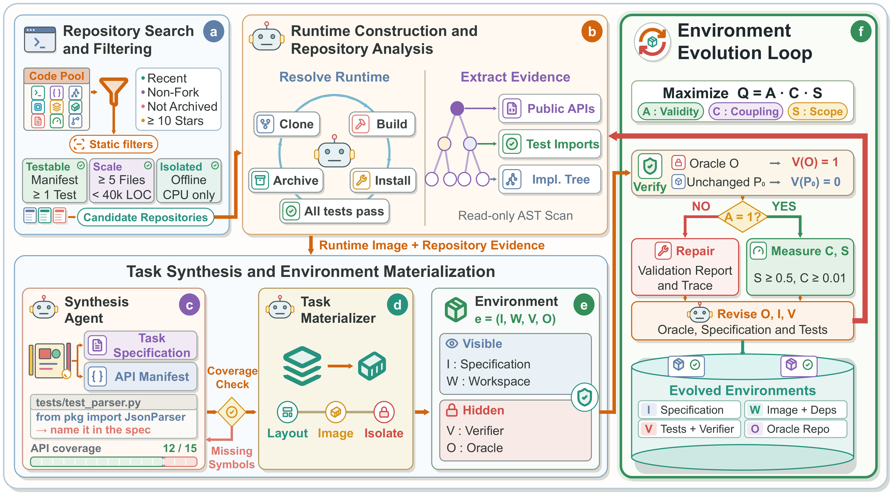
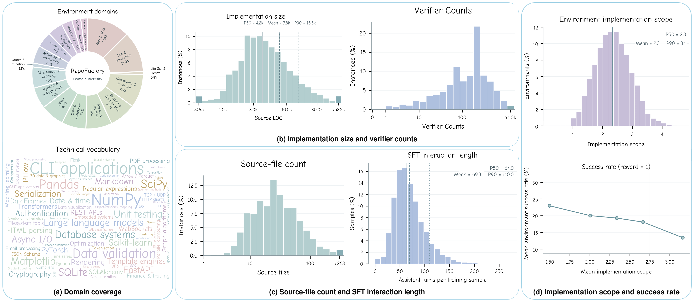
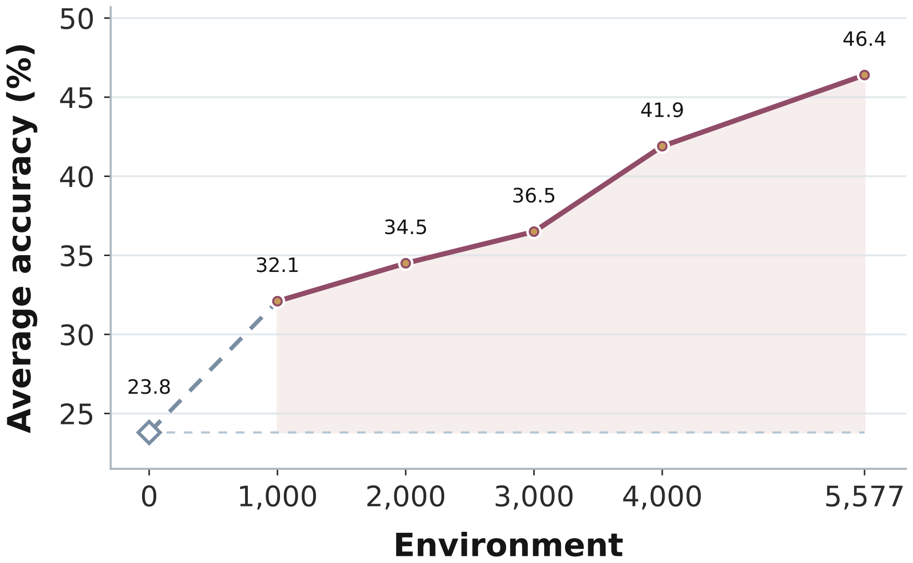
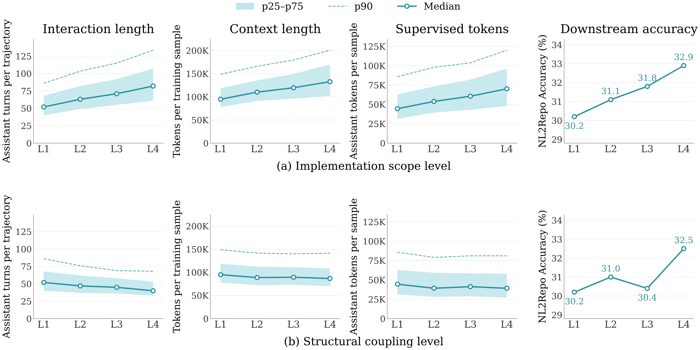

<!-- paper-reading-lang: zh-CN -->
<!-- paper-reading-mode: deep -->
<!-- paper-reading-theme: cobalt -->

# RepoFactory：把真实仓库变成训练环境——乘性目标与环境演化循环撑起长程编码 agent

```paper-map
{"thesis":"北航/上交/IQuest 团队提出：长程编码 agent 的训练瓶颈不在模型而在环境——需要「可验证反馈 + 足够训练价值」的仓库级环境，而现有管线要么线性构造把不合用仓库直接丢弃（DeNovoSWE/MindForge），要么反馈只管可靠性不管训练价值（ProgramGym），要么靠模型 rollout/下游训练当反馈信号、在长程任务上又贵又慢（BenchEvolver/SETA/DataMaster）。RepoFactory 把环境定义为四元组 e=(I,W,V,O)（规格说明/工作区/验证器/参考实现），用一个乘性目标 Q=A·C·S 在**不用任何求解模型跑一遍**的前提下给环境打分：A=有效性（参考实现满奖、初始工作区零奖的二值条件）、C=结构耦合（静态调用图可达有序函数对 R/N²）、S=实现规模（log10(LOC)+log10(1+D)−2）；环境演化循环在 12 轮预算内联合修订参考实现/规格/测试，先修复后按阈值门（S≥0.5、C≥0.01）优化，修订只在目标严格增加时保留。产出 10,159 个环境（17 域、中位 4.2k 行、209 万条测试）；用 Qwen3.8-Max 每环境跑 5 次过滤出 10,947 条 SFT 轨迹（中位 64 轮）训练 Qwen3.5-35B-A3B 得 RepoHorizen：NL2Repo +22.6 分到 46.4（超过 GPT-5.5 与 Gemini-3.1 Pro、同规模开源最强），五基准平均 +8.5；演化循环本身贡献 5.1/2.1 分；同教师同轨迹数的受控对照里比六个开源 SWE 数据集全基准领先（NL2Repo 领先最强基线 21.2 分）；环境数 0→5,577 无饱和、3,000 后增益反而变大；消融显示演化把候选恢复率从 33.8% 提到 69.4%，且优化耦合度 C 的收益不靠加长轨迹（交互更短仍 +2.3 分）。","reader":"要做 agent 训练数据/环境合成、或关心「RLVR/SFT 环境从哪来」的工程师与研究者；本页把论文的每个机制与结果数字放进可复算的模型（Q 三分项手算、恢复率账、scaling 曲线斜率、增益分解、受控对照、消融读法）。","goals":["走通「环境瓶颈→三代相关工作各自的账→四元组与乘性目标→管线五步→演化循环→数据统计→主结果与增益分解→scaling→受控对照→消融→边界」完整论证","把 +22.6/+8.5/5.1/2.1/69.4%/21.2 等关键数字逐个放回算式核算，分清「环境本身的贡献」与「演化循环的贡献」","标出论文自己承认的边界：Python-only、代理指标只到结构粒度、以及训练价值论证需要 proxy→downstream 两跳的证据链"],"outcome":"全文精读 arXiv 2611.21152v2（2026-11-17，13 页双栏：主文 8 页 + 局限 + 附录 A 实现细节与 SFT 超参全表 + 附录 B 数据集分析全读），四张关键图 600 DPI 提取嵌入，Table 1/2/3 逐格核对。","outcomeSource":"https://arxiv.org/abs/2611.21152","items":[{"number":"01","label":"环境瓶颈","signal":"训练价值≠可用性","text":"长程编码 agent 需要可验证反馈的仓库级环境；现有管线的三笔账：线性构造（DeNovoSWE/MindForge）不合用即弃、规模靠找更多合格仓库；可靠性反馈（RefactorForge/TrajLong/ProgramGym）修构建强测试但不优化训练价值——任务只需少量实现工作或无跨组件协调时照样低价值；模型执行反馈（BenchEvolver/SETA 用 rollout、DataMaster 用下游训练）在长程任务上每次反馈又贵又慢。","source":"§1 引言"},{"number":"02","label":"四元组与乘性目标","signal":"Q=A·C·S","text":"环境 e=(I,W,V,O)：可见的规格说明 I 与隔离工作区 W，隐藏的验证器 V 与参考实现 O；训练时 agent π 收 (I,W) 产出 P=π(I,W)，按 V(P)∈[0,1] 计奖。环境目标 Q=A·C·S 三项相乘——任一项归零全 Q 归零，乘法结构本身表达了「有效是前提、价值两项都要」的优先序。","source":"§3.1"},{"number":"03","label":"三分项定义","signal":"A/C/S 闭式","text":"A 是二值有效性：V(O)=1 且 V(P₀)=0 才为 1（参考实现满奖 + 初始工作区零奖——防验证器恒过或恒不过）；C=R/N² 归一化传播成本（静态内部调用图可达有序函数对含自环 / 函数数平方）；S=log10(LOC)+log10(1+D)−2（代码规模+直接运行时依赖数，双对数抑制量纲）。全部由验证器执行与代码静态分析算出，零模型调用。","source":"§3.1 Eq.2-4"},{"number":"04","label":"管线五步","signal":"搜索→运行时→AST→合成→物化","text":"搜索过滤（≥10 星非 fork、≥5 文件 <40k 行 Python、离线 CPU-only、排除基准仓库）；运行时构建（Docker 隔离安装、全新容器无网络全部测试通过才留）；只读 AST 分析（公共 API/签名/异常、测试导入符号、实现树）；任务合成（规格+API 清单，对照测试导入符号做覆盖检查、缺符号回传修订）；物化（I/W 可见、V/O 隐藏，验证资源只在验证时可用）。","source":"§3.2"},{"number":"05","label":"演化循环","signal":"先修复后优化","text":"12 轮预算内：先查 A——验证报告与执行轨迹定位故障修复候选；过 A 后按阈值门（S≥0.5、C≥0.01）优先补短板，双达标后自选优化项；每次修订重查有效性，目标分不严格增加即回滚上一版。修订对象是 O/I/V 三件套联合改（改功能就要同步改描述与测试）。全程不用求解模型 rollout、不做下游训练——反馈是验证器执行+代码分析。","source":"§3.2 末"},{"number":"06","label":"数据面","signal":"10,159 环境","text":"17 个软件域、最大域 Web&APIs 仅 12.5%、Other 6.9%（覆盖广不集中）；中位 oracle 4.2k 行（均值 7.8k、P90 15.5k）、中位 26 个源文件；实例级验证器合计 209 万条静态识别的测试定义（继承自源仓库、走公共接口而非端到端几条）。按 S 五分位分组的教师成功率从最小组的 23.0% 降到最大组的 13.4%——S 作为重建难度代理得到验证。","source":"§4 与图 2"},{"number":"07","label":"SFT 数据","signal":"10,947 轨迹","text":"Qwen3.8-Max 每环境跑 5 次，过滤 reward>0.5 + 确定性检查（记录/对话结构/工具调用一致性/重复/越界获取信息）+ LLM 法官复核灰色样本，留 10,947 条覆盖 5,577 环境；中位 64 个 assistant 轮（P90 110）——多文件项目状态维护的持续监督。附录 B.2：88.2% 轨迹用内联 Python、78.0% 做断言/diff 检查、33.2% 跑测试套件。","source":"§4、附录 A.1/B.2"},{"number":"08","label":"主结果","signal":"+22.6 到 46.4","text":"Claude Code 2.1.140 脚手架（262k 上下文、temp 1.0）：RepoHorizen-35B-A3B 在 NL2Repo 23.8→46.4（+22.6，<200B 开源最强，超 GPT-5.5 的 45.1 与 Gemini-3.1 Pro 的 33.4，也超更大的 DeepSeek-V4-Pro 38.5/MiniMax-M3 42.1）；SWE-bench Verified/Pro/ML 与 Terminal-Bench 分别 +6.4/+5.2/+1.3/+6.8，平均 +8.5——仓库生成训练迁移到维护与终端任务。","source":"§5.2 Table 1"},{"number":"09","label":"增益分解","signal":"演化贡献 5.1/2.1","text":"去掉演化循环的对照（同样的管线、无 Q 优化）：NL2Repo +17.5、平均 +6.4——环境演化在此基础上再加 5.1/2.1 分。乘性目标里 A 修可靠性、C/S 提训练价值，两件事在一次循环里同时完成，增益可分离可归因。","source":"Table 1 末行、§5.2"},{"number":"10","label":"scaling 无饱和","signal":"3k 后增益变大","text":"环境数 0/1k/2k/3k/5,577 对应 NL2Repo 23.8/32.1/34.5/36.5/41.9/46.4——无饱和迹象；且 3,000 之后斜率变大：最后 2,577 个环境贡献 9.9 分（超过前 3,000 个的 12.7 分的四分之三）。作者解读：更大的集合覆盖了小子集覆盖不到的仓库结构与行为要求。","source":"§5.3 图 3"},{"number":"11","label":"模型规模","signal":"35B 增益最大","text":"9B/27B/35B-A3B 三档：基线 14.4/30.6/23.8，训练后 26.6/44.7/46.4，增益 +12.2/+14.1/+22.6——27B 基线更高但 35B 增益最大，「更强初始性能不必然带来更大训练收益」的实证反例。","source":"§5.4 图 4"},{"number":"12","label":"受控数据源对照","signal":"同教师领先 21.2","text":"六个开源 SWE 数据集（OpenSWE/R2E/ScaleSWE/SWE-smith/SWE-rebench/v2）各采 11,000 条轨迹（比 RepoFactory 还多）、同教师同清洗同微调同评测：RepoFactory 在全部五个基准领先，NL2Repo 46.4 对最强 OpenSWE 25.2（+21.2）——教师相同所以优势不能归于教师强度，是环境本身。","source":"§5.5 Table 2"},{"number":"13","label":"消融三件","signal":"恢复 69.4%/C 不靠加长","text":"(1) 恢复：500 个抽样仓库，允许 3 步修复把有效环境从 169 提到 347（产出率 33.8%→69.4%），第一步修复贡献绝大部分（169→344）；(2) S 演化：按 3/6/9/12 轮取 L1-L4 各 2,000 轨迹微调，NL2Repo 30.2→32.9，交互/上下文/监督 token 同步变长；(3) C 演化：30.2→32.5 但交互**变短**、上下文只微降——训练价值不只来自更多工作量，还来自组件间的相互依赖。","source":"§5.6 图 5/6"},{"number":"14","label":"边界","signal":"Python-only/两跳证据","text":"局限自述：仅 Python；代理指标只到宽结构粒度、不区分单个任务所需能力。更深一层（本页注）：训练价值的论证是两跳的——Q 的 C/S 是 proxy，与下游精调收益的相关性由消融（+2.3~+2.7 分）与难度分组（23.0%→13.4%）间接支撑，没有逐环境的因果链；SFT 轨迹来自强教师蒸馏而非 RL，reward>0.5 的过滤阈值意味着全部训练信号是「教师已解出」的环境。","source":"§7、本页补"}]}
```

深读对象：arXiv 论文[《From Repositories to Training Environments: Scaling Long-Horizon Coding Agents with Environment Evolution Loop》](https://arxiv.org/abs/2611.21152)（v2，2026-11-17；北航 × 上海交大 AI 学院 × IQuest Research，作者 Yang Tian、Tianyu Zheng（项目负责）等，通讯 Jian Yang；GitHub 与 HuggingFace 开放）——[点此打开原文 ↗](https://arxiv.org/abs/2611.21152)。选它做今日深读有三个理由：其一，它回答的是本周一路追问下来的底层问题——agent 变强的燃料从哪来？周一的 Claude 权限原语、周二的 MIRIX 记忆、周三的 SPILLWAY 安全都在谈「agent 怎么用」，这篇谈「agent 怎么练」，而答案不是更大的模型而是**更好的环境**；其二，它的方法论姿态与昨天 SPILLWAY 一脉相承——**把昂贵的模型判断换成便宜的确定性信号**（SPILLWAY 用类型化字段替代模型判序，RepoFactory 用静态代码指标替代 solver rollout 反馈），这是本周浮现的一条清晰的技术路线；其三，数字本身极硬：+22.6 分、同教师受控对照 +21.2、恢复率翻倍、无饱和 scaling——每个结论都有干净的对照实验托底。本页按细章跟读：环境瓶颈与三代相关工作的账、四元组与乘性目标的闭式定义、管线五步、演化循环的修复-优化次序、数据统计、主结果与增益分解、scaling 与模型规模、受控数据源对照、消融三件、以及边界与两跳证据链；全部数字经逐格回对原文表格。

<!-- Deep Reading coverage
| Source section / object | Role | Explanation location / status |
| --- | --- | --- |
| 摘要 + §1 引言（环境瓶颈、三挑战、贡献三条） | 立论 | §01 |
| §2 相关工作（环境合成/递归合成与自改进两支） | 定位 | §01-02、§16 |
| §3.1 问题形式化与目标（Eq.1-4） | 形式化 | §02-03 |
| §3.2 构建管线（搜索/运行时/AST/合成/物化/演化循环） | 机制 | §04-05 |
| Figure 1 总览 | 总览 | §04（图 1 嵌入） |
| §4 数据分析（域覆盖/规模/交互长度/难度，图 2） | 数据 | §06-07（图 2 嵌入） |
| §5.1 设置（五基准、Claude Code 脚手架参数） | 实验 | §08 |
| §5.2 主结果 Table 1（含 w/o evolution 行） | 实验一 | §08-09 |
| §5.3 环境 scaling 图 3 | 实验二 | §10（图 3 嵌入） |
| §5.4 模型规模图 4 | 实验三 | §11 |
| §5.5 数据源对照 Table 2 | 实验四 | §12 |
| §5.6 消融（恢复图 6、S/C 演化图 5） | 实验五 | §13（图 4 嵌入） |
| §6 结论 + §7 局限 | 收束 | §16 |
| 附录 A（轨迹过滤清洗 A.1、SFT 超参全表 A.2 Table 3） | 配置 | §07、§15 |
| 附录 B（Python 生态覆盖 B.1、轨迹操作分布 B.2 图 8） | 数据 | §15 |
-->

## 01 / 环境瓶颈：长程编码 agent 的燃料问题

LLM 正在变成能在真实环境里干成整件事的 agent，这改变了训练目标的形状：模型要学会的不只是产出正确答案，而是**朝完成一个长程任务持续做连贯推进**——规划几十步、维护多文件的项目状态、用执行反馈自我修正。软件工程是 coding agent 的主战场，但围绕 bug 修复与功能开发建起来的管线（SWE-Gym 一系）只覆盖了「交付软件」的一小段——成功的局部改动只是工作的一部分，agent 越来越被期望产出**完整可运行的系统**：从一份语言描述出发，把目录结构、公共接口、核心实现、依赖配置、测试适配全部落到位。在短程任务上训练覆盖不了这个过程——「改一个函数」与「造一个系统」在上下文管理、工具编排、跨模块一致性上是两种能力——仓库级环境于是成为刚需。

### 三代环境工作的三笔账

论文对现有路线的清点沿三条失败线展开，每条对应一代工作，且每条都给得出可检验的账目：

- **线性构造丢弃仓库**：DeNovoSWE 与 MindForge 按固定流程精修文档、修构建失败，但**参考实现固定不变**——不合用的仓库直接丢弃，哪怕再改一改就能用。规模化只能靠「找到更多满足同一固定要求的仓库」，把产出量押在仓库池的运气上。§12 的恢复消融给这条线补了定量注脚：抽样 500 个候选里，只差一次执行反馈就能救回来的有 175 个——线性管线「即弃」策略丢掉的正是这些本可修复的候选，产出率直接腰斩；
- **反馈只管可靠性不管训练价值**：RefactorForge 与 TrajLong 为特定能力设计数据但不问环境反馈能否改进任务内容；ProgramGym 用执行诊断与覆盖率反馈修构建、围绕固定参考实现强化测试——这些信号提升可靠性，却不显式优化训练价值：一个只需要少量实现工作、或几乎不需要跨组件协调的任务，测试再密也是低价值训练。价值与可靠性是两个正交的轴：前者问「这个任务教会 agent 什么」，后者问「验证器能不能可信地判对错」——第二代工作把后者做到了位，前者仍是空白；
- **模型执行反馈又贵又慢**：BenchEvolver 用模型表现引导任务修订、SETA 用学习者表现适配终端环境、DataMaster 直接把下游训练分数拉进数据优化循环——长程编码任务上一次 rollout 就是几十轮工具调用与上千行实现，反馈延迟与算力成本在长程上被平方级放大，而且反馈信号本身还是噪声源（同一环境两次 rollout 的成功率天然波动）。RepoFactory 对这条线的回应是把反馈完全移出模型回路：验证器执行与静态分析覆盖了「可靠性」与「价值」两轴的测量，模型只保留在「怎么改」的决策位上。

问题的准确形状由此得出：**如何用及时、可靠、低成本的信号同时提升环境的可靠性与训练价值，并规模化合成长程编码环境**。这句话里每个形容词后面都有一章机制：「及时」对应反馈延迟（模型 rollout 以小时计、静态分析以秒计）；「可靠」对应验证器质量（$A$ 的两个条件）；「低成本」对应反馈回路里不放模型；「同时提升」对应乘性目标把可靠性与价值绑在一个优化问题里；「规模化」对应恢复机制把产出率翻倍。把问题描述得每个词都可落地，是这篇论文工程品味的第一个信号。

## 02 / 四元组与乘性目标：环境的代数化

### 环境是一个四元组

RepoFactory 把「环境」形式化为：

$$e = (I, W, V, O)$$

$I$ 是语言规格说明（任务描述）、$W$ 是隔离工作区与运行时（两者对训练中的 agent 可见）；$V$ 是验证器、$O$ 是源仓库的参考实现（两者隐藏）。训练时 agent $\pi$ 收到 $(I, W)$，从头重建项目，按验证器计奖：

$$P = \pi(I, W), \qquad V(P) \in [0, 1]$$

这个定义把「从自然语言重建整个仓库」立为任务形态——不是修一个 bug，而是**造出整个系统**，天然长程：多文件、多模块、实现与集成交织，且验收标准是从源仓库继承的整套测试而非人工判分。任务形态本身就是论文的第一个设计决策，后面 §11 的受控对照会证明这个决策贡献了总增益的四分之三。

### 乘性目标的三重语义

环境目标是一个乘积：

$$Q = A \cdot C \cdot S$$

$A$ 是有效性、$C$ 是结构耦合、$S$ 是实现规模。（教学重建）乘法结构自带两条工程语义：其一，**任何一项归零则 $Q$ 归零**——有效性是硬前提（无效环境训练价值恒零，无论多大多耦合），这把「先修可靠性再谈价值」的次序写进了目标函数本身；其二，三项对数尺度不同（$A \in \{0,1\}$、$C \in (0,1]$、$S$ 无上界），乘法让优化器在达标线上做边际权衡而非线性加总——一个 $C=0.5, S=3$ 的环境与 $C=1, S=1.5$ 的环境同分，但演化循环可以按阈值门决定先补哪边（§05）。对照：若用加法 $Q = A + C + S$，一个无效但巨大的环境（$A=0, S=5$）仍得 5 分——乘法堵死这条路。

## 03 / 三分项的闭式定义与手算

### A：有效性的二值条件

$$A = \begin{cases} 1, & V(O) = 1 \wedge V(P_0) = 0 \\ 0, & \text{否则} \end{cases}$$

两个条件各防一种坏验证器：$V(O)=1$ 要求**参考实现拿满奖**（验证器不是恒零——任务可解）；$V(P_0)=0$ 要求**未改动的初始工作区拿零奖**（验证器不是恒一——空工作不能白拿分）。（教学手算）三个故障例把二值条件的失效模式各演一遍：例一，一个只检查「目录里存在 setup.py」的验证器，对 $P_0$（物化时预置依赖但无实现）也给 1——第二条件不满足，$A=0$，该候选必须修验证器；例二，一个要求全部继承测试通过的验证器，碰上某条测试本身依赖网络（构建时被 mock、验证时没 mock）——$V(O)=0$，第一条件不满足，回修复运行时或测试配置；例三，一个只跑两条冒烟测试的验证器，$V(O)=1$ 且 $V(P_0)=0$ 都过——$A=1$ 但验证密度极低，这不再触发 $A$ 而是落进 $S$ 的阈值门：冒烟级验证往往伴随小规模实现，被 $S<0.5$ 拦下。二值化意味着 $A$ 不参与连续优化，只做门——门内的世界才轮到 $C$ 与 $S$ 说话。

### C：结构耦合的归一化传播成本

$$C = \frac{R}{N^2}$$

$N$ 是分析代码中的函数数，$R$ 是静态内部调用图上**可达有序函数对**的数量（含自环对）。这是软件工程里经典的传播成本（propagation cost）归一化：$R$ 数的是「从函数 $i$ 出发沿着调用关系能影响到的函数 $j$（含 $i=j$）」的对数——注意是有序对（$i$ 可达 $j$ 不意味着 $j$ 可达 $i$）且算传递闭包（$i \to k \to j$ 也算 $i$ 可达 $j$），所以 $R$ 度量的是**改动的潜在波及面**而非一跳邻居数。耦合高意味着改动会传播得远，重建任务要求组件间真正咬合：一个 $C$ 高的仓库里，agent 抄近路糊弄某个组件迟早会在别的组件的测试上露馅——互联把「各组件都做对」从可选项变成必选项。分母 $N^2$ 是有序对总数上界，归一化让 $C$ 与仓库规模解耦——30 函数的小仓库与 300 函数的大仓库在 $C$ 上可直接比较。（教学手算）三个极端例：$N$ 个互不调用的独立函数，$R = N$（只有自环），$C = 1/N \to 0$——纯独立拼盘；完全链式 $f_1 \to f_2 \to \cdots \to f_N$，从 $f_i$ 可达所有 $j \ge i$，$R = N(N+1)/2$，$C \approx 0.5 + 1/(2N)$——一条线串起来；星形（全部函数调一个中心）$R \approx 2N - 1$ 量级，$C \approx 2/N$——枢纽型但传导浅。$C$ 区分的是「真互联」与「共享工具库」：后者每个函数都调用工具函数，但彼此不可达，$R$ 依然小。

### S：实现规模的双对数

$$S = \log_{10}(\mathrm{LOC}) + \log_{10}(1 + D) - 2$$

LOC 是源码行数、$D$ 是直接运行时依赖数。（教学手算）中位数仓库（论文实测）：LOC=4,200、$D=5$：$S = \log_{10}4200 + \log_{10}6 - 2 \approx 3.62 + 0.78 - 2 = 2.40$；一个 100 行、零依赖的小工具：$S = 2 + 0 - 2 = 0$——恰在阈值 0.5 之下，会被演化循环优先「做大」；一个 15,500 行（P90）、12 依赖的项目：$S \approx 4.19 + 1.11 - 2 = 3.30$。减 2 的锚定意义：$S=0$ 对应「百行零依赖」的基线任务，阈值 $S \ge 0.5$ 即「至少千行或带依赖」量级。双对数抑制量纲：LOC 涨十倍 $S$ 只涨 1，防止目标被巨型仓库独占。

三个分项全部由**验证器执行 + 代码静态分析**算出——零模型调用。这是整篇论文的成本宣言：反馈不在模型回路里。（教学手算·反馈成本对比）一次候选评估的开销：跑一遍继承测试（容器内秒到分钟级）+ 一次 AST 扫描与传递闭包计算（秒级）；而 BenchEvolver 式的模型反馈要先让求解模型完整实现一次仓库——按论文数据，教师做一次的中位交互是 64 轮、约十万 token 量级的前向。两者相差三到四个数量级，这决定了演化循环敢在每个候选上跑满 12 轮而总成本仍然可控：环境侧的便宜反馈买来了迭代次数，迭代次数买回了被线性管线丢弃的仓库与被低价值任务浪费的训练预算。

## 04 / 管线五步：从星标仓库到隔离环境

### 搜索、运行时与 AST 分析

**搜索过滤**：公开代码托管平台，排除已进入主流编码基准的仓库（防评测重叠）。硬条件可以写成一个谓词合取：

$$\text{accept}(r) \iff \text{recent} \wedge \neg\text{fork} \wedge \neg\text{archived} \wedge \text{stars} \ge 10 \wedge \text{manifest} \wedge |\text{tests}| \ge 1 \wedge 5 \le |\text{files}| \wedge \text{LOC} < 40{,}000 \wedge \text{offline} \wedge \text{cpu-only}$$

需要外部服务、出网、图形界面或特殊硬件的排除；网络类项目在测试 mock 外呼或仅本地连接时保留——「隔离性」是硬门，因为环境在训练时要被并发跑成千上万次，任何外部依赖都是不确定性与成本的放大器。**运行时构建**：每个候选拷入隔离任务目录，从构建文件与依赖清单建 Docker 镜像，由 agent 安装依赖、找测试命令、按需修订镜像或执行配置——**全新容器、受限资源、无网络下全部测试通过才保留**，归档镜像与安装/测试命令。这一步的验收标准值得细看：「全新容器」排除上一轮残留状态的假通过，「无网络」排除测试偷偷拉外部服务，「受限资源」把并发训练时的资源占用钉死——三条合起来保证验证器在训练时的高并发下仍然可信，这是后面一切 $V(P)$ 分数的可复现前提。构建本身也交给 agent 而非脚本，因为真实仓库的构建失败形态太多（依赖版本漂移、隐式系统包、测试框架配置），规则脚本覆盖不过来，agent 拿着执行报错迭代修——构建侧用强模型（Qwen3.8-Max），一次付清。**只读 AST 分析**：在只读容器里扫出公共类/函数/方法及签名、异常、返回信息，记录**测试导入的仓库符号**，构建排除测试文件的实现树——这些输出同时服务任务合成与 C/S 计算。

### 任务合成与物化：覆盖检查的细节

合成 agent 依仓库分析写**规格说明**与 **API 清单**；关键的一道闸是**覆盖检查**：功能正确的实现仍可能因接口名或导入路径与测试期望不符而挂——所以规格与清单要对照「原始测试导入的符号」逐一核验，缺符号连同其导入记录回传合成 agent 修订，过了才物化。原仓库隔离为 oracle，评测资源只在验证时可用。（教学重建）这一步防的是 SWE 数据里经典的「假阴性」：agent 写对了功能却因 `pkg.JsonParser` vs `package.json_parser` 的命名差被测试打死——教师 rollout 会把它过滤掉，等于白白烧掉一个好环境。



*图 1：RepoFactory 总览（原文 Figure 1）。a 搜索过滤（星标/非 fork/规模/隔离硬条件）出候选仓库池；b 运行时构建（clone/build/install、全部测试通过）与只读 AST 分析（公共 API、测试导入、实现树）；c 任务合成（规格说明+API 清单+覆盖检查）与 d 物化——环境 e=(I,W,V,O)，规格与工作区可见、验证器与 oracle 隐藏；e 环境演化循环：Maximize Q=A·C·S，先验证 A（V(O)=1 且 V(P₀)=0），未过先修复，过了量 C、S 对照阈值（S≥0.5、C≥0.01）联合修订 oracle/规格/测试。*

## 05 / 演化循环：先修复、后优化、严格增量保留

物化后进入演化循环，固定 12 轮预算，次序设计三段：

**先修复**：查 $A$——oracle 没拿满奖或 $P_0$ 没拿零奖，就用**验证报告与执行轨迹**定位原因修候选；修订后重评，**两项检查都过了才开始优化 scope 与 coupling**。把验证报告与执行轨迹直接喂给修复 agent 是这里的关键设计：agent 看到的不是「失败了」三个字而是「哪条测试在哪个 import 上挂了、退出码是什么、stderr 说了什么」——绝大多数构建缺陷（依赖版本、测试配置、路径假设）在这种反馈下一次就能修对。修复不是惩罚项而是回收机制：§12 的消融显示第一步修复就把有效环境从 169 提到 344——把线性管线里「直接丢弃」的仓库成批救回来，产出率翻倍的主旋律就在这一步。

**阈值门**：对每个有效候选，先对照门槛：

$$\text{gate}(e) = \begin{cases} \text{补 } S, & S < 0.5 \wedge C \ge 0.01 \\ \text{补 } C, & C < 0.01 \wedge S \ge 0.5 \\ \text{自选优化}, & S \ge 0.5 \wedge C \ge 0.01 \end{cases}$$

**低于阈值的项优先补**（短板优先）；双达标后 agent 自选优化项。（教学重建）阈值门把乘性目标的连续优化变成「先达标再拔高」的两段式：一个 $C=0.005$ 的环境无论 $S$ 多大都是「组件互不咬合的大拼盘」，先把它变成真互联才有训练价值可言——0.5 的 $S$ 阈值对应「至少千行或带依赖」量级（§03 手算），0.01 的 $C$ 阈值对应「至少存在一条跨若干函数的传导链」。

**严格增量保留**：每次修订先重查有效性（有效性失败回修复），接受准则是一条严格不等式：

$$e_{t+1} \leftarrow \begin{cases} e', & \mathrm{score}(e') > \mathrm{score}(e_t) \\ e_t \text{（回滚）}, & \text{否则} \end{cases}$$

$S$ 或 $C$ 的单目标贪心爬山，12 轮封顶——不严格增加就回滚，杜绝「改了半天原地打转还留着一堆平级修订」的漂移。修订对象是 $O/I/V$ 三件套**联合改**：改功能就必须同步改描述与测试——这保证可见面（规格）与隐藏面（oracle/验证器）始终一致，不会演化出「测试考的与规格说的不是一回事」的分裂环境。

全程**没有求解模型 rollout、没有下游训练**——每轮反馈=验证器执行+代码分析。与 §01 第三代工作（BenchEvolver 每轮反馈要跑模型、DataMaster 要训一遍模型）对照，这是把反馈成本从「一次前向一整条长程实现」压到「跑测试+扫 AST」。所有构建 agent 用 Qwen3.8-Max——构建侧用强模型、训练信号侧零模型，成本花在刀刃上。

## 06 / 数据面：10,159 个环境长什么样

### 域覆盖：广而不集中

17 个软件域，最大域 Web & APIs 仅 12.5%，Text & Languages 12.0%，Networking 9.8%，Science & Math 7.8%，Media & Graphics 7.6%，Data & Databases 7.1%……域外 Other 仅 6.9%——没有任何一个域超过八分之一，覆盖广而非集中。这个「不集中」对训练的意义比看起来大：如果七成环境都是 Web API 重建，模型学到的是「Web API 的套路」而不是「重建一个陌生系统的通用方法论」；域分布越平，跨域泛化的压力越真实。附录 B.1 按依赖与描述把生态再切了一层：验证与序列化类占 32.7%、HTTP/网络/异步占 28.6%、数值计算、命令行工具、文本处理、数据分析都广泛出现，从应用基础设施到科学库、Web 框架、ML 框架都有——多样化的库、接口与实现惯例让 agent 见识真实软件开发的多样性，而非窄域特化。对照 §09 的 scaling 结论（3,000 之后增益反而变大），广覆盖不是锦上添花而是后期增益的来源：小子集覆盖不到的仓库结构，正是域多样性买来的。

### 规模、验证密度与难度验证

中位 oracle **4.2k 行**源码（均值 7.8k、P90 15.5k）——重建的是真仓库不是玩具脚本；中位 **26 个源文件**——多文件项目状态的维护从任务定义上就是必需的。10,159 个实例的验证器合计 **209 万条**静态识别的测试定义，平均每环境约 206 条——测试继承自源仓库、走公共接口而非只查几个端到端结果。这个数字的分量要用对比读：SWE-bench 类任务每题通常只有一条 issue 复现测试，RepoFactory 的平均验证密度是它的两个数量级。「成功因此取决于实现一个在稠密验证下各组件保持一致的完整仓库」——部分正确、投机取巧的实现（写个空函数骗过冒烟）在两百条测试的火力下几乎无处藏身。难度分布 1-4 档、P50=2.3、P90=3.1——中位偏易尾偏难，恰好落在「教师能解出、但要花真功夫」的训练甜区。**S 作为难度代理的验证**：按 S 五等分组的教师成功率从最小组的 23.0% 单调降到最大组的 13.4%——S 越大教师越做不出来，代理指标与真实难度方向一致。



*图 2：RepoFactory 环境与 SFT 数据统计（原文 Figure 2）。(a) 17 域覆盖饼图（最大域 12.5%）；(b) 实现规模分布（P50=4.2k / 均值 7.8k / P90=15.5k 行）与每实例验证器计数；(c) 源文件数分布与 SFT 交互长度（P50=64 / 均值 69.3 / P90=110 个 assistant 轮）；(d) 实现难度分布（P50=2.3）与按 S 分组的成功率单调下降（23.0%→13.4%）。*

## 07 / SFT 数据：教师五跑、三层过滤、64 轮中位交互

采数据用 Qwen3.8-Max **每环境跑 5 次**，三层过滤（附录 A.1）层层收窄：第一层只留 reward>0.5 的轨迹——把「教师自己都没做出来」的尝试挡在监督信号之外；第二层是**确定性检查**清单：记录有效性、对话结构、工具调用与结果一致性、回复完整性、推理与代码格式，并筛重复、交互死循环、**污染**（与评测基准重叠的内容）、敏感内容、以及**越界获取信息**——最后这条值得停一下：轨迹里若出现试图读取任务环境之外的信息（比如偷看隐藏的 oracle），整条作废——蒸馏数据不能教会学生作弊；第三层把灰色样本交 LLM 法官复核，判定「看似违规实为良性」才收，确认违规与存疑不决的一律排除。最终 **10,947 条样本覆盖 5,577 个环境**——平均每环境约 1.96 条过线轨迹，教师五跑约五分之二过线：连最强教师做完整建仓也不是高概率事件，这个成功率本身就是环境难度的又一重印证（与 §06 难度分组的 23.0%~13.4% 量级吻合）。

中位 **64 个 assistant 轮**（均值 69.3、P90 110）：一条轨迹要在多文件项目里边实现边测、持续维护项目状态——对照 SWE-bench 类单轮或数轮的轨迹，这里的监督密度是「整段开发过程」而非「一个补丁」。附录 B.2 的操作分布给「长程」落了地：读写文件几乎全部轨迹都有、**内联 Python 执行 88.2%**（agent 惯用小脚本探行为再实现）、断言/diff 检查 78.0%、测试套件执行 33.2%、环境探测与导入探查高频出现——四类操作（Explore/Plan/Author/Execute/Verify）交织，agent 在轨迹里真实地「运行-观察-修正」，监督信号覆盖的是完整的开发循环而不只是代码生成。这组分布对「SFT 数据里学到的到底是什么」给出了可审计的回答：不只是代码风格，还有「何时跑测试、何时读文件、何时断言自查」的操作策略。

## 08 / 主结果：+22.6 与五基准迁移

### 设置与主表

评测脚手架选 Claude Code 2.1.140（上下文 262,144、输出 32,768、用量到 80% 自动压缩；temp 1.0、top-p 0.95、top-k 20）——**模型是自训的、agent 壳是业界通用的**，评测不偏自家 harness，也让分数与社区实测可比。这套参数本身也说明长程任务对脚手架的要求：26 万 token 的窗口、80% 处的自动压缩阈值，都是为「几十轮工具调用的持续开发」配的——环境定义里的中位 64 轮交互在这个窗口里才装得下。五基准：NL2Repo（从自然语言完整建仓）、SWE-bench Verified/Pro/Multilingual（既有仓库改 issue）、Terminal-Bench 2.1（终端任务）。

| 模型 | 参数 | NL2Repo | Verified | Pro | ML | TB | 平均 |
| --- | --- | --- | --- | --- | --- | --- | --- |
| Claude Opus 5 | - | 75.3 | 96.0 | 79.2 | 89.5 | 89.1 | 85.8 |
| GPT-5.6-sol | - | 56.8 | 96.2 | 64.6 | - | 88.8 | 76.6 |
| Qwen3.8-Max | 2.4T | 55.9 | 85.6 | 67.7 | - | 86.6 | 74.0 |
| Qwen3.5-35B-A3B（基线） | 35B | 23.8 | 65.8 | 42.4 | 59.7 | 33.7 | 45.1 |
| **RepoHorizen-35B-A3B** | 35B | **46.4 (+22.6)** | 72.2 (+6.4) | 47.6 (+5.2) | 61.0 (+1.3) | 40.5 (+6.8) | **53.5 (+8.5)** |
| ↳ 无演化循环 | 35B | 41.3 (+17.5) | 70.9 (+5.1) | 45.1 (+2.7) | 60.8 (+1.1) | 39.3 (+5.6) | 51.5 (+6.4) |

三个读数：其一，NL2Repo 46.4 是 **<200B 开源权重最强**，超过 GPT-5.5（45.1）与 Gemini-3.1 Pro（33.4），也超过大得多的开源模型 DeepSeek-V4-Pro（38.5，1.6T）与 MiniMax-M3（42.1，428B）——35B 总参 3B 激活的模型靠环境训练打赢了一到两个量级的参数规模，这是「环境质量替代参数规模」最直接的证据；其二，增益**全面迁移**到四个非训练形态的基准（Verified +6.4、Pro +5.2、ML +1.3、TB +6.8）——仓库生成训练学到的规划、工具使用、多文件协调与执行反馈利用不是过拟合到「从零建仓」这一个形态，迁移到「在既有仓库里改 issue」与「终端里完成任务」都成立，其中 ML（多语言 SWE-bench）+1.3 最弱——Python 环境训练对多语言任务的迁移天然受限（§14 的 Python-only 边界）；其三，与 Claude Opus 5（75.3）仍有 28.9 分差距——天花板还远，但注意比较的口径：Opus 是通用前沿模型，RepoHorizen 是在 5,577 个环境上专项训练的 35B，同规模下的性价比已被改写。还有一个表内细节：TB 从 33.7 涨到 40.5（+6.8），而训练环境里没有任何终端任务——泛化跨越了任务形态的边界。

### 增益分解：环境的钱和演化的钱分开算

无演化对照（同样的管线、只构建不优化 $Q$）给出 +17.5/+6.4。把总增益拆成两个正交成分：

$$\Delta_{\text{total}} = \Delta_{\text{env}} + \Delta_{\text{evo}}, \qquad 22.6 = 17.5 + 5.1 \quad (\text{NL2Repo})$$

**环境形态本身**（完整仓库重建任务 + 稠密继承测试）贡献 17.5 分——选对任务形态这个一次性设计决策拿走了大头；演化循环在其上再加 **5.1（NL2Repo）/ 2.1（平均）**——一个不跑任何求解模型的循环。（教学手算·份额）演化增益占 NL2Repo 总增益的 $5.1/22.6 \approx 22.6\%$、占平均增益的 $2.1/8.5 \approx 24.7\%$——**四分之一量级**：一个不跑任何模型 rollout 的循环拿到四分之一的增益，性价比极高；反过来说四分之三来自「任务形态选对了」这个一次性设计决策。

## 09 / scaling：无饱和，且 3,000 之后斜率变大

环境数从 0 到 5,577，NL2Repo 依次 23.8 → 32.1（1k）→ 34.5（2k）→ 36.5（3k）→ 41.9（4k）→ 46.4（5,577）。（教学手算·分段斜率）把曲线按 3,000 处分两段算平均斜率：

$$k_{\text{前}} = \frac{36.5 - 23.8}{3} \approx 4.2 \ \text{分/千}, \qquad k_{\text{后}} = \frac{46.4 - 36.5}{2.577} \approx 3.8 \ \text{分/千}$$

两段斜率几乎持平、远未进入收益递减的尾巴；论文的解读是「更大的集合覆盖了小子集覆盖不到的仓库结构与行为要求」——环境多样性的红利在规模后半段仍在释放。这条曲线对「要不要继续堆环境」的部署问题给出了直接答案：至少到 5.5k 无饱和。更细的读法是曲线的**形状**而非终点：如果环境多样性有上限，增益应随规模按 $1/n$ 型衰减——后段斜率应明显低于前段；实测两段斜率几乎持平（3.8 对 4.2 分/千），说明 5,577 个环境仍远未逼近「仓库结构多样性」的覆盖上限，公开代码托管平台的长尾还有大量未开采的结构类型。这与 LLM 预训练的 scaling 曲线形成有趣的对照：数据墙的争论在文本域已经开场，而环境域的墙还看不见。



*图 3：NL2Repo 准确率随 RepoFactory 训练环境数的变化（原文 Figure 3）。0/1,000/2,000/3,000/5,577 个环境对应 23.8/32.1/34.5/36.5/41.9/46.4——单调上升无饱和，最后 2,577 个环境再贡献 9.9 分。*

## 10 / 模型规模：35B 增益最大，强基线不必然大收益

三档模型同一套训练：9B（14.4→26.6，+12.2）、27B（30.6→44.7，+14.1）、35B-A3B（23.8→46.4，+22.6）。（教学手算·反直觉点）27B 的基线（30.6）明显高于 35B-A3B（23.8）——同为 Qwen3.5 家族，稠密 27B 在这套评测上起步更好；训练后次序反转：35B-A3B 反超（46.4 对 44.7）且增益差 8.5 分（22.6 对 14.1）——「更强初始性能带来更大训练收益」的朴素直觉在这里不成立。增益随规模的分布也不是单调线性：9B 到 27B 增益只从 12.2 涨到 14.1（+1.9），27B 到 35B-A3B 跳到 22.6（+8.5）——中间某处存在一个「能吃下长程协调训练」的容量门槛，跨过去之后训练信号才被充分吸收。论文只给现象不给机制解释（本页补一个假说：35B-A3B 是 MoE 激活 3B 的架构，稀疏激活下每参数的容量-计算配比不同，可能对长程多文件协调的模式更敏感；无实验支撑，仅标注为推测——但 9B 也是同家族，若稠密/MoE 之差是主因，27B 稠密应当增益更低，与实测 +14.1 大于 9B 的 +12.2 不矛盾但也不证实）。

## 11 / 受控数据源对照：同教师、同轨迹数、全面领先

这一节是「环境价值」归因的关键实验，设计上处处在堵解释的后门：六个开源 SWE 数据集（OpenSWE、R2E、ScaleSWE、SWE-smith、SWE-rebench、SWE-rebench-v2）各采 **11,000 条轨迹**——比 RepoFactory 的 10,947 还多，堵住「数据量赢的」；**同一教师**（Qwen3.8-Max）跑轨迹，堵住「教师强度赢的」；同一清洗流程、同微调设置、同 Claude Code 评测脚手架，堵住「训练或评测配置赢的」。结果：RepoFactory 在**全部五个基准**领先——NL2Repo 46.4 对最强基线 OpenSWE 的 25.2（**+21.2**，接近翻倍）、Verified 72.2 对 68.8、Pro 47.6 对 42.0、TB 40.5 对 37.1，唯一接近的是 ML（61.0 对 SWE-rebench 的 59.0）。表格还分开列了「他引报道值」与「本文自跑值」两段——他引里最高的 Refact-92B 在 NL2Repo 报 28.9（各家 harness 不同不可直接比），自跑段全部统一条件。剩下唯一未被控住的变量是任务形态本身：基线数据集以「既有仓库改 issue」为主，RepoFactory 是「从零建仓」——这既是差异的来源（论文的论点），也是 paper-check 里追问的归因开口。与 §01 第二代工作的账对上：同样跑一遍教师，普通 SWE 数据（改 issue 为主）学到的长程协调远少于完整建仓环境。

## 12 / 消融一：恢复账与 S/C 双演化的分野

### 恢复：产出率翻倍

500 个分层抽样候选，允许 ≤3 步修复 vs 不允许：有效环境 **169 → 347**，产出率翻倍：

$$\text{yield} = \frac{\#\{e : A(e)=1\}}{500} = \frac{169}{500} \to \frac{347}{500} = 33.8\% \to 69.4\%$$

同样的仓库池、同样的验收标准，一倍以上的增量全部来自「多给了几次执行反馈」。这个数字要放回 §01 的第一代工作里读：DeNovoSWE 与 MindForge 的线性管线在「全部测试通过」这一关直接丢弃未过者——按此抽样估计丢掉了约三分之二的候选；而修复一步拿回 175 个（占总回收量的 99%），说明被丢的仓库绝大多数不是「本质上不可用」，只是构建配置、测试环境这类**一次执行反馈就能定位的浅层缺陷**卡住了。恢复机制的工程含义是把「仓库筛选」从一次性资格考试改成带补考的迭代准入——矿藏没变，采出率翻倍——对任何「候选池有限、验收严格」的数据管线（不限于代码）这个模式都值得照抄：先问被丢弃的候选差在哪，再问能不能用一次便宜的反馈救回来——这两个问题几乎不花钱，而回收的每一份合格候选都是净赚的纯增量。分步看：第一步修复 169→344（+175，占绝大部分）、第二步 +2、第三步 +1——**绝大多数构建失败一次执行反馈就能修**，线性管线丢弃这些仓库等于扔掉一半的池子。墙钟曲线还显示修复的边际成本递减（图 6 按半小时采样）。

### S 演化与 C 演化：两种增益的不同形状

从同 1,000 个环境出发各跑一条演化线（分别以 S 或 C 为目标、保留有效性检查），按 3/6/9/12 轮取样为 L1-L4，各供 2,000 条轨迹同设置微调：

- **S 线**：NL2Repo 30.2 → 32.9（L1→L4），交互轮数、上下文长度、监督 token 同步增长——**把任务做大**带来更多开发经验与更高重建表现；
- **C 线**：30.2 → 32.5（+2.3），但**交互长度下降**、上下文与监督 token 只微降——**增益不靠更长的轨迹或更多监督**。中间水平（L2/L3）准确率有波动（31.0/30.4）——耦合优化不是单调改善的旋钮，中间态可能停在「组件开始互联但接口边界还没理清」的过渡区，到 L4 才稳定超过起点。（教学手算·对照）两条线的单位增益成本完全不同：S 线 L1→L4 的监督 token 中位从约 25k 涨到 75k（三倍）换 +2.7 分，C 线几乎不加监督换 +2.3 分——**组件间相互依赖本身**（改动传播、接口咬合）就是训练信号，与工作量正交。一个直观的机制解释（本页推测）：高耦合环境里，agent 对组件 A 的任何含糊实现都会在组件 B 的测试上爆出具体报错——错误信号更具体，修复动作更能教给模型「接口契约」的意识；低耦合环境里各组件错误互不传染，agent 学到的只是「把每个独立函数写对」。这组对照是「训练价值 = 工作量 × 互联度」二元论的最好证据，也是 $C$ 进入目标函数的实证辩护。



*图 4：S/C 两个优化目标各自的演化效果（原文 Figure 5）。L1-L4 为演化轮次 3/6/9/12 取样。(a) S 演化：交互长度/上下文/监督 token 随轮次增长，NL2Repo 30.2→32.9；(b) C 演化：交互长度下降、上下文微降，NL2Repo 仍 30.2→32.5——耦合带来的增益不依赖更长的轨迹。*

## 13 / 附录全读：SFT 配置与轨迹操作面

附录 A.2 的超参全表值得照抄（对标 Rollback 篇「Table 5 完整配置」的传统）：3 epochs、rollout/global batch 64/64、每卡 micro-batch 1、**动态 token 批处理每卡 80,000 token 上限**（无单独序列长帽）、AdamW（β₁=0.9、β₂=0.98、wd 0.1）、峰值/谷值学习率 1.0e-6/1.0e-7 cosine 退火 10% 预热、并行度 TP2/PP1/CP4/EP8、序列并行开。损失掩码只对 **assistant 跨度（含工具调用）** 计损，其余轮只当上下文：

$$\mathcal{L} = -\sum_{t \in \text{assistant}} \log p(x_t \mid x_{<t}), \qquad t \notin \{\text{system, user, tool-result}\}$$

system/user/tool-result 轮只当上下文——Qwen3.5 的多轮目标，防止把环境反馈也当监督信号学。数据 shuffle、无在线生成。附录 B.2 的操作分布（内联 Python 88.2%、断言/diff 78.0%、测试套件 33.2%）连同 B.1 的生态覆盖（验证与序列化 32.7%、HTTP/网络/异步 28.6%）给「训练数据里到底有什么」提供了可审计的切面——这类附录是复现者的路标。

## 14 / 边界与两跳证据链

论文自述的局限：**仅 Python**（其他语言覆盖有限）；**代理指标只到宽结构粒度**——C 与 S 刻画任务内容但不区分单个任务需要什么能力，更细的能力标注是未来工作。本页补两条更深的边界（非原文）：

- **训练价值的论证是两跳的**：$Q$ 的 C/S 是 proxy，它与下游精调收益的关系由两组间接证据支撑——难度分组单调性（§06，S 越大教师成功率越低）与 S/C 演化消融（§12，各 +2.7/+2.3 分）——但没有逐环境的「proxy 分 → 训练增益」因果链。proxy 有效是因为**演化方向对了**（更大、更互联 → 更好），不代表 $Q$ 的数值可跨域比较：一个 Web 框架环境 $S=2.5$ 与一个数值库环境 $S=2.5$ 的训练价值未必相同，域内容不在 $Q$ 里——若把 $Q$ 当跨数据集的排序键直接比大小，就踩进了这一跳之外的空隙；
- **训练信号全部来自教师已解出的环境**：reward>0.5 的过滤意味着 SFT 数据只覆盖教师（Qwen3.8-Max）能做出来的任务——教师做不出的 13.4%~23.0% 环境（§06 难度分组）天然缺席。这不是缺陷（蒸馏的本分如此）但划定了能力传播的上界：RepoHorizen 学到的是「教师的解法在长程任务上的组织方式」，不是超越教师的新解法。RL 阶段（若有）才是越过教师的路径，论文未涉及。

## 15 / 一句话收束

这篇论文把「agent 训练数据」从名词变成了**工艺**：环境是造出来的，而造环境的要诀是把「可靠性」与「训练价值」拆成可分别度量的分项（$A$ 修到能用、$C/S$ 提到值得练），再用一次不跑模型的循环同时优化两者——修复把产出率从 33.8% 翻到 69.4%，优化把 35B 模型在完整建仓上从 23.8 拉到 46.4。回顾本周四篇深读连成的线：常驻智能体的架构原语（怎么运行）、记忆系统（怎么积累）、出口闸（怎么设防），到本篇的训练环境工厂（怎么变强）——四件事共享同一个时代的底层直觉：**把贵的判断交给结构、把结构造不出来的部分才留给模型**。它与本周三篇深读共享同一个时代的底层直觉：**确定性的便宜信号（类型化字段、静态代码指标）+ 模型只花在刀刃上（法官、构建 agent）**。对要自建 agent 训练管线的读者，乘性目标 + 阈值门 + 严格增量保留这套循环几乎可以直接搬走——它的每个组件都是普通工程件：Docker 隔离、AST 扫描、验证器执行、贪心爬山；昂贵的是教师轨迹（每环境 5 次 rollout），便宜的是环境本身（每次修订只是跑测试加扫代码）。而「最后 2,577 个环境仍贡献 9.9 分」的曲线提醒所有人：模型的 scaling 有算力墙，环境的 scaling 才刚刚开始——把公开代码托管平台想成一个几乎取之不尽的环境矿藏，RepoFactory 给出了第一套可信的采矿工艺。

```paper-check
{
  "title": "六道检验环境合成理解与数字核算的问题",
  "items": [
    {
      "question": "改输入重算：一个候选仓库 8,000 行、3 个直接依赖、120 个函数两两完全互联（任意函数可达其余全部函数）。求 C、S 与 Q（假设 A=1）。这个 C 值说明传播成本归一化的上界大约是多少？",
      "hint": "完全互联时 R=N²。",
      "answer": "完全互联：R = N² = 14,400，C = 14,400/120² = 1——归一化上界即完全可达（每个函数影响其余所有）。S = log10(8000)+log10(4)−2 ≈ 3.90+0.60−2 = 2.50。Q = 1×1×2.50 = 2.50。注意 C=1 只在理论上界出现（真实代码总有不可达对），论文阈值 C≥0.01 对应 R ≥ 0.01N²——N=120 时至少 144 个可达对，约等于「至少存在一条跨若干函数的传导链」。",
      "source": "§03 Eq.3-4"
    },
    {
      "question": "机制重构：为什么 Q 用乘法 A·C·S 而不是加法 A+C+S？用「A=0、C=0.002、S=4 的巨型松散仓库」在两种目标下的得分说明，并解释这对演化循环行为的影响。",
      "hint": "想想无效环境在两种目标下的分。",
      "answer": "加法下该环境得 0+0.002+4 = 4.002——一个验证都过不了的仓库靠体量拿高分，演化循环会保留并继续「做大」它；乘法下 Q = 0×0.002×4 = 0——无效环境无论多大都是零分，循环的第一优先级永远是修 A。乘法把「有效性是前提、价值两项都不可为零」写成代数性质，配合「先修复后优化」的次序设计（§05），保证了优化器永远不会在无效候选上浪费预算。",
      "source": "§02-03、§05"
    },
    {
      "question": "改输入重算：把演化循环的修复步从 3 步放宽到 6 步，按 §12 的分步恢复数据（169→344→346→347）外推还能涨多少？这解释了为什么论文选 3 步？",
      "hint": "边际递减。",
      "answer": "第一步 +175、第二步 +2、第三步 +1——几何级数式递减，外推后三步合计最多再 +1 上下（约 348）。每多一轮修复要付一次验证器执行与 agent 修订的成本，边际收益趋零——3 步已拿走 99%+ 的可恢复量。这个模式（一次执行反馈修掉绝大多数构建缺陷）也是「线性管线直接丢弃」最大的浪费所在：那 175 个仓库只差一次修复。",
      "source": "§12 恢复盘、图 6"
    },
    {
      "question": "数字解读题：NL2Repo 上 RepoHorizen 46.4 超过 GPT-5.5 的 45.1——能得出「35B 开源模型整体超过 GPT-5.5」吗？列出至少两条不能这样读的理由（用表内数字）。",
      "hint": "看同一张表的其余列。",
      "answer": "不能。理由一：同表 Verified 上 GPT-5.5 是 82.6 对 RepoHorizen 的 72.2、TB 73.8 对 40.5——差距 10 到 33 分，「整体超过」不成立，领先的只是 NL2Repo 这一与训练形态直接对齐的基准；理由二：训练数据教师是 Qwen3.8-Max，其 NL2Repo 55.9——RepoHorizen 46.4 仍低于教师 9.5 分，蒸馏传播了大部分但非全部能力，与前沿闭源的比较要带着「同一教师上限」的语境。正确的表述是：在完整建仓这个长程形态上，环境训练让 35B 达到了与其规模不匹配的水平。",
      "source": "§08 Table 1"
    },
    {
      "question": "机制重构：C 演化的增益（+2.3 分）不靠更长轨迹——这与 S 演化（+2.7 分、轨迹变长）合起来说明「训练价值」的什么结构？给一个部署侧推论。",
      "hint": "工作量与互联度正交。",
      "answer": "训练价值至少二维：实现工作量（S 线：更多轮次更多监督 → 更多分）与组件互联度（C 线：轨迹更短仍涨分——改动传播与接口咬合本身提供学习信号）。两者正交可叠加（主结果里乘性目标同时优化两者）。部署推论：如果算力只够优化一项，优先把 C 拉过阈值——C 线几乎不加监督 token 就拿近 S 线的增益，单位 token 的训练价值更高；S 的增益要买三倍的监督量。",
      "source": "§12 图 5、§02"
    },
    {
      "question": "数字解读题：受控对照里六个基线数据集各 11,000 条轨迹、RepoFactory 只有 10,947 条且覆盖 5,577 环境（平均每环境约 2 条）。有人据此说「RepoFactory 赢在环境多样而非轨迹量」——这个读法对吗？需要补什么对照才能更严谨？",
      "hint": "想想轨迹数、环境数、每环境轨迹数三个变量。",
      "answer": "方向对但变量没拆干净。现有对照固定了轨迹数（11k 对 10.9k），RepoFactory 的轨迹摊在 5,577 个不同环境上、基线摊在各自任务分布上——「多样性」与「任务形态（完整建仓 vs 改 issue）」两个因素没有分离：基线输可能只因任务形态短程，与多样性无关。更严谨的对照应在 RepoFactory 内部做同轨迹数的「少环境多轨迹」（如 2,000 环境×5.5 条）vs「多环境少轨迹」——§12 的 L1-L4 实验部分触及（每级 2,000 条）但目标是演化轮次不是环境数。现有 scaling 曲线（§09）只扫了环境数没固定轨迹数，所以「多样性红利」的定量归因仍是开口。",
      "source": "§11 Table 2、§09、§12"
    }
  ]
}
```

## 溯源披露

<details>
<summary>来源、版本与覆盖声明</summary>

- **来源**：arXiv 2611.21152v2（cs.CL，2026-11-17），《From Repositories to Training Environments: Scaling Long-Horizon Coding Agents with Environment Evolution Loop》，北航 × 上海交大 AI 学院 × IQuest Research（作者 Yang Tian、Tianyu Zheng*（项目负责）、Xiyuan Yang、Yaxin Du、Chengran Yang、Bo Zhao、Jian Yang†（通讯）、Bryan Dai；†通讯）。GitHub 与 HuggingFace 开放（论文页标注 @ GitHub / @ Hugging Face）。
- **PDF 指纹**：13 页双栏，下载于 2026-11-19 07:0x（arxiv.org，v2 单版本；读者可对本地文件计算 SHA-256）。
- **覆盖声明**：主文 §1-§7、附录 A（A.1 轨迹过滤清洗、A.2 SFT 超参全表 Table 3）、附录 B（B.1 Python 生态覆盖、B.2 轨迹操作分布图 8）全部覆盖，见文首 coverage 表；Table 1/2/3 逐格核对；配图 Figure 1/2/3/5 以 600 DPI 提取嵌入（本页重排为图 1-4）；Figure 4（模型规模）、6（恢复墙钟）的数值已并入正文核算未单独嵌图。
- **利益相关**：作者团队同时发布 RepoHorizen 模型与数据，方法评价存在自身产品立场；六个基线数据集的对照为本文自跑（同教师同轨迹数同 harness，配置已列明），其「公开报道值」与「自跑值」在 Table 2 中已分段标注。
- **本页自建内容标注**：标注「教学重建/教学手算」的模型（乘法语义双条、C 三极端例、S 三点手算、覆盖检查假阴性例、阈值门两段式、增益份额、分段斜率、MoE 敏感假说、恢复外推、正交二维价值与部署推论、多样性归因开口）为本页构建，不属于原文；原文数字全部来自正文与 Table 1/2/3 及图 2/3/5/6 标注值。

</details>
