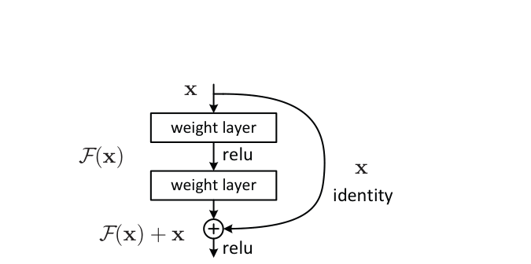
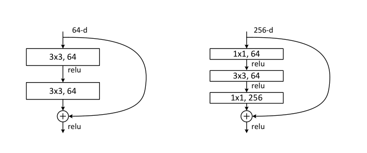
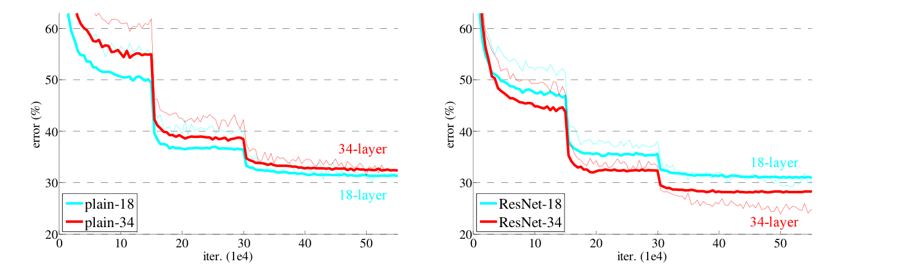
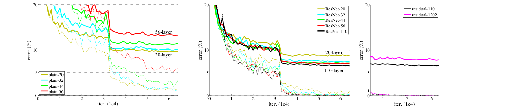
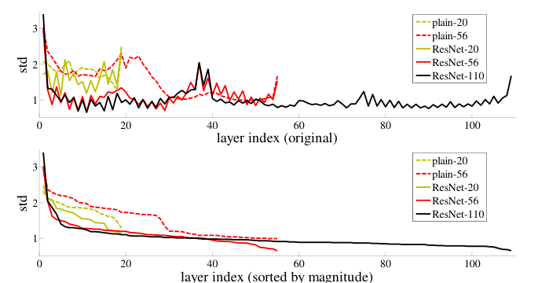

<!-- paper-reading-lang: en -->
<!-- paper-reading-theme: cobalt -->
# Why residual learning makes depth usable

**A complete reading of _Deep Residual Learning for Image Recognition_ — Kaiming He, Xiangyu Zhang, Shaoqing Ren, and Jian Sun, arXiv:1512.03385v1, 10 December 2015.** Written for a reader who knows basic neural networks. The main source is all 12 PDF pages, including detection and localization appendices A–C. This is an explanation and author self-check, not an experimental reproduction or a reader study. [Versioned paper](https://arxiv.org/abs/1512.03385v1) · [Original PDF](https://arxiv.org/pdf/1512.03385v1).

<span class="source-ref">PDF SHA-256: 1e0651b6810ecba34a3dbc5b5b0209226f889004607c1f203540a48d64e5a93a. Retrieved 27 October 2026, Asia/Shanghai. Page numbers below are the PDF's printed page numbers.</span>

## The whole argument

```paper-map
{
  "thesis": "Keep an identity route through a block and train its layers to modify that route. The 2015 evidence shows easier optimization and useful depth, while a 1202-layer counterexample separates fitting from generalization.",
  "outcome": "A practical architecture and an empirical case for residual parameterization, with a hypothesis about why it helps rather than a general optimization theorem.",
  "outcomeSource": "PDF §§1, 3.1, 4.1–4.3; Figs. 4, 6; Table 6",
  "items": [
    {"number":"01","label":"The puzzle","signal":"Training degradation","text":"Adding layers to a plain network can increase training error even though a useful shallow solution ought to remain representable.","source":"PDF §1; Fig. 1"},
    {"number":"02","label":"The change","signal":"Learn a correction","text":"Use F(x) + x so the learned branch can express a small change around the incoming representation.","source":"PDF §§3.1–3.2; Eq. 1"},
    {"number":"03","label":"The implementation","signal":"Add, then activate","text":"The original block applies ReLU after addition. Dimension changes require zero-padding/subsampling or a learned projection.","source":"PDF §§3.2–3.3; Fig. 2; Eq. 2"},
    {"number":"04","label":"The direct test","signal":"Matched architectures","text":"At 34 layers, a parameter-matched residual network trains better and has lower ImageNet validation error than its plain counterpart.","source":"PDF §4.1; Fig. 4; Table 2"},
    {"number":"05","label":"The practical reach","signal":"Scale and transfer","text":"Bottlenecks make 50–152 layer ImageNet models affordable; learned backbones also improve detection in the tested systems.","source":"PDF §4.1; Table 1; §4.3; appendices A–C"},
    {"number":"06","label":"The boundary","signal":"Fitting is insufficient","text":"The 1202-layer CIFAR-10 network fits training data extremely well but tests worse than the 110-layer network.","source":"PDF §4.2; Fig. 6 right; Table 6"}
  ]
}
```

The argument runs from problem to mechanism to evidence: **training degradation motivates a new parameterization; matched tests check whether it helps; deeper models test its practical reach; the extreme-depth test limits the conclusion.** The paper does not establish that depth always improves predictions or that residual connections guarantee non-vanishing gradients.

Three terms will keep the evidence straight. **Optimization** concerns finding parameters that fit the training objective; the paper mainly diagnoses it using training classification error and convergence curves. **Generalization** concerns predictions on images excluded from fitting. **An explanatory mechanism** is a reason the architecture might help. A plausible mechanism and favorable measurements are different kinds of support.

## Why learning a correction helps

Imagine a shallow network already gives a useful representation. A deeper network could preserve it by making added layers copy their inputs. The existence of such a solution is a representational argument; it does not show that SGD will find it. The degradation puzzle is that trained deeper plain networks can actually fit the training set worse. That observation needs an optimization explanation before a story about overfitting. (PDF §1; §3.1)

Let $x$ be the feature vector entering a few layers, $H(x)$ the desired mapping at that location, and $F(x)$ the mapping represented by the learned branch. The paper proposes:

$$
F(x) := H(x)-x, \qquad y=x+F(x,\{W_i\}).
$$

Here $W_i$ are that branch's learned weights and $y$ is the sum before the final activation. The branch need only learn the discrepancy between what is already available and what would help next. If the desired mapping is close to identity, the needed correction is close to zero. This is the authors' **preconditioning hypothesis**: a change of coordinates around identity may make the problem easier for the optimizer. It is not a proof about all functions or all training runs. The target mapping $H$ is explanatory notation, not an extra dataset label available to training. (PDF §3.1; Eq. 1)

**Teaching example — invented numbers, not a paper measurement.** Suppose an incoming representation is $x=(2,1)$ and a useful next representation is $H(x)=(2.2,0.7)$. A plain branch must learn the full mapping; a residual branch can output $F(x)=(0.2,-0.3)$, and addition gives $(2.2,0.7)$. A negative correction is allowed: the last branch convolution is not immediately followed by ReLU before addition. This example illustrates the representation, not a measured convergence advantage.

If no change is needed, $F(x)=0$ yields $y=x$. But the original block's actual outgoing signal is $z=\operatorname{ReLU}(y)$, so with zero residual it is $\operatorname{ReLU}(x)$, not identity for every possible signed vector. At ordinary same-shape block boundaries in this architecture, the preceding ReLU makes $x$ nonnegative. This caveat matters when explaining the original design rather than a later variant. (PDF §3.2; Fig. 2)

In **Fig. 2**, follow the curved identity path from $x$ to the plus sign, then notice that both routes meet **before** the last ReLU. The curved route copies features; it does not copy the loss or act as an auxiliary classifier. The two weighted layers learn the correction.



*Original Fig. 2, PDF p. 2; interpreted with Eq. 1 and the explicit after-addition activation in §3.2. The crop preserves the lower ReLU label.*

### What happens to gradients

The following is an **editorial chain-rule explanation**, not a theorem proved or a measurement reported in the 2015 paper. For a same-shape block, away from the ReLU kink:

$$
z=\operatorname{ReLU}(x+F(x)), \qquad
J_z = D_{\mathrm{ReLU}}(x+F(x))\bigl(I+J_F(x)\bigr).
$$

$J_z$ and $J_F$ are the Jacobians of the block output and residual branch with respect to $x$; $I$ is the identity matrix; $D_{\mathrm{ReLU}}$ is diagonal with entries 1 for positive preactivations and 0 for negative ones. An additive identity contribution is available before the gate, giving backpropagation another route besides the learned branch. Yet the gate can zero a coordinate, $J_F$ can cancel part of $I$, and a stack multiplies many block Jacobians. “Gradients are guaranteed to survive” does not follow.

The 2015 authors explicitly report healthy gradient norms and BN-stabilized signal variances in their plain ImageNet networks, and leave the precise optimization difficulty open. They conjecture slow convergence. Therefore “the only problem was vanishing gradients, and ResNet solved it” misstates their diagnosis. They also report trying three times as many iterations without removing degradation. (PDF §4.1, p. 5 and footnote 3)

## From a block to an image classifier

The residual branch and identity route are used in the forward pass during **both training and inference**. Training adds a loss and parameter updates; inference uses fixed learned weights. Residuals are learned end to end from the ordinary image-classification loss, not supervised against precomputed values of $H(x)-x$.

```paper-path
{
  "title":"One image through the original classifier",
  "intro":"Stages 1–3 are the prediction path. Stage 4 is a training feedback step, not another inference layer.",
  "stages":[
    {"title":"1 · Produce early features","role":"Forward pass","action":"A convolutional stem and pooling turn an image crop into feature maps.","why":"Later blocks operate on spatial feature maps rather than raw class labels.","cost":"Cropping and scale choices are part of the evaluation protocol.","output":"A feature tensor with spatial dimensions and channels.","source":"PDF §§3.3–3.4; Fig. 3; Table 1"},
    {"title":"2 · Refine features in residual blocks","role":"Forward pass","action":"Each block computes a learned branch, adds a compatible shortcut, then applies ReLU.","why":"The existing representation is available while the branch learns a correction.","cost":"Addition needs equal shapes; downsampling/channel expansion changes the shortcut.","output":"Updated features; later stages reduce spatial resolution and increase channels.","source":"PDF §§3.2–3.3; Eqs. 1–2"},
    {"title":"3 · Predict a class","role":"Training and inference","action":"Global average pooling feeds a 1000-way fully connected classifier and softmax on ImageNet.","why":"Spatial features become class scores; test crops/scales may have their scores averaged.","cost":"More test views add inference work and must be distinguished in comparisons.","output":"Class probabilities and a top-1 or top-5 prediction.","source":"PDF §§3.3–3.4"},
    {"title":"4 · Update learned weights","role":"Training only","action":"Compare predictions with training labels and backpropagate through the learned and shortcut paths using SGD.","why":"The end-to-end objective discovers useful corrections without target residual labels.","cost":"BN, initialization, augmentation, learning-rate schedule, and regularization accompany the architecture.","output":"Updated convolution/classifier weights, including learned projection shortcuts where used.","source":"PDF §3.4; §4.2"}
  ]
}
```

For same-shape blocks, the identity shortcut adds no learned weights and only the element-wise sum adds arithmetic. This is why the paper can compare plain and residual architectures with the same depth, width, and parameter count. It does **not** mean adding arbitrary extra residual blocks is free. (PDF §3.2)

When a stage halves spatial resolution and increases channels, the two paths must still have matching shapes. **Option A** subsamples the shortcut and pads extra channels with zeros; it adds no parameters. **Option B** uses a learned $1\times1$ convolution, $W_s$, at dimension changes and identity elsewhere. **Option C** uses learned projections at every shortcut. The sum becomes $y=F(x)+W_sx$ for a projected shortcut. A projection introduces parameters and is not an identity map. (PDF §§3.2–3.3; §4.1)

### Why bottlenecks appear

In **Fig. 5**, compare the left block's two $3\times3$ convolutions with the right block's $1\times1\rightarrow3\times3\rightarrow1\times1$ branch. The right branch narrows channels before its expensive spatial convolution and expands them afterward. The identity route still carries the wide representation. The purpose is economical depth, not a new residual objective.



*Original Fig. 5, PDF p. 6; basic block for ResNet-34 at left, bottleneck for ResNet-50/101/152 at right.*

**Teaching calculation — convolution weights only.** The left branch uses $2(3\cdot3\cdot64^2)=73{,}728$ weights. The right uses $256\cdot64+9\cdot64^2+64\cdot256=69{,}632$. Biases and BN parameters are excluded. These are different endpoint widths, so this calculation illustrates the paper's computational design rather than an accuracy-controlled comparison. A learned $256\times256$ shortcut would add 65,536 weights, explaining why identity shortcuts are economical for bottlenecks.

ImageNet networks use a stem followed by four residual stages. Block counts are [2,2,2,2] for 18 layers, [3,4,6,3] for 34, and bottleneck counts [3,4,6,3], [3,4,23,3], [3,8,36,3] for 50, 101, and 152. Count the convolutional stem and final classifier with the weighted branch layers to recover the named depths. The paper reports 1.8, 3.6, 3.8, 7.6, and 11.3 billion FLOPs respectively, using its multiply-add counting convention. ResNet-152's count is below VGG-19's 19.6 billion; this is not a measured wall-clock speed claim. (PDF Table 1; §4.1)

## What the ImageNet experiments establish

ImageNet 2012 supplies 1.28 million training images, 50,000 validation images, and 100,000 test images over 1,000 classes. **Top-1 error** is the percentage of images whose highest-scoring class is wrong; **top-5 error** is the percentage whose correct class is absent from the five highest scores. Lower is better. Ten crops still yield one aggregated prediction per image, not 500,000 independent validation examples. (PDF §4.1; §3.4)

The training setup includes random resized-scale sampling (shorter side 256–480), random $224\times224$ crops and flips, color augmentation, BN after convolutions, the initialization in the paper's reference [13], SGD with batch size 256, momentum 0.9, weight decay 0.0001, and no dropout. Learning rate starts at 0.1 and is reduced by ten at plateaus, for up to 600,000 iterations. These are results for residual learning within this recipe. (PDF §3.4)

### The most informative control

In **Fig. 4**, first inspect the **thin training-error curves**: on the left, plain-34 remains worse than plain-18; on the right, ResNet-34 fits better than ResNet-18. Then inspect the bold center-crop validation curves. The figure concerns training trajectories; Table 2 below uses **10-crop validation**, so their absolute error levels should not be treated as identical evaluation views.



*Original Fig. 4, PDF p. 5. Horizontal axis: iterations in units of 10,000. Vertical axis: error percentage. Residual and plain counterparts have equal parameter counts.*

The full Table 2 comparison is small enough to retain without selection. Values are top-1 error percentages on the same 50,000-image validation set with 10-crop testing.

| Weighted depth | Plain | ResNet, option A | ResNet minus plain |
|---|---:|---:|---:|
| 18 | 27.94 | 27.88 | −0.06 percentage points |
| 34 | 28.54 | 25.03 | −3.51 percentage points |

Increasing plain depth from 18 to 34 raises validation error by 0.60 points; increasing residual depth lowers it by 2.85 points. Fig. 4's training curves are the evidence that this reversal involves fitting, rather than only a regularization effect on held-out data. The 34-layer comparison is especially useful because extra shortcut parameters cannot explain the gain. It supports the tested residual parameterization as an effective optimization change. It does not identify a unique microscopic cause or prove convergence for every task. At 18 layers, similar final accuracy accompanies faster early convergence for ResNet. (PDF Table 2; §4.1)

### Shortcuts and deeper architectures

Table 3 uses the same 10-crop validation protocol. The complete architecture rows are retained here so neither the weak 18-layer effect nor the shortcut choices disappear behind the best result.

| Model | Top-1 error % | Top-5 error % | Relevant distinction |
|---|---:|---:|---|
| VGG-16 | 28.07 | 9.33 | Authors' test of another architecture |
| GoogLeNet | — | 9.15 | Referenced architecture |
| PReLU-net | 24.27 | 7.38 | Referenced architecture |
| plain-34 | 28.54 | 10.02 | Plain comparator |
| ResNet-34 A | 25.03 | 7.76 | Parameter-free shortcuts |
| ResNet-34 B | 24.52 | 7.46 | Projection at dimension changes |
| ResNet-34 C | 24.19 | 7.40 | Projection everywhere |
| ResNet-50 | 22.85 | 6.71 | Bottleneck, option B |
| ResNet-101 | 21.75 | 6.05 | Bottleneck, option B |
| ResNet-152 | 21.43 | 5.71 | Bottleneck, option B |

All A/B/C variants improve on plain-34. B improves on A by 0.51 top-1 points and C improves on B by 0.33 points, while adding learned shortcut weights. The authors attribute the small extra C gain to added parameters; that attribution is an interpretation, not a parameter-matched isolation of that cause. Parameter-free A already addresses degradation. Going from 34 to 50 layers also changes the block design and shortcut choice, so that comparison is not depth alone. (PDF Table 3; §4.1)

### Three famous numbers with three protocols

| Result for ResNet-152 or its ensemble | Images and model setting | What can be concluded |
|---|---|---|
| 5.71% top-5 error | Single model, ImageNet validation, 10-crop; Table 3 | Architecture result in the comparison protocol |
| 4.49% top-5 error | Single model, ImageNet validation, fully convolutional multi-scale score averaging; Table 4 | Stronger test-time evaluation of a single model |
| 3.57% top-5 error | Six-model ensemble, ImageNet test, competition submission; Table 5 | Whole submission's held-out performance |

The multi-scale recipe averages scores over shorter sides {224,256,384,480,640}. The six-model ensemble contains different depths, including two 152-layer models. These numbers do not measure a single isolated residual-connection effect. In particular, subtracting 3.57 from 4.49 as a matched “ensemble improvement” would mix validation with test and other evaluation differences. (PDF §3.4; §4.1; Tables 3–5)

## CIFAR separates fitting from generalization

CIFAR-10 contains 50,000 training and 10,000 test images in 10 classes. The paper's thin networks use $6n+2$ weighted layers, with $2n$ convolutions at each of three spatial sizes and widths 16, 32, and 64. All shortcuts use option A. These are not the ImageNet bottleneck architectures. (PDF §4.2)

Training uses BN, SGD, batch size 128, momentum 0.9, weight decay 0.0001, and no dropout. Augmentation pads four pixels per side and samples a $32\times32$ crop or its horizontal flip. The schedule uses 64,000 iterations with learning-rate drops at 32,000 and 48,000, selected on a 45k/5k split. The final results train on 50k and test on 10k; testing uses one original-size view. For 110 layers, an initial 0.01 learning rate warms up training to below 80% training error, then returns to 0.1. This schedule adaptation matters when comparing it with shallower models. (PDF §4.2)

In **Fig. 6**, use the dashed lines to compare fitting and the bold lines to compare test performance. The left and middle panels show the plain-versus-residual depth trend. The right panel deliberately zooms to late training for 110 versus 1202 layers: both fit extremely well, while the magenta 1202-layer **test** curve stays higher.



*Original Fig. 6, PDF p. 8. Dashed curves: training error. Bold curves: test error. The right panel has a different horizontal range; no exact curve values were digitized for this reading.*

The complete ResNet portion of Table 6 is below. Error is a percentage of the 10,000 test images; lower is better.

| Layers | Parameters | Test error % | Run reporting |
|---|---:|---:|---|
| 20 | 0.27 million | 8.75 | One table entry |
| 32 | 0.46 million | 7.51 | One table entry |
| 44 | 0.66 million | 7.17 | One table entry |
| 56 | 0.85 million | 6.97 | One table entry |
| 110 | 1.7 million | 6.43 best; 6.61 ± 0.16 mean ± std | Five runs |
| 1202 | 19.4 million | 7.93 | One table entry; no multi-run uncertainty given |

The 1202-layer network reaches **below 0.1% training error**, showing optimization success under this setup. Yet its test error exceeds the 110-layer mean by 1.32 percentage points, or the reported best by 1.50 points. Those are descriptive differences across the paper's reported entries, not a significance test or a matched distribution of runs. The authors argue that overfitting from a model too large for the small dataset explains this result, and propose stronger regularization as future work. The measured fact is the train/test separation; the specific explanation was not established by a regularization ablation. (PDF §4.2; Fig. 6 right; Table 6)

### Does the residual branch actually make small changes

In **Fig. 7**, compare solid residual-network curves with dashed plain-network curves, then compare ResNet-20, -56, and -110. The upper panel retains layer order; the lower panel sorts each model's response magnitudes. Sorting is useful for comparing distributions but removes correspondence between layer positions.



*Original Fig. 7, PDF p. 8. Responses are taken after BN at each 3×3 layer and before the following ReLU or addition; the statistic is standard deviation, not classification error.*

Residual networks have generally smaller response standard deviations; deeper residual networks tend to have smaller individual responses. This is consistent with learning incremental modifications around identity. It is descriptive support for the motivation, not proof that every learned block is close to identity in a specified function norm, nor a causal explanation of the accuracy gains. No response values are invented or digitized here. (PDF §4.2; Fig. 7)

## Transfer and the appendix evidence

The detection experiments test whether an ImageNet-pretrained representation is useful for another recognition task. They use Faster R-CNN and compare VGG-16 with ResNet-101 backbones. Appendix A describes the adaptation: share convolutional features through conv4_x, perform region-of-interest pooling before conv5_x, use later layers per region, and replace the final classifier with class and box-regression outputs. BN statistics are computed on ImageNet and then fixed during detection fine-tuning. Thus this is task transfer plus detector fine-tuning, not zero-shot generalization. (PDF §4.3; Appendix A)

**mAP** averages detection precision summaries across classes; the COCO metric additionally averages across intersection-over-union thresholds 0.50, 0.55, …, 0.95. IoU is overlap area divided by union area for predicted and reference boxes. Higher is better. These mAP values are not percentages of images classified correctly.

```paper-experiments
{
  "title":"What the transfer results support",
  "rows":[
    {"question":"Do the learned backbones improve the baseline detector?","setup":"PASCAL VOC 2007 test: train on 07+12, about 21k images. VOC 2012 test: train on 07++12, about 26k images. Compare VGG-16 and ResNet-101 within the baseline Faster R-CNN recipe.","observation":"VOC 2007 mAP rises 73.2% → 76.4% (+3.2 points); VOC 2012 rises 70.4% → 73.8% (+3.4 points).","conclusion":"Evidence for a useful replacement backbone in these detection systems. The architectures and adapted heads differ, so this is not an isolated shortcut ablation.","source":"PDF Table 7; Appendix A; Tables 10–11"},
    {"question":"Does the improvement survive stricter box-overlap evaluation?","setup":"COCO baseline Faster R-CNN, 80 categories; train on 80k images and evaluate on 40k validation images. Compare VGG-16 and ResNet-101.","observation":"mAP@0.5 rises 41.5% → 48.4% (+6.9 points); mAP@0.5:0.05:0.95 rises 21.2% → 27.2% (+6.0 points, about +28.3% relative to 21.2).","conclusion":"Transfer gains include the stricter overlap metric. This does not uniquely separate improved classification from improved localization or attribute the gain to identity shortcuts alone.","source":"PDF Table 8; §4.3; Appendix A"},
    {"question":"What produces the larger COCO competition number?","setup":"Appendix B adds detector changes, then extra training data and an ensemble; those settings must remain separate.","observation":"On COCO validation with train-only fitting, standard mAP progresses 27.2 → 29.9 with box refinement → 30.0 with context → 32.5 with multi-scale testing. On test-dev after trainval fitting, the single model is 34.9 and the three-network ensemble is 37.4.","conclusion":"The later score includes detector engineering, evaluation changes, and ensembling. It cannot be assigned wholly to residual connections.","source":"PDF Appendix B; Table 9"},
    {"question":"Do the appendix tasks extend the practical claim?","setup":"ImageNet detection: 200 categories, DET train plus val1 for fine-tuning, val2 for validation. Localization uses class-specific box prediction; distinguish ground-truth classes from predicted classes.","observation":"Detection test mAP: 58.8% single model and 62.1% ensemble. Localization validation: 11.7% error with ground-truth classes and dense RPN; 14.4% top-5 localization error using predicted classes; 10.6% with RPN+RCNN; final ensemble 9.0% localization error on test.","conclusion":"These are functioning recognition systems with substantial task-specific changes. Oracle-class localization and predicted-class localization answer different questions.","source":"PDF Appendices B–C; Tables 12–14"}
  ]
}
```

The appendix's improved PASCAL results, 85.6% mAP on VOC 2007 and 83.8% on VOC 2012, additionally use COCO pretraining and the improved detector recipe. They should not be merged with the baseline-backbone comparisons. Localization Appendix C replaces Fast R-CNN with RoI-centric R-CNN training because the authors argue that highly overlapping proposals provide too little sample variation. That is a separate system design choice, not a property implied by $x+F(x)$. (PDF Appendix B, Tables 10–11; Appendix C)

The abstract also announces a COCO segmentation competition win. This PDF does not provide a comparable segmentation method-and-result analysis. That announcement alone cannot establish the segmentation mechanism or isolate a residual effect. This reading does not invent missing mask experiments.

## What belongs to 2015 and what came later

| Kind of statement | Its proper status |
|---|---|
| Deeper plain networks can have higher training error; the residual counterparts fit better in these tests | Direct 2015 empirical observation, Figs. 1, 4, and 6 |
| It may be easier to optimize perturbations around identity than an unreferenced mapping | The authors' 2015 motivation/hypothesis, §3.1 |
| Smaller residual-network responses are consistent with incremental refinement | Descriptive 2015 analysis, Fig. 7, with bounded interpretation |
| An additive identity term creates a backward route, subject to the original ReLU gate | Chain-rule explanation given in this reading, not a 2015 global guarantee |
| Identity after-addition mappings and pre-activation further improve propagation and motivate another residual unit | Later work: He et al., _Identity Mappings in Deep Residual Networks_, arXiv:1603.05027v1, 16 March 2016 |

The [2016 follow-up](https://arxiv.org/abs/1603.05027v1) explicitly studies propagation and changes the residual unit. Its abstract was checked for this historical distinction; its full experimental claims were not audited here. Do not silently substitute a pre-activation block into the 2015 explanation. Other later interpretations are outside this reading's source audit.

The defensible takeaway is: **residual parameterization made substantially deeper networks trainable and useful under the tested recipes; strong held-out results and task transfer demonstrate practical value; neither unlimited generalization nor a universal account of why optimization improves follows.** The matched 34-layer comparison supports the central change more directly than the competition ensemble, and the 1202-layer result protects against confusing easier fitting with better predictions.

## Check your understanding

Try to answer before revealing each disclosure. These questions help you reconstruct the argument; no score or automatic claim of comprehension is assigned.

```paper-check
{
  "title":"Four checks tied to this paper",
  "items":[
    {"question":"A same-shape block receives (2,1) and should output (2.2,0.7). What should its residual branch output, and where does the original design apply its final ReLU? Is zero residual identity for an arbitrary signed input?","hint":"Separate the preactivation sum from the outgoing block signal.","answer":"The residual is (0.2,−0.3). Addition gives (2.2,0.7), then ReLU leaves these positive coordinates unchanged. The 2015 unit applies its final ReLU after addition. With zero residual it outputs ReLU(x), which is identity for nonnegative x but not for an arbitrary signed vector. These are teaching numbers, not paper measurements.","source":"PDF §3.2; Eq. 1; Fig. 2; worked example in this reading"},
    {"question":"Why does plain-34's higher training error than plain-18 diagnose an optimization problem, and which comparison controls for extra shortcut parameters?","hint":"Distinguish the existence of a good parameter setting from the optimizer finding one.","answer":"A deeper network can in principle retain a useful shallow mapping by adding identity behavior, yet the trained plain-34 fits worse. That implicates the training process rather than explaining the degradation solely as overfitting. The same-depth option-A 34-layer comparison holds depth, width, and parameter count fixed; ImageNet 10-crop validation error falls from 28.54% to 25.03%, while Fig. 4 supplies the training-error evidence. It does not prove a universal optimizer guarantee.","source":"PDF §§1, 4.1; Fig. 4; Table 2"},
    {"question":"The 1202-layer CIFAR-10 network has below 0.1% training error but 7.93% test error. What does this establish, and what is still a hypothesis? How should it be compared with 110 layers?","hint":"The 110-layer table entry includes both a best run and a five-run mean.","answer":"It establishes successful fitting alongside worse reported test performance than 110 layers: 6.61 ± 0.16% mean ± std over five runs, best 6.43%. The test-error gaps are 1.32 points versus the mean and 1.50 versus the best. The authors' overfitting explanation is plausible but no stronger-regularization ablation establishes it here; repeated-run uncertainty for 1202 layers is absent. Easy optimization does not imply better generalization.","source":"PDF §4.2; Fig. 6 right; Table 6"},
    {"question":"Can you subtract the 3.57% competition error from the 4.49% single-model error to isolate the benefit of an ensemble? Can the 2016 propagation argument be reported as a theorem of this 2015 paper?","hint":"Name the split, model setting, and historical source for each number or claim.","answer":"No. The 4.49% result is single-model multi-scale top-5 validation error; 3.57% is six-model ensemble top-5 test error. Different splits and submission settings prevent a matched causal estimate. The 2016 identity-mapping/pre-activation analysis belongs to a later paper; the 2015 work motivates residual learning and supplies empirical evidence, not that later propagation analysis or architecture.","source":"PDF §4.1; Tables 4–5; He et al. 2016 arXiv:1603.05027v1 abstract"}
  ]
}
```

## Sources and reading boundaries

- **Primary source read in full:** [arXiv:1512.03385v1 PDF](https://arxiv.org/pdf/1512.03385v1), all 12 pages: introduction and related work; method and implementation; ImageNet and CIFAR-10 results; response analysis; transfer; bibliography; detection baselines and improvements; localization. No newer version was substituted.
- **Later context checked narrowly:** [arXiv:1603.05027v1 abstract](https://arxiv.org/abs/1603.05027v1), for the historical separation of propagation analysis and a new residual unit. No full audit of that paper is claimed.
- **Original excerpts:** Figs. 2, 4, 5, 6, and 7 are cropped from the pinned main PDF. Their captions, axes/paths, and nearby text were author-checked. Numerical tables were transcribed from the main PDF, not inferred from curves. Teaching examples and the Jacobian explanation are labeled editorial material.
- **Verification scope:** scientific content received author self-review and a separate AI-assisted source check against the pinned PDF. No paper experiment was run. No independent human reader, comprehension study, or independent visual acceptance is claimed.

<!-- Interaction decision: the mechanism and protocol distinctions fit in static diagrams/figures and tables. No parameter slider is needed. Native answer disclosures let the reader attempt paper-specific reconstruction before revealing an answer, and remain available without JavaScript. No Archify or other skill was used. -->
<!-- Author self-audit: equations checked against §3.2 with the after-addition ReLU made explicit; Table 2/3/6 and transfer metrics checked against PDF rows; Fig. 4 center-crop curves kept distinct from 10-crop table; CIFAR best/mean/run reporting preserved; 2016 context quarantined; no curve digitization or experimental reproduction. Rendering observations are recorded separately from source evidence in the repository validation report. -->
