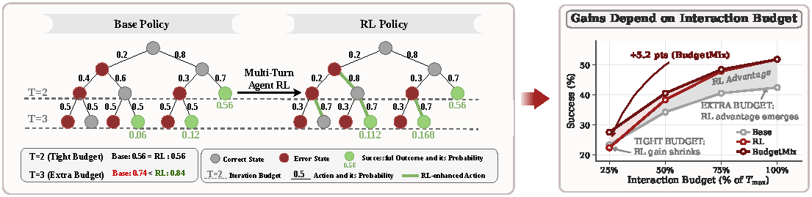
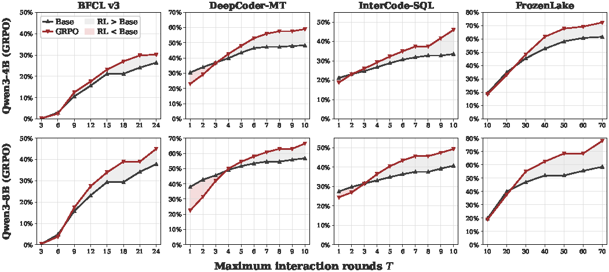
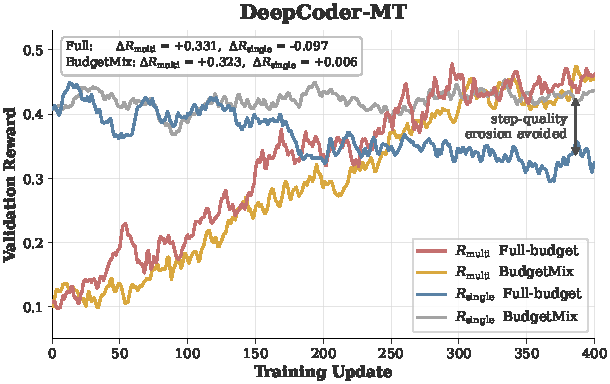

<!-- paper-reading-lang: zh-CN -->
<!-- paper-reading-mode: deep -->
<!-- paper-reading-theme: plum -->

# Rethinking Agentic RL 深读：多轮 RL 到底改进了 Agent 的什么

```paper-map
{"thesis":"多轮 agentic RL 的轨迹级增益被三个发现重新归因：它能扩展基座的 Pass@K 经验边界（与单轮 RLVR 相反），但增益依赖充足的交互预算——紧预算下缩小甚至反转；步级动作质量并不一致提升（匹配态上 RL 只在 46.8%/42.8% 的状态更好），真正的优势在错误态（65.7%/67.3%）与轨迹后段；机制是「局部动作仍属基座支持集、但整条轨迹在 RL 策略下似然高出一个量级」的组合改进。修复方案 BudgetMix RL 把预算从评测维度变成训练维度，紧预算平均 +4.2/+4.8 分且不伤满预算表现。","reader":"关心 RL 后训练机理与 Agent 可靠性评测、想看一套归因分析如何逐层排除替代解释的读者。","goals":["走通 Pass@(K,T) 双维评测与无偏估计、结构上界排除法","把步级质量对照、错误态反转、LLR 机制、Table 1 增益逐格手算","分清「扩边界」结论与「预算依赖」风险各自的前提与证据强度"],"outcome":"通读 arXiv 2611.06483v1 全部 26 页：正文 §1-§7、附录 A-E 全部（训练细节/评测协议/附加实验/案例）。","outcomeSource":"arXiv 2611.06483v1 PDF pp.1-26","items":[{"number":"01","label":"双维评测","signal":"Pass@(K,T)","text":"采样广度 K 与交互深度 T 两个 test-time 维度分开测：K 维 RL 全面胜出，T 维增益随预算收紧而消失。","source":"§2-3, Fig.2-3"},{"number":"02","label":"步级真相","signal":"不升反微降","text":"匹配态上 GRPO-RL 只在 46.8%（DC）/42.8%（FL）的状态出更好的动作，均值还略负——轨迹级增益不来自每步更准。","source":"§3.3, Fig.4"},{"number":"03","label":"优势在哪","signal":"错误态+后段","text":"错误态上反转：RL 在 67.3%/65.7% 的错误态更优，续跑成功率 +12.7/+15.6 个百分点；优势随轨迹深度递增。","source":"§3.3, Fig.5-6"},{"number":"04","label":"机制","signal":"组合似然","text":"RL 动作在基座下的 NLL 与基座自己的几乎重叠（12.20 vs 10.25），但成功轨迹的累计 LLR 达 228 对 26——RL 改的是「把局部合理动作可靠串成长轨迹」。","source":"§4.1, Fig.7"},{"number":"05","label":"训练侵蚀","signal":"R_multi↑R_single↓","text":"轨迹奖励 +0.331 的同时步级奖励 −0.097——侵蚀随训练逐步发生，不是最终检查点的偶然。","source":"§4.2, Fig.8"},{"number":"06","label":"修复","signal":"BudgetMix","text":"训练时每组任务从 {10%,…,100%} 预算均匀抽一个：紧预算平均 +7.9/+5.2/+3.8/+1.1（4B），步级侵蚀消失（−0.097→+0.006）；过程监督只在有 oracle 的任务上有效。","source":"§5, Table 1, Fig.8-9"}]}
```



*原论文 Fig. 1，PDF p.2 裁剪。左：状态转移示意——多轮 RL 不均匀提升每步质量，主要增强错误恢复与长程韧性（紧预算 T=2 时 base 与 RL 打平 0.56，宽预算 T=3 拉开 0.74 对 0.84）；右：RL 增益随交互预算出现的示意曲线。*

深读对象：What Does Multi-Turn Reinforcement Learning Really Improve in LLM Agents?（Rethinking Agentic RL 项目，arXiv 2611.06483v1，2026-11-04，中科院自动化所 + 清华，PDF 26 页）。本周的三篇深读恰好构成一条追问链：CUA-Master 造了系统（递归飞轮）、Axion 1.0 做了减法（极简配方）、这篇论文问的是最底层的问题——**多轮 RL 训完的 agent，比基座好在哪里**？答案有点反直觉：好在「错误恢复与长程韧性」，而不在「每步更准」；且轨迹级增益**依赖充足的交互预算**——紧预算下缩小、消失甚至反转（8B DeepCoder 25% 预算下 GRPO-RL 31.5 分反而比基座 42.8 低 11.3 分）。这个发现对部署有直接含义：给 agent 规定「最多 N 步」的线上场景，RL 训练的增益可能兑现不了。本页按细章跟读：Pass@(K,T) 双维评测与无偏估计手算、匹配态对照与错误态构造的方法细节、似然分析的组合解释、Table 1 的 Avg. gain 行逐格复算、BudgetMix 的预算分布设计与伪代码、附录 A-E（三种 RL 算法配置、评测协议、三维泛化扩展、BFCL 修错案例）全量整合。

<!-- Deep Reading coverage
| Source section / object | Role | Explanation location / status |
| --- | --- | --- |
| §1 引言（问题、Fig.1 总览） | 立论 | §01（含图） |
| §2.1 多轮 agentic RL 形式化（轨迹/奖励） | 形式化 | §02 |
| §2.2 Pass@(K,T) 定义 Eq.1 + App B.2 无偏估计 | 评测框架 | §02（手算） |
| §3.1 Pass@K 发现 + App C（算法/架构/任务扩展） | 发现一 | §03、§13 |
| §3.2 Pass@T 预算依赖 + App B.3 结构上界 + App D | 发现二 | §04（含图、手算） |
| §3.3 步级质量（匹配态/错误态/深度动态）+ App B.4-B.5/E.1 | 发现三四 | §05-06（手算） |
| §3.4 部署风险 | 风险 | §14 |
| §4.1 似然分析（NLL/LLR）+ App E.2 长度匹配 | 机制一 | §07（手算） |
| §4.2 训练动态 + App E.3 | 机制二 | §08（含图、手算） |
| §5.1 过程监督讨论 + App B.6 LLM judge | 缓解 A | §09 |
| §5.2-5.4 BudgetMix 设计/设置/结果 + App A.4 伪代码 | 缓解 B | §10-12（Table 1 逐格） |
| §6 相关工作（Pass@K 之争谱系） | 谱系 | §16 |
| §7 结论 + AI/Ethics/Reproducibility 声明 | 收束 | §16 |
| App A 训练细节（任务/超参/预算/模板/算法） | 复现条件 | §15 全档 |
| App C/D/E 全部附加实验 | 泛化与补充 | §13、§06、§07、§12 |
| References | 行政性材料 | 不单列 |
-->

## 01 / 靶子：轨迹级成功率掩盖了什么

论文的出发点是评测盲区：agent 的评测几乎都停在轨迹级——「任务在给定预算内完成没有」。但这一个数字回答不了两个更细的问题：**增益从哪来**（每步更准？还是会从错误里爬出来？）与**增益在什么条件下兑现**（预算够的时候？）。单轮 RL 领域已有一场著名争论：Yue et al. 2025 用 Pass@K 论证 RLVR 只是把基座已能解的解重新加权、并不扩边界；后续工作（ProRL 延长训练、Yuan et al. 组合旧技能）给出更细的修正。这篇论文把同一把手术刀移到多轮 agent 上，并加上 agent 特有的第二根轴：交互深度 T。Fig.1 的总览值得先记两个数：紧预算 T=2 时 base 与 RL 成功率打平（0.56 = 0.56），预算放宽到 T=3 就拉开（0.74 < 0.84）——整篇论文的发现浓缩在这两个对比里。

### 这场争论的赌注：为什么「边界」二字值钱

「RL 扩不扩边界」不只是学术口径之争，它直接决定两条技术路线的投入分配。如果 RL 只是重加权（边界不变），那么能力提升的杠杆在**基座**（预训练数据与算力），后训练只是把已有能力「选出来」；如果 RL 能扩边界，后训练本身就是能力来源，值得为它造环境、造奖励、造算力。2026 年的行业现实是后者押注巨大——CUA-Master 的 2000 台 VM、ScaleCUA 式的可验证任务合成、本周 Axion 的整段 RL——这篇论文的 Pass@K 发现（扩边界成立）给这条路线提供了机理背书，但 Pass@T 的发现（预算依赖）同时给「RL 万能」泼了冷水：扩的是**恢复型边界**，不是**精度型边界**。对研究者的含义：想要单步精度，路径可能不在 agentic RL 里，而在数据质量（Axion 的难化路线）或过程监督（本文 §09 证明有效但难得）里——三种手段各管一段，替代不了彼此。

### 为什么这个问题对部署是致命的

线上 agent 很少有无限预算：超时限制、API 调用配额、用户耐心、以及**不可逆动作**（金融交易、数据库写操作——引 Doshi et al. 2026 的可验证安全工具使用）。如果 RL 的增益真的依赖「犯错了还有预算重试」，那么在严格限步或错误代价高的场景，RL 模型不仅兑现不了宣传分数，还可能因为步级质量侵蚀而**更差**——§05 的匹配态数据（RL 步级均值略负）与 §08 的训练动态（R_single 单调下滑）把这个风险从推测落成了测量。

## 02 / 形式化：Pass@(K,T) 与无偏估计

任务 $x\sim\mathcal{D}$ 上，agent 与环境多轮交互：

$$a_t\sim\pi(\cdot\mid h_t),\qquad o_{t+1}\sim P(\cdot\mid h_t,a_t)$$

预算 $T$ 内的轨迹 $\tau_{\le T}$ 由终局验证器打分 $R(\tau_{\le T})$。框架兼容纯结果奖励（GRPO）与过程级信用（GiGPO）。核心评测指标是二维的：

$$\mathrm{Pass@}(K,T)=\Pr_{\tau^{(1)},\dots,\tau^{(K)}\sim\pi(\cdot\mid x)}\left[\exists i\in\{1,\dots,K\}: R(\tau^{(i)}_{\le T})=1\right]$$

固定采样宽度 $C$ 扫 $T$ 得 Pass@T（深度轴），固定 $T$ 扫 $K$ 得 Pass@K（广度轴）。实现上用无偏估计（App B.2，源自 HumanEval 的经典公式）：每任务采 $n$ 条轨迹、成功 $c$ 条，则

$$\mathrm{Pass@}k = 1-\binom{n-c}{k}\Big/\binom{n}{k}$$

教学算例：$n=16$ 条采样、$c=4$ 条成功，估 Pass@8——$1-\binom{12}{8}/\binom{16}{8}=1-495/12870\approx 0.962$。直观核对：单条成功率 $p\approx0.25$，8 条至少一条成功的朴素概率 $1-(1-0.25)^8\approx 0.90$，无偏估计给出 0.96 略高——因为 $c/n=0.25$ 只是均值估计，无偏公式在超几何抽样下修正了方差。这个细节决定 Fig.2/3 曲线的可信度：k=128 的点不是真采 128 条取一条，而是 $n$ 条里的组合概率外推。

### 为什么必须两根轴，而不是只加一个总预算

一个自然的反对意见：广度与深度可以合并成「总交互次数 $K\times T$」一个预算。分开的必要性在于两者消耗的资源不同且不可互换——$K$ 消耗并行采样（延迟不变、成本线性涨），$T$ 消耗串行轮次（延迟线性涨）；更重要的是**它们探测的能力性质不同**：$K$ 大意味着「多次独立尝试里有一次走通」，$T$ 大意味着「一条轨迹里犯错了还能走通」。§05-06 的发现恰好证明这两个性质可以被分开训练与分开破坏——RL 提高的主要是后者（恢复），所以 $T$ 轴上的优势才随预算收紧而蒸发。合并预算会把这两个信号搅在一起：总预算相同的 $(K{=}8, T{=}2)$ 与 $(K{=}2, T{=}8)$ 在合并口径下不可区分，而论文恰恰证明前者对 RL 最不利、后者最有利。

### 预算感知提示词：一个容易忽视的自变量

整条实验线的另一个设计决定：预算始终写进系统 prompt（Table 2 模板）——模型知道自己有几轮、已用几轮、剩几轮。这带来一个读者要记住的限定：**本文测的是「知道预算的策略在预算约束下的表现」**，不是「不知道预算的策略被外部截断的表现」。两种设定可能给出不同结论——不知预算的模型可能过度挥霍前几轮（不省着用），知预算的模型会调整激进度。BudgetMix 的训练正是利用这个接口（把预算条件化进策略），所以它学到的是「按剩余预算调节行为」的策略而不只是「更保守的策略」——这解释了为什么它在满预算也不掉分。

## 03 / 发现一：Pass@K——agent RL 扩了经验边界

固定充足预算、扫采样宽度 $k$（1 到 128）：四个任务上 RL 模型**一致**高于基座，且 $k$ 越大优势越明显（Fig.2，Qwen3-4B/8B + GRPO）。四张子图里最值得盯的是 InterCode-SQL——k=1 时 RL 与 base 几乎贴着，k=128 时差距拉到最大：广度轴上的优势是「给足独立尝试次数后至少一条走通」的能力，这种能力在单次执行里完全用不上，它属于「可并行重试」的部署形态。附录 C 把这个结论钉到三个泛化维度：换算法（GiGPO/PPO，Fig.11-12）、换架构（InternVL3.5-8B 上 FrozenLake、DeepSeek-R1-Distill-Llama-8B 上 DeepCoder-MT，Fig.13）、换更真实的任务（Terminal-Bench 1.0，Fig.14）——全部复现。这与单轮 RLVR 的 Pass@K 结论形成正面对照：单轮场景 RL 不扩边界（Yue et al.），多轮场景 RL 扩边界。**但注意结论的措辞**：论文写的是「经验（empirical）能力边界」——Pass@K 上的优势不等于证明了基座「原则上不可解」的任务被解开，只说明在有限采样下 RL 的可达性更高；§07 的似然分析会给出这个现象的机制候选解释。

### 与单轮之争的精确对接：组合作为边界的载体

为什么同样的 RL 在单轮不扩边界、多轮扩了？把 §07 的机制放在这个对照下读会更清楚。单轮任务里一条解就是一次生成，「基座采不到」意味着每一步联合概率都低——RL 要扩边界只能提高单条解的概率，这正是单轮侧发现 RL 做不到（只是重加权）的部分。多轮任务里轨迹 = 多次生成 + 环境反馈的交替，基座失败的主因不是「每步都想不到」而是「几十步里总会有一步走岔、后面就崩了」（§07 的 NLL 证据：RL 的好动作在基座下并不惊讶）。RL 的恢复能力恰好补在这个接缝上：岔了能拉回来，等于把「一步不差走完全程」的要求降级成「关键处不崩 + 崩了能修」。用 Yuan et al. 的语言：多轮环境给「组合旧技能」提供了环境反馈这个免费的中间检查点，单轮没有。这也给出一个可检验预言（本页推断）：环境反馈信息越丰富的任务，RL 的 Pass@K 扩边界效应应该越强——论文没有做这个跨任务相关分析。

## 04 / 发现二：Pass@T——增益的预算依赖与反转

固定 $k=8$、扫最大交互轮数 $T$（Fig.3）：预算充足时 RL 大幅领先；预算收紧时优势缩小、消失乃至反转。最重的反转格：**8B DeepCoder-MT 在 25% 预算（T=2/10）下 GRPO-RL 31.5 对基座 42.8——RL 比基座低 11.3 分**；4B FrozenLake 25% 预算下 GRPO-RL 28.7 对基座 30.3 也倒挂。



*原论文 Fig. 3，PDF p.4 裁剪。八个子图（Qwen3-4B/8B × 四任务）固定 k=8 扫预算 T：蓝上红下为 RL 领先，红上蓝下为反转——紧预算端多格出现红上蓝下。*

### 结构上界排除法：不是「题目做不了」

紧预算下掉分的平凡解释是任务结构性不可解——FrozenLake 最短路 12 步、预算只给 10 步，神仙也做不了。附录 B.3 逐一计算结构上界，把「不可解」从成绩里剥掉：

$$\mathrm{Ceiling}(T)=\Pr_{x\sim\mathcal{D}}\left[\mathrm{OptimalCost}(x)\le T\right]$$

即最优执行成本不超过 $T$ 的任务占比。FrozenLake 用最短路长度、BFCL 用标注的真值工具调用轨迹、DeepCoder/InterCode 每轮就是完整提交所以上界恒 100%。Fig.10 把灰色上界线画在成绩曲线上方：**小 T 处上界确实下降（FL/BFCL），但两类模型都离上界有巨大余量，RL 仍无优势**——掉分不是不可解造成的，是策略在紧预算下的行为变了。这一步排除是全文方法论最干净的一处：把「预算依赖」从曲线现象升格为策略性质。

### 反转的分布：不是所有任务都会倒挂

读 Fig.3/15-16 要注意反转的分布并不均匀。倒挂最狠的是 DeepCoder-MT（8B 25% 预算 −11.3）与 FrozenLake 的 4B GRPO 档（28.7 vs 30.3，−1.6），BFCL 紧档是「RL 无优势」而非倒挂（2.5 vs 3.0 基本持平），InterCode-SQL 则全预算段 RL 都领先。分布的形状与任务结构对得上：DeepCoder 每轮是完整提交、$T_{max}=10$，25% 档只有 2 轮——基座直接写出正确程序的概率不低（首轮通过率高），而 RL 策略学到的「先提交再看反馈再修」的行为模式在 2 轮里没施展空间，反而可能因步级侵蚀首轮质量略降；FrozenLake 是长链规划（$T_{max}=70$），25% 档 17 步对多数地图仍够走，倒挂幅度小；InterCode 的 SQL 任务基座首轮就很弱，RL 全段领先。**教训**：预算反转不是 agent RL 的普遍诅咒，而是「RL 改变的行为模式与预算窗口错配」时才出现——部署前按自己的预算档实测是唯一的可靠判据。

## 05 / 发现三：步级动作质量——不升反微降

要解释预算依赖，自然要问：RL 到底有没有让每步动作更好？方法是把「同一状态下的下一步动作质量」隔离出来测（§3.3）：从 base 与 RL 轨迹**等量**抽取中间状态建池（避免状态访问偏置），每个状态两策略各独立采 $G=16$ 个动作，用动作质量均值估计。两种度量：FrozenLake 用有限步动态规划（$\gamma=0.95$）算精确 $Q^*$ 值；DeepCoder-MT 每个候选程序独立跑单测、用通过率当动作质量。结果（Fig.4，Qwen3-4B + GRPO）：**RL 只在 46.8%（DC）/42.8%（FL）的匹配状态出更好动作**，步级均值差 $\Delta Q$ 分别为 −0.005 与 −0.018——分布整体**略偏向基座**。百分比自洽性手算：DC 的 46.8+52.5+0.7=100 ✓、FL 的 42.8+57.2=100 ✓。结论：多轮 RL 不一致提升单步决策，某些场景还更差——轨迹级增益另有来源。

### 匹配态对照的两个方法坑

这套对照设计有两个容易翻车的地方，论文都处理了。**坑一：状态访问偏置**——RL 轨迹访问的状态分布与基座不同（RL 走得更远），若只从 RL 轨迹取状态，比较就混入了「状态难度分布」的差异。解法是状态池从两类轨迹**等量**抽取，比较在同一状态上进行，差的只是策略。**坑二：采样方差**——每状态单次采样会噪声淹没信号（尤其温度 0.6 下动作分布平），$G=16$ 独立采样取均值把估计方差压到单采的 1/16。残余的方法性限制（边界句）：FrozenLake 的 $Q^*$ 度量以「剩余预算内的最优续跑」为参照；DeepCoder 的通过率度量奖励「部分正确」但未显式建模「不破坏已过单测」的编辑价值。两种度量都是代理，结论在两个代理上一致才是它可信的原因。

### FL 的 Q 值怎么算（教学重演）

FrozenLake 是确定转移的网格世界，有限步动态规划可算每动作的精确价值（App B.4）：

$$Q^{*}(s,a)=\max_{\pi}\ \mathbb{E}\left[\sum_{u=0}^{B-1}\gamma^{u}r_{t+u}\ \middle|\ s_t=s,\ a_t=a,\ \pi\right]$$

教学算例（走格）：目标在 3 步外、$\gamma=0.95$、到达奖励 1：朝目标动作 $Q^{*}=0.95^{2}\approx0.9025$（还差 2 步，奖励再折两折），绕路动作 $Q^{*}=0.95^{3}\approx0.857$——「每步最优」就是永远选剩余折扣最大的方向。这套精确参照只可能在小而确定的环境里拿到，这正是 FL 当「理想实验室」、而结论仍需真实任务佐证（§13）的原因。

## 06 / 发现四：错误态反转与后段优势

那 RL 的优势在哪？两个对照实验给出清晰答案。**错误态对照**（构造法在 App B.5）：FrozenLake 在随机中间态执行一个让最短路距离变长的动作、DeepCoder 用 Qwen3-1.7B 把中间代码改差（单测通过数下降），得到错误态池。结果（Fig.5）：模式完全反转——RL 在 **67.3%（DC）/65.7%（FL）** 的错误态上动作更优，$\Delta Q=+0.112/+0.071$；从同一错误态续跑到终局（恢复增益）：

$$\Delta_{\mathrm{recover}}=\mathrm{Succ}_{RL}(s_{\mathrm{err}})-\mathrm{Succ}_{Base}(s_{\mathrm{err}})$$

RL 成功率 51.3% vs 38.6%（FL，**+12.7 个百分点**）、38.5% vs 22.9%（DC，**+15.6 个百分点**）。附录 E.4 给了最直观的案例：BFCL 上 191 个含工具调用错误的轨迹前缀（91 取自 RL、100 取自 base），下一步纠错率 RL 41.4% vs base 27.2%（+14.2 个百分点）——`ls(path="documents", a=True)` 报错后，base 原样重试再错，RL 去掉不支持参数改调 `ls()` 恢复。**深度动态**（Fig.6）：按归一化深度 $d_t=t/T_{max}$ 分桶，RL 的步级优势从轨迹前段（甚至略负）随交互推进单调走强。「错误恢复 + 长程韧性」这八个字由此得来——也直接解释了预算依赖：优势要靠「出错后还有余量修复」来兑现，紧预算掐断的正是这个兑现通道。

### 错误态构造的代理性：边界在哪

两种错误态构造都是代理而非定义（论文自认）。FrozenLake 用「让最短路距离变长的动作」——干净但只覆盖空间性错误；DeepCoder 用 Qwen3-1.7B 改差代码（单测通过数下降）——覆盖语义错误但引入了另一个模型作为「错误制造者」，错误分布带着 1.7B 模型的偏差（它更可能在哪些语法模式上犯错）。代理性带来的解读限制：67%/66% 的错误态优势是在「这两类可构造错误」上测的，不可直接外推为「一切错误」。不过三条独立证据链（错误态步级、错误态续跑终局、BFCL 真实工具调用错误的 41.4% vs 27.2% 纠错率）指向同一方向——代理瑕疵动摇不了「恢复优势」这个定性结论，只影响幅度估计的精度。

## 07 / 机制一：似然分析——局部合理，组合shift

为什么步级不占优的模型能在轨迹级扩边界？似然分析（§4.1）拆成两层。**单动作层**：RL 生成的动作在基座策略下的逐 token 负对数似然

$$\mathrm{NLL}_B(a_t\mid h_t)=-\sum_{j=1}^{m_t}\log p_B\left(w_{t,j}\mid h_t,w_{t,<j}\right)$$

在 Terminal-Bench 上，RL 动作（12.20）与 base 自己的动作（10.25）分布大幅重叠——RL 动作没有跑出基座的支持集，「局部仍是基座认为合理的动作」，这解释了步级为何拉不开。**轨迹层**：累计对数似然比

$$\mathrm{LLR}_{1:t}(\tau)=\sum_{i=1}^{t}\left[\log\pi_R(r_i\mid h_i)-\log\pi_B(r_i\mid h_i)\right]$$

成功的 RL 轨迹 LLR 随交互推进涨到约 **228**，而成功的 base 轨迹只有约 **26**——比值近 8.8 倍。手算核对口径：228 与 26 都是 nats 累计量，不是比率；$228/26\approx8.8$ 表示两策略对各自成功轨迹的相对偏好强度在指数上差约 202 个 nats。机制读法：**每步概率都不低，但整条长轨迹的联合概率极低；RL 学到的是「可靠地把局部合理动作组合成长程轨迹」**——这也为 §03 的扩边界提供了机制候选：能连贯采样整条轨迹，等价于在 Pass@K 意义下 reach 了基座采样难以触及的轨迹。附录 E.2 补了长度匹配控制（Token 数差 ≤10% 配对）：Terminal +185.9 nats、BFCL +805.8 nats，95% CI 均在零上——排除了「RL 轨迹更长所以 LLR 更大」的平凡解释。

### LLR 的一个常见误读：它不是「RL 更自信」

看到 RL 轨迹在自己策略下似然高出两百多 nats，容易读成「RL 变得过度自信/坍缩了」。两处要分开：第一，LLR 是**相对量**（同一轨迹在两策略下的对数概率之差的累加），高 LLR 只说明 RL 策略把概率质量从别处搬到了这类轨迹上，不直接说明绝对熵是升是降——熵动态是另一条研究线（论文引了但没测）。第二，失败轨迹的 LLR 曲线（Fig.7 中灰/橙的 failure 曲线）同样随进度上升且量级不小——RL 策略对自己**失败**的轨迹也给高似然，说明搬移的是「行为模式」（如先提交再修）而不仅是「成功内容」。正确的读法是策略分布的整体迁移：RL 把采样质量从基座分布搬到自己的轨迹族上，成功轨迹是这族里被奖励选中的部分。

## 08 / 机制二：训练动态——侵蚀是逐步发生的

§3.3 用最终检查点对比，会不会只是收敛点的偶然？训练动态分析（§4.2）把过程拉开：对有步级度量的任务，训练只优化轨迹奖励 $R_{multi}$，同时用固定验证协议跟踪步级奖励 $R_{single}$（512 个 held-out 状态池、每检查点每状态采 8 个动作取均值，App E.3）。DeepCoder-MT 上：$R_{multi}$ 升 **+0.331** 的同时 $R_{single}$ 降 **−0.097**——两条曲线从训练早期就开始分叉，侵蚀随优化逐步积累，不是终点偶然。FrozenLake 同型（App E.3：+0.568 对 −0.091）。



*原论文 Fig. 8，PDF p.7 裁剪，右栏版式。Full 预算训练中 R_multi 升 +0.331 而 R_single 降 −0.097；BudgetMix 的 R_single 保持在 +0.006 不再侵蚀——「步级质量侵蚀被避免」是曲线里最直接的对照。*

这个发现与「RLVR 熵坍缩」「高熵 token 承载信号」一系的机理研究相衔接，但给出了 agent 特有的形态：**轨迹级收益与步级质量在同一个优化目标下可以负相关**——GRPO 的组相对优势只关心组内终局差异，没有任何梯度项直接保护单步质量。

### 512 状态池协议为什么必要

跟踪训练中的步级质量有三个测量陷阱，这套协议逐一堵住。**状态漂移**：若每个检查点用当期轨迹的状态测，测的是「模型现在走到哪」而不是「模型在固定难度上变强还是变弱」——固定 512 个 held-out 状态（多 rollout 种子、跨任务跨深度采样）保证纵向可比。**任务泄漏**：状态取自 held-out 任务，训练见过与否不污染验证。**评分漂移**：所有检查点共用同一评分协议（同 $G=8$ 采样、同质量度量）。这个协议本身可复用：任何「训练优化 A、验证 B 是否被牺牲」的问题（如对齐税、长上下文遗忘）都能套——固定基准池 + 恒定评分 + 纵向检查点，是检测「隐性侵蚀」的通用模板。

## 09 / 缓解 A：过程监督——有效但拿不到

自然的修复方向是给步级信号。§5.1 的对照（Fig.9）分两类场景。**有精确 oracle 的场景**（FrozenLake）：oracle Q 值过程奖励与 GiGPO（利用重复状态的锚点做步级信用分配）都能把 Pass@T 曲线在紧预算下稳住——GiGPO/PPO 在 FL 上甚至不再掉出基座（App D.1）。**没有 oracle 的场景**（BFCL 及更真实任务）：GiGPO/PPO 与 GRPO 表现几乎一样，紧预算下照样无优势；连 GPT-5.6-Sol 当 LLM judge 打过程分（0-10，App B.6 prompt）也不行——强判官给不出一致高质量的步级监督。结论的诚实措辞值得抄：过程监督**能**缓解预算依赖，但「这类监督在真实任务里几乎不可得」——所以需要下一条路。

### GiGPO 锚点在 BudgetMix 下怎么变

GiGPO 的步级信用靠「同一任务组内**重复出现的环境状态**」做锚点对齐（anchor state），锚点组内做组相对。这带来一个与 BudgetMix 的交互问题：不同预算的轨迹里，同一环境状态的「剩余预算」不同——紧预算下的状态在宽预算轨迹里也会出现，但策略的最优动作不同（剩 2 轮 vs 剩 9 轮时的合理激进度不同）。论文的处理（App A.4）：BudgetMix 下锚点匹配用二元组 $(s_t, B-t)$——**状态相同且剩余预算相同**才算锚点。这个细节是 BudgetMix 能与 GiGPO 组合的关键：否则跨预算的错误对齐会污染步级优势信号。它也顺带回答了「budget-aware 条件化会不会破坏状态对齐」——会，所以锚点定义必须跟着扩。

## 10 / 缓解 B：BudgetMix RL——把预算从评测维度变成训练维度

BudgetMix（§5.2 + App A.4）只改一处：训练时每个任务组的交互预算不再是固定 $T_{max}$，而是从 10% 到 100% 的十档均匀抽：

$$\mathcal{B}(x)=\mathrm{Unique}\left\{\tfrac{k}{10}T_{max}(x):k=1,\dots,10\right\},\qquad T(x)\sim\mathrm{Uniform}\left(\mathcal{B}(x)\right)$$

预算与剩余轮数写进系统 prompt（Table 2 模板：「你在一个有限交互预算下……已用 X 轮、剩 Y 轮」）；超预算未完成得零分；奖励机制与常规 RL 完全一致。可与 GRPO/GiGPO/PPO 组合（Algorithm 1 伪码以 GRPO 为例，组内优势照常）：

$$A_i=\frac{R_i-\mathrm{mean}\left(\{R_j\}_{j=1}^{G}\right)}{\mathrm{std}\left(\{R_j\}_{j=1}^{G}\right)+\epsilon}$$

设计直觉：紧预算限制重试机会、逼模型把前段决策做对；宽预算保留长程执行训练——两组条件混在同一个训练分布里，策略不能再只押「错了再修」。教学算例（预算档位）：FrozenLake $T_{max}=70$ → 候选 $\{7,14,\dots,70\}$ 各以 0.1 概率抽出；DeepCoder $T_{max}=10$ → $\{1,\dots,10\}$。期望预算手算：均匀十档下 $\mathbb{E}[T]=\frac{1+2+\dots+10}{10}\cdot\frac{T_{max}}{10}=0.55\,T_{max}$——训练中过半的任务组在半预算以下运行。

### 与课程学习的区别：这是条件化不是衰减

BudgetMix 表面像「预算课程」（先易后难的变体），但机制不同。课程学习按难度**排序**暴露样本（时间维度的调度）；BudgetMix 是**条件化**：预算作为策略的输入条件（prompt 里有），模型学的是「给定剩余预算下的最优行为」——一个策略覆盖全预算谱。差别在部署形态：课程学到的还是单一预算策略，BudgetMix 学到的是带预算接口的策略——部署时给什么预算提示就走什么行为模式。这也解释了它为什么能同时改善紧预算与保持满预算：不是一个折中的策略，而是条件分布的族。代价面（边界句）：推理时必须正确告知预算，若部署环境给的预算信息与真实限制不符（如说 10 轮实际 8 轮强制截断），条件化策略的行为可能失配——论文未测这种「提示失真」场景。

## 11 / BudgetMix 结果：Table 1 逐格与 Avg. gain 行复算

主表（Pass@8，四任务 × {25%,50%,75%,100%} 预算 × 三算法 × 两尺寸）。先复算最重的几个格：**4B FrozenLake 25%**：GRPO Full 28.7（低于 base 30.3，倒挂）、BudgetMix 37.6（+8.9）；三算法增益 8.9/7.9/7.0，均值 **7.93 ≈ 表中 Avg. +7.9** ✓。**8B DeepCoder 25%**：GRPO Full 31.5 对 base 42.8（−11.3 大倒挂）、BudgetMix 45.5（**反超 base**）；三算法 +14.0/+16.2/+9.5 均值 **13.23 ≈ +13.2** ✓。**BFCL 4B 25%**：base 3.0、GRPO Full 2.5、BudgetMix 8.5（几乎三倍）。结构规律：**增益随预算收紧单调放大**（4B 平均 +7.9→+5.2→+3.8→+1.1；8B +7.3/+4.7/+4.0/+1.4 一致），满预算处 BudgetMix 与 Full 打平（+1.1/+1.4/+1.0/+1.6 量级）——低预算增强**不牺牲**长程能力。全表平均增益 4B +4.2、8B +4.8。需要带着的折扣：所有数字是 Pass@8（8 条采至少 1 成）；三算法共用同一套任务与采样协议，但没有报置信区间或多种子方差（边界句）。

### 8B 表逐格走：三个结构性观察

8B 块（下三行组）值得整段走一遍，它比 4B 更能说明问题。观察一：**满预算最强的是 PPO-Full（FrozenLake 85.0）而非任何 BudgetMix 变体**——预算混训在满预算档让出约 1-2 分的顶尖性能换全谱稳定，这是「全谱可靠」与「单点极致」的取舍而非全面碾压；选型时若部署预算恒定且宽裕，标准满预算 RL 仍是合理选择。观察二：**DeepCoder 的 base 42.8 在 25% 档高于全部三个 Full 变体（31.5/28.7/34.5）**——8B 基座首轮写对程序的能力已经不弱，满预算 RL 一致地把行为推向「提交-看反馈-修」模式，2 轮窗口下这个模式没有展开空间，三个算法全军倒挂；而三个 BudgetMix 变体（45.5/44.9/44.0）全部回到基座之上——修复的不是「能力」而是「行为模式与窗口的匹配」。观察三：**BFCL 8B 的 BudgetMix 在 100% 档 47.2-50.5，与 Full 的 45.0-48.0 相比还略占优**——混训不只不伤满预算，在反馈密集型任务上甚至正贡献（紧预算样本教会策略更快收敛，宽预算下同样受益）。三格合读：BudgetMix 的收益结构是「紧档大幅修复 + 宽档不降甚至微升」，且修复机制是行为模式重匹配。

### Base 行的第二个用途：三种训练的统一参照

Table 1 的 Base 行不只是陪衬——把四个预算档的 base 分数连起来，它就是「预算-成绩」基线曲线，三种训练（Full/BudgetMix × 三算法）与它的差值能拆出两层信息：RL 本身带来的预算响应变形（Full 曲线相对 base 的形状）与 BudgetMix 的再变形。两个具体读法：其一，**BFCL 的 base 曲线在 25% 档只有 3.0 而 100% 档 26.4**——该任务的基座行为对预算极端敏感（每轮工具调用都重要），这解释了为什么 BudgetMix 在这里紧档翻倍（8.5 vs 2.5）却仍只有个位数：可挖的天花板本身低。其二，**InterCode 的 base 曲线平缓**（23.1→33.5）——SQL 任务两轮提交已能拿到大部分分数，所以 RL 与 BudgetMix 的增益都集中在绝对值不大的区间。读增益数字前先读 base 曲线的形状，是使用这张表的正确姿势。

## 12 / 步级修复证据与训练动态收敛

BudgetMix 不只救分数，还救步级质量。直接对照（App E.1，Fig.21）：匹配态上 BudgetMix-GRPO 在 **68.2%（DC）** 与 62.5%（FL）的状态出更好动作（$\Delta Q=+0.093/+0.020$），错误态 67.7%/67.3%——与标准 GRPO 的 46.8%/42.8% 形成镜像反转。训练动态（Fig.8/24）：BudgetMix 下 $R_{multi}$ 照涨（DC +0.323 vs Full +0.331，几乎无损）而 $R_{single}$ 从 −0.097 转为 **+0.006**（FL：+0.008 vs −0.091）——「步级侵蚀」在预算混合训练下消失。两组证据合起来：BudgetMix 同时兑现了 §09 过程监督想要的效果，但**不需要任何步级标注**——只用了预算这个环境自带的水龙头。

### 为什么预算混训能救步级：梯度视角的解释

机制上可以给一个梯度层面的解释（本页推断）。满预算训练时，组内 $G=16$ 条轨迹几乎都能「先错后修」拿到奖励——成功的路径里既包含好动作也包含坏动作（反正后面修回来了），组相对优势对「第一步就好」与「第一步烂但修得好」一视同仁，步级质量没有系统性的梯度支持，反而可能被「探索性试错」的风格挤占。混入紧预算后，只有「前段不犯错」的轨迹能在短窗口内拿到奖励——组内比较突然变成了「稳 vs 莽」的对照，谨慎动作第一次获得系统性优势信号。这个解释的可检验推论：BudgetMix 训出的策略在紧预算轨迹上的**首步**质量应该提升最明显（首步是最受预算压力的动作）——Fig.6 式的深度分析若在 BudgetMix 模型上重跑，优势应该前移。论文未做这个分析，是复现者可以补的第一实验。

## 13 / 泛化性检查：结论的三个外延

附录 C/D 把两个核心发现各推三个泛化维度。**扩边界（Pass@K）**：GiGPO/PPO（Fig.11-12）、InternVL3.5-8B 与 DeepSeek-R1-Distill-Llama-8B（Fig.13）、Terminal-Bench（Fig.14）全部复现——不是 Qwen3+GRPO 的特例。**预算依赖（Pass@T）**：同样跨算法/架构/任务复现（Fig.15-18），且 D.1 给出一个重要的条件分化：在 FrozenLake 这类可获取可靠步级信号的理想环境，GiGPO/PPO 能稳住跨预算表现；在 DeepCoder/InterCode 这类真实任务上稳不住——与 §09 的过程监督结论互证。边界句：Terminal-Bench 上两类曲线差异不如合成任务醒目（紧预算区间更窄），真实任务上的反转幅度应以 8B DeepCoder 的 −11.3 为上界参照而非普遍预期。

### Terminal-Bench 的幅度为什么要打折

Terminal-Bench（Fig.14/18）在论文里的角色是「真实性锚点」，但它的证据强度要仔细打折。其一，分数量级低（Pass@8 最高 30% 以下）——低分区的绝对差天然小，同样的相对变化在 10 分附近只体现为 1-2 个点，反转是否存在要看 CI（论文没报）。其二，$T_{max}=50$ 的 25% 档是 12 轮——对终端任务仍算宽裕，「紧预算」的定义在长预算任务上被稀释。其三，训练数据来自 Tmax 项目而非本文自建，任务分布与另外四个基准不同源。所以 Terminal-Bench 支持「方向在真实任务上存在」，不支持「幅度与合成任务可比」——引用本文反转结论谈真实部署时，更稳妥的表述是「存在预算依赖的证据，幅度任务依赖」。

### 一份给评测者的清单

把全文方法浓缩成可执行的评测清单：(1) 报 Pass@T 至少四档（25/50/75/100% $T_{max}$），不只报满预算；(2) 画结构上界线，区分「不可解」与「策略性掉分」；(3) 状态池等量抽样 + $G\ge16$ 采样做匹配态步级对照（有条件时）；(4) 错误态续跑成功率（可用本文两种构造法）；(5) 训练中固定状态池纵向跟踪步级质量，检测隐性侵蚀；(6) 所有 Pass@K 报 $n$ 与 $k$，用无偏估计。这六条里 (1)(2)(6) 零成本，(3)(4)(5) 各需要一个固定验证池——比「再加一个榜单」便宜得多，而它们恰好覆盖了本文发现的全部三类盲区。

## 14 / 风险图谱：谁该关心这个发现

把发现翻译成部署语言：**(1) 限步场景**（SLA 超时、API 配额、交互成本上限）——RL 增益可能兑现不了甚至倒挂，上线前应按真实预算档测 Pass@T 而不是满预算成功率；**(2) 不可逆动作场景**（金融、数据库写、邮件发送）——错误恢复能力强不等于第一步更谨慎，步级质量略降意味着关键单步的期望损失略升；**(3) 安全体评场景**——只看终局成功率的榜单会系统性高估 RL agent 在约束下的可靠性。论文 Ethics Statement 把这三条点得很直白：agent 系统的评测不应止于终局成功率，还要看约束下的稳健性与单步决策的可靠性。反方向的公平也要说：错误恢复 +15 个百分点的续跑成功率是实打实的红利——**对预算宽松、错误可回滚的场景，agentic RL 的价值主张依然成立**，本文修正的是「何时成立」。

### 三条部署判据（本页整理）

从全文证据可以整理出三条可操作的选型判据。**判据一（预算比）**：部署预算 $T_{deploy}$ 与训练预算 $T_{train}$ 之比小于 0.5 时，对满预算 RL 模型的分数宣传应主动打折；有条件就用 BudgetMix 重训（成本与标准 RL 相同），没条件至少要在 $T_{deploy}$ 档复测。**判据二（错误可回滚性）**：任务里不可逆动作占比高时，恢复优势兑现不了（错了没有「下一步」），此时 RL 相对基座的净收益要看步级质量——而本文测得它略负，这类场景选基座+好的 prompt 或许不输 RL 模型。**判据三（K 的真实值）**：线上单次执行（K=1）场景把 Pass@8 表格打折扣（§11 的 K 依赖讨论），重测 Pass@1。三条判据共同的精神：**RL agent 的选型决策应该在自己的预算-可回滚性-重试次数三坐标上做，而不是搬榜单**。

## 15 / 复现条件：附录 A 全档

**任务与数据**（A.1）：BFCL v3（EnvFactory 的可执行工具环境做训练、评测限 BFCL）；DeepCoder-MT 由 DeepCoder 编程题构造多轮版（每轮可提交程序、看单测反馈、再修订）；FrozenLake 训练/测试地图独立生成不重叠；Terminal-Bench 1.0 用 Tmax 的训练任务；InterCode-SQL 由 Spider 训练集构造交互 SQL 环境。**预算**（A.3）：$T_{max}$ 分别为 FL 70、DC 10、BFCL 24、SQL 10、TB 50；预算三元组（总数/已用/剩余）写进系统 prompt。**训练**（A.2）：Qwen3-4B/8B，GRPO/GiGPO/PPO 三算法自基座起训；lr $1\times10^{-6}$、wd 0.01、rollout 温度 1.0/top-p 1.0、KL（low-var 估计）系数 0.001、每组 $G=16$；GiGPO 步级优势 $A_{i,t}=A_i^E+\omega A_{i,t}^S$（$\omega=1$、环境折扣 $\gamma=0.95$、折扣回报 $R_{i,t}=\sum_{u=t}^{T_i}\gamma^{u-t}r_{i,u}$），锚点在 BudgetMix 下匹配 $(s_t, B-t)$（状态+剩余预算）；PPO critic 同基座初始化、lr $1\times10^{-5}$、GAE、clip 0.2/0.2、value clip 0.5。**评测**（B.1）：温度 0.6、top-p 0.9，base/RL 同任务同模板同预算同采样数。**GiGPO 折扣手算**：两步轨迹奖励 $r_1=1, r_2=0$，则 $R_{i,1}=\gamma^0\cdot1+\gamma^1\cdot0=1$、$R_{i,2}=0$；若 $r_1=0,r_2=1$ 则 $R_{i,1}=0.95$——同终局不同时序拿不同折扣回报，这是步级信用的来源。

### 训练与评测温度的 1.0 / 0.6 之分

一个容易被忽略的协议细节：训练 rollout 温度 1.0（top-p 1.0），评测温度 0.6（top-p 0.9）。这不是笔误而是各取所需——训练要探索（组内 16 条轨迹需要多样性，方差是 GRPO 优势估计的原材料），评测要代表部署（略低的温度贴近实际使用，也压方差让 Pass@T 曲线可读）。但这带来一个复现陷阱：直接拿训练配置去评测会高估曲线平滑度与绝对分，拿评测温度去训练则组内退化、优势信号消失。论文没有讨论这个 gap 对结论的影响——一个合理的疑问是紧预算反转在温度 1.0 下会不会更严重（高温更容易出激进动作），这属于复现时要锁定的自由度。同类的细节还有：环境观测 token 与 padding 不进策略损失（A.2）、PPO 的零终端 bootstrap（预算耗尽与任务终止同视）——这些工程开关每一处都可能翻转小预算档的结论，全文可复现性的价值正在于此。

## 16 / 定位与边界

这篇论文在「RL 后训练机理」谱系上的位置：单轮侧的 Pass@K 之争（Yue et al. 的「不扩边界」、ProRL 的「延长可扩」、Yuan et al. 的「组合旧技能」、Invisible Leash 的「放大潜在行为」）它全部接住，并把结论翻转到多轮侧——**多轮 RL 扩经验边界，但代价是预算依赖与步级侵蚀**；与它最相近的 Zhai et al. 2026（Pass@(K,T) 指标的提出者，已示 agent RL 可超基座边界）相比，本文加的是「预算依赖、步级质量、机制、修复」四层。**结论强度边界**：(1) 主实验 Qwen3-4B/8B + 三个中小规模基准，Terminal-Bench 只作佐证——「反转」的最大幅度（−11.3）出自 DeepCoder-MT 这种构造任务，真实任务的典型幅度更小；(2) 步级质量只在两个有可靠度量的任务上测——「略降」不能外推为普遍侵蚀；(3) BudgetMix 的预算档位（10% 等距十档、均匀分布）未经消融，最优分布留白；(4) 无多种子方差报告。**留给后续的四个方向**（本页整理）：预算分布消融（偏向紧端的偏态分布可能更优，代价是满预算能力风险）；BudgetMix 与过程监督的组合（紧预算训练 + 步级信号是否叠加）；更大模型上复检（步级侵蚀随模型尺寸放大还是收敛未测）；「预算条件化策略在提示失真下的行为」（§10 的边界句）。**可复用资产**：Pass@(K,T) + 结构上界的评测协议（任何限步 agent 评测可直接套）；错误态构造法（两种代理构造，原文自认是 proxy）；BudgetMix 一行式实现（改预算采样即可并入现有 RL 管线，verl 上即插即用）；budget-aware prompt 模板。一句话收束：这篇论文把「agentic RL 更强」拆成了「强在恢复、弱在单步、依赖预算、可被预算混训修复」四条可分别检验的命题——对造模型的人，BudgetMix 是即插即用的免费午餐；对评测榜单，Pass@T 是必须补上的那根轴。

### 与本周两篇深读的对照：三条证据线拼出一个图景

把本周三篇深读并排看，agent RL 的证据链恰好齐了三层。**Axion 1.0（配方层）**说「大部分增益来自 SFT，RL 在选定 agentic 基准上再加成」——本文解释了那个「再加成」的成分：加的是恢复与长程组合，不是单步精度；Axion 的 RL 增益集中在 SEAL-0/HLE 这类多次尝试与长程任务上，与其 FS-R 在 35B 上负增益（科学推理吃单步质量）的分布完全对得上。**CUA-Master（系统层）**的快照回滚是本文结论的工程镜像：既然 RL 的优势在「出错后修复」，那就把环境做成可回滚的，让恢复能力有最大的兑现舞台——Table 3 高难档 3.4-61 倍的成功率增益，一半是机制（保前缀）、一半是给恢复型策略开了跑道。**本文（机理层）**给了两者之上的预算约束：同一套恢复优势，在可回滚、预算宽的 CUA 环境里是红利，在限步、不可逆的线上场景里兑现不了。三层合起来的实践图景：**造环境时让错误可恢复（系统层）、训模型时混预算（配方层）、部署时按预算档评测（机理层）**——三个环节各自消化「步级质量不升」这个事实的一部分。

```paper-check
{"title":"六个检验归因理解与数字解读的问题","items":[{"question":"手算：n=20 条采样、c=5 成功，Pass@10 的无偏估计是多少？它与朴素估计 1−(1−0.25)^{10} 哪个大，为什么？","hint":"用超几何组合公式。","answer":"Pass@10 = 1−C(15,10)/C(20,10) = 1−3003/184756 ≈ 0.9838。朴素估计 1−0.75^10 ≈ 0.9437。无偏估计更大：c/n=0.25 只是点估计，实际成功数在组合抽样下有方差，无偏公式计算的是「从这 20 条里随机取 10 条至少含 1 条成功」的概率，5 条成功分散在 20 条中时 10 条全落失败的组合概率只有 C(15,10)/C(20,10)≈1.6%。差别提醒：Pass@K 曲线尾部由组合外推决定，报告时要说明 n 与 k 的关系。","source":"App B.2；手算见 §02"},{"question":"GiGPO 折扣回报手算：三步轨迹 r=(0,1,1)、γ=0.95，R_{i,1} 与 R_{i,3} 各是多少？这个折扣怎么服务于步级信用分配？","hint":"R_{i,t}=Σ γ^{u−t} r_{i,u}。","answer":"R_{i,1}=γ⁰·0+γ¹·1+γ²·1=0.95+0.9025=1.8525；R_{i,3}=γ⁰·1=1。早期步把后续所有奖励折扣累进来、末步只看自己——同一终局下不同时序的奖励路径在步级上被区分开（早犯错让后续奖励拿不到，折扣回报在错误步就被压低），这是 GiGPO 从终局奖励里「蒸馏」步级信号的机制。","source":"App A.2；手算见 §15"},{"question":"8B DeepCoder 25% 预算下 GRPO-RL 31.5 比基座 42.8 低 11.3 分。能否据此说「RL 把模型训坏了」？","hint":"看同一模型在 100% 预算的分数，以及这个任务的 T_max。","answer":"不能一概而论：同一 GRPO-RL 在 100% 预算（T=10）是 66.5 对基座 56.8（+9.7）——模型在宽预算下显著更强，只有紧预算（T=2）下倒挂。「训坏」的错误在于把条件依赖的表现当成整体性质；正确表述是「RL 重塑了策略的行为分布：宽预算受益、紧预算受损」，且 BudgetMix 把两头都拿到（45.5/66.8）。","source":"§3.2, Table 1；解读见 §04、§11"},{"question":"匹配态上 RL 只在 46.8% 的状态更好、ΔQ=−0.005。有人说「这说明 RL 没用」，反驳的最短证据链是什么？","hint":"错误态、续跑成功率、LLR 三个证据。","answer":"三步：(1) 错误态上同一对照反转到 67.3%、ΔQ=+0.112——RL 的优势集中在会出错的困难状态；(2) 同错误态续跑终局成功率 38.5% vs 22.9%（+15.6 个百分点）——优势兑现成终局；(3) 成功轨迹 LLR 228 vs 26——组合可靠性上量级差异。合起来：RL 不是没用，是把改进投在了「恢复与组合」而不是「首步更准」，这与 Pass@K 扩边界、Pass@T 预算依赖两个宏观现象全部自洽。","source":"§3.3, §4.1；整合见 §05-07"},{"question":"BudgetMix 在 25% 预算平均 +7.9 分、100% 预算 +1.1 分。为什么「紧预算增益大、满预算不亏」是设计使然而不是巧合？","hint":"想想训练分布里紧预算样本教了策略什么。","answer":"训练分布里 10%-90% 预算的样本占九成，紧预算样本教会策略「重试机会有限时前段决策要保守准确」（错误恢复的老本行用不上），这直接修复了紧预算短板；满预算能力由 100% 档样本维持（占一成），且宽预算下策略仍可用恢复能力，所以只增不减。增益梯度（+7.9→+1.1 随预算放宽递减）恰好与「缺陷在紧预算处最深」对应——哪里有病哪里补得多的形状。留白：档位分布（均匀十档）未消融，非均匀分布可能更优。","source":"§5.2, Table 1；分析见 §10-11"},{"question":"论文所有 Pass@T 都是 k=8 的 Pass@8。如果部署场景是「单次执行、无重试」（k=1），Table 1 的结论能直接搬吗？","hint":"Pass@K 随 K 的斜率在 base 与 RL 间不同。","answer":"不能直接搬。Pass@8 是「8 次尝试至少一次成功」，而 §03 恰好显示 RL 的优势随 K 增大而扩大——这意味着 K=1（Pass@1）处 RL 对 base 的真实差距比 Pass@8 表格显示的更小，某些任务甚至可能反转更严重。预算依赖的定性结论（紧预算增益缩水）应该保持，但具体数字需按部署真实 K 重测。这是引用任何 Pass@K 型表格时的一般性折扣：表里的 K 与你的部署 K 不一致时，结论方向可参考、幅度不可搬。","source":"§3.1, Table 1；解读见 §11、§14"}]}
```

<details>
<summary>溯源与版本披露</summary>

- 论文：What Does Multi-Turn Reinforcement Learning Really Improve in LLM Agents?（Rethinking Agentic RL），arXiv 2611.06483v1（cs.LG，2026-11-04 提交）。
- PDF：26 页，1,348,513 字节，SHA-256 <code>246a6568987e4c3b37fc2f029977202b5b6404eb463d3a6dac62131c8518010d</code>。
- 阅读覆盖：正文 §1-§7、AI/Ethics/Reproducibility 声明、附录 A（训练细节含 Table 2 模板与 Algorithm 1 伪码）、B（评测协议含无偏估计与结构上界）、C（Pass@K 三维扩展）、D（Pass@T 三维扩展）、E（步级/似然/动态/案例附加）全部读取；覆盖审计表见文首。
- 配图：Fig.1（总览）、Fig.3（Pass@T）、Fig.8（训练动态）由本页从论文 PDF 渲染裁剪（墨水投影定界）；其余图表以文字重述。
- 数字重算声明：§02（无偏估计）、§05-06（百分比自洽、续跑差）、§07（LLR 比值）、§11（Avg. gain 行两组）、§15（GiGPO 折扣）由本页独立完成，与论文一致处标 ✓；「反转幅度上界」「K=1 不可搬」等解读边界为本页标注。

</details>
