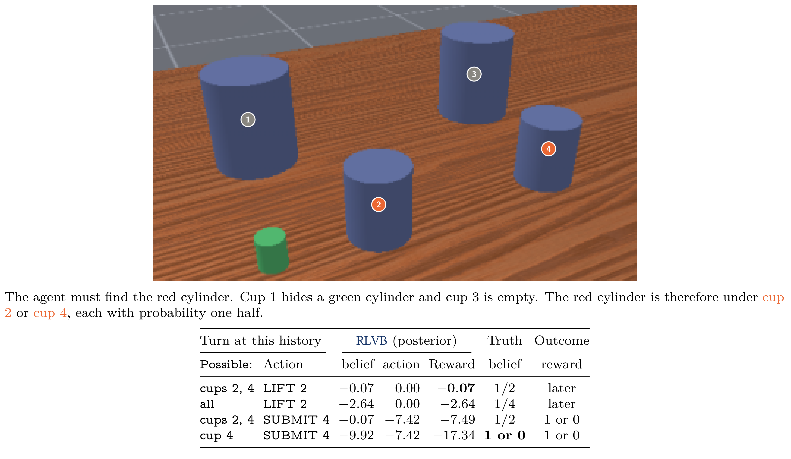
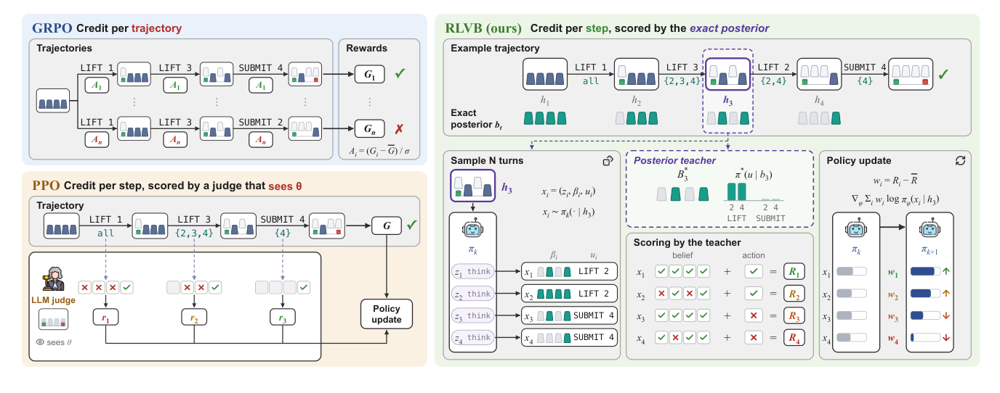
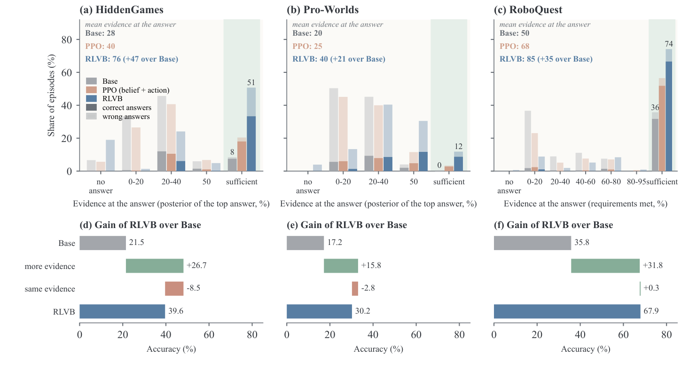
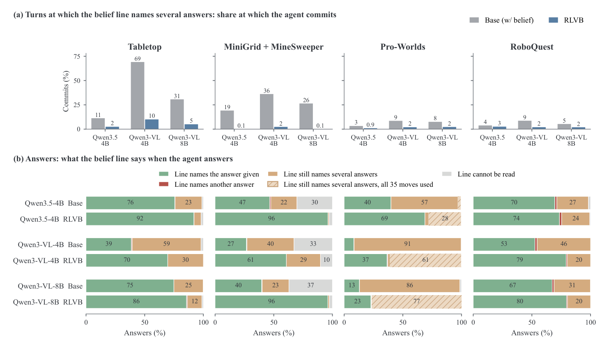

<!-- paper-reading-lang: zh-CN -->
<!-- paper-reading-mode: deep -->
<!-- paper-reading-theme: cobalt -->

<!-- Deep Reading coverage
| 原文对象 | 论证职责 | 本文位置与状态 |
| --- | --- | --- |
| §§1–3.1，Figs.1–2，Eqs.1–2 | 猜中、相信与有证据地作答 | 01–03，已讲解 |
| §3.2，Eqs.3–4，Appendix A | 前瞻、停止、教师校准 | 04–05，已讲解 |
| §3.3，Eqs.5–6，Appendix B | 动作奖励与可选信念评分 | 06–07，已讲解 |
| §3.4，Eqs.7–10，Appendices C、H | 同历史加权、阶段采样与复现设置 | 08–10，已讲解 |
| §§4.1–4.5，Tables 1–6，Appendices D–J | 三基准、逐任务结果、基线与算力 | 11–13，已讲解 |
| §4.6，Figs.5–9，Eq.11，Appendix K.1–K.6 | 证据构成、单步、策略一致性及干预 | 14–16，已讲解 |
| §§5–6，Appendices L–N，Figs.13–45 | 阶段采样、预算、案例与迁移边界 | 16–18，已讲解整组及代表性片段 |
附录 A–N 按函数、配置、逐任务表、复测和定性图组索引。正文保留证据口径和可计算例子，细粒度提示词、逐种子全表和所有轨迹截图见原文。原文图按 CC BY 4.0 提取。本文未重训或复跑基准。
-->

# RLVB：让智能体按手里的证据决定何时作答

§§1、4.6 的主要观察是，当证据仍允许多个答案、模型也写出了多个候选时，带信念行的基模在约 3.2%–67.9% 的此类回合提交答案。RLVB 把比例降到 0.1%–2.2%。表 1 的九个模型与基准组合平均提升约 17.1 个百分点。正文随后拆开这两件事之间的关系，以及数据何时支持继续搜证这一策略。

§§3.1–3.4 提供训练条件。环境需要枚举候选并按动作与观测更新后验。训练时，这个后验决定哪些动作得到高分。部署到论文的迁移测试时，模型自己读历史，逐轮写仍可能的答案与动作。

**深读对象**为 Richmond Sin Jing Xuan、Peilin Feng、Wenbin Wang、Soujanya Poria 的 [Lazy Agents Answer Against Their Own Beliefs: Reinforcement Learning with Verifiable Beliefs Teaches Them to Act on What They Believe](https://arxiv.org/abs/2611.32884v1)。arXiv v1 于 2026 年 11 月 24 日提交。[点此打开原文 ↗](https://arxiv.org/pdf/2611.32884v1)

```paper-map
{"thesis":"用同一段已见历史计算答案后验，给当前的搜证与提交动作作比较，再训练整轮输出。","reader":"适合研究视觉智能体、多轮强化学习或可验证交互评估的读者。","goals":["用杯子任务手算后验、停止费用和组内信用","分清正确率、证据充分率、提前作答率的分母","重建论文对证据读取、动作质量和停止行为的三条诊断"],"outcome":"建立能区分观察误读、探索质量与提前作答的实验读法。","outcomeSource":"PDF §§3–5、Appendices A–N","items":[{"number":"01","label":"最后一杯到底值不值得翻","signal":"同历史对照","text":"两只杯子仍可能藏目标，翻一只与猜一只得到不同过程分，即使猜到了真答案。","source":"Fig.1、§3.1"},{"number":"02","label":"把所见证据变成后验","signal":"条件化","text":"环境按动作、观察和任务先验更新候选质量，模型只接收已见记录。","source":"Eqs.1–2"},{"number":"03","label":"算提交与再探索的价值","signal":"搜索与停止","text":"有限前瞻加折扣和经验答对率，给老师两类动作各自的概率。","source":"Eqs.3–4、Appendix A"},{"number":"04","label":"把信用给当轮输出","signal":"动作奖励与组内权重","text":"同历史采多个完整回合，主配置按动作打分，阶段内用相对权重拟合。","source":"Eqs.5–10、Appendices B–C"},{"number":"05","label":"拆开九列准确率","signal":"三种基准","text":"逐模型逐基准读取准确率，再独立看早答和 GPU 小时。","source":"Tables 1–6、Appendices D–J"},{"number":"06","label":"把准确率差重算一遍","signal":"证据构成分解","text":"分别算证据档位占比变动与同证据内准确率变动，并保留子集口径。","source":"Eq.11、Fig.5、Table 21"},{"number":"07","label":"定位策略改进到哪一环","signal":"读取、选动作、执行停止","text":"对齐场景和证据，比较单步带来的新增信息以及多候选时的提交率。","source":"Tables 7–10、Appendix K"},{"number":"08","label":"读会拖延和误读的反例","signal":"部署边界","text":"无效动作、预算到期、错误信念和已见证据的误读会限制收益。","source":"§5、Appendices L–N"}]}
```

## 01 / 可验证的对象是当时手里的证据

### 同一历史的两个结局

先从一个可以边看图边复算的例子开始。四只杯子中藏了一个红圆柱。已经翻过一号和三号，观察分别排除两只杯子。二号和四号都符合剩下的观测。代理可以写「二号或四号」，然后翻二号，也可以写同样一句话，紧接着提交四号。如果这局的目标实际在四号，后者很可能被传统终局奖励当成成功示例。换一局，让已观察画面完全一样、目标改在二号，同样的提交会吃到零奖。决策时能获得的证据没有变化，学习信号却因隐藏真值翻转。原文图一在这个时刻并排展示四种可选输出，说明任务需要为证据不足而提交这件事单独计分。



*Richmond Sin Jing Xuan 等，原文 Fig.1，CC BY 4.0，由原 PDF 裁切。表中还展示可选的信念项，主结果的 RLVB 使用动作项。*

### 从日志观察信念与动作

语言输出可以同时包含一个正确承认不确定性的句子和一个冒进决定。信念行与动作的矛盾可直接观察，和「模型实际上知道什么」是两个层次。作者实验里有可对照的目标状态、决策日志和后验重放，因此能够把更多问题定位到控制环节。读者可以拿任意一局，先遮住答案，只用当时的观测重建可能集合，再把线上动作对过去。这个顺序很重要。若先看揭晓后的答案，再判断上一步是否合理，评价里会混进当时拿不到的信息。任务建立后验的研究价值，正来自决策前后有可记录的时间边界。

从相关工作看，终局 RLVR 提供清楚的任务成功定义，过程奖励则尝试把训练信号移到更早的位置。后验教师把后者与部分可观测规划连在一起。训练环境可以看见生成机制，模型在推理时只能看见已获得的观测。只要两者的信息被严格隔开，训练端就能给模型「此时适合补哪项证据」的反馈，也能在测试后重放检验它是否做到。若环境的规则或已见记录含泄漏，奖励会退化成预测隐藏标签，提交时机的解释随之失效。（§§1–2，Figs.1–2）

## 02 / 从隐藏状态到答案分布

### 由观测过滤候选

令固定的隐藏变量为 $\theta$，先验为 $p_0$。第 $s$ 次动作与它之前的序列记为 $a_{1:s}$，返回观测 $o_s$。第 $t$ 次决策开始前，更新只用 $s<t$ 的观测。原文式一先写未归一化权重，再把候选答案所对应的潜变量质量合并。后验最大值与某个给定答案的质量要分开。一个任务可能有不同潜变量对应同一个正确答案，因而状态尚有歧义时，答案仍可能已确定。

$$
\begin{aligned}
w_t(\theta)&=p_0(\theta)
 \prod_{s<t}p(o_s\mid\theta,a_{1:s}),\\
b_t(\theta)&=\frac{w_t(\theta)}
 {\sum_{\theta'}w_t(\theta')}.
\end{aligned}
$$

$$
b_t(y)=\sum_{\theta:\,y^*(\theta)=y} b_t(\theta).
$$

**手算一。** 假设四个位置先验均等，已经确定一号和三号都没有红圆柱。剩余权重为 $(0,1/4,0,1/4)$，总权重为 $1/2$，归一化后二号和四号各为 $1/2$。二号若被翻出是空的，四号权重归一化为一。教学变体把二号和四号的先验设为 0.30 与 0.10，排除同样两只杯子后它们是 0.75 与 0.25。两个变体都有两个可能答案，最优直接猜测的成功概率却分别为一半与四分之三。把可能集合当成均匀分布是一种额外假设，论文用它来解析某些信念行，真实后验则由任务先验更新。

### 概率和候选集合

模拟器中的确定性观测把似然化为保留或剔除候选。在有遮挡、带误差量测的迁移设定中，似然会留给同一观测多种解释，收到一次观测也不会令候选立即归零。评估若只用可能集合大小，就无法比较重复观测究竟把置信集中到了哪里。本文结果以已知生成规则计算的后验为准，精确一词描述环境的概率计算。它并不提升模型的视觉辨认能力，也不能自动为开放任务构造可靠先验。（§3.1，Appendix E）

## 03 / 一轮输出有三块，动作只有两类

### 历史与信念行

每轮生成可写成 $x=(z,\beta,u)$。$z$ 是推理块，$\beta$ 是把当前仍可能的答案写出来的信念行，$u$ 是探索动作或提交。模型看到任务、历史动作与观测、上一轮信念行。先前的推理文本没有作为完整记录继续提供。保留历史意味着对照里的差异基本不来自「这一版记得之前翻过哪只杯子、另一版忘了」。信念行是模型报告的内容，真实的后验支持集是评估可计算量；从模型日志里读出「全部」或只有四号，可以逐轮和环境后验核对。

$$
\begin{gathered}
c(t)=e^{-\lambda t/T},\\
G=c(T_{\mathrm{stop}})\,
 \mathbf1\{y=y^*(\theta)\}.
\end{gathered}
$$

这里 $T$ 是任务步数上限，$T_{\mathrm{stop}}$ 是提交发生的时刻，未提交成功的回合获零终局收益。时间折扣进入原文式二所定义的停止目标。举一个教学设置，若每多走一步折扣乘 0.98，等概率的两杯立即猜有期望 0.50，再走一步若确定目标且能读对，期望为 0.98。若翻杯后模型只能以 0.49 概率提交正确项，追加动作的期望变成约 0.48。这里把识别错误放在准确率项，提醒读者实际的教师需要区分「世界有足够线索」和「当前模型能用这些线索」。

### 三种不同分母

这个目标兼顾省行动和答对。论文的评估还要在结尾报三个分母。准确率按所有 episode 算，提前作答率按给出答案的 episode 算，多候选且证据不足时的提交率按满足两项条件的回合算。一个模型若从频繁早答变成常常超时，第二种比例会明显变好，第一种可能没有改善。每张结果表都要回到原研究问题，确认当前单位是整局、其中成功提交的局，还是局内某轮。（§3.1，Tables 1–2、6、25）

## 04 / 后验教师怎样在现在答和再看一次之间取舍

### 提交和搜证的递推

原文式三的提交价值对时间折扣后的答对机会取对数。$\hat\rho$ 是教师对当前模型答对率的估计。$\hat\rho$ 已包含 $b_{\max}$，因而再乘 $b(y)/b_{\max}$ 使最佳答案的价值仍是 $\log[c(t)\hat\rho(b)]$。搜证的价值是未来各观测发生时最优后续价值的期望，深度决定向前看的步数。留到未来的 posterior 依然由观测决定，无须预先把实际目标交给当前动作打分。

$$
\begin{aligned}
b_{\max}&=\max_y b(y),\\
Q(b,y)&=\log[c(t)\hat\rho(b)]\\
&\quad+\log[b(y)/b_{\max}].
\end{aligned}
$$

$$
\begin{aligned}
M_o&=p(o\mid b,a),\\
Q_n(b,a)&=\sum_o M_oV_{n-1}(b_{a,o}),\\
V_n(b)&=\max_u Q_n(b,u).
\end{aligned}
$$

### 有限前瞻的边界

附录 A 设零后验答案准确率地板为 $10^{-9}$。到步限或答案确定时的价值取当前答对率与折扣的对数，深度截断时可用 $\hat\rho$ 的上界。这个上界把样本不足的区域留给探索。Tabletop 使用二层前瞻。MiniGrid、FrozenLake、Sokoban 借最短计划上的可见信息给动作估值，MineSweeper 每次看一次揭格后的分布。真实的前瞻在各任务有定制近似，二层枚举的最坏展开量随动作和观测数的平方增长。判断能不能把方法移到自己的模拟器，首先要看观测空间的分支数和先验是否能直接计算。

**手算二。** 在两杯教学局，取当前折扣为一、下一轮为 0.98，模型能读取确定答案。提交价值 $\ln 0.5=-0.6931$，翻一只后的两种观察都确定目标，搜证价值为 $\ln 0.98=-0.0202$。若另一个动作有一半概率保持当前分布，另一半概率把答案确定，深度一的价值是 $(\ln 0.49+\ln 0.98)/2=-0.3668$。它优于猜测、弱于可靠翻杯。这里使用了平均对数的原式，也能看出高风险分支的处理。一个分支让成功机会很低，会在对数空间占更大损失。附录 A 的命题要求前瞻一直到总步限、答对率估计正确、温度趋近零，才有对相应停止目标的最优性结论；实验的浅搜索保留近似误差。（§3.2，Appendix A）

## 05 / 将两类动作映射为可训练的软分数

### 提交门与等值分组

用两类动作各自最优值之差 $\Delta$ 决定提交门。温度 $\tau$ 控制平滑程度。进到提交或搜证层后，再在层内按候选价值分配权重。附录 A 的实现将等值搜证动作合并成组，同组每个动作共享整组概率，避免给动作空间加一批等效副本就改变每个原有选择的分数。由此需要区分对组归一化和对去重前每个动作归一化。读 Fig.1 时，两种同价值的探索选择可以都接近零对数分数，这与实现的分组口径一致。

$$
\begin{aligned}
Q_Y&=\max_y Q(b,y),\\
Q_A&=\max_a Q_n(b,a),\\
\Delta&=Q_Y-Q_A,\\
p_{\mathrm{ans}}&=\sigma(\Delta/\tau).
\end{aligned}
$$

$$
\begin{aligned}
p&=p_{\rm ans},\\
s_y&=\operatorname{softmax}_y(Q/\tau),\\
s_a&=\operatorname{softmax}_a(Q_n/\tau),\\
\pi^*(y\mid b)&=p\,s_y,\\
\pi^*(a\mid b)&=(1-p)s_a.
\end{aligned}
$$

**手算三。** 用上一节的两个最优值及教学温度 $\tau=0.1$，得到 $\Delta=-0.6729$，提交的总概率约为 0.00119。两种提交等价时单个答案分到约 0.00060，对数分数约为 $-7.42$。若搜证被视为一个等值组，取它的概率约 0.99881，对数约 $-0.0012$，两位小数显示为 0.00。这样复现了 Fig.1 的量级。把同一套当前观测放进模拟器两次，只改变未见到的真正藏处，教师的这两个分数保持相同。

### 让教师适配当前模型

教师的 $\hat\rho$ 通过历史答题来校准。附录 A 按可能答案数分桶，最高桶为四与以上。每个样本的相对分数 $r_y=b(y)/b_{\max}$ 衡量提交相对于该时刻后验最优答案的损失。按场景与分桶的单元平均，再按当次更新的平均单元样本数重标度，借先验均值为一和四个伪计数防止早期剧烈摆动。教师可以观察到某类画面目前很容易被模型看错，于是提高继续搜证的相对价值。若错误估计持续降低提交价值，同一个机制也会引入拖延。后文消融固定 $\hat\rho=b_{\max}$ 的做法，正是把基模自己的识别误差和环境证据拆开。（Appendix A，Eqs.12–14，C.4）

## 06 / 主训练给动作评分，梯度覆盖整轮文本

$$
R_{\mathrm{act}}(h,x)=\log\pi^*(u\mid b(h)).
$$

### 整轮更新的范围

主配置只用这个动作项。教师知道本回合证据支持什么，给当前动作相应分数。训练拟合的样本却有完整推理、信念行和动作，动作选择与它之前的文字共同更新。当前缀写多种候选之后接调查常被升权，写同样候选后接提交常被降权，模型就可能形成依赖自身信念行的行为。可检验的信号是这种依赖在未见场景里的联合频率和条件频率，训练日志单独无法证明模型内部实现了同样的概率图。



*Richmond Sin Jing Xuan 等，原文 Fig.2，CC BY 4.0，由原 PDF 裁切。图中同一历史重采四个回合，作者用它说明相对更新。*

### 三种过程信用

终局 GRPO 的组由多条轨迹构成，同一条轨迹的各轮共享最终优势。一条正好猜中的路径与一条猜错的路径前面可以包含完全相同的观察动作，两边这些动作仍拿到异号信用。论文采用的 PPO 评审基线把真值交给判信念的模型，给真实陈述过程奖励，早答和继续主要仍由回合结果归因。RLVB 的比较固定起点历史以及该历史的后验，因此把「此刻再翻一只」的评价与「这局最后恰好猜对」拆开。基线同时改变学习信号与部分输出格式，比较足以读取这套协议的结果。若要进一步识别因果份额，需要对同一输出形式、同样历史覆盖与同样训练预算分别控制。（Fig.2，§§2、3.3、4.2，Appendix I）

## 07 / 可选的信念项怎样处罚漏报和泛报

### 三项可选信念得分

原文给了一个附加变体。把模型写的集合 $B$ 按均匀选项解释，域外选项的对数分数设为 $-m$。$S$ 处罚没有覆盖到的真实后验质量。$W$ 镜像地惩罚候选里已被排除的比例。$S_{\mathrm{dec}}$ 将该行当作后验输入老师，算出它会导致什么动作，再在真实后验下检查这个动作。并列最优取均值，无法解析的行有地板分数。这个决策项让会导致同一动作的不同表述有机会得同样分，配合较小权重的集合项打破了部分并列。

$$
\begin{aligned}
S(\beta;b)&=\sum_y b(y)\log b_\beta(y),\\
W(\beta;b)&=-m\,\frac{|B\setminus B^*|}{|B|}.
\end{aligned}
$$

$$
\begin{gathered}
a_\beta=\arg\max_u\pi^*(u\mid b_\beta),\\
S_{\mathrm{dec}}=\log\pi^*(a_\beta\mid b),\\
R=R_{\mathrm{act}}+S_{\mathrm{dec}}+\eta(S+W).
\end{gathered}
$$

**手算四。** 附录表 11 有十六个可能目标，真实后验均匀在三项，$m=50$。精确写三项时 $S=-\ln3=-1.10$、$W=0$。全写时 $S=-\ln16=-2.77$，$W=-50(13/16)=-40.625$，总分约 $-43.40$。写三项全错时 $S=-50$、$W=-50$。只看 $S$，全写比精确只差 1.67 nat。风险加大后，广撒候选的收益明显下降。附录还指出：非均匀后验下，有限惩罚可能让最佳集合省略极低质量的项；处理连续置信时不能未经验证就把这个有限集分数当严格适当的分布评分。

### 候选匹配和停止时机

论文证据支持的是主配置中的可验证后验动作奖励，以及对信念项的独立消融。加上信念项提高某些集合匹配率，尤其 Tabletop 上两款 Qwen3-VL，却让模型更频繁在写出单一候选的瞬间提交。诊断的一项实用启发是分开追踪三件事：输出能否解析、候选集合是否覆盖后验、动作是否符合证据。若把它们混在一个「信念好」指标里，纯格式改进和过度自信可能同时出现。（§3.3、Tables 3、5，Appendix B）

## 08 / 在同一个历史里比较候选回合

### 历史从哪里来

阶段开始时冻结当前策略 $\pi_k$。它先和任务交互、收集会抵达的历史，教师以逐阶段衰减的概率替换执行动作。半数训练场景还会加一条由随机取证动作开头的 episode。这样能覆盖模型本来极少走到的状态，例如它通常在两只杯子尚未排除时就停，教师或随机前缀能给数据集中添入「多看一只后的画面」。随后在每个已挑选历史上，用冻结策略重采样多种思考与动作续写。将候选拿回同一个后验打分，一次比较共享完整的观测历史。

$$
w_i\propto R_i-\frac{\sum_{j\ne i}R_j}{N-1}.
$$

$$
\begin{aligned}
\ell_i(h)&=\log\pi_\phi(x_i\mid h),\\
\mathcal L(\phi)&=-\sum_h\sum_i w_i\,\ell_i(h).
\end{aligned}
$$

**手算五。** 令同一历史的三个候选原始奖为 $0,-1,-7$。逐个减去其他候选的均值，得到 $4,2.5,-6.5$。三项总和为零。简化例里的正分代表在同历史下相对较好，论文实现还要套绝对接受门。若第二个候选被教师判为拒绝，它的正权重立即截到零，最差候选仍可得负权。接受门约束为 $\pi^*(u\mid b)\ge \pi^*(u_{\rm best}\mid b)/20$。因为 $\ln20\approx3.00$，若最佳动作对数分为 $-0.10$，差过三 nat 的候选不能得到正监督。设所有采样都走同一个明显错误方向，这道门可以阻止某个稍轻的坏动作仅凭对照构成被升权。

### 拒绝门与无梯度组

样本极少时，三个候选会碰巧一模一样，组内中心化后给不出梯度。论文先检查每组是否有可用候选，必要时对当轮再采一次。采样覆盖、接受阈值和零学习信号是可独立记录的三个事件。梯度版本把差值限制在 20 nat 的窗口内，避免一个极差回合抬高其他全部权重。分数在对数概率单位上已经有尺度，作者没有按组内标准差再归一化，原因是组内几乎没有差异时也会被强行放大。两个研究者要复现组间分布时，应保存拒绝前的值、进入权重的值、实际参与更新的标记和同历史的探索结果。（§3.4，Appendix C.1、C.3）

## 09 / EM 与策略梯度共享目标，拟合方式不同

### 冻结策略上的改进目标

每个历史的改进目标可看成最大化平均奖励，同时付出偏离冻结策略的代价。定义 $Z_k$ 是指数重权重的归一化常数。将 $\log q_k$ 展开并移项，得到 KL 的等价式。右侧第一项固定，第二项仅在新策略等于 $q_k$ 时消失。这个推导讨论每个历史上不受模型容量与有限样本约束的最优解，实际训练通过采样和有限次拟合近似它。

$$
q_k(x\mid h)=
 \frac{\pi_k(x\mid h)e^{R(h,x)/\alpha}}{Z_k(h)}.
$$

$$
\begin{gathered}
\mathbb E_\pi R-\alpha D_{\rm KL}(\pi\|\pi_k)\\
=\alpha\log Z_k-\alpha D_{\rm KL}(\pi\|q_k).
\end{gathered}
$$

**手算六。** 假设冻结策略从同一历史以 0.6 概率生成探索、0.4 生成提交，动作奖为 0 与 $-2$，取 $\alpha=1$。未归一化质量是 0.6 和 $0.4e^{-2}\approx0.0541$，新分布约为 0.917 和 0.083。再把接受门应用到同样两类，若提交的教师概率比最佳动作仍大于二十分之一，可以保留它。将分差改成 $-4$ 时，概率比约 0.0183，提交会在 EM 拟合里被直接置零。原策略从未采到的行为无法由指数倍增创造。因此作者在实现里安排同历史再采样、教师辅助抵达历史，这也解释了纯靠损失加权解决不了数据覆盖。

### 两种拟合的实际差别

EM 实现归一化候选的非负权重，按系统重采样抽取目标拟合，低权重的行为是通过概率总和的竞争退下去。策略梯度拟合正负权重，能明确把拒绝动作概率向下推。附录 C.5 证明，在不加截断和接受门的教学极限，EM 权重高温时可展开为均匀项加中心化奖励，中心化后与组内相对优势同方向。低温则会把质量集中到组内最高分项。相同公式家族在有限温度、有限拟合和不同过滤规则下，得到不同模型。表 1 的两个主变体还有另一个差异：EM 带信念加分。比较学习器本身时应读表 5 中同奖励的结果，而非只用两个主结果相减。（Eqs.8–10、15、17–19，Appendix C.2、C.5）

## 10 / 阶段复用的具体保护机制

### 探针检查与停止阈值

阶段内复用冻结策略采得的历史与样本。候选可以由同一份推理块接出多种短决定。固定样本减少等待环境的时间，同时可能让拟合越来越偏离采它的分布。论文各阶段在探针生成前缀上，用冻结策略逐 token 对当前策略测前向 KL。超过界限就停止本阶段，按更新后的模型进入下一阶段。理论目标的 KL 与探针方向要分别记。前者惩罚目标策略偏离先验，探针用冻结分布作平均，检查已用样本附近的位移。

$$
\begin{aligned}
p_k&=\pi_k(\cdot\mid x_{<p}),\\
p_\phi&=\pi_\phi(\cdot\mid x_{<p}),\\
D_p&=D_{\rm KL}(p_k\|p_\phi),\\
\Delta_k(\phi)&=\frac1{|P|}\sum_{p\in P}D_p.
\end{aligned}
$$

### 模型与阶段配置

附录 H 表 19 给出阈值 0.015 nat/token、探针 32 个候选回合、LoRA rank 16、训练和测试推理预算 8,192 token。两个 Qwen3-VL 主配置每阶段采 1,200 个历史，使用 800 个，计划两个 25 更新的阶段。Qwen3.5-4B 主配置每阶段采 240、使用 160，五次更新后换样本，合计 25，并关闭长度奖励。附录 C 的长度奖励在同组中略偏向正确短推理，最长与最短相同则该项为零。推理块与短决定块分别裁剪梯度范数。重算候选 token 概率时，温度、存在惩罚及推理块的 top-p/top-k 截断与生成用的分布对齐。正负权重还分别按每 token 相对于冻结策略的对数比保护。

这里的可复现信息包括组是怎样组成的、谁负责走真实环境、训练日志是否分开记录重采样时间、分块裁剪按什么口径。只保存一条输入输出与最终的 LoRA 权重，无法恢复同组竞争，验证时也难区分好候选早已出现与模型靠阶段轮转后来才采到。设想两个团队同样做五十次更新，一个每次重玩新局，一个按阶段取样复用，即使有效更新数接近，两者用过的历史数量与游戏难度构成也会变化。这个区别在附录 L 的壁钟时间和超时比例上有直接表现。（Appendices C、H、L）

## 11 / 三个基准检验不同层次的迁移

| 基准 | 测试单位 | 与训练的关系 | 充分证据的诊断 |
| --- | --- | --- | --- |
| HiddenGames | 七类任务，756 个新游戏 | 任务类别在训练中出现，测试种子、地图或颜色不同 | 五类有提交答案的任务可用后验检查 |
| Pro-Worlds | 15 个游戏各 20 局，每局最多 35 步 | 视觉窗格问题不进入 RLVB 训练 | 游戏引擎能枚举后验，诊断阈值 0.95 |
| RoboQuest | 十类模拟移动操控任务，每类 50 局 | 基准独立于 RLVB 训练 | 用任务记录的反馈检查要求，机制分析取八类可计数任务 |

### 训练内外的场景

HiddenGames 由扫雷、KeyCorridor、FrozenLake、推箱子以及杯子、灯、木块三种桌面任务构成。训练可能见过同种规则，测试仍需要处理不同实例。部分任务结束于到目标状态，无须显式提交，所以主成功率和提前提交诊断覆盖的任务不同。Pro-Worlds 屏幕一次只给一格，答案通常在八个图中选一，Jigsaw 有十个。很多位置对选项区分没帮助。RoboQuest 记录一次巡查、称量或打开容器产生的反馈。它用环境模拟物理与交互过程，主结果属于模拟评估。把三项简单写成「模型真实环境推理能力」会丢掉能核查结果的条件。

### 作为参照的后验教师

附录 D 的 teacher-only 对照固定老师停止规则，换掉其选择取证动作的方式。756 局 HiddenGames 的前瞻老师正确率 97.5%，随机合法动作 56.2%，平均步数 5.7 对 15.1。杯、灯和块等规则下随机合法动作也可都成功。难题才有大差。扫雷随机策略容易在未完成时结束，KeyCorridor 盲走到正确视野可能很慢。附录 G 展示 Pro-Worlds 教师能做完所有测试局，平均约 14.7 步。它知道后验且按最佳答案提交，适合作充满特权信息的参照；论文给的数值也保留两个边界，老师在扫雷仍可能踩雷，RoboQuest 没有对应的精确教师。（§§4.1–4.2，Appendices D–G）

## 12 / 把主表逐列求差，再看哪些读法成立

| 模型 | HiddenGames Base → RLVB | Pro-Worlds Base → RLVB | RoboQuest Base → RLVB |
| --- | ---: | ---: | ---: |
| Qwen3-VL-8B-Thinking | 22.9% → 31.1% | 14.8% → 29.9% | 36.2% → 62.7% |
| Qwen3-VL-4B-Thinking | 24.6% → 36.2% | 17.2% → 28.7% | 28.4% → 61.2% |
| Qwen3.5-4B | 26.5% → 48.5% | 20.2% → 32.1% | 39.6% → 54.0% |

**手算七。** 九列绝对差依序是 8.2、15.1、26.5、11.6、11.5、32.8、22.0、11.9、14.4 个百分点。它们合计 154.0，除九约 17.11 个百分点。这里每个模型和基准组合等权。将三个数据集各有多少局乘进去，会得到另一个按 episode 加权的估计量。若想报告相对变化，例如第三列的 36.2% 到 62.7%，相对增长约为 73.2%。研究简报应优先保留表中的绝对差和按列均值口径，否则三个近似正确的数字会指向多个不同问题。

### 八列优势与一个反例

两种 RLVB 主变体合计赢得八列最好成绩。EM 的 32.4% 在 Qwen3-VL-8B 的 Pro-Worlds 优于梯度版的 29.9%。Qwen3.5-4B 的 RoboQuest 则由带评审过程奖励的 PPO 以 57.1% 领先梯度版 54.0%。表中的实验分别跑三个测试采样种子并取均值。正文脚注另报告 Qwen3.5-4B 的少量不同训练配置能带来数个百分点波动。比较很接近的列时，应查成对区间、训练重复与协议变化。论文为部分消融给出这种区间，主表没有为每个小差提供同等统计证据。

### 逐任务分布与基线口径

附录 F 逐任务结果给出看均值的原因。灯和杯等合适机会多的任务拉升 HiddenGames，MineSweeper、MiniGrid 没有同样收益。RoboQuest 的搜索场景改善很大，遇到基模已容易获取必要反馈的个例，训练也可能有回退。附录 J 把训练损失口径列开。SFT 用胜局教师动作作为标签，常规轨迹强化覆盖整轮并用终局折扣。附录 I 的评审基线单独打格式、观测更新与真值一致性等分数，再配合结果训练。基准共享的是目标任务和起始模型，样本生成、回合形式与求值机制各有约定。正因为存在这些差别，表 3 的同主干消融更适于局部归因。（Tables 1、3、15–20，Appendices F、I、J）

## 13 / 样本量、信念奖励与训练成本

### 相同小样本设置的消融

Qwen3-VL-4B 在表 3 中缩小历史采样集后，HiddenGames 从 36.2% 到 35.3%，Pro-Worlds 从 28.7% 到 23.9%，RoboQuest 从 61.2% 到 55.5%。在同一个小样本设置给信念行再加分，三个结果依次是 35.9%、21.7%、45.8%。只保留信念项并关闭动作接受门时结果是 24.6%、14.6%、19.7%。小样本更影响两项跨基准迁移，直接训练文本集合未让总体行为同步改善。因为最后一项还移除了接受门，具体下降可以拆成若干有交互的改动，在文章中应按实际消融配置归因。若要把效果移植到新训练器，同时保留同一行动接口和样本集比较会更有解释力。

### GPU 小时与评审调用

训练成本应写出模型和量纲。Qwen3.5-4B 同规格 A100 上，评审 PPO 用 120.1 GPU 小时，RLVB 用 74.2，RLVB（EM）用 29.7。分别以 120.1 除后两者得约 1.62 和 4.04 倍。评审另外发约 12,600 次模型调用。两款 Qwen3-VL 的 H200 小时不能直接和 A100 的时长相除去外推相同硬件效率。附录 L 是另一类比较，在 Qwen3-VL-4B 对阶段样本复用和每更新重采样用壁钟时间，时长要按相同实验报告讲。关注成本时，至少查 actor、critic、评审模型、环境 rollout 这几项是否入账，以及能否把同型 GPU 的变动解释为单一机制。

原文 Fig.3 又提供一个训练信号侧的诊断。终局 GRPO 到约五十更新时，18.8%–53.1% 的组没有一个采到胜局，组内无优势差。RLVB 的两款 Qwen3-VL 约 2% 的组无梯度，Qwen3.5-4B 约 14%。因为两种方法对组的定义不同，百分比表示各自少出全同分组，不能直接当作每 GPU 小时的一比一有效样本倍数。试图把算法扩到新的任务时，观察什么候选经常同分，有助于识别奖励贫乏与动作采不出来这两种不同失败。（§4.5，Tables 3–5，Fig.3，Appendices H、L）

## 14 / 把总体准确率拆回作答时手里的证据

### 证据档位和条件正确率

作者在机制分析中按证据分档。HiddenGames 的五种提交任务和 Pro-Worlds 用提交时最可能答案的后验，阈值 0.95。RoboQuest 八类有可计数反馈的任务用要求满足比例，满足全部才算充分。令 $f_m(e)$ 为方法 $m$ 在档 $e$ 作答的 episode 占全体比例，$a_m(e)$ 是这些作答的条件正确率。未答单独计零。两方法每档对称分解，防止任意选一方作权重就改变归因尺度。

$$
\begin{aligned}
\mathrm{Acc}_m&=\sum_e f_m(e)a_m(e),\\
\Delta\mathrm{Acc}&=\sum_e\Delta f(e)\,\bar a(e)\\
&\quad+\sum_e\bar f(e)\,\Delta a(e).
\end{aligned}
$$

**手算八。** 用两种档制造教学例。基模低证据与高证据作答份额是 0.75、0.20，条件正确率 0.20、0.80，总正确率 0.31，余下 0.05 未答。新模型的份额是 0.40、0.50，条件正确率 0.18、0.74，总正确率 0.442，余下 0.10 未答。第一项为 $(-0.35)(0.19)+(0.30)(0.77)=0.1645$。第二项为 $(0.575)(-0.02)+(0.35)(-0.06)=-0.0325$。相加等于正 0.132。档内准确率都降了，总成绩仍上升，因为更多作答移入高证据档。这一事实也提示需要公开每档的样本数。若一档只有少量作答，它的条件率会有较大不确定性。作者用重采样给分解加区间，并确认在相同测试游戏里充分证据作答也常更准确。



*Richmond Sin Jing Xuan 等，原文 Fig.5 图面，CC BY 4.0，由原 PDF 裁切。对应数值在下文逐项列出。*

### 从论文读出两项贡献

HiddenGames 子集的构成与档内两项约为 +26.7、−8.5 个百分点，总成绩按同口径 21.5% 到 39.6%，显示保留一位小数后的分解会有 0.1 个百分点舍入差。Pro-Worlds 为 +15.8、−2.8，RoboQuest 为 +31.8、+0.3。三项充分证据后作答的 episode 占比，约从 8%、0.4%、36% 到 51%、12%、74%。按档分解是观测分布的恒等式，档内的实例和经过的历史仍有差异。它可以指出准确率上升伴随哪类行为变化。若希望知道同一模型被强制看同一段证据后的净变化，还需要额外干预或同历史回放。（§4.6，Fig.5，Eq.11，Appendix K.1）

## 15 / 三条诊断路径指向不同瓶颈

### 读取证据

第一条是读证据。表 7 按所有回合算信念行和后验支持集是否相同。带信念行基模的 Qwen3.5-4B 在 HiddenGames 为 47.8%，RLVB 为 60.3%，而 Pro-Worlds 从 82.4% 到 75.0%。作者另外报告 HiddenGames 部分差异来自未能解析的信念行变少。训练前后看过的状态本来就不同，所有回合的平均值还混入探索深度。表 8 再将方法限制在共同到达的状态，以游戏和剩余可能答案数对齐。训练后某些子组较少在证据不充分时过早缩成一个候选。这个对照减少总体路径差异，仍可能有同样候选数却观察内容不同的历史。具体可迁移的观察是：完整平均、共同条件和无法解析比例缺一项，都可能让读者误判信念改进。

### 选择动作

第二条是一步能获得多少新证据。Fig.7 按从开局跟踪到相同观察步数的区间统计正确项后验增长，RoboQuest 用新满足的任务要求。Table 9 又在共同状态比较有用动作份额和单位动作信息增量。强化后行为经常带来更多总证据，单步的新增量却约和基模同级。附录 K.3 同时把基模停下的局继续用随机动作跑、用同局同动作数匹配随机轨迹，并评估选中动作离教师最优有多远。这样把能否再走几步、每步是否有效和理论上有没有更好动作分开。若将多行动的模型直接比末尾状态，会把延长搜索误写成规划一步更聪明。

### 决定何时提交

第三条是报告不确定后还会不会贸然提交。在证据不足而且信念行写出多候选的回合，RLVB 的提交比例为 0.1%–2.2%，带信念行基模为 3.2%–67.9%。区间端点跨模型与任务组，不能拿两端任意配对作倍数。表 25 依组合报告 bootstrap 区间。共同状态下，桌面任务的不足证据提交从 45%–87% 到 5%–12%，RoboQuest 从 30%–49% 到 7%–13%。作者用两方向的组分交换，把信念行的组成和同一类型信念行的提交倾向拆开。桌面任务早答减幅的 53%–83% 归于后一个量，Pro-Worlds 几乎都归于它。这个分析最直接解释为何正确率会上升，也留下一个条件：出现错误的单一候选后，停止倾向可能把误读固化成答案。（§4.6，Figs.6–9，Tables 7–10、25–35，Appendix K.1–K.3）



*Richmond Sin Jing Xuan 等，原文 Fig.8 图面，CC BY 4.0，由原 PDF 裁切。图八上栏按多候选回合统计，不预先限定证据不足；不足证据子集请看原文 Table 25。*

## 16 / 第一条过早收敛的信念行仍能令全局失败

### 第一次写出单一答案

Fig.9 复查训练后的模型第一次写出单一答案的时刻。如果当场提交那个答案，与实际完成任务的准确率差别在九个分析设置里都不超过 2.3 个百分点。模型留下的额外动作有时复核已猜答案，大多沿用同一判断。论文用杯子和灯说明，有时它确实再翻一次，但下一行仍可能复述第一次的错解。按同样充分阈值筛选 RLVB 的提交，HiddenGames、Pro-Worlds、RoboQuest 的正确率约 65.7%、73.7%、89.8%。得到足够证据与理解这些证据因此能分开检查。有些实验题从本体状态推断答案只需要很少步骤，对视觉中的形状、颜色或位置读错依然会输。

### 干预与尾步复测

附录 K.4 在推理的外层驳回首次提交，并要求确认是否有足够证据。这个提醒令基模 RoboQuest 准确率提升 6.1–11.3 个百分点，HiddenGames、Pro-Worlds 变化最多约 1.9 个百分点。外层程序只知道有提交发生，对图像里的哪条线索缺失无从评估。若要区分「一个额外提示给模型多点时间」和「模型已学会跟证据停止」，可同时记是否继续拿到新证据、是否改答案、最终正确率三列。原文这个检查能指导小部分场景，但覆盖不了视觉谜题中已发生的错误解释。

附录 K.5 检查每次重采样的 on-policy 变体，观察已满足证据却无提交、在尾步强制回答，以及延长阶段里的步数是否继续带来信息。K.6 的定性图组示范 Pro-Worlds 局部窗口找到线索的区域密度，兼有扫雷与搜索室长短路径。它们解释为什么「还没证据，继续」不能独立成为无预算的策略。给任务增加查询成本时，需要一并计下无结果和没有提交。一个部署方可能宁愿要带条件地答复，另一个需要等待人工确认，研究给出的二元提交接口都没有直接覆盖这些策略。（Figs.9、12，Tables 22–24、36–37，Appendix K.4–K.6）

## 17 / 保住探索意愿之后，如何看待拖延

### 重采样会把轨迹拉长

附录 L 用 Qwen3-VL-4B 比较阶段采样与每次更新重新跑新局。阶段版约 6.4 小时走完实际对照，每次更新版约 20.8 小时后在 46 更新处停止。重采样版生成的训练回合从前十次更新平均约五轮，延长到最后十次约二十轮。Fig.13 的对照中，它在三个测试集都略低或更低，HiddenGames 的差距最大。两种方案重新探索次数、平均路径长度、更新时间和没有提交的比例同时变化；应将这看成作者对两种完整采样制度做的对照。长期更新可能放大相对低廉的等待成本，因为模型越常听到「继续」，新采集的路径越长，也会把越来越多相似的低信息回合带入数据。

### 限制没有新增证据的动作

附录 C.4 在 Qwen3.5-4B 测了三条抑制空转的规则。固定答对率至后验最大值，剥离估计误差带来的拖延；对无信息或非法动作设置教师分上限；缺失正例时加入教师行动。组合的 RoboQuest 成绩上升 2.9 个百分点，配对测试 $p=0.014$。HiddenGames 的 +1.6 和 Pro-Worlds 的 −0.2 则没有报告可比的统计支持。在原始主配置把三个改动同时换进去之前，需要衡量它会不会拒绝为获取远期观测必需的准备步骤。有的观察就藏在打开柜门之后，打开动作在一步内未直接改变后验，浅搜索不够远时很容易被错罚。这也是停止模型需要和取证规划协同评价的实例。

### 增大思考预算的实验

附录 M 将基模推理上限从 8,192 加倍至 16,384 token，在作者补测的三模型三基准里，变动范围约 −0.4 至 +2.6 个百分点，未报告显著变化。表 38 的基模数值属于复测，和表 1 采用的测试结果有少量变动，所以应在表 38 内按相同模型、相同基准比较两个预算。预算干预回答的是这组基模在增大思考 token 容量后会否取证更多、准确率改善。检验代价更高或观察更难的任务，仍要另外记录实际生成 token 数、推理是否触顶、每轮搜索动作以及提交时证据。若把多想一分钟和多获得一项外部观测混成同一个资源，行为实验会无法定位可控变量。（C.4，Tables 12、38，Appendices L–M）

## 18 / 用逐局案例追踪能迁移什么

### 粉色与橙色圆柱两局

附录 N 表 39 给两局杯子作为机制例子。第一局粉色圆柱真实在一号杯。带信念行基模在没有新观测时写二、三号仍可能并提交三号。RLVB 先翻二号，随后翻一号看到粉色圆柱才提交。第二局橙色圆柱在四号杯，模型依次把三个橙色立方体排除，看到四号杯下目标后反而写五号并提交。后一个路径保留了等待策略的收益，也直接呈现视觉误读怎样沿动作接口变成错误答案。图 14–45 逐任务记录不同方法失败所在轮和成功时的提交轮，涵盖桌面操作、网格导航、滑窗图像与模拟室内查验。它们是定性追踪材料。比较失败普遍程度要回到附录 F、K 和未答比例。

### 部署需要的证据条件

这项方法的迁移价值取决于任务中能否建立「什么时候已有足够证据」的外部参照。在新基准上可以先保存截至每次动作之前确实看到的证据，用相同的提交通道统计任务成功、无答案、早答与档内正确率，再设同历史动作分差的训练改造。对网页检索或机器人真机，先验和似然往往无法精确建立。来源互相转引时，多看一页的证据可能只是重复；机械设备的感知存在误差，成功反馈也可能来得更晚。后验近似、反馈可靠性、域外新状态覆盖与动作成本都需要独立验证。开放域若无法构造精确后验，也可以研究可重复的证据要求代理量，但代理量能答什么问题、哪些语义没有纳入，应随报告一起公开。

可复核的工程启示是保留一次「停止决定」自己的上下文和评估记录。日志至少要知道当时哪些候选仍合理、收到过哪些会改变候选的观测、模型最终是否提交、以及停在没有答案的终止条件。试图进一步提升的方向取决于这些量。若高证据条件下也频频错答，优先检验感知和读证据。若低证据时经常提交，改训练期的停止信用。如果证据水平长时间不增长，先检验动作规划和任务预算。三条线的测量可以共享同一批轨迹，却要保留各自分母，才能逐层定位瓶颈。（§§5–6，Appendices A、F、K–N）

```paper-check
{"title":"检验后验、信用和实验归因","items":[{"question":"只有二号和四号未排除，先验分别为 0.30 和 0.10。此时提交二号的后验是多少，另一个是否仍应列出？","answer":"二号为 0.30÷0.40=0.75，四号为 0.25，两项仍在支持集。两项的教师提交价值并不相同。","source":"§3.1，Eqs.1、3"},{"question":"终局验证会奖恰好猜中的四号。比较过程中怎样让隐藏答案互换后得到相同分数？","answer":"固定完整可见历史，用它更新答案后验。在该后验上评估当前动作的教师概率。翻换未见真值但无观测变化时，后验教师的动作分数相同。","source":"Figs.1–2，§3.3"},{"question":"三个同历史候选的奖为 0、−1、−7，留一优势是多少？","answer":"依次为 +4、+2.5、−6.5。实际训练还需施加绝对接受门与分数截断，拒绝动作最多得到零权重。","source":"Eq.10，Appendix C.3"},{"question":"三基准各三模型平均提高 17.1 个百分点，是否按所有游戏的数量加权？","answer":"按 Table 1 九列等权。不同基准测试局数不同，汇合所有局需另算一个加权平均。","source":"Table 1，§4.2"},{"question":"模型训练后总准确率上升，档内准确率反而下降，怎样解释？","answer":"将全部 episode 份额与各证据档的条件准确率分开。更多答案在高证据档给出，因此第一项可超过第二项的损失。须保持同一分析子集和未提交计分。","source":"Eq.11，Fig.5，Appendix K.1"},{"question":"如果代理常走很多步却仍没有答案，怎样查明是停止策略、读图还是选步出错？","answer":"比较达到充分证据的份额、同证据档和共同状态的正确率、以及单位动作新增信息。已充分仍未答提示停止问题，充分仍答错提示证据读取问题，新增信息低提示探索动作或环境瓶颈。","source":"§4.6，Table 9，Appendices K、L"}]}
```

## 来源与核对范围

<details>
<summary>查看原文版本、附录范围与图源许可</summary>

- Richmond Sin Jing Xuan、Peilin Feng、Wenbin Wang、Soujanya Poria（2026）。[论文 arXiv:2611.32884v1](https://arxiv.org/abs/2611.32884v1)，[85 页 PDF](https://arxiv.org/pdf/2611.32884v1)，[HTML](https://arxiv.org/html/2611.32884v1)，[作者代码](https://github.com/declare-lab/RLVB)。PDF 的 SHA-256 为 `eac17284220210dfa063b2fd542e0e055da28954088d18fb80391cc95f6d76b0`。
- 直接核对了论文正文、附录 A–N 的方法、配置、任务结果与定性案例组。手算用于阐明原式，原文数据的复算在各处单独注明。原图由 PDF 裁切，图文许可为 [CC BY 4.0](https://creativecommons.org/licenses/by/4.0/)。

</details>
