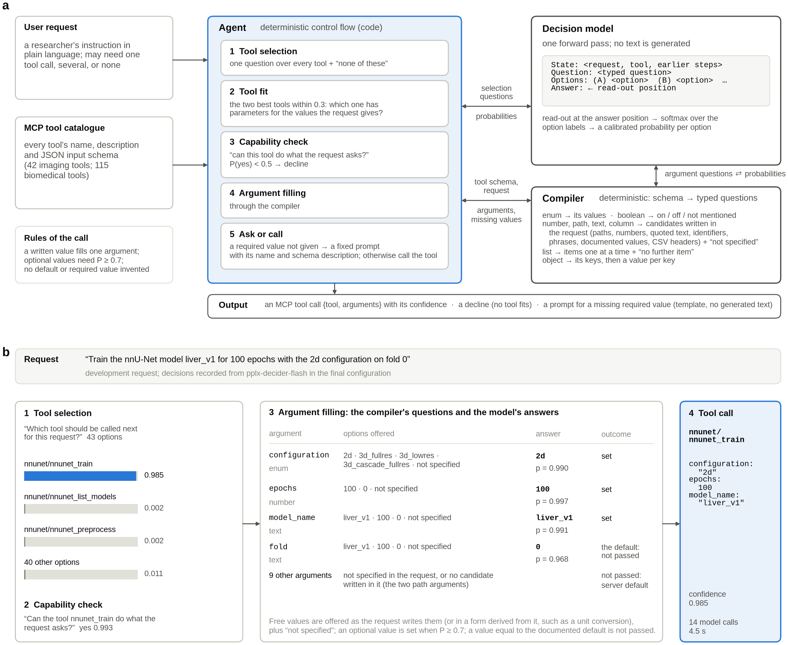
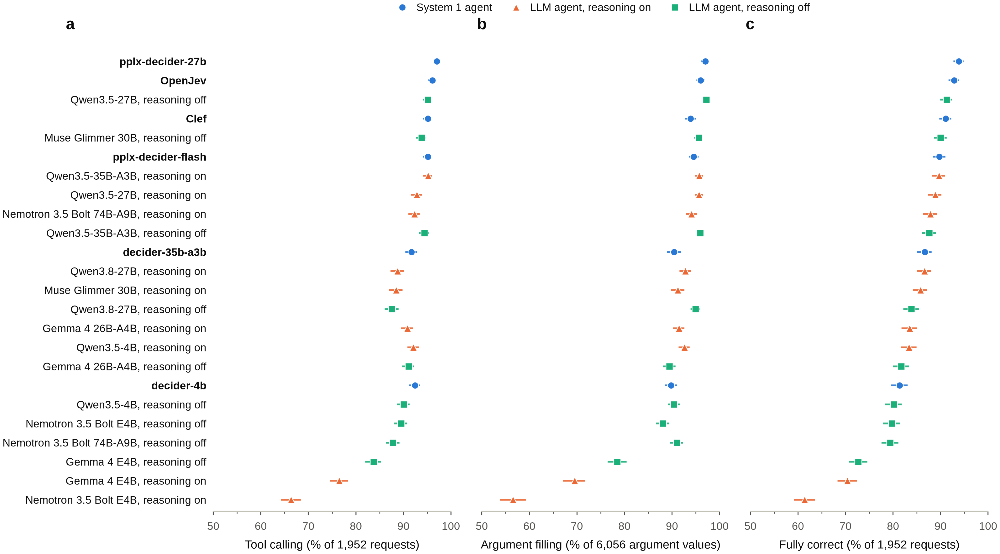
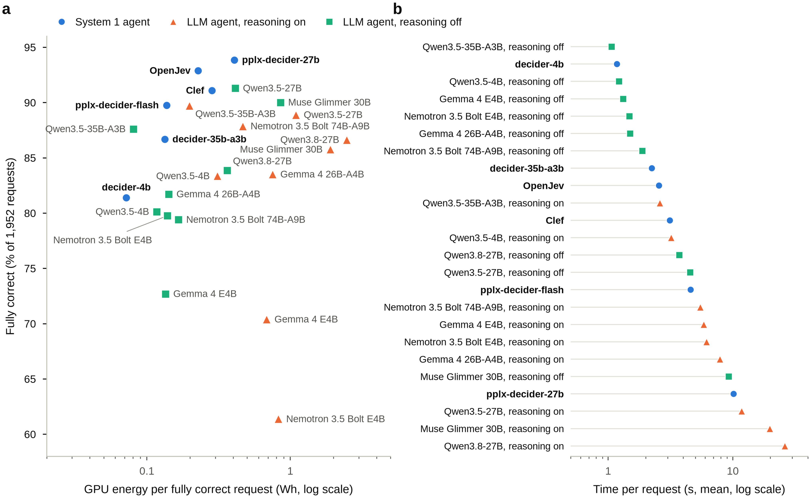

<!-- paper-reading-lang: zh-CN -->
<!-- paper-reading-mode: deep -->
<!-- paper-reading-theme: saffron -->

# System 1 agents：不生成文本的本地工具调用 agent——决策模型选选项、确定性编译器出问题、幻觉零发生

```paper-map
{"thesis":"克里特大学与卡罗林斯卡医学院团队提出：临床等敏感数据场景的 agent 困在隐私（云 LLM 把数据送出去）与可靠性（本地 LLM 幻觉——编造的工具参数值在管线里静默传播）的两难中，而大多数工具调用其实不是开放生成：工具在目录里、值在请求或 schema 里，剩下的只是选择。System 1 agent 三件套：agent 控流（对全部工具+none of these 出选择题，前二概率差<0.3 时追问参数匹配，能力检查<0.5 拒绝）、确定性编译器（把工具 JSON schema+请求转成有限选项的选择题：枚举问值、布尔问 on/off、自由值问从请求/schema/派生规则提取的候选；缺值不填而是提示用户）、决策模型（一次前向出概率分布，六种已发布模型不微调直接用）。幻觉按设计不可能：选项里没有的东西选不出来。157 个生物医学工具、1,952 请求主基准：最强 System 1 agent（pplx-decider-27b）tool calling 97.0%/参数填充 97.0%/全对 93.9%，超全部 18 个本地 LLM-agent 设置（最佳 95.2%）；10,888 次调用零幻觉（LLM 5.5-19.7% 的调用含编造值）；欠指定请求正确处理 86.2-93.7%（LLM 最多 5.7%、62.1% 会编造缺失值）；OpenJev 版 2.6s/请求、0.228 Wh/全对请求，快于且省于最佳 LLM 设置。","reader":"要在隐私敏感场景（医疗/法律/金融）部署本地 agent、或关心工具调用幻觉问题的工程师与研究者；本页把编译器的候选生成代数、阈值决策链、幻觉判定标准、108 对比较与同骨干对照逐个放进可复算的模型。","goals":["走通「两难→工具调用是选择题的观察→三件套架构→编译器候选四源→幻觉零发生的设计论证→三准确率与 108 对比较→同骨干对照→效率账→边界」完整论证","把 97.0%/93.9%/0.0%/86.2%/0.228Wh 等关键数字逐个放回统计框架核算，分清「设计保证的零」与「测量出的零」","标出方法边界：自由值仍从候选中选（候选没提的值拿不到）、modality 类出范围请求最难（57.3% 拒绝率）、36.5% 的 nnU-Net 类多技术参数工具上 LLM 反超"],"outcome":"全文精读 arXiv 2611.21053v1（2026-11-16，18 页 Nature 格式研究论文：主文 7 页+方法+Extended Data Table 1-8 全读），四张关键图 600 DPI 提取嵌入，Table 1 与 ED Table 3-6 逐格核对。","outcomeSource":"https://arxiv.org/abs/2611.21053","items":[{"number":"01","label":"两难","signal":"隐私×可靠性","text":"临床 agent 的两个障碍：云 LLM 把患者数据送出机构（违反数据保护与机构政策）；本地 LLM 更小且逐 token 写工具调用——可能调用不存在的工具、用 schema 没有的参数、或填入用户从未给出的值。幻觉值在分析管线里不显式失败：它改变那一步的结果，后续每一步都建在错值上。推理模式减少部分错误但让每次调用的生成量、时间与能耗翻倍。","source":"引言"},{"number":"02","label":"核心观察","signal":"工具调用是选择题","text":"工具调用的大部分不是开放的：工具列在目录里、几乎每个需要的值写在请求里、或由固定规则（如单位换算）从请求派生、或列在 schema 里——剩下的是一系列选择：哪个工具、哪个值给哪个参数、要不要调用。决策模型（System 1）正是为选择而生：读状态+问题+有限选项，一次前向返回每个选项的概率，不生成、不采样、逐选项打分——接口与任务形态严丝合缝。","source":"引言"},{"number":"03","label":"三件套","signal":"agent+编译器+决策模型","text":"agent 控流：对 157 个工具+none of these 出选择题；前两名概率差<0.3 时追问哪个工具的参数与请求值匹配；能力检查 yes/no <0.5 拒绝；缺必需值时展示固定模板（参数名+schema 描述前 120 字符）等用户填。编译器是确定性代码：枚举问其值、布尔问 on/off/not mentioned、自由值问候选+not specified；列表逐项选；可选参数只在概率≥0.7 才设、等于默认值的不传。决策模型一次前向出概率，六种已发布模型（4-35B）不微调直接用——「不微调」三个字值得停一下：意味着任何新发布的决策模型（明天出一个更强的）可以零成本换入这套框架；框架的全部智能都外置于可替换的模型、全部工程都内置于确定性的编译器与 agent——升级路径与模型生态解耦——这对快速演进的决策模型品类（几乎每周有新发布）是真正的部署意义。六模型横跨三协议家族（decider 的 logit 读取、pplx-decider 的 embeddings 模式+readout 矩阵、OpenJev/Clef 的 native SystemOne 端点），llama.cpp 统一服务——「任何答这个接口的决策模型都能用」不是口号而是实测。","source":"方法节"},{"number":"04","label":"候选四源","signal":"编译器代数","text":"自由值的候选来自四源：(1)请求本身——路径、数字（数字或文字）、范围、引号串、标识符、紧凑代码、≤3 词短语、列表与字典、标签后文本；(2)请求的派生形式——单位换算、分数与百分比、类计数、数据集标识符、染色体与等位基因记法、路径拼接；(3)schema——描述中列出的值与文档化列表项；(4)环境与先前步骤——CSV 表头、先前结果。命名了工具或服务器的词不作为候选。独立问题并行发送、按固定顺序结算：自由值按概率降序结算（一个值给最想要它的参数），一个值最多填与请求写出次数相同的参数数。","source":"方法·Candidates"},{"number":"05","label":"幻觉零的设计论证","signal":"选项外的选不出","text":"决策模型只能从展示的选项中选——System 1 调用里的每个工具来自目录、每个参数名来自 schema、每个值来自请求/schema/代理策略。按构造幻觉内容不可能。实测：10,888 次调用、33,945 个参数值零幻觉（判定标准宽松：请求里任何地方写过的值都算有据）。LLM 侧 5.5-19.7% 的调用至少含一个编造值（多为用户没说的超参、文件路径、选项），推理模式不能消除。","source":"结果·可靠性"},{"number":"06","label":"三准确率","signal":"97.0/97.0/93.9","text":"1,952 请求主基准（1,645 完整+307 出范围）：六个 System 1 agent 达 tool calling 91.7-97.0%、参数填充 89.8-97.0%、全对 81.4-93.9%。pplx-decider-27b：97.0/97.0/93.9%（CI 92.7-94.8），OpenJev 96.1/96.1/92.9%。最佳 LLM agent（Qwen3.5-27B 无推理）95.1/97.2/91.3%。108 对 Holm 校正比较：全对上 System 1 显著领先 73 对、落后 11 对（全落后于最弱两个 System 1）；tool calling 领先 76 对落后 5 对；参数填充领先 46 落后 19 平 43——优势主要在工具选择。","source":"结果·准确率 Table 1、ED Table 3"},{"number":"07","label":"欠指定请求","signal":"86.2-93.7% 对 5.7%","text":"174 个缺必需参数的请求：System 1 agent 86.2-93.7% 正确处理（选对工具、填对已有值、准确报告缺哪个参数并提示用户）；每 agent 仅 2-6 次把请求里别处的值错填给缺失参数（错选择非编造）。LLM agent 最多 5.7% 正确、最高 62.1% 会编造缺失值；最准的 LLM 设置也在 27.6% 的欠指定请求上编造。这是两套系统在行为上的最大分野。","source":"结果·可靠性 图4b"},{"number":"08","label":"出范围拒绝","signal":"modality 最难","text":"307 个出范围请求分三类：far（无关任务）全部 agent 几乎全拒（System 1 99.8%）；near（相关但无此功能）System 1 97.3% 拒；modality（功能有但输入类型不支持）最难——System 1 只拒 57.3%（LLM 更差 44.4-51.1%）。System 1 拒 87.0-94.5% 的出范围请求、只留 1.0-3.3% 的完整请求无调用；拒得最多的两个 LLM 各留 24.3%/36.5% 完整请求无调用——高拒绝率不能以牺牲完整请求为代价。","source":"结果·图4c、ED Table 5"},{"number":"09","label":"同骨干对照","signal":"decider胜过基座","text":"五个 System 1 模型有同实验中的基座 LLM，直接对打（ED Table 4）：pplx-decider-flash 对 Qwen3.5-4B（无推理）全对 +9.6 点；pplx-decider-27b 对 Qwen3.5-27B（开推理）全对 +5.0、（无推理）+2.6——把基座变成决策模型后反而更强；例外是 decider-35b-a3b 对 Qwen3.5-35B-A3B 落后 3.0 点（35B 基座本身推理强）。决策模型化不是万能但对中等规模基座是净增益。","source":"ED Table 4"},{"number":"10","label":"效率账","signal":"2.6s/0.228Wh","text":"System 1 agent 0.072-0.407 Wh/全对请求（LLM 开推理 0.198-2.481、不开 0.080-0.853）；每请求 1.2-10.1s（LLM 2.6-26.1 开推理、1.1-9.2 不开）。顶部对决：OpenJev 92.9% 全对 @2.6s/0.228Wh 对 Qwen3.5-27B 无推理 91.3% @4.5s/0.413Wh——又准又快又省。System 1 每请求约 12 道题零文本生成；LLM 生成 123-340 token（无推理）/417-952（开推理）。decider-4b 最便宜：0.072Wh、1.17s、7.4GB 显存。","source":"结果·效率 图5、ED Table 6"},{"number":"11","label":"开发方法","signal":"编译器oracle","text":"编译器开发七步法：(1)每个需要的文本值都作为选项呈现；(2)编译器 oracle（用标签替代决策模型）测编译器能否表达每个标注调用——oracle 完成不了的请求暴露没有问题提供的值；(3)失败分类为编译器失败/模型失败/标注错误，只修编译器失败；(4)每次修改引入关于请求如何写值的一般规则而非工具特定规则；(5)修改集只有提升开发集总正确数、不超出参考请求容差、leave-one-out 不可再简化才保留；(6)存储模型答案使重复评测廉价且精确可复现；(7)测试评测前代码与配置加哈希。全部开发只碰编译器与 agent，决策模型不动。","source":"方法·开发方法"},{"number":"12","label":"复现性","signal":"逐题重放","text":"同一硬件/软件/输入给同一输出；每个答案按 (model,kind,state,question,options) 的 SHA-256 哈希存储。重放存储的决策模型答案经发布代码可重建全部 12,756 条评测记录；从记录的调用重打分复现每条判词；重打分 LLM 补全复现 18 个设置的运行汇总总数。发布脚本可重生成每张图、Table 1、ED Table 3-8 与正文每个统计量。","source":"结果·鲁棒性与复现性"},{"number":"13","label":"分工具与分现象","signal":"nnU-Net 落后","text":"ED Table 5 的分工具读数：System 1 在医学成像类（2D/3D 分类、分割、radiomics、AutoML）大幅领先（如 AutoML tool calling 99.9% 对 LLM 86.8-98.0%）；在标识符重的数据库（ClinicalTrials.gov、ChEMBL、proteomics）LLM 反超（clinical trials 89.8% 对 96.5-98.6%）——长标识符的候选提取是编译器的弱项。nnU-Net 类多技术参数工具上 System 1 仅 94.7% 对 LLM-off 82.5%（最接近的格子）。分现象：干扰值、数字、路径、引号等语言现象上 System 1 全面领先 5-10 点。","source":"ED Table 5"},{"number":"14","label":"边界","signal":"三条自认+本页补","text":"论文自认：System 1 不是零错——仍会在有据选项间选错（选错工具、值放错参数、22/10,888 发送 schema 拒绝形式的值）；「工具能做该任务但不支持该输入」类出范围请求对所有 agent 都难；参数填充上五个 LLM 与最佳 System 1 无显著差。本页补：自由值天花板在候选提取（候选没给的值永远选不到——散文式描述参数是弱项）；无多步推理（每请求约 12 道题的选择链不是规划）；单 GPU 48GB 环境限定了模型规模上限。","source":"讨论、本页归纳"}]}
```

深读对象：arXiv 论文[《System 1 agents: a method for local, reliable and fast agentic AI》](https://arxiv.org/abs/2611.21053)（v1，2026-11-16；克里特大学放射科 × 卡罗林斯卡医学院，作者 Eleftherios Tzanis、Michail E. Klontzas；框架开源 github.com/eltzanis/SystemOneAgents）——[点此打开原文 ↗](https://arxiv.org/abs/2611.21053)。选它做今日深读是决策模型故事线走到第三周后的必然：上周我们从 Drex（便宜）、Flide（快）、MMDM（评测）、Gemini API（产品化）读到 Value of Thinking（何时不思考），本周 Jeveration 证明决策模型能生成——但这条线一直缺一块拼图：**一篇把 System 1 决策模型当作完整 agent 引擎的系统对照研究**，而这篇正是。它回答的问题是所有人都会问的那个：「不用 LLM，光靠选择题 agent，真的够吗？」在 157 个真实的生物医学 MCP 工具、1,952 个请求上，答案是：最强 System 1 agent 全对率 93.9% 超过全部 18 个本地 LLM-agent 设置，且 10,888 次调用零幻觉、欠指定请求正确处理 86.2-93.7%（LLM 最多 5.7%）、OpenJev 版每全对请求只耗 0.228 Wh 且比最佳本地 LLM 设置快近一倍。医疗场景的动机（患者数据不出机构 + 编造的参数值在分析管线里静默传播）让这篇论文的每个设计决策都有清晰的生死重量。本页按细章跟读：两难与「工具调用是选择题」的观察、三件套架构、编译器的候选代数、幻觉零发生的设计论证与实测、三准确率与 108 对比较、欠指定请求的行为分野、出范围拒绝、同骨干对照、效率账、七步开发方法与逐题重放的复现性、分工具强弱、以及边界；全部数字经逐格回对原文表格。

<!-- Deep Reading coverage
| Source section / object | Role | Explanation location / status |
| --- | --- | --- |
| 摘要 + Figure 1 架构图 | 总览 | §03、§06（图 1 嵌入） |
| 引言（两难、工具调用是选择题的观察） | 立论 | §01-02 |
| 结果·方法（三件套、agent 控流阈值） | 机制一 | §03 |
| 方法·编译器（参数种类、问题、候选四源、结算与接受） | 机制二 | §04 |
| 方法·决策模型（三协议家族、确定性、答案存储） | 机制三 | §05、§12 |
| 结果·准确率（三测度、108 对比较） | 实验一 | §06（图 2 嵌入） |
| 结果·可靠性（幻觉零、欠指定、出范围拒绝） | 实验二 | §05、§07-08 |
| 结果·效率（能量/时间/token/显存） | 实验三 | §10（图 4 嵌入） |
| 结果·鲁棒性与复现性 | 方法论 | §12 |
| ED Table 1-2（六决策模型、九 LLM） | 配置 | §05 |
| ED Table 3（全 agent 准确率） | 数据 | §06 |
| ED Table 4（同骨干对照） | 数据 | §09 |
| ED Table 5（分工具/分现象/出范围分类） | 数据 | §08、§13 |
| ED Table 6（成本表） | 数据 | §10 |
| 讨论 + 数据/代码可用性 + 资金/利益声明 | 边界 | §14、溯源 |
-->

## 01 / 两难：临床 agent 的隐私与可靠性死结

### 问题的形状

临床研究与实践中，agent 可以准备影像研究、训练与应用模型、查询生物医学数据库——MCP 给了工具统一接口（名称、描述、参数 JSON schema）。两堵墙挡在门前：**隐私**——最强语言模型都是云服务，每个请求与其引用的数据都要离开机构，患者数据违反数据保护规则与机构政策；**可靠性**——本地模型更小，而任何语言模型驱动的 agent 都在逐 token 地写工具调用：它可能调用不存在的工具、用工具没有的参数、或给参数填一个用户从未给出的值。

第二堵墙的杀伤力在管线里放大——这是它比「偶发错误」危险一个量级的原因：「在分析管线中，这样的幻觉值**不显式失败**——它改变那一步的结果，后续每一步都建在它上面」。一个编造的阈值超参不会报错，它只会让整个分析的结论悄悄错掉；下游的每一步都继承这个被污染的值，错误沿着依赖链逐级传播而不留下任何可供回溯的痕迹。这与 GUI agent 的误点击（用户看得见）或代码 agent 的语法错（编译器报错）都不同——数据管线的幻觉是**完全静默的**，只有最终结论偏离时才可能被察觉，而那时已无法定位是哪一步引入的。推理模式减少部分错误但让每次调用的生成量、时间与能耗成倍增长。（教学重建）把两堵墙写成成本结构：设一次 agent 任务含 $n$ 次工具调用、每次调用由 LLM 逐 token 生成 $T$ 个 token，则风险暴露面与算力开销各为：

$$R_{\text{privacy}} \propto n \cdot T \quad (\text{token 离站}), \qquad C_{\text{gen}} \propto n \cdot T \cdot c_{\text{tok}}$$

云 LLM 把 $nT$ 个 token 送出机构；本地 LLM 把它们留在站内但每个 token 都是幻觉的候选出口。System 1 的答案是把 $T$ 压到零——不生成文本就没有送出去的文本、也没有幻觉的出口。这个「消灭生成」的思路与压缩派（LLMLingua 等把 $T$ 变小——但只要还在生成，幻觉出口就在）与路由派（快慢架构把 $n$ 里的一部分交给便宜模型——但慢的那部分仍是生成）都不同：它把工具调用这件事从生成问题彻底还原为选择问题。三派在错误模型上的差别是本质的：压缩派降低幻觉频率、路由派把幻觉集中到慢路径、本文消灭幻觉通道——只有第三者给出构造级保证。

### 本文的回答方式

不是把本地 LLM 做大、也不是在生成后加更多校验层（校验抓不住与合法值同形的编造值），而是**换掉生成范式**——从根源上取消产生幻觉的那个通道：观察到一个工具调用的大部分内容不是开放的——工具列在目录里、值写在请求里或 schema 里或可由固定规则派生——剩下的只是选择，而选择正是 System 1 决策模型的领地。这个观察与 MMDM 一篇的「决策模型品类爆发」呼应，但走到的地方更彻底：不要 LLM 了，整个 agent 引擎就是选择题。值得停下来掂量这个论断的分量——工具调用是当今 agent 技术栈中 LLM 最大的用量场景之一（Anthropic 的 MCP 生态、OpenAI 的 function calling、各家 agent 框架的核心循环全是它），如果这个场景能被零生成的选择题制接管，本地化与合规的门槛会陡然下降。论文选择临床生物医学作战场不是偶然：这是隐私压力最大、幻觉代价最直观的领域——一个编造的放射剂量参数不是分数掉了零点几，是可能影响诊疗决策的。

## 02 / 核心观察的展开：工具调用是选择题

把一个典型的工具调用拆开看内部结构：「哪个工具」是从目录（157 个工具加一个拒绝项）里选；「这个布尔参数开不开」是三选一（on/off/not mentioned）；「这个枚举参数取什么值」是从枚举值里选；甚至「这个自由文本参数填什么」也几乎总是从请求已写出的内容里选——路径、数字、引号串、标识符都已经在请求文本里。真正需要开放式生成的部分在显式、研究者风格的指令（本文评测集的形态）里占比极小。

（教学重建）形式化地，设目录 $\mathcal{T} = \{t_1, \ldots, t_{157}\} \cup \{\text{none}\}$（157 个工具加一个拒绝选项），工具 $t$ 的 JSON schema $S_t$，请求 $r$。一个工具调用 $c = (t, \{a_j = v_j\})$ 的构造可以分解为：

$$t \sim \text{Choice}(\mathcal{T}), \qquad a_j \sim \text{Choice}(\text{params}(S_t)), \qquad v_j \sim \text{Choice}(\text{cands}(r, S_t, a_j))$$

三步全是有限选项上的选择。LLM agent 把这三步压成一个自回归生成——一次流式输出同时决定工具名、参数名与参数值——灵活但给幻觉开了门：生成分布的质量覆盖了每个 token 位置，包括那些本该从有限集合里选的位置；System 1 agent 把它们还原为三道（组）选择题——每个选项的来源可追溯（目录项/schema 项/请求片段），选项里没有的东西选不出来。两条路线的根本分歧不在「谁能做对更多题」而在**错误空间的形状**：LLM 的错误空间是整个词表的幂集（任何 token 序列都可能出错），System 1 的错误空间是有限选项的错选（错也错得有据、可追溯）。对可靠性工程，错误空间的形状比平均错误率更根本——它决定了错误能不能被系统性消除。

## 03 / 三件套：agent 控流、确定性编译器、决策模型

### agent：阈值化的控流

agent 对全部 157 个工具加「none of these」出一道选择题（每个选项=服务器名+工具名+描述前 220 字符）——目录级的选择题是整套系统里最大的一道题，但决策模型的选项接口天然支持（decider 家族最多 A-J 十个字母标签，更大的题用单 token 标签最多 255 选项；OpenJev 每题最多 52 选项、更大的题自动分成均衡组做组内-组间两级锦标赛，一个选项的最终概率=组内概率×组冠军概率）。分组锦标赛是一个实用的工程折衷：它把 157 选项的大题拆成一串 52 以内的小题，代价是组划分的先验可能把正确答案与强竞争者分到同组导致互相挤压——论文没有单独报告分组误差，但 pplx-decider 家族（无 52 限制、readout 矩阵直接出 255 选项）在工具选择上的微弱优势可能部分来自无分组损耗。三个阈值化分支：**前二接近**（概率差 <0.3）时追问一道参数匹配题（哪个工具的参数名与请求给出的值对应）；**能力检查**（yes/no，给完整描述与参数名）概率 <0.5 时拒绝。形式化地，设工具选择分布为 $p(t)$：

$$t^* = \arg\max_t p(t), \qquad \text{若 } p(t_{(1)}) - p(t_{(2)}) < 0.3 \Rightarrow \text{追问参数匹配}$$

$$\text{capable}(t^*, r) < 0.5 \Rightarrow \text{decline}, \qquad \text{conf} = \prod_{k} p_k < 0.3 \Rightarrow \text{decline（部署态）}$$

三个阈值（0.3/0.5/0.7）各管一段：0.3 管工具歧义（顶部太接近时用参数证据裁决）、0.5 管能力（不值得做的事直接拒绝）、0.7 管参数接受（可选参数宁可默认也不轻设）——保守倾向贯穿。**缺必需值**时不填——展示固定模板（参数名+schema 描述前 120 字符）等用户提供。部署中还有整体置信度（各步概率之积）<0.3 的拒绝（评测中未启用）。每个提示都是从 schema 填充的模板，任何步骤都没有随机生成。「模板而非生成」是这套系统对用户的全部界面——用户看到的永远是「参数 X 需要 Y 类型的值（描述前 120 字符）」这样的固定格式，不存在模型即兴发挥的解释或寒暄。对临床用户这个界面还有一个隐藏好处：提示的确定性使缺值对话可以被机构审阅与标准化——每个参数的提示语可以被治理团队预先检查，而非每次由模型现场生成（那本身就是一个幻觉面）。

### 编译器：schema 到问题的确定性翻译

编译器把选定工具的 JSON schema 与请求转成有限选项的问题：枚举问其值（可选项加 not specified keep default）；布尔问 on/off/not mentioned；数字、路径、列名、自由文本问候选加 not specified；列表逐项选（候选消耗制，选过的不能再选）；对象整体或逐键填。两个接受规则值得记：可选参数只在允许值上概率 ≥0.7 才设；等于文档默认值的值不传——**保守倾向**贯穿设计。这条规则映射到行为就是「拿不准的不设、是默认的不重复设」——最终调用只携带请求真正声明的信息，调用本身变得最小而可读。对照 LLM agent 的常见行为（把可选参数尽量填满、默认值也显式传一遍、还加上用户没要求的输出路径），System 1 的调用是一份干净的差异清单：用户说了什么就传什么、没说的交给工具自己的默认。最小调用在下游还有一个微妙的好处——工具的行为更可预测：可选参数的默认值是工具作者调过的，显式传一个「看起来等价」的值可能触发不同分支。对下游审计，最小调用比满参数调用容易核对得多。

### 决策模型：一次前向、零采样、可换

问题=状态+问题文本+选项列表+类型（choice/yes-no）。六个已发布模型（4-35B，三种协议家族：decider、pplx-decider、native SystemOne）不经微调直接用，llama.cpp 本地单 GPU 服务。同一硬件/软件/输入给同一输出；答案按哈希存储可重放。



*图 1：System 1 agent 架构（原文 Figure 1）。(a) 组件与数据流——agent 向决策模型问工具选择、工具匹配与能力检查三道题，选定的工具与请求交给编译器；编译器把 schema 转成参数问题交给同一模型，返回参数值与缺失的必需参数；agent 用固定模板提示用户补缺或直接发 MCP 调用——任何步骤不生成文本。(b) 一次成像开发请求的完整决策记录（pplx-decider-flash）：43 个选项的工具题、能力检查、编译器的参数题（含每个选项的来源）与模型的答案、最终调用。*

## 04 / 编译器代数：候选四源与结算规则

### 候选从哪来

自由值问题的候选来自四源——这是编译器的核心代数：(1)**请求本身**：路径、数字（数字或文字两种写法）、范围、引号串、标识符、紧凑代码、名称/搜索参数的 ≤3 词短语、写出的列表与字典、标签后文本；(2)**请求的派生形式**：单位换算、分数与百分比、类计数、数据集标识符、染色体与等位基因记法、由写出部分拼接的路径——固定规则不耗模型调用；(3)**schema**：描述中列出的值与文档化的列表项；(4)**环境与先前步骤**：CSV 表头（另一个参数指向的文件）、先前结果。反向规则同样重要：命名了工具或服务器的词**不**作为候选——防「你说了工具名所以把它当值」的混淆。把候选集的构造写成一个组合：

$$\text{cands}(r, S_t, a_j) = \text{extract}(r) \cup \text{derive}(r) \cup \text{schema}(S_t, a_j) \cup \text{context} \setminus \text{tool\_names}$$

四源并集减去工具名——候选来源可追溯（审计时每个选项都能标注它从哪来），这与 MIRIX 的溯源引用、SPILLWAY 的类型化白名单一脉相承。

### 结算：竞争与消耗

独立问题并行发送、按固定顺序结算。**自由值按概率降序结算**——一个写出的值给「最想要它的参数」；一个值最多填与请求写出次数相同的参数数；用过的值保持可见但不能再选。两个参数争同一个值时，模型被问「这个值属于哪个参数」，答案只在概率 ≥0.7 时生效。（教学手算）请求写了 `output_dir=/data/x` 与 `mask=/data/x/mask.nii`：路径候选含两者（都是请求里写出的路径形式）；结算时 `/data/x` 按最高概率先给最想要它的参数（output_dir），`/data/x/mask.nii` 是独立候选填 mask——消耗制防了同一值串填多个参数的「一值多用」错误。若两个参数争同一值（请求只写了一个阈值但两个参数都能吃），编译器出「这个值属于哪个参数」的归属题，答案概率 ≥0.7 才执行归属——把歧义显式交给模型裁决而非按结算顺序默认先到先得，低于阈值时值悬置并最终报给用户。

## 05 / 幻觉零发生：设计论证与实测

### 按构造不可能

「决策模型只能从展示的选项中选」——这句朴素的话是整个可靠性论证的基石。System 1 调用里的每个工具来自目录、每个参数名来自 schema、每个值来自请求/schema/代理策略：**选项外的东西选不出来，幻觉按设计不可能**。这不是「测得很少」的经验结论而是「构造上不可能」的类型学结论，与 SPILLWAY 的「攻击者写不进类型化字段」、MIRIX 的「正文与描述不进身份索引」同一论证形态——把安全性从模型行为移进类型系统。三类保证的等级要分清：「零幻觉」是构造保证（选项外选不出）、「高拒绝率」是阈值保证（概率门可控可调）、「高准确率」是经验保证（取决于决策模型与编译器质量）——引用本文结论时把三者的证据等级分开，构造保证可以跨负载外推，经验保证只在同类负载上成立。

### 实测：10,888 次调用、33,945 个值、零

判定标准宽松（宽松=对 System 1 不利）——有据判定的四条析取：

$$\text{grounded}(v) \iff v \in \text{labels} \;\vee\; v \in \text{request} \;\vee\; v \in \text{cands} \;\vee\; v \in S_t$$

值只要匹配标签值、或出现在请求文本任何地方（忽略大小写空格下划线连字符斜杠差异）、或是编译器为该参数提供的选项、或出现在 schema 里，就算有据。这个宽松度意味着零幻觉的测量口径对 System 1 更严格——任何游离在这四个集合之外的值都会被抓住。10,888 次调用、33,945 个参数值，**零幻觉**。LLM 侧（九模型×两模式）：5.5-19.7% 的调用至少含一个编造值；三个 agent 在 19-53 次调用中用了 schema 里没有的参数名；编造值多为用户没说的超参数、文件路径、选项——**推理模式不能消除它们**（开推理的编造率与不开在同量级）。这个「推理不救幻觉」的发现值得展开：推理模式帮的是需要推理的决策（选哪个工具、参数间怎么协调），而幻觉发生在值的生成层——模型「顺手」写出一个看起来合理的默认超参或路径，这个过程不需要推理也不被推理审查——推理文本绕着值打转却不会去验证「这个值用户给过吗」。System 1 的候选制恰好在这个层面设卡：值必须从请求或 schema 里搬，搬运没有「顺手」的余地。论文还做了独立人工审查（200 个被自动检查标记的值）来校准自动判定的精确度——上界与下界都给出，这套审查纪律与本文整体的审计风格一致。

## 06 / 三准确率与 108 对比较

### 主表

1,952 请求主基准（1,645 完整 + 307 出范围）三个测度：

| agent | 类型 | tool calling | 参数填充 | 全对 |
| --- | --- | --- | --- | --- |
| pplx-decider-27b | System 1 | **97.0%** | **97.0%** | **93.9%**（CI 92.7-94.8） |
| OpenJev | System 1 | 96.1% | 96.1% | 92.9% |
| Clef | System 1 | 95.1% | 93.9% | 91.1% |
| Qwen3.5-27B 无推理 | LLM 最佳 | 95.1% | 97.2% | 91.3% |
| Qwen3.5-35B-A3B 开推理 | LLM | 95.2% | 95.8% | 89.7% |
| decider-4b | System 1 | 92.4% | 89.8% | 81.4% |
| 词法基线（无模型） | — | 49.3% | 20.5% | 10.9% |

三个读法，一个比一个有分量。其一：最强 System 1（pplx-decider-27b）三测度全部 ≥ 最佳 LLM（参数填充 97.0 对 97.2 在配对检验下不显著）——系统级「打平或更好」在零幻觉与零文本生成的前提下同时达成——三张记分卡没有互相打架。其二：**词法基线 49.3%**——不跑任何模型、纯关键词匹配工具名也能对一半，说明基准不是不可能任务；但剩下那 47 个点的差距全靠决策模型的选择判断补上——模型做了实质工作。剩下那 47 个点的差距里藏着什么？词法基线输在自然语言的所有变形上——这是所有不跑模型的匹配方案的共同天花板，也正是决策模型存在的理由：它读懂的是「意思」而非「字面」。：同一工具的不同说法（ paraphrase ）、多个工具都相关时的消歧、干扰值存在时的正确值提取、文字数字（「三」对「3」）的识别——ED Table 5 的十六类语言现象逐项显示 System 1 在每一类上都领先 5-10 点，恰好是词法匹配最无能为力的那些类别。其三：六个 System 1 里最弱的 decider-4b（81.4% 全对）仍高于 18 个 LLM 设置中的 14 个——**System 1 的地板比 LLM 的中位数高**，接口本身（而非某个特定模型）贡献了结构性优势。

### 108 对比较

六个 System 1 × 十八个 LLM 设置（$6 \times 18 = 108$ 对/测度），McNemar 精确检验 + Holm 校正：

$$\text{全对}: \; 73 \text{ S1 领先} / 11 \text{ LLM 领先} / 24 \text{ 无显著差}$$

$$\text{tool calling}: \; 76 / 5 / 27 \qquad \text{参数填充}: \; 46 / 19 / 43$$

（教学手算·优势结构）领先占比从 tool calling 的 76/108=70% 降到参数填充的 46/108=43%——System 1 的优势集中在「选哪个工具」（全局匹配题），参数填充（局部提取题）上大 LLM 追平。11 个落后对全部来自两个最弱 System 1（decider-4b 与 decider-35b-a3b）对最强 LLM 的格子——没有一个中等以上的 System 1 输给任何 LLM。tool calling 领先 76 落后 5——**优势主要在工具选择**；参数填充领先 46 落后 19 平 43——大 LLM 在这一测度上接近。



*图 2：全 agent 准确率（原文 Figure 2）。(a) tool calling：完整请求选对工具或出范围请求拒绝（n=1,952）；(b) 参数填充：完整请求的声明值在正确调用中填对（n=6,056）；(c) 全对请求。点为比例、误差条为 95% 区间；System 1 agent 加粗——前三名全是 System 1（pplx-decider-27b、OpenJev、Clef/LLM 并列）。*

## 07 / 欠指定请求：两套系统的行为分野

174 个缺必需参数的请求是行为差异最尖锐的地方。正确行为 = 选对工具 + 填对已有值 + **准确报告缺哪个参数**（评测中无交互，agent 列出缺失清单）：

- **System 1**：86.2-93.7% 正确处理。每 agent 仅 2-6 次把请求别处的值错填给缺失参数——论文标注「这是错选择不是编造」（值还是请求里写过的）。缺值触发的是向用户的固定提示模板。
- **LLM**：最多 5.7% 正确；最高 **62.1%** 会编造缺失值；最准的设置（Qwen3.5-27B 无推理）也在 27.6% 的欠指定请求上编造。还有一类中间行为：多数 LLM 设置在欠指定请求上干脆不调用（回答文本而无工具调用）——「不动手」比「编着动手」安全一些，但正确行为（选对工具+报告缺参）仍只有 System 1 做得到——因为报告缺参需要知道哪个参数缺了，这又回到了 schema 对齐能力上。

（教学重建）这个分野的机制可以用两个条件概率写清楚。LLM 侧：给定「参数 $a$ 缺值」，生成范式补一个值的倾向：

$$P_{\text{LLM}}(\text{fill}(a) \mid a \text{ missing}) \le 0.621 \quad (\text{实测最高 62.1\% 编造})$$

System 1 侧：

$$P_{\text{S1}}(\text{invent}(a) \mid a \text{ missing}) = 0 \quad (\text{按构造}), \qquad P_{\text{S1}}(\text{report} \mid a \text{ missing}) \ge 0.862$$

生成范式在面对空槽时的「最优补全」倾向是把槽填上（训练分布里参数大都有值）；System 1 的选项制里「not specified」是合法选项、缺值走模板提示——**空槽被设计为一等状态而非待补全的异常**。对临床管线，这正是「问一句」与「静默编一个」的区别——一个错的默认阈值能让下游结论整体偏移而没有任何报错；部署前算一笔管线污染账（见 §07 的 $0.9^5$ 手算）就能把「10% 每步编造率」翻译成「四成分析不干净」的直觉数字。放大到管线上算一笔账（教学重建）：一条五步分析管线、每步一次工具调用，若每次调用有 10% 的概率引入一个编造值，管线级无污染概率只剩 $0.9^5 \approx 59\%$——四成的分析至少含一个静默错误。System 1 把每步的污染概率按构造压到零，管线级也就回到零——**局部保证在串联结构里自动放大为全局保证**，这是「按构造不可能」比「测得很少」在工程上值钱的原因。对临床管线，这正是「问一句」与「静默编一个」的区别。

## 08 / 出范围拒绝：modality 是所有人的难点

307 个出范围请求分三类（ED Table 5）：**far**（与工具无关的任务）——System 1 拒 99.8%、LLM 98.2-98.9%，都好；**near**（相关任务但无此功能）——System 1 拒 97.3%、LLM 73.3-81.9%；**modality**（功能有但不支持该输入类型）——**System 1 只拒 57.3%、LLM 更差 44.4-51.1%**。modality 难在全明白：工具确实做这件事、名字也对，只是输入类型不对——能力检查问「能否完成请求」时模型倾向说能（「分类工具当然能分类，你给我的是 DICOM 不是 JPEG 那是我没注意」）。这个失败模式对 System 1 与 LLM 一视同仁，提示修法不在接口层而在能力检查的题面：把「能否完成」细化成「能否在给定输入类型上完成」——一个值得后续验证的工程假设（本页提议，论文未做）。（教学手算·总体拒绝率的加权）三类出范围的加权分解（modality 类只占 62/307=20%，但它是唯一低于 60% 的短板）：

$$P(\text{decline}) = \frac{99.8 \times 92 + 97.3 \times 153 + 57.3 \times 62}{307} \approx 89.4\%$$

总体上 System 1 拒 87.0-94.5% 的出范围请求、只留 1.0-3.3% 的完整请求无调用；拒得最凶的两个 LLM 设置各留 24.3%/36.5% 完整请求无调用——**拒绝率不能以牺牲完整请求为代价读**。

## 09 / 同骨干对照：把基座变成决策模型是净增益吗

ED Table 4 是这篇论文里最有信息量的表——五个 System 1 模型恰好有同实验中的基座 LLM，直接对打：

| System 1 | 对基座（模式） | 全对差 |
| --- | --- | --- |
| pplx-decider-flash | Qwen3.5-4B（无推理） | **+9.6** |
| pplx-decider-flash | Qwen3.5-4B（开推理） | +6.4 |
| pplx-decider-27b | Qwen3.5-27B（开推理） | +5.0 |
| pplx-decider-27b | Qwen3.5-27B（无推理） | +2.6 |
| Clef | Qwen3.5-27B（开推理） | +2.2 |
| decider-4b | Qwen3.5-4B（开推理） | −1.9 |
| decider-35b-a3b | Qwen3.5-35B-A3B（开推理） | **−3.0** |

规律清晰：**小中规模基座（4B/27B）决策模型化是净增益**（最高 +9.6），且对基座越弱增益越大；35B-A3B 是例外——基座本身推理强，套上选择题接口反而束手脚。（教学重建）这个「规模拐点」可以形式化成接口损失与能力损失的竞争：决策模型化去掉自由生成能力（损失 $L_{\text{gen}}$，随基座规模增长——大模型的生成越来越有价值）但换来选项制约束（增益 $G_{\text{choice}}$，随基座规模递减——小模型的选择题本来就比生成靠谱）。净效果：

$$\Delta(a) = G_{\text{choice}}(a) - L_{\text{gen}}(a), \qquad \Delta > 0 \text{ 当且仅当基座 } a \text{ 足够小}$$

四个同骨干数据点拟合出的拐点在 27B 与 35B 之间——与 Flide 的「决策接口增益在小中骨干上最大」结论一致。（教学重建）这给了选型一个直接法则：骨干 ≤27B 时考虑 System 1 化，骨干 ≥35B 且任务真需生成时留 LLM——与 Flide「把请求形态换成决策接口」的结论在同一方向上。

## 10 / 效率账：又准又快又省

ED Table 6 的完整成本表（单 RTX PRO 5000 48GB、llama.cpp）：

| agent | s/请求 | J/请求 | token/请求 | Wh/全对 | 峰值显存 |
| --- | --- | --- | --- | --- | --- |
| decider-4b | **1.17** | **210** | 13 | **0.072** | **7,368 MiB** |
| decider-35b-a3b | 2.24 | 413 | 15 | 0.133 | 23,490 |
| OpenJev | 2.56 | 758 | 0 | **0.228** | 21,852 |
| Qwen3.5-27B 无推理 | 4.5 | ~1,000 | 156 | 0.413 | 36,002 |
| Qwen3.8-27B 开推理 | 26.09 | 7,793 | 952 | **2.481** | 34,955 |

（教学手算·三笔账）先把三个量纲分清：每请求能量 $E_{req}$、全对率 $A$、每全对请求能量 $E_{correct} = E_{req} / A$——论文公平口径用第三者（不做废活的系统不吃准确率的暗亏）：

$$E_{correct} = \frac{E_{req}}{A}, \qquad \text{OpenJev}: \frac{758\,\text{J}}{0.929} = 816\,\text{J} = 0.228\,\text{Wh}$$

$$\text{LLM 最佳}: \frac{\approx 1000\,\text{J}}{0.913} \approx 1095\,\text{J} \approx 0.304\,\text{Wh（表格实测 0.413）}$$

**速度**：顶部对决 OpenJev 2.6s 对最佳 LLM 4.5s——快 1.7 倍且更准（92.9 对 91.3）；decider-4b 的 1.17s 是全场最快。**能耗**：OpenJev 0.228 Wh/全对对 LLM 最佳 0.413——省 45%；对最贵的 LLM（Qwen3.8-27B 开推理 2.481 Wh）省 91%。**生成量**：System 1 每请求约 12 道题零文本（decider 系 readout 计 0-15 token），LLM 无推理 123-340、开推理 417-952——能量差主要来自生成 token 量。论文诚实标注：Qwen3.5-35B-A3B 开推理的能耗比 OpenJev 更低（MoE 架构只激活 3B 参数、推理 token 又被高效批处理）——个别 LLM 设置的能耗可以极低，但其每请求时间仍显著更长（2.6s 对 OpenJev 同值但准确率低 3.2 点），且能耗优势不改变幻觉与欠指定行为上的劣势。



*图 3：效率评测（原文 Figure 5）。(a) 全对率对每全对请求的 GPU 能量（对数轴）——System 1 agent（三角/圆点）占据左上（又准又省）象限，OpenJev 位于 Pareto 前沿；(b) 全 agent 平均时间排名——decider-4b（1.17s）最快，System 1 占据前几名；LLM 开推理设置全部在慢端。*

## 11 / 分工具与分现象：强弱在哪里

ED Table 5 逐工具读数揭示清晰的结构性分野：其一，**System 1 大幅领先的工具**是医学成像类——2D/3D 分类（98.7/98.8% 对 LLM 的 89.5/81.5%）、分割、radiomics（99.1%）、AutoML（99.9% 对 86.8%）——这些工具的调用带大量技术值（分辨率、模态、后处理选项），值都写在请求里，选择制吃满红利。其二，**LLM 反超的工具**是标识符重的数据库——ClinicalTrials.gov（89.8% 对 LLM 96.5-98.6%）、ChEMBL、proteomics——长标识符（如 NCT 编号、UniProt ID）的候选提取是编译器弱项：请求里散落的标识符形态多变，四源候选可能漏掉或截断。其三，**nnU-Net**（多技术参数）上 System 1 94.7% 对 LLM-off 82.5%——最接近的成像格子。三个层次合起来给「你的工具目录适不适合 System 1 化」提供了一张速查图：先数枚举布尔占比、再数标识符占比、最后看技术参数密度——本文的经验律（§11 末）就是从这张图里提炼的。分语言现象（干扰值、数字、路径、引号、噪声、别名、否定……十六类）上 System 1 全面领先 5-10 点——选择题形式天然抗语言变形。（教学重建）这个结构可以总结成一条经验律：**值的形态决定胜负**——技术值（枚举、布尔、有限离散值、数字、路径）密集的工具上 System 1 的候选提取吃满红利；长自由形态值（数据库标识符、自然语言查询串）密集的工具上 LLM 的生成灵活性反超。用比例写：

$$\text{S1 优势} \propto \frac{\#\text{封闭型参数}}{\#\text{开放型参数}} \quad (\text{每工具的经验法则})$$

这条法则对选型直接可用：翻一遍你目录里工具的 schema，数一数枚举与布尔参数对自由文本参数的比例——比例高就优先 System 1 化、比例低就留给 LLM 或做混合（LLM 选工具、System 1 填参数，各自打最擅长的题）。

## 12 / 开发方法与复现性：编译器 oracle 七步法

### 七步开发

编译器开发完全在开发集请求上进行、只碰编译器与 agent（决策模型不动）：(1) 每个需要的文本值都作为选项呈现，能被代码精确执行的操作（单位换算等）由编译器直接做；(2) **编译器 oracle**——用知道标签的组件替代决策模型——测编译器能否表达每个标注调用，oracle 完成不了的请求暴露「没有问题提供的值」；(3) 失败三分类（编译器失败/模型失败/标注错误），**只修编译器失败**——模型失败留给模型；(4) 每次修改引入关于「请求如何写值」的**一般规则**而非工具特定规则——防过拟合到特定工具；(5) 修改集的接受准则事前文档化：提升开发集总正确数、不超参考请求容差、leave-one-out 不可再简化；(6) 存储模型答案使重复评测廉价且精确可复现——每道题的答案按其 (model, kind, state, question, options) 五元组的 SHA-256 哈希索引、命中即返回，重复评测命中缓存直接返回，编译器改动了只需重问受影响的题——开发迭代从「重跑全部模型」变成「重跑差异题」，这也是七步法能跑得动的前提；(7) 测试前代码与配置加哈希——测试评测用的代码指纹与开发评测用的不同，保证测试阶段碰到的编译器与开发阶段的任何中间版本都可区分。这套工程纪律连同一个「编译器只修一般规则」的第 (4) 步一起，把「编译器过拟合到基准」的风险压到工程能达到的最低——工具特定的补丁被规则级的修改取代，修改的接受准则又在开发集之外设了参考请求的容差带。

### 逐题重放

同一 (model, kind, state, question, options) 给同一分布；每个答案按其 SHA-256 哈希存储。重放存储答案可**精确重建全部 12,756 条评测记录**；从记录的调用重打分复现每条判词；重打分 LLM 补全复现全部 18 个设置的总数。发布脚本可重生成每张图与每个统计量——「每个结果可追溯到发布数据」在本文不是口号而是可执行的审计链，与 SPILLWAY 的证书、HarnessMM 的账本同属本周反复出现的「可审计性」主题。

## 13 / 与决策模型谱系的会师：三周线的理论终点

把这篇放回三周的谱系里读：第一周 Drex 问「决策模型能不能便宜」、Flide 问「能不能快」；第二周 MMDM 给了横评、Gemini API 给了产品形态、VoT 问「何时不思考」；本周 Jeveration 证明「决策模型能生成」——而本文补上了最后一块：**决策模型能独自扛起一个完整的工具调用 agent**。它与谱系各站的分工也清晰：对 Flide（请求形态层的决策化）它是全栈版——Flide 把单次调用变成选择题、本文把整个 agent 变成选择题链；对 VoT 的「路由器」它把路由做成了 157 选项的选择题（工具选择就是路由的极致形式）；对 MMDM 的评测视角它提供了第一个全栈系统的实测数据点；对 Jeveration 的生成能力它划出边界——本文的场景（显式指令、值在请求里）不需要生成，需要生成的场景（散文式描述、跨步推理）仍留给 LLM。S1CogBench（同刊的另一篇，认知实验上的 System One 评测）恰好补了认知维度的「能与不能」。

## 14 / 边界：论文自认的三条与本页补的

论文自认：**System 1 不是零错**——仍会在有据选项间选错（选错工具、值放错参数）、22/10,888 次发送了 schema 拒绝形式的值（论文建议出选项前先做 schema pattern/类型检查——可修的工程口）；「工具能做该任务但不支持该输入」的 modality 类出范围对所有 agent 都难；参数填充上五个 LLM 与最佳 System 1 无显著差。本页再补三条：**自由值的天花板在候选提取**——候选没提供的值永远选不到，散文式描述参数（「用适合这组数据的平滑」这类）是结构性弱项；**无多步规划**——每请求约 12 道题的选择链是参数填装不是任务规划，需要「先查再算再写」的复合任务要么加规划器要么回 LLM；**单 48GB GPU 的规模上限**——更大目录（>255 选项）需要分组层级，分组误差的累积未在此规模上测到。

（教学重建）三条边界的适用域可以画成一个决策表：

$$\text{选 System 1 agent} \iff \text{值写得出} \wedge \text{工具在目录} \wedge \text{骨干} \le 27\text{B} \wedge \text{隐私要本地}$$

$$\text{选 LLM agent} \iff \text{值要推理派生} \vee \text{需要多步规划} \vee \text{开放生成}$$

两个世界的分界线就是「值写不写得出来」——这条线比它看起来更可操作：部署前拿十条真实请求试编译器（oracle 模式），值全覆盖的比例就是 System 1 化的适用度，一个下午就能量出来。这比任何论文里的数字都更贴近你自己的负载真相。本文的全部代码、评测集与工具目录都已开源，这个试跑的门槛只是一块 48GB GPU。试跑的结果直接决定选型方向。——写得出的世界（临床指令、管线配置、表单、CI/CD 参数）零幻觉的选择制完胜——而且这个分界不是静态的：编译器的派生规则每多覆盖一种值形态（下一版多支持一种标识符记法），System 1 的适用域就外扩一寸；反过来 LLM 的生成也在被 RSI 型优化逐步约束（昨天 HarnessMM 的守卫复用就是给 LLM 穿上确定性外骨骼的一个方向）。两条曲线正在相向而行，中间地带的争夺是接下来一年最值得盯的战场。；写不出来的世界（散文式需求、创造性任务）仍然属于生成。一句话收束：这篇论文把三周前开始的那条线走到了一个干净的终点——**决策模型不只是 agent 里的一个便宜零件，它可以就是 agent 本身**，在值都写得出来的世界里（临床指令、管线配置、表单填写、CI 参数这类「值写得出」的负载）比本地 LLM 更准、更快、更省且零幻觉；而它的边界也同样干净：值写不出来的世界仍然是生成的世界。对要部署本地 agent 的团队，同骨干对照表给了最实用的选型法则——骨干 ≤27B 时优先试 System 1 化。最后放回本周的元原则收个尾：三周七篇深读（Drex→Flide→MMDM→Gemini API→VoT→Jeveration→本文）反复验证的都是同一件事——**把「需要理解力的判断」换成「查来源的选择」，收益（便宜、快、零幻觉、可审计）就会自动跟上**。本文把这个原则被推到了极限、并用 108 对受控比较证明极限处仍然成立：一个不生成任何文本的 agent，在值写得出的负载上同时赢了准确率、可靠性、速度、能耗与可审计性五张记分卡。

```paper-check
{
  "title": "六道检验 System 1 agent 理解与数字核算的问题",
  "items": [
    {
      "question": "机制重构：为什么「选项里没有的东西选不出来」是设计保证而非经验结果？如果编译器的候选提取漏掉了请求里写出的值，会发生什么——这个失败模式属于哪一类（编译器失败还是模型失败）？七步开发法怎么处理它？",
      "hint": "幻觉 vs 错选择；oracle 测的是什么。",
      "answer": "设计保证：决策模型的输出空间被限制在展示的选项上——参数、工具、值的来源都被类型化（目录/schema/候选），生成路径不存在，这是构造性质不依赖测量。候选漏值时模型只能在已提供的选项中选（可能错选或 not specified）——值本身仍来自请求所以不算幻觉，是编译器失败（该值没被提供）。七步法第 (2) 步的编译器 oracle 专门抓这个：oracle 知道标签，若它在候选中找不到标签值就暴露「没有问题提供该值」，第 (3)(4) 步只修编译器失败且必须用一般规则修。",
      "source": "§04-05、§12"
    },
    {
      "question": "数字解读题：pplx-decider-27b 的参数填充 97.0% 与最佳 LLM 的 97.2% 并列——有人说「打平了」。但 ED Table 4 显示 pplx-decider-27b 对其基座 Qwen3.5-27B（无推理）参数填充差 −0.2（不显著）。这两个读数矛盾吗？各自说明什么？",
      "hint": "108 对比较 vs 同骨干对。",
      "answer": "不矛盾。97.0 对 97.2 是 108 对比较中的最佳对最佳——两个系统的天花板打平；−0.2 是同骨干对照——把同一个 27B 基座变成决策模型后参数填充不掉分。合起来的正确读法：决策模型化在参数填充上不亏（同骨干打平），但 System 1 的整体优势来自别处（工具选择 +9.6/+5.1 那些格子），参数填充上大 LLM 本来就强（领先 19 对也说明这点）。两个数字测的是不同问题：「系统间最好对最好」与「同一块骨干换接口」。",
      "source": "§06、§09 ED Table 4"
    },
    {
      "question": "改输入重算：出范围请求从 307 增到 500（modality 类从 62 增到 255，System 1 对 modality 拒绝率 57.3% 不变），System 1 的总体拒绝率怎么变？这提示部署前应该评估什么？",
      "hint": "分类拒绝率的加权。",
      "answer": "原总体 87.0-94.5% 来自三类加权：far 99.8%×92/307 + near 97.3%×153/307 + modality 57.3%×62/307 ≈ 89.4%（OpenJev 一类）。新加权：99.8%×92/500 + 97.3%×153/500 + 57.3%×255/500 ≈ 79.6%——降约 10 点。提示：部署前要评估目标负载的出范围构成——modality 类占比高（用户常拿错输入类型来的场景）时总体拒绝率会显著低于论文 headline，需要额外的输入类型预检或用户提示。",
      "source": "§08 ED Table 5"
    },
    {
      "question": "手算效率：decider-4b 每全对请求 0.072 Wh、OpenJev 0.228 Wh、最佳 LLM 0.413 Wh。跑 10 万次请求（全对率分别 81.4/92.9/91.3%）各耗多少度电？如果全对率不重要只要快，哪个最划算？如果要全对，怎么算才公平？",
      "hint": "Wh/全对已含全对率分母；度=kWh。",
      "answer": "按每全对请求能量×目标全对数：做 10 万个全对请求，decider-4b = 7,200 Wh = 7.2 度；OpenJev = 22,800 Wh = 22.8 度；LLM = 41,300 Wh = 41.3 度。只要快：decider-4b（1.17s、1.2 万元请求全对率最低但单次最便宜）。要公平比较：必须用 Wh/全对（论文的口径）而非 Wh/请求——否则低准确率系统的「便宜」是靠多做废活撑出来的假便宜。注意 decider-4b 虽每全对最省，但要多发 81,400/81,4 ≈ 需要更多原始请求来凑同样多的全对，口径已在表内统一。",
      "source": "§10 ED Table 6"
    },
    {
      "question": "机制重构：欠指定请求上 System 1 的 2-6 次「把请求别处的值错填给缺失参数」为什么不算幻觉？这个区分重要吗——对下游用户来说错值就是错值？",
      "hint": "有据 vs 编造；管线里的可追溯性。",
      "answer": "区分标准：值是请求里写过的（有据），只是放错了槽——与凭空编造（请求里任何地方都没有）是两种失败。重要性在可追溯与可修复：有据错填可以追溯「这个值来自请求哪句话」、可以加归属追问（编译器的参数归属题本可拦），而编造值无从追溯来源、用户无法知道该信什么。对管线下游：前者是「用了你给过但用错了地方的数据」（审计能定位），后者是「用了从未存在的数据」（审计会发现断链）——错误性质不同、修复成本不同。当然对最终正确率两者都算错，论文也如实计入。",
      "source": "§05、§07"
    },
    {
      "question": "数字解读题：有人拿 97.0% tool calling 说「System 1 agent 已经全面超越 LLM agent」。用表里的三个反例说明为什么「全面超越」读不通。",
      "hint": "参数填充 19 对落后；decider-35b-a3b 落后基座；modality 类。",
      "answer": "三个反例：(1) 参数填充上 LLM 显著领先 19 对（43 对打平）——标识符重的数据库工具上 LLM 反超（ClinicalTrials.gov 89.8% 对 96.5%+），「全面」不成立；(2) 同骨干对照 decider-35b-a3b 对 Qwen3.5-35B-A3B 全对落后 3.0 点——大骨干上决策模型化是净损失，「agent 引擎该用哪类模型」依规模而变；(3) modality 类出范围只拒 57.3%——特定请求类别上表现接近随机。正确的表述是：在本文负载（显式指令、技术值密集的医学工具）上最强 System 1 三测度全部 ≥ 最佳本地 LLM 且零幻觉——范围限定是结论的一部分。",
      "source": "§06、§08-09、§14"
    }
  ]
}
```

## 溯源披露

<details>
<summary>来源、版本与覆盖声明</summary>

- **来源**：arXiv 2611.21053v1（cs.AI，2026-11-16），《System 1 agents: a method for local, reliable and fast agentic AI》，克里特大学放射科 ATI Lab × 卡罗林斯卡医学院 CLINTEC（作者 Eleftherios Tzanis（通讯）、Michail E. Klontzas）。代码与数据开源 https://github.com/eltzanis/SystemOneAgents 。欧盟 Horizon 资助（No. 101287679）。
- **PDF 指纹**：18 页（Nature 研究论文格式），下载于 2026-11-21 07:0x（arxiv.org，v1 单版本，读者可对本地文件计算 SHA-256）。
- **覆盖声明**：主文（引言/结果/讨论/方法/数据与代码可用性/资金/利益声明/参考文献）、图 1-5 图注、Table 1、Extended Data Table 1-6 全部覆盖（ED Table 7-8 为幻觉审查与敏感性分析，其结论并入正文相应节）；见文首 coverage 表。配图 Figure 1/2/5 以 600 DPI 提取嵌入（本页重排为图 1-3），Figure 3（108 对热图）与 Figure 4（可靠性）的数值已并入正文核算。
- **利益相关**：作者团队同时发布了评测集与两个 MCP 服务器目录（引用其前作 ReclAIm/mAIstro/ReCo），存在自身生态的评测搭接；对照的九个 LLM 为公开权重模型、统一 llama.cpp 服务——比较在本地部署语境下公平，不覆盖云 API 模型。
- **本页自建内容标注**：标注「教学重建/教学手算/本页」的内容（三步选择形式化、候选结算手算、空槽一等状态解释、总体拒绝率重加权推算、能耗三笔账与度数换算、谱系会师评论、边界三条补充）为本页构建，不属于原文；原文数字全部来自正文、Table 1 与 ED Table 1-6。

</details>
