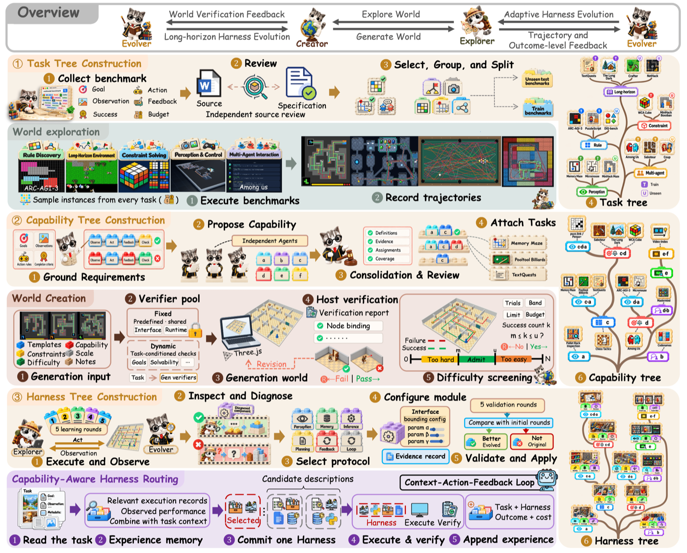
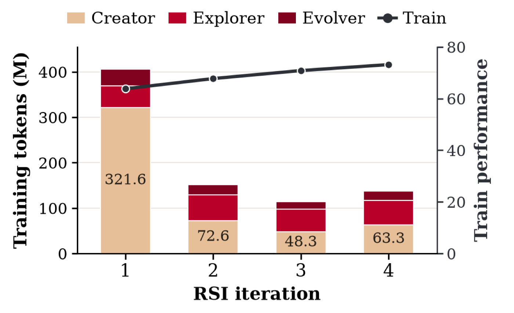

<!-- paper-reading-lang: zh-CN -->
<!-- paper-reading-theme: cobalt -->
<!-- paper-reading-mode: brief -->

# The Trinity 导读：能力驱动的多模态 Agent 递归自我改进

阅读对象：The Trinity: Capability-Driven Recursive Self-Improvement for Multimodal Agents（arXiv 2610.36077v1，The Trinity Research Team / NUS 系团队，冻结 Claude Opus 5 主干）。昨天的 Trustworthy RSI 综述把「改进机制本身被修订」的层级叫 U，并追问元改进层证据为何几乎空白；今天这篇正是这一层的正面实例：它把 RSI 的对象放在 **Agent Harness**（围绕冻结模型的六协议编排层）上，提出「任务驱动 → 能力驱动」的组织范式转变——不同模态、不同表面形态的任务可能共享同一底层能力需求（ARC-AGI-3 与 Micromouse 都吃「感知+状态跟踪」），按能力而非按任务组织进化，就能用更少的训练环境换来更强的迁移。框架用 Creator / Explorer / Evolver 三个角色耦合「世界生成」与「Harness 进化」，沿能力树做选择性继承，最终产物是一棵可被 Router 按任务能力画像检索的 Harness 树。头条数字：28 个训练基准均值 +34 分、18 个未见基准 +26 分，未见集超过 Codex（47.5）与 DeepSeek（46.2）参照。

<!-- 视觉决策：本文是方法+系统论文，核心是三棵树的构建流水线与选择继承的合成算子，静态卡片图与两张重绘条形图可完整承载；不嵌入交互视图。 -->

## 01 全景：这篇论文在做什么

长程多模态任务里，Agent 的能力越来越多地被 Harness（模型外围的编排层：感知、记忆、推理、规划、调度、执行协议）卡住，而手工迭代 Harness 跟不上任务多样性的增长（PDF §1）。已有 Harness RSI 工作集中在文本任务（代码、数学）且按任务特化进化——任务同质时适用，任务异质时会过拟合；反过来一个全局 Harness 又装不下互相冲突的任务需求。The Trinity 的解法是换组织轴：**按共享能力需求聚类任务，沿能力树进化出多个专用 Harness，再用 Router 按任务选枝**。

```paper-map
{
  "thesis": "把 Harness 递归自我改进的组织轴从任务换成能力：异质任务共享底层能力需求，按能力建树、在简化可验证的仿真世界里练能力、沿树选择性继承模块，最终用能力感知路由按任务选 Harness——28 个训练基准 +34 分、18 个未见基准 +26 分，未见均值超过 Codex 与 DeepSeek 参照。",
  "outcome": "提出 Creator/Explorer/Evolver 三角色框架、能力驱动的 Real2Sim2Real、固定拓扑的 Harness 树与能力感知 Router；在冻结主干上完成 4 轮 RSI 并验证到真实机器人任务。",
  "outcomeSource": "PDF 摘要、§3、§4",
  "items": [
    { "number": "01", "label": "立场", "signal": "范式转变", "text": "从任务驱动自我改进转向能力驱动：共享能力需求成为 Harness 进化的组织原则——这是论文明确声明的 position，其余设计都由此展开。", "source": "PDF §1 Position" },
    { "number": "02", "label": "Harness", "signal": "六协议", "text": "Harness 是对冻结模型的六协议配置：感知 Π_er、记忆 M、推理 I、规划 P、调度 F、执行 L；模块是公共记录的纯函数，进化只改模块配置、不动权重 θ。", "source": "PDF §2.2、Eq.(1)-(2)" },
    { "number": "03", "label": "三棵树", "signal": "任务→能力→Harness", "text": "Stage1 规范化 28+18 个基准成任务树；Stage2 从已验证轨迹归纳能力需求、按固定序构成 Trie 能力树；Stage3 沿能力树对齐地长出 Harness 树（选择性继承⊕+局部精炼）。", "source": "PDF §3.2-3.4" },
    { "number": "04", "label": "仿真", "signal": "Real2Sim2Real", "text": "同节点异质任务的共同需求被 Creator 抽象成简化、可验证的仿真世界（剔除目标布局与私有证明），冻结筛选 Harness 只放行落在预定中间表现带内的关卡——太难太易都退回调难度。", "source": "PDF §3.3、Fig.3" },
    { "number": "05", "label": "路由", "signal": "逼近 Oracle", "text": "Router 是带验证经验记忆的 context-action-feedback 环：完整自路由在 Unseen 上 60.96，逼近 Oracle 63.61，且 token 开销最低；能力先验与经验记忆各贡献一截。", "source": "PDF §3.6、§4.4、Table 4" }
  ]
}
```

## 02 立场之争：任务驱动还是能力驱动

```paper-contrast
{
  "title": "任务驱动特化 vs 能力驱动组织",
  "intro": "两种组织轴决定 Harness 进化的泛化边界，论文用对照实验直接量了这笔账。",
  "branches": [
    { "name": "任务/域驱动", "lead": "按任务域各养一个专用 Harness，或全局共享一个。", "scope": "任务同质（代码、数学）时有效；异质任务下任务特化过拟合，全局 Harness 装不下冲突需求（如具身任务的性能-效率权衡）。", "judge": "Table 3：Task-Domain（15 个 Harness）Train 51.17 / Unseen 40.82；Global（1 个）53.04/42.92；扁平 Capability-Domain（6 个）49.25/39.43——特化与全局各有输面。", "signal": "组织轴是任务表面形态，能力共性被埋没；训练环境多（Real 全量）而迁移弱。", "why": "实现直觉、无需能力归纳；也是现有 Harness RSI 的默认做法。", "source": "PDF §1、§4.2 Table 3" },
    { "name": "能力驱动（本文）", "lead": "按共享能力需求建 Trie、沿树选择性继承，训练用能力聚焦的仿真世界。", "scope": "跨模态泛化成为显式目标：同节点异质任务共享学习目标，原任务评测度量迁移。", "judge": "能力树 Sim：Train 56.95 / Unseen 47.26（模块单用、无技能），均为最高，且推理成本最低（514M/549M）；比扁平能力分组 +4.19/+2.88，仿真再加 +3.51/+4.95。", "signal": "组织轴是能力前缀：公共前缀共享继承、节点局部精炼；仿真世界少而准（11 个环境对 28 个基准）。", "why": "需要先解决能力归纳的可靠性（独立提案+裁判合并+人工复核）与仿真世界验证（宿主验证池+表现带筛选）；换来更少环境、更强迁移、更低推理成本。", "source": "PDF §3.3、§4.2" }
  ]
}
```

全流程管线见原文总览图——三阶段建树、世界验证筛选、选择性继承与路由闭环：



*原论文 Fig. 2，PDF §3。阅读时注意三个角色沿同一棵能力树的分工：Evolver 定需求与验证、Creator 造世界并汇成 Base、Explorer 练模块并被 Router 调用。*

## 03 三棵树怎么长出来

```paper-path
{
  "title": "任务树 → 能力树 → Harness 树",
  "intro": "三个阶段依次把异质基准收敛为能力前缀路径，再沿路径进化模块；冻结主干全程不动。",
  "stages": [
    { "title": "任务树：规范化", "role": "建语料", "action": "把公开多模态基准规范化为目标/观察/动作/反馈/完成判据/预算的规格，独立对照来源核验；统一观察-动作接口；按五域分组（规则发现、约束求解、感知控制、多智能体交互、长程环境），训练/未见切分在能力归纳前固定。", "why": "后续一切归纳与评测都以规格为准，接口统一保证轨迹可比、切分固定防泄漏。", "output": "28 训练 + 18 未见基准的任务树与固定切分。", "source": "PDF §3.2" },
    { "title": "能力树：归纳与建 Trie", "role": "换轴", "action": "从任务规格与已验证轨迹归纳能力需求：独立智能体提案能力类别、裁判合并、评审独立核查定义/证据/指派/覆盖；每任务得固定需求集，按预先固定的能力序排序成路径，Trie 合并公共前缀成树。", "why": "只用训练任务建树；固定序与固定类别让树在评测阶段不可再动，未见任务的需求指派只做事后路由评测。", "cost": "能力归纳质量决定全局——论文用多重独立校验压可靠性风险，但这仍是该框架最大的假设载荷。", "output": "能力树：节点=能力前缀，任务保留端点关联（含内部节点）。", "source": "PDF §3.3、Eq.(3)" },
    { "title": "世界生成：Real2Sim2Real", "role": "造训练场", "action": "Creator 为每个节点把共同需求抽象成简化可验证的仿真关卡（剔除目标布局、私有证明与解轨迹，保留核心决策过程）；宿主验证池检查绑定/执行/状态转移/渲染/完成；冻结筛选 Harness 试玩，只放行落在预定中间表现带内的关卡，否则按预设维度调难度。", "why": "异质任务在同一简化世界里共享学习目标；表现带筛选保证「练得了」——太难太易都无训练信号。", "cost": "环境构造成本主导首轮训练开销（405.7M vs Real 的 211.6M），靠后续迭代复用世界摊销。", "output": "每节点一套已验证、难度合身的课程。", "source": "PDF §3.3、Fig.3、§4.2" },
    { "title": "Harness 树：选择性继承", "role": "进化", "action": "Explorer 沿树自顶向下迭代：每节点用「继承父注册表⊕本地模块」跑课程，Evolver 对比成败轨迹提案节点级模块更新，宿主验证证据/所有权/接口/血缘后接受；父更新只有在相同验证任务与预算下严格更优才被子节点采纳。", "why": "⊕ 合成（右偏并集）让本地覆盖父级、公共前缀自动复用；「严格更优才继承」防止进化回退——这正是综述说的后继级约束保持的工程化实现。", "output": "固定拓扑的 Harness 树：每节点一个专用配置，验证过的更新跨迭代累积。", "source": "PDF §3.4-3.5、Eq.(4)-(6)" },
    { "title": "基座汇合与路由", "role": "收口", "action": "Creator 侧同结构进化，迭代末把各节点验证过的提案与现有 Base 合并去重（互补合并、近重复保留先学），产出下一轮 Base Harness；Explorer 侧由 Router 按任务公共信息+能力定义+验证经验记忆选枝，先承诺理由再执行，回执核验后写入记忆。", "why": "Base 汇合保证框架整体不散架；Router 把「多专用 Harness」变成部署期可用的单入口，检索即选型。", "output": "可部署的 Router + 版本化 Harness 池 + 哈希锁定的预测台账。", "source": "PDF §3.5、§3.6、Eq.(7)-(9)" }
  ]
}
```

## 04 机制放大：六协议与两个关键设计

**六协议 Harness**（Eq. 1–2）：给定任务 τ、观察 o_t、公共历史 ξ_<t、控制器状态 s_t 与资源 C_τ，感知提取事实 f_t，记忆组装历史条件视图 v_t，推理维护候选集 Cand_t，规划裁剪出指令 d_t，调度判定可用资源 C_t，执行环解决动作 e_t 与提交 c_t（含「不行动」）。模块是所供公共记录的纯函数、无隐藏状态、不动环境；只有 Memory 可声明显式携带；能力与协议多对多——同一记忆模块可支撑多种需求（PDF §2.2）。

**选择继承 ⊕**（Eq. 4）：`(P⊕L)[m]` 本地优先、父级补位；父导出绑定父标识与状态摘要，祖先条目自根至父按记录版本组合，覆盖保留来源与版本血缘。配合「严格更优才换父」的门槛，进化在树上既共享又防退。

**能力感知路由**（Eq. 8–9）：`h_n = π(x_n, C, R(x_n, M_n), S(M_n))`——候选描述、检索到的经验（余弦≥0.5、至多 10 条、2 万条 FIFO 记忆）与观测到的性能-成本摘要共同决定选枝；Agent 先给出基于证据的理由再执行；终结回执与承诺决策及注册表哈希核验后才更新记忆。未见任务的能力标签全程不进路由上下文与记忆，预测台账先哈希锁定再评测（PDF §3.6）。

训练成本结构见原文分析图——环境构造主导首轮开销、复用摊销、固定轨迹量下的增益来自更干净的进化信号：



*原论文 Fig. 4，PDF §4.2。阅读时注意两轴对照：曲线持续上行而增量成本在后续迭代大幅下降——「less is more」的经济账。*

## 05 实验图谱

```paper-experiments
{
  "title": "五组实验各自回答什么",
  "rows": [
    { "question": "模块与技能各值多少分？", "setup": "迭代 1 时四设置对照（Train/Unseen，基准等权均值）。", "observation": "Base 39.06/37.45；仅模块 56.95/47.26；仅技能 58.86/48.67；两者结合 63.80/53.53——结合总是最好，技能与模块增益大体可加。", "conclusion": "Harness 模块与评测期技能是互补的两条增益通道，框架两条都要。", "source": "PDF §4.2、Table 2" },
    { "question": "组织轴与训练课程哪个划算？", "setup": "五种组织单轮 RSI、模块单用：Global/Task-Domain/Cap-Domain/能力树(Real)/能力树(Sim)。", "observation": "能力树 Sim 最高（56.95/47.26）且推理成本最低（514.42M/549.07M）；扁平 Cap-Domain 训练最省（136.94M）但最弱；任务特化（15 个 Harness）与全局（1 个）都输给树形。", "conclusion": "层级能力组织+能力聚焦仿真课程的组合同时赢了效果与推理成本；训练成本首轮更高、靠复用摊销（Finding 1）。", "source": "PDF §4.2、Table 3" },
    { "question": "RSI 能持续改进吗？", "setup": "固定切分/能力需求/树拓扑/主干，迭代 0→4。", "observation": "Train 39.1→73.2、Unseen 42.1→64.1；首轮增益最大，迭代 2-4 再加 +9.4/+6.4；ARC-AGI-3 41.0→53.6、SciGym 45.2→57.1、BuildArena 93.3→97.8，Mastermind 持平 88.9，Eleusis 微降 82.2→81.1。最终 Unseen 均值超 Codex(47.5)/DeepSeek(46.2) 参照，但 Crafter 与 DiG-bench 仍低于参照。", "conclusion": "在固定能力树上改进可持续并外溢到未见任务；但逐基准看有持平与回退，「持续改进」是均值层面的结论（Finding 2）。", "source": "PDF §4.3、Fig.5-6" },
    { "question": "Router 逼近上限多少？", "setup": "迭代 4 的 Harness 树上五种路由配置。", "observation": "Unseen：随机 46.23 → 无先验自路由 52.36 → +能力定义 58.27 → +经验记忆 60.96，Oracle 上限 63.61；Train 同构（52.74→71.27 vs 73.16）；完整自路由同时 token 最低（541M/Unseen）。", "conclusion": "能力先验与验证经验各贡献一截可解释的增益，自路由已吃到 Oracle 的 96% 左右（Finding 3）。", "source": "PDF §4.4、Table 4" },
    { "question": "能力-模块关联是因果还是相关？", "setup": "受控模块干预：往 Base 加一个相关/无关模块；从迭代 4 完整体里删一个相关模块。", "observation": "加相关模块 39.06→58.45（+19.39），加无关仅 +1.02；删相关模块 73.16→70.42（−2.74）且 token 反升（496.7→517.3M）。", "conclusion": "能力-模块先验经得起干预检验，可用于指导模块选型与组合（Finding 4）。", "source": "PDF §4.5、Table 5" },
    { "question": "能力进化出的 Harness 能落到真机器人吗？", "setup": "SOON（Unitree G1 走近桌旁）与 CaP-X（AlohaMini2 揭杯报方块）按能力需求映射到 d→a 节点，Harness 固定，重建仿真器里 5 次试错总结成技能后冻结，再上正式仿真与真机测试。", "observation": "两任务构成仿真→真机的完整链路，试错集不计入成绩（协议见 Table 6 与附录 E.3）。", "conclusion": "能力树节点可复用为具身任务的 Harness 选型入口，Real2Sim2Real 闭环到真实世界——但样本仅两任务，属可行性演示而非统计结论。", "source": "PDF §4.6、Fig.8、Table 6" }
  ]
}
```

路由消融重绘（Unseen 列，分数为基准等权均值）：

```paper-chart
{
  "type": "bars",
  "title": "能力感知路由消融（Unseen 18 基准）",
  "subtitle": "迭代 4 Harness 树；自路由三档逐步加先验",
  "origin": "本文重绘 · 原论文 Table 4",
  "source": "PDF §4.4、Table 4",
  "unit": "分",
  "domainMax": 70,
  "note": "完整自路由 60.96 已达 Oracle（63.61）的约 96%，且推理 token 最低（541.28M）；Train 侧同构：52.74→71.27 vs Oracle 73.16。",
  "rows": [
    { "label": "随机选枝", "value": 46.23 },
    { "label": "自路由（仅任务信息）", "value": 52.36 },
    { "label": "+能力定义先验", "value": 58.27 },
    { "label": "+验证经验记忆（完整）", "value": 60.96 },
    { "label": "Oracle（事后最优上限）", "value": 63.61 }
  ]
}
```

组织轴对照重绘（模块单用、单轮 RSI 的 Unseen 列）：

```paper-chart
{
  "type": "bars",
  "title": "五种组织方式的 Unseen 均值",
  "subtitle": "模块单用、无技能；数字后括号为 Harness 数/环境数",
  "origin": "本文重绘 · 原论文 Table 3",
  "source": "PDF §4.2、Table 3",
  "unit": "分",
  "domainMax": 55,
  "note": "能力树 Sim 用 10 个 Harness/11 个环境拿到最高 Unseen（47.26）与最低推理成本；其首轮训练成本更高（405.70M vs Real 211.56M），靠后续迭代复用世界摊销。",
  "rows": [
    { "label": "Base（不进化）", "value": 37.45 },
    { "label": "扁平能力分组（6/6）", "value": 39.43 },
    { "label": "任务域特化（15/15）", "value": 40.82 },
    { "label": "全局单 Harness（1/28）", "value": 42.92 },
    { "label": "能力树-真实任务（10/11）", "value": 42.31 },
    { "label": "能力树-仿真课程（10/11）", "value": 47.26 }
  ]
}
```

## 06 综合评述

把机制与证据对齐看：立场（能力驱动）由组织对照实验支撑（Table 3：树形>扁平/任务/全局，仿真>真实课程）；可持续性由 4 轮迭代曲线支撑，但逐基准有持平与回退（Eleusis −1.1）；路由有效性由消融+Oracle 逼近支撑；能力-模块先验经受住了加删干预的因果检验。对照昨天的综述语言：这篇工作改进的是 Harness 层的 B（模块配置的构造与选择规则）并部分触及 U（Creator 的 Base 汇合程序每轮被改写），而它的「严格更优才继承」「宿主验证池」「哈希锁定台账」正是综述要求的后继级证据与接受有效性的工程化落地——但它也 still 停在综述划的边界内：改进的判据（宿主验证的任务完成数）仍是系统内定义的，没有独立外部审计；「能力」归纳本身依赖 LLM 提案+裁判，其可靠性靠流程而非保证。

一句话收束：当任务多样性超过人工 Harness 迭代速度时，把改进本身组织成一棵按能力分叉、可路由、可验证的树——这份答卷显示，冻结的大脑配上会自我编排的手脚，还有大段便宜的提升空间。
