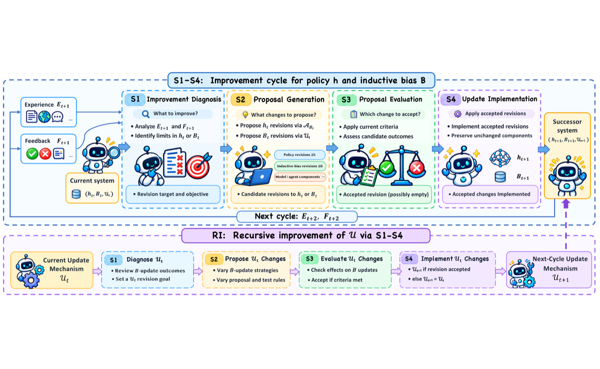
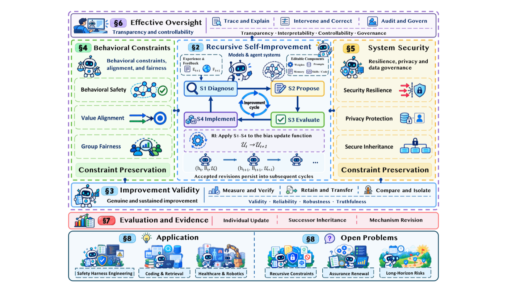

<!-- paper-reading-lang: zh-CN -->
<!-- paper-reading-theme: forest -->

# Trustworthy RSI 综述深读：当模型开始修改"如何改进自己"

深读对象：Trustworthy Recursive Self-Improvement in the Era of Large Models: Foundation, Risks, Evaluation and Open Challenges（arXiv 2610.35193v1，牛津/Google/Stanford/Meta 等多机构团队，引用 301 篇文献、跨度 1973–2026）。这是一篇**综述**，不是基准或方法——前三篇深读（OpenDS-World、OmniDR-Bench、Dual Exam）量的是 Agent 的能力边界，这篇回答的是一个更上游的问题：当大模型系统开始用经验和反馈**持久地修改自己**——不仅改模型、提示、记忆、工具、工作流，还改"归纳偏置"和"未来更新的机制本身"——凭什么相信它真的变好了、没变坏、还管得住？今天这期 HF 刊恰好是 RSI 主题井喷（Skill^∞、ParetoRSI-Gym、Continual Learning Exam、ReGE、Build-Don't-Play 至少五篇），这篇综述是理解全刊的地图。

<!-- 视觉决策：综述型论文，核心是定义体系（h/B/U 三层）与分类框架（四主题×三角色×五阶段），静态卡片图与一张漏斗图足以承载；不嵌入交互视图。 -->

## 01 全景：这篇综述在做什么

自我修改本身不等于可信的改进（PDF 摘要）：报告的增益可能来自有缺陷的评测；既有能力可能退化；对行为约束的遵守可能松动；被污染的产物或敏感信息可能被后继系统继承；对改进机制本身的修改可能让早先的验证失效、让人工监督失灵。综述做三件事：给 RSI 一个**操作化定义**（§2）、把可信 RSI 的要求组织成**四主题框架**并逐阶段盘点风险与护栏（§3–6）、系统梳理**评测证据**还缺什么（§7–8）。

```paper-map
{
  "thesis": "递归自我改进（RSI）不只是「用经验更新自己」，而是连「如何更新」的机制也被自己修订复用——自我修改不保证可信改进：增益可能是评测假象，约束可能松动，污染会传给后继，改机制会让既有验证失效；本综述用 h/B/U 三层定义 + S1–S4/RI 五阶段 + 四主题框架，把「可信 RSI」变成可分阶段评估的问题。",
  "outcome": "操作化定义与过程框架；四大可信主题的风险/护栏/证据综述（301 篇文献）；三层声明（更新/后继/元改进）的评测要求与七大开放问题。",
  "outcomeSource": "PDF 摘要、§2、§7–8",
  "items": [
    { "number": "01", "label": "定义", "signal": "h/B/U 三层", "text": "任务策略 h、归纳偏置 B（如何学）、偏置更新函数 U（如何改「如何学」）。RSI = 更新 h 的同时自主修订 B、并修订复用 U 本身，目标是持续的性能增益。", "source": "PDF §2.1、Def.2、Eq.(2)-(3)" },
    { "number": "02", "label": "过程", "signal": "S1–S4 + RI", "text": "每个改进循环四阶段：改进诊断 S1 → 提案生成 S2 → 提案评估 S3 → 更新实施 S4；同一过程递归作用于 U 即 RI。阶段即风险定位器：失败与护栏都能挂到具体阶段上。", "source": "PDF §2.1.2、Fig.3" },
    { "number": "03", "label": "框架", "signal": "4 主题 × 3 角色", "text": "八组可信性要求（NIST/TrustLLM 等综合）归并为四主题：真实持续改进、行为约束/对齐/公平、系统安全/隐私、透明可控；分别对应三种分析角色：改进有效性、约束保持、有效监督。", "source": "PDF §2.2–2.3、Table 3" },
    { "number": "04", "label": "声明层级", "signal": "3 层证据", "text": "更新级（单次修订合格吗）、后继级（继承后仍成立吗）、元改进级（改了 U 之后产出的更新更好吗）——三层规定了证据必须覆盖的范围。", "source": "PDF §2.3" },
    { "number": "05", "label": "证据现状", "signal": "26 → 4", "text": "对 114 项自我改进研究的审查中，26 项自称改进了「改进器」，其中只有 4 项做了同起点、等预算的对照比较——元改进层的证据几乎空白。", "source": "PDF §7.2、Chen et al. 2026j" }
  ]
}
```

## 02 定义：什么才算 RSI

综述的起点是把 Mitchell 1997 的学习定义 $h=\mathcal{A}(B, E)$（经验 E 在归纳偏置 B 下学出策略 h）推广到大模型系统：h 可以是"模型+提示+记忆+技能+工具"的组合体；关键的**功能性区分**在 B 与 h 之间——执行任务的提示属于 h，而"如何构造/筛选策略更新"的规则属于 B（例如"提交前跑测试"是 h，"挑选纠正轨迹去训练"的规则是 B）（PDF §2.1.1）。RSI 的形式定义只有两行（Eq. 2–3）：

$$h_{t+1}=\mathcal{A}_{B_t}(h_t,\,E_{t+1}),\qquad (B_{t+1},\,\mathcal{U}_{t+1})=\mathcal{U}_t(B_t,\,h_{t+1},\,F_{t+1})$$

偏置更新函数 $\mathcal{U}$ 修订 B、也修订 $\mathcal{U}$ 自己，两者都保留到下一轮循环。这个定义的判别力在与近邻的对比里看得最清楚：

```paper-contrast
{
  "title": "常规自我改进 vs 递归自我改进",
  "intro": "差别不在「改了多少」，而在修改是否触及 B 与 U。",
  "branches": [
    { "name": "常规学习/自我改进", "lead": "在固定学习规则下更新任务策略 h（含提示/记忆/工具）。", "scope": "常规 ML 与 RL 更新策略但学习规则指定后不变；MAML 学初始化但元梯度程序固定；AutoML 在指定搜索流程内选算法超参。", "judge": "任务性能即可；改进机制本身在评估范围外。", "signal": "B 部分可变（如学到的优化器属于 B），但更新 B 的外层程序固定——U 不被修订。", "why": "工程上是绝大多数「self-improving agent」的现状：经验合成、记忆更新、提示进化都属此类。", "source": "PDF §2.1.1、Table 2" },
    { "name": "RSI（本综述对象）", "lead": "h 更新之外，B 被自主修订，且修订 B 的机制 U 本身也被修订并在后续循环复用。", "scope": "Promptbreeder 同时进化任务提示与变异提示，是 U 被修订的早期例子；改进器自身的改写、评估标准的自我修改都入此列。", "judge": "仅任务分不够——三层声明（更新/后继/元改进）+ 四主题都要有证据。", "signal": "U 的修订是分水岭：改 U 可能改掉「什么算改进」的判据本身，早先的验证不再自动有效。", "why": "这是能力扩展的下一跳，也是风险结构的质变点——综述全部章节都围绕这层递归展开。", "source": "PDF §2.1.1、§2.3" }
  ]
}
```

S1–S4/RI 循环的全景见图（每个阶段的输入输出、递归支路 RI 作用于 U）：



*原论文 RSI_process 图，PDF §2.1.2。阅读时注意 RI 支路：当 S1–S4 的对象从 h/B 换成 U 本身，同一套"诊断-提案-评估-实施"就变成了元改进。*

## 03 可信性框架：四主题 × 三角色

综述从 NIST、TrustLLM、AI HLEG 等框架综合出八组要求（有效性/可靠性/鲁棒/真实、行为安全/价值对齐、公平、系统安全/韧性、隐私/数据治理、透明/可解释、人类控制/可纠正、问责/治理），再归并为四主题、挂到三种分析角色上（PDF §2.2–2.3、Table 3）。§3–6 对每个主题走同一套流程：定义与边界 → 可信性声明（按三层）→ 各阶段（S1–S4/RI）的风险与失败证据 → 现有护栏及其局限 → 证据综合与研究缺口。

```paper-map
{
  "items": [
    { "number": "01", "label": "真实持续改进", "signal": "有效性角色", "text": "S3 的评估要区分真改进与「在不充分测试上拿高分」；改进要在 S4 集成与后续使用中保持；RI 层要证明改过的机制产出更好的更新，而不是 merely 改了接受标准。", "source": "PDF §3" },
    { "number": "02", "label": "行为约束与公平", "signal": "约束保持", "text": "任务分涨的同时安全/对齐/公平可能弱化；RI 改动经验筛选或提案评估，会改变后继强化哪些行为——要求变更必须授权并重估，分数涨不能兑换约束松。", "source": "PDF §4" },
    { "number": "03", "label": "安全隐私", "signal": "约束保持", "text": "不可信经验可影响 S1–S2；S4 集成可能保留被污染产物或敏感信息并被后继复用（技能后门：删源记录后衍生技能仍存）；RI 还可能改访问控制与数据保留规则本身。", "source": "PDF §5" },
    { "number": "04", "label": "透明可控", "signal": "有效监督", "text": "审查者要能回答「提了什么、为何接受、集成了什么」；跨后继要可追溯、可纠正、可回滚；改过 U 之后，修订程序本身仍须可审查、授权干预仍须有效。", "source": "PDF §6" }
  ]
}
```

框架总览（定义 → 四主题 → 评测 → 应用/开放问题的全图对应关系）：



*原论文 Fig. 1，PDF §1。阅读时注意中央的 S1–S4/RI 循环与四周四主题的连线方式：主题不是流程阶段，而是每个阶段都要过的"检查面"。*

## 04 评测证据：已有什么、缺什么

§7 是综述最有实证力的一章：把代表性研究按其主要服务的声明层级分组，逐项编码证据覆盖（Fig. 8 的证据矩阵，编码协议与审计文件公开）。

```paper-experiments
{
  "title": "四组证据各自说明什么",
  "rows": [
    { "question": "更新级：怎么知道一次修订真的更好？", "setup": "RE-Bench（人时预算对照）、PostTrainBench（受限算力自主后训练）、RSIBench-Data（固定训练设施隔离数据决策）、TEB（不变智能体的重复评估方差）、SAV（自我编写测试的可靠性）。", "observation": "性能结论依赖资源预算、选择程序与报告条件；RSIBench-Data 出现非单调轨迹且选报共用任务子集；TEB 显示同一智能体重复评估本身有分数波动——都指向「增益可能是评测假象」的具体机制。", "conclusion": "隔离评分、受保护测试数据、冻结对照与种子匹配比较，是更新级结论成立的最低配置。", "source": "PDF §7.1" },
    { "question": "后继级：继承的改动还成立吗？", "setup": "DGM 系谱存档、EvoPathBench（累积/干扰/规则反转流）、Agent Plasticity（固定权重看获取成本）、Misevolution、SEABench（演化 vs 非演化助手）、EvoUndo（一次性 harness 修改的恢复）。", "observation": "SEABench 把下游安全/隐私失败追溯到「局部有用」的适应；Misevolution 记录模型/记忆/工具/工作流的变更风险；EvoUndo 发现恢复效果受状态接地与恢复语言表达力限制。", "conclusion": "后继级证据要看继承物（含记忆、工具、权限）在后续使用中的持续影响，仅端点分数不够。", "source": "PDF §7.1" },
    { "question": "元改进级：改了 U 真的更好吗？", "setup": "Dream-RSI（修订探索策略代码后重部署）、Hyperagents（修订元级程序并做迁移测试，improvement@50）。", "observation": "两者分别示范「与固定探索策略对照」和「配对延续（同一 h_t/B_t 起点分别用 U_t 与 U_{t+1}）」两种设计；但对 114 项研究的审查发现 26 项自称改进改进器者中仅 4 项做了同起点等预算对照。", "conclusion": "元改进层是证据最薄弱的层级——绝大多数声明无法与「改了判据」区分。", "source": "PDF §7.1–7.2、Chen et al. 2026j" },
    { "question": "什么支撑可信性声明？", "setup": "§7.3 提出三条件：证据溯源（评估器的数据/提示/代码/修改权）、接受有效性（PACE 的 anytime-valid 检验、SGM/REUSE 的复用误差控制）、联合证据（效用与安全在不同评测条件下分别量得，如 AI Control 用红队策略测安全）。", "observation": "PostTrainBench 观察到污染与未授权检查点替换，凸显产物溯源必要；REUSE 处理固定评测集反复影响后续提案的依赖问题，在决策-only 接口下对接受总体的改进给保证。", "conclusion": "可信声明 = 溯源 + 统计有效的接受规则 + 跨主题联合证据，三者都要版本化记录。", "source": "PDF §7.3" }
  ]
}
```

把元改进层的证据缺口画成漏斗，是这篇综述最刺眼的一组数字：

```paper-chart
{
  "type": "bars",
  "title": "元改进层的证据漏斗",
  "subtitle": "Chen et al. (2026j) 对自我改进研究的审查",
  "origin": "本文重绘 · 原论文 §7.2 引述",
  "source": "PDF §7.2",
  "unit": "项研究",
  "domainMax": 120,
  "note": "自称改进了改进器的 26 项中，只有 4 项做了同一起点、等预算的对照比较；综述据此把配对延续设计列为元改进评测的必要条件。",
  "rows": [
    { "label": "审查的自我改进研究总数", "value": 114 },
    { "label": "自称改进了改进器（RSI 标签）", "value": 26 },
    { "label": "做了同起点等预算对照", "value": 4 }
  ]
}
```

§7.2 把上述发现转成可执行的比较规范：更新级要全程记账（经验收集、被拒提案、接受测试的成本，人工协助单列）并报性能-预算曲线；后继级要维护 $(h_t,B_t,\mathcal{U}_t)$ 的版本化谱系、对冻结对照重复评估、在检查点禁用产物访问以估算继承物贡献、报告"未评估"而非留空；元改进级要配对延续（同一起点双臂分别用 $U_t$/$U_{t+1}$），一次性发现成本按使用次数摊销后与固定臂同账对比。

## 05 综合评述：七大开放问题与读法边界

§8.3 的七个开放问题环环相扣，可以当作"可信 RSI 研究议程"直接使用：①递归变化下可信性的理论基础（哪些要求必须跨修订不变；组合反例：单独安全、经共享记忆/权限/评测状态冲突）；②自改机制的验证（评估器被改后，用双版本评估器评同一组冻结候选+受保护参照）；③长程风险动力学（污染复用频率如何影响失败的出现/持续/复发；技能后门的清理范围）；④可信机制自身的递归改进（护栏固定 vs 不变更新器自适应 vs 改过的 $U_{t+1}$ 三臂）；⑤执行中的自适应控制（U 修订后停止/纠正/回滚指令还能覆盖哪些动作与派生状态）；⑥根本权衡与极限；⑦（应用域差异化的证据要求，见 §8.2）。

作为综述的边界也要读清：它的贡献是**组织框架与证据编码**，不是新实验——四主题的风险/护栏叙述是文献综合，各主题"研究缺口"一节的措辞都是"现有证据未覆盖 X"而非"X 已被证明"；301 篇的编码协议与审计文件公开在附录 A，可复现它的证据归类。另外注意区分：文中多处把"相关系统的证据"（如 AI Control、AgentDojo 这类非 RSI 专门设计）与"直接 RSI 发现"分开标注——引用时要保持这个区分。

一句话收束：当"改进"本身成为被改写的对象，可信性就必须在更新、后继、机制三个层级上各自举证——这篇综述把这个口号拆成了 301 篇文献支撑的可执行议程。
