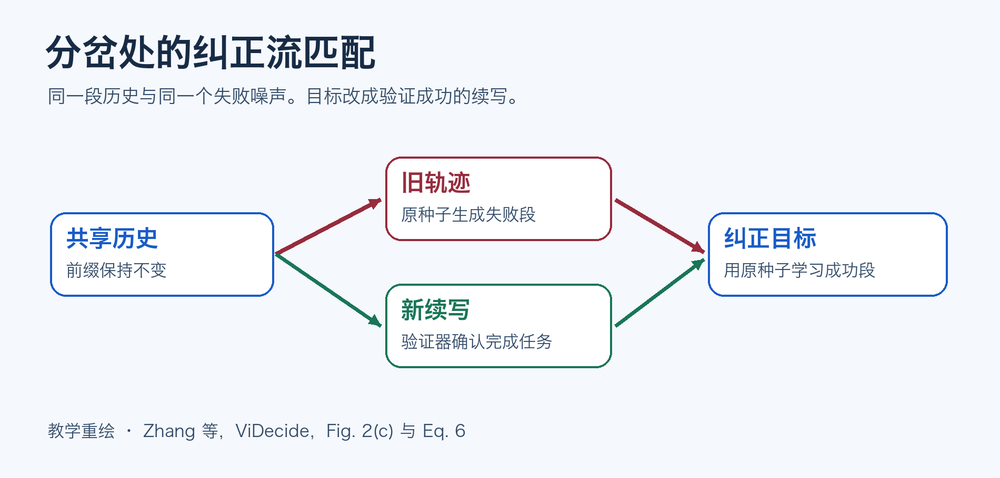

<!-- paper-reading-lang: zh-CN -->
<!-- paper-reading-mode: deep -->
<!-- paper-reading-theme: cobalt -->

<!-- Deep Reading coverage
| 原文对象 | 论证职责 | 本文位置与状态 |
| --- | --- | --- |
| §§1–2，Fig.1 | 视频外观与规则有效性分离，相关范式 | 01、08、15 已讲解 |
| §§3.1–3.2，Eqs.1–3，Fig.2a，Appendix C.1–3 | 流匹配、因果段、视觉 EOS、实现 | 02–04、09–10 已讲解 |
| §3.3，Eqs.4–5，Fig.2b，Table 4，Appendix D.3 | 训练时间步偏移，区分采样设置 | 05、10 已讲解 |
| §3.4，Eqs.6–8，Fig.2c，Appendix C.4 | 失败分岔、自生成纠正和损失 | 06–07、11 已讲解 |
| §§4.1–4.2，Tables 1–3，Figs.3–4，Appendices A、B、D.1–2 | 数据、评分、粒度、失效 | 08–09 已讲解 |
| §4.4，Tables 5–6，Figs.5–6，Appendix D.4–6 | 后训练对照、轨迹噪声探针、新旧纠正数据、多采样、求解器 | 11–13 已讲解 |
| §4.5，Table 7，Fig.7，Appendix D.7–8 | OOD、首错、文本动作对照 | 14 已讲解 |
| §5，Appendices E–F，Figs.S6–S9 | 定性路径、长程样例、未覆盖的物理闭环 | 15 已讲解 |
| Table S17 | 任务指令模板 | 08、14 解释规则与最短策略口径，变体颜色、主题逐条模板省略，无关主要比较 |
交互：采用静态表格及自绘状态转移示意，逐步计算保留在正文。自测通过原生 details 展开。事实核对和教学复算为作者检查，未重训模型或复跑整个基准。
-->

# ViDecide：把视频规划拆成可纠正的一步步决策

```paper-map
{"thesis":"让视频扩散模型顺着过去逐段预测，训练时多问下一步该做什么，后训练再把导致失败的随机起点配给同一历史上的成功分支。","reader":"面向熟悉扩散模型、希望区分视频生成、过程验证与具身规划证据的研究者。","goals":["沿同一段起点噪声，算出普通流匹配和纠正流匹配各学什么","根据片段长度、终止协议、测试分母读出主结果","区分规则有效、到达终态、求解最短和真机可执行"],"outcome":"从 v1 正文与附录 A–F 重建三阶段训练、推理和证据边界。","outcomeSource":"PDF pp.1–28","items":[{"number":"01","label":"终态漂亮也会输","signal":"逐步验规则","text":"同一批推箱子视频，仅验终态与逐步验的得分可差近半，先厘清要提升的指标。","source":"PDF §4.1、Table S2"},{"number":"02","label":"把决策放到时间轴上","signal":"因果分解","text":"每段只看已完成历史，以视觉 EOS 停止。游戏最强配置按潜帧，主要机器人结果按八潜帧。","source":"PDF §3.2、Appendix C.1"},{"number":"03","label":"让目标更难看见","signal":"高噪声采样","text":"把更多训练时间步移向纯噪声端，削弱从目标局部纹理直接抄答案的机会。","source":"PDF §3.3、Table 4"},{"number":"04","label":"把随机起点改配到好分支","signal":"纠正流匹配","text":"定位同历史首次分岔，用失败种子搭配验证成功的下一段，后续各段继续回归。","source":"PDF §3.4、Eqs.6–8"},{"number":"05","label":"把平均拆回四列","signal":"严格成功率","text":"按四个数据列等权平均得到 83.8%，逐项看同骨干基线、评估条件和误差类型。","source":"PDF Fig.1、Tables 1–5"},{"number":"06","label":"拆开训练增益","signal":"同数据与时间步对照","text":"同纠正数据下比较 RFT 和失败噪声映射，再比较原数据续训与重新采样。","source":"PDF Tables 5–6、S10–S12"},{"number":"07","label":"找跨布局退步","signal":"具身分布外","text":"更大游戏有收益，但机器人新布局和更长计划上，CFT 相比块式模型均降低 SSR。","source":"PDF Table 7、Table S15"},{"number":"08","label":"预测轨迹与实际控制","signal":"分清证据边界","text":"论文验证生成视频中的状态序列，比较文本动作时显式保留输出空间和验证器口径。","source":"PDF Appendices D.8、F"}]}
```

**深读对象**为 Kaiwen Zhang、Yiming Gao、Zeqi Xiao、Xintao Wang、Pengfei Wan、Kun Gai、Xingang Pan 的 [ViDecide: Teaching Video Diffusion Models to Reason and Plan Step by Step](https://arxiv.org/abs/2611.26389v1)。arXiv:2611.26389v1，2026 年 11 月 19 日提交。[点此打开原文 ↗](https://arxiv.org/pdf/2611.26389v1)

## 01 / 先规定什么叫解出一道视频题

### 视频是规划的输出空间

给模型一张初始画面和任务文字，输出是一段视频。以推箱子为例，任务的状态包括墙、人物位置、箱子和目标格。目标是让每只箱子都停在目标格上，同时每一步移动都遵守约束。禁止的变化包括箱子穿墙、箱子被拉动或凭空消失、人物瞬移。模型本身在像素或视频潜空间生成，评估器从视频读回这些状态，再检查状态序列是否构成一条有效的解。模型的生成接口始终是图像与视频潜变量，规则程序用于验证和挑选训练数据。（PDF §§1、3.1、4.1）

设 $c$ 为任务文字，$o_0$ 为初始观测，完整输出路径为 $\tau=(o_0,\ldots,o_T)$。下面把论文的二元成功标签拆为便于查验的三个条件。$G$ 检查是否到达目标，$V$ 检查一次状态转换，$M$ 对要求最短的子任务检查步数，无此要求时取一。EOS 是推理的结束标志，计分项仍由任务验证器决定。

$$
\begin{gathered}
R(\tau)=\mathbf1[G(o_T)]\,\mathbf1[M(\tau)]\\
\quad {}\cdot\!\prod_{j=1}^{T}\mathbf1[V(o_{j-1},o_j)].
\end{gathered}
$$

**教学算例。** 盒子原在格 A，推到 B 合法，B 后面是墙。视频中箱子随后出现在墙的另一边 C，最终恰好与目标重合。终态命中是 1，两次转换的有效性是 1、0，故严格成功为 $1\times1\times0=0$。另一条路径先绕行再合法入位，如果任务只要求到达，绕行可通过。最短路径有四步而视频用了六步时，要求最短的题会给 $M=0$。同一条轨迹在两个协议下可以拥有不同成绩。

### 推理链条的误差分布

若一个模型在给定之前都正确时每一步以相同概率 $p$ 做对，教学模型中的合法路径比例为 $p^T$。$p=0.98$ 时，十步约为 81.7%，五十步约为 36.4%。这是条件概率链的简化演示，真实转移难度、终态错误与步间依赖会变。它说明长题的最终成功率对少数高风险步骤敏感，因此研究设计必须既观察终态，也定位首次可见失误。ViDecide 从三个层面改变训练信号：给生成加上时间顺序，改变哪些噪声水平出现得更多，把整段失败重新归因到一处分岔。（PDF §§1、3、4.2）

## 02 / 一个片段的噪声、速度和采样方向

### 训练目标是速度回归

对干净片段 $x_0$ 在同一个形状上抽高斯噪声 $\epsilon$。$t$ 是噪声混合系数，零端是清晰目标，一端是纯噪声。沿线性路径对时间求导，得到训练的目标速度。历史和指令作为条件 $h$，保留在路径之外。

$$
\begin{aligned}
x_t&=(1-t)x_0+t\epsilon,\\
\frac{d x_t}{dt}&=\epsilon-x_0.
\end{aligned}
$$

$$
\begin{gathered}
r_t=v_\theta(x_t,t;h)-(\epsilon-x_0),\\
\mathcal L_{\rm FM}=\mathbb E[\|r_t\|_2^2].
\end{gathered}
$$

**教学算例。** 单维目标 $x_0=2$，噪声 $\epsilon=-1$。在 $t=0.25$ 时，输入为 $1.25$，目标速度为 $-3$。假如网络此处输出 $-2$，单坐标平方误差是 $1$。推理从 $t=1$ 往 $t=0$ 积分，故向量场若始终精确，沿负时间方向的总位移是 $(-3)(-1)=3$，从 $-1$ 回到 $2$。真实生成使用有限次求解器更新，向量场通常随时间和变量而变，不能把教学例的一步位移当实现。

对同一个历史而言，好几种后续动作可能都合法。纯噪声与历史一起输入，构成采样时选择其中一条的条件。后训练能利用这个接口，记住一条失败轨迹所用的随机初值并换掉它的目标。监督的基本单位仍是一段视频张量，求解过程产生视频；旁边的符号解读器用于判合法，未参与每一次普通解码。（PDF §3.1、§3.4）

### 三种时间尺度

读后续实验时分开三种计数。第一种是原始 RGB 帧数，Wan2.2 视频每秒 16 帧。第二种是自回归生成段数，决定需要串行调用多少次。第三种是每段数值积分的去噪步数，默认五步。五次去噪合成一个段，多个段才是一条路径。若把表格中的「五步」理解成五次游戏移动，就会把模型需要的计算量和能解决的规划时域同时看错。把采样步数加大能让单段积分更细，但它本身不会给路径增加新的决策位置。（PDF Appendix C.1、Table S8）

## 03 / 时间因果、段长和 EOS 共同决定生成接口

### 每段从已经生成过的历史起步

传统双向基线同时去噪固定长度的视频。ViDecide 给未来序列加一个视觉终止状态 $e$，再把它切成 $N$ 个段 $X_i$。每段最多含 $K$ 个时间单位。从第 $i$ 段的条件中拿走未来段，保留已经完成的各段、初始画面和文字。每个条件分布由扩散生成。

$$
\begin{aligned}
&p_\theta(o_{1:T},e\mid o_0,c)\\
&\quad {}=\prod_{i=1}^{N}p_\theta(X_i\mid X_{<i},o_0,c).
\end{aligned}
$$

**教学算例。** 给定初始画面，若模型生成合法的第一段、在该段之后生成合法第二段、在完成后正确画 EOS 的条件概率分别为 0.9、0.8、0.95，这条确定路径的三项乘积为 0.684。换掉第一段会同时改变第二段与终止的条件。这个乘积只说明依赖关系，实际总成功率需要对全部成功路径求和，且一次片段可能横跨多个连续画面。

训练采用 teacher forcing。Wan2.2 实现构造同一视频的干净和加噪两份表示。第 $i$ 段的加噪 token 互相可见，还可以读到先前段的干净 token。未来 token 和当前段的干净目标不能泄漏进条件。首个潜帧是给定观测，从损失中排除。推理时缓存来自模型已生成并去噪的前缀，早先的错位、变色或错误状态会因此传给后段。时间因果决定的是信息可见性，规则有效性还需靠数据与训练学出。（PDF §3.2、Appendix C.1）

可以沿一个三段输入核对掩码。训练第一段时，唯一可引用的干净视觉状态是给定起点。第二段可见起点与干净第一段，当前段以带噪形式出现。第三段才可用前两段的干净表示。因此把三个训练片段并行送进同一批，并没有把第二段目标泄漏给第一段。这是训练数据内部的并行，与部署时先产生第一段再计算第二段的串行不冲突。若把当前段的干净分支误加入上下文，高噪声训练也无法产生预期效果，模型可直接抄目标。若把前缀每段一起重新去噪，部署时前一轮已经承诺的状态可能被改写，固定分岔、比较同历史的含义也会变弱。正是这组信息可见性和缓存约束，让后续纠正有了可定位的输入条件。

### K 是潜帧数，红框是停止协议

Wan2.2 的冻结 VAE 把四个 RGB 帧压到一个潜帧，单潜帧形状为 $24\times24\times48$，得到 144 token。训练更新扩散主干的 50 亿参数，图像编码和文本编码接口沿用基础模型。每个实际动作对应的可见时长因任务而异。游戏采 $K=1$ 时，一段约 0.25 秒，往往能更细地表达状态变化。$K=8$ 时一段约 2 秒，在机械臂抓取、搬运、放置连成一个较长动作的任务上，段内联合生成有机会保住动作连贯性。

$$
\begin{gathered}
\Delta_{\mathrm{Wan}}(K)=\frac{4K}{16}\;\mathrm{s},\\
\Delta_{\mathrm{Wan}}(1)=0.25\;\mathrm{s},\\
\Delta_{\mathrm{Wan}}(8)=2\;\mathrm{s}.
\end{gathered}
$$

训练视频尾部共享最后的状态，末四帧带红框。实现每生成一段就解码检查，首次看到 EOS 停止。若一直未检测到，到 80 潜帧即 20 秒停止。这让不同题有不同输出长度，也留下两类错误：没做完就生成终止帧，或始终不生成。这类停止信号使用特定视觉协议，换视觉域时需要重新验证。DiT-B 是 132M 的从头训练像素空间模型，游戏数据每个动作渲染一帧，时间单位与 Wan 不同，不能套用同一秒数。（PDF §3.2、Appendices A、C.1–2）

## 04 / 不同生成器各自给过去和未来开了哪扇门

### 分段也是对比条件的一部分

双向基线将短训练视频补到任务的最大长度，重复末帧，所有待预测帧共享噪声水平；一开始给定的观测固定。HDR 先以粗到细的方式生成关键帧层级，再填完整视频，靠粗骨架帮助全局结构。S2PD 的采样先用局部串行得到较高噪声水平的中间帧，再把全片一起余下去噪。两者在相同任务和主干上重实现，是比零样本商品模型更接近结构问题的对照。（PDF §4.2、Appendix C.3）

本文因果支路把每段去噪到底再进入下一段，接下来的决策能看到最终选中的状态。从一张格图能读出箱子到底推到哪，对下一步重要。如果生成整条视频时相邻未来区域都能互相参考，模型可能先凑出了一个像目标的结尾，再把前面的画面接过去。这样的失败表现支持顺序约束有帮助。但 K、EOS、历史可见性和推理调用次数共同变化，Table 1 的改进归到整套生成范式，单表无法给因果掩码或红框各分多少百分点。（PDF Tables 1–3、Figs.3–4）

### 扩散强制提供近邻对照

附录比较 teacher forcing 和 diffusion forcing。后者训练可从不同噪声状态下的历史段学习，没有要求历史全干净。控制输出仍逐段因果，使对比更接近历史训练分布的选择。它不是原始双向基线的另一名字。Table S7 的多任务比较说明历史扰动的作用依赖任务，不能从一种历史噪声策略推出普遍最优；也不能把训练所见的带噪历史等同于推理发生的语义错误。一个错位的状态可能视觉上非常清晰，增加训练噪声未必直接为这个错误提供正确替代。（PDF Appendix D.2、Table S7）

论文实际用噪声水平 0.1 重新扰动已生成历史，再给 diffusion forcing 产生下一段。四组对照中，用这一路历史的 Wan FlowFree 与 Sokoban 为 69.9、81.8，干净历史为 77.9、83.0。DiT-B 对应为 59.6、58.1 对 58.6、73.8。后一骨干在 FlowFree 有 1 点反向例外。按四组等权平均，干净历史约好 6 点；两者均使用视觉终止协议，也都好过相应的固定长度方法。如果要把「分布偏移是否缓解」变成更具体的研究问题，可以将前缀按真实正确、像素损坏但状态正确、语义状态错误三个组来评价。论文未给这样分组的干预，稳妥的归因仍是异质地比较了两个完整训练与推理做法。

## 05 / 加大高噪声训练的比例

### 从整段回归里腾出更多「下一步」练习

当 $t$ 小时，模型输入里有较多真实目标。修复局部边缘便能降低损失，场景下一步如何变化未必需要从历史推断。当 $t$ 大时，目标在混合中变弱，模型有更强动机利用任务和历史。论文保持回归形式，改变时间步的抽样分布。给定原采样 $t'$ 和偏移 $s\geq1$，式 4 如下。

$$
\begin{aligned}
t&=\frac{s t'}{1+(s-1)t'},\\
\frac{t}{1-t}&=s\,\frac{t'}{1-t'}.
\end{aligned}
$$

推导右式时，$1-t$ 的分子是 $1-t'$，两边公共分母相消。于是对数几率平移 $\log s$。端点零、一不变，区间内按正 $s$ 单调。**教学算例。** $t'=0.3$ 时，$s=1$ 得 0.3，$s=5$ 得 $1.5/2.2\approx0.682$，$s=10$ 得 $3/3.7\approx0.811$。对均匀的教学基分布，若要 $t\geq0.8$，$t'\geq4/(s+4)$。所以 $s=1$ 有 20% 满足，$s=10$ 有约 71.4%。论文的具体训练噪声分布依骨干而异，DiT-B 使用 logit-normal 基分布；这组比例只针对均匀的教学示例。

$$
\begin{gathered}
Y_i=(1-t_i)X_i+t_i\epsilon_i,\\
r_i=v_\theta(Y_i,t_i;h_i)-(\epsilon_i-X_i),\\
\mathcal L_{\rm DF}=\mathbb E_{i,t_i,\epsilon_i}[\|r_i\|_2^2],\\
t_i\sim p_{\rm DF}.
\end{gathered}
$$

### 训练偏移和推理偏移分开看

每段各抽自己的 $t_i$，因此在同一批样本里可以把一个难决策段放到近乎纯噪声端，另一个段留在较低噪声端。历史仍按前述掩码供给。推理默认采样 shift 5、五次 UniPC、无 classifier-free guidance，训练中的 $s=10$ 并不自动改掉推理调度。一步步生成时首先要决定下一状态的大形状，随后再补细节；训练偏移是把更多监督给最初这个选择的办法。文章的经验结论基于规则性视频和被测偏移区间，更大的 $s$ 或所有领域里的视觉保真提高都超出了这组证据。（PDF §3.3、Appendices C.1、D.3）

## 06 / 从失败点往前找可比较的分岔

### 验证器找错，旧模型找替代路径

只收最终失败的视频会留下很多原本正确的片段。ViDecide 让当前模型在训练题上先生成，验证器找最先失效的地方。在错误前几步恢复一份模型生成的历史，固定这段共享前缀，多抽几条后续轨迹。保留能通过完整规则验证的续写。设 $d$ 是某条成功续写与原失败轨迹首次分开的位置，$h_d$ 是共享前缀，坏段为 $X_d^-$，替代段为 $X_d^+$。在这之前，两条视频讲的是同一题、看到的是同样状态。续写如果没有通过，就不拿来当纠正目标。（PDF §3.4、Appendix C.4）



*本文重绘机制示意，依据原论文 Fig.2(c) 与式 6。圆点与箭头只表示训练样本的对应，均未复用论文原图。*

### 首个分岔、首个错和不可挽回各有一个时刻

举例来说，旧路径在第八段把箱子推到死角，成功分支可能从第六段就选择另一条合法路线。纠正损失作用在第六段的原噪声上，验证器能直接看见的致命错误在第八段，第六段旧动作本身可能合法且仍有解。附录对 Sokoban 的 149 个分岔点做了区分，原失败种子有 63.8% 在分岔处做出仍可解的安全动作，而产生选定成功决策的比例只有 1.3%。把「分岔就不同」写成「旧动作当场非法」会夸大监督的精确性。分岔的信用来自两条最终结果不同的、共享历史的轨迹。（PDF Fig.6、Table S10、Fig.S3）

### 训练题上的纠正依赖可重采样性

实现对训练题先滚两次，按任务规则找分支点，每处尝试四条续写。游戏用首个违反规则、冗余、不可解或过早停止的位置，机器人用违例或绕路前的休止状态。VBVR 与 RoboTwin 把收集重点放在成功率较低的若干子任务。在原模型几乎从不成功的状态，模型内成功续写稀缺，这条路径难产生纠正。历史与分支不足本身就是训练信号的选择偏差。论文用简单规则、预设模拟器和较可判定的数据为这个方案建立实验起点。（PDF Appendix C.4、F）

## 07 / 把失败的噪声和成功的目标接到同一条直线上

### 换目标而保留旧条件

记录失败路径在 $d$ 段采样起始时的 $\epsilon^-_d$。一条通过验证的续写可能来自另一个种子，纠正训练特意不用那个新种子作分岔段的输入，把旧种子和成功段配成一条路径。这样训练条件与预测出坏段时有交集。修正量由整块潜张量组成，只在同一历史中定义。它不会把这个噪声设成跨题都要避免的固定符号。（PDF Eq.6）

$$
\begin{gathered}
\tilde X_d^+(t)=(1-t)X_d^++t\epsilon_d^-,\\
r_d^+=v_\theta(\tilde X_d^+,t;h_d)-(\epsilon_d^--X_d^+),\\
\mathcal L_{\rm corr}=\mathbb E_{t\sim q}[\|r_d^+\|_2^2].
\end{gathered}
$$

**教学算例。** 旧种子为 $0.8$，坏段是 $-0.4$，好段是 $0.2$。原路径的速度目标是 1.2，纠正速度是 0.6。在 $t=1$ 时两条路径输入都为 $0.8$，历史也相同，训练明确用 0.6 替换 1.2。在 $t=0.5$，旧路径输入 0.2，新路径输入 0.5，两条路径连中间点也不同。因而纠正同时改变纯噪声端的初始预测和沿途回归，旧段没有被减进损失。新的随机向量仍可以生成另一条好路径。

### 后缀、前缀与专家样本怎样分工

成功分岔后的每段用成功历史和新抽的噪声做普通决策聚焦回归。从旧轨迹复用噪声限于该分岔段。$d$ 之前的片段保留作上下文，纠正子样本不对它们分配目标损失。另混入专家轨迹，用同样的决策聚焦目标保持原能力。实践中纠正样本的约一半损失权重落在分岔，另一半落在后缀，专家视频占每批四分之一。分岔采样以 0.5 概率把 $t$ 精确置为 1，其余按 $p_{\rm DF}$。

$$
\begin{gathered}
q(t)=\tfrac12\delta_1(t)+\tfrac12 p_{\rm DF}(t),\\
\mathcal L_{\rm CFT}=\mathcal L_{\rm corr}+\mathcal L_{\rm suffix}
    +\lambda\mathcal L_{\rm DF}^{\rm expert}.
\end{gathered}
$$

终局奖励负责挑出哪些续写可以教；梯度由选中目标的速度回归提供。整段拒绝式微调也可以用终局奖励筛视频，但会把监督分布摊到完整成功轨迹，局部 RFT 虽用同一批成功续写，却用新抽噪声训练分岔。如果要问原失败种子是否被改配，最贴近的实证是 Table S10 的原种子复测，同时要看新种子上是否也获益。（PDF §3.4、Appendix C.4、Tables S10–S12）

式 7 具体把期望放在成功续写中分岔之后的片段。记历史已更新为成功路径的前缀，回归仍以独立生成的标准噪声和目标片段的差作速度标签。

$$
\begin{gathered}
u_i=\epsilon_i-X_i^+,\\
r_i^+=v_\theta(\tilde X_i^+,t_i;h_i^+)-u_i,\\
\mathcal L_{\rm suffix}=\mathbb E_{i>d,t_i,\epsilon_i}[\|r_i^+\|_2^2].
\end{gathered}
$$

在只有一个成功分岔、紧接着就 EOS 的例子里，后缀可能只负责学会及时停。另一条成功分岔此后有很长的搬运过程，后缀帮助学到保持物体状态和连续动作。在同一训练配置中，分岔与剩余部分分配权重，使较长轨迹不会仅因为包含更多帧就完全淹没第一次纠正。反过来只保留分岔损失，也无法直接给分岔后的稳定通路增加监督。专家锚点在第三条支路承接全轨迹结构，三种数据项在一轮训练中依变量与位置领取各自的梯度。将它们混称为「成功视频占比」会丢失此处最具辨识度的处理。

## 08 / 指标如何从生成视频读下来

### 三族任务，三个统计单元

VideoRLVR 的 Maze、FlowFree、Sokoban 各有 1,000 个测试题，专家模型按游戏分开训练，10,000 题中的 500 题留验证。这一生成范式比较省略 Maze，因为训练后每种方案都超 98%，它对多状态决策差异的辨别力有限。FlowFree 不是只连上同色端点，还要按规则连续走、占满棋盘并且不穿越已有路径，作者清理了不能转换的部分题并补了 123 个生成例，其中包含所有 100 个 8×8 测试板。（PDF §4.1、Appendix A）

VBVR-MultiStep 六种任务共享泛化模型，每类 5,000 训练、100 测试。作者剥去颜色后检查布局，发现原 Hanoi 测试有 45% 与训练重复，重新构造颜色无关布局未见的测试集。除该族的 Sokoban 外，任务指令还要求最短解。应当用 600 道题理解这列结果；一个论文中独立训练的 VideoRLVR Sokoban 专家和这一族的通用模型不是同一个设置。RoboTwin-Plan 六个子设定合计 700 个测试 episode，Blocks World 三角场景就占 300。故相同的 5 个百分点在每类独立和占 300 个样本的任务上对总分的影响不同。（PDF Table S1）

### 三道闸之间的差值也可读

游戏从渲染结构提取符号状态并逐步重放，机械臂使用学习式物体状态读取器，再按抓取、放置和目标配置验收。论文报告的是这些任务上的测量，不宜转述成程式已检查视频里所有连续物理细节。S2 同一批 Sokoban 视频只查终态时，双向 98.2%，严格为 50.8%。$98.2-50.8=47.4$ 个百分点，按 1,000 题规模相当于约 474 个终态看似合格却在严格协议下不通过。逐潜帧模型从 83.5% 到 83.0% 只掉 0.5 点，说明终态读数会把两个模型的顺序翻转。（PDF Appendix B、Table S2）

VBVR 逐潜帧的严格分是 85.7%，加最短才是 74.8%，落差 10.9 点反映另一个门槛。论文指出最短规则主要影响 Hanoi，且范式相对排序保持。对闭源零样本系统，每类抽 20–30 个案例，允许较宽松的规则，且额外加上终止帧之后评分，部分输出还人工复核。由此得到的是现成视频生成器在这些样例的量级，不适合与同主干训练结果当成同协议排行榜。（PDF Tables 1、S2）

### 机器人读取器决定哪些运动有机会被计入

RoboTwin-Plan 中的系统看到一段已经生成的第三人称视频，先靠学习式读取器推断盒子的潜在位置和抓取状态，再检查符号顺序。箱子是否被抓稳、挡住后还存不存在、两个方块在画面重叠时谁先放下，都需要通过这个观察接口。机械臂视频外观有瑕疵与规则违例仍需分开：某些瑕疵会使读取器认错，有些只损害观感。表 S14 分别统计任务未完成、幻觉和路径相关错误，使「生成困难」能进一步落到读到的状态与规划选择。该指标可以比较在同一生成与验证接口里的配置，无法替代接触力或碰撞记录。

连续状态中，略过一次中间姿态是否违规，取决于那次姿态是完成动作的必要步骤还是可容许的运动差异。自动验证需要有一个稳定粒度把视频映射到同类状态。这个粒度与前文潜帧打包相互作用：长段内部可能含有多个细微变化，评估器仍按其协议去读。对游戏，非法穿墙更容易通过符号状态定义判断。对模拟机器人，评价不能顺着同一个 SSR 名称把这个差异抹平。（PDF Appendix B、Table S14）

## 09 / 主结果沿四列复算

### 固定比较条件

下表为 Wan2.2-5B。在 Table 1 的范式对比中，除另行说明，模型共享数据预算，训练偏移均为 10。表末是从逐任务最佳因果 SFT 出发做 CFT 的结果。所有值是严格成功率百分数，VBVR 包含适用任务的最短要求。

| 条件 | FlowFree（1,000） | Sokoban（1,000） | VBVR（600） | RoboTwin（700） |
| --- | ---: | ---: | ---: | ---: |
| 双向，偏移 10 | 1.1 | 50.8 | 22.3 | 42.6 |
| HDR | 11.6 | 45.9 | 24.0 | 63.9 |
| S2PD | 68.1 | 75.7 | 64.5 | 62.9 |
| 因果 $K=8$ | 28.5 | 75.0 | 57.8 | 73.9 |
| 因果 $K=1$ | 77.9 | 83.0 | 74.8 | 70.1 |
| 最佳因果 SFT + CFT | 84.4 | 90.8 | 82.2 | 78.0 |

论文把四列等权。全套模型的计算为 $(84.4+90.8+82.2+78.0)/4=83.85\%$，按表面已舍入数重算约 83.85%，图 1 报 83.8%。S2PD 四列是 $271.2/4=67.8\%$，全套相对它约高 16 个百分点。23.3% 是 Fig.1 的默认标准微调口径，训练偏移 5。Table 1 的双向为同数据、偏移 10，均值 29.2%，不宜当作 Fig.1 的同一个编码行。最优因果 SFT 的四列均值 $309.6/4=77.4\%$，相对同偏移双向 29.2% 恰好约 +48.2 点，对应正文所述范式收益。（PDF Fig.1、Tables 1、4–5）

### 机器人加权和附录反例

Table 3 的 RoboTwin 块式三个任务两种布局分别是 85、64、98、74、90、64。按 $100,300,50,50,100,100$ 加权，成功数约 $85+192+49+37+90+64=517$，$517/700=73.86\%$。逐潜帧 Hanoi 两列更好，排序两列也更好，但占比最大的 Blocks World 三角从 64.0% 到 50.7%，权重足以使总体下降。机械臂更适合长段的说法描述的是这组平均，可先按动作时长与配置分组，再决定用什么段长，不宜当每个机械臂子任务的固定结论。

VBVR 的逐潜帧在 Hanoi 37%、Ordinal 97%、Sliding 61%、Snake 86%、Sokoban 75%、TSP 93%，六列等量，平均约 74.8%。难点依然集中在 Hanoi 和 Sliding，合均不能视作难题已解决。论文图 3 和附录 S6、S7 展示的彩框案例用来辨认首错，三箱 Sokoban 的群体结果更有比较力：逐潜帧 54.4%、双向 11.8%，工作量最长四分位 54.9% 对 12.3%。较短题上改善幅度与这些困难切片不同。（PDF Tables 2–3、Appendices D.1、E）

## 10 / 训练偏移比多跑去噪步更关键的条件

### 从默认继续提高还有多少收益

Wan2.2 在 $s=1,5,10$ 的 FlowFree 为 46.8、73.5、77.9，Sokoban 68.4、79.6、83.0，VBVR 44.0、70.3、74.8，RoboTwin 2.6、33.3、73.9。按同样四列均值，1 到 10 的调整约为 $(31.1+14.6+30.8+71.3)/4=36.95$ 点。5 到 10 的净改善主要由 RoboTwin 的 40.6 点驱动，其他三列只增加 3.4–4.5 点。DiT-B 在相同方向上也高，FlowFree 0.0 到 58.6、Sokoban 2.0 到 73.8。无偏移训练十轮的游戏成绩还低于偏移十只训练五轮的对应对照，故在该配方中训练步数难替代这个数据分配。（PDF Table 4、§4.3）

### 延迟账需要按同一子集读

Table S8 在每族抽 120–200 个分层测试样本，同设备 batch 1。RoboTwin 上因果五去噪步为 82.5% 和 3.9 秒每视频，因果二步为 55.8% 和 3.3 秒，二到五用 0.6 秒换 26.7 个点。五到十用 1 秒而分数从 82.5% 到 80.8%。双向二十步是 69.2%、5.1 秒。对 FlowFree，因果五步要 10.2 秒，双向五步是 3.1 秒，因果结构的串行成本具体依赖题型和长度。$82.5\%$ 是这张子表的测量，和 Table 1 的 73.9% 不应合并计算相对改进。（PDF Appendix D.3、Table S8）

### 分开调整两个偏移

Table S9 交叉训练偏移与采样偏移。RoboTwin 训练偏移 1、采样偏移 1、5、10 时为 2.5、2.5、1.7。在训练偏移 10 下则为 70.8、82.5、79.2。这个比较支持在训练时预先学到预测能力，到了推理再改步长不会自动产生同样技能。FlowFree 在训练偏移 10 后，采样偏移 1 的 73.5 略高于偏移 5 的 73.0，机器人同一列却较低。默认设置兼顾被测任务，不代表每项都最优。（PDF Table S9）

## 11 / 后训练先比较同起点，再比较监督位置

### 预算做了哪些对齐

后训练同族以表现最好的因果 SFT 为共同起点，控制更新次数和学习率调度。Wan2.2 版本从训练状态继续，四族分别约 7,600、6,200、9,800、3,200 次更新，峰值学习率 $10^{-6}$。纠正条目约 8,483、6,962、10,937、3,430；这是通过验证的续写数，题目数分别是 2,257、2,747、3,932、1,258，多个样本可能来自同一题。DiT-B 使用 1,000 更新、batch 32、峰值 $5\times10^{-6}$，还维护滑动平均。在线基线各轮在同类任务抽取样本，Flow-GRPO 和 DiffusionNFT 使用各自论文与附录所述对齐配方。相同优化更新并未证明所有方法的总数据采样成本相同。（PDF Appendix C.4、Tables S3–S4）

前一阶段 SFT 的预算见下表。列内各范式对齐；列间训练集、参数规模和批大小不同，将更新次数横向读成统一算力预算会混淆基座和任务。

| 设置 | Wan 游戏 | Wan VBVR | Wan RoboTwin | DiT-B 游戏 |
| --- | ---: | ---: | ---: | ---: |
| 更新次数 | 47,500 | 37,500 | 16,700 | 11,000 |
| batch | 2 | 4 | 6 | 32 |
| epoch | 10 | 5 | 10 | 37 |
| 峰值学习率 | $10^{-5}$ | $10^{-5}$ | $10^{-5}$ | $10^{-4}$ |
| 调度 | 预热 500 后余弦 | 预热 500 后余弦 | 预热 500 后余弦 | 预热 500 后恒定 |
| 权重衰减 | 0.01 | 0.01 | 0.01 | 0 |

用 FlowFree 的 8,483 条纠正除以 2,257 道题，平均约 3.76 条每题。RoboTwin 的 3,430 除以 1,258，约 2.73 条每题。两者分母是已有可用纠正的题，不是所有训练题，也不包括没有采到成功续写的失败。这个简单比值揭示了优化样本与覆盖面两条轴：扩大单题可用续写数量与收集更多真实的失败前缀，会改变纠正目标的集中程度。用一次训练表可以复算已有成功续写密度，不能反推平均生成成本或成功搜出一条纠正的概率。

普通测试的增益也会在任务内部重排。Table S6 把 VBVR 74.8% 到 82.2% 展开后，最大的差来自 Hanoi，37 到 61 平均贡献四点；Snake 86 到 90、Sokoban 75 到 83，两项一起贡献两点；Ordinal 97 到 98、Sliding 61 到 68、TSP 93 不变。六项等量时，分差向量之和为 44，除六约 7.33 点，和报告相符。Decision-level DiffusionNFT 在 Sliding 61 到 31，说明当其他子任务变化较小，单族平均下降可能由一项非常大的失败驱动。选择后训练方式时，优先看最难的任务和变化最大的那一栏。（PDF Tables S3–S4、S6）

### 逐数据集读收益和转弱

从 SFT 到一轮 CFT，FlowFree +6.5 点，Sokoban +7.8 点，VBVR +7.4 点，RoboTwin +4.1 点，四列平均约 +6.45 点。后训练最有说服力的另一组是相对同数据的决策级 RFT。Wan2.2 的四列由 80.1、89.8、78.8、70.7 到 84.4、90.8、82.2、78.0，各差 +4.3、+1.0、+3.4、+7.3 点。但把比较对象换成样本级 RFT，RoboTwin 77.9 对 78.0 只差 0.1 点。少了置信区间和独立重复，不能据此断言这两个方法在机器人整体上真有差异。DiT-B FlowFree-Hard 的 27.2 还低于继续 SFT 的 34.4，弱模型难题上学到的修正覆盖有限。（PDF Table 5）

在可比更新预算下，Flow-GRPO 和 DiffusionNFT 多数情况下不能稳定同时提高各族。它们在某些困难切片和模型上也有收益，例如 DiT-B FlowFree-Hard，样本级 Flow-GRPO 的 31.8 高过 CFT 的 27.2。用这组结果可以判断特定设置下回归式纠正更稳健，无法排除不同奖励、更新工艺和预算下其他后训练方法会改善。（PDF §4.4、Tables 5、S5–S6）

## 12 / 原种子是否真的被改配

### 复用训练条件的探针

把 149 个 Sokoban 分岔点的历史固定，分别拿旧失败种子和 32 个新种子问各模型。旧种子下成功决策比例从 SFT 1.3%、决策级 RFT 48.3% 到 CFT 57.0%。$149\times0.570\approx85$，$149\times0.483\approx72$，约多 13 个分岔在原随机条件下选中对应替代。新种子的平均为 43.8、65.9、67.9，CFT 超过决策级 RFT 2.0 点。这组设计同时测试操作重新配对与邻近的生成能力；分岔从旧模型的失败案例中挑出，也不能用它推算任意新任务的总体正确率。若只看安全动作，新种子中决策级 RFT 和 CFT 都 95.0%，两种评分区分能力不一样。（PDF Fig.6、Appendix D.5、Table S10）

### 拆开失败噪声和 t=1 两项干预

Table S11 的四格可以直接减。Wan2.2 FlowFree 普通测试，在标准时间步下从新噪声 80.1 到失败噪声 83.6，+3.5 点。固定新噪声时，加 $q$ 是 80.1 到 80.8，+0.7 点。固定失败噪声时，加 $q$ 是 83.6 到 84.4，+0.8 点。Hard 上则由 53.6 降到 52.0。DiT-B 普通测试依次 59.0、62.1、63.4、65.6，交叉比较给出相近方向但幅度不同。Table S12 的 0、0.5、1 质量点在 DiT-B FlowFree 为 63.4、65.6、61.3，纯 $t=1$ 失掉中间路径回归时反而较弱。数值支持两个阶段的分工，不能从中推出任意任务都该精确取 0.5。（PDF Appendix D.6、Tables S11–S12）

## 13 / 用新纠正继续学习，顺带检验求解器外部教师

### 多抽四条和换模型是两种收益

用同一组固定种子比较 pass@$k$，至少一条合格就算其题成功。教学上，若每次独立且同概率 $u$，至少一次成功为 $1-(1-u)^k$。对 FlowFree-Hard CFT 的 $u=0.52$，假设独立给 $k=4$ 的 94.7%，而论文实测是 79.8%。差值提醒，同一难题的样本有共享难度与可能的相似路径，把整个测试集的 pass@1 代入独立同质计算通常偏乐观。该榜在 FlowFree-Hard 的 $k=4$ 甚至由决策级 RFT 的 80.0 稍高于 CFT，不能从 CFT 的平均单次收益推出所有搜索预算都占先。多次采样还需要同任务验证器选择一条，现场没有验证器时不可直接把 pass@4 当部署准确率。（PDF Table S5）

### 重新收集错误有独立的对照

第一轮 FlowFree-Hard 为 52.0，原数据相同追加更新到 53.0，新收第二轮错误到 57.6。相同续训步数的对照差 4.6 点。Sokoban-Hard 三行 78.2、76.4、80.2，新数据领先旧数据 +3.8 点。二轮能够从当前模型现存错误取得新的监督，单纯多见相同分岔出现收益不足或退化。这里观察两轮，无法据此断言继续滚动永不饱和。（PDF Table 6）

附录用符号求解器接管分岔后的计划，规则上有效、覆盖题目更多；学习时仍做失败噪声配对。FlowFree 的求解器版测试 48.2%，自采样纠正 84.4%；Sokoban 为 86.9% 对 90.8%。作者把现象解释为模型生成分布和外部解的风格差异。求解器视频怎样渲染、解的复杂度、收集题的组成也与自采样对照不同，这个比较测的是两套纠正数据流程。形式上最优的解如果造成训练风格跳变，未必是当前视频生成器最容易吸收的目标。（PDF Appendix D.6、Fig.S4）

## 14 / 推向没见过的尺寸时，难点换了位置

### OOD 不是一个单一指标

训练 Sokoban 至多三箱，OOD 四、五箱各 100 题。逐潜帧因果 51、37，CFT 后 74、54，分别多 23 与 17 个正确；FlowFree 由见过最大 8×8 到新 9×9 的 100 题，32 到 38，高 6 个案例。新大板中逐潜帧的规则违例已明显少于双向，剩余很多是有效动作但没完成。难点从遵守基本规则转向规划是否够长、路径是否会阻塞。在训练范围内表现强的策略，到更长地平线仍会积累错误。论文用最长实例说明能力存在，整体成功概率须看表而非最长视频。（PDF §4.5、Table 7、Fig.S5、S9）

机器人换到 2×2 布局，每设定 50 个 episode。块式 SFT 在 Blocks 与 Hanoi 分别 36%、18%，相当于 18 和 9 个合格。CFT 后 32%、14%，是 16 和 7 个合格。更长计划从 26% 到 18%，即 13 到 9 个。失败分解显示新集的未完成占比增加，不能从游戏大尺寸的收益推出不同空间布局也会改善。作者给出的解释是收集到的成功修正集中于训练内布局，改变分岔选择可能损害跨布局能力；将该解释当作有待验证的原因，证据更精确。（PDF Appendix D.7、Tables S14–S15）

### 文本动作模型是能力参照，接口不同

附录在每个游戏测试切片随机抽 50 题，让两个多模态语言模型把动作写成文本，由同一规则验证器重放。ViDecide 的 FlowFree 普通、困难与 Sokoban 普通、困难为 82、66、90、82；Qwen3.8-27B 为 68、42、36、40；Claude Opus 5.5 为 100、100、100、96。在四个 50 题子集中，语言模型输出可直接重放的离散序列，视频模型还需画出途中状态并通过视觉读回。同一任务目标可以对照，输出格式、计算预算、物理渲染责任不同。此表给出领先强语言模型仍有的能力差距，未试验用其输出经过渲染来训练同一流程是怎样的效果。（PDF Appendix D.8、Table S16）

### 长视频示例回答存在性

S9 给出的最长合格 Sokoban-Hard 实例包含 75 次移动，用 19.3 秒生成视频表达，训练中该族专家视频最长 15.8 秒。Blocks World 的较长例有十次移动、视频长 18.3 秒，训练视频最长 11.6 秒。这里的秒数描述生成的媒体时间，与 Table S8 的计算延迟是不同量。时长超出训练范围仍能成功，说明该模型至少能链过一些超过演示的例，不能据此判断典型样本也会通过。对于两种长例还要分开配置：游戏是 CFT，机器人是块式模型，后者在 OOD 整体上的表现更好。附录没有将两者混成统一的长程能力。

把同一图中的极端样本与统计表连起来读，会得到更具体的研究边界。假如需要十次搬运动作，并且把轨迹串得比训练更长，即使有代表性的成功视频，Table S15 仍给出块式的 26% 和纠正后的 18%。对于较长机器人计划，希望提高平均成功率的实验需要先扩大新布局的覆盖，分开观察何时规则被破坏，以及何时直到停止也没有完成目标。（PDF Fig.S9、Table S15）

## 15 / 把贡献放回世界模型的使用链条

### 训练时的回退，部署时的限制

ViDecide 所谓因果是生成依赖方向。最终交付视频可以帮助检查一个规划，但真机系统还需要从视觉计划取得可执行动作，并在碰撞、遮挡、执行偏差后用实际传感器闭环纠正。RoboTwin-Plan 用模拟数据和视觉规则评估生成轨迹。当前实验没有把预测视频驱动真实机械臂并同基线比较实体成功率。失败修正采取的是训练时回分支，常规推理依然串行产生一条输出，不会在每个新错误处自动分叉搜索。20 秒长度上限、有限图像读取、有限分布都约束了作品的结论。（PDF §§3.2、5、Appendices B、E–F）

### 三个改动各有自己的最小复查

范式实验最干净的问题是同骨干模型按何种时间组织更常保住规则，表 1 的因果组合回答它。偏移实验问在生成方式固定时如何分配训练精力，表 4 和 S9 把训练与采样拆开。纠正实验问同一失败种子的后续在训练后是否改变，表 S10 的重复条件与表 S11 的四格最直接。想复查整体结论时再回到严格成功率、机器人失败切片和分布外降分。若只把 Fig.1 的 23.3 和 83.8 摘出来，方法变更、训练偏移与后训练会在同一差中出现，读者无法区分哪一项解决的是哪种错误。

论文提出可迁移的研究问题：当规划能被过程验证，监督应选择哪一段、哪一类噪声和哪一个历史来教。它的可重建答案是先确保一段信息能供给下一段，再学会从高噪声选择可用转换，最后在相同历史里给失败初值一个有证据的替代。若没有能读状态的验证器、没有可采样到的成功续写，这条后训练路径就缺少决定性输入。在视频生成能力与机器人可执行性之间，仍应保留这两项明确的必要条件。（PDF §§3–5、Appendix F）

从实现上检查上述边界，可先做一项不需改训练的测量：在一个新物体布局中，收集相同的初始画面与目标，然后分别统计验证器能可靠读出状态的比例、模型首错前有足够可复用历史的比例、恢复同一前缀后能抽到成功续写的比例。三项分别对应读不清、没有可分叉时刻、已经分叉但没有教案。只有最后一项直接决定当前 CFT 过程能从多少失败生成正样本。一个新任务即使普通成功率低，只要失败路径里仍有许多可修正前缀，就可能得到训练信号。反过来，看上去收益很大的任务也可能有一小类初始状态持续无解，需要先引入新的数据或更强验证器。

与单纯收集新专家视频相比，同历史配对还为误差分析提供一种复查材料。保存原分岔条件、两条去噪后的片段和验证结果，可以在训练前后比较同一个案。也要另存未参加训练的探针种子，检验改配是泛化还是只在一批条件上记住了结果。论文分别检查原种子和新种子的做法提供了起点。它并未公开可将输出可靠映射到每种物体动作空间的通用接头。把修正从视频规划迁往真实执行时，状态读取和闭环评价仍是新问题。

```paper-check
{"title":"检查是否能复算和迁移","items":[{"question":"给 t′=0.2、s=8，训练输入的噪声比例是多少？采样 shift 必须也置为 8 吗？","answer":"t=1.6/(1+1.4)=2/3。论文训练偏移和推理数值采样调度分别设置，主实验采样 shift 为 5。","source":"PDF §3.3、Appendices C.1、D.3"},{"question":"同一个失败噪声 1.1，旧段为 −0.4，好段为 0.3。CFT 的目标速度和 t=0.25 时的输入是什么？","answer":"目标速度 1.1−0.3=0.8，输入 0.75×0.3+0.25×1.1=0.5。条件保留分岔前的干净历史。","source":"PDF §3.4、Eq.6"},{"question":"为何 $K=8$ 在 RoboTwin 总体更高，但来自它的结果不能证明八帧配置普适？","answer":"Wan2.2 的八单位指八潜帧约两秒，三角 Blocks World 有 300 个测试且优势较大。逐潜帧在若干其他布局更高，任务分布与运动时间改变会影响最优分段。","source":"PDF Tables 1、3、S1"},{"question":"同一成功后缀、同一历史下，决策级 RFT 与 CFT 除失败噪声还有何差异？","answer":"CFT 的 q 在 t=1 加点质量，决策级 RFT 用普通偏移训练分布。Table S11 交叉这两项，显示常规测试主要收益来自失败噪声，在 Hard 切片上并不普遍。","source":"PDF Table S11"},{"question":"机器人 Blocks OOD 从 36% 到 32%，50 个 episode 对应多少成功变化？可以用来否定普通测试的收益吗？","answer":"18 个变成 16 个，少 2。结果限制新布局上的外推；普通测试是不同的数据分布与合计口径。","source":"PDF Tables 5、7、S15"},{"question":"论文测得 83.8% 是什么平均？它可直接解释为机器人真实任务成功率吗？","answer":"FlowFree、Sokoban、VBVR 和 RoboTwin-Plan 四个表列等权平均。机器人项本身是视频中的模拟规划评分，真机闭环成功没有纳入这项度量。","source":"PDF Fig.1、Table 5、Appendix F"}]}
```

## 来源

- Zhang, K. 等（2026）。[ViDecide: Teaching Video Diffusion Models to Reason and Plan Step by Step，arXiv:2611.26389v1](https://arxiv.org/abs/2611.26389v1)。[28 页 PDF](https://arxiv.org/pdf/2611.26389v1)及[实验版 HTML](https://arxiv.org/html/2611.26389v1)。PDF SHA-256 `84ca1881a6a913257935b89fb3b4800ce4c352c805a7c130206a7d1c45c8ee28`。
- [作者项目页](https://kevin-thu.github.io/ViDecide/)提供视频、模型和数据入口。文中的图是据 Fig.2(c) 独立重绘的教学图，实验数字以同版论文表格为准。
