<!-- paper-reading-lang: zh-CN -->
<!-- paper-reading-theme: cobalt -->
<!-- paper-reading-mode: brief -->
# VISTA：用一副视觉外骨架，放出多模态模型的长程推理

> **阅读定位**：这篇论文不训练任何新模型，它回答的是“同样的多模态模型，换一副交互外壳能差多少”。作者把 ARC-AGI-3 从文本网格问题重新框定为视觉问题，提出 VISTA 视觉外骨架（visual harness）：原始视觉观察 + 无损视觉记忆 + 模型主动检视，让模型在长程交互中按需回看证据、重组视觉输入。在 25 个公开 ARC-AGI-3 游戏上，Claude Opus 5.0 拿到满分 RHAE 100.00，总动作数比首次接触的人类参考少 57.4%。原文为 Qiushi Han\*、Keya Hu\*、Linlu Qiu\*（三位共同一作）、Cathy Wu、Kaiming He 的 *VISTA: A Visual Harness for Reasoning in an Interactive World*（MIT）。<span class="source-ref">本图谱依据 <a href="https://arxiv.org/abs/2610.02200v1">arXiv:2610.02200v1</a>（2026-10-01）<a href="https://arxiv.org/pdf/2610.02200v1">PDF</a>，SHA-256 <code>40c95e5ebed5f50fe696462177a2561352027ef85fd28293dbd5e2cc221e838a</code>，共 23 页：正文 10 页 + 参考文献 + 附录 A–B。覆盖 PDF §§1–7、Figs. 1–11、Tables 1–2、附录 A.1–A.6、B.1–B.3（附录轨迹图 Fig. 13 在工作机制示例中引用）。</span>

```paper-map
{
  "thesis":"ARC-AGI-3 该被当作视觉问题来做：给多模态模型一副视觉外骨架——原始观察、无损视觉记忆、主动检视——长程交互里原本被压缩丢掉的视觉证据就能按需找回。",
  "reader":"了解多模态模型与上下文窗口、第一次读长程视觉智能体论文的读者；无需先懂 ARC-AGI-3 的玩法，RHAE 从一个两关算例讲起。",
  "goals":["追踪一次动画如何从环境返回、归档、被检视，再变成带条件的规则假设","手算一个未完全通关游戏的 RHAE，解释动作总数和满分为什么是两回事","区分完整系统成绩、捆绑组件消融与静态图像迁移各能支持什么"],
  "outcome":"纯机械 harness（无任何训练）+ 通用闭源/开源 VLM，在 ARC-AGI-3 公开 25 游戏 RHAE 100.00（Opus 5.0），并以最小适配迁移到 GameWorld、AI GameStore、BabyVision。",
  "outcomeSource":"PDF 摘要， §§4.2, 5.2, Table 1, Fig. 11",
  "items":[
    {"number":"01","label":"问题","signal":"长程视觉证据会丢","text":"ARC-AGI-3 要求在无规则说明的交互游戏中自行发现规则与目标。主流做法是文本网格 + 程序合成世界模型；VLM 则把图像编码一次就丢掉原始像素，表示可能被压缩、淘汰或换成文本摘要——模型既不知道编码时什么信息日后会用到，也控制不了保留什么。","source":"PDF §1, Fig. 1"},
    {"number":"02","label":"机制","signal":"无损记忆 + 主动检视","text":"视觉外骨架三件套：原始视觉观察（渲染图像，保留外观与空间关系）、无损视觉记忆（每一帧含动画中间帧原样存档，按回合与帧号寻址）、模型主动检视（inspect 放大任意区域、read_pixels 读精确像素值）。回合内观察→推理→行动循环，检视与笔记是模型自己决定的可选步骤。","source":"PDF §§3.1–3.2, Fig. 3"},
    {"number":"03","label":"证据","signal":"消融阶梯 + 4 基准","text":"25 个公开 ARC-AGI-3 游戏的系统级对比（Table 1）；GPT-5.6 Sol 上六级 harness 阶梯消融（Fig. 5）；文本网格对照、上下文与分辨率消融（Figs. 6–7）；开源 GLM-5.3 Flash 与 3D 渲染（Figs. 8–9）；另三个基准的迁移结果（Fig. 11）。","source":"PDF §§4–5, Figs. 5–11, Table 1"}
  ]
}
```

**首次阅读路线：** 第 01 节先回答为何要保留像素；第 02 节跟一个游戏回合追踪状态；第 03 节用“存→取→判断”的小例子和两关计分弄清机制；第 04 节只先读关键对照与消融，再按需展开设计扫参；第 05 节把同一工具移到没有交互历史的静态迷宫，最后检验哪些结论能迁移。

**证据入口总览：** 主结果是 Table 1 的系统级对比（RHAE 满分与近满分）与 Fig. 5 的六级消融阶梯（增益被逐级拆开，关键一跳在“无损记忆 + 检视”）；Fig. 6–7 回答表示形式、上下文大小、图像分辨率三个工程问题；Fig. 8–9 检验开源模型与 3D 渲染下的稳健性；Fig. 11 把同一副外骨架搬到另外三个基准。逐游戏明细与运行间波动在附录 Table 2 与 B.1。（PDF §§4–5，附录 B）

## 01 / 全局：把“发现规则的游戏”当成视觉问题

**一句话主线：** 作者提出的诊断是：ARC-AGI-3 一类“未知规则的交互世界”里，外壳（harness）可能让后续推理需要的视觉证据失去可达性。保留原始观察并让模型主动取回，是要减少这类限制；结果仍取决于底座推理与视觉能力。（PDF 摘要，§1）

问题的设定很干净：ARC-AGI-3 是一套交互式视觉游戏，规则与目标都不给定，智能体只能靠观察状态、选择动作、解读结果来推断对象角色、转移规则、隐藏状态与可能的目标；一款游戏内多个关卡共享底层机制但不断引入新对象、新布局、新约束，因此还要跨关卡保留并修订自己的理解。（PDF §4.1）

在此之前，ARC-AGI-3 的成绩几乎都来自**程序合成**路线：观察被写成文本/符号表示，环境被抽象成可执行、可验证、可搜索的程序（Schema、ewma sv v1.6、Retrodict、Tycho 等）。这条路有效，但显式程序抽象在视觉复杂度上升时越来越难构建。（PDF §2）

VISTA 的对应做法有两步。第一步是**重新框定**：观察直接用渲染图像，让模型调用学到的视觉先验来理解场景，而不是先把画面翻译成整数网格。第二步是**承认“编码即遗忘”是外壳问题**：现有 VLM 每张图只编码一次，原始像素即被丢弃，此后表示会被压缩、被移出上下文、被文本摘要替换，而且模型无法决定留下什么；更重要的是，**编码的当下并不知道哪些细节日后会变成关键证据**。VISTA 于是把“记住什么”从一次性编码里拿出来，交给一个全程无损、可寻址的视觉记忆，以及一组由模型决定何时调用的检视工具——相当于给模型一套作用在交互历史上的显式注意力。（PDF §3，Fig. 1）

贡献可以概括为三件：(1) 一个纯机械、无训练的视觉外骨架设计（观察 / 记忆 / 检视三组件 + 每回合流水线）；(2) 在 ARC-AGI-3 公开 25 游戏上，用通用闭源模型取得 RHAE 100.00（Opus 5.0，xhigh）与 99.00（GPT-5.6 Sol，max），是已知第一个**不用程序合成**达到满分或近满分的系统；(3) 同一副外骨架以最小适配迁移到 34 款 GameWorld 浏览器游戏、10 款 AI GameStore 游戏、39 道 BabyVision 视觉追踪题，在同底座模型下全面超过最小 harness 基线。（PDF §1，§§4.2, 5.2）

**原论文 Fig. 1 是三种智能体设计的对照，建议按下面的顺序读：** 左（a）语言智能体把观察写成文本交给 LLM；中（b）多模态智能体把图像编码一次，压缩、有损的表示可能撑不住后续推理；右（c）VISTA 让同一个 VLM 在每次行动前**反复调用视觉工具**，从记忆里取回历史观察并重组视觉输入——注意左右两侧的 VLM 是同一个底层模型，差别只在外壳。（PDF p. 1, Fig. 1）

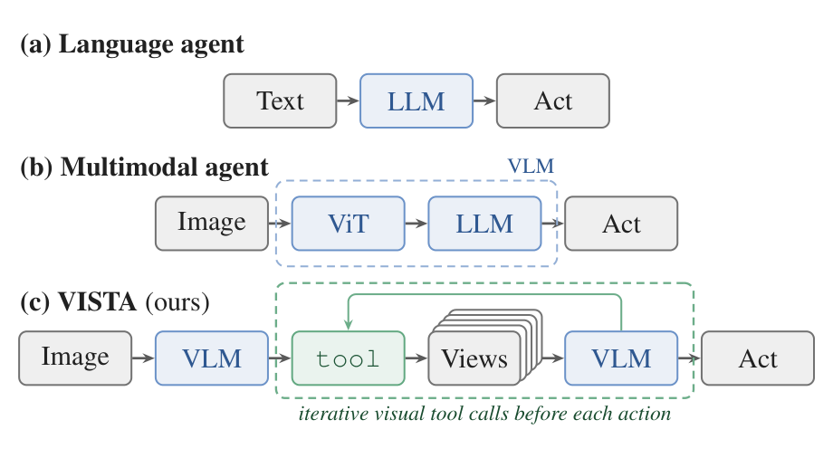

*原论文 Fig. 1，PDF p. 1。两个 VLM 方块代表同一个底层模型；中间“ViT+LLM”画法是为示意把 VLM 拆成视觉编码器与语言模型。图 (c) 中“iterative visual tool calls before each action”是 VISTA 与 (b) 的分界线。*

## 02 / 主路径：一个游戏回合的完整循环

理解 VISTA 不需要记住全部工具，只要跟一个回合走一遍。外骨架本身**不含任何训练过的模型**——它只执行工具调用、返回图像或像素值、对非法请求报错；所有判断与规划都来自模型的自由语言推理。每个游戏回合内可以发生多次与外骨架的对话，但只有一次游戏动作。（PDF §3.2, Fig. 3d）

```paper-path
{
  "title":"观察 → 推理 →（可选检视）→ 行动的回合循环",
  "intro":"一次 play 才推进一个游戏回合并消耗一个动作；inspect、read_pixels、笔记读写都不消耗游戏动作——“免费/零代价”只指游戏动作计分，token、时延与现实成本并不为零。检视与否、检视什么，每回合由模型自行决定。",
  "stages":[
    {"title":"观察","role":"每回合的起点","action":"模型收到当前视觉状态与可用动作列表。配置 (v)–(vi) 的完整 VISTA 下，每个动作后自动只返回最后一帧——中间帧不再自动塞进上下文。","why":"把上下文预算留给推理；自动推入全部帧正是文本网格/官方协议的 token 负担来源。","output":"当前帧 + 可用动作清单。","source":"PDF §3.2, Fig. 3d；附录 A.2"},
    {"title":"自由语言推理","role":"建立并修订游戏模型","action":"模型用自由文本提出假设、预测动作结果、规划下一步，并按提示词要求在行动前说出预期、行动后清点可见变化。","why":"把理解外化成可修订的自然语言陈述，让“发现规则”变成有记录、可纠错的过程（ReAct 式循环）。","output":"对游戏机制的当前最佳理解与下一步计划。","source":"PDF §3.2；附录 A.5"},
    {"title":"可选：检视视觉记忆","role":"按需取回证据","action":"调用 inspect(question, views)：指定任意历史回合的帧、矩形区域，返回裁剪放大后的图像；或 read_pixels(question, views) 读取区域内的精确像素值。一次调用可同时取多帧、多区域。","why":"编码时不知道什么细节日后关键；检视把“记住什么”推迟到推理当下，构成对交互历史的显式注意力。","output":"放大图或像素值列表，直接进入本轮推理。","source":"PDF §§3.1–3.2, Fig. 3c；附录 A.4"},
    {"title":"可选：读写笔记","role":"跨上下文的持久理解","action":"读写 GUIDE.md（跨关卡可复用的游戏理解）与 WORKING.md（当前关卡的便签与计划）；两者都跨 RESET 与上下文重启动保留，关卡推进时清空 WORKING。","why":"语言化理解需要一个稳定存放处，才能在上下文换新后继续修订而不是从零开始。","output":"更新后的游戏规则笔记。","source":"PDF §3.2；附录 A.4–A.5"},
    {"title":"play：执行一次游戏动作","role":"唯一消耗游戏动作的步骤","action":"调用 play(action, x, y) 推进一个游戏回合；环境返回最终帧，所有中间动画帧自动归档。动作集由各游戏定义（如 ARC-AGI-3 的 RESET、ACTION1..7、点击）。","why":"动作预算直接进 RHAE 计分、检视不计动作——这一价目表鼓励模型想清楚再动、用检视代替试探性动作（此设计动机为读者重构，论文只陈述价目表本身）。","output":"新状态的最终帧；回合号 +1。","source":"PDF §3.2；附录 A.4"},
    {"title":"归档与寻址","role":"无损记忆的写入","action":"每个由环境返回的帧（含动画中间帧）以原始分辨率存入记忆，按（turn, frame）双索引标注，全程可寻址。","why":"与上下文窗口解耦：上下文可以换新，证据库不缩水。","output":"不断增长的可寻址帧序列（示例运行中曾累积 1,472 帧）。","source":"PDF §3.1, Fig. 3b；Fig. 10a"},
    {"title":"上下文交接","role":"撑过长程","action":"上下文将满时，外骨架控制器暂停普通工具调用，要求智能体保存继续所需的最小状态（写 WORKING.md 摘要，必要时更新 GUIDE.md），随后携带笔记、动作史、当前帧在全新上下文中续跑。","why":"长程游戏必然超出单个上下文；交接保住的是“理解 + 证据入口”，而不是把全部历史塞进摘要。","output":"新上下文中的续跑实例。","source":"PDF §3.2；附录 A.4"}
  ]
}
```

**循环里最反直觉的一点是“少给信息反而更好”。** 配置 (v)–(vi) 下每个动作只自动返回最后一帧，而 (i)–(iv) 沿用官方协议自动附带最多 7 帧；删掉的那些帧并没有丢，而是全部进了无损记忆，等模型需要时自己取。Fig. 5 显示这一改法与“无损记忆 + 检视”捆绑后把 RHAE 从 70.05 抬到 94.10。**读者推断**（作者未如此表述）：信息没有变少，只是从“被动推入”改成了“主动拉取”。（PDF Fig. 5，附录 A.2）

**原论文 Fig. 3 是组件与回合流水线的总览，建议按 (a)→(d) 读：** (a) 观察是渲染后的图像（ARC-AGI-3 官方帧为 64×64，图中展示文本网格与渲染图像的差别）；(b) 记忆条带表示“世界返回的每一帧都被完整保留”，注意“按回合与帧号可寻址”的标注；(c) 检视的两个方向——空间上放任意区域、时间上取任意更早回合的多帧；(d) 流水线把三步排成 1 观察 → 2 推理 → 3 行动，其中只有 play 花费动作，检视与笔记是可选分支，所有返回帧汇入记忆。（PDF p. 4, Fig. 3）

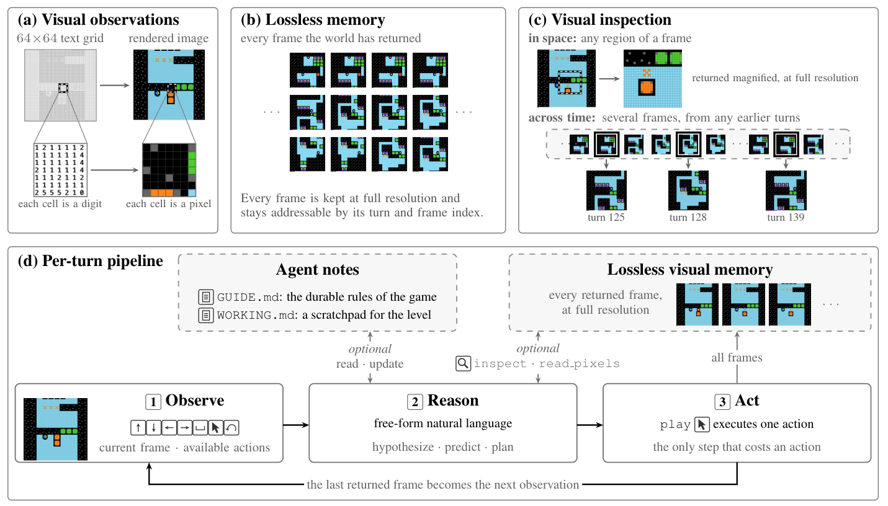

*原论文 Fig. 3，PDF p. 4。以 ARC-AGI-3 为例。(d) 中“the last returned frame becomes the next observation”与 (b) 的存档并存：下一回合只看最后一帧，其余帧留在记忆里随时可取。*

**动作计费与现实成本要分开读。** 检视不消耗 benchmark 游戏动作，因此模型可在行动前多取证；这为“用观察替代部分试探动作”提供了设计上的可能性，但不能单凭接口推导出为何比人类少用动作。Opus 5.0 在 25 个游戏共用 7,302 个动作，人类参考合计 17,135 个，比值约 0.43×；这个测量没有等同化人的观察时间、模型 token 或实际时延。（PDF §4.2, Table 2）

## 03 / 机制特写：三个关键操作与一把尺子

抓住三个操作就能复述 VISTA 的机制：**存**（无损记忆怎么写入）、**取**（检视怎么把证据拉回推理）、**算**（RHAE 如何定义“比人类高效”）。前两个是外骨架提供的无参数机械操作，发现规则仍由模型完成；第三个决定成绩数字该怎么读。

### 存：无损记忆是“解耦的证据库”

记忆的写入规则只有一条：环境返回的每一帧，包括动画中间帧，以**原始形式**存档，按（turn, frame）双索引标注，整个交互过程中一直可寻址——**与模型上下文里还留着什么无关**。（PDF §3.1, Fig. 3b）

这正对着引言里诊断的两个失效点：其一，编码一次的视觉表示会在上下文吃紧时被移除或被文本摘要替换，模型控制不了；其二，编码时不知道什么细节日后关键。存档不做任何压缩或摘要，等于把“记住什么”的决定从编码时刻推迟到推理时刻。（PDF §§1, 3）

### 取：检视是模型主导的“历史注意力”

三个只读工具构成回溯通道（工具以结构化函数调用暴露，纯文本无法触发执行）；前两个取像素证据，`history` 取自己的行为记录——`history("events", …)` 返回区间内精确动作/结果记录，`history("attempts", …)` 返回当前关卡每次尝试的摘要。（PDF §3.1–3.2；附录 A.4）

```text
inspect(question, views) -> images
# question: 希望这些视图回答的视觉问题
# view = {label, turn, frame=final, region=full}
# region = {x, y, w, h}，每个视图返回一张图
# 取任意归档帧，裁剪该区域并放大

read_pixels(question, views) -> (palette, samples[])
# 把区域切成 行×列 个格子，读出每格像素值
# 返回调色板与数值列表
```

两个设计细节值得停一下。第一，`question` 参数强制模型**为每次检视说出它要回答的视觉问题**——检视不是漫无目的的翻找，而是带着问题取证，这也使轨迹里的每次检视都可读、可审计。第二，`inspect` 返回的是裁剪放大后的**原始分辨率**图像：Fig. 10b 的例子里一次检视把三个小方块放大约 13 倍，模型据此读出每个守卫紫色标记贴在哪一边，从而确定朝向与拆解顺序。（PDF §3.1；Fig. 10b）

### 小教学例：检视返回证据，不返回游戏规则

假设一个新游戏在第 12 回合的动作后返回三帧：f0 中红点在格子 (2,1)，f1 在 (3,1)，f2 中红点消失。**这些格子、颜色与回合号都是教学设定，不是论文测量。** 自动观察只有 f2；无损记忆保存 f0、f1、f2。当前问题若是“红点是否经过格子 (3,1)”，模型可发出一次 `inspect`，把 t12/f0、f1、f2 并排取回；若 (3,1) 的颜色在放大图里仍不确定，可让 `read_pixels` 读该区域的精确值。工具产出是裁剪图或数值，不是“经过”“传送”“死亡”这样的语义标签。（对应 PDF §3；附录 A.4）

| 输入 | 外骨架操作 | 返回给模型的输出 | 合理的下一步 |
|---|---|---|---|
| “是否经过 (3,1)？”+ 三个已归档帧地址 | inspect 取回并裁剪同一区域 | 三张仍带 turn/frame 的图 | 比较红点位置，确认中间帧存在该点 |
| “该点是红色还是背景？”+ f1 的局部区域 | read_pixels 返回区域像素值 | 调色板与数值列表 | 用数值检查颜色，保留像素证据 |
| 上述观测 + 原来的规则假设 | 模型推理并写 GUIDE/WORKING | “这次经过后消失；原因待检验” | 选择能区分消失原因的下一个动作 |

这解释了“显式注意力”的实际含义：模型决定**何时取哪一帧哪一区域**；外骨架保真地取回。三帧足以支持“曾出现在那里”，却还不能区分“撞墙消失”与“触发传送”。要分清两种规则，仍需新的、能区分假设的环境反馈。存档解决证据可达性，不能自动把相关变化变成因果规则。

### 工作示例：一次检视如何变成一条规则

Fig. 2 左侧的 ARC-AGI-3 轨迹给出了完整的“存 → 取 → 写入笔记”闭环。第 67 回合新关卡出现橙色方块与橙色 X 标记，模型点击一个橙色方块后，环境返回 6 帧动画并全部归档（编号 t67 f0–f5，最后一帧成为当前观察）；模型没有在模糊的整帧里猜发生了什么，而是用一次 `inspect` 同时取回 t66 f27（动作前）与 t67 f0、f2、f5 三帧动画中间态，确认“橙色方块像绿色的一样爆掉，但留下橙色 X 残留”。图中下一次笔记写入标注为 GUIDE.md (turn 79)，记录橙色块规则（点击移除并留下橙色 X 空槽，再点 X 可重建方块），随后模型转向打开 bc6 通道；而“点 X 重建方块”这一开关机制是在附录 Fig. 13 的 level 3 轨迹里由模型于 turn 73 亲口确认（“clicking an X spawns an orange block (toggle…)”），并在 turn 75–76 用它搭出阻挡致命上升的天花板——turn 67 的检视本身只确认了“爆掉留 X”半条机制。（PDF p. 2, Fig. 2；附录 Fig. 13, pp. 21–22）

**原论文 Fig. 2 的左侧可直接检验这个闭环。** 从 turn 67 的动作及归档帧走到 `inspect` 的多帧返回，再找 turn 79 的 GUIDE 记录；不要把图里后写入的完整橙色规则都当成 turn 67 单次检视已经证明。右侧是 GameWorld 的另一条轨迹，用来说明同一工具接口也能在浏览器游戏中插入取证。（PDF Fig. 2；附录 Fig. 13）

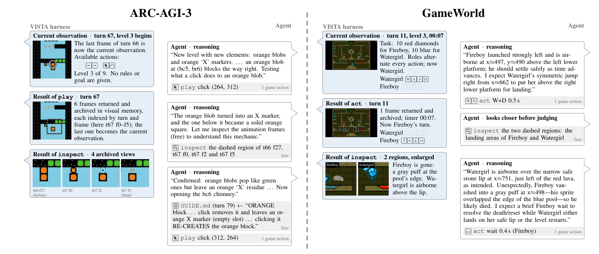

*原论文 Fig. 2，PDF p. 2。轨迹中的问题、检视返回与后续结论要按回合先后读。*

在这个示例里，三个环节各承担不同作用：**动画帧必须被存下**（否则爆掉的过程无从回放）、**检视可多帧对照且不计游戏动作**（降低取证在动作分数上的成本，但是否值得仍取决于 token、时延和问题）、**结论必须写入持久笔记**（否则下一次上下文换新就得重新发现）。这就是“显式注意力 + 外置记忆”机制在单个回合上的样子。

### 算：RHAE 这把尺子怎么刻的

**先算一个两关游戏（教学数值）。** 第一关人类参考 10 个动作，智能体用 5 个完成；比例平方为 $(10/5)^2=4$，关卡得分被截到 1.15。第二关未完成记 0。两关权重分别 1、2：加权效率是 $(1\times1.15+2\times0)/3=0.3833$，但完成度上限是 $1/3$，故游戏分只能是 **33.33%**。第一关再省动作也冲不破未完成第二关的上限。若两关都在参考动作数内完成，加权效率至少 1，完成度上限为 1，游戏分封顶 100%；因此 100 分也无法区分更省动作的两次完整通关。

下面的一般式只是把这个计算扩展到第 $\ell$ 关和第 $g$ 个游戏：先算每关效率，再按关卡加权，并让完成度限制整局分数。

Relative Human Action Efficiency（RHAE）把智能体的动作效率与**首次接触该游戏的人类玩家**对比，这是理解“100.00”和“57.4% 更少动作”两个数字的必要背景。按官方计分方法（附录 A.3），关卡 $\ell$ 在游戏 $g$ 中的得分是

$$
S_{\ell,g}=\min\left(1.15,\ \left(\frac{h_{\ell,g}}{a_{\ell,g}}\right)^{2}\right)
$$

其中 $a_{\ell,g}$ 是智能体在该关卡消耗的动作数，$h_{\ell,g}$ 是**成功通关的首次人类玩家动作数的上中位数**；未完成的关卡记 0 分。注意三点：动作数等于人类参考时得满分 100%；用得更少可升到 115% 封顶；动作数翻倍则掉到 25%（平方惩罚）。

游戏得分再按关卡权重 $w_\ell=\ell$（越靠后的关卡越重）聚合，并用完成度封顶：

$$
S_g=\min\left(\frac{\sum_{\ell=1}^{k} w_\ell}{\sum_{\ell=1}^{n} w_\ell},\ \frac{\sum_{\ell=1}^{n} w_\ell S_{\ell,g}}{\sum_{\ell=1}^{n} w_\ell}\right)
$$

第一个分式是“完成前 $k$ 关的加权占比”（通关上限），第二个分式是各关得分的加权平均；最终报告 25 个公开游戏 $S_g$ 的均值 ×100。由于通关上限的存在，**只刷通简单关卡拿不到高分**；论文也并列报告总动作数，用来区分同样 RHAE 下的效率差异。（PDF 附录 A.3, Eqs. 1–2；§4.2）

人类参考本身的口径也值得记住：ARC-AGI-3 官方人类研究共 486 名普通参与者，每款游戏由 10 人首次接触、无针对性训练，单游戏软限时 20 分钟、硬截断 30 分钟；$h_{\ell,g}$ 取成功者动作数的上中位数。也就是说，VISTA 的“0.43× 人类动作数”是对标**初次上手的普通人**，不是熟练专家。（PDF 附录 A.6）

### 机制对照：历史怎么留，两条路

```paper-contrast
{
  "title":"保留交互历史的两条路线",
  "intro":"同一批视觉证据，可以走“编码一次、窗口滚动”的隐式路线，也可以走“原始存档、按需取回”的显式路线。VISTA 的全部组件都在后一条上。",
  "branches":[
    {
      "name":"隐式保留：编码一次 + 滑动窗口",
      "lead":"图像被编码一次后丢掉原始像素，表示随上下文滚动被截断或摘要化。",
      "scope":"官方最小 harness、多数文本路线与早期多模态智能体的默认做法。",
      "judge":"上下文满了就丢最旧的交互，模型无法控制留下什么；文本网格表示还额外消耗大量 token（64×64 网格约 4K token/帧）。",
      "signal":"编码当下不知道什么细节日后关键，事后也无法找回——长程任务里信息丢失是结构性的。",
      "why":"它假设一次编码足以捕捉全部后续所需细节，这一假设在多关卡、机制逐步解锁的游戏中不成立。",
      "source":"PDF §1, Fig. 1b；附录 A.2"
    },
    {
      "name":"显式保留：无损记忆 + 主动检视",
      "lead":"每一帧原始存档、按（turn, frame）寻址；推理中用 inspect / read_pixels 按问题取回。",
      "scope":"VISTA 配置 (v)–(vi)；对 ARC-AGI-3、GameWorld、AI GameStore、BabyVision 使用同一套工具。",
      "judge":"上下文换新不影响证据库；检视不耗动作、可多帧对照、可放大到原始分辨率；取回动作带着明确的视觉问题。",
      "signal":"把“记住什么”推迟到需要证据的那一刻，构成对交互历史的显式注意力。",
      "why":"代价是每回合只自动给最后一帧，依赖模型自己知道何时回看；模型能力不足时可能不知道该检视什么。",
      "source":"PDF §§3.1–3.2, Fig. 3；附录 A.2"
    }
  ]
}
```

## 04 / 实验图谱：阶梯消融与跨环境证据

实验分四类看最清楚：**系统级对比**（同一分数尺上与其他系统排座次）、**组件消融**（把增益拆到 harness 的每一级）、**设计选择**（表示形式、上下文、分辨率）、**迁移与稳健性**（开源模型、3D 渲染、另外三个基准）。系统级对比只说明总分，组件归因要靠消融阶梯；两者不能互相替代。（PDF §§4–5）

**先抓住三组关键数与条件。** ARC-AGI-3 的 25 个公开游戏上，完整 VISTA + GPT-5.6 Sol max 为 RHAE 99.00、9,126 动作；相同模型/推理档的官方公布值为 13.33，但接口与停止协议不同。内部阶梯中，(iv)→(v) 是 70.05→94.10，**同时**加入记忆/检视并把自动推帧改为最终帧，不能把 +24.05 点单独归因于 `inspect`。Opus 5.0 的官方 high 40.68→VISTA xhigh 100.00 还包含推理档变化。完整 harness 内只换表示，文本 96.75 对图像 99.00，而 token/游戏为 71.9M 对 30.7M：图像更强的主要可见优势是这组设置中的 token 效率。（PDF Table 1、Figs. 5–6；附录 A.2）

<details class="reading-detail">
<summary>展开各实验的任务、指标、比较条件与结果</summary>

```paper-experiments
{
  "title":"VISTA 的实验问题矩阵",
  "rows":[
    {
      "question":"不用程序合成，视觉路线能在 ARC-AGI-3 上到什么水平？",
      "setup":"25 个公开游戏；VISTA + Opus 5.0（xhigh）/ GPT-5.6 Sol（max），与官方最小 harness、程序合成系统（Schema、ewma sv v1.6、Retrodict、Tycho）同表对比。指标 RHAE（%），并列总动作数。",
      "observation":"Opus 5.0 得 RHAE 100.00（7,302 动作，0.43× 人类参考 17,135）；GPT-5.6 Sol 99.00（9,126 动作，0.53×）。同底座模型在官方 harness 下仅 40.68（Opus 5.0 high）与 13.33（GPT-5.6 Sol max）。程序合成系统最高 100.00（Tycho）——VISTA 是已知首个不走程序合成达到满分/近满分的系统。",
      "source":"PDF §4.2, Table 1, Table 2"
    },
    {
      "question":"增益来自外骨架的哪一级？",
      "setup":"GPT-5.6 Sol max、200K 上下文固定；从官方实现出发逐级加组件：图像观察 → 提高动作/时间限额 → 连续对话 → GUIDE/WORKING 笔记 → 无损记忆 + 检视 → 像素读出。对照官方文本网格结果 13.33。",
      "observation":"RHAE 逐级：13.33 →（i）47.32 →（ii）51.66 →（iii）65.82 →（iv）70.05 →（v）94.10 →（vi）99.00。在可比的 (i)–(vi) 阶梯内，最大一跳是（v）无损记忆 + 检视（+24.05）；像素读出再 +4.90。（对比外部参考的最大单跳是换图像观察：13.33 → 47.32。）完成率同步从 4% 升到 100%。（i)–(iv) 沿用官方每动作最多 7 帧协议，(v)–(vi) 只自动给最后一帧。",
      "source":"PDF §4.3, Fig. 5；附录 A.2"
    },
    {
      "question":"图像观察 vs 文本网格，差别在效果还是成本？",
      "setup":"其余 harness 不变，只替换观察表示：64×64 整数网格文本 vs 512×512 渲染 PNG（8× 最近邻放大官方 64×64 帧）。指标 RHAE、总动作数、每游戏平均 token 数。",
      "observation":"RHAE 96.75（文本）vs 99.00（图像）；动作 10,614 vs 9,126；每游戏 token 71.9M vs 30.7M。文本网格约 4K token/帧，图像约 308 image token/帧——效果相近，成本差 2.3 倍。",
      "source":"PDF §4.3, Fig. 6"
    },
    {
      "question":"上下文多大才够？",
      "setup":"最大上下文 100K / 200K / 500K / 780K（决定何时触发压缩交接）；其余为完整 VISTA + GPT-5.6 Sol max。",
      "observation":"RHAE 98.6 / 99.0 / 94.4 / 93.9；总动作 8,395 / 9,126 / 12,391 / 12,321；每游戏 token 17.3M / 30.7M / 84.1M / 105.7M。默认 200K 最优；100K 仅低 0.4 且 token 减半；更大的上下文反而更贵更差。",
      "source":"PDF §4.3, Fig. 7a"
    },
    {
      "question":"图像分辨率给多少？",
      "setup":"输入图像边长为官方 64×64 帧的 2× / 4× / 8× / 16×（128 / 256 / 512 / 1,024 像素），约 20 / 77 / 308 / 1,229 image token 每帧。",
      "observation":"RHAE 96.6 / 99.7 / 99.0 / 88.3；总动作 12,590 / 8,849 / 9,126 / 15,331。4× 用默认 8× 的约 1/4 image token 取得可比性能；2× 退化，16× 反而更差——每帧 image token 翻两番（308 → 1,229），每游戏总 token 也升到约 2.3 倍（30.7M → 71.1M）。",
      "source":"PDF §4.3, Fig. 7b"
    },
    {
      "question":"换开源模型还成立吗？",
      "setup":"GLM-5.3 Flash 320B 开源后端（Codex CLI 接入）；对照官方最小 harness 与去掉 inspect / read_pixels 的 VISTA 残化版。动作上限 3,000/游戏。",
      "observation":"RHAE 1.89（官方实现）→ 13.27（VISTA 去视觉工具）→ 66.93（完整 VISTA）。全开源可复现系统取得 66.93，说明外骨架增益不依赖单一闭源模型，但绝对水平仍受底座能力限制。",
      "source":"PDF §4.3, Fig. 8；附录 A.1"
    },
    {
      "question":"视觉更复杂时还站得住吗？",
      "setup":"同一批 ARC-AGI-3 游戏改用 3D 渲染（示例游戏 SP80、LF52），完整 VISTA + GPT-5.6 Sol。",
      "observation":"RHAE 84.12（3D）vs 99.00（2D）；动作 20,640 vs 9,126——动作数翻倍以上，但仍远超官方文本网格基线（13.33）。",
      "source":"PDF §4.3, Fig. 9"
    },
    {
      "question":"同一副外骨架能迁移到别的视觉环境吗？",
      "setup":"GameWorld 34 游戏 / 170 任务（SR、PG，官方评估器）；AI GameStore 10 游戏（人类中位=100 的归一化几何平均）；BabyVision 39 道视觉追踪题（准确率）。均用 GPT-5.6 Sol + VISTA，对照同模型最小 harness（BabyVision 基线为单次问答、不许检视）、新手人类/人类中位、此前最好成绩。",
      "observation":"GameWorld SR 63.3（官方 40.0，新手人类 55.3，此前最好 20.0）、PG 79.3（官方 62.9，人类 64.1，此前最好 39.8）；AI GameStore 几何平均 140.3（官方 47.3，人类中位 100，此前最好 9.0）；BabyVision 63.2%（官方 41.0%，人类 92.3%，此前最好 25.7%）。三个基准全面超过最小 harness 基线；GameWorld 与 AI GameStore 还超过人类参照。",
      "source":"PDF §5, Fig. 11；附录 A.3, A.6"
    },
    {
      "question":"数字有多稳？",
      "setup":"ARC-AGI-3、GameWorld、BabyVision 主实验各重复三次（附录 B.1）。",
      "observation":"ARC RHAE 99.00 / 98.90 / 99.23（99.04 ± 0.17）；GameWorld SR 63.33 ± 2.37%、PG 79.30 ± 2.14%；BabyVision 63.23 ± 3.00%。AI GameStore 三次聚合分 119.99 / 148.58 / 140.06，按官方多轮协议先对每游戏原始分取均值再归一聚合。",
      "source":"PDF 附录 B.1"
    }
  ]
}
```

</details>

**主对比表先建立座次：** Table 1 在同一把 RHAE 尺上排了六类系统——官方最小 harness（无程序）、四个程序合成系统（Schema、ewma sv v1.6、Retrodict、Tycho）与 VISTA（无程序）。每个系统最多两行（不同模型/推理档位）。读表时盯住“Program”列：VISTA 是唯一进入满分区间（99.00 / 100.00）的“No”行；同为“No”的官方实现只有 13.33 / 40.68。表中 Opus 5.0 的 40.68 带 † 脚注，是由官方公布逐游戏分推算的，不是官方直接给出的总分。

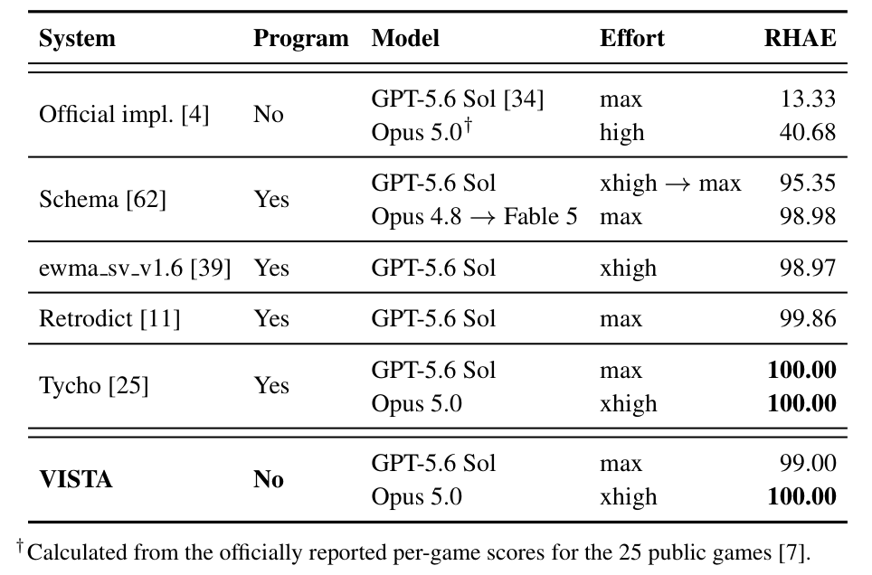

*原论文 Table 1，PDF p. 5。行与行的模型/推理档位并不统一（如 Schema 的 Opus 4.8 → Fable 5 为两阶段），只有 GPT-5.6 Sol 的 max 档对齐；Opus 5.0 的官方 high 与 VISTA xhigh 档位不同，而且官方与内部实验的接口/停止条件也不完全相同。*

**同一底座、最小 harness → VISTA 的 RHAE 变化**（本文重绘，三组数据分别来自 Table 1 与 Fig. 8；横轴为 RHAE 百分点）：

```paper-chart
{
  "type":"paired",
  "title":"换外壳前后：同一模型的 ARC-AGI-3 RHAE",
  "subtitle":"最小 harness（官方实现）→ 完整 VISTA；后值取各配置最高推理档",
  "origin":"本文重绘 · 原论文 Table 1 与 Fig. 8",
  "source":"PDF p. 5, Table 1；p. 7, Fig. 8",
  "note":"Opus 5.0 官方 40.68 由官方公布逐游戏分推算（表注 †）；GLM-5.3 Flash 320B 为开源后端，动作上限 3,000/游戏，其余为 2,000/游戏。",
  "rows":[
    {"label":"GPT-5.6 Sol（max）","before":13.33,"after":99.00},
    {"label":"Claude Opus 5.0（high → xhigh）","before":40.68,"after":100.00},
    {"label":"GLM-5.3 Flash 320B（开源）","before":1.89,"after":66.93}
  ]
}
```

**消融阶梯的完整数字**（原论文 Fig. 5 的全部行；RHAE 为 %，动作数是 25 个游戏合计，完成率以 25 款游戏为分母）：

| 配置 | RHAE (%) | 总动作数 | 完成游戏 | 说明 |
|---|---|---|---|---|
| 官方实现（文本网格） | 13.33 | 10,619 | 4% | 官方公布值，外部参考 |
| (i) 图像观察 | 47.32 | 16,343 | 36% | 文本网格 → 512×512 PNG |
| (ii) + 动作/时间限额 | 51.66 | 22,544 | 44% | 2,000 动作/48 小时每游戏 |
| (iii) + 连续对话 | 65.82 | 28,626 | 60% | 原生压缩续跑，替代滑动截断 |
| (iv) + GUIDE.md 与 WORKING.md | 70.05 | 23,702 | 76% | 两份笔记 + 修订模型提示词 |
| (v) + 无损记忆与检视 | 94.10 | 12,261 | 96% | 每动作只自动给最后一帧 |
| (vi) + 像素读出（完整 VISTA） | 99.00 | 9,126 | 100% | read_pixels 精确 RGB |

*上表为本文按原论文 Fig. 5 重排的数据表，非新测量。(i)–(iv) 每个动作自动附带最多 7 帧（官方协议），(v)–(vi) 自动只给最终帧、其余帧由模型主动检视。官方文本网格一行是官方公布值，与 (i)–(vi) 的运行接口不同（API vs CLI），严格可比的是 (i)–(vi) 彼此。（PDF Fig. 5；附录 A.2）*

**原论文 Fig. 5 是消融阶梯的原始图，建议这样读：** 三块面板从左到右分别是 RHAE、25 游戏总动作数、完成游戏百分比；七根柱从左到右按上表顺序排开。看 RHAE 面板时重点停在 (iv)→(v) 一跳（70.05 → 94.10）：这一级才引入 VISTA 的视觉组件。动作数的同级回落可以直接读出：(iv) 为 23,702，(v) 降到 12,261（更早的 (iii) 曾冲到 28,626）。但要注意 (v) 同时改了两件事——接入无损记忆与检视，并把每动作自动附带最多 7 帧改为只自动给最后一帧——所以动作回落不能只记在检视头上；可能的解释是检视替代了试探性动作、更少的自动推帧也减少了浪费，两者未被分开测量。（PDF p. 6, Fig. 5；附录 A.2）

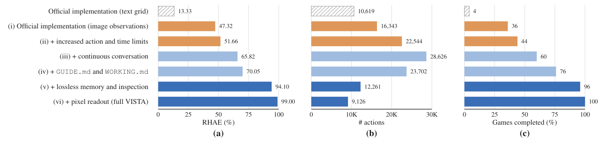

*原论文 Fig. 5，PDF p. 6。数值与上表一致；最左斜纹柱（13.33 / 10,619 / 4%）是官方公布的文本网格结果，与后续实测柱接口不同。*

<details class="reading-detail">
<summary>展开表示、上下文、分辨率与更难视觉条件的原图</summary>

**原论文 Fig. 6 按左示例、右测量读。** 左面板把同一状态写成整数网格或图像；右面板同时看 RHAE、总动作、平均 token/游戏。不要只看 96.75 与 99.00 的小分差而漏掉 71.9M 与 30.7M 的 token 代价。比较保留了其余 VISTA harness。（PDF Fig. 6）

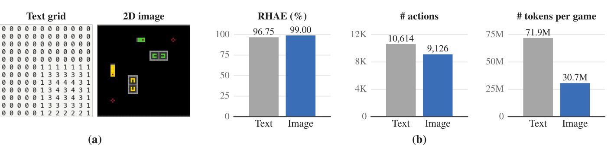

*原论文 Fig. 6，PDF p. 6。每帧估计 token 和每游戏总 token 是两个不同分母。*

**原论文 Fig. 7 要逐行、跨三列读。** (a) 改变上下文上限，(b) 改变图像缩放；每行三列是分数、动作数、token/游戏。200K 是报告默认，100K 只低 0.4 RHAE 却约半数 token；图像 4× 与 8× 成绩接近，16× 更贵且得分更低。这是离散配置的观测，不是“越小永远越好”的规律。（PDF Fig. 7）

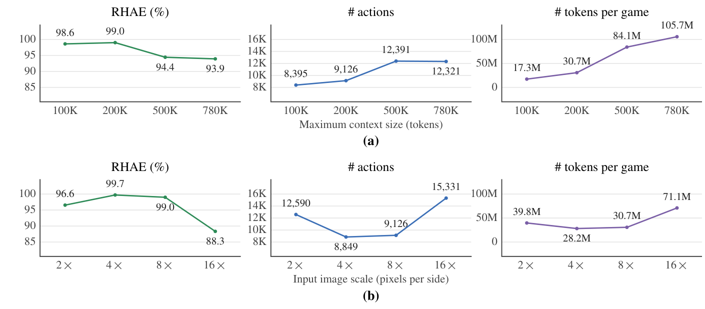

*原论文 Fig. 7，PDF p. 7。缩放相对于官方 64×64 帧；4× 为 256×256，8× 为 512×512。*

**原论文 Fig. 8 看开源后端的三配置差值。** GLM-5.3 Flash 320B 从官方实现 1.89，经去视觉工具的 VISTA 13.27，到完整 VISTA 66.93。完整与去工具变体的差值支持工具在该后端下有用，未追平闭源后端也说明能力仍受模型限制。（PDF Fig. 8）

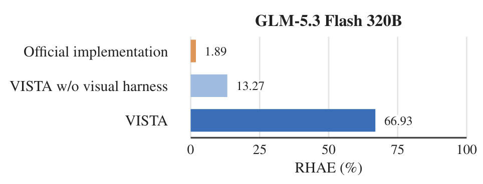

*原论文 Fig. 8，PDF p. 7。该后端每游戏动作上限 3,000，不同于两个闭源后端的 2,000。*

**原论文 Fig. 9 先看同一游戏换成 3D 的外观，再看结果。** 从 2D 到 3D，RHAE 99.00→84.12，动作 9,126→20,640；这说明方法仍能工作但付出了更大交互代价。相同游戏逻辑不能消除渲染改变带来的感知难度。（PDF Fig. 9）

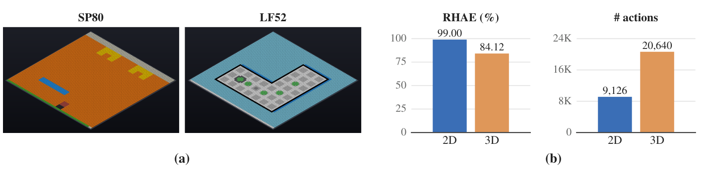

*原论文 Fig. 9，PDF p. 7。3D 条件的动作数超过 2D 两倍，分数仍下降。*

</details>

**跨环境结果的原始图**（Fig. 11）按四个面板读：GameWorld 成功率与进度、AI GameStore 归一化几何平均、BabyVision 准确率；每组三根柱依次是新手人类、官方最小 harness、VISTA（GPT-5.6 Sol），虚线是此前最好成绩。注意 AI GameStore 面板的纵轴到 150——VISTA 的 140.3 是超过“人类中位=100”的归一化分，不是百分比。（PDF p. 9, Fig. 11）

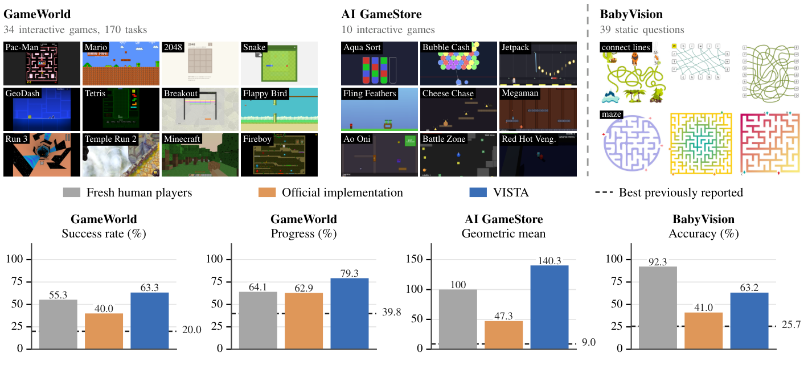

*原论文 Fig. 11，PDF p. 9。数值核对：GameWorld SR 人类 55.3 / 官方 40.0 / VISTA 63.3 / 此前最好 20.0；PG 64.1 / 62.9 / 79.3 / 39.8；AI GameStore 100 / 47.3 / 140.3 / 9.0；BabyVision 92.3 / 41.0 / 63.2 / 25.7。BabyVision 人类 92.3 是按 20 道迷宫 + 19 道连线题加权的人类成绩（附录 A.6）。*

**逐游戏明细的一个细节：** Table 2 显示 Opus 5.0 在全部 25 个游戏都是 100.00；GPT-5.6 Sol 完成全部游戏、均分 99.00，唯一低于满分的是 ls20（75.03 分，1,135 动作，人类参考的 1.46×）——其余 24 款都在 100.00。也就是说 GPT 的 99.00 不是“普遍差一点”，而是单游戏失手拉低的均值。正文 Fig. 4 的镜面游戏轨迹给出了单游戏粒度的动作效率示例：level 1 VISTA 16 个动作（人类参考 32），level 3 41 个（人类 75）。（PDF 附录 Table 2；Fig. 4, p. 5）

**定性证据看两眼就够：** Fig. 10a 展示跨时空取证——棋盘重置后，模型一次 `inspect` 取回此前 22 个回合中的 4 帧重建地图；Fig. 10b 展示局部取证——放大约 13 倍看清三个守卫的紫色标记朝向，得出“必须从安全侧按 A→B→C 拆”的结论。两例分别对应机制里“时间维”与“空间维”的取回路径。（PDF §4.4, Fig. 10）

**原论文 Fig. 10 的读法：** 左半 (a) 从上往下看——记忆条带标注“已存 1,472 帧”，一次 `inspect` 调用取回此前 22 个回合中的 **4 帧**（turn 125、128、139、145；当前观察是 turn 147 重置后的画面），用一次取证重建地图后再下动作；右半 (b) 对比“整帧”与“一次检视返回的约 13 倍放大图”，A/B/C 三个守卫的紫色标记在放大后才能分辨贴在哪一侧。两半的图注都按“inspect · the question it asks / Agent · what it concludes”成对给出问题与结论——检视不消耗游戏动作这一点由 Fig. 2 与 Fig. 14 的“free”标注体现，Fig. 10 本身没有该标注。（PDF p. 8, Fig. 10）

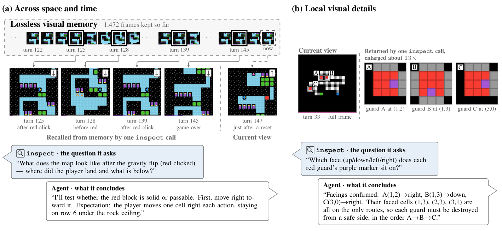

*原论文 Fig. 10，PDF p. 8。图中虚线框是模型请求的检视区域，返回图已裁剪放大；每组给出“inspect 要回答的问题”与“Agent 的结论”，未标注动作计费（计费约定见 Fig. 2、Fig. 14）。*

## 05 / 附录迁移：静态迷宫还需要记忆吗

BabyVision 是这条论证中必须保留的边界：单张图没有历史回合，但仍可以**改变看图的粒度**。附录 B.3 的 Fig. 14 下排给出实际操作路径。Maze 的输入是一张迷宫图和问题；模型先按 $2\times$ 尺度查看棋盘，再调用 `read_pixels` 把墙格读成数值，得到可逐格推理的局部结构，最后提交答案。Connect the Lines 则先放大两个路径区域，再读精确像素以追踪细线。工具只改变证据视图，未向模型提供正确路径。（PDF §5；附录 A.5、B.3, Fig. 14）

| 输入 | 操作 | 输出 | 如何测量 |
|---|---|---|---|
| Maze 的单张图与问题 | 2× 查看棋盘，读取墙格像素 | 供模型寻路的视觉/数值证据，再给最终答案 | 在所选 20 道 Maze 与 19 道连线题共 39 题上算准确率；失败算错 |
| 同一模型的官方最小设置 | 一次看图直接作答，不再检视 | 单次最终答案 | 同一所选任务，41.0%；VISTA 63.2% |

这个迁移把“长期存档”和“局部检视”分开到任务层面：没有交互历史时依然观察到收益，所以空间检视不只服务于回放。不过这不是 ARC-AGI-3 上两个组件的正交消融，不能据此给各自分摊 +24.05 点。人类参考 92.3% 仍高于 63.2%，而 39 题也只是 BabyVision 388 题中的两个子类。（PDF §5、Fig. 11；附录 A.3、A.6）

**原论文 Fig. 14 先读下排两例。** 左下连线题中的放大区域对应难以追踪的路径；右下迷宫的 2× 查看与像素读出对应上表的输入→操作→输出。上排 Minecraft/Pac-Man 则分别展示局部识别和跨时间回看，说明同一接口可以解决不同的取证需求。（PDF 附录 B.3, Fig. 14）

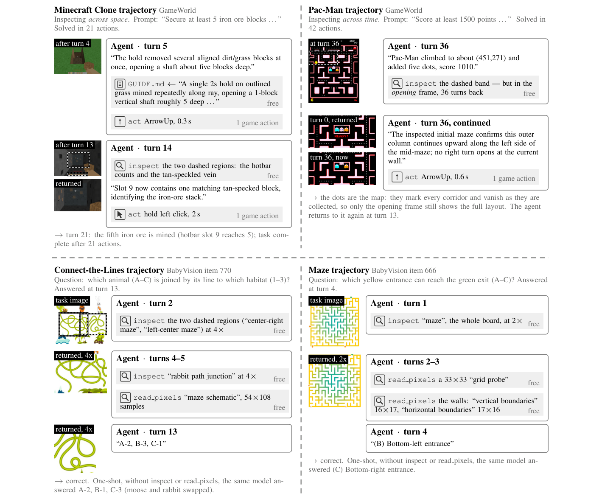

*原论文 Fig. 14，PDF p. 23。定性轨迹说明工具如何被使用，准确率结论来自所选 39 题的聚合评测。*

## 06 / 综合：外骨架补的是“证据可达性”，不是模型能力

这篇论文的机制与证据由一条明确的依赖关系串起来：**长程任务的一类限制被诊断为视觉证据不可达**（编码一次、有损保留），于是机制上做“存 + 取”（无损记忆 + 主动检视），证据上就必然要回答“取得到底值多少”。Fig. 5 的阶梯消融正面回答了增益落在哪一级——同一模型下逐级加装（注意 (iv) 起提示词也随之加了“建立可修订游戏模型”的指令，并非全程固定），(iv) 笔记与连续对话做到 70.05，接上证据库与取回工具（v）跳到 94.10，像素读出（vi）收尾到 99.00。归因要分两层读：相对外部参考的最大单跳来自换成图像观察（13.33 → 47.32），而 (iv)→(v) 是接口可比的 (i)–(vi) 阶梯内最大的一跳；**有界解释**：该捆绑配置是内部阶梯中增益最大的一步；主动取回、原始记忆和自动推帧策略各自的净效应没有被单独识别。（PDF Fig. 5；附录 A.2）

作者对这一归因相当克制，值得原样保留：论文明说**模型已有的能力仍是成功的关键因素，VISTA 只是把这些能力“引出来”**；外骨架是对模型改进的补充，不是替代。（PDF §6）这一点在开源模型上看得最清楚：GLM-5.3 Flash 320B 从官方 harness 的 1.89 到完整 VISTA 的 66.93，提升幅度巨大，但绝对值仍与闭源底座的 99–100 有实质差距。**读者推断**：外骨架决定的是“能力可达性”，天花板仍在底座。3D 渲染实验（84.12 分、动作数翻倍以上）显示视觉更复杂时需要显著更多交互（论文原话），**读者推断**是检视的单位证据成本随之变高——外骨架不能把难度完全消化掉。（PDF §§4.3, 6）

证据的适用范围要跟着数字一起读。RHAE 的分母是“成功通关的首次人类玩家动作数上中位数”，0.43× 说明 VISTA 比初次上手的普通人高效，不是与熟练专家比较；且 RHAE 平方惩罚动作浪费、按 $w_\ell=\ell$ 加权靠后关卡、用加权完成度封顶，“100.00”在这一记分法下的含义是“所有关卡都通关，且加权动作效率不低于人类参考”。此外有三处限定：其一，被测模型发布晚于这些公开基准，**不能排除游戏进入过训练数据**，作者自己把 ARC-AGI-3 私有集列为更强的泛化检验；其二，系统比较里对手多是同期的程序合成系统，且官方基线数值部分来自公布结果、部分为推算（Opus 5.0 的 40.68 由逐游戏分推得），接口（API vs CLI）也不完全一致；其三，GPT-5.6 Sol 的主结果有运行间波动（三次 RHAE 99.00 / 98.90 / 99.23，即 99.04 ± 0.17）；Opus 5.0 的满分是单次运行，论文没有给出它的重复数据。（PDF §6, Table 1 注；附录 B.1）

把机制与证据对齐后，有两处张力值得留给读者。第一，动作数随证据工具的引入大幅回落，但因果并未拆开——观察是 (iii) 无证据工具时 28,626 个动作，(iv)→(v) 接入记忆与检视的同级动作数 23,702→12,261（该级还同时把自动推帧从最多 7 帧改为只给最后一帧）；**读者推断**：检视替代试探性动作、自动推帧减少浪费都是可能解释，论文没有把它们分开测量。这暗示在动作昂贵、观察便宜的环境（机器人、网页操作）里，价目表设计可能与无损记忆同样关键，而论文没有拆开这两个因素。第二，BabyVision 上**没有交互历史**（单张静态图），检视仍把准确率从 41.0% 提到 63.2%——说明“空间维取回”（放大局部）独立于“时间维取回”（跨回合回看）也有价值，但两个维度的贡献在 ARC-AGI-3 上是捆绑测量的，论文未做正交分解。这两点都需要下一步的独立控制实验，不能由现有阶梯自动解答。（PDF Fig. 5, Fig. 11, Fig. 10）

至于“该带走什么”：VISTA 证明了在一组要求发现未知规则的交互视觉游戏上，**把视觉证据原样留住并交给模型主动取回**，足以让通用多模态模型在不写一行程序合成的情况下，以首次人类参考 0.43× 的动作数拿满 RHAE；而消融阶梯、开源模型与 3D 渲染三组证据共同界定了这句话的边界——已直接验证的是这些公开游戏、指定底座与工具/预算协议；跨真实世界任务的有效性仍待测量。（PDF §§4–7）

## 07 / 理解检查

先尝试重建过程与计算，再展开答案；答案披露不是理解提升的测量。

```paper-check
{
  "title": "理解检查：把 VISTA 放进一个新环境",
  "items": [
    {
      "question": "一个新环境的动作返回5帧，自动观察只给最终帧。第3帧中短暂出现的标记在上下文交接后变得关键。模型该用什么地址和操作取回，工具又不能替它回答什么？",
      "answer": "所有返回帧都按turn/frame存档，与当前上下文独立；模型应指出视觉问题并用inspect取指定回合第3帧和必要的前后帧，可再用read_pixels核查精确值。工具返回图/数值，不会自动判定标记的角色或导致变化的规则；这些要由模型结合反馈检验。",
      "source": "PDF §3；附录 A.4"
    },
    {
      "question": "教学游戏有3关、权重1/2/3。前2关各用人类参考一半动作完成，第3关未完成。RHAE游戏分是多少？继续压低前两关动作数能否到100？",
      "answer": "前两关各封顶1.15；效率加权为(1+2)×1.15/6=0.575，完成度上限为3/6=0.5，最终50%。再省动作无法越过未完成关卡造成的50%上限。",
      "source": "PDF 附录 A.3, Eqs. 1–2；本文计分教学迁移"
    },
    {
      "question": "有人用70.05→94.10宣称inspect单独贡献24.05点，又用Opus40.68→100宣称只换工具、不换任何其他条件。哪两个条件需要补回？",
      "answer": "(iv)→(v)同时加入无损记忆与检视，并由最多7帧自动推入改为只推最终帧；Opus的官方high与VISTA xhigh不同，官方/API与内部CLI及停止协议也有差异。数值支持配置比较，不能单独识别inspect效应。",
      "source": "PDF Fig. 5、Table 1；附录 A.2"
    },
    {
      "question": "在只有一张地图的新任务中，删掉历史存档后仍可调用局部放大。如果它比一次作答更好，能否据此声称长期记忆没有价值？",
      "answer": "不能。静态任务没有历史回放需求，改善只说明改变空间取证粒度可能有用；长期任务仍会遇到当前帧不含所需证据的情况。BabyVision的41.0→63.2只覆盖所选39题，不把长期记忆与检视在ARC上的贡献拆开。",
      "source": "PDF §5、Fig. 11；附录 B.3, Fig. 14"
    }
  ]
}
```

<!-- 交互选择审计：回合内的可选取证分支已由静态路径、逐帧教学表与原 Fig. 2/3/10 显示；读者可同时比较所有帧和假设。数值图只含论文已测离散配置，不用滑块插值出未测结果。扩展协议与扫参使用原生 details，关键捆绑变化和反例保持可见，因此不另加脚本交互。 -->
