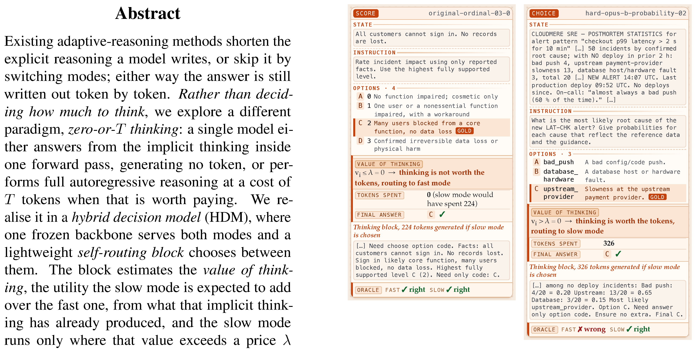
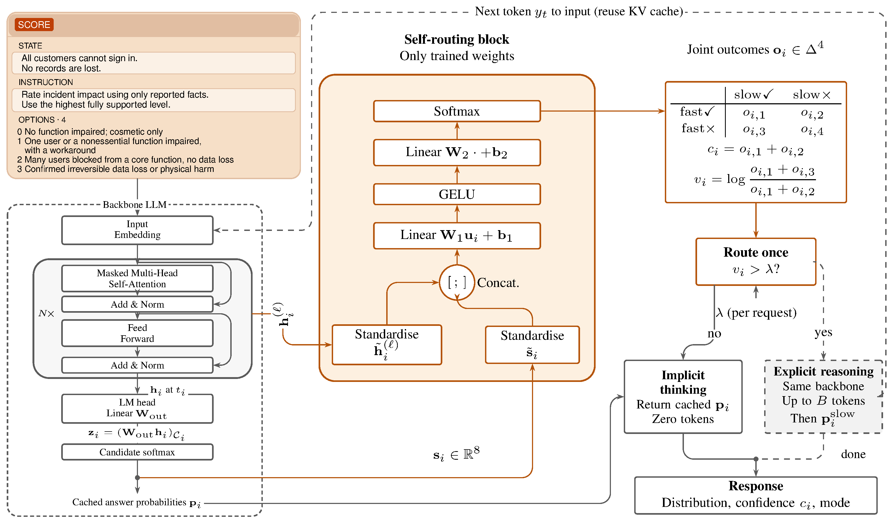
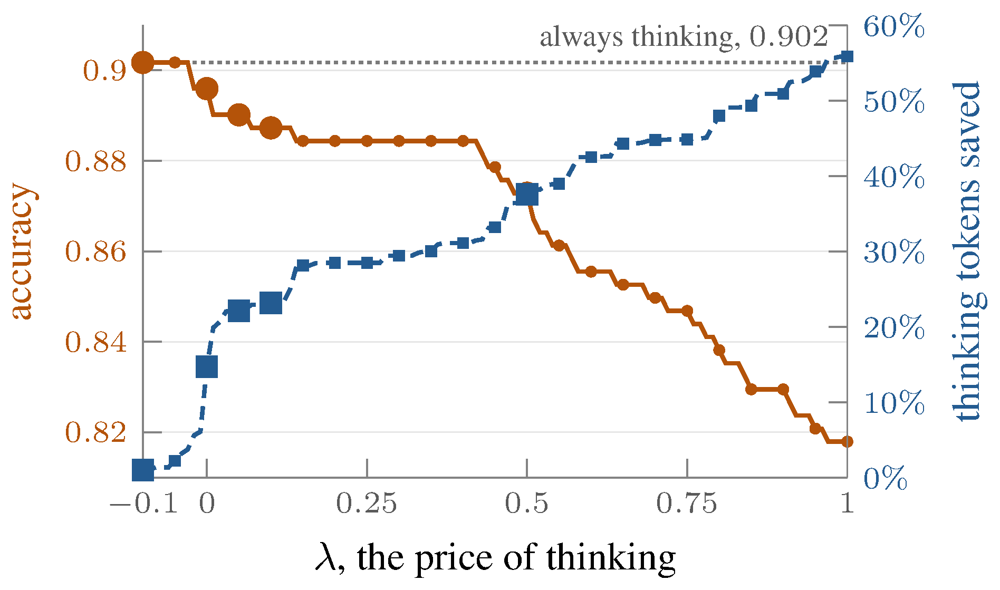

<!-- paper-reading-lang: zh-CN -->
<!-- paper-reading-mode: deep -->
<!-- paper-reading-theme: plum -->

# The Value of Thinking：混合决策模型何时该思考（深读）

```paper-map
{"thesis":"现有自适应推理都在决定「想多长」，没有问「要不要想」——答案仍逐 token 生成。本文提出 zero-or-T 思考范式：一个问题要么在单次前向的隐式思考里直接给出决策（零生成 token），要么付 T 个 token 走完整自回归推理，由一个几百 KB 的自路由块在推理开始前决定。路由块读冻结骨干最后一层的隐藏状态与快速答案的 8 个统计量，估计「思考的价值」——慢模式比快模式预期多挣的效用（对数比），仅当价值超过按请求设定的价格 λ 时升级。无逐决策标签的情景式任务用 CDPO（PPO 变体，从回合级回报训练）。在 JevBench 上 HDM-4B 达 0.857 对 Jev 的 0.851，中位延迟 0.179s 对 0.652s（−72.5%）；MiniWoB 上省 80.1% thinking token。","reader":"关心推理经济学、System 1/System 2 混合架构、决策模型与 agent 成本工程的读者。机制推导、CDPO 全部主表与消融都展开手算。","goals":["看懂 zero-or-T 范式与「思考的价值」定义：为什么置信度不能替代它、对数比形式从何而来","把效用折扣账（e^−ρT）、价格 λ、路由曲线与 BANKING77 两阶差对照逐式手算","沿本周决策模型线（Drex→Flide→MMDM→Gemini Decisions API→本文）理解「何时不思考」的理论收官"],"outcome":"通读 arXiv 2611.16961v1 全部 20 页：正文 §1-§5、附录 A-G（请求 schema、超参、模板、AUROC 消融、四路标签、CDPO 推导、逐题阅读）。","outcomeSource":"arXiv 2611.16961v1 PDF pp.1-20","items":[{"number":"01","label":"靶子","signal":"想多长≠要不要想","text":"现有自适应推理缩链、跳模式、级联路由——都在决定推理量而非推理有无。答案仍是 token 序列。zero-or-T 把二分推到底：要么零 token 决策，要么完整 T token 推理。","source":"§1"},{"number":"02","label":"价值定义","signal":"log 比率","text":"思考的价值 v_i = log P(slow✓)/P(fast✓)——慢模式预期把对率提升的对数倍数。置信度只报告快答案的确定性，不回答「想会不会改变答案」；两者在「思考毁掉对的快答案」与「两种都对」两方向分离。","source":"§2, 式5"},{"number":"03","label":"架构","signal":"一个骨干两个模式","text":"冻结 LLM 骨干；快模式=无 token 的分类读出（候选码 logits = softmax(W_out h_i|C_i)）；慢模式=同骨干自回归推理（KV 复用，升级不重 prefill）。自路由块读 h_i + p_i 的 8 统计量，输出两模式联合四结果分布 o_i。","source":"§2.1, Fig.2"},{"number":"04","label":"效用折扣","signal":"e^−ρT","text":"正确答案的价值随等待指数折扣 r = u·e^−ρT；快模式 T=0 无折扣；慢模式升级条件 v_i > λ = ρ·T̄^slow（按均值定价）。λ 按请求设置、训练时从 [-0.2, 0.5] 采样——一个块覆盖全价格曲线无需重训。","source":"§2.1.2, 式3,7"},{"number":"05","label":"CDPO","signal":"回合级训练","text":"情景任务无逐决策标签。CDPO：PPO clip 目标 + 每决策重加权 ρ_t + 优势 A_t = G_t − Ḡ（同价格回合均值）；折扣 G_t = R·e^{−λ_t Σe_s} 按升级次数计。","source":"§2.2, 式8"},{"number":"06","label":"监督路径","signal":"四路分类","text":"有标签任务：跑两模式得 (a_fast, a_slow) 四结果交叉熵。损失不含 λ——一次拟合服务全价格。","source":"§2.3, 式9"},{"number":"07","label":"通用 QA","signal":"λ=0.5 省 38-47%","text":"Qwen3.8-27B：MMLU-Pro 0.873 对 always-thinking 0.902（−0.029）省 38% token；AGIEval 0.890 对 0.925 省 47%。选择来自升级谁（长题优先）：38% 升级省 38% token（等长应省 62%）。","source":"§3.2, Tab.1"},{"number":"08","label":"JevBench","signal":"0.857 vs Jev 0.851","text":"HDM-4B 路由 λ=0：升级 30%、精度 0.857 对 Jev 1.13.0 的 0.851、中位 0.179s 对 0.652s。HDM-27B 0.987。类型迁移：noul 是非题升级 78.4% 对 choice 41.7%——块在未训过的类型上做出方向正确的区分。","source":"§3.3, Tab.2"},{"number":"09","label":"BANKING77","signal":"两阶差 1.1 vs 140.2","text":"意图任务上思考不划算（slow 0.913 < fast 0.923）；路由器 λ=0.05 只升级 0.3%、花 1.1 token/题达 0.920——比 AnyJev 的 140.2 token 低两个数量级。","source":"§3.3, Tab.3"},{"number":"10","label":"Agent 任务","signal":"MiniWoB −80.1%","text":"ALFWorld 回合 0.560（区间 0.463-0.642，取 54% 增益花 48% token）；MiniWoB 0.469 对 0.519，让 0.05 奖励换 80.1% thinking token 减免。CDPO 从回合级信号学出有区分度的路由。","source":"§3.4, Tab.4"},{"number":"11","label":"消融","signal":"h_i > stats","text":"隐藏状态携带路由信号：layer 24 原始读出 rescue AUROC 0.778 对 stats-only 0.671。最后层并非最佳（差 0.013-0.046）但为通用性保留。ThinkSwitcher 选的题不值随机抽的题（352 对 213 token）。","source":"§3.5-3.6, Tab.5-6"}]}
```

<!-- Deep Reading coverage
| Source section / object | Role | Explanation location / status |
| --- | --- | --- |
| §1 引言（零或 T 范式） | 立论 | §01 |
| Figure 1（两个 JevBench 案例） | 图解 | §02 |
| §2 式 1-4（效用与折扣） | 形式化 | §03（手算 1） |
| §2.1 架构（Fig.2） | 机制 | §04-05 |
| §2.1.2 价格 λ | 机制 | §06（手算 2） |
| §2.1.3 隐式思考是什么 | 概念 | §05 |
| §2.2 CDPO（式 8） | 机制 | §07 |
| §2.3 监督训练（式 9） | 机制 | §08 |
| §3.1-3.2 通用 QA（Tab.1, Fig.3） | 主证据 | §09（手算 3） |
| §3.3 JevBench+BANKING77（Tab.2-3） | 主证据 | §10（手算 4） |
| §3.4 Agent（Tab.4） | 主证据 | §11（手算 5） |
| §3.5-3.6 消融+对照（Tab.5-6） | 对照 | §12 |
| §4 相关工作（三谱系定位） | 谱系 | §13 |
| §5 结论 | 收束 | §14 |
| App A-G（schema/超参/模板/AUROC/标签/CDPO/逐题） | 复现条件 | §04-07/§12 摘要 |
-->

## 深读对象

[The Value of Thinking: Learning When to Reason in Hybrid Decision Models](https://arxiv.org/abs/2611.16961)（Zhengxu Yu 等，Huawei Noah's Ark Lab / University of Liverpool / UCL。arXiv 2611.16961v1，2026-11-12）。[点此打开原文 ↗](https://arxiv.org/abs/2611.16961)

一句话定位：不再问「想多长」，改问「该不该想」——一个冻结 LLM 骨干 + 几百 KB 的自路由块，在推理开始前从隐式思考的残余状态估计「思考的价值」，低于价格就零 token 直接拍板、高于价格才付 T 个 token 展开推理。JevBench 上 4B 模型以 −72.5% 延迟超 Jev；MiniWoB 上省 80% thinking token。

## 总评

这是本周决策模型线的**理论收官**。前面四篇各修一层：Drex 说「高频微决策用小模型便宜」、Flide 说「一状态多问题可以一次前向算完」、MMDM 说「单选准不等于概率准」、Gemini 昨天发了 Decisions API 产品化——但它们都隐含一个前提：**这个问题确实该用决策模型（快思考）来答**。谁来判这个前提？决策模型自己不能判（它是被路由的对象），通用 LLM 判又太贵（判断本身就要推理）。本文的答案是让骨干的**隐式思考残余**来判：一次前向已经把请求编码进隐藏状态了，这个状态里已经有足够信息判断「多花 T 个 token 想下去会不会改变答案」——再加一个小网络读出来就行。

三个贡献合起来才成立。**范式层**：zero-or-T 把「自适应推理」的二分从「多长」推到「有无」，答案不是「短链」而是「零链或全链」；**度量层**：思考的价值 v = log P(slow✓)/P(fast✓) 是对率提升的对数（不是差——差在价值最大处被压缩，对数比保持分辨率），且明确与置信度分离（置信度答「快答案对不对」，价值答「想会不会把它从错变成对」）；**训练层**：有标签走四路交叉熵（损失无 λ，一次拟合全价格），无标签走 CDPO（回合级回报乘升级折扣，PPO clip 从决策级重加权）。

从工程视角看，这个设计有一个此前所有混合架构都不具备的实用性质：**骨干完全冻结**。你可以用任何 Hugging Face 上的推理模型当骨干——Qwen、GLM、开源 Jev 系——路由块只是加在最上面的一个几百 KB 的小网络，训练它只要 1,200 题的双模式标注（监督路径）或 150 回合的随机路由数据（CDPO 路径）。骨干升级换新版时路由块可以继续用（或用少量题快速重标定）——**路由器的生命周期与骨干解耦**，这在生产迭代中价值巨大。

最诚实的两处。其一，BANKING77 上作者如实展示「思考不划算」的场景——always-thinking 0.913 反而低于 fast-only 0.923，路由器学会几乎全走快模式（升级 0.3%），这不是失败而是系统按价值正确运作；相比之下 AnyJev 的自适应版本仍然升级 6.0%、花 140 token/题——top-2 边际信号在意图分类这种天然多近邻的任务上系统性触发不必要的升级。其二，结论里明确说「我们主张的是竞争力而非统治力」——JevBench 上 HDM-27B 的「always thinking」达 0.991（一个 27B 推理模型在这个基准上接近完美），说明如果延迟和成本不是约束，慢模式仍然是金标；HDM 的价值在于以可控代价接近这个上界，而非取而代之。

---

## §01 靶子：自适应推理错过了真正的问题

Kahneman 双系统理论把认知分为自动快速的 System 1 与需要努力的 System 2，这塑造了 LLM 推理设计的哲学——但受影响的工作要么建一个好的 System Two（推理模型如 GPT-6、Claude Fable 5、Qwen3.8，每题都写长思维链），要么建一个好的 System One（Jev 及其开源复现，零 token 直接拍板）。**一个同时是两者的模型仍然缺乏探索**。

现有工作三条路，全部在「想多长」里打转：**缩短思维链**（截断/蒸馏/逐 token 深度分配）让链更便宜但仍然存在；**模式切换**让模型自己发一个「不思考」的 token——但答案还是逐 token 写出来；**级联路由**在多个模型间逐级升级——每个分支还是一个在生成的模型。共同盲区：**没有一个方案允许零生成 token**。换个角度说：三条路解决的都是「推理量」的优化，没有一条把「推理有无」本身作为决策变量。

zero-or-T 把二分推到底：一个问题要么用骨干前向已经完成的**隐式思考**（latent reasoning，每层对下层的抽象——这是模型没写下来的思考）直接读出答案，要么升级为完整的自回归推理（最多 B=4096 token）。选择权交给一个在推理**开始前**就完成的小网络。这个设计有一个关键的经济学含义：问题不再花「多少 token 推理」的成本，而是花「要么零、要么 T」的成本——总系统开销变成了升级率 × 平均慢模式长度的简单乘积，成本-精度曲线只由一个运行时旋钮 λ 控制。



*两个 JevBench 问题的 zero-or-T 决策。左：价值 ≤ λ，零 token 答对（慢模式本来要花 224 token 答同一个答案）。右：价值 > λ，升级到慢模式 326 token 答对（快模式答错了）。*

## §02 思考的价值：与置信度的三向分离

价值定义的核心洞见：**置信度报告的是快答案的确定性，不回答慢模式会不会改变它**。两者在两个方向分离：(a) 快答案对但思考会**毁掉**它（thinking spoils）；(b) 两种模式都对，思考白花 token。路由需要的是两模式的**联合**结果分布。

形式化：效用 u_i(m) = 1[模式 m 答对问题 i]，跑两模式观察到四结果之一（both✓ / fast✓ only / slow✓ only / both✗）。混合决策模型 f 配一个策略 π：

$$f_{\pi(q)}, \qquad \pi(q) \in \{\text{fast}, \text{slow}\}, \tag{1}$$

且 π 是**自路由的**（self-routing）——只读 f 的隐式思考已产出的量。路由器在数据集 D 上的**均值效用与均值成本**定义为：

$$\bar{u}(\pi) = \frac{1}{|D|} \sum_{i \in D} u_i(\pi(i)), \qquad \bar{T}(\pi) = \frac{1}{|D|} \sum_{i \in D} T_i^{\pi(i)}, \tag{4}$$

目标是固定 T̄ 最大化 ū，且满足两个约束：决策时两模式的效用都未观测；路由只读骨干已计算的量（零额外前向、零额外 token）。路由块输出 o_i ∈ Δ⁴，从其边际导出：

- 置信度：c_i = o_{i,1} + o_{i,2} = P(fast✓)
- **思考的价值**：

$$v_i = \log \frac{P(\text{slow✓})}{P(\text{fast✓})} = \log \frac{o_{i,1} + o_{i,3}}{o_{i,1} + o_{i,2}}. \tag{5}$$

**手算 1（为什么是对数比不是差）。** 设 P(slow✓)=0.6, P(fast✓)=0.3：差 = 0.3，对数比 = log(2) ≈ 0.69。再设 P(slow✓)=0.99, P(fast✓)=0.05：差 = 0.94（只多了 0.64），对数比 = log(19.8) ≈ 2.99。效用折扣 r = u·e^{−λT} 是**乘法**的（见 §03），所以 v 要与 λ 比较就必须取对数——线性差在「思考值得最多」的极端区间被压缩到看不出区别，对数比保住了。第三组对照：P(slow✓)=0.6, P(fast✓)=0.55——差 0.05（微小），对数比 log(1.09) ≈ 0.087（同样微小但不会被负数淹没）；反过来的情况 P(slow✓)=0.3, P(fast✓)=0.6 时对数比 log(0.5) = −0.69（思考**毁掉**答案的情况清晰为负），差则给出 −0.3 的对称值——**对数比在正负两侧保持尺度一致性**，差不行。

## §03 效用折扣账：一个 token 乘一次 e^{−ρ}

正确答案的价值随等待**指数折扣**而非线性减——一个迟到的正确答案不如一个及时的（「正确但太晚」等价于零价值），指数形式自然地表达了这一点：

$$r_i(m, \rho) = u_i(m)\, e^{-\rho T^m_i}, \tag{3}$$

每生成一个 token 把效用乘以 e^{−ρ}。快模式 T=0，无折扣；慢模式 T 个 token。**错误答案在任何价格下都值零**——折扣只作用于正确的答案，所以慢模式升级的条件不只是「慢模式更可能对」，而是「对率的提升幅度足以覆盖 token 折扣」。升级条件从逐题精确的 v_i > ρT_i^{slow}（T 要跑完才知道）近似为按慢模式均值长度统一定价：

$$\text{escalate}_i = \mathbb{1}[v_i > \lambda], \qquad \lambda = \rho\, \bar{T}^{slow}. \tag{7}$$

**手算 2（价格账与错配）。** 设 ρ = 0.001/token（每个 token 打 0.999 折）、T̄^{slow} = 500 token：λ = 0.5。一道 v_i = 0.7 的题升级后如果实际用 800 token：真实折扣 e^{−0.8} = 0.449，按均值定价付了 e^{−0.5} = 0.607——**多收了 0.158 的折扣（低估成本）**。反之一道只用 200 token 的题：真实折扣 e^{−0.2} = 0.819，按均值定价 e^{−0.5} = 0.607——**付价过度（高估成本）**，统一价让本该升级的短思考题被拦在外面。论文 §2.1.2 明确承认这个错配：按均值定价「对会想很久的题过于宽松、对只想一小会儿的题过于严格」。

但好处压倒坏处：λ 是**按请求设置的**（用户或上层系统定，不是模型训练时定死的），训练时从 [−0.2, 0.5] 均匀采样使块学会在全价格范围做出合理决策。**价格作为运行时旋钮**（而非训练时超参）使得同一模型可以服务不同 SLA 的流量——对延迟敏感的在线路由设高 λ（几乎全走快模式），对精度优先的离线分析设低 λ（接近 always-thinking）——不需要部署两个模型或做两次推理。

负价格也有意义：λ = −0.1 时升级率 97-99%（几乎总是思考），但仍有一小部分 v_i 极低的题走快模式——这相当于**即使你想全推理，路由器仍然能帮你省掉那些确实不需要思考的题的 token**。

## §04 架构：一个冻结骨干、两个模式、一个小路由器



*HDM 架构：冻结骨干编码请求（无 token 生成）→ 自路由块读隐藏状态 h_i 与快答案 8 统计量 → 输出四结果联合分布 → 一次性路由。*

三个组件按序执行。(1) **快模式读出**：请求 x_i 经一次前向得到读出位置隐藏状态 h_i ∈ ℝ^d 与候选 logits

$$z_i = W_{\text{out}}\, h_i \big|_{C_i} \in \mathbb{R}^{K_i}, \qquad p_i = \text{softmax}(z_i), \tag{6}$$

其中 W_out ∈ ℝ^{|V|×d} 是骨干自己的输出投影，C_i 索引问题 i 的 K_i 个候选码——候选码在词表中的 logits 互相比。这个设计的精妙之处在于**复用骨干已有的输出头**而不是加一个新分类头：候选码只是词表中的普通 token（如 "A"、"B"、"yes"），模型在预训练中已经学会了这些 token 的语义分布，多选（选一个码）、打分（每级一个码）、是非（yes/no 码）、自由生成（next-token）共用同一条 logit 路径。(2) **自路由块**：读标准化后的 h_i 与 p_i 的 8 个统计量（附录 Table 7：top-1 概率、top-2 边际、熵、方差等），经几层 MLP

$$o_i = \text{Softmax}\big(W_2 \cdot \text{GELU}(W_1 [h_i; s_i] + b_1) + b_2\big) \in \Delta^4, \tag{10}$$

参数量**几百 KB**——不到骨干的 0.01%。输入端先做标准化（h̃_i 与 s̃_i 各自 zero-mean unit-variance）再拼接——标准化在不同骨干的隐藏状态尺度间建立了统一接口，这是路由块能跨骨干迁移的前提。输出的是四联合结果的分布，c_i 与 v_i 都是其边际——**一个 o_i 同时回答两个问题**（快答案对不对 + 想会不会改变），这比分别预测两个边际更高效也更强（联合分布捕获了两者的相关性）。(3) **慢模式升级**：v_i > λ 时从快模式已编码的前缀继续自回归生成（KV 缓存复用，**升级不重 prefill**），解码到 B=4096 token 上限或停止。路由只做一次（不是逐 token）。这个设计的实际部署意义：骨干冻结意味着可以随时换新版本而不动路由块，路由块也可以在不同骨干间迁移（或按 Table 5 选最佳层）——**组件解耦使生产迭代互不阻塞**。

## §05 隐式思考：解码器骨干为什么能当编码器用

§2.1.3 是概念核心。生成不是解码器前向的全部——**在任何 token 生成之前，骨干已经编码了请求**：token 进入潜空间，每层对下层持有的内容做抽象。这就是模型「没写出来的思考」，文献里叫 latent/implicit reasoning（Yang et al. 2024、Wang et al. 2024a、Hao et al. 2024 等研究在无生成条件下模型的潜在推理能力）。本文的实证证据有两处：Table 2 里快模式（零 token）大多数题能答对——4B 骨干 fast-only 在 JevBench 0.762、27B 0.879，隐式思考已经有可观的决策能力；Table 5 里同一个隐藏状态告诉路由块「想会不会改变答案」——而且比快答案自身的输出分布更准（rescue AUROC 0.778 对 0.671）。

这个视角把「思考」从离散事件变成了**连续谱**：隐式思考（若干层抽象，不写下来）在左端，每个生成的 token 是一步显式深思（进入共享上下文，下一次前向从更远处出发）在右端，中间没有本质的分界线——只有「步数的多少」与「是否外部化」。zero-or-T 路由器做的事情是在这个谱上画一条二值切分线，切分依据是从当前位置继续往右走能否改变终点。

typed input schema 在这里也值得展开。请求由 prompt s（必须）+ 可选显式问题 q₁,...,q_N + 每个问题的可选候选集组成——这不过是一个普通请求本来携带的结构。schema 的作用是让两模式可互换：无论哪个模式产出答案，调用者拿到的是同一类型的回答（一个码、一个分数或一段文本），不必关心来源。**这意味着 HDM 可以无缝替换任何现有的推理服务端点**——调用侧不需要知道有时它拿到了零 token 的快答案、有时是完整推理链的产出。对 agent 系统设计的含义：每个 agent 步骤的决策——下一步调什么工具、用哪个分支、该不该等——都可以放在这个框架下。多数步骤在隐式思考里已经可判（工具调用的模式重复性高），少数需要展开推理。agent 成本从「每步都推理」变为「决策密度 × 每次推理成本」——MMDM 测的 28 个决策模型如果加上这个路由层，就能覆盖从零 token 到全推理的完整谱，而这正是 Flide 服务效率设计所假设但未实现的上层调度。

## §06 CDPO：回合级信号训练逐决策路由

情景式 agent 任务（ALFWorld、MiniWoB）没有逐决策标签——一个 episode 结束时只有一个回报 R，中间几十步各自是对是错无从知道。CDPO（Calibrated Decision Policy Optimisation）把它变成可训练信号，三步分解：

**折扣回报**：每步的 G_t 是回合回报乘以该步之前（含自身）所有升级的价格折扣之和：

$$G_t = R\, e^{-\lambda_t \sum_s e_s}, \tag{11}$$

其中 e_s ∈ {0,1} 标记第 s 步是否升级。折扣不是按 token 数——§2.1.2 的归一化把 per-step token 差吸进了 λ，一个升级的步骤推理到上限、快模式零 token，所以 per-step 差近似常数。

**软策略**：

$$\pi_\theta(e_t \mid x_t, \lambda_t) = \sigma\big((v_t - \lambda_t) / \tau\big), \tag{12}$$

路由规则的可微版本——σ 是 sigmoid、τ 是温度。τ→0 恢复硬阈值（式 7），有限 τ 使策略对 θ 可导、可用梯度方法训练。

**PPO clip 损失**（式 8）：

$$L(\theta) = -\mathbb{E}_{t,\lambda}\Big[\min\big(\rho_t A_t,\ \text{clip}(\rho_t, 1-\epsilon, 1+\epsilon)\, A_t\big)\Big], \tag{8}$$

逐决策的比率重加权 ρ_t = π_θ/μ（当前策略对采样策略），优势 A_t = G_t − Ḡ（同价格回合的均值回报）——避免整回合比率连乘在几十步后崩溃。附录 F 明确论证 CDPO 是目标函数的**代理估计**而非无偏梯度——在长回合里这是可以接受的妥协，因为无偏的整回合重要性采样方差太大根本训不动。

CDPO 的巧妙之处在于它把「一次决策的代价」从 token 数抽象成了价格 λ_t：训练时随机抽 λ_t（与推理路径 λ=0 不同），使块学会在**不同价格下做出不同决策**——高价格时更保守（少升级）、低价格时更激进——而不仅仅在一个固定工作点过拟合。

## §07 监督路径：有标签时走四路交叉熵

对有标签任务更简单：跑两模式得 (a^{fast}, a^{slow})，与金标对照得四路标签 y_i ∈ {both✓, fast✓ only, slow✓ only, both✗}，对块做交叉熵：

$$L(\theta) = -\frac{1}{|D|} \sum_{i \in D} \log P_\theta(y_i \mid h_i, s_i), \tag{9}$$

**损失里没有 λ**——一次拟合服务全价格。这个设计使得一个训练好的块可以根据请求上下文动态调价格（贵流量高 λ 省更多、闲时低 λ 保精度），而不需要为每个工作点重训。在零温度下冻结骨干是确定性映射，所以慢模式对有标签题的正确性是固定的——四路标签无噪声（除非慢模式被 B 截断，此时标记取保守值）。

训练成本也值得注意：块只需 MMLU-Pro 的 1,154 题（每题跑一次快模式 + 一次慢模式）——不到 1,200 次前向就能拟好一个覆盖全价格曲线的路由器，对任何有标签的场景（客服意图、审核分类、风险评级）都是几乎免费的附加层。

**MiniWoB 补充（思考预算的影响）**：MiniWoB 每步只给 512 token 思考预算（ALFWorld 是 256），但 thinking token 从 3345 降到 664——降低的不是升级步数本身（26% 的步仍升级），而是**升级的步更便宜**（短预算下每步思考更短）与**非升级步完全免费**（零 token）的联合效果。每步的决策是独立的（一个 episode 内每步各自判 v_t > λ_t），CDPO 的训练信号也是逐步传递的——所以路由器学会了在 episode 的不同阶段差异化升级（早期探索步更需要思考、后期执行步可以快）。

骨干 Qwen3.5-4B 与 Qwen3.8-27B（SGLang 服务），均使用 NVFP4 量化。训练集 = MMLU-Pro 的 11/14 学科（1,154 题），**3 个学科整体留出**（化学/经济/心理学，346 题）——所以所有 MMLU-Pro 数字测的是向未见学科的迁移。AGIEval（每 7 题取 1 共 335 题）、GPQA-Diamond（全部 198 题）、JevBench（231 题公开集）、BANKING77（300 题 20 类意图）、ALFWorld（134 回合）、MiniWoB（27 点击任务）**全部零重训**——路由块只在 MMLU-Pro 训练集上拟合一次，所有其他基准都是纯迁移测试。这个评测设计的力度值得注意：作者没有为任何下游任务做任何适配，块从 MMLU-Pro 的选择题上学到的「隐式思考完备性信号」要迁移到是非题、意图分类、具身 agent 点击——如果它能通过，说明信号确实捕捉到了某种任务无关的本质。思考预算 B = 4096，贪心解码。截断率：4B 36.1%（慢模式 36% 的题被 4096 截断），27B 14.9%——截断题的精度是下界（截断前的答案可能对也可能错）。

## §09 通用 QA：价格曲线与「升级谁」



*价格曲线（Qwen3.8-27B, MMLU-Pro 留出 346 题）：λ 从 −0.1 扫到 1，精度从 0.902 平滑降到 0.82，thinking token 节省从 0% 涨到 60%+。*

Table 1 关键数字：27B 在 MMLU-Pro 上 λ=0.5 时 0.873 对 always-thinking 0.902（让 0.029），省 38% token；AGIEval 0.890 对 0.925 省 47%。更实用的甜区读法：λ=0.05 时 MMLU-Pro 0.890（只让 0.012）省 22%，AGIEval 0.916（让 0.009）省 30%——**前 0.05 的价格涨幅买走了 60% 的可得节省**。GPQA-Diamond 上省得更少（λ=0.5 只省 43% 对 MMLU-Pro 的 38%——但精度掉得更多：0.788 对 0.848 让了 0.06），因为 GPQA 是全场最难的基准（fast-only 只有 0.510），几乎所有题都需要思考，路由空间本来就小。

4B 骨干的模式不同：MMLU-Pro λ=0.5 让 0.081（0.853→0.772）省 49%——精度掉得比 27B 多两倍。小骨干的 fast 模式更弱（0.543 对 27B 的 0.650），路由器可依赖的隐式思考残余更少，甜区更窄。这再次指向**zero-or-T 的收益与骨干能力正相关**。

**手算 3（升级的是长题）。** 27B MMLU-Pro λ=0.5：升级 38%、省 38% token。**表面看这两个数恰好相等，但等长假设下应该省 62%**——always-thinking 花 100% 题的 token，路由只花升级那 38% 题的 token，如果所有题等长就省了不升级的 62%。实际只省 38% 说明升级的那 38% 的题**平均用了比全库均值更多的 token**（486 / 0.38 ≈ 1,279 token/升级题，对全库均值 778 token/题）——路由器正确地把「想得久」与「想了值」关联起来了。这个细节在部署中很重要：如果你的流量里有一小撮极长推理的难题，HDM 会准确找到它们（而不是随机分配升级预算），成本控制优于均匀采样。

Figure 3 的价格曲线还有一个值得注意的形状：从 λ=−0.1 到 λ≈0.15 这段精度几乎平（0.902→0.89），但 token 从 0% 节省快速升到 25%——**曲线的甜区在前段**。生产部署可以取 λ=0.05-0.1 得到大部分节省而几乎不损精度；λ>0.3 之后精度下降加速（进入了「开始漏掉该升级的题」的区域）。

## §10 JevBench 与 BANKING77：两端验证

**JevBench（决策能力端）**：HDM-4B 路由 λ=0，升级 30%，精度 0.857——超 Jev 1.13.0 的 0.851，中位延迟 0.179s 对 0.652s（−72.5%）。HDM-27B 路由 λ=0 升级 54%、达 0.987。这个结果值得拆开看：HDM-4B 的「always thinking」达 0.931（远超 Jev 的 0.851），说明 Qwen3.5-4B 的推理模式在这个基准上本身就强于 Jev（一个 9B 专用决策模型）；fast-only 0.762 说明隐式思考也已有 0.76 的水平；**路由器的贡献是在 30% 升级率下拿到 0.857——恰好落在两个端点的加权位置**。

类型迁移值得单独说：块在 MMLU-Pro（全是选择题）上训练，在 JevBench 的 noul 是非题上升级率 78.4%、在 choice 选择题上 41.7%——**没见过是非题也能做出方向正确的区分**（是非题更需要推理验证）。这暗示路由块学到的不是「题型特征」而是更本质的「隐式思考的完备性」信号——当隐式思考不能给出充分区分时，无论题型是什么，都应该升级。

**手算 4（BANKING77 的两阶差）。** AnyJev Tacit-9B 在 300 题上升级 6.0%、花 140.2 token/题达 0.913；HDM λ=0.05 升级 0.3%、花 **1.1 token/题**达 0.920——token 少 **127 倍**（两个数量级）。这里的关键是意图分类对强骨干来说本来就不需要思考（fast-only 0.923 已超 slow-only 0.913——27B 骨干隐式思考对意图分类已经足够），HDM 路由器正确识别了这一点把升级压到近零。对比不是「我们模型更好」而是「我们路由更懂何时不该想」。AnyJev 的问题在于它用 top-2 边际做路由——当意图分类的 top-1 与 top-2 天然接近（20 个意图中很多相近），边际窄就触发升级——**信号选错了导致升级浪费**。HDM 的价值估计从隐藏状态读到了更本质的信息，知道这些题不值得想。

这组数字的部署含义：如果你的 agent 有一个高频意图路由组件（每次工具调用前判意图），用 AnyJev 每题 140 token 的成本 × 每天 10 万次调用 = 14M token/天；用 HDM = 11 万 token/天——**成本差 127 倍但精度反而高 0.7 个点**。路由器的质量在这里比骨干的大小更重要。

## §11 Agent 任务：CDPO 从回合学出路由

ALFWorld（134 回合，每步 256 token 思考预算）：块在 150 随机路由回合上拟合一轮——即 CDPO 的训练数据只有 150 个 episode 的终末回报与逐步升级决策，没有逐步对错标签。λ=0 结果：回报 0.560，在 fast-floor 0.463 与 slow-ceiling 0.642 之间取 **54% 可得增益**、花 48% thinking token（6254 → 3015/回合）——从回合级信号（无逐步标签）学出的路由质量可观，尤其考虑到训练数据量只有 150 回合（相当于一个下午的 agent 交互）。MiniWoB 用三个种子取池化均值、27 个任务全部留出测——路由器在未见过的点击任务上仍然学出了有效的升级策略，泛化性进一步确认。

**手算 5（MiniWoB 的交换比）。** MiniWoB（27 点击任务，每步 512 token）：HDM 回报 0.469 对 slow-only 0.519，让 0.050 奖励；省 token 3345−664 = 2681，即 **80.1%**；省时 96.1−31.3 = 64.8s 即 **67.4%**。每让 0.01 奖励换 536 token——对高频 agent 调用（一个 episode 几十步），这个交换比在生产里非常划算。如果换成 Always-Thinking 的成本为 $0.60/M token（27B 模型典型推理价），每 100 回合 HDM 节省 268,100 token ≈ $0.16/100 回合——每天 1,000 回合的 agent 节省 $1.60/天，一年 $584——只是路由层的贡献，未计延迟改善的间接收益。

## §12 消融：信号从哪来、块比谁强

**隐藏状态 > 统计量**（Table 5）：路由 rescue AUROC（找「思考能把错变对」的题）——layer 24 原始读出 0.778 对 stats-only 0.671；最后层 0.765（非最佳但通用性保留——「往上 2/3 处」的层不跨骨干迁移）。去掉统计量后 right AUROC 从 0.827 掉到 0.758——两者互补。这个消融回答了一个关键问题：**路由信号主要藏在骨干的中间表示里，而不是快答案的输出分布里**——隐式思考的信息确实在隐藏状态中，而不全体现在候选概率的表面统计上。

PCA-64 降维后 rescue 从 0.778 降到 0.730——信息密度最高的维度不超过 64 个，但全量信息确实需要完整 h_i。layer 16（前 1/3 处）rescue 0.733，layer 24（中后部）0.778，最后层 0.765——**信号在骨干中后段最富集**（既不像浅层只有表面特征、也不像最后层被输出 head 的投影压缩了判别方向），这为「为什么隐式思考的残余能预测思考的价值」提供了神经层面的间接证据。

**与基线对照**（Table 6，固定 90% always-thinking 精度）：HDM 花 103 token/题（27B），对 RouteLLM 112、置信度阈值 138、随机 213、ThinkSwitcher 352。ThinkSwitcher 比随机还差——它选的题不值随机抽的。always-thinking 591 是上界。置信度阈值 138 也不差——因为很多场景置信度与价值确实相关（低置信度往往对应需要思考）——但在「高置信度但思考会毁掉」和「低置信度但思考也没救」两个区域，置信度路由会犯错。HDM 的优势正是把这两类分离出去。

4B 骨干上的排序略有不同（HDM 792 对 RouteLLM 822）——更小的骨干隐式思考更弱，隐藏状态的预测力相对降低，路由器接近基线。这说明 **zero-or-T 的收益随骨干能力增长**——骨干越好，隐式思考的残余越丰富，路由器越准，而快模式本身也越强（fast-only 精度从 4B 的 0.650 到 27B 的 0.710-0.710）。

## §13 谱系定位：本文在三条线的交点

相关工作 §4 把本文放在三条已有线的交点上。(1) **推理成本线**（Snell et al. 2024 的 test-time scaling、Muennighoff et al. 2025 的简化版 s1、Aggarwal & Welleck 2025 的长度控制）缩短链但不消灭链。(2) **快思考线**（Jev 及其开源复现、Song et al. 2026 的迭代深度决策模型LEV——用骨干自跑层数代替生成，stopper 问「答案还在变吗」）零 token 但不问要不要快。(3) **混合/路由线**（模式 token、ThinkSwitcher、pre-inference probe、perplexity 路由、RouteLLM/KNN-Router 的模型间路由）要么让骨干发自选 token（仍要解码）、要么外挂路由器（信号与答案分离计算）。本文 = 冻结骨干 + 内部隐式状态驱动路由 + 真正的零 or 全二分。

价值概念本身有三个名字：metareasoning 的 **value of computation**（Horvitz 1987、Russell & Wefald 1991——「多一步计算预期带来多少效用提升」，经典理性元推理问题）、uplift modelling 的 **treatment effect**（「干预组相对对照组的提升」，因果推断框架）、learning to defer 的 **deferral decision**（「当前分类器应不应推迟给更强分类器」，可信 AI 框架）。本文的新意是**从同一个网络的已有状态估计它**——不跑第二个模型、不额外前向、不加 probe forward pass——这在工程上使价值估计的成本为零。

与 Nokia AnyJev 的自适应版本最近似，但后者用固定的 top-2 边际阈值路由（不是学习到的预测器），也不从隐藏状态读信息。ThinkSwitcher 是冻结骨干 + 自产标签 + 阈值路由，但它的两个模式都要解码答案，选择的是「写多少推理」而非「要不要解码」。

## §14 与本周线的合龙：何时不思考的理论收官

本周的决策模型叙事从应用层逐步下沉到理论层，五篇工作各修一环：**Drex**（第 25 篇）证明高频微决策用小模型便宜——但怎么知道一道题是不是「微决策」？**Flide**（第 28 篇）解决决策模型的服务效率——「一状态多问题一次前向」——但谁来决定把请求送到决策模型而不是推理模型？**MMDM**（第 29 篇）评测了 28 个决策模型——但都在测「答得好不好」而非「该不该由它答」。**Gemini Decisions API**（11-12 新闻）把决策模型产品化——但路由到它的规则仍然靠人工。**Evolving Infra**（第 31 篇）让服务集群随 agent 负载变形——但 PD 分离管的是算力配比，不涉及单请求要不要推理。本文补上理论基石：**路由判据应该是「思考的价值」——从骨干自己的隐式思考残余估计，与置信度分离、与价格比较、按请求调价**。

同刊四篇决策模型论文把这条线拉得更密。**SO-Arena**（2611.15777）是又一个 System One 基准（MMDM 的竞品）；**Actor, Judge, or Teacher?**（2611.17167）研究决策模型在长程 agent 里的三种角色分工——衔接 AgentBaton 的交接判断与 MMDM 的任务剖面；**From LLMs to System One via Adaptive Computation**（2611.16321）从训练侧把 LLM 压缩为决策模型——与本文的路由侧互补（训练侧造出更好的快模式，路由侧决定何时用它）。四篇加本文，一个完整的「混合决策架构」研究议程正在成形。

局限也清楚：路由器只在两个极端模式间选（无中间深度——不像 Song et al. 2026 的 LEV 可以迭代多轮决定算力深度）；CDPO 的代理估计并非无偏（附录 F 的方差-偏差权衡——代理损失偏离真梯度方向但方差可控）；「价值」是期望而非分布——同一价格下不确定性的差异被抹平（一个 v=0.3±0.05 的稳定题与 v=0.3±0.5 的波动题被同等对待）；JevBench 的对照端点来自不同后端（论文承认延迟可比性有限）；4B 骨干上路由器接近置信度基线（信号密度不足）；训练集只来自 MMLU-Pro 的 11 个学科——虽然迁移到了六个未见基准，但多模态输入（图像/视频）和超长上下文（>100K）的场景完全未测。但这些是在一个干净的新问题上迈出的第一步——「要不要想」这个问题第一次有了可训练、可解释、可调价的答案。

从更广的视角看，这篇论文回应的是一个即将到期的假设：**test-time scaling 的边际回报递减**。如果 GPT-7 或 Claude Fable 6 的推理链在 80% 的请求上是多余的，那么 always-thinking 模式的基础设施投资（更多 GPU、更长上下文、更快的解码）大量浪费在不需要它的请求上。zero-or-T 路由——或者它的某个后续变体——会成为下一代推理服务的标配层，就像 KV 缓存复用成为今天的标配一样。与本周另两篇的互补关系恰好说明这一点：Flide 解决了决策模型**算得快**（服务层），Evolving Infra 解决了集群**摆得对**（编排层），本文解决了单请求**该不该算**（决策层）——三层合在一起才是一个完整的 agent 推理经济学。

## §15 paper-check 自测

**Q1（概念）**：为什么置信度不能替代思考的价值？给两个分离方向的例子。
**A1**：置信度回答 P(fast✓)，价值回答 P(slow✓)/P(fast✓)。方向一（思考毁掉对的）：fast 98% 置信且对，slow 会推翻重来答错——置信度高、价值为负（不该想）。方向二（都不对）：fast 30% 置信且错，slow 也答错——置信度低、价值 ≈ 0（想了也白想）。两个方向上置信度给出的路由信号都与价值相反或无关。

**Q2（计算）**：ρ=0.002/token，T̄^{slow}=300 token。λ = ? 如果一道题实际花 500 token，定价偏差多少？
**A2**：λ = 0.002×300 = 0.6。实际折扣 e^{−1.0} = 0.368 对定价折扣 e^{−0.6} = 0.549——高估了 0.181（付价不足），所以统一价对长思考题过于宽松（应升级更多但 λ 门槛没拦住）。

**Q3（改输入）**：把 λ 从 0.05 提到 0.5，MMLU-Pro 27B 的精度与 token 各怎么变？从 Table 1 读。
**A3**：精度 0.890→0.873（降 0.017），token 606→486（再省 20%）。更高价格=更少升级（48%→38%）=更多走快模式=精度略降但成本降。一条训练好的块通过改一个运行时数字就能移动工作点。

**Q4（数据）**：BANKING77 上 HDM 比 AnyJev 少两个数量级的 token，但精度略高——精度差异的来源是什么？
**A4**：HDM 的快模式基于 Qwen3.8-27B 骨干（275 亿参数），AnyJev Tacit-9B 是 9B。但关键不是模型大——fast-only 0.923 > slow-only 0.913 说明这个任务根本不需要思考，胜负在路由器正确识别「几乎不升级」（0.3% 对 6.0%）。

**Q5（机制）**：CDPO 为什么逐决策重加权而不是整回合连乘比率？
**A5**：一条轨迹几十步，ρ_t = π_θ/μ 连乘后方差爆炸（每步的小偏差相乘后漂移巨大），PPO 的 clip 也无法作用于崩溃的比率。逐决策取比率使 clip 在每步独立生效，CDPO 因此是目标函数的代理估计而非无偏梯度（附录 F 明确承认）。

**Q6（应用）**：你的 agent 每步有 80% 概率不需要思考（简单操作），20% 需要长推理（500 token）。HDM 能帮你省多少？如果路由器把 5% 的该升级题漏掉了（假阴性），代价是什么？
**A6**：假设路由完美：80% 步走快模式（零 token），20% 升级花 500 token。均值 = 0.2×500 = 100 token/步，对 always-thinking 的 500 省 **80%**——与 MiniWoB 实测 80.1% 吻合。假阴性代价：5% 的题走快模式但快模式答错——如果这些题在 agent 的关键路径上（比如选错工具导致后续全错），实际损失可能远超 token 节省。生产建议：在 agent 的关键决策点（工具选择、方向切换）设低 λ（宁可多升级），在例行步骤（格式化输出、状态检查）设高 λ——**价格差异化是最直接的风险管理工具**。

**部署清单（从这篇论文带走什么）**：(1) 冻结骨干 + 小路由块的架构模式——任何推理服务都可在不换模型的前提下加一个「要不要想」层；(2) 价值 = log P(slow✓)/P(fast✓) 而非置信度差——如果自建路由器，这是正确的估计目标；(3) λ 作为运行时旋钮——同一部署服务不同 SLA 流量，不需要多份模型；(4) 四路标签监督的极低训练成本（~1,200 题双跑）——几乎任何有标签的场景都能做；(5) CDPO 的「回合级信号 + 逐决策重加权」模式——agent 场景没有逐步标签时的通用训练配方。

---

## 溯源披露

- 原文：arXiv:2611.16961v1 [cs.AI]，2026-11-12 提交，20 页（正文 8 页 + 附录 A-G 至 20 页）；代码开源 https://github.com/zhengxuyu/HDM。
- 本地 PDF SHA-256：`936847cd436fa6e20fec305f9d52e6ae71be57981095d7644ca4eab0d32a3f7e`（6,609,596 字节，单栏版式）。
- 深读覆盖正文 §1-§5 与附录 A（请求 schema 与服务路径）、B（超参与训练细节）、C（模板机制：候选码/边界串/读出协议）、D（JevBench 评分：231 题分 139 choice / 74 noul / 18 score）、E（四路标签构造）、F（CDPO 代理性论证：非无偏的方差-偏差权衡）、G（七道路由题逐条阅读）全部；三张配图（Fig 1 案例双联 / Fig 2 架构 / Fig 3 价格曲线）600 DPI 提取。
- 引用关系注记：本文为本周决策模型线理论收官（Drex 第 25 篇→Flide 第 28 篇→MMDM 第 29 篇→Gemini Decisions API 11-12 新闻→本文「何时不思考」）；同刊 SO-Arena/Actor-Judge-Teacher/LLM-to-SystemOne 三篇决策模型论文为同波工作。本篇为仓库第 32 篇深读。
- 利益相关声明：与论文作者无合作或竞争关系；深读中的数值复算若有误，以原文表格为准。