<!-- paper-reading-lang: zh-CN -->
<!-- paper-reading-theme: forest -->
<!-- paper-reading-mode: deep -->

<!-- Deep Reading coverage
Canonical source: arXiv:2610.36068v1, PDF 25 pages, SHA-256 d9d2906181805b3a6ac188d8ca557569ea35adf7fee894d3a07eaa0707620085. Read substantive main text, captions, Tables 1-8, Algorithms 1-3, Appendices A-G. No unavailable core source.
| Source section / object | Role | Explanation location / status |
| §1, Fig.1 | Physical interaction cost and training-time rewind | 01-02 explained |
| §2 related work | Search-and-distill, continuous proposals, learned simulators | 01,03,06,08 explained; individual bibliography entries omitted as secondary references, not a new literature review |
| §3, Eq.1 | Observations, action chunks, model context | 02 explained with shapes and cache trace |
| §4, Fig.2 | Search, relative labels, co-evolution | 01,03-06 explained |
| §4.1, Eq.2, Appendix A Algorithm 2 | Spine, PUCT, widening, paired expansion, refinement, soft budget | 03 explained with numerical selection example |
| §4.2, Eqs.3-4, Appendix A Algorithm 3 | Empirical leaf values and bins | 04 explained with Fig.9 calculation and all-zero / same-bin cases |
| §4.2, Eq.5 | Conditional flow matching and guidance | 05 explained with derivative and two-dimensional teaching calculation |
| §4.3, Eq.6 | Real-only adaptation, LoRA SFT, DMD | 06 explained; underlying GE-Sim2 prediction loss and DMD internals not specified by this paper, scope stated |
| §5, Figs.3-4, Appendix A Algorithm 1 | Concurrent dataflow, locality, pinned versions, edge runtime | 07 explained; Fig.4 described without a redundant system image |
| §6.1, Appendix B | Tasks, baselines, real annotation, execution | 08,15 explained |
| §6.2, Table1 | Main real-robot comparisons | 09 explained with counts and macro-average |
| §6.3, Table2 | Frozen model and direct reward controls | 10 explained |
| §6.4, §6.6, Figs.5-6 | Learning curves and three-person comparison | 11 explained; PDF figure numbering retained over HTML cross-reference error |
| §6.5, Fig.7 | Real and imagined rollback | 13 explained with same-context second-release trace |
| §6.7, Tables3-4, Fig.8 | Open-loop prediction diagnostics | 12 explained with failure-only data and adaptation-data reuse |
| Appendix C, Table5 | Hyperparameters and initialization | 15 explained, all reported values retained |
| Appendix D, Tables6-8 | Position heterogeneity and secondary metrics | 14 explained; negative positions visible, full tables disclosed |
| Appendix E, Figs.9-11 | Quantified subtrees and siblings | 04,13 explained; Fig.10 four ball siblings described without repeated imagery |
| Appendix E, Figs.12-14 | Prediction and real execution | 12-13 explained; Fig.13 robot/human stroboscopic comparison described without redundant image |
| Appendix F, Fig.15 | Release-window failures | 13 explained |
| §7, Appendix G | Reward dependence, horizon, single task/robot | 16 explained and connected to evidence |
Interaction choice: Counterfactual branches and bin arithmetic are shown together in static figures/tables. Native details expose full secondary tables and self-check answers; essential mechanisms, negative results and conditions remain readable without scripts. No animation is needed to compare these recorded branches. This is an AI-authored source-grounded reading, not an independent reader study or an experimental reproduction.
-->

# Rollback：从经验回退到策略改进

```paper-map
{"thesis":"把世界模型变成可回退的训练环境：在同一个决策上下文里尝试不同动作，用后续结果的差异训练策略，再用真实轨迹校正模型。","reader":"面向了解机器人策略与监督学习、希望读懂方法和实验的读者；文中展开树搜索、相对标签和 flow matching 所需的数学。","goals":["从真实轨迹重建搜索、标签提取与策略更新的数据流","算出兄弟动作的价值和五档标签，解释它们的边界","区分真机收益、模型保真度和人体对照分别支持什么结论"],"outcome":"完整阅读 arXiv v1 的正文与附录 A–G，围绕机制、公式和逐组证据展开。","outcomeSource":"PDF pp.1–25","items":[{"number":"01","label":"从哪里回退","signal":"共享历史","text":"真实轨迹构成参考主干；恢复模型缓存，在真实或想象中的中间节点分叉。","source":"PDF §§3–4.1, Appendix A"},{"number":"02","label":"怎样学到差异","signal":"同上下文比较","text":"子树叶子的成功比例给动作估值；相对最优兄弟归一化，形成策略质量标签。","source":"PDF §4.2, Eqs.3–5"},{"number":"03","label":"怎样回到现实","signal":"真实反馈","text":"新策略的真实成功与失败用于校正模型；部署时由边缘策略直接控制机器人。","source":"PDF §§4.3–5, Appendix A"}]}
```

论文为 **Rollback: Experience Backtracking in World Models for Policy Improvement**，Jiayi Luo 等，arXiv:2610.36068v1，2026 年 10 月 26 日提交。本阅读以 25 页 PDF 为准，涵盖正文及附录 A–G。[论文 PDF](https://arxiv.org/pdf/2610.36068v1) · [arXiv 摘要](https://arxiv.org/abs/2610.36068v1) · [Hugging Face 入口](https://huggingface.co/papers/2610.36068)。原图作者为 Luo 等，依据 [CC BY 4.0](https://creativecommons.org/licenses/by/4.0/) 裁切引用；中文解释、重算与教学例子在文中区分。

## 01 / 先分清它改进了哪一个环节

机器人在真实世界里失败一次，花掉的不只是推理算力：积木塔可能倒塌，球需要捡回，物体与手臂需要复位。视频世界模型可以模拟动作后果，但从起点向前生成独立轨迹，仍会反复重做相同前缀。两次尝试又可能同时改变很多动作，终局的成败难以告诉策略：应该改哪一下接触、哪一瞬间松手。（PDF pp.1–3，§1）

Rollback 研究的是**策略训练时如何组织想象经验**。它把已有尝试变成参考路径，在中间决策点恢复同一段模型历史，再试几个不同动作。比较各自后续成功的比例，得到这个位置上的相对动作质量。真实机器人无需为每次比较精确复位到相同中间姿态；想象预算与策略监督都因此围绕局部决策重新组织。（PDF §4，Fig.2）

读 Fig.1，先看左侧真实交互的复位成本，再看右侧从中间节点展开的树。“回退”发生在模型内部，真实机器人提供下一轮校正数据。中间图关于训练不稳定的描述是作者的问题定位，具体证据要到第 09–12 节判断。

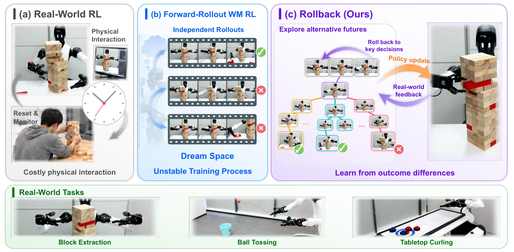

*原论文 Fig.1，PDF p.2。下方三个任务为抽取积木、投球入桶与桌面冰壶，上方是作者对训练方式的概括。*

实际数据流是：**真实尝试 → 可恢复的参考树 → 有选择地展开分支 → 叶子结果变成动作标签 → 条件策略训练 → 新的真实尝试**。并行的另一条支路用真实尝试更新世界模型。前一条改进“怎么做动作”，后一条改进“动作会发生什么”。（PDF §§4–5）

方法承接 AlphaGo、Expert Iteration 的 search-and-distill 思路：策略提案、搜索评估、策略学习搜索结果。这里的环境是有误差的学习式视频模型，动作是高维连续块，起点来自真实经验。作者也讨论了已经会更新世界模型的相关工作；贡献在于组织回退搜索、同上下文比较与持续真实反馈，不能简化成“首次让世界模型更新”。（PDF §2，§4）

贯穿全文的时间界限是：**搜索主要用于训练，真机执行使用蒸馏后的策略**。机器人每做一下动作都无需等待云端搜索。文中 test-time physics grounding 相对于世界模型预训练之后的使用阶段而言；这时机器人策略仍在训练，不能据此理解成部署时每次测试都在线微调策略。（PDF §§4.3–5）

## 02 / 回退恢复的究竟是什么

### 状态、动作与模型记忆

决策时刻 $t$，策略接收观测 $o_t$ 和语言指令 $g$。观测包括头部、左右腕部三路 RGB 及本体状态。动作块 $\mathbf a_t\in\mathbb R^{H\times d_a}$ 包含未来 $H$ 步控制量；本文 $H=50,d_a=16$，即左右两侧各七个机械臂关节和一个夹爪坐标。一个块有 $50\times16=800$ 个标量，无法枚举所有动作。（PDF §3，Appendices B–C）

世界模型的动作条件转移为：

$$
(\hat o_{t+1},m_{t+1})\sim\mathcal W_\phi(\,\cdot\mid m_t,\mathbf a_t,g).
$$

$\phi$ 是模型参数，$m_t$ 是包含历史信息的可缓存时间上下文，$\hat o_{t+1}$ 是下一段预测观测，包含未来多视角图像与 pose-expert head 预测的本体状态。下一次策略调用需要知道手臂和夹爪在哪里；只给生成图像，对精确接触和松手时机太粗糙。（PDF §3.1，§4.1）

一个真实 episode $\tau=(o_0,\mathbf a_0,\ldots,o_T)$ 以二元结果 $y_\tau$ 结束，最终目标是提高真实成功期望 $J(\pi_\theta)=\mathbb E_{\tau\sim\pi_\theta}[y_\tau]$，并减少昂贵的物理交互。这个目标与后面用于训练的 flow-matching 损失不同：前者是要改善的任务表现，后者是利用搜索标签更新策略的具体代理目标。（PDF §3.1）

**回退恢复的是 $m_t$，不是把一张图当成完整物理状态。** 先保存上下文，生成分支 A，再恢复该缓存，以另一个动作和新噪声生成分支 B。两者共享已有历史，各自未来不同。缓存仍是学习到的表征，其有效性依赖模型能否保留有关物理信息。（PDF §4.1，Appendix A）

把该操作写完整，就是原文 Eq.1 的分支集合：

$$
m_t\xrightarrow{\mathrm{Restore}}\left\{(\hat o_{t+1}^{(i)},m_{t+1}^{(i)})\sim\mathcal W_\phi(\,\cdot\mid m_t,\mathbf a_t^{(i)},g)\right\}_{i=1}^{n}.
$$

左边只有一份保存好的历史，右边每个 $i$ 对应一个不同候选动作及它生成的后续上下文。恢复不要求分支未来相同，只要求它们从相同的保留历史开始；之后每个 $m_{t+1}^{(i)}$ 又可以缓存为新的分叉点。（PDF §3.2，Eq.1）

### 一次分叉的输入与输出

以冰壶为例，输入是同一个“第二次推石前”的相机历史、本体状态、指令和缓存。策略提出两个动作块，一个释放较快，一个较慢；模型分别生成石头滑行和手臂运动；后续策略继续行动到终局；world judge 给各终局成败标签。缓存保持前缀一致，但后续策略动作与模型噪声仍会影响结果，所以要比较多个后续样本。（PDF §4.1，Fig.7）

下面是**教学用调用次数估算**，不是真实吞吐测量。若 $K_b$ 条分支共享 $d$ 个动作块前缀，各需 $L$ 个后续块，重跑前缀要 $K_b(d+L)$ 块，复用缓存约为 $d+K_bL$，省下 $(K_b-1)d$。取 $d=6,L=4,K_b=5$，即 50 对 26，少 48%。这忽略缓存读写、显存与并行开销；论文没有报告对应端到端加速倍数。

## 03 / 搜索怎样把预算花在分歧上

看 Fig.2 的三个面板：左侧缓存构成树，中间把后续结果变成动作质量，右侧真实数据更新模型。中间高、中、低只是示意，实际使用五档标签。以下分别重建每个箭头。

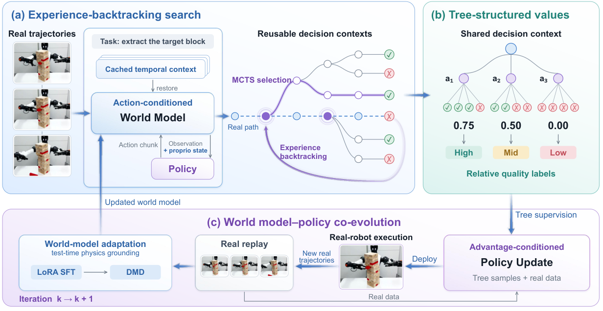

*原论文 Fig.2，PDF p.5。想象观测包含图像和本体状态；树标签进入策略训练，真实轨迹进入模型校正。*

### 把真实尝试放进树

种子来自离线示范或已收集的真实轨迹，成功和失败都可使用。在动作块边界保留观测，连成参考主干 spine。真实结果 $y_\tau$ 沿主干回传，真实尝试便成为第一条有结果的路径。根上下文立即缓存，其余主干节点首次使用时再构造与缓存。（PDF §4.1，Appendix A，Algorithm 2）

成功种子的深度上限等于其主干深度；失败种子用任务上限 $D_{\max}$，三个任务分别为 12、2、8 个动作块。它既能围绕成功寻找动作差异，也能从失败寻找可行后续，但不会无限延长想象。深度单位与真机控制步不同。（PDF Appendix A，Table5）

### PUCT 兼顾成功比例与证据不足

节点保存访问次数 $N(v)$、累计回报 $W(v)$，以及 $Q(v)=W(v)/N(v)$。已有孩子 $u$ 以如下分数竞争：

$$
U(v,u)=Q(u)+c_{\mathrm{puct}}P(u\mid v)\frac{\sqrt{1+N(v)}}{1+N(u)}.
$$

第一项利用当前成功比例，第二项探索访问不足的路径。已有孩子取均匀先验 $P(u\mid v)$，$c_{\mathrm{puct}}=1.5$。父节点访问增加，探索奖励增大；某孩子频繁访问，它自己的探索奖励降低，避免最早一次成功垄断搜索。（PDF p.6，Eq.2）

**教学算例，只比较两个已有孩子：** 令 $N(v)=10$，先验各为 0.5。A 访问 8 次、成功 6 次，B 访问 2 次、成功 1 次，故 $Q_A=0.75,Q_B=0.5$。代入得 $U_A\approx1.026,U_B\approx1.329$，均值较低的 B 因采样不足而胜出。这只比较已有孩子；若允许新动作候选，它还会参与完整选择。

### 连续动作如何长出有限个孩子

策略从最高质量条件 $b=K$ 下用新噪声采样动作。progressive widening 限制孩子数量随访问量增长：

$$
|\mathcal C(v)|\leq\left\lceil c_{\mathrm{pw}}\max(1,N(v))^\alpha\right\rceil,\qquad\alpha=0.5.
$$

宽度按访问量的平方根增长，避免预算全花在浅尝一次的提案上。允许扩展时，一个经验值为零、先验为 $1/(|\mathcal C(v)|+1)$ 的虚拟孩子也参与选择，选到它才生成新动作。教学例中 $c_{\mathrm{pw}}=1.5$，访问 1 次对应上限 2，访问 16 次对应上限 6。实际首次想象兄弟对总会接纳，后续 widening 限于有分歧的组，并有任务最大宽度；最大宽度数值未在表中列出。（PDF §4.1，Appendix A，Algorithm 2 后说明）

第一次在节点上创建想象孩子时成对采样两个动作；已有想象孩子时再新增一个。每次先恢复缓存、执行候选，再 rollout 到成功或深度上限。终局标签 $y\in\{0,1\}$ 沿路径执行 $N\leftarrow N+1,W\leftarrow W+y$，把远处成败传回较早决策。（PDF Appendix A）

### 对已经出现的分歧补采样

一成一败也可能是偶然。算法把暂时落入不同质量档的兄弟组加入优先队列，继续探索访问最少的子树，目标是各兄弟至少获得 $n_{\mathrm{conf}}$ 次访问，三个任务为 5、9、5。额外计算优先用于会产生监督差异的位置。（PDF §4.1，Appendices A、C）

这能减少稀疏采样的标签噪声，却不能修复系统性模型或 reward 错误；剩余预算与节点可扩展性也可能使确认次数无法达标。每树 $B=256$ 统计**生成的动作块**，已启动的 rollout 与原子兄弟对会完成，所以是可超出的软预算。它不表示 256 条完整轨迹或 256 次真实试验。（PDF Appendix A）

完整过程可以手工追踪为：真实种子与结果初始化主干 → 选节点 → 恢复同一上下文，展开两兄弟 → 各自完成后续并回传 → 若档位不同，优先补采不足的兄弟 → 预算结束后提取有区分度的组。下一节计算其中的档位。

## 04 / 从一棵树算出五档标签

### 价值来自哪些结果

动作 $\mathbf a_i$ 把父节点 $v$ 连到想象孩子 $u_i$，它的价值是下方已探索终局叶子 $\mathcal L(u_i)$ 的成功比例：

$$
\hat q(v,\mathbf a_i)=\frac{1}{|\mathcal L(u_i)|}\sum_{\ell\in\mathcal L(u_i)}y_\ell.
$$

这是**已探索后续的经验比例**。搜索的 $Q$ 维护访问与累计回报，最终标签的 $\hat q$ 按 Eq.3 汇总叶子，应保留各自定义，不把所有访问与叶子计数混成同一个分母。这里不额外训练从中间状态预测成功概率的 value critic，但终局 $y_\ell$ 仍来自学习过的任务 reward 模型。（PDF §4.2，Eq.3）

world judge 基于 GE-Sim 2.0，在带标注机器人视频上做任务级二元交叉熵微调。它接收视觉观测与指令，以 0.5 阈值、任务成功标准和时间一致性检查转成想象结果。因此“没有额外 critic”不等于没有标签、没有 reward 模型。论文未给出时间一致性窗口的完整参数。（PDF §4.2，Appendix C）

### 相对于同组最优动作归一化

只对想象孩子集合 $\mathcal C_{\mathrm{im}}(v)$ 提取相对标签。至少有两个孩子且 $q_{\max}(v)>0$ 才继续：

$$
q_{\max}(v)=\max_i\hat q(v,\mathbf a_i),\qquad
\rho_i=\frac{\hat q(v,\mathbf a_i)}{q_{\max}(v)},\qquad
b_i=\min\!\left(K,1+\lfloor K\rho_i\rfloor\right),\quad K=5.
$$

分母是最优兄弟，没有减去均值或 learned baseline。$\rho=0$ 为第 1 档，$\rho=0.5$ 为第 3 档，$\rho=1$ 先得到 6，再截成第 5 档。标签表示“在这个局面目前探索的动作中属于什么质量”，使难易不同的局面能使用同一个条件训练接口。（PDF Eq.4）

看 Fig.9，从同一恢复点出发的两棵主要想象子树，上方 2/3 个后续成功，下方 1/3 个成功。紫色在本图标记分支来源，不代表成败，不能沿用 Fig.7 的混合结果图例。这两棵子树提供一个可复算的论文实例。

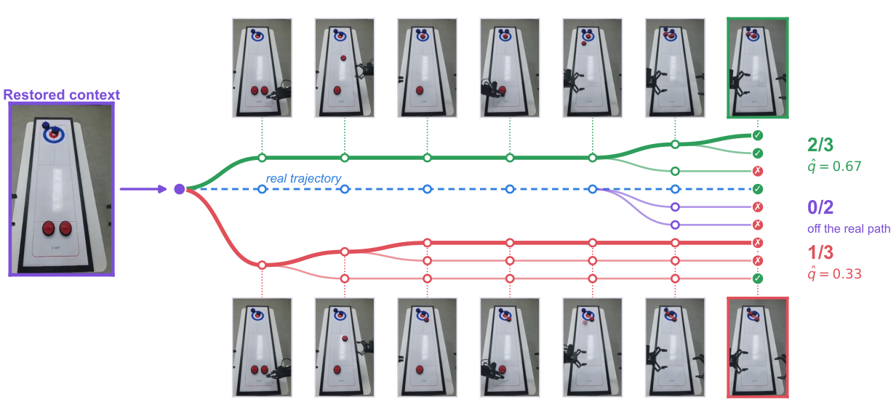

*原论文 Fig.9，PDF p.21。0.67 与 0.33 是 2/3 和 1/3 的显示近似；标签计算使用原始分数。*

计算顺序是 $\hat q_A=2/3,\hat q_B=1/3$，故 $q_{\max}=2/3$；得到 $\rho_A=1,\rho_B=1/2$，最终 $b_A=5,b_B=3$。档位不同，保留两条 $(o_v,g,\mathbf a_i,b_i)$ 样本。同一个观测与任务、不同动作及质量条件，就是轨迹终局反馈转成中间动作监督的过程。（PDF Appendix E，Fig.9；§4.2）

### 丢弃规则与相对标签的边界

| 情况 | 结果 | 解释 |
| --- | --- | --- |
| 全部兄弟都没有成功叶子 | $q_{\max}=0$，跳过 | 不能除以零，也没观察到可比较的成功 |
| 只有一个想象孩子 | 跳过 | 缺少同局面的替代动作 |
| 教学值 0.8 与 1.0 | 都为第 5 档，丢弃 | 五档离散化抹掉部分细小差异 |
| 教学值 0.1 与 0.05 | 第 5 与第 3 档 | 相对最好可能绝对很差 |
| 教学值 0.8 与 0.4 | 仍为第 5 与第 3 档 | 标签不保存绝对成功概率 |

整组同档时不提供偏好信号，所以丢弃。全失败**想象组**的规则不适用于真实失败数据；后者仍以最低档进入策略训练，也用于模型校正。（PDF §4.2，Appendix A，Algorithm 3）

同上下文比较减少前缀差异，是作者希望改善信用分配的原因。但结果仍取决于提案策略、后续搜索、模型随机性和 world judge。$\hat q$ 不是在真实物理世界无偏识别的单动作因果效应，叶子也未必独立同分布；确认采样增加证据量，不把经验比例变成物理真值。

## 05 / 策略具体优化什么

### 把质量变成条件生成问题

策略以 $\pi_{0.5}$ 初始化，把档位编码进 prompt。$\mathcal D_{\mathrm{mix}}$ 混合树样本、离线示范与真实轨迹；真实成功给最高档，失败给最低档。树贡献的是中间上下文里的多档动作样本，因而能学习一个局部决策的质量差异。（PDF §4.2）

对归一化动作块 $\mathbf a$ 和同形状高斯噪声 $\boldsymbol\epsilon\sim\mathcal N(0,I)$，flow matching 构造：

$$
\mathbf x_s=(1-s)\mathbf a+s\boldsymbol\epsilon.
$$

$s=0$ 是动作，$s=1$ 是噪声。对这条插值路径求导，得到训练需要的目标方向：

$$
\frac{d\mathbf x_s}{ds}=-\mathbf a+\boldsymbol\epsilon.
$$

所以网络向量场要拟合 $\boldsymbol\epsilon-\mathbf a$，损失为：

$$
\mathcal L_\pi(\theta)=\mathbb E_{\substack{(o,g,\mathbf a,b)\sim\mathcal D_{\mathrm{mix}}\\s,\boldsymbol\epsilon,\tilde b\sim p(\tilde b\mid b)}}\left[\left\|v_\theta(\mathbf x_s,s\mid o,g,\tilde b)-(\boldsymbol\epsilon-\mathbf a)\right\|_2^2\right].
$$

$v_\theta$ 是预测向量场，$\tilde b$ 是条件丢弃后的档位输入；期望覆盖数据、flow 时间、噪声及条件丢弃。$p(\tilde b\mid b)$ 特指档位处理，不是给所有随机量指定同一个分布。推理从噪声端向动作端积分，方向为 $s=1\to0$；不能因目标写成“噪声减动作”，就把生成方向理解反了。（PDF Eq.5）

### 手算一个训练样本

以下为**二维教学例子**；真实块有 800 个标量。令 $\mathbf a=(0.2,-0.4)$，$\boldsymbol\epsilon=(0.6,0.1)$，$s=0.25$：

$$
\mathbf x_s=0.75(0.2,-0.4)+0.25(0.6,0.1)=(0.3,-0.275),\qquad
\boldsymbol\epsilon-\mathbf a=(0.4,0.5).
$$

若网络输出 $(0.5,0.4)$，平方范数损失为 $(0.5-0.4)^2+(0.4-0.5)^2=0.02$。网络在大量“观测、任务、档位 → 动作”的样本上学习，树价值不会沿生成视频与搜索链条直接反向传播。Eq.5 使用已提取的标签与动作目标。（PDF §4.2；本段算术为教学重建）

### 最高档与 guidance

训练以 $p_{\mathrm{drop}}=0.5$ 概率省略质量条件，使模型学习无档位的 $v_\varnothing$ 与带档位的 $v_K$。搜索和部署都使用最高档，并施加 classifier-free guidance：

$$
v_{\mathrm{guided}}=v_\varnothing+\beta(v_K-v_\varnothing),\qquad\beta=1.5.
$$

即 $1.5v_K-0.5v_\varnothing$，沿条件差异外推，不是凸平均。它强化高质量条件影响，但最高档是相对标签，不能保证绝对成功率。本文也未给出 guidance 强度敏感性曲线。（PDF §4.2，Appendix C）

新策略会改变后续新树的最高档动作提案，再产生新的监督。作者借鉴 group-relative 比较与 advantage-conditioned 训练接口，但 Eq.5 是条件 flow-matching 损失；不能替换为 PPO clipped objective，也没有一个被减去的 learned value baseline。（PDF §4.2）

## 06 / 真实反馈怎样校正世界模型

搜索越会找高回报路径，越可能找到模型漏洞。例如积木实际应倒下，视频模型却让它保持直立，再被 judge 判成成功。只在专家演示上微调的模型，未必覆盖新策略带来的失败姿态与新成功路线。（PDF §4.3）

作者把最新策略收集的真实成功与失败加入回放集：

$$
\mathcal D_{\mathrm{real}}^{(k+1)}=\mathcal D_{\mathrm{real}}^{(k)}\cup\mathcal D_{\mathrm{new}}^{(k)}.
$$

随后优化真实转移上的动作条件预测：

$$
\mathcal L_{\mathrm{SFT}}^{(k)}(\phi)=\mathbb E_{\tau\sim\mathcal D_{\mathrm{real}}^{(k+1)}}\left[\sum_t\ell_{\mathrm{WM}}\bigl(\phi;o_{\le t},\mathbf a_t,o_{t+1},g\bigr)\right].
$$

输入为真实历史、实际动作与任务，目标为下一段真实多视角画面和本体状态。树生成的想象轨迹不作为模型预测目标。一次失败投球也有效：真实球落在哪里，就约束了该动作应产生的运动。（PDF Eq.6）

每轮适配先做 **400 步 LoRA SFT**，再做 **100 步 DMD**。LoRA 用较少可训练参数吸收新经验，DMD 即 distribution matching distillation，把适配结果恢复为搜索可用的少步生成器。前者提高当前策略分布上的预测，后者服务于频繁想象的采样效率。本文未完整展开 GE-Sim 2.0 的 $\ell_{\mathrm{WM}}$、DMD 损失及全部噪声与采样步设置，不能擅自把 Eq.6 等同于逐像素 MSE。（PDF §4.3，Appendix C）

“不需额外标注”在这里指**真实转移自身提供模型预测目标**，不取消任务 judge 的视频标注，也不取消复位和真实结果判定成本。physics grounding 的直接意义是让下一批搜索更贴近当前策略实际访问的状态与动作，尚不等于精确通用物理模型。（PDF §4.3）

作者把这种适配与固定物理引擎中的参数辨识区分：学习式模拟器可改变动态表示，固定机制中只能调参数。但本文未做两类模拟器的配对实验；这是设计动机，效果要看冻结模型消融与保真度诊断。（PDF §4.3；第 10、12 节）

## 07 / 异步系统怎样保持比较一致

Fig.3 沿两个方向读：向下的权重把策略送往边缘执行端，向上的真实轨迹回到共享经验池；云端搜索、策略训练、模型训练并发进行。图中多站点是架构表达，实验实际只有一台机器人。

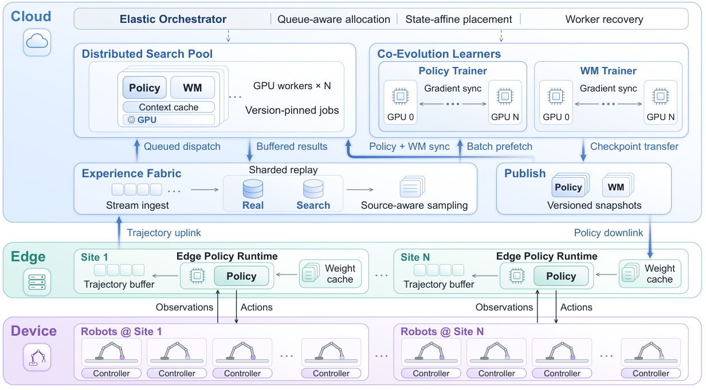

*原论文 Fig.3，PDF p.8。架构可容纳多个站点，本文测量规模为一台物理机器人。*

| 并发过程 | 读取 | 写入或发布 | 一致性单位 |
| --- | --- | --- | --- |
| 真实机器人 | 最新边缘策略、实际观测 | 真实轨迹与物理成功标签 | 整个 episode 同一策略 |
| 搜索 worker | 示范或真实种子、策略与模型快照 | 树导出的相对动作样本 | 整棵树固定两种快照 |
| 策略训练器 | 树、示范、真实数据混合 batch | 新策略送往搜索与边缘 | DDP 在训练器内部同步梯度 |
| 世界模型训练器 | 真实回放集 | 适配并蒸馏的模型送往搜索 | 只以真实转移校正 |

Experience Fabric 用数据流和版本化快照连接过程。机器人不用等搜索，每次策略更新也不用等一轮模型适配；Algorithm 1 不能读成“先全部搜索，再训练，再执行”的串行循环。（PDF §5，Appendix A）

每个搜索 GPU 驻留策略、世界模型及缓存，一棵树留在同一 worker，不跨节点传中间状态。新树固定开始时的模型与策略直到结束。原因可从比较本身推出来：若 A 用旧模型、B 用新模型，成败差异混入了模型变化；旧参数生成的缓存也未必可由新参数继续使用。固定版本提供一致生成条件，仍不能消除共同的模型偏差。（PDF §5，Fig.4，Appendix A）

边缘端保存运行时、权重缓存与轨迹缓冲，只在 episode 边界切换策略，使同一轨迹可对应一个清楚的版本。实时控制无需为每个动作调用云端树搜索。（PDF §5）

实验使用 **48 张 H200：40 张搜索、8 张策略训练**，物理机器人一台；初始化和 warm-up 另有计算。“约 8 小时”对应策略改进阶段，不能据此推断完整训练便宜，或从架构图推出多机器人扩展效率。论文未报告完整搜索吞吐扩展曲线。（PDF §6.1，Appendix C）
## 08 / 先看实验究竟在测什么

### 三个任务有不同的成功条件

实验平台是 AGIBOT Genie-02。积木任务要取出指定木块且塔保持完整；碰到目标只算中间指标。投球必须最终落在桶内，碰桶沿后弹出不算成功。桌面冰壶中，人和机器人各投两颗，四次投掷全部结束后才按距中心的最终石头配置判断胜负，因为后投石头会撞开先前石头。（PDF §6.1，Appendix B）

| 任务 | 主要困难 | 主结果分母 | 主指标 |
| --- | --- | --- | --- |
| 抽取积木 Block Extraction | 接触与塔稳定性，失败会改变环境 | 6 个位置 × 每位置 25 次 = 150 次 | 完整抽出且不倒塔的成功率 |
| 投球入桶 Ball Tossing | 释放方向、速度、夹爪时机 | 6 个位置 × 每位置 15 次 = 90 次 | 球落入桶的成功率 |
| 桌面冰壶 Tabletop Curling | 滑行精度与对手后续碰撞 | 9 个位置 × 每位置 15 次 = 135 次 | 最终胜率 |

每次试验的复位姿态从成功示范片段开头构成的任务配置池中抽取，物体按任务协议随机化；各方法使用相同分布，并非所有试验从唯一机械臂姿态开始。真实成败由实际物理结果标注；积木倒塔或无明确标签的终止按失败处理。**world judge 只判想象轨迹，不决定论文报告的真机成功率**，因此不能把主结果误读成模型给自己的分数。（PDF Appendix B）

### 三类基线分别控制了什么

SFT 在专家示范上监督微调，是纯模仿学习参照。RECAP 在真实交互数据上用学习到的 value 估计 advantage，再做条件策略训练。RISE w/ GE-Sim2 是本文作者在**同一 GE-Sim 2.0 模型上复现**的 RISE，包含 forward imagination、learned progress value 与五档质量条件；表中的数值都不是引用原版 RISE 论文的结果。（PDF §6.1）

各方法以相同 $\pi_{0.5}$ 初始化，采用可比计算预算；RECAP、RISE 的交互改进阶段约 8 小时、一台机器人、相近数量 H200。共享世界模型有助于减少不同模拟器质量造成的差异，但 Rollback 对比 RISE 同时改变回退搜索与树结构监督。这个整套方法比较不能单独量化“缓存复用贡献多少”，也不能当作精确相同 FLOPs 下的效率实验。（PDF §§6.1–6.2）

后续证据分四层：主结果检查整套训练方案能否改善物理执行；消融检查关闭模型适配或改用单 rollout reward 会怎样；曲线检查给定时间内的变化；保真度分析则检查生成观测与真实记录的差异。它们的测量对象不同，互相补充而不能互相替代。

## 09 / 真机主结果如何重算

下面完整保留 Table1。单位均为 **%**，越高越好；最后一列是三个任务等权平均。Rollback 的这些真机结果由训练后的策略执行取得，无需在部署时运行世界模型搜索。（PDF Table1，§6.2）

| 方法 | 抽取积木 | 投球入桶 | 桌面冰壶 | 三任务平均 |
| --- | ---: | ---: | ---: | ---: |
| $\pi_{0.5}$ + SFT | 48.67 | 23.33 | 48.89 | 40.30 |
| $\pi_{0.5}$ + RECAP | 56.00 | 25.56 | 51.11 | 44.22 |
| $\pi_{0.5}$ + RISE w/ GE-Sim2 | 58.67 | 28.89 | 52.59 | 46.72 |
| **Rollback** | **69.33** | **40.00** | **64.44** | **57.93** |
| 相对最强基线的绝对增量，百分点 | +10.67 | +11.11 | +11.85 | +11.21 |

三个任务的最强基线都是 RISE w/ GE-Sim2。下面按原表重绘，把它与 Rollback 并排看；点的位置表示成功率，连线表示该任务的差距。数值表仍在上方，可直接离线读取。

```paper-chart
{"type":"paired","title":"同一世界模型基础上的真机成功率","subtitle":"每行从 RISE w/ GE-Sim2 到 Rollback；横轴为百分比","origin":"本文重绘 · 原论文 Table1","source":"PDF p.11, Table1; §6.1 evaluation denominators","rows":[{"label":"抽取积木 · 150 次","before":58.67,"after":69.33},{"label":"投球入桶 · 90 次","before":28.89,"after":40},{"label":"桌面冰壶 · 135 次","before":52.59,"after":64.44}],"note":"图形按已显示的两位小数计算连线差；积木的精确计数增量为 16/150，即 10.67 个百分点，显示值相减会出现 0.01 的舍入差。"}
```

### 分母比“提升百分之多少”更重要

可由位置数、试验数与报告比例**反推对应成功计数**：积木为 RISE 88/150、Rollback 104/150，增加 16 次，即 10.67 个百分点；投球为 26/90 到 36/90，增加 10 次，即 11.11 个百分点；冰壶为 71/135 到 87/135，增加 16 次，即 11.85 个百分点。这些是按汇总比例重建的计数，不是本文取得的逐试验原始日志。（PDF §6.1，Tables1、6–8；计数为本文重算）

宏平均的算法是先算每个任务，再各占三分之一：

$$
\bar r=\frac{1}{3}\left(\frac{104}{150}+\frac{36}{90}+\frac{87}{135}\right)\times100\%\approx57.93\%.
$$

若把所有试验直接合并，则是 $227/375\approx60.53\%$，这会给试验数较多的积木更大权重，不是 Table1 的 Average。对 RISE 的宏平均 46.72%，Rollback 约高 **11.21 个百分点**；除以 RISE 的平均值后，才得到论文所说约 **24.0% 相对提升**。投球相对 RISE 的提升约 38.5%，而从自身 RECAP 初值 25.56% 到 40.00% 是约 56.5%，两者基准不同。（PDF §6.2，§6.4）

主结果支持：这套搜索与监督方案在三项给定任务上，取得高于这些基线的汇总物理成功率。它没有报告独立训练种子的方差、主成功率置信区间或显著性检验，因此这里不把均值差写成统计显著性结论。第 14 节还会看到若干初始位置的退步，不能从任务平均领先推成每个场景都领先。

## 10 / 消融分别拆出了什么

Table2 专门在积木任务上控制两个设计。**冻结模型**保留初始任务微调后的世界模型，关闭后续真实数据适配；**直接 reward 监督**保留树搜索，将子树汇总价值改成单条 rollout 的终局 reward。初始化与计算预算相同。（PDF §6.3）

| 变体 | 目标接触率 % ↑ | 完整抽取成功率 % ↑ | 平均连续抽取块数 ↑ |
| --- | ---: | ---: | ---: |
| 冻结世界模型 | 78.67 | 64.67 | 1.90 |
| 单 rollout 的直接 reward 监督 | 77.33 | 59.33 | 1.73 |
| **完整 Rollback** | **89.33** | **69.33** | **2.60** |

目标接触衡量推的动作有没有碰到指定木块；完整成功还要求取出且塔不倒。完整方法从 89.33% 接触降到 69.33% 成功，说明“碰对目标”仍不保证稳定抽取。平均连续抽取数考察多次重复操作，比单次成功更容易暴露接触误差积累。（PDF §6.3，Table2）

关闭适配后，成功率从 69.33% 降到 64.67%，连续抽取从 2.60 降到 1.90。结合第 12 节的模型诊断，它符合“持续真实反馈帮助维持可用想象”的解释。附录另外报告，冻结模型时投球为 26.67%，冰壶为 52.59%，也低于完整方法的 40.00% 和 64.44%。（PDF §6.3，Tables6–8）

保留搜索却改用单 rollout reward，成功率降到 59.33%，比完整方法低 10.00 个百分点，连续抽取少 0.87 块。这项控制直接支持多后续汇总监督的价值：一次随机后续会把偶然成功或失败强加给整个动作，子树平均则利用更多后果。不过这仍受 reward 与模型偏差影响，更多叶子不会自动消除偏差。（PDF §6.3；机制解释衔接 Eq.3）

两项实验不是完整的“是否适配 × 是否树价值”的 2×2 因子设计，也没有在这一表中完全去掉树搜索；因此不能用它证明两个组件的协同效应大小或收益可相加。它能说明在完整框架中关闭其中一项会怎样。

## 11 / 八小时曲线与人类对照

先看下面图组的左半（Fig.5）：实线/虚线按图例对应方法，横轴是策略改进的墙钟时间，纵轴是真机成功率。右半（Fig.6）用水平虚线放置人类手工与遥操作均值，星号标出首次超过手工均值的测点。图中 8 小时不包含全部预训练与 warm-up。

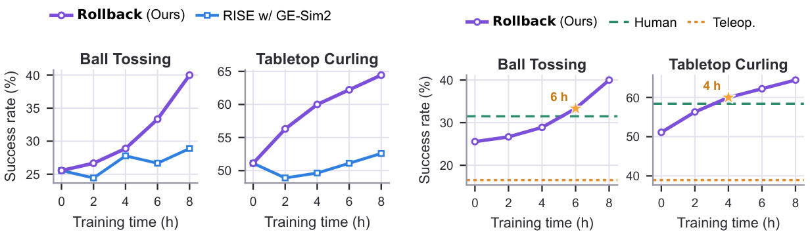

*原论文 Fig.5–6，PDF p.12。原 PDF 的训练曲线为 Fig.5；HTML 转换版在 §6.4 存在指向 Fig.6 的交叉引用错误，本阅读采用 PDF 图号。*

### 改进轨迹说明什么

投球从 RECAP 初值 25.56% 出发，Rollback 最终到 40.00%；RISE 在 2 小时先降到 24.44%，最终到 28.89%。Rollback 在 6 小时达到 33.33%。冰壶从 51.11% 出发，Rollback 到 64.44%，RISE 到 52.59%，论文展示的评测阶段中两者差距逐渐拉开。它们说明在这次固定配置训练中，Rollback 更持续地把想象训练转化成物理收益。（PDF §6.4，Fig.5）

曲线没有给出多个独立训练种子的分布，所以不能把一条上升曲线当成任意重跑都稳定的证明。这里的横轴也不能回答“达到相同成功率要多少真实交互条数”：异步系统会同时消耗 GPU 和物理时间，论文没有把全部交互计数与吞吐成本分解成完整数据效率曲线。

### “超过人类”的比较对象

| 对照 | 投球成功率 % | 冰壶胜率 % |
| --- | ---: | ---: |
| 人类手工操作，3 人平均 | 31.48 | 58.39 |
| 人类遥操作机器人，3 人平均 | 16.53 | 38.94 |
| Rollback 的 RECAP 初值 | 25.56 | 51.11 |
| Rollback 8 小时结果 | 40.00 | 64.44 |

初始位置与成功标准相同；人类直接用手、遥操作机器人和自主机器人，是三种执行条件。Rollback 在投球 6 小时测点超过手工均值，在冰壶 4 小时测点超过；最终高于手工均值 8.52、6.05 个百分点，高于遥操作均值 23.47、25.50 个百分点。策略没有观察人类手工玩家的视频来训练。（PDF §6.6，Fig.6）

这支持对**该三人样本和给定任务协议**的数值比较。参与者人数少、未报告参与者方差，且执行界面不同，不能外推成普遍超过人类操作能力。初始 RECAP 本来已高于遥操作均值但低于手工均值，也应和终点同时保留，才能判断增量从何而来。

## 12 / 世界模型的画面更准意味着什么

### 积木：失败轨迹与 reward 假阳性

作者取 **8 条真实失败 episode，各回放 5 次，共 40 条想象 rollout**。把实际记录的动作开环喂给共同演化后的模型，比较预测与真实视频。开环意味着后续动作沿用真实记录，不根据模型输出重新规划；因此测的是在给定动作下预测漂移，不是闭环策略成功率。（PDF §6.7，Table3）

| 积木开环诊断 | 数值 | 怎样读 |
| --- | ---: | --- |
| 头部 PSNR | 23.41 dB | 越高表示图像误差越小 |
| 左腕 / 右腕 PSNR | 20.63 / 20.85 dB | 腕部运动使预测更难；三视角平均约 21.6 dB |
| 前四分之一 RGB L1 | 6.79 | 越低越好，保持原论文的像素误差尺度 |
| 后四分之一 RGB L1 | 11.79 | 比前段约 1.74 倍，长序列误差仍积累 |
| reward 假阳性 | 0 / 40 | 这组回放中没有把失败判成成功 |

序列长 150–275 个视频帧；这不是 150–275 个动作块。静态背景容易预测，因此头部 PSNR 较高也不保证接触物理精确。0/40 限定在 8 个失败上下文的重复回放上：它不能评估真实成功的召回率，也不能推出所有搜索状态的 reward 零错误；40 次还共享原始 episode，不是 40 个完全独立的场景。（PDF §6.7）

看 Fig.12，沿同一列比较真实与模型的头部视角，再看每格左右腕部小图。它展示了一次失败 episode 中接近木塔、夹爪闭合和塔保持完整的预测；这个具体例子说明表中的图像比较是怎样对齐的，不能代替整体统计。

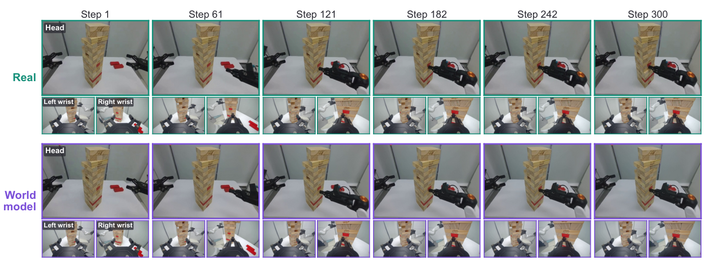

*原论文 Fig.12，PDF p.23。标注是 30 Hz 控制步；该可视化来自一条失败的积木 episode。*

### 冰壶：适配前后比较包含一个关键数据条件

冰壶诊断用 64 条真实 episode，每条在冻结模型和适配模型中各回放 3 次，即每种模型 192 条 rollout。**这 64 条轨迹属于适配模型所用的真实数据，冻结模型没见过。** 原文称其 validation episodes，但实验实际上检查在当前策略访问且已用于适配的数据上的预测拟合，不是保留测试集上的泛化结论。（PDF §6.7）

| 模型 | 头部 PSNR dB ↑ | 左腕 PSNR ↑ | 右腕 PSNR ↑ | RGB L1 前段 ↓ | RGB L1 后段 ↓ | rollout 间 L1 spread ↓ |
| --- | ---: | ---: | ---: | ---: | ---: | ---: |
| 冻结 | 21.50 | 17.07 | 15.01 | 12.48 | 23.73 | 9.39 |
| 共同演化后 | 22.27 | 17.79 | 16.37 | 10.50 | 14.47 | 6.12 |

平均 RGB L1 从 19.52 到 12.96，约降低 33.6%；原文报告全部 64 条 episode 都降低。前后段误差增长，冻结约为 $23.73/12.48\approx1.90$ 倍，适配后约为 $14.47/10.50\approx1.38$ 倍；三次生成之间的 spread 也减少，表示输出更一致，但一致本身不保证正确。（PDF Table4，§6.7；比例为本文重算）

Fig.8 左侧按真实、冻结、适配后三行比较。注意第 130 控制步：冻结模型把已经停在中心的第一颗石头移到边缘；第 215 步又过早把第二颗石头放入得分区。适配后的模型更贴近真实位置。右侧误差曲线的阴影为这一保真度分析的 95% 置信区间，不是主成功率或训练种子方差。

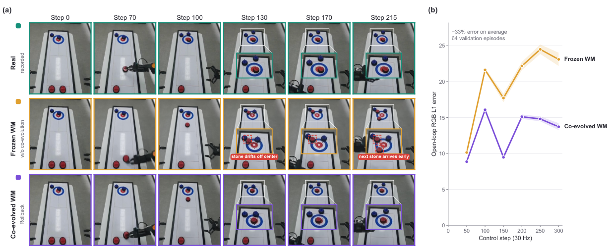

*原论文 Fig.8，PDF p.14。放大框突出得分区中的石头位置，红框标记幻觉石头；横轴为控制步。*

这个诊断与树标签紧密相连：石头漂移会改变 imagined shot 的终局分数，再改变兄弟动作的相对标签。结果支持“真实适配纠正当前策略分布上的部分预测错误”；它尚不能证明新场景泛化，也没有逐一验证标签排序与真实动作价值的相关性。RGB 误差、任务 reward 和动作排序是三个相连但不同的测量量。

## 13 / 追踪具体分支与真实失败

### 冰壶中，分歧来自第二次释放

Fig.7 先看 (a)：蓝色虚线是已发生的真实尝试，绿色、红色、紫色边分别表示下游全成功、全失败、混合，紫圈标记分叉点。再看 (b) 从想象中的第 50 步回退，(c) 从真实轨迹第 200 步回退；它们检验两类节点都可恢复，不只是从真实起点向前模拟。

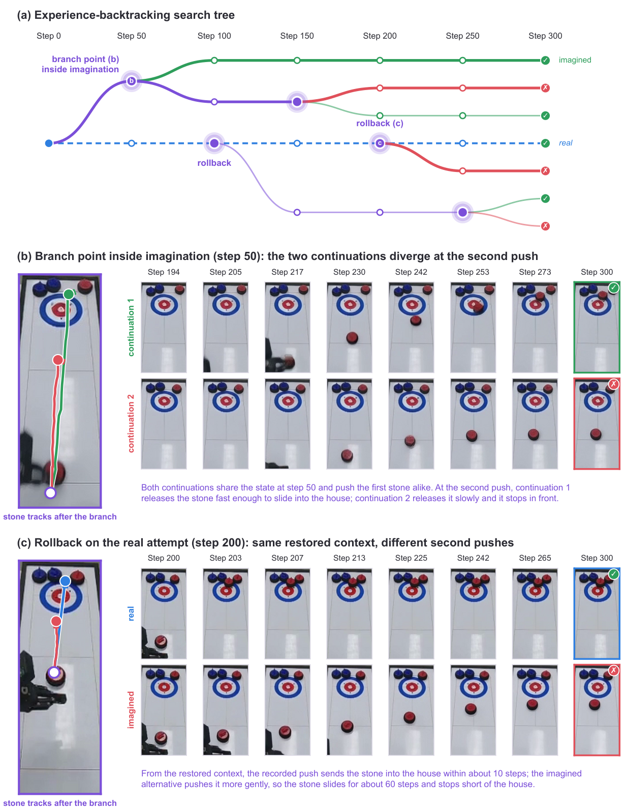

*原论文 Fig.7，PDF p.13。各 Step 均为 30 Hz 控制步；分支颜色与 Fig.9 的来源颜色含义不同。*

在 (c) 的第 200 步，两条后续共享第二次推石前的上下文。真实记录的较快推动约 10 步后到达得分区，想象替代动作更轻，石头滑行约 60 步却停在前方。(b) 中两条分支的第一颗石头推得相似，真正分歧出现在第二次释放速度。这展示搜索能把长轨迹里的局部决策显现出来；成败仍由模型后续与 judge 给出，不能把这张图当成真实机器人已执行每个反事实分支的证明。（PDF §6.5）

附录 Fig.10 在同一投球上下文采四个兄弟，展示不同球轨迹和桶边时刻。它补充的是提案多样性，不是四种动作的总体频率或价值估计置信度；Fig.13 把机器人成功、失败和人类投掷的时间序列叠成轨迹图，同样属于定性示例。（PDF Appendix E）

### 积木树中，价值相同也可能证据量不同

Fig.11 先沿 (a) 的想象分叉点第 300 步看三个孩子：成功比例为 0/3、2/2、1/1，再看 (b) 中 A 与 B 在第 500 步的差异。A 把木块抽出，B 到第 650 步仍未取出。这里的树共有 12 条想象后续，其中 9 条成功，说明不只有一条幸运成功可用。

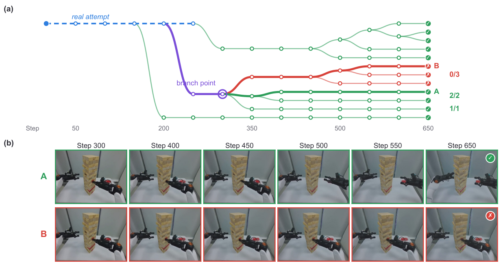

*原论文 Fig.11，PDF p.22。两条画面后续从同一个想象状态出发，成功比例用于计算相对质量。*

按 Eq.3–4，三个经验值为 $0,1,1$，最优为 1，所以标签为 **1、5、5**。2/2 与 1/1 进同档，但采样证据量不同；1/1 不能被解释成已经确定 100% 成功。这就是为什么算法会确认分歧组中访问不足的兄弟，同时又必须承认有限样本的不确定性。（PDF Fig.11；标签为本文计算）

### 最终策略的展示与失败都要看

Fig.14 从上到下看三个真实执行：五次连续抽取而塔未倒，一次投球入桶，两次冰壶出手。这些是最终策略能做出的具体动作实例；五次抽取的案例不等于 Table2 平均连续抽取数 2.60，展示成功不能替代所有试验的分母。

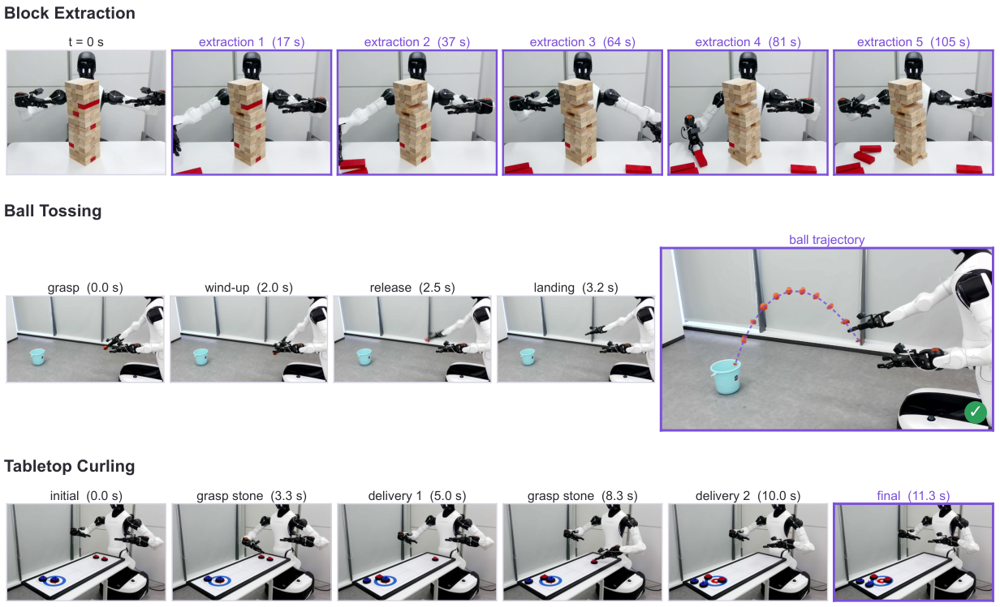

*原论文 Fig.14，PDF p.24。时间标签属于这些单次展示，不是所有试验的平均耗时。*

Fig.15 依次看投短、投过头、撞桶沿弹出、松手失败。前三类主要与释放速度或方向有关，第四类为夹爪松得过晚、球落在机器人附近。它们共享一个短促的释放窗口，所以一个动作块可能决定整条 episode 的结果，这与同上下文比较的动机相符。

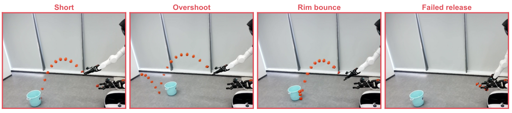

*原论文 Fig.15，PDF p.24。轨迹来自训练时收集的真实失败数据，原文未报告各类占比。*

作者说前三类占大多数、松手失败较少，但没有频次表；不能据此编造失败比例。即使最终投球率从基线提高到 40%，仍有大量失败，方法改善了释放动作的学习，却没有解决该任务的所有控制误差。（PDF Appendix F）

## 14 / 平均领先掩盖了哪些位置退步

位置级结果对“改善了什么”很关键。积木 P2，Rollback 为 56%，低于 RISE 的 80% 和 RECAP 的 84%；P5、P6 却达到 84%，分别高于 RISE 的 52%、60%。投球 P2 为 60%，低于 RISE 73.33%；P6 为 20%，低于 RISE 40%。冰壶 P5 为 20%，低于 RISE 40% 与 RECAP 60%；P9 为 73.33%，低于两者的 100%。（PDF Tables6–8）

所以主结论应是“这三个任务按给定位置分布汇总后更好”，不能改写成每个位置都改善。每位置的试验也有限：投球、冰壶各 15 次，一次成败便改变约 6.67 个百分点；积木每位置 25 次，对应 4 个百分点。少量试验中的排序不宜被进一步解释为某种普遍空间规律。

下面保留全部附录位置表，方便核对退步与获益从哪里来。P1–P6/P9 沿用作者的位置编号；Overall 是任务汇总成功率，Consec. Extr. 为连续抽取数，冰壶 Score 是作者另报的最终得分指标，不与胜率混用。

<details class="reading-detail">
<summary>展开 Tables6–8 的全部位置结果</summary>

### Per-position results on Block Extraction

| Method | P1 | P2 | P3 | P4 | P5 | P6 | Overall | Consec. Extr. |
| --- | --- | --- | --- | --- | --- | --- | --- | --- |
| $\pi_{0.5}$ + SFT | 64.00 | 80.00 | 44.00 | 40.00 | 44.00 | 20.00 | 48.67 | 1.60 |
| $\pi_{0.5}$ + RECAP | 48.00 | 84.00 | 40.00 | 48.00 | 72.00 | 44.00 | 56.00 | 1.78 |
| Frozen World Model | 72.00 | 76.00 | 48.00 | 68.00 | 60.00 | 64.00 | 64.67 | 1.90 |
| Direct Reward Supervision | 76.00 | 64.00 | 48.00 | 64.00 | 64.00 | 40.00 | 59.33 | 1.73 |
| $\pi_{0.5}$ + RISE w/ GE-Sim2 | 60.00 | 80.00 | 32.00 | 68.00 | 52.00 | 60.00 | 58.67 | 2.00 |
| Rollback (Ours) | 72.00 | 56.00 | 56.00 | 64.00 | 84.00 | 84.00 | 69.33 | 2.60 |

### Per-position results on Ball Tossing

| Method | P1 | P2 | P3 | P4 | P5 | P6 | Overall |
| --- | --- | --- | --- | --- | --- | --- | --- |
| $\pi_{0.5}$ + SFT | 13.33 | 60.00 | 0.00 | 0.00 | 46.67 | 20.00 | 23.33 |
| $\pi_{0.5}$ + RECAP | 0.00 | 60.00 | 20.00 | 13.33 | 46.67 | 13.33 | 25.56 |
| Frozen World Model | 0.00 | 46.67 | 26.67 | 13.33 | 53.33 | 20.00 | 26.67 |
| $\pi_{0.5}$ + RISE w/ GE-Sim2 | 13.33 | 73.33 | 13.33 | 13.33 | 20.00 | 40.00 | 28.89 |
| Rollback (Ours) | 26.67 | 60.00 | 33.33 | 46.67 | 53.33 | 20.00 | 40.00 |

### Per-position results on Tabletop Curling

| Method | P1 | P2 | P3 | P4 | P5 | P6 | P7 | P8 | P9 | Overall | Score |
| --- | --- | --- | --- | --- | --- | --- | --- | --- | --- | --- | --- |
| $\pi_{0.5}$ + SFT | 60.00 | 86.67 | 33.33 | 26.67 | 60.00 | 0.00 | 40.00 | 80.00 | 53.33 | 48.89 | 0.35 |
| $\pi_{0.5}$ + RECAP | 60.00 | 66.67 | 13.33 | 26.67 | 60.00 | 0.00 | 60.00 | 73.33 | 100.00 | 51.11 | 0.44 |
| Frozen World Model | 53.33 | 53.33 | 13.33 | 6.67 | 33.33 | 46.67 | 80.00 | 100.00 | 86.67 | 52.59 | 0.51 |
| $\pi_{0.5}$ + RISE w/ GE-Sim2 | 20.00 | 86.67 | 20.00 | 26.67 | 40.00 | 80.00 | 20.00 | 80.00 | 100.00 | 52.59 | 0.43 |
| Rollback (Ours) | 86.67 | 80.00 | 60.00 | 20.00 | 20.00 | 80.00 | 80.00 | 80.00 | 73.33 | 64.44 | 0.79 |

（PDF p.21，Appendix D，Tables6–8；表格数字按 v1 原表转录）

</details>

## 15 / 按实现层次整理复现条件

### 观察和控制的时间尺度

真实和想象图像都先映射到 $384\times512$ 画布，再应用策略自身图像变换。动作每步 16 维，控制频率 30 Hz。积木和投球预测 50 步动作块，real-time chunking 使用 6 步延迟、32 步重规划步幅。换成时间，完整块约 1.67 秒，重规划间隔约 1.07 秒，延迟约 0.20 秒；这些是由频率换算的数值，不是另测的网络时延。（PDF Appendix B）

世界模型每个动作块生成 25 帧，视频频率 16 fps。控制步、视频帧和搜索动作块是三个时间尺度，不能把 Fig.7 中 Step200 读成第 200 次世界模型调用。25/16 约 1.56 秒，只是帧数与帧率的名义换算，本文未完整交代与 50 个控制步的边界对齐和重采样细节。（PDF Appendices B–C）

积木的真机硬上限为 700 控制步，约 23.3 秒；投球为 120 步，即 4 秒。成败确定或安全停止会提前结束；冰壶在人和机器人各完成两次投掷后结束。搜索深度表中的 12/2/8 则以动作块计，不能直接替代这些终止条件。（PDF Appendix B）

### Table5 的完整配置

| 组件 | 参数 | 报告值 |
| --- | --- | --- |
| 世界模型 | 初始化 | GE-Sim 2.0 |
| 世界模型 | 初始 SFT：步数 / GPU 数 / 全局 batch | 10,000 / 32 / 128 |
| 世界模型 | 初始 DMD：步数 / GPU 数 / 全局 batch | 2,500 / 16 / 16 |
| 世界模型 | 每轮适配 | 400 步 LoRA SFT + 100 步 DMD |
| 世界模型 | 每动作块帧数 / 帧率 | 25 / 16 fps |
| 策略 | 初始化 | $\pi_{0.5}$ |
| 策略 | warm-up：步数 / GPU 数 / 全局 batch | 100,000 / 16 / 64 |
| 策略 | 质量档数 $K$ | 5 |
| 策略 | 条件丢弃概率 | 0.5 |
| 策略 | guidance 强度 $\beta$ | 1.5 |
| 策略 | 动作块 / 控制频率 | 50 步 / 30 Hz |
| Reward | 初始化 / 成功阈值 | GE-Sim 2.0 world judge / 0.5 |
| 搜索 | PUCT 系数 | 1.5 |
| 搜索 | $(c_{\mathrm{pw}},\alpha)$，积木 / 投球 / 冰壶 | (1.5, 0.5) / (4.0, 0.5) / (1.5, 0.5) |
| 搜索 | 新分叉首次动作数 | 2 |
| 搜索 | 确认次数，积木 / 投球 / 冰壶 | 5 / 9 / 5 |
| 搜索 | 每树想象预算 | 256 个生成动作块，软预算 |
| 搜索 | 最大深度，积木 / 投球 / 冰壶 | 12 / 2 / 8 个动作块 |
| 系统 | 搜索 / 策略训练 GPU | 40 / 8，均为 H200 |
| 系统 | 物理机器人 | 1 台 |

（PDF p.20，Appendix C，Table5；软预算及首次分叉解释来自 Appendix A）

投球 $c_{\mathrm{pw}}=4$、确认次数 9、深度 2，与“短时间释放决定终局，需要比较更多同局面候选”的设计相符。这是把配置与机制联系起来的阅读解释；论文未提供逐参数敏感性实验，不能据此认定这组取值最优。

要复现的是一个并发系统：先完成任务世界模型与 reward 适配、策略 warm-up，再同时运行机器人、搜索、策略训练和模型更新，并按树与 episode 固定版本。论文给出了主接口和超参数，但没有完整报告所有数据混合比例、快照刷新时刻、任务宽度上限、优化器细节及底层 DMD 实现。共同演化模型训练器的完整资源调度也不能仅由 40/8 搜索与策略训练分配反推出。实现需要结合上游模型与实际代码，不能仅凭本文表格声称逐项复现。（PDF §§4–6，Appendices A–C）

## 16 / 把机制和证据接回同一条论证

论文最有解释力的设计，是把同一局面下不同动作的后果变成监督单位：缓存降低重复前缀成本；搜索与补采样把预算投向有分歧的节点；子树结果转换为相对档位；条件 flow matching 学习这些动作分布；真实经验再修正供下一轮搜索使用的环境。它不需要额外 learned value critic，却持续依赖任务 judge 与世界模型。（PDF §§4–5）

证据形成了有边界的链条。三个真机任务的汇总结果说明整套训练收益能落到物理执行；保留搜索的直接 reward 消融说明子树汇总有用；冻结模型消融与同分布保真度诊断说明真实适配有价值；具体反事实图展示分歧能落到释放或抽取动作上。它们还没有证明每个动作的相对标签都正确，也没有将缓存、搜索选择、标签和模型适配的全部贡献完全独立分开。（PDF §§6.2–6.7）

作者最后承认的限制与实验证据吻合：任务 reward 模型需要专门准备，长接触序列仍有预测漂移；每个策略只学单个任务，物理实验只有一台机器人。联合学习结果检测、多任务策略、多机器人共享搜索集群属于未来方向，本文没有验证。读完后更准确的判断是：**可回退的学习式模拟器提供了有用的训练接口，而这套接口的上限仍由物理预测与结果判断的可靠性约束。**（PDF §7，Appendix G）

下面的自检用于重建与应用，不自动评分，也不代表独立读者实验。可以先回答，再展开对照。

```paper-check
{"title":"六个能检验技术理解的问题","items":[{"question":"恢复同一个中间上下文后，只看到一条分支成功、另一条失败，为什么还不能直接确定哪个动作在真实世界更好？","hint":"同时考虑后续策略、模型噪声、终局判断与确认采样。","answer":"共享前缀减少上下文差异，但成败仍取决于后续动作、学习式模型和 judge，单次结果可能偶然。算法补采分歧组中访问不足的兄弟，增加证据；这仍不能纠正共同的模型偏差，也不是无偏的真实因果实验。","source":"PDF §§4.1–4.2, Appendix A"},{"question":"五档标签中，一组兄弟价值是 0、0.2、0.4，应得到什么？若改为 0.8、1.0 呢？","hint":"先除以组内最大值，再乘 5、下取整、加 1 并截到 5。","answer":"第一组归一化为 0、0.5、1，标签为 1、3、5，保留。第二组归一化为 0.8、1，标签均为 5，整组丢弃。相对差异被离散化抹掉时没有监督信号。","source":"PDF Eq.4, Appendix A Algorithm 3; teaching calculation"},{"question":"真实失败轨迹是否会像全零价值的想象组一样被全部丢掉？","answer":"不会。全零想象组缺乏组内偏好，提取树标签时跳过；真实失败仍以最低质量档进入混合策略训练，并为模型预测提供真实转移目标。","source":"PDF §§4.2–4.3"},{"question":"flow 时间从 0.25 改为 0.5，教学例的插值和目标怎样变化？","answer":"动作 (0.2,-0.4)、噪声 (0.6,0.1) 不变时，插值变成 (0.4,-0.15)，目标仍是噪声减动作 (0.4,0.5)，因为直线路径的导数不依赖 flow 时间。","source":"PDF Eq.5; teaching derivation"},{"question":"57.93% 能否理解成全部 375 次真机试验的成功比例？","answer":"不能。它是三个任务成功率的等权平均。按报告比例反推，Rollback 成功数为 104、36、87，合并是 227/375 约 60.53%。合并比例对试验数多的任务赋予更大权重。","source":"PDF §6.1, Tables1,6–8; arithmetic reconstruction"},{"question":"64 条冰壶轨迹上的 L1 降低，为什么不等于世界模型已证明能泛化到新场景？","answer":"这些轨迹也属于共同演化模型的适配数据，冻结模型没见过。结果支持对当前策略访问数据的拟合改善；要判断未见场景泛化，需要独立保留的数据和相应协议。","source":"PDF §6.7, Table4"}]}
```

<details class="reading-detail">
<summary>来源与离线交付记录</summary>

本阅读使用 arXiv:2610.36068v1，PDF 25 页，SHA-256：`d9d2906181805b3a6ac188d8ca557569ea35adf7fee894d3a07eaa0707620085`。裁图页码、坐标、文件哈希与工具版本保留在同目录 `provenance.json`；正文与图表以 `reading.md` 为唯一内容源，HTML 从它生成，图像、字体和公式均内嵌。渲染器来自本机 `paper-reading` 提交 `8717a45a5cfda7d5e538c9dd28a5f4755cdd9f09`。

核对方式是逐节对照原论文、重算文中算例与汇总数字、检查离线页面；没有运行作者的机器人训练实验。原图依据 CC BY 4.0 署名使用，PDF 为原论文事实与图号的依据。阅读记录日期为 2026 年 10 月 29 日。

</details>
